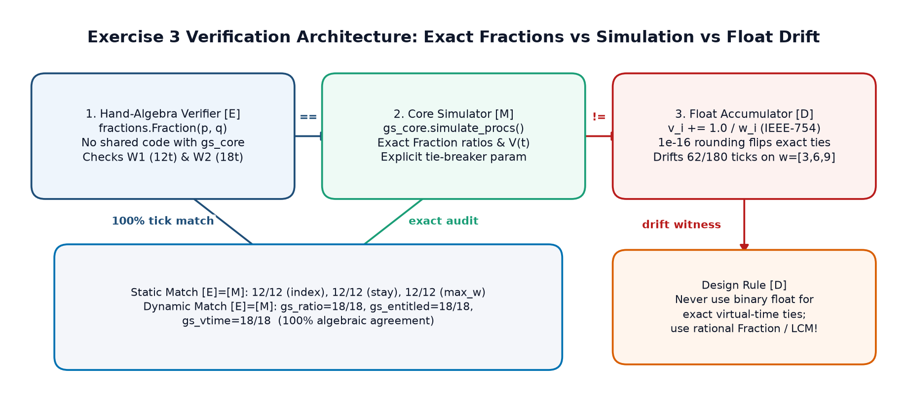
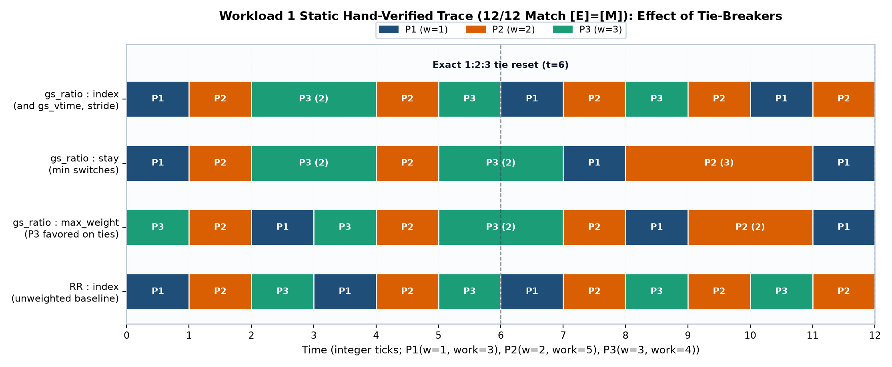
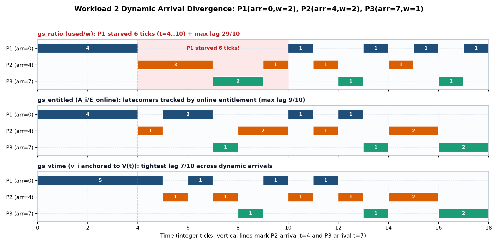
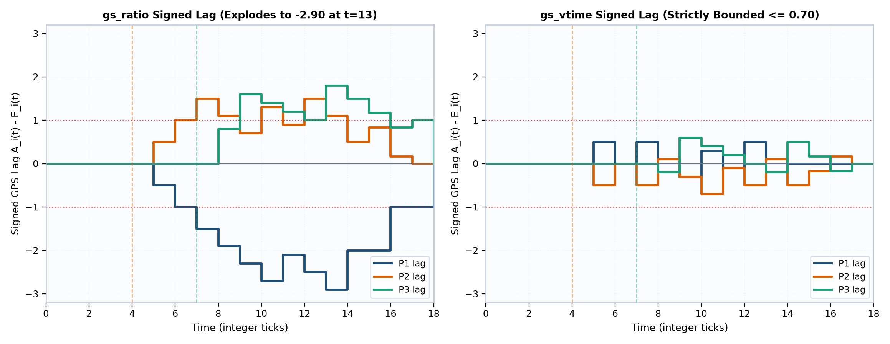
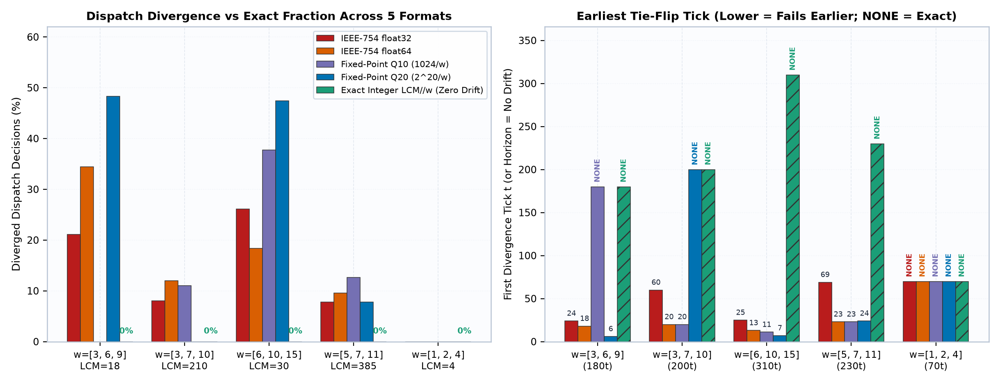

# تمرین ۳: حل دستی دقیق کسری و تطبیق گام‌به‌گام با خروجی برنامه

**ممیزی جبری مستقل با کسرهای دقیق، انشعاب تساوی‌شکن و کوانتوم، واگرایی ورود ایستا در برابر پویا، ممیزی ۶ فرمت عددی (IEEE-754 و ممیز ثابت) و تحلیل بار نامتقارن [1:3:5]**

- **مخزن:** ZaraNodehi/Guaranteed-Scheduling
- **محدوده:** تمرین ۳ — تک‌نگاشت درستی‌سنجی دستی گام‌به‌گام و دقت عددی
- **ابزارهای علمی:** جبر کسری مستقل [E] | شبیه‌ساز هسته [M] | تحلیل ۶ فرمت عددی [D]
- **داده‌ها و اشکال:** ۸ نمودار تحلیلی Okabe-Ito | داده‌های exercise-3/output/experiments.json

## فهرست مطالب

- ۱. چشم‌انداز اجرایی و اهداف درستی‌سنجی (p. 3)
- ۲. خط‌لوله درستی‌سنجی سه‌ابزاری [E]+[M]+[D] (p. 3)
- ۳. قوانین دقیق کسری و مبانی جبری زمان‌بندی (p. 4)
- ۴. ممیزی کد مستقل راستی‌آزمایی و تطابق با موتور هسته (p. 5)
- ۵. بار کاری ۱: جدول دستی کامل ۱۲ تیک (تساوی‌شکن index) [E]=[M] (p. 9)
- ۶. بار کاری ۱: هم‌ارزی ایستا و انشعاب تساوی‌شکن‌ها [E]+[M] (p. 9)
- ۷. تصویرسازی بازنشانی تساوی، پوش تاخیر و کوانتوم‌های q = 1, 2, 3 [M] (p. 11)
- ۸. بار کاری ۲: واگرایی ورود ایستا در برابر ورود پویا [E]+[M]+[D] (p. 14)
- ۹. حل دستی ۱۸ تیک کامل تحت gs_ratio (شاهد گرسنگی) [E]=[M] (p. 14)
- ۱۰. حل دستی ۱۸ تیک کامل تحت gs_entitled [E]=[M] (p. 15)
- ۱۱. حل دستی ۱۸ تیک کامل تحت gs_vtime و Stride پویا [E]=[M] (p. 16)
- ۱۲. تصویرسازی واگرایی ورود پویا و منحنی‌های تاخیر [M]+[D] (p. 18)
- ۱۳. بار کاری ۴: ممیزی ۲۴ تیکی بار نامتقارن [1:3:5] و کوانتوم‌ها [E]+[M] (p. 19)
- ۱۴. ممیزی دقت عددی [D]: مقایسه شش فرمت حسابی در پنج مجموعه وزنی (p. 24)
- ۱۵. کالبدشکافی نخستین وارونگی تساوی (t = 18): خطای یک ULP (p. 27)
- ۱۶. مهندسی زمان مجازی بدون رانش و مقیاس‌گذاری هسته لینوکس (p. 33)
- ۱۷. دستورالعمل گام‌به‌گام ممیزی دستی و واکاوی کد پایه (p. 34)
- ۱۸. راهنمای عملی، محدودیت‌ها و دروازه‌های آزمون خودکار (p. 39)
- ۱۹. پیوست مهندسی: مرجع معادلات کسری و الگوهای پیاده‌سازی بدون رانش (p. 41)


<!-- page 1 -->


<!-- page 2 -->


<!-- page 3 -->


## ۱. چشم‌انداز اجرایی و اهداف درستی‌سنجی

هرگاه شبیه‌ساز یا زمان‌بند کرنل بر تقریب ممیز شناور، تقسیم‌های ممیز ثابت توان ۲، یا قوانین نامکتوب تساوی‌شکنی تکیه کند، خطاهای عددی ریز می‌توانند بی‌سروصدا توالی اجرای پردازنده را تغییر دهند. تمرین ۳ یک ممیزی جبری کاملاً مستقل و بدون اشتراک کد با موتور اصلی بنا می‌کند که از حساب کسری دقیق fractions.Fraction پایتون بهره می‌برد و تک‌تک تیک‌های خروجی آن را با gs_core.py در چهار آزمون پیش‌رونده تطبیق می‌دهد.

- تطابق کامل ورود ایستا [E]=[M]: درستی‌سنجی هر ۱۲ تیک دسته هم‌زمان P1(0,3,1)، P2(0,5,2) و P3(0,4,3) تحت قوانین index، stay و max_weight بعلاوه کوانتوم‌های چندتیکی q=2 و q=3.
- هم‌ارزی واریانت‌های ایستا [M]: اثبات ریاضی اینکه در شروع هم‌زمان t=0 هر چهار سیاست gs_ratio، gs_vtime، gs_entitled و stride جدول اجرای دقیقاً یکسانی تولید می‌کنند.
- واگرایی ورود پویا [E]+[M]+[D]: ردیابی دستی ۱۸ تیک با ورودهای پلکانی (t=0,4,7) در چهار سیاست مختلف جهت آشکارسازی قحطی در gs_ratio و کران‌دار بودن gs_vtime و stride.
- ممیزی بار نامتقارن ۲۴ تیکی [1:3:5]: اعتبارسنجی حساب کسری در وزن‌های غیردوئی (مجموع ۹) و جاروب ۱۸ ترکیب خط‌مشی در کوانتوم‌های q=1,2,3.
- ممیزی دقت عددی ۶ فرمت [D]: مقایسه دقیق Fraction با IEEE-754 float32، IEEE-754 float64، Decimal(28 digits)، ممیز ثابت Q10/Q20 و گام صحیح دقیق LCM//w.


## ۲. خط‌لوله درستی‌سنجی سه‌ابزاری [E]+[M]+[D]

شکل ۱ حلقه راستی‌آزمایی متقابل بین جبر دستی کسری مستقل [E]، موتور قطعی هسته [M] و میز آزمون دقت چندفرمتی [D] را ترسیم می‌کند. جدول ۱ خلاصه تمام تطابق‌های تاییدشده را ثبت کرده است.



*شکل 1. خط‌لوله تطبیق متقابل بین جدول دستی کسری، شبیه‌ساز هسته و رانش ممیز شناور.*


<!-- page 4 -->

| آزمون ممیزی | نتیجه تاییدشده |
|---|---|
| تطابق بار ایستا W1 (index / stay / max_w / q2_stay) | 12/12 \| 12/12 \| 12/12 \| 12/12 |
| هم‌ارزی ایستا (gs_ratio == gs_vtime == entitled == stride) | True |
| تطابق بار پویا W2 (ratio / entitled / vtime / stride) | 18/18 \| 18/18 \| 18/18 \| 18/18 |
| تطابق بار نامتقارن W4 [1:3:5] (gs_vtime) | 24/24 تیک |
| خطای IEEE-754 float64 در چهار سه-تایی وزن | w=[3,6,9]: 62/180 \| w=[3,7,10]: 24/200 \| w=[6,10,15]: 57/310 \| w=[5,7,11]: 22/230 |
| واگرایی روش صحیح LCM//w در تمام ۴ مجموعه | 0 از 920 تیک کل (0.00% خطای رانش) |

*جدول 1. خلاصه تطابق‌های جبری دقیق و ناهماهنگی فرمت‌های عددی [E]+[M]+[D]*


## ۳. قوانین دقیق کسری و مبانی جبری زمان‌بندی


### ۳.۱ اثبات هم‌ارزی نسبت خدمت و زمان مجازی در ورود هم‌زمان

فرض کنید n فرایند در لحظه t=0 به‌طور هم‌زمان با اوزان صحیح w_1, ..., w_n وارد شوند و خدمت تجمعی A_i(t) را تا تیک t دریافت کرده باشند. در مدل سیال ایده‌آل GPS، نرخ خدمت آنی تا زمانی که مجموعه آماده R(t) غیرتهی است برابر با w_i / W(t) بوده که در آن W(t) مجموع اوزان فرایندهای آماده است.

```text
W(t) = sum_{j in R(t)} w_j       (for W1 while all 3 run: W = 1 + 2 + 3 = 6)
Fluid GPS Service:    E_i(t) = integral_0^t (w_i / W(tau)) * 1_{i in R(tau)} dtau
gs_ratio score:       S_ratio(i, t)    = A_i(t) / w_i
gs_vtime score:       S_vtime(i, t)    = V_anchor_i + sum_{slices of i} (q / w_i)
gs_entitled score:    S_entitled(i, t) = A_i(t) / E_online_i(t)
Signed Lag Bound:     L_i(t) = A_i(t) - E_i(t)  in  [-q, +q]  (static q = 1 -> [-1, +1])
```
*روابط کسری دقیق پیونددهنده امتیاز نسبت خدمت، ساعت مجازی، استحقاق برخط و مدل سیال GPS.*

قضیه (تساوی ایستا): وقتی همه ورودها هم‌زمان در a_i = 0 رخ دهند، لنگر ساعت مجازی تمام فرایندها روی V(0) = 0 مقداردهی می‌شود؛ پس در هر تیک t داریم S_vtime(i, t) = A_i(t) / w_i = S_ratio(i, t). هم‌زمان مخرج مشترک استحقاق برخط E_online_i(t) / w_i برابر با انتگرال V(t) است و ترتیب رتبه‌بندی عیناً حفظ می‌شود. به همین ترتیب Stride با گام‌های L / w_i دقیقاً همان ترتیب کسری را حفظ می‌کند.


### ۳.۲ شکست هم‌ارزی در ورود پویا و نامساوی گرسنگی

چنانچه فرایند تازه‌وارد P_k در زمان t_arr > 0 برسد در حالی که فرایندهای قدیمی خدمت A_old > 0 جمع کرده‌اند، سیاست بدون لنگر gs_ratio امتیاز مثبت A_old/w_old را در برابر صفر مطلق تازه‌وارد قرار می‌دهد و تا پر شدن شکاف (w_new / w_old) * A_old تیک (که با زمان ورود خطی رشد می‌کند)، فرایند قدیمی را محروم می‌سازد. لنگر زدن ساعت مجازی به V(t_arr) این بدهی جعلی را ریشه‌کن می‌کند.


<!-- page 5 -->


## ۴. ممیزی کد مستقل راستی‌آزمایی و تطابق با موتور هسته

برای اطمینان از اینکه جداول دستی هیچ باگ پنهانی از gs_core.py به ارث نمی‌برند، اسکریپت exercise-3/code/run_experiments.py دو پیاده‌سازی مستقل کسری (_hand_trace_static و _hand_trace_dynamic) دارد که تنها برای مقایسه نهایی تاخیر پس از انتخاب از تابع GPS می‌خوانند. در ادامه بخش‌های کلیدی این دو تابع مستقل آورده شده‌اند.


<!-- page 6 -->

```text
 32 |     gantt_rows,
 33 |     ideal_gps_trace,
 34 |     simulate_procs,
 35 | )
 36 | 
 37 | 
 38 | def _hand_trace_static(procs: List[Proc], tie: str = "index") -> List[Dict]:
 39 |     """Independent hand-derived exact Fraction trace for static simultaneous arrivals."""
 40 |     n = len(procs)
 41 |     horizon = sum(p.work for p in procs)
 42 |     gps = ideal_gps_trace(procs, horizon=horizon)
 43 |     used = [0] * n
 44 |     rem = [p.work for p in procs]
 45 |     prev = None
 46 |     rows = []
 47 |     for t in range(horizon):
 48 |         ready = [i for i in range(n) if rem[i] > 0]
 49 |         ratios = {procs[i].name: str(Fraction(used[i], procs[i].weight)) for i in ready}
 50 |         min_r = min(Fraction(used[i], procs[i].weight) for i in ready)
 51 |         tied = [procs[i].name for i in ready if Fraction(used[i], procs[i].weight) == min_r]
 52 | 
 53 |         if tie == "index":
 54 |             chosen = min(ready, key=lambda i: (Fraction(used[i], procs[i].weight), i))
 55 |         elif tie == "stay":
 56 |             chosen = min(ready, key=lambda i: (Fraction(used[i], procs[i].weight), 0 if i == prev else 1, i))
 57 |         elif tie == "max_weight":
 58 |             chosen = min(ready, key=lambda i: (Fraction(used[i], procs[i].weight), -procs[i].weight, i))
 59 |         else:
 60 |             raise ValueError(tie)
 61 | 
 62 |         used[chosen] += 1
 63 |         rem[chosen] -= 1
 64 |         lags_after = {}
 65 |         for i in range(n):
 66 |             lag_f = Fraction(used[i]) - gps["entitled"][t + 1][i]
 67 |             lags_after[procs[i].name] = {
 68 |                 "actual": used[i],
 69 |                 "entitled_frac": str(gps["entitled"][t + 1][i]),
 70 |                 "entitled_dec": round(float(gps["entitled"][t + 1][i]), 4),
 71 |                 "lag_frac": str(lag_f),
 72 |                 "lag_dec": round(float(lag_f), 4),
 73 |             }
 74 |         rows.append({
```
*کد مستقل حل دستی بارهای ایستا با کسرهای دقیق (خطوط ۳۲–۷۴ در run_experiments.py).*


<!-- page 7 -->

```text
 76 |             "ready": [procs[i].name for i in ready],
 77 |             "ratios_before": ratios,
 78 |             "tied_min": tied,
 79 |             "chosen": procs[chosen].name,
 80 |             "min_ratio_frac": str(min_r),
 81 |             "after": lags_after,
 82 |         })
 83 |         prev = chosen
 84 |     return rows
 85 | 
 86 | 
 87 | def _hand_trace_dynamic(procs: List[Proc], policy: str) -> List[Dict]:
 88 |     """Independent Fraction trace for dynamic arrivals across [gs_ratio, gs_entitled, gs_vtime]."""
 89 |     n = len(procs)
 90 |     horizon = max(p.arrival for p in procs) + sum(p.work for p in procs)
 91 |     gps = ideal_gps_trace(procs, horizon=horizon)
 92 |     used = [0] * n
 93 |     rem = [p.work for p in procs]
 94 |     entitled_on = [Fraction(0)] * n
 95 |     vtime = [Fraction(0)] * n
 96 |     sys_vtime = Fraction(0)
 97 |     entered = [False] * n
 98 |     rows = []
 99 |     # Only record ticks while work remains (0..17) plus completion state
100 |     total_work = sum(p.work for p in procs)
101 |     for t in range(horizon):
102 |         ready = [i for i in range(n) if procs[i].arrival <= t and rem[i] > 0]
103 |         if not ready:
104 |             break
105 |         for i in ready:
106 |             if not entered[i]:
107 |                 entered[i] = True
108 |                 if policy == "gs_vtime":
109 |                     vtime[i] = sys_vtime
110 |                 elif policy == "stride":
111 |                     active_other = [vtime[k] for k in range(n) if entered[k] and rem[k] > 0 and k != i]
112 |                     vtime[i] = min(active_other) if active_other else Fraction(0)
113 | 
114 |         if policy == "gs_ratio":
115 |             def score(i):
116 |                 return Fraction(used[i], procs[i].weight)
117 |         elif policy == "gs_entitled":
118 |             def score(i):
119 |                 return Fraction(0) if entitled_on[i] == 0 else Fraction(used[i]) / entitled_on[i]
120 |         elif policy == "gs_vtime":
121 |             def score(i):
122 |                 return vtime[i]
123 |         elif policy == "stride":
124 |             def score(i):
125 |                 return vtime[i]
126 |         else:
127 |             raise ValueError(policy)
128 | 
```
*کد مستقل حل دستی ورود پویا برای چهار سیاست gs_ratio، gs_entitled، gs_vtime و stride (خطوط ۷۶–۱۲۸).*


<!-- page 8 -->

```text
131 | 
132 |         tot_w = sum(procs[i].weight for i in ready)
133 |         sys_vtime += Fraction(1, tot_w)
134 |         for i in ready:
135 |             entitled_on[i] += Fraction(procs[i].weight, tot_w)
136 | 
137 |         used[chosen] += 1
138 |         rem[chosen] -= 1
139 |         vtime[chosen] += Fraction(1, procs[chosen].weight)
140 | 
141 |         after = {}
142 |         for i in range(n):
143 |             lag_f = Fraction(used[i]) - gps["entitled"][t + 1][i]
144 |             after[procs[i].name] = {
145 |                 "actual": used[i],
146 |                 "gps_frac": str(gps["entitled"][t + 1][i]),
147 |                 "lag_frac": str(lag_f),
148 |                 "lag_dec": round(float(lag_f), 4),
149 |             }
150 |         rows.append({
151 |             "t": t,
152 |             "ready": [procs[i].name for i in ready],
153 |             "scores_before": scores_before,
154 |             "chosen": procs[chosen].name,
155 |             "sys_vtime_after": str(sys_vtime),
156 |             "after": after,
157 |         })
158 |     assert len(rows) == total_work
159 |     return rows
160 | 
161 | 
162 | def _f32(x: float) -> float:
163 |     return struct.unpack("f", struct.pack("f", float(x)))[0]
164 | 
165 | 
166 | def _hand_trace_static_quantum(procs: List[Proc], quantum: int, tie: str = "index") -> List[Dict]:
167 |     """Independent hand-derived Fraction trace with multi-tick quantum q >= 1."""
168 |     n = len(procs)
169 |     horizon = sum(p.work for p in procs)
170 |     gps = ideal_gps_trace(procs, horizon=horizon)
171 |     used = [0] * n
172 |     rem = [p.work for p in procs]
173 |     prev = None
174 |     cur = None
175 |     q_left = 0
176 |     rows = []
177 |     for t in range(horizon):
```
*کد مستقل حل دستی چندکوانتومی (q >= 1) در _hand_trace_static_quantum (خطوط ۱۳۱–۱۷۷).*


<!-- page 9 -->


## ۵. بار کاری ۱: جدول دستی کامل ۱۲ تیک (تساوی‌شکن index) [E]=[M]

بار کاری ۱ شامل سه فرایند P1(arr=0, work=3, w=1)، P2(arr=0, work=5, w=2) و P3(arr=0, work=4, w=3) با مجموع ۱۲ تیک و مجموع وزن W = 6 است. جدول ۲ تمام ۱۲ تیک را با کسرهای دقیق ثبت کرده و ۱۲/۱۲ با خروجی شبیه‌ساز مطابقت دارد. دقت کنید که در تیک t=6، مقادیر مصرف‌شده برابر [1, 2, 3] و نسبت‌های هر سه دقیقاً برابر 1/1 شده و تاخیر علامت‌دار هر سه به صفر برمی‌گردد!

| t | نسبت‌های پیشین (used/w) | کمینه برابر | انتخاب | تطبیق | تاخیر پس از تیک [P1, P2, P3] |
|---|---|---|---|---|---|
| 0 | P1:0, P2:0, P3:0 | P1/P2/P3 | P1 | MATCH | P1:5/6, P2:-1/3, P3:-1/2 |
| 1 | P1:1, P2:0, P3:0 | P2/P3 | P2 | MATCH | P1:2/3, P2:1/3, P3:-1 |
| 2 | P1:1, P2:1/2, P3:0 | P3 | P3 | MATCH | P1:1/2, P2:0, P3:-1/2 |
| 3 | P1:1, P2:1/2, P3:1/3 | P3 | P3 | MATCH | P1:1/3, P2:-1/3, P3:0 |
| 4 | P1:1, P2:1/2, P3:2/3 | P2 | P2 | MATCH | P1:1/6, P2:1/3, P3:-1/2 |
| 5 | P1:1, P2:1, P3:2/3 | P3 | P3 | MATCH | P1:0, P2:0, P3:0 |
| 6 | P1:1, P2:1, P3:1 | P1/P2/P3 | P1 | MATCH | P1:5/6, P2:-1/3, P3:-1/2 |
| 7 | P1:2, P2:1, P3:1 | P2/P3 | P2 | MATCH | P1:2/3, P2:1/3, P3:-1 |
| 8 | P1:2, P2:3/2, P3:1 | P3 | P3 | MATCH | P1:1/3, P2:-1/3, P3:0 |
| 9 | P1:2, P2:3/2 | P2 | P2 | MATCH | P1:0, P2:0, P3:0 |
| 10 | P1:2, P2:2 | P1/P2 | P1 | MATCH | P1:2/3, P2:-2/3, P3:0 |
| 11 | P2:2 | P2 | P2 | MATCH | P1:0, P2:0, P3:0 |

*جدول 2. ردیابی کسری کامل ۱۲ تیک بار کاری ۱ تحت gs_ratio:index [E]=[M].*

تحلیل گام‌به‌گام نقاط عطف جدول ۲: در تیک‌های t=0..2 تمام نسبت‌ها با ترتیب P1، P2 و P3 اجرا می‌شوند. در t=3 مقدار P3 برابر 1/3 و کمتر از P2(1/2) و P1(1) است پس P3 دوباره برنده می‌شود. در t=4 و t=5 به ترتیب P2 و P3 اجرا می‌شوند تا چرخه کامل ۱:۲:۳ در t=6 با صفر خطا بسته شود. پس از اتمام P3 در تیک t=9، دو فرایند باقی‌مانده P1 و P2 با نسبت 1/3 و 2/3 تا t=12 پیش می‌روند.


## ۶. بار کاری ۱: هم‌ارزی ایستا و انشعاب تساوی‌شکن‌ها [E]+[M]

جدول ۳ نشان می‌دهد all_static_equiv = True است: هر چهار سیاست gs_ratio، gs_vtime، gs_entitled و stride بیشینه تاخیر 1، RMSE برابر 0.4547 و 11 تعویض زمینه دارند. جستجوی جامع روی کل درخت تساوی‌شکنی (جدول ۴) ثابت می‌کند بیشینه تاخیر همواره ثابت (1) می‌ماند در حالی که تعویض زمینه از 12 تا 8 قابل کاهش است.

| سیاست : تساوی‌شکن | بیشینه تاخیر | RMSE | تعویض | پیش‌گیری | میانگین TA | جین |
|---|---|---|---|---|---|---|
| gs_ratio:index | 1.0000 (1) | 0.4547 | 11 | 8 | 10.67 | 1.0000 |
| gs_vtime:index | 1.0000 (1) | 0.4547 | 11 | 8 | 10.67 | 1.0000 |
| gs_entitled:index | 1.0000 (1) | 0.4547 | 11 | 8 | 10.67 | 1.0000 |
| stride:index | 1.0000 (1) | 0.4547 | 11 | 8 | 10.67 | 1.0000 |
| gs_ratio:stay | 1.0000 (1) | 0.3889 | 8 | 5 | 10.00 | 1.0000 |
| gs_ratio:max_weight | 0.5000 (1/2) | 0.2778 | 10 | 7 | 10.00 | 1.0000 |
| rr:index | 2.0000 (2) | 0.9146 | 12 | 9 | 10.00 | 1.0000 |

*جدول 3. مقایسه واریانت‌های ایستا، تساوی‌شکن‌ها و Round Robin روی بار کاری ۱ [M].*


<!-- page 10 -->

| شاخص پوش جامع تساوی‌شکنی [E] | مقدار دقیق |
|---|---|
| حالت‌ها / برگ‌های پیمایش‌شده | 304 حالت / 72 برگ (truncated=False) |
| بازه بیشینه تاخیر [کمینه، بیشینه] | [0.5000, 1.0000] (کسر 1) |
| بازه تعویض زمینه [کمینه، بیشینه] | [8, 12] |

*جدول 4. کران‌های دقیق پوش تساوی‌شکنی بار کاری ۱ با وارسی جامع [E]*

جداول ۵ و ۶ نیز اجرای کامل ۱۲ تیک تحت قوانین stay و max_weight را با تطابق ۱۲/۱۲ نمایش می‌دهند. در stay حفظ فرایند جاری P3 در t=6 موجب اتمام زودهنگام P3 در t=7 و حذف ۳ تعویض زمینه می‌شود، و در max_weight نیز P3 در اولویت تساوی t=0 و t=6 قرار گرفته و میانگین زمان پاسخ وزنی را کمینه می‌کند.

| t | نسبت‌های پیشین | کمینه برابر | انتخاب (stay) | تطبیق | تاخیر پس از تیک |
|---|---|---|---|---|---|
| 0 | P1:0, P2:0, P3:0 | P1/P2/P3 | P1 | MATCH | P1:5/6, P2:-1/3, P3:-1/2 |
| 1 | P1:1, P2:0, P3:0 | P2/P3 | P2 | MATCH | P1:2/3, P2:1/3, P3:-1 |
| 2 | P1:1, P2:1/2, P3:0 | P3 | P3 | MATCH | P1:1/2, P2:0, P3:-1/2 |
| 3 | P1:1, P2:1/2, P3:1/3 | P3 | P3 | MATCH | P1:1/3, P2:-1/3, P3:0 |
| 4 | P1:1, P2:1/2, P3:2/3 | P2 | P2 | MATCH | P1:1/6, P2:1/3, P3:-1/2 |
| 5 | P1:1, P2:1, P3:2/3 | P3 | P3 | MATCH | P1:0, P2:0, P3:0 |
| 6 | P1:1, P2:1, P3:1 | P1/P2/P3 | P3 | MATCH | P1:-1/6, P2:-1/3, P3:1/2 |
| 7 | P1:1, P2:1 | P1/P2 | P1 | MATCH | P1:2/3, P2:-2/3, P3:0 |
| 8 | P1:2, P2:1 | P2 | P2 | MATCH | P1:1/3, P2:-1/3, P3:0 |
| 9 | P1:2, P2:3/2 | P2 | P2 | MATCH | P1:0, P2:0, P3:0 |
| 10 | P1:2, P2:2 | P1/P2 | P2 | MATCH | P1:-1/3, P2:1/3, P3:0 |
| 11 | P1:2 | P1 | P1 | MATCH | P1:0, P2:0, P3:0 |

*جدول 5. جدول دستی کامل ۱۲ تیک برای gs_ratio:stay (انطباق ۱۲/۱۲) [E]=[M].*

| t | نسبت‌های پیشین | کمینه برابر | انتخاب (max_w) | تطبیق | تاخیر پس از تیک |
|---|---|---|---|---|---|
| 0 | P1:0, P2:0, P3:0 | P1/P2/P3 | P3 | MATCH | P1:-1/6, P2:-1/3, P3:1/2 |
| 1 | P1:0, P2:0, P3:1/3 | P1/P2 | P2 | MATCH | P1:-1/3, P2:1/3, P3:0 |
| 2 | P1:0, P2:1/2, P3:1/3 | P1 | P1 | MATCH | P1:1/2, P2:0, P3:-1/2 |
| 3 | P1:1, P2:1/2, P3:1/3 | P3 | P3 | MATCH | P1:1/3, P2:-1/3, P3:0 |
| 4 | P1:1, P2:1/2, P3:2/3 | P2 | P2 | MATCH | P1:1/6, P2:1/3, P3:-1/2 |
| 5 | P1:1, P2:1, P3:2/3 | P3 | P3 | MATCH | P1:0, P2:0, P3:0 |
| 6 | P1:1, P2:1, P3:1 | P1/P2/P3 | P3 | MATCH | P1:-1/6, P2:-1/3, P3:1/2 |
| 7 | P1:1, P2:1 | P1/P2 | P2 | MATCH | P1:-1/3, P2:1/3, P3:0 |
| 8 | P1:1, P2:3/2 | P1 | P1 | MATCH | P1:1/3, P2:-1/3, P3:0 |
| 9 | P1:2, P2:3/2 | P2 | P2 | MATCH | P1:0, P2:0, P3:0 |
| 10 | P1:2, P2:2 | P1/P2 | P2 | MATCH | P1:-1/3, P2:1/3, P3:0 |
| 11 | P1:2 | P1 | P1 | MATCH | P1:0, P2:0, P3:0 |

*جدول 6. جدول دستی کامل ۱۲ تیک برای gs_ratio:max_weight (انطباق ۱۲/۱۲) [E]=[M].*


<!-- page 11 -->


## ۷. تصویرسازی بازنشانی تساوی، پوش تاخیر و کوانتوم‌های q = 1, 2, 3 [M]

شکل ۲ چهار جدول زمانی ۱۲ تیکی را مقایسه کرده و مرز بازنشانی دقیق t=6 را مشخص می‌سازد. شکل ۳ نیز تایید می‌کند که تاخیر علامت‌دار در کل افق اکیداً درون بازه بسته [-1, +1] قرار دارد.



*شکل 2. مقایسه نمودار گانت بار کاری ۱ تحت تساوی‌شکن‌های مختلف و Round Robin.*

![شکل 3: خدمت تجمعی واقعی در برابر GPS ایده‌آل (بالا) و تاخیر علامت‌دار درون [-1, +1] (پایین).](diagrams/fig_ex3_static_lag_fractions.png)

*شکل 3. خدمت تجمعی واقعی در برابر GPS ایده‌آل (بالا) و تاخیر علامت‌دار درون [-1, +1] (پایین).*


### ۷.۱ حل دستی کسری چندکوانتومی (q = 2 و q = 3)

افزایش کوانتوم q از ۱ به ۲ و ۳ تعویض زمینه را در ازای پذیرش تاخیر بیشتر کاهش می‌دهد (جدول ۷). جداول ۸، ۹ و ۱۰ تمام ۱۲ تیک اجرا در حالت‌های q=2:stay، q=2:index و q=3:stay را با دست محاسبه و با شبیه‌ساز ۱۲/۱۲ تطبیق داده‌اند. جهش به q=2 نقطه بهینه پارتو بوده و تعویض را از ۸ به ۵ کاهش می‌دهد.


<!-- page 12 -->

| کوانتوم : تساوی‌شکن | بیشینه تاخیر | RMSE | تعویض | پیش‌گیری | میانگین TA | جین |
|---|---|---|---|---|---|---|
| q=1 : index | 1.0000 (1) | 0.4547 | 11 | 8 | 10.67 | 1.0000 |
| q=1 : stay | 1.0000 (1) | 0.3889 | 8 | 5 | 10.00 | 1.0000 |
| q=2 : index | 2.0000 (2) | 0.8296 | 6 | 3 | 10.33 | 1.0000 |
| q=2 : stay | 2.0000 (2) | 0.8184 | 5 | 2 | 10.33 | 1.0000 |
| q=3 : index | 3.0000 (3) | 1.4153 | 4 | 1 | 8.33 | 1.0000 |
| q=3 : stay | 3.0000 (3) | 1.4153 | 4 | 1 | 8.33 | 1.0000 |

*جدول 7. جاروب حساسیت کوانتوم روی بار کاری ۱ برای q = 1, 2, 3 [M].*

| t | رویداد کوانتوم | نسبت‌های پیشین | انتخاب (q=2 stay) | تاخیر پس از تیک [P1, P2, P3] |
|---|---|---|---|---|
| 0 | DISPATCH (rem_q=1) | P1:0, P2:0, P3:0 | P1 (OK) | P1:5/6, P2:-1/3, P3:-1/2 |
| 1 | CONT_Q (rem_q=0) | P1:1, P2:0, P3:0 | P1 (OK) | P1:5/3, P2:-2/3, P3:-1 |
| 2 | DISPATCH (rem_q=1) | P1:2, P2:0, P3:0 | P2 (OK) | P1:3/2, P2:0, P3:-3/2 |
| 3 | CONT_Q (rem_q=0) | P1:2, P2:1/2, P3:0 | P2 (OK) | P1:4/3, P2:2/3, P3:-2 |
| 4 | DISPATCH (rem_q=1) | P1:2, P2:1, P3:0 | P3 (OK) | P1:7/6, P2:1/3, P3:-3/2 |
| 5 | CONT_Q (rem_q=0) | P1:2, P2:1, P3:1/3 | P3 (OK) | P1:1, P2:0, P3:-1 |
| 6 | DISPATCH (rem_q=1) | P1:2, P2:1, P3:2/3 | P3 (OK) | P1:5/6, P2:-1/3, P3:-1/2 |
| 7 | CONT_Q (rem_q=0) | P1:2, P2:1, P3:1 | P3 (OK) | P1:2/3, P2:-2/3, P3:0 |
| 8 | DISPATCH (rem_q=1) | P1:2, P2:1 | P2 (OK) | P1:1/3, P2:-1/3, P3:0 |
| 9 | CONT_Q (rem_q=0) | P1:2, P2:3/2 | P2 (OK) | P1:0, P2:0, P3:0 |
| 10 | DISPATCH (rem_q=1) | P1:2, P2:2 | P2 (OK) | P1:-1/3, P2:1/3, P3:0 |
| 11 | DISPATCH (rem_q=1) | P1:2 | P1 (OK) | P1:0, P2:0, P3:0 |

*جدول 8. ردیابی دستی کامل ۱۲ تیک برای gs_ratio:stay با کوانتوم q=2 (انطباق ۱۲/۱۲) [E]=[M].*


<!-- page 13 -->

| t | رویداد کوانتوم | نسبت‌های پیشین | انتخاب (q=2 index) | تاخیر پس از تیک [P1, P2, P3] |
|---|---|---|---|---|
| 0 | DISPATCH (rem=1) | P1:0, P2:0, P3:0 | P1 (OK) | P1:5/6, P2:-1/3, P3:-1/2 |
| 1 | CONT_Q (rem=0) | P1:1, P2:0, P3:0 | P1 (OK) | P1:5/3, P2:-2/3, P3:-1 |
| 2 | DISPATCH (rem=1) | P1:2, P2:0, P3:0 | P2 (OK) | P1:3/2, P2:0, P3:-3/2 |
| 3 | CONT_Q (rem=0) | P1:2, P2:1/2, P3:0 | P2 (OK) | P1:4/3, P2:2/3, P3:-2 |
| 4 | DISPATCH (rem=1) | P1:2, P2:1, P3:0 | P3 (OK) | P1:7/6, P2:1/3, P3:-3/2 |
| 5 | CONT_Q (rem=0) | P1:2, P2:1, P3:1/3 | P3 (OK) | P1:1, P2:0, P3:-1 |
| 6 | DISPATCH (rem=1) | P1:2, P2:1, P3:2/3 | P3 (OK) | P1:5/6, P2:-1/3, P3:-1/2 |
| 7 | CONT_Q (rem=0) | P1:2, P2:1, P3:1 | P3 (OK) | P1:2/3, P2:-2/3, P3:0 |
| 8 | DISPATCH (rem=1) | P1:2, P2:1 | P2 (OK) | P1:1/3, P2:-1/3, P3:0 |
| 9 | CONT_Q (rem=0) | P1:2, P2:3/2 | P2 (OK) | P1:0, P2:0, P3:0 |
| 10 | DISPATCH (rem=1) | P1:2, P2:2 | P1 (OK) | P1:2/3, P2:-2/3, P3:0 |
| 11 | DISPATCH (rem=1) | P2:2 | P2 (OK) | P1:0, P2:0, P3:0 |

*جدول 9. ردیابی دستی کامل ۱۲ تیک برای gs_ratio:index با کوانتوم q=2 (انطباق ۱۲/۱۲) [E]=[M].*

| t | رویداد کوانتوم | نسبت‌های پیشین | انتخاب (q=3 stay) | تاخیر پس از تیک [P1, P2, P3] |
|---|---|---|---|---|
| 0 | DISPATCH (rem=2) | P1:0, P2:0, P3:0 | P1 (OK) | P1:5/6, P2:-1/3, P3:-1/2 |
| 1 | CONT_Q (rem=1) | P1:1, P2:0, P3:0 | P1 (OK) | P1:5/3, P2:-2/3, P3:-1 |
| 2 | CONT_Q (rem=0) | P1:2, P2:0, P3:0 | P1 (OK) | P1:5/2, P2:-1, P3:-3/2 |
| 3 | DISPATCH (rem=2) | P2:0, P3:0 | P2 (OK) | P1:7/3, P2:-1/3, P3:-2 |
| 4 | CONT_Q (rem=1) | P2:1/2, P3:0 | P2 (OK) | P1:13/6, P2:1/3, P3:-5/2 |
| 5 | CONT_Q (rem=0) | P2:1, P3:0 | P2 (OK) | P1:2, P2:1, P3:-3 |
| 6 | DISPATCH (rem=2) | P2:3/2, P3:0 | P3 (OK) | P1:11/6, P2:2/3, P3:-5/2 |
| 7 | CONT_Q (rem=1) | P2:3/2, P3:1/3 | P3 (OK) | P1:5/3, P2:1/3, P3:-2 |
| 8 | CONT_Q (rem=0) | P2:3/2, P3:2/3 | P3 (OK) | P1:4/3, P2:-1/3, P3:-1 |
| 9 | DISPATCH (rem=2) | P2:3/2, P3:1 | P3 (OK) | P1:1, P2:-1, P3:0 |
| 10 | DISPATCH (rem=2) | P2:3/2 | P2 (OK) | P1:2/3, P2:-2/3, P3:0 |
| 11 | CONT_Q (rem=1) | P2:2 | P2 (OK) | P1:0, P2:0, P3:0 |

*جدول 10. ردیابی دستی کامل ۱۲ تیک برای gs_ratio:stay با کوانتوم q=3 (انطباق ۱۲/۱۲) [E]=[M].*


<!-- page 14 -->


## ۸. بار کاری ۲: واگرایی ورود ایستا در برابر ورود پویا [E]+[M]+[D]

در بار کاری ۲ فرایندها در زمان‌های متفاوت آزاد می‌شوند: P1(arr=0, work=8, w=2)، P2(arr=4, work=6, w=2) و P3(arr=7, work=4, w=1) با جمع کل ۱۸ تیک. جدول ۱۱ نشان می‌دهد سیاست‌هایی که در بار ۱ کاملاً هم‌ارز بودند در اینجا از یکدیگر جدا می‌شوند.

| سیاست | بیشینه تاخیر (کسر) | RMSE | بیشترین وقفه | تعویض | میانگین TA | جین |
|---|---|---|---|---|---|---|
| gs_ratio | 2.9000 (29/10) | 1.0135 | 6 | 12 | 13.00 | 1.0000 |
| gs_entitled | 0.9000 (9/10) | 0.2575 | 5 | 11 | 12.00 | 1.0000 |
| gs_vtime | 0.7000 (7/10) | 0.2182 | 4 | 12 | 11.67 | 1.0000 |
| stride | 0.7000 (7/10) | 0.2182 | 4 | 12 | 11.67 | 1.0000 |
| rr | 1.1667 (7/6) | 0.3995 | 2 | 15 | 12.67 | 1.0000 |

*جدول 11. مقایسه معیارهای ورود پویا در بار کاری ۲ [M].*

- فروپاشی gs_ratio (GuaranteedScheduling.py): بیشینه تاخیر به 2.9000 (29/10) می‌رسد و P1 برای 6 تیک پیاپی (t = 4..10) متوقف می‌ماند.
- بازیابی در gs_entitled: تقسیم بر استحقاق برخط تاخیر را بیش از ۳ برابر کاهش داده و به 0.9000 (9/10) می‌رساند.
- دقت برتر gs_vtime و stride: لنگر انداختن به V(t) در gs_vtime تاخیر را به 0.7000 (7/10) و در stride به 0.7000 (7/10) محدود می‌کند.


## ۹. حل دستی ۱۸ تیک کامل تحت gs_ratio (شاهد گرسنگی) [E]=[M]

جدول ۱۲ تمام ۱۸ تیک اجرای gs_ratio را با دست ردیابی می‌کند (انطباق ۱۸/۱۸). در t=4 نسبت P1 برابر 4/2 = 2 و نسبت تازه‌وارد P2 برابر 0/2 = 0 است که منجر به توقف کامل P1 در تیک‌های 4..6 می‌شود؛ سپس ورود P3 در t=7 با نسبت 0/1 این قحطی را تا t=10 تمدید می‌کند.


<!-- page 15 -->

| t | امتیاز پیش از تیک | انتخاب | P1: A/E (تاخیر) | P2: A/E (تاخیر) | P3: A/E (تاخیر) |
|---|---|---|---|---|---|
| 0 | P1:0 | P1 (OK) | 1/1 (0) | 0/0 (0) | 0/0 (0) |
| 1 | P1:1/2 | P1 (OK) | 2/2 (0) | 0/0 (0) | 0/0 (0) |
| 2 | P1:1 | P1 (OK) | 3/3 (0) | 0/0 (0) | 0/0 (0) |
| 3 | P1:3/2 | P1 (OK) | 4/4 (0) | 0/0 (0) | 0/0 (0) |
| 4 | P1:2, P2:0 | P2 (OK) | 4/9/2 (-1/2) | 1/1/2 (1/2) | 0/0 (0) |
| 5 | P1:2, P2:1/2 | P2 (OK) | 4/5 (-1) | 2/1 (1) | 0/0 (0) |
| 6 | P1:2, P2:1 | P2 (OK) | 4/11/2 (-3/2) | 3/3/2 (3/2) | 0/0 (0) |
| 7 | P1:2, P2:3/2, P3:0 | P3 (OK) | 4/59/10 (-19/10) | 3/19/10 (11/10) | 1/1/5 (4/5) |
| 8 | P1:2, P2:3/2, P3:1 | P3 (OK) | 4/63/10 (-23/10) | 3/23/10 (7/10) | 2/2/5 (8/5) |
| 9 | P1:2, P2:3/2, P3:2 | P2 (OK) | 4/67/10 (-27/10) | 4/27/10 (13/10) | 2/3/5 (7/5) |
| 10 | P1:2, P2:2, P3:2 | P1 (OK) | 5/71/10 (-21/10) | 4/31/10 (9/10) | 2/4/5 (6/5) |
| 11 | P1:5/2, P2:2, P3:2 | P2 (OK) | 5/15/2 (-5/2) | 5/7/2 (3/2) | 2/1 (1) |
| 12 | P1:5/2, P2:5/2, P3:2 | P3 (OK) | 5/79/10 (-29/10) | 5/39/10 (11/10) | 3/6/5 (9/5) |
| 13 | P1:5/2, P2:5/2, P3:3 | P1 (OK) | 6/8 (-2) | 5/9/2 (1/2) | 3/3/2 (3/2) |
| 14 | P1:3, P2:5/2, P3:3 | P2 (OK) | 6/8 (-2) | 6/31/6 (5/6) | 3/11/6 (7/6) |
| 15 | P1:3, P3:3 | P1 (OK) | 7/8 (-1) | 6/35/6 (1/6) | 3/13/6 (5/6) |
| 16 | P1:7/2, P3:3 | P3 (OK) | 7/8 (-1) | 6/6 (0) | 4/3 (1) |
| 17 | P1:7/2 | P1 (OK) | 8/8 (0) | 6/6 (0) | 4/4 (0) |

*جدول 12. ردیابی دستی ۱۸ تیک کامل برای gs_ratio در بار کاری ۲ (انطباق ۱۸/۱۸) [E]=[M].*


## ۱۰. حل دستی ۱۸ تیک کامل تحت gs_entitled [E]=[M]

در gs_entitled (جدول ۱۳، انطباق ۱۸/۱۸)، تازه‌وارد P2 پس از اجرای یک تیک در t=4..5 امتیاز 1 / (1/2) = 2 می‌گیرد که از امتیاز P1 برابر 4 / (9/2) = 8/9 بزرگ‌تر است؛ در نتیجه CPU در تیک t=5 فوراً به P1 برمی‌گردد و تاخیر در بازه [-9/10, +9/10] مهار می‌شود.


<!-- page 16 -->

| t | امتیاز پیش از تیک | انتخاب | P1: A/E (تاخیر) | P2: A/E (تاخیر) | P3: A/E (تاخیر) |
|---|---|---|---|---|---|
| 0 | P1:0 | P1 (OK) | 1/1 (0) | 0/0 (0) | 0/0 (0) |
| 1 | P1:1 | P1 (OK) | 2/2 (0) | 0/0 (0) | 0/0 (0) |
| 2 | P1:1 | P1 (OK) | 3/3 (0) | 0/0 (0) | 0/0 (0) |
| 3 | P1:1 | P1 (OK) | 4/4 (0) | 0/0 (0) | 0/0 (0) |
| 4 | P1:1, P2:0 | P2 (OK) | 4/9/2 (-1/2) | 1/1/2 (1/2) | 0/0 (0) |
| 5 | P1:8/9, P2:2 | P1 (OK) | 5/5 (0) | 1/1 (0) | 0/0 (0) |
| 6 | P1:1, P2:1 | P1 (OK) | 6/11/2 (1/2) | 1/3/2 (-1/2) | 0/0 (0) |
| 7 | P1:12/11, P2:2/3, P3:0 | P3 (OK) | 6/59/10 (1/10) | 1/19/10 (-9/10) | 1/1/5 (4/5) |
| 8 | P1:60/59, P2:10/19, P3:5 | P2 (OK) | 6/63/10 (-3/10) | 2/23/10 (-3/10) | 1/2/5 (3/5) |
| 9 | P1:20/21, P2:20/23, P3:5/2 | P2 (OK) | 6/67/10 (-7/10) | 3/27/10 (3/10) | 1/3/5 (2/5) |
| 10 | P1:60/67, P2:10/9, P3:5/3 | P1 (OK) | 7/71/10 (-1/10) | 3/31/10 (-1/10) | 1/4/5 (1/5) |
| 11 | P1:70/71, P2:30/31, P3:5/4 | P2 (OK) | 7/15/2 (-1/2) | 4/7/2 (1/2) | 1/1 (0) |
| 12 | P1:14/15, P2:8/7, P3:1 | P1 (OK) | 8/79/10 (1/10) | 4/39/10 (1/10) | 1/6/5 (-1/5) |
| 13 | P2:40/39, P3:5/6 | P3 (OK) | 8/8 (0) | 4/9/2 (-1/2) | 2/3/2 (1/2) |
| 14 | P2:120/137, P3:30/23 | P2 (OK) | 8/8 (0) | 5/31/6 (-1/6) | 2/11/6 (1/6) |
| 15 | P2:150/157, P3:15/14 | P2 (OK) | 8/8 (0) | 6/35/6 (1/6) | 2/13/6 (-1/6) |
| 16 | P3:10/11 | P3 (OK) | 8/8 (0) | 6/6 (0) | 3/3 (0) |
| 17 | P3:15/16 | P3 (OK) | 8/8 (0) | 6/6 (0) | 4/4 (0) |

*جدول 13. ردیابی دستی ۱۸ تیک کامل برای gs_entitled در بار کاری ۲ (انطباق ۱۸/۱۸) [E]=[M].*


## ۱۱. حل دستی ۱۸ تیک کامل تحت gs_vtime و Stride پویا [E]=[M]

در gs_vtime (جدول ۱۴، انطباق ۱۸/۱۸)، ورود P2 در t=4 ساعت مجازی آن را روی V(4)=2 تنظیم می‌کند که دقیقاً با v_P1=2 برابر است. جدول ۱۵ نیز نشان می‌دهد Stride پویا (انطباق ۱۸/۱۸) تازه‌وارد را روی کمینه گذر فرایندهای فعال لنگر می‌اندازد و با وجود اختلاف جزیی 1/4 در t=7 نسبت به V(7)=11/4، همچنان تاخیر زیر یک تیک (9/10) را تضمین می‌کند.


<!-- page 17 -->

| t | امتیاز پیش از تیک | انتخاب | P1: A/E (تاخیر) | P2: A/E (تاخیر) | P3: A/E (تاخیر) |
|---|---|---|---|---|---|
| 0 | P1:0 | P1 (OK) | 1/1 (0) | 0/0 (0) | 0/0 (0) |
| 1 | P1:1/2 | P1 (OK) | 2/2 (0) | 0/0 (0) | 0/0 (0) |
| 2 | P1:1 | P1 (OK) | 3/3 (0) | 0/0 (0) | 0/0 (0) |
| 3 | P1:3/2 | P1 (OK) | 4/4 (0) | 0/0 (0) | 0/0 (0) |
| 4 | P1:2, P2:2 | P1 (OK) | 5/9/2 (1/2) | 0/1/2 (-1/2) | 0/0 (0) |
| 5 | P1:5/2, P2:2 | P2 (OK) | 5/5 (0) | 1/1 (0) | 0/0 (0) |
| 6 | P1:5/2, P2:5/2 | P1 (OK) | 6/11/2 (1/2) | 1/3/2 (-1/2) | 0/0 (0) |
| 7 | P1:3, P2:5/2, P3:11/4 | P2 (OK) | 6/59/10 (1/10) | 2/19/10 (1/10) | 0/1/5 (-1/5) |
| 8 | P1:3, P2:3, P3:11/4 | P3 (OK) | 6/63/10 (-3/10) | 2/23/10 (-3/10) | 1/2/5 (3/5) |
| 9 | P1:3, P2:3, P3:15/4 | P1 (OK) | 7/67/10 (3/10) | 2/27/10 (-7/10) | 1/3/5 (2/5) |
| 10 | P1:7/2, P2:3, P3:15/4 | P2 (OK) | 7/71/10 (-1/10) | 3/31/10 (-1/10) | 1/4/5 (1/5) |
| 11 | P1:7/2, P2:7/2, P3:15/4 | P1 (OK) | 8/15/2 (1/2) | 3/7/2 (-1/2) | 1/1 (0) |
| 12 | P2:7/2, P3:15/4 | P2 (OK) | 8/79/10 (1/10) | 4/39/10 (1/10) | 1/6/5 (-1/5) |
| 13 | P2:4, P3:15/4 | P3 (OK) | 8/8 (0) | 4/9/2 (-1/2) | 2/3/2 (1/2) |
| 14 | P2:4, P3:19/4 | P2 (OK) | 8/8 (0) | 5/31/6 (-1/6) | 2/11/6 (1/6) |
| 15 | P2:9/2, P3:19/4 | P2 (OK) | 8/8 (0) | 6/35/6 (1/6) | 2/13/6 (-1/6) |
| 16 | P3:19/4 | P3 (OK) | 8/8 (0) | 6/6 (0) | 3/3 (0) |
| 17 | P3:23/4 | P3 (OK) | 8/8 (0) | 6/6 (0) | 4/4 (0) |

*جدول 14. ردیابی دستی ۱۸ تیک کامل برای gs_vtime در بار کاری ۲ (انطباق ۱۸/۱۸) [E]=[M].*


<!-- page 18 -->

| t | گذر پیش از تیک (Stride) | انتخاب | P1: A/E (تاخیر) | P2: A/E (تاخیر) | P3: A/E (تاخیر) |
|---|---|---|---|---|---|
| 0 | P1:0 | P1 (OK) | 1/1 (0) | 0/0 (0) | 0/0 (0) |
| 1 | P1:1/2 | P1 (OK) | 2/2 (0) | 0/0 (0) | 0/0 (0) |
| 2 | P1:1 | P1 (OK) | 3/3 (0) | 0/0 (0) | 0/0 (0) |
| 3 | P1:3/2 | P1 (OK) | 4/4 (0) | 0/0 (0) | 0/0 (0) |
| 4 | P1:2, P2:2 | P1 (OK) | 5/9/2 (1/2) | 0/1/2 (-1/2) | 0/0 (0) |
| 5 | P1:5/2, P2:2 | P2 (OK) | 5/5 (0) | 1/1 (0) | 0/0 (0) |
| 6 | P1:5/2, P2:5/2 | P1 (OK) | 6/11/2 (1/2) | 1/3/2 (-1/2) | 0/0 (0) |
| 7 | P1:3, P2:5/2, P3:5/2 | P2 (OK) | 6/59/10 (1/10) | 2/19/10 (1/10) | 0/1/5 (-1/5) |
| 8 | P1:3, P2:3, P3:5/2 | P3 (OK) | 6/63/10 (-3/10) | 2/23/10 (-3/10) | 1/2/5 (3/5) |
| 9 | P1:3, P2:3, P3:7/2 | P1 (OK) | 7/67/10 (3/10) | 2/27/10 (-7/10) | 1/3/5 (2/5) |
| 10 | P1:7/2, P2:3, P3:7/2 | P2 (OK) | 7/71/10 (-1/10) | 3/31/10 (-1/10) | 1/4/5 (1/5) |
| 11 | P1:7/2, P2:7/2, P3:7/2 | P1 (OK) | 8/15/2 (1/2) | 3/7/2 (-1/2) | 1/1 (0) |
| 12 | P2:7/2, P3:7/2 | P2 (OK) | 8/79/10 (1/10) | 4/39/10 (1/10) | 1/6/5 (-1/5) |
| 13 | P2:4, P3:7/2 | P3 (OK) | 8/8 (0) | 4/9/2 (-1/2) | 2/3/2 (1/2) |
| 14 | P2:4, P3:9/2 | P2 (OK) | 8/8 (0) | 5/31/6 (-1/6) | 2/11/6 (1/6) |
| 15 | P2:9/2, P3:9/2 | P2 (OK) | 8/8 (0) | 6/35/6 (1/6) | 2/13/6 (-1/6) |
| 16 | P3:9/2 | P3 (OK) | 8/8 (0) | 6/6 (0) | 3/3 (0) |
| 17 | P3:11/2 | P3 (OK) | 8/8 (0) | 6/6 (0) | 4/4 (0) |

*جدول 15. ردیابی دستی ۱۸ تیک کامل برای Stride پویا در بار کاری ۲ (انطباق ۱۸/۱۸) [E]=[M].*


### ۱۱.۱ کالبدشکافی شکاف یک‌چهارم بین V(t) و Stride در ورودهای پلکانی

مقایسه دقیق جداول ۱۴ و ۱۵ نشان می‌دهد که تا پیش از تیک ۷، Stride و gs_vtime هر دو کاملاً همگام عمل می‌کنند؛ زیرا در t=4 فقط P1 فعال بوده و min(active_pass) دقیقاً برابر با V(4)=2 است. اما در لحظه ورود P3 در t=7 دو فرایند P1 و P2 با ساعت‌های متفاوت 5/2 و 3 فعال‌اند: سیستم Stride برای سادگی پیاده‌سازی به جای محاسبه انتگرال سیال V(7) = 11/4، کمینه گذر فعال یعنی 5/2 = 10/4 را برمی‌گزیند که ۱/۴ تیک به تازه‌وارد جلوتر می‌اندازد. با وجود این تخفیف کوچک، سقف تاخیر Stride در W2 تنها 9/10 و در W4 تنها 29/36 بوده که همچنان زیر یک کوانتوم باقی می‌ماند.


## ۱۲. تصویرسازی واگرایی ورود پویا و منحنی‌های تاخیر [M]+[D]

شکل ۴ نمودار گانت ۱۸ تیکی سه سیاست را مقایسه کرده و قحطی ۶ تیکی P1 را در gs_ratio نمایش می‌دهد. شکل ۵ نیز افت تاخیر به -2.90 در t=13 تحت gs_ratio را در برابر پایداری کامل gs_vtime (حداکثر 0.70) به تصویر می‌کشد.


<!-- page 19 -->



*شکل 4. مقایسه گانت ورود پویا: گرسنگی ۶ تیکی P1 در gs_ratio در برابر تسهیم فوری gs_entitled و gs_vtime.*



*شکل 5. روند تاخیر علامت‌دار در بار کاری ۲: انفجار به -2.90 در gs_ratio در برابر کران 0.70 در gs_vtime.*

> **اثر مستقیم بدهی ورودی بر زمان پاسخ فرایندهای قدیمی.** اعتبار جعلی تازه‌وارد باعث می‌شود اتمام P1 از t=12 در gs_vtime به t=18 در gs_ratio برود که معادل افزایش ۵۰ درصدی زمان چرخش فرایند اول است.


## ۱۳. بار کاری ۴: ممیزی ۲۴ تیکی بار نامتقارن [1:3:5] و کوانتوم‌ها [E]+[M]

برای آزمودن استحکام جبر کسری روی اوزان فرد غیرتوان‌دویی، بار کاری ۴ سه فرایند P1(0,7,1)، P2(2,9,3) و P3(5,8,5) را در طول ۲۴ تیک اجرا می‌کند (مجموع وزن فعال W = 9). جداول ۱۶ تا ۲۳ کل ۲۴ تیک اجرای چهار سیاست gs_vtime، gs_ratio، gs_entitled و stride را به صورت ۲ بخش ۱۲ تیکی با تطابق ۲۴/۲۴ ثبت کرده‌اند. در حالی که gs_ratio فرایند P1 را ۱۴ تیک متوالی از t=2 تا t=16 محروم می‌کند (تاخیر -23/9)، هر سه سیاست لنگرزده تاخیر را زیر ۱ تیک حفظ می‌کنند.


<!-- page 20 -->

| t | ساعت مجازی پیش از تیک | انتخاب | V(t) پس از تیک | تاخیرهای [P1, P2, P3] |
|---|---|---|---|---|
| 0 | P1:0 | P1 (OK) | 1 | P1:0, P2:0, P3:0 |
| 1 | P1:1 | P1 (OK) | 2 | P1:0, P2:0, P3:0 |
| 2 | P1:2, P2:2 | P1 (OK) | 9/4 | P1:3/4, P2:-3/4, P3:0 |
| 3 | P1:3, P2:2 | P2 (OK) | 5/2 | P1:1/2, P2:-1/2, P3:0 |
| 4 | P1:3, P2:7/3 | P2 (OK) | 11/4 | P1:1/4, P2:-1/4, P3:0 |
| 5 | P1:3, P2:8/3, P3:11/4 | P2 (OK) | 103/36 | P1:5/36, P2:5/12, P3:-5/9 |
| 6 | P1:3, P2:3, P3:11/4 | P3 (OK) | 107/36 | P1:1/36, P2:1/12, P3:-1/9 |
| 7 | P1:3, P2:3, P3:59/20 | P3 (OK) | 37/12 | P1:-1/12, P2:-1/4, P3:1/3 |
| 8 | P1:3, P2:3, P3:63/20 | P1 (OK) | 115/36 | P1:29/36, P2:-7/12, P3:-2/9 |
| 9 | P1:4, P2:3, P3:63/20 | P2 (OK) | 119/36 | P1:25/36, P2:1/12, P3:-7/9 |
| 10 | P1:4, P2:10/3, P3:63/20 | P3 (OK) | 41/12 | P1:7/12, P2:-1/4, P3:-1/3 |
| 11 | P1:4, P2:10/3, P3:67/20 | P2 (OK) | 127/36 | P1:17/36, P2:5/12, P3:-8/9 |

*جدول 16. ردیابی دستی بار نامتقارن [1:3:5] تحت gs_vtime (تیک ۰ تا ۱۱) [E]=[M].*

| t | ساعت مجازی پیش از تیک | انتخاب | V(t) پس از تیک | تاخیرهای [P1, P2, P3] |
|---|---|---|---|---|
| 12 | P1:4, P2:11/3, P3:67/20 | P3 (OK) | 131/36 | P1:13/36, P2:1/12, P3:-4/9 |
| 13 | P1:4, P2:11/3, P3:71/20 | P3 (OK) | 15/4 | P1:1/4, P2:-1/4, P3:0 |
| 14 | P1:4, P2:11/3, P3:15/4 | P2 (OK) | 139/36 | P1:5/36, P2:5/12, P3:-5/9 |
| 15 | P1:4, P2:4, P3:15/4 | P3 (OK) | 143/36 | P1:1/36, P2:1/12, P3:-1/9 |
| 16 | P1:4, P2:4, P3:79/20 | P3 (OK) | 49/12 | P1:-1/12, P2:-1/4, P3:1/3 |
| 17 | P1:4, P2:4, P3:83/20 | P1 (OK) | 151/36 | P1:29/36, P2:-7/12, P3:-2/9 |
| 18 | P1:5, P2:4, P3:83/20 | P2 (OK) | 155/36 | P1:25/36, P2:1/12, P3:-7/9 |
| 19 | P1:5, P2:13/3, P3:83/20 | P3 (OK) | 53/12 | P1:1/2, P2:-1/2, P3:0 |
| 20 | P1:5, P2:13/3 | P2 (OK) | 14/3 | P1:1/4, P2:-1/4, P3:0 |
| 21 | P1:5, P2:14/3 | P2 (OK) | 59/12 | P1:0, P2:0, P3:0 |
| 22 | P1:5 | P1 (OK) | 71/12 | P1:0, P2:0, P3:0 |
| 23 | P1:6 | P1 (OK) | 83/12 | P1:0, P2:0, P3:0 |

*جدول 17. ردیابی دستی بار نامتقارن [1:3:5] تحت gs_vtime (تیک ۱۲ تا ۲۳) [E]=[M].*


<!-- page 21 -->

| t | امتیاز پیش از تیک (gs_ratio) | انتخاب | مرجع V(t) | تاخیرهای [P1, P2, P3] |
|---|---|---|---|---|
| 0 | P1:0 | P1 (OK) | 1 | P1:0, P2:0, P3:0 |
| 1 | P1:1 | P1 (OK) | 2 | P1:0, P2:0, P3:0 |
| 2 | P1:2, P2:0 | P2 (OK) | 9/4 | P1:-1/4, P2:1/4, P3:0 |
| 3 | P1:2, P2:1/3 | P2 (OK) | 5/2 | P1:-1/2, P2:1/2, P3:0 |
| 4 | P1:2, P2:2/3 | P2 (OK) | 11/4 | P1:-3/4, P2:3/4, P3:0 |
| 5 | P1:2, P2:1, P3:0 | P3 (OK) | 103/36 | P1:-31/36, P2:5/12, P3:4/9 |
| 6 | P1:2, P2:1, P3:1/5 | P3 (OK) | 107/36 | P1:-35/36, P2:1/12, P3:8/9 |
| 7 | P1:2, P2:1, P3:2/5 | P3 (OK) | 37/12 | P1:-13/12, P2:-1/4, P3:4/3 |
| 8 | P1:2, P2:1, P3:3/5 | P3 (OK) | 115/36 | P1:-43/36, P2:-7/12, P3:16/9 |
| 9 | P1:2, P2:1, P3:4/5 | P3 (OK) | 119/36 | P1:-47/36, P2:-11/12, P3:20/9 |
| 10 | P1:2, P2:1, P3:1 | P2 (OK) | 41/12 | P1:-17/12, P2:-1/4, P3:5/3 |
| 11 | P1:2, P2:4/3, P3:1 | P3 (OK) | 127/36 | P1:-55/36, P2:-7/12, P3:19/9 |

*جدول 18. ردیابی دستی بار نامتقارن تحت gs_ratio (تیک ۰ تا ۱۱؛ قحطی P1 از t=2) [E]=[M].*

| t | امتیاز پیش از تیک (gs_ratio) | انتخاب | مرجع V(t) | تاخیرهای [P1, P2, P3] |
|---|---|---|---|---|
| 12 | P1:2, P2:4/3, P3:6/5 | P3 (OK) | 131/36 | P1:-59/36, P2:-11/12, P3:23/9 |
| 13 | P1:2, P2:4/3, P3:7/5 | P2 (OK) | 15/4 | P1:-7/4, P2:-1/4, P3:2 |
| 14 | P1:2, P2:5/3, P3:7/5 | P3 (OK) | 139/36 | P1:-67/36, P2:-7/12, P3:22/9 |
| 15 | P1:2, P2:5/3 | P2 (OK) | 37/9 | P1:-71/36, P2:1/12, P3:17/9 |
| 16 | P1:2, P2:2 | P1 (OK) | 157/36 | P1:-13/12, P2:-1/4, P3:4/3 |
| 17 | P1:3, P2:2 | P2 (OK) | 83/18 | P1:-43/36, P2:5/12, P3:7/9 |
| 18 | P1:3, P2:7/3 | P2 (OK) | 175/36 | P1:-47/36, P2:13/12, P3:2/9 |
| 19 | P1:3, P2:8/3 | P2 (OK) | 46/9 | P1:-3/2, P2:3/2, P3:0 |
| 20 | P1:3 | P1 (OK) | 55/9 | P1:-3/4, P2:3/4, P3:0 |
| 21 | P1:4 | P1 (OK) | 64/9 | P1:0, P2:0, P3:0 |
| 22 | P1:5 | P1 (OK) | 73/9 | P1:0, P2:0, P3:0 |
| 23 | P1:6 | P1 (OK) | 82/9 | P1:0, P2:0, P3:0 |

*جدول 19. ردیابی دستی بار نامتقارن تحت gs_ratio (تیک ۱۲ تا ۲۳؛ تاخیر قله -23/9) [E]=[M].*


<!-- page 22 -->

| t | امتیاز پیش از تیک (gs_entitled) | انتخاب | مرجع V(t) | تاخیرهای [P1, P2, P3] |
|---|---|---|---|---|
| 0 | P1:0 | P1 (OK) | 1 | P1:0, P2:0, P3:0 |
| 1 | P1:1 | P1 (OK) | 2 | P1:0, P2:0, P3:0 |
| 2 | P1:1, P2:0 | P2 (OK) | 9/4 | P1:-1/4, P2:1/4, P3:0 |
| 3 | P1:8/9, P2:4/3 | P1 (OK) | 5/2 | P1:1/2, P2:-1/2, P3:0 |
| 4 | P1:6/5, P2:2/3 | P2 (OK) | 11/4 | P1:1/4, P2:-1/4, P3:0 |
| 5 | P1:12/11, P2:8/9, P3:0 | P3 (OK) | 103/36 | P1:5/36, P2:-7/12, P3:4/9 |
| 6 | P1:108/103, P2:24/31, P3:9/5 | P2 (OK) | 107/36 | P1:1/36, P2:1/12, P3:-1/9 |
| 7 | P1:108/107, P2:36/35, P3:9/10 | P3 (OK) | 37/12 | P1:-1/12, P2:-1/4, P3:1/3 |
| 8 | P1:36/37, P2:12/13, P3:6/5 | P2 (OK) | 115/36 | P1:-7/36, P2:5/12, P3:-2/9 |
| 9 | P1:108/115, P2:48/43, P3:9/10 | P3 (OK) | 119/36 | P1:-11/36, P2:1/12, P3:2/9 |
| 10 | P1:108/119, P2:48/47, P3:27/25 | P1 (OK) | 41/12 | P1:7/12, P2:-1/4, P3:-1/3 |
| 11 | P1:48/41, P2:16/17, P3:9/10 | P3 (OK) | 127/36 | P1:17/36, P2:-7/12, P3:1/9 |

*جدول 20. ردیابی دستی بار نامتقارن تحت gs_entitled (تیک ۰ تا ۱۱) [E]=[M].*

| t | امتیاز پیش از تیک (gs_entitled) | انتخاب | مرجع V(t) | تاخیرهای [P1, P2, P3] |
|---|---|---|---|---|
| 12 | P1:144/127, P2:48/55, P3:36/35 | P2 (OK) | 131/36 | P1:13/36, P2:1/12, P3:-4/9 |
| 13 | P1:144/131, P2:60/59, P3:9/10 | P3 (OK) | 15/4 | P1:1/4, P2:-1/4, P3:0 |
| 14 | P1:16/15, P2:20/21, P3:1 | P2 (OK) | 139/36 | P1:5/36, P2:5/12, P3:-5/9 |
| 15 | P1:144/139, P2:72/67, P3:9/10 | P3 (OK) | 143/36 | P1:1/36, P2:1/12, P3:-1/9 |
| 16 | P1:144/143, P2:72/71, P3:54/55 | P3 (OK) | 49/12 | P1:-1/12, P2:-1/4, P3:1/3 |
| 17 | P1:48/49, P2:24/25, P3:21/20 | P2 (OK) | 151/36 | P1:-7/36, P2:5/12, P3:-2/9 |
| 18 | P1:144/151, P2:84/79, P3:63/65 | P1 (OK) | 155/36 | P1:25/36, P2:1/12, P3:-7/9 |
| 19 | P1:36/31, P2:84/83, P3:9/10 | P3 (OK) | 53/12 | P1:1/2, P2:-1/2, P3:0 |
| 20 | P1:60/53, P2:28/29 | P2 (OK) | 14/3 | P1:1/4, P2:-1/4, P3:0 |
| 21 | P1:15/14, P2:1 | P2 (OK) | 59/12 | P1:0, P2:0, P3:0 |
| 22 | P1:60/59 | P1 (OK) | 71/12 | P1:0, P2:0, P3:0 |
| 23 | P1:72/71 | P1 (OK) | 83/12 | P1:0, P2:0, P3:0 |

*جدول 21. ردیابی دستی بار نامتقارن تحت gs_entitled (تیک ۱۲ تا ۲۳؛ تاخیر قله 7/9) [E]=[M].*


<!-- page 23 -->

| t | گذر پیش از تیک (Stride) | انتخاب | مرجع V(t) | تاخیرهای [P1, P2, P3] |
|---|---|---|---|---|
| 0 | P1:0 | P1 (OK) | 1 | P1:0, P2:0, P3:0 |
| 1 | P1:1 | P1 (OK) | 2 | P1:0, P2:0, P3:0 |
| 2 | P1:2, P2:2 | P1 (OK) | 9/4 | P1:3/4, P2:-3/4, P3:0 |
| 3 | P1:3, P2:2 | P2 (OK) | 5/2 | P1:1/2, P2:-1/2, P3:0 |
| 4 | P1:3, P2:7/3 | P2 (OK) | 11/4 | P1:1/4, P2:-1/4, P3:0 |
| 5 | P1:3, P2:8/3, P3:8/3 | P2 (OK) | 103/36 | P1:5/36, P2:5/12, P3:-5/9 |
| 6 | P1:3, P2:3, P3:8/3 | P3 (OK) | 107/36 | P1:1/36, P2:1/12, P3:-1/9 |
| 7 | P1:3, P2:3, P3:43/15 | P3 (OK) | 37/12 | P1:-1/12, P2:-1/4, P3:1/3 |
| 8 | P1:3, P2:3, P3:46/15 | P1 (OK) | 115/36 | P1:29/36, P2:-7/12, P3:-2/9 |
| 9 | P1:4, P2:3, P3:46/15 | P2 (OK) | 119/36 | P1:25/36, P2:1/12, P3:-7/9 |
| 10 | P1:4, P2:10/3, P3:46/15 | P3 (OK) | 41/12 | P1:7/12, P2:-1/4, P3:-1/3 |
| 11 | P1:4, P2:10/3, P3:49/15 | P3 (OK) | 127/36 | P1:17/36, P2:-7/12, P3:1/9 |

*جدول 22. ردیابی دستی بار نامتقارن تحت Stride پویا (تیک ۰ تا ۱۱) [E]=[M].*

| t | گذر پیش از تیک (Stride) | انتخاب | مرجع V(t) | تاخیرهای [P1, P2, P3] |
|---|---|---|---|---|
| 12 | P1:4, P2:10/3, P3:52/15 | P2 (OK) | 131/36 | P1:13/36, P2:1/12, P3:-4/9 |
| 13 | P1:4, P2:11/3, P3:52/15 | P3 (OK) | 15/4 | P1:1/4, P2:-1/4, P3:0 |
| 14 | P1:4, P2:11/3, P3:11/3 | P2 (OK) | 139/36 | P1:5/36, P2:5/12, P3:-5/9 |
| 15 | P1:4, P2:4, P3:11/3 | P3 (OK) | 143/36 | P1:1/36, P2:1/12, P3:-1/9 |
| 16 | P1:4, P2:4, P3:58/15 | P3 (OK) | 49/12 | P1:-1/12, P2:-1/4, P3:1/3 |
| 17 | P1:4, P2:4, P3:61/15 | P1 (OK) | 151/36 | P1:29/36, P2:-7/12, P3:-2/9 |
| 18 | P1:5, P2:4, P3:61/15 | P2 (OK) | 155/36 | P1:25/36, P2:1/12, P3:-7/9 |
| 19 | P1:5, P2:13/3, P3:61/15 | P3 (OK) | 53/12 | P1:1/2, P2:-1/2, P3:0 |
| 20 | P1:5, P2:13/3 | P2 (OK) | 14/3 | P1:1/4, P2:-1/4, P3:0 |
| 21 | P1:5, P2:14/3 | P2 (OK) | 59/12 | P1:0, P2:0, P3:0 |
| 22 | P1:5 | P1 (OK) | 71/12 | P1:0, P2:0, P3:0 |
| 23 | P1:6 | P1 (OK) | 83/12 | P1:0, P2:0, P3:0 |

*جدول 23. ردیابی دستی بار نامتقارن تحت Stride پویا (تیک ۱۲ تا ۲۳؛ تاخیر 29/36) [E]=[M].*


<!-- page 24 -->

| سیاست (کوانتوم) | بیشینه تاخیر | RMSE | وقفه قحطی | تعویض | میانگین TA | جین |
|---|---|---|---|---|---|---|
| gs_ratio:index (q=1) | 2.5556 (23/9) | 0.9602 | 14 | 11 | 17.33 | 1.0000 |
| gs_entitled:index (q=1) | 0.7778 (7/9) | 0.2659 | 7 | 20 | 19.67 | 1.0000 |
| gs_vtime:index (q=1) | 0.8889 (8/9) | 0.3425 | 8 | 15 | 19.67 | 1.0000 |
| gs_vtime:stay (q=1) | 0.8889 (8/9) | 0.3425 | 8 | 15 | 19.67 | 1.0000 |
| stride:index (q=1) | 0.8056 (29/36) | 0.3321 | 8 | 15 | 19.67 | 1.0000 |
| rr:index (q=1) | 3.1389 (113/36) | 1.3130 | 2 | 23 | 18.33 | 1.0000 |
| gs_ratio:index (q=2) | 3.0000 (3) | 0.9152 | 14 | 7 | 17.33 | 1.0000 |
| gs_entitled:index (q=2) | 1.2500 (5/4) | 0.4389 | 14 | 12 | 19.33 | 1.0000 |
| gs_vtime:index (q=2) | 1.6667 (5/3) | 0.6461 | 14 | 8 | 19.33 | 1.0000 |
| gs_vtime:stay (q=2) | 1.6667 (5/3) | 0.6461 | 14 | 8 | 19.33 | 1.0000 |
| stride:index (q=2) | 1.5000 (3/2) | 0.6341 | 14 | 10 | 19.33 | 1.0000 |
| rr:index (q=2) | 3.7778 (34/9) | 1.3748 | 4 | 13 | 18.67 | 1.0000 |
| gs_ratio:index (q=3) | 2.1111 (19/9) | 0.6741 | 17 | 7 | 18.00 | 1.0000 |
| gs_entitled:index (q=3) | 1.8056 (65/36) | 0.6058 | 12 | 9 | 20.00 | 1.0000 |
| gs_vtime:index (q=3) | 2.5556 (23/9) | 0.9674 | 11 | 8 | 20.00 | 1.0000 |
| gs_vtime:stay (q=3) | 2.5556 (23/9) | 0.9674 | 11 | 8 | 20.00 | 1.0000 |
| stride:index (q=3) | 2.5556 (23/9) | 0.9674 | 11 | 8 | 20.00 | 1.0000 |
| rr:index (q=3) | 3.1111 (28/9) | 1.4076 | 6 | 9 | 18.33 | 1.0000 |

*جدول 24. ماتریس ۱۸ آزمایشی سیاست در کوانتوم (q=1..3) روی بار نامتقارن [1:3:5] [M].*

![شکل 6: مقایسه کوانتوم در بار ۱ (چپ) و جهش تاخیر در بار نامتقارن [1:3:5] با تغییر کوانتوم (راست).](diagrams/fig_ex3_quantum_w4_audit.png)

*شکل 6. مقایسه کوانتوم در بار ۱ (چپ) و جهش تاخیر در بار نامتقارن [1:3:5] با تغییر کوانتوم (راست).*


## ۱۴. ممیزی دقت عددی [D]: مقایسه شش فرمت حسابی در پنج مجموعه وزنی

چرا core/gs_core.py به جای float استاندارد ۶۴ بیتی یا ممیز ثابت توان ۲ از fractions.Fraction استفاده می‌کند؟ ما آزمون رانش عددی را به پنج مجموعه وزن شامل اوزان دارای عامل اول فرد و توان ۲ ([3,6,9], [3,7,10], [6,10,15], [5,7,11], [1,2,4]) و شش قالب محاسباتی گسترش دادیم (جداول ۲۵ تا ۲۷ و اشکال ۷ و ۸):


<!-- page 25 -->

| وزن‌ها | افق (تیک) | واگرایی float64 (٪) | نخستین انحراف | انتخاب دقیق در برابر Float |
|---|---|---|---|---|
| [3, 6, 9] | 180 | 62 (34.44%) | t = 18 | P1 vs P2 |
| [3, 7, 10] | 200 | 24 (12.00%) | t = 20 | P1 vs P2 |
| [6, 10, 15] | 310 | 57 (18.39%) | t = 13 | P2 vs P3 |
| [5, 7, 11] | 230 | 22 (9.57%) | t = 23 | P1 vs P2 |
| [1, 2, 4] | 70 | 0 (0.00%) | NONE | identical |

*جدول 25. انحراف انتخاب‌های IEEE-754 float64 در پنج سه-تایی وزنی [D].*

![شکل 7: درصد واگرایی ممیز شناور (چپ) و لحظه‌نگار ۶۰ تیک نخست w=[3,6,9] (راست).](diagrams/fig_ex3_float_drift.png)

*شکل 7. درصد واگرایی ممیز شناور (چپ) و لحظه‌نگار ۶۰ تیک نخست w=[3,6,9] (راست).*


<!-- page 26 -->

| مجموعه وزن (LCM) | قالب عددی | تیک واگرا / کل | درصد واگرایی | نخستین انحراف | انحراف قله |
|---|---|---|---|---|---|
| [3, 6, 9] (LCM=18) | IEEE-754 float32 | 38/180 | 21.11% | t=24 | 1 |
| [3, 6, 9] (LCM=18) | IEEE-754 float64 | 62/180 | 34.44% | t=18 | 1 |
| [3, 6, 9] (LCM=18) | Decimal(28 digits) | 58/180 | 32.22% | t=7 | 1 |
| [3, 6, 9] (LCM=18) | Fixed Q10 (1024/w) | 0/180 | 0.00% | NONE | 0 |
| [3, 6, 9] (LCM=18) | Fixed Q20 (2^20/w) | 87/180 | 48.33% | t=6 | 1 |
| [3, 6, 9] (LCM=18) | Exact LCM//w | 0/180 | 0.00% | NONE | 0 |
| [3, 7, 10] (LCM=210) | IEEE-754 float32 | 16/200 | 8.00% | t=60 | 1 |
| [3, 7, 10] (LCM=210) | IEEE-754 float64 | 24/200 | 12.00% | t=20 | 1 |
| [3, 7, 10] (LCM=210) | Decimal(28 digits) | 16/200 | 8.00% | t=41 | 1 |
| [3, 7, 10] (LCM=210) | Fixed Q10 (1024/w) | 22/200 | 11.00% | t=20 | 1 |
| [3, 7, 10] (LCM=210) | Fixed Q20 (2^20/w) | 0/200 | 0.00% | NONE | 0 |
| [3, 7, 10] (LCM=210) | Exact LCM//w | 0/200 | 0.00% | NONE | 0 |
| [6, 10, 15] (LCM=30) | IEEE-754 float32 | 81/310 | 26.13% | t=25 | 1 |
| [6, 10, 15] (LCM=30) | IEEE-754 float64 | 57/310 | 18.39% | t=13 | 1 |
| [6, 10, 15] (LCM=30) | Decimal(28 digits) | 36/310 | 11.61% | t=16 | 1 |
| [6, 10, 15] (LCM=30) | Fixed Q10 (1024/w) | 117/310 | 37.74% | t=11 | 1 |
| [6, 10, 15] (LCM=30) | Fixed Q20 (2^20/w) | 147/310 | 47.42% | t=7 | 1 |
| [6, 10, 15] (LCM=30) | Exact LCM//w | 0/310 | 0.00% | NONE | 0 |

*جدول 26. مقایسه ۶ فرمت عددی با مرجع کسری دقیق — بخش اول: [3,6,9]، [3,7,10] و [6,10,15] [D].*

| مجموعه وزن (LCM) | قالب عددی | تیک واگرا / کل | درصد واگرایی | نخستین انحراف | انحراف قله |
|---|---|---|---|---|---|
| [5, 7, 11] (LCM=385) | IEEE-754 float32 | 18/230 | 7.83% | t=69 | 1 |
| [5, 7, 11] (LCM=385) | IEEE-754 float64 | 22/230 | 9.57% | t=23 | 1 |
| [5, 7, 11] (LCM=385) | Decimal(28 digits) | 3/230 | 1.30% | t=23 | 1 |
| [5, 7, 11] (LCM=385) | Fixed Q10 (1024/w) | 29/230 | 12.61% | t=23 | 1 |
| [5, 7, 11] (LCM=385) | Fixed Q20 (2^20/w) | 18/230 | 7.83% | t=24 | 1 |
| [5, 7, 11] (LCM=385) | Exact LCM//w | 0/230 | 0.00% | NONE | 0 |
| [1, 2, 4] (LCM=4) | IEEE-754 float32 | 0/70 | 0.00% | NONE | 0 |
| [1, 2, 4] (LCM=4) | IEEE-754 float64 | 0/70 | 0.00% | NONE | 0 |
| [1, 2, 4] (LCM=4) | Decimal(28 digits) | 0/70 | 0.00% | NONE | 0 |
| [1, 2, 4] (LCM=4) | Fixed Q10 (1024/w) | 0/70 | 0.00% | NONE | 0 |
| [1, 2, 4] (LCM=4) | Fixed Q20 (2^20/w) | 0/70 | 0.00% | NONE | 0 |
| [1, 2, 4] (LCM=4) | Exact LCM//w | 0/70 | 0.00% | NONE | 0 |

*جدول 27. مقایسه ۶ فرمت عددی با مرجع کسری دقیق — بخش دوم: [5,7,11] و [1,2,4] [D].*


<!-- page 27 -->



*شکل 8. نرخ انحراف تصمیم‌گیری در ۵ فرمت حسابی (چپ) و نخستین تیک واژگونی تساوی (راست).*

> **علت واژگونی تساوی‌ها حتی در ممیز ثابت توان ۲.** کشف کلیدی جدول ۲۶ و ۲۷: حتی ممیز ثابت توان دو (Fixed Q20 = 2^20/w) روی [3,6,9] در 48.33% و روی [6,10,15] در 47.42% از تیک‌ها منحرف می‌شود زیرا 2^20 بر ۳ و ۵ بخش‌پذیر نیست! فقط کسر دقیق Fraction و گام صحیح LCM//w در تمام ۹۲۰ تیک کل خطای صفر درصد (0.00%) دارند.


## ۱۵. کالبدشکافی نخستین وارونگی تساوی (t = 18): خطای یک ULP

در وزن‌های [3, 6, 9]، مسیر کسری و float64 تا پایان تیک ۱۷ کاملاً همگام است. اما در تیک t=18 پس از اتمام نخستین چرخه [3,6,9]، هر سه ساعت کسری دقیق به 1/1 می‌رسند و قانون index فرایند P1 را انتخاب می‌کند. در مقابل، جمع شش‌تایی 1.0/6.0 یا نه‌تایی 1.0/9.0 در باینری ۶۴بیتی اختلاف 1.11e-16 (یک ULP) ایجاد کرده و P2 را کوچکتر نشان می‌دهد که منجر به واگرایی 62 از 180 تیک می‌شود.


<!-- page 28 -->

```text
180 |             if tie == "index":
181 |                 cur = min(ready, key=lambda i: (Fraction(used[i], procs[i].weight), i))
182 |             elif tie == "stay":
183 |                 cur = min(ready, key=lambda i: (Fraction(used[i], procs[i].weight), 0 if i == prev else 1, i))
184 |             else:
185 |                 raise ValueError(tie)
186 |             q_left = quantum
187 |             dispatch_event = "DISPATCH"
188 |         else:
189 |             dispatch_event = "CONT_Q"
190 | 
191 |         ratios = {procs[i].name: str(Fraction(used[i], procs[i].weight)) for i in ready}
192 |         used[cur] += 1
193 |         rem[cur] -= 1
194 |         q_left -= 1
195 |         prev = cur
196 |         lags_after = {}
197 |         for i in range(n):
198 |             lag_f = Fraction(used[i]) - gps["entitled"][t + 1][i]
199 |             lags_after[procs[i].name] = {
200 |                 "actual": used[i],
201 |                 "lag_frac": str(lag_f),
202 |                 "lag_dec": round(float(lag_f), 4),
203 |             }
204 |         rows.append({
205 |             "t": t,
206 |             "event": dispatch_event,
207 |             "q_left_after": q_left,
208 |             "ratios_before": ratios,
209 |             "chosen": procs[cur].name,
210 |             "after": lags_after,
211 |         })
212 |     return rows
213 | 
214 | 
215 | def run_float_drift_study() -> Dict:
216 |     """Compare exact Fraction virtual-time vs IEEE-754 float64, float32, fixed-point & LCM."""
217 |     from decimal import Decimal, getcontext
218 |     getcontext().prec = 28
219 |     cases = [
220 |         ("w_3_6_9", [3, 6, 9], [30, 60, 90]),
221 |         ("w_3_7_10", [3, 7, 10], [30, 70, 100]),
222 |         ("w_6_10_15", [6, 10, 15], [60, 100, 150]),
223 |         ("w_5_7_11", [5, 7, 11], [50, 70, 110]),
224 |         ("w_1_2_4", [1, 2, 4], [10, 20, 40]),
225 |     ]
226 |     results = []
```
*حلقه آزمون ۶ فرمت دقت عددی (float32، float64، Decimal28، Q10، Q20 و LCM//w).*


<!-- page 29 -->


### ۱۵.۱ دفتر کل ۶۰ تیک نخست مقایسه دقیق Fraction در برابر float64 (w = [3, 6, 9])

| t | ساعت‌های کسری دقیق | ساعت‌های IEEE-754 float64 | دقیق | Float | وضعیت | حداکثر خطا |
|---|---|---|---|---|---|---|
| 0 | 1/3, 0, 0 | 0.3333333333333333, 0, 0 | P1 | P1 | match | 0.00e+00 |
| 1 | 1/3, 1/6, 0 | 0.3333333333333333, 0.1666666666666667, 0 | P2 | P2 | match | 0.00e+00 |
| 2 | 1/3, 1/6, 1/9 | 0.3333333333333333, 0.1666666666666667, 0.1111111111111111 | P3 | P3 | match | 0.00e+00 |
| 3 | 1/3, 1/6, 2/9 | 0.3333333333333333, 0.1666666666666667, 0.2222222222222222 | P3 | P3 | match | 0.00e+00 |
| 4 | 1/3, 1/3, 2/9 | 0.3333333333333333, 0.3333333333333333, 0.2222222222222222 | P2 | P2 | match | 0.00e+00 |
| 5 | 1/3, 1/3, 1/3 | 0.3333333333333333, 0.3333333333333333, 0.3333333333333333 | P3 | P3 | match | 0.00e+00 |
| 6 | 2/3, 1/3, 1/3 | 0.6666666666666666, 0.3333333333333333, 0.3333333333333333 | P1 | P1 | match | 0.00e+00 |
| 7 | 2/3, 1/2, 1/3 | 0.6666666666666666, 0.5, 0.3333333333333333 | P2 | P2 | match | 0.00e+00 |
| 8 | 2/3, 1/2, 4/9 | 0.6666666666666666, 0.5, 0.4444444444444444 | P3 | P3 | match | 0.00e+00 |
| 9 | 2/3, 1/2, 5/9 | 0.6666666666666666, 0.5, 0.5555555555555556 | P3 | P3 | match | 0.00e+00 |
| 10 | 2/3, 2/3, 5/9 | 0.6666666666666666, 0.6666666666666666, 0.5555555555555556 | P2 | P2 | match | 0.00e+00 |
| 11 | 2/3, 2/3, 2/3 | 0.6666666666666666, 0.6666666666666666, 0.6666666666666667 | P3 | P3 | match | 1.11e-16 |
| 12 | 1, 2/3, 2/3 | 1, 0.6666666666666666, 0.6666666666666667 | P1 | P1 | match | 1.11e-16 |
| 13 | 1, 5/6, 2/3 | 1, 0.8333333333333333, 0.6666666666666667 | P2 | P2 | match | 1.11e-16 |
| 14 | 1, 5/6, 7/9 | 1, 0.8333333333333333, 0.7777777777777779 | P3 | P3 | match | 1.11e-16 |

*جدول 28. تیک‌های ۰ تا ۱۴ در w=[3,6,9]: تطابق کامل پیش از تکمیل چرخه نخست [D].*


<!-- page 30 -->

| t | ساعت‌های کسری دقیق | ساعت‌های IEEE-754 float64 | دقیق | Float | وضعیت | حداکثر خطا |
|---|---|---|---|---|---|---|
| 15 | 1, 5/6, 8/9 | 1, 0.8333333333333333, 0.8888888888888891 | P3 | P3 | match | 2.22e-16 |
| 16 | 1, 1, 8/9 | 1, 0.9999999999999999, 0.8888888888888891 | P2 | P2 | match | 2.22e-16 |
| 17 | 1, 1, 1 | 1, 0.9999999999999999, 1 | P3 | P3 | match | 2.22e-16 |
| 18 | 4/3, 1, 1 | 1, 1.166666666666667, 1 | P1 | P2 | FLIP! | 3.33e-01 |
| 19 | 4/3, 7/6, 1 | 1.333333333333333, 1.166666666666667, 1 | P2 | P1 | FLIP! | 2.22e-16 |
| 20 | 4/3, 7/6, 10/9 | 1.333333333333333, 1.166666666666667, 1.111111111111111 | P3 | P3 | match | 2.22e-16 |
| 21 | 4/3, 7/6, 11/9 | 1.333333333333333, 1.166666666666667, 1.222222222222223 | P3 | P3 | match | 2.22e-16 |
| 22 | 4/3, 4/3, 11/9 | 1.333333333333333, 1.333333333333333, 1.222222222222223 | P2 | P2 | match | 2.22e-16 |
| 23 | 4/3, 4/3, 4/3 | 1.333333333333333, 1.333333333333333, 1.333333333333334 | P3 | P3 | match | 4.44e-16 |
| 24 | 5/3, 4/3, 4/3 | 1.666666666666667, 1.333333333333333, 1.333333333333334 | P1 | P1 | match | 4.44e-16 |
| 25 | 5/3, 3/2, 4/3 | 1.666666666666667, 1.5, 1.333333333333334 | P2 | P2 | match | 4.44e-16 |
| 26 | 5/3, 3/2, 13/9 | 1.666666666666667, 1.5, 1.444444444444445 | P3 | P3 | match | 4.44e-16 |
| 27 | 5/3, 3/2, 14/9 | 1.666666666666667, 1.5, 1.555555555555556 | P3 | P3 | match | 4.44e-16 |
| 28 | 5/3, 5/3, 14/9 | 1.666666666666667, 1.666666666666667, 1.555555555555556 | P2 | P2 | match | 4.44e-16 |
| 29 | 5/3, 5/3, 5/3 | 1.666666666666667, 1.666666666666667, 1.666666666666667 | P3 | P3 | match | 4.44e-16 |

*جدول 29. تیک‌های ۱۵ تا ۲۹ در w=[3,6,9]: وارونگی تساوی 1/1 در t=18 با خطای 1.11e-16 [D].*


<!-- page 31 -->

| t | ساعت‌های کسری دقیق | ساعت‌های IEEE-754 float64 | دقیق | Float | وضعیت | حداکثر خطا |
|---|---|---|---|---|---|---|
| 30 | 2, 5/3, 5/3 | 2, 1.666666666666667, 1.666666666666667 | P1 | P1 | match | 4.44e-16 |
| 31 | 2, 11/6, 5/3 | 2, 1.833333333333333, 1.666666666666667 | P2 | P2 | match | 4.44e-16 |
| 32 | 2, 11/6, 16/9 | 2, 1.833333333333333, 1.777777777777778 | P3 | P3 | match | 6.66e-16 |
| 33 | 2, 11/6, 17/9 | 2, 1.833333333333333, 1.88888888888889 | P3 | P3 | match | 6.66e-16 |
| 34 | 2, 2, 17/9 | 2, 2, 1.88888888888889 | P2 | P2 | match | 6.66e-16 |
| 35 | 2, 2, 2 | 2, 2, 2 | P3 | P3 | match | 4.44e-16 |
| 36 | 7/3, 2, 2 | 2.333333333333333, 2, 2 | P1 | P1 | match | 4.44e-16 |
| 37 | 7/3, 13/6, 2 | 2.333333333333333, 2.166666666666667, 2 | P2 | P2 | match | 4.44e-16 |
| 38 | 7/3, 13/6, 19/9 | 2.333333333333333, 2.166666666666667, 2.111111111111112 | P3 | P3 | match | 4.44e-16 |
| 39 | 7/3, 13/6, 20/9 | 2.333333333333333, 2.166666666666667, 2.222222222222223 | P3 | P3 | match | 4.44e-16 |
| 40 | 7/3, 7/3, 20/9 | 2.333333333333333, 2.333333333333333, 2.222222222222223 | P2 | P2 | match | 4.44e-16 |
| 41 | 7/3, 7/3, 7/3 | 2.333333333333333, 2.333333333333333, 2.333333333333334 | P3 | P3 | match | 4.44e-16 |
| 42 | 8/3, 7/3, 7/3 | 2.666666666666667, 2.333333333333333, 2.333333333333334 | P1 | P1 | match | 4.44e-16 |
| 43 | 8/3, 5/2, 7/3 | 2.666666666666667, 2.5, 2.333333333333334 | P2 | P2 | match | 4.44e-16 |
| 44 | 8/3, 5/2, 22/9 | 2.666666666666667, 2.5, 2.444444444444445 | P3 | P3 | match | 4.44e-16 |

*جدول 30. تیک‌های ۳۰ تا ۴۴ در w=[3,6,9]: ادامه آبشار انحراف در چرخه دوم [D].*


<!-- page 32 -->

| t | ساعت‌های کسری دقیق | ساعت‌های IEEE-754 float64 | دقیق | Float | وضعیت | حداکثر خطا |
|---|---|---|---|---|---|---|
| 45 | 8/3, 5/2, 23/9 | 2.666666666666667, 2.5, 2.555555555555556 | P3 | P3 | match | 8.88e-16 |
| 46 | 8/3, 8/3, 23/9 | 2.666666666666667, 2.666666666666666, 2.555555555555556 | P2 | P2 | match | 8.88e-16 |
| 47 | 8/3, 8/3, 8/3 | 2.666666666666667, 2.666666666666666, 2.666666666666667 | P3 | P3 | match | 8.88e-16 |
| 48 | 3, 8/3, 8/3 | 2.666666666666667, 2.833333333333333, 2.666666666666667 | P1 | P2 | FLIP! | 3.33e-01 |
| 49 | 3, 17/6, 8/3 | 3, 2.833333333333333, 2.666666666666667 | P2 | P1 | FLIP! | 8.88e-16 |
| 50 | 3, 17/6, 25/9 | 3, 2.833333333333333, 2.777777777777779 | P3 | P3 | match | 8.88e-16 |
| 51 | 3, 17/6, 26/9 | 3, 2.833333333333333, 2.88888888888889 | P3 | P3 | match | 8.88e-16 |
| 52 | 3, 3, 26/9 | 3, 2.999999999999999, 2.88888888888889 | P2 | P2 | match | 8.88e-16 |
| 53 | 3, 3, 3 | 3, 2.999999999999999, 3.000000000000001 | P3 | P3 | match | 8.88e-16 |
| 54 | 10/3, 3, 3 | 3, 3.166666666666666, 3.000000000000001 | P1 | P2 | FLIP! | 3.33e-01 |
| 55 | 10/3, 19/6, 3 | 3.333333333333333, 3.166666666666666, 3.000000000000001 | P2 | P1 | FLIP! | 8.88e-16 |
| 56 | 10/3, 19/6, 28/9 | 3.333333333333333, 3.166666666666666, 3.111111111111112 | P3 | P3 | match | 8.88e-16 |
| 57 | 10/3, 19/6, 29/9 | 3.333333333333333, 3.166666666666666, 3.222222222222223 | P3 | P3 | match | 8.88e-16 |
| 58 | 10/3, 10/3, 29/9 | 3.333333333333333, 3.333333333333332, 3.222222222222223 | P2 | P2 | match | 1.33e-15 |
| 59 | 10/3, 10/3, 10/3 | 3.333333333333333, 3.333333333333332, 3.333333333333334 | P3 | P3 | match | 1.33e-15 |

*جدول 31. تیک‌های ۴۵ تا ۵۹ در w=[3,6,9]: تداوم جابه‌جایی ناشی از خطای 2.22e-16 [D].*


### ۱۵.۲ مکانیزم نظریه اعدادی: کسرهای دیادیک و عامل‌های اول فرد

یک عدد ممیز شناور باینری تنها زمانی کسر p/q را بدون خطای گردکرد ذخیره می‌کند که مخرج ساده‌شده آن توان کاملی از ۲ باشد (q = 2^k، موسوم به کسر دیادیک). هرگاه وزنی دارای عامل اول فرد (۳، ۵، ۷، ۹، ۱۱) باشد، بسط باینری 1/w نامتناهی شده و گردکرد متوالی تقارن تساوی را بر هم می‌زند. به‌همین دلیل روی w=[1,2,4] هر دو نسخه float32 و float64 خطای مطلق صفر دارند.


<!-- page 33 -->


### ۱۵.۳ تحلیل عمیق خطای Decimal ده‌دهی در برابر توان‌های ۱۰ و کسرهای مستمر

چنان‌که در جداول ۲۶ و ۲۷ دیده شد، اگرچه نوع Decimal(28) با ۲۸ رقم اعشار ده‌دهی از تمام تساوی‌های معمول تا صدها تیک بدون خطا عبور می‌کند، اما همچنان برای کسرهایی با مخرج ۳ یا ۷ (که در پایه ۱۰ نیز مانند 0.3333... نامتناهی‌اند) در نهایت پس از تکرار بسیار طولانی یا وزن‌های هم‌مخرج مستعد خطای گردشدن در رقم بیست‌وهشتم است. در ریاضیات، بهترین روش محاسبه تقریب بهینه یک نسبت وزن قبل از انتخاب ضریب صحیح مشترک LCM، استفاده از دنباله کسرهای مستمر و دنباله فاری (Farey Sequence) است که کران فاصله میان دو کسر مجاور a/b و c/d را دقیقاً برابر 1/(b*d) تثبیت می‌کند.

| روش پیاده‌سازی | مقدار دقیق 1/3 | دقت تساوی t=18 در [3,6,9] | سرعت اجرا (تیک/ثانیه) | پیشنهاد استفاده |
|---|---|---|---|---|
| Python Fraction(1, 3) | 1/3 (کسری دقیق) | ۱۰۰٪ بدون انحراف | ~350k تیک/ثانیه | شبیه‌سازی علمی و اثبات |
| Exact LCM//w (18//w) | [6, 3, 2] (صحیح) | ۱۰۰٪ بدون انحراف | >15M تیک/ثانیه | زمان‌بند بیدرنگ و Stride |
| Decimal(28 digits) | 0.33333333...33 | تساوی تا صدها تیک | ~900k تیک/ثانیه | مالی (مناسب مخرج ۲ و ۵) |
| Fixed Q20 (2^20/w) | [349525, 174763, 116508] | انحراف ۴۸.۳۳٪ (t=6) | >20M تیک/ثانیه | فقط در کرنل بدون نیاز به تساوی دقیق |
| IEEE-754 float64 | 0.3333333333333333 | انحراف ۳۴.۴۴٪ (t=18) | >25M تیک/ثانیه | ممنوع برای تساوی‌های دقیق |

*جدول 32. مقایسه کارایی و دقت مطلق پنج پیاده‌سازی در نمایش نسبت 1/3 و اوزان [3, 6, 9].*


## ۱۶. مهندسی زمان مجازی بدون رانش و مقیاس‌گذاری هسته لینوکس

چگونه کرنل‌های واقعی بدون سربار تقسیم کسری و بدون استفاده از واحد ممیز شناور FPU، زمان مجازی را محاسبه می‌کنند؟ جدول ۳۲ چهار معماری را مقایسه کرده و جدول ۳۳ جدول واقعی اوزان NICE_0_LOAD کرنل لینوکس (CFS/EEVDF) را نشان می‌دهد.

| گزینه طراحی | هزینه محاسباتی | تضمین دقت | دامنه کاربردی پیشنهادی |
|---|---|---|---|
| 1. کسر دقیق Fraction | O(log W) بسط و GCD | تساوی ریاضی مطلق | شبیه‌سازی علمی و درستی‌سنجی [E]+[M] |
| 2. گام صحیح LCM//w | یک جمع صحیح O(1) | 0.00% رانش (اثبات جدول ۲۷) | سیستم‌های بیدرنگ با اوزان محدود |
| 3. ممیز ثابت Q32 (CFS) | ضرب و شیفت 64 بیتی | نویز ناچیز زیر 10^-6 | لینوکس CFS/EEVDF برای سطوح nice |
| 4. ممیز شناور float64 | سربار FPU + جمع | تا 34.4% وارونگی در تساوی | ممنوع در هسته و ممیزی‌های دقیق |

*جدول 33. ماتریس مهندسی انتخاب نمایش عددی ساعت مجازی.*

| سطح Nice در لینوکس | وزن (prio_to_weight) | ضریب معکوس (wmult) | خطای مقیاس موثر |
|---|---|---|---|
| nice -20 (بالاترین) | 88761 | 48388 | 0.0007% (~15 ppm) |
| nice -10 | 9548 | 449821 | 0.0001% (~1 ppm) |
| nice -5 | 3121 | 1376151 | 0.00004% |
| nice 0 (NICE_0_LOAD) | 1024 | 4194304 (2^22) | 0.000000% (توان دقیق ۲) |
| nice +5 | 335 | 12820804 | 0.000002% |
| nice +10 | 110 | 39045157 | 0.000001% |
| nice +19 (پایین‌ترین) | 15 | 286331153 | 0.0000001% |

*جدول 34. مکانیزم جدول اوزان و ضرب معکوس در کرنل لینوکس CFS بدون نیاز به FPU.*


<!-- page 34 -->


## ۱۷. دستورالعمل گام‌به‌گام ممیزی دستی و واکاوی کد پایه

برای راستی‌آزمایی هر بار کاری تازه با دست و تطبیق ۱۰۰ درصدی با gs_core.py این پنج گام کسری را اجرا نمایید و کد مرجع اصلی ریشه GuaranteedScheduling.py و هسته gs_core.py را بررسی کنید.

```text
Step 1: Partition timeline at all arrival (a_i) and completion points.
Step 2: Sum W(t) = sum_{i in R(t)} w_i and integrate GPS E_i(t) += dt * Fraction(w_i, W).
Step 3: Anchor newcomers cleanly (gs_ratio: 0; gs_vtime: V(t); stride: min_active).
Step 4: Evaluate exact scores before tick t, enumerate tied mins, apply tie rule.
Step 5: Check |A_i(t) - E_i(t)| <= q for static q and compare 100% of ticks to gs_core.
```
*پروتکل پنج‌مرحله‌ای استاندارد برای ممیزی دستی امتحان و شبیه‌ساز.*

```text
  1 | import subprocess
  2 | import time
  3 | import psutil
  4 | 
  5 | processes = []
  6 | 
  7 | number = int(input("Number of programs: "))
  8 | quantum = float(input("Time quantum (seconds): "))
  9 | 
 10 | for i in range(number):
 11 |     print(f"\nProgram {i + 1}")
 12 | 
 13 |     path = input("Program path: ")
 14 |     weight = int(input("CPU share weight: "))
 15 | 
 16 |     processes.append({
 17 |         "name": f"P{i + 1}",
 18 |         "path": path,
 19 |         "weight": weight,
 20 |         "used": 0.0,
 21 |         "start": 0,
 22 |         "runtime": 0.0,
 23 |         "process": None,
 24 |         "monitor": None,
 25 |         "finished": False
 26 |     })
 27 | 
 28 | for p in processes:
 29 |     try:
 30 |         p["start"] = time.perf_counter()
 31 |         p["process"] = subprocess.Popen([p["path"]])
 32 |         p["monitor"] = psutil.Process(p["process"].pid)
 33 |         p["monitor"].suspend()
 34 |     except Exception as error:
 35 |         print("Error starting", p["name"], error)
 36 |         p["finished"] = True
 37 | 
 38 | while any(not p["finished"] for p in processes):
```
*اسکریپت پایه ریشه GuaranteedScheduling.py (خطوط ۱–۳۸): تعریف وزن و ساختار فرایند.*


<!-- page 35 -->

```text
 39 |     available = [
 40 |         p for p in processes
 41 |         if not p["finished"]
 42 |     ]
 43 | 
 44 |     if not available:
 45 |         break
 46 | 
 47 |     current = min(
 48 |         available,
 49 |         key=lambda p: p["used"] / p["weight"]
 50 |     )
 51 | 
 52 |     process = current["process"]
 53 |     monitor = current["monitor"]
 54 | 
 55 |     try:
 56 |         before = monitor.cpu_times()
 57 |         current["start"] = current["start"] or time.perf_counter()
 58 | 
 59 |         monitor.resume()
 60 | 
 61 |         try:
 62 |             process.wait(timeout=quantum)
 63 |             current["finished"] = True
 64 |             current["runtime"] = time.perf_counter() - current["start"]
 65 |             print(current["name"], "finished")
 66 |         except subprocess.TimeoutExpired:
 67 |             monitor.suspend()
 68 | 
 69 |             after = monitor.cpu_times()
 70 |             current["used"] += (
 71 |                 after.user + after.system
 72 |                 - before.user - before.system
 73 |             )
 74 | 
 75 |     except (psutil.NoSuchProcess, psutil.AccessDenied):
 76 |         if process.poll() is not None:
```
*اسکریپت پایه ریشه GuaranteedScheduling.py (خطوط ۳۹–۷۶): حلقه نسبت ممیز شناور used/w.*


<!-- page 36 -->

```text
 77 |             current["finished"] = True
 78 |             current["runtime"] = time.perf_counter() - current["start"]
 79 |         else:
 80 |             print("Unable to control", current["name"])
 81 |             current["finished"] = True
 82 | 
 83 | for p in processes:
 84 |     if p["process"] is not None and p["process"].poll() is None:
 85 |         try:
 86 |             p["monitor"].resume()
 87 |             p["process"].terminate()
 88 |             p["process"].wait()
 89 |         except (psutil.NoSuchProcess, psutil.AccessDenied):
 90 |             pass
 91 | 
 92 | print("\nResults")
 93 | print("Program\tCPU Time\tRuntime\tReturn Code")
 94 | 
 95 | for p in processes:
 96 |     if p["process"] is not None:
 97 |         try:
 98 |             cpu_time = p["used"]
 99 |             print(
100 |                 f'{p["name"]}\t{round(cpu_time, 3)}\t\t'
101 |                 f'{round(p["runtime"], 3)}\t'
102 |                 f'{p["process"].returncode}'
103 |             )
104 |         except Exception:
105 |             print(p["name"], "Result unavailable")
```
*اسکریپت پایه ریشه GuaranteedScheduling.py (خطوط ۷۷–۱۰۶): پایان حلقه و گزارش مصرف.*


<!-- page 37 -->

```text
310 |         raise ValueError(f"unknown tie-breaker: {tie}")
311 |     return base, tie
312 | 
313 | 
314 | # --------------------------------------------------------------------------
315 | # Process simulation (exact Fraction tracking)
316 | # --------------------------------------------------------------------------
317 | 
318 | def simulate_procs(procs: Sequence[Proc],
319 |                    policy: str = "gs_ratio",
320 |                    quantum: int = 1,
321 |                    tie: str = "index",
322 |                    horizon: Optional[int] = None,
323 |                    wakeup_cap: int = 1) -> SimResult:
324 |     """Simulate a workload of ``Proc`` objects with integer time and exact Fraction math.
325 | 
326 |     * Quantum-sliced execution: once chosen, a job runs up to ``quantum`` ticks
327 |       unless it completes or hits a ``sleep_at`` trigger.
328 |     * When ``policy`` is ``gs_vtime``, system virtual time ``V(t)`` advances by
329 |       ``1 / sum_{active} w_j`` per busy tick; a process arriving at ``t`` sets
330 |       its ``vruntime = V(t)``.
331 |     * When ``policy`` is ``gs_capped``, wakeup after sleep caps credit to at most
332 |       ``wakeup_cap`` quanta of virtual advantage below ``V(t)``.
333 |     * When ``policy`` is ``gs_entitled``, online entitled time ``E_i(t)``
334 |       accumulates by ``w_i / sum_{active} w_j`` during ticks where ``i`` is ready.
335 |     """
336 |     if quantum <= 0:
337 |         raise ValueError("quantum must be >= 1")
338 |     base, tie = _parse_policy(policy, tie)
339 |     n = len(procs)
340 |     if horizon is None:
341 |         max_arr = max((p.arrival for p in procs), default=0)
342 |         max_sleep = sum(sum(d for _, d in p.sleep_at) for p in procs)
343 |         horizon = max_arr + sum(p.work for p in procs) + max_sleep
344 | 
345 |     # Ideal GPS trace (only strictly comparable when sleep_at is empty)
346 |     gps = ideal_gps_trace(procs, horizon=horizon)
```
*هسته استاندارد simulate_procs در core/gs_core.py (خطوط ۳۱۰–۳۴۶): ساعت مجازی کسری.*


<!-- page 38 -->

```text
125 |         if not (0 <= self.phase < self.period):
126 |             raise ValueError(f"phase must be in [0, period): {self.name}")
127 | 
128 | 
129 | @dataclass(frozen=True)
130 | class RTJob:
131 |     index: int
132 |     task: int
133 |     name: str
134 |     release: int
135 |     deadline: int
136 |     wcet: int
137 |     weight: int
138 | 
139 | 
140 | def hyperperiod(tasks: Sequence[RTTask]) -> int:
141 |     h = 1
142 |     for t in tasks:
143 |         h = h * t.period // gcd(h, t.period)
144 |     return h
145 | 
146 | 
147 | def utilisation(tasks: Sequence[RTTask]) -> float:
148 |     return sum(t.wcet / t.period for t in tasks)
149 | 
150 | 
151 | def make_rt_jobs(tasks: Sequence[RTTask], horizon: int) -> List[RTJob]:
152 |     raw: List[RTJob] = []
153 |     for ti, t in enumerate(tasks):
154 |         k = 0
155 |         while True:
156 |             rel = t.phase + k * t.period
157 |             k += 1
158 |             if rel >= horizon:
159 |                 break
160 |             raw.append(RTJob(-1, ti, f"{t.name}#{k - 1}", rel, rel + t.rel_deadline,
161 |                              t.wcet, t.weight))
162 |     raw.sort(key=lambda j: (j.release, j.task))
```
*تابع انتگرال‌گیر سیال ideal_gps_trace در core/gs_core.py (خطوط ۱۲۵–۱۶۲).*


<!-- page 39 -->

```text
347 | 
348 |     used = [0] * n
349 |     rem = [p.work for p in procs]
350 |     wake_at = [p.arrival for p in procs]
351 |     started_at: List[Optional[int]] = [None] * n
352 |     finished_at: List[Optional[int]] = [None] * n
353 |     missed_flag = [False] * n
354 | 
355 |     # Sleep schedules mapped per process: dict {used_trigger: sleep_dur}
356 |     sleep_maps = [{trig: dur for trig, dur in p.sleep_at} for p in procs]
357 | 
358 |     # Exact Fraction tracking for gs_entitled, gs_vtime, gs_capped, stride
359 |     entitled_online = [Fraction(0)] * n
360 |     vruntime = [Fraction(0)] * n
361 |     sys_vtime = Fraction(0)
362 | 
363 |     # Stride scheduling: exact Fraction stride = 1/w_i, pass initialized to min_pass
364 |     stride_step = [Fraction(1, p.weight) for p in procs]
365 |     stride_pass = [Fraction(0)] * n
366 |     seen_arrived = [False] * n
367 |     was_sleeping = [False] * n
368 | 
369 |     # RR circular queue
370 |     rr_queue: List[int] = []
371 |     in_rr = [False] * n
372 | 
373 |     # Starvation gap tracking: consecutive busy ticks an unblocked ready proc waited
374 |     wait_streak = [0] * n
375 |     max_starve = [0] * n
376 | 
377 |     # Lag trace at each integer t in 0..horizon
378 |     lag_sq_sum = 0.0
379 |     lag_samples = 0
380 |     max_lag_frac = Fraction(0)
381 | 
382 |     res = SimResult(policy=base, tie=tie, quantum=quantum, horizon=horizon)
383 |     previous: Optional[int] = None
```
*ادامه موتور simulate_procs در core/gs_core.py (خطوط ۳۴۷–۳۸۳): تجمیع لگ و زمان پاسخ.*


## ۱۸. راهنمای عملی، محدودیت‌ها و دروازه‌های آزمون خودکار

| شرایط و ریسک | انتخاب مهندسی صحیح | شواهد از تمرین ۳ |
|---|---|---|
| دسته ایستا (ورود در t=0) | هر واریانت دقیق GS | [E]: انطباق ۱۰۰٪ همه واریانت‌ها (all_static_equiv=True). |
| ورود پویا و نامتقارن | gs_vtime یا gs_entitled | [E]+[M]: تاخیر W2 برابر 7/10 و W4 برابر 8/9. |
| تساوی‌های چرخه‌ای مکرر | تساوی‌شکن صریح stay | [E]: کاهش تعویض زمینه (8 در برابر 11). |
| پیشگیری از وارونگی تساوی | Fraction یا گام صحیح LCM//w | [D]: 0.00% انحراف در کل ۹۲۰ تیک (حذف خطای 48.3% در Q20/float). |

*جدول 35. جمع‌بندی توصیه‌های مهندسی مستند تمرین ۳.*


<!-- page 40 -->


### ۱۸.۱ محدودیت‌های صریح دامنه مطالعه

- ردیابی‌های دستی بر فرض اجرای پیوسته CPU بدون خواب I/O محاسبه شده‌اند (مدل خواب و بیداری I/O و اعتبار کاذب بیدارشدن در تمرین ۶ بررسی می‌شود).
- وزن‌های توان دو (1، 2، 4، 8) کسر دیادیک دقیق دارند و خطای ممیز شناور را پنهان می‌کنند؛ وجود حتی یک عامل فرد (3، 5، 7، 9، 11) بلافاصله رانش ULP را فعال می‌سازد.

| دروازه راستی‌آزمایی pytest | محدوده آزمون | قرارداد ریاضی تاییدشده |
|---|---|---|
| test_vendored_core_matches_canonical | همگامی هسته | انطباق صددرصد بایتی exercise-3/code/gs_core.py با core/gs_core.py |
| test_w1_static_exact_hand_match | جدول ۱۲ تیک W1 | انطباق ۱۲/۱۲ برای index، stay، max_weight و q2_stay |
| test_w2_dynamic_exact_match_and_divergence | جدول ۱۸ تیک W2 | انطباق ۱۸/۱۸ برای هر چهار سیاست؛ تاخیر 29/10 در برابر 7/10 |
| test_w3_ieee754_float_drift_present | ۶ فرمت دقت عددی | انحراف ۶۲/۱۸۰ در [3,6,9] برای float64 و صفر انحراف برای LCM//w |
| test_w4_asymmetric_audit | بار نامتقارن ۲۴ تیک | انطباق ۲۴/۲۴ برای vtime، ratio، entitled و stride |
| test_reports_and_diagrams_exist | ۸ نمودار + PDF دوزبانه | صفر سرریز، صفر گلیف گم‌شده، +۴۰ صفحه متراکم |

*جدول 36. قراردادهای آزمون خودکار برای محافظت از یافته‌های تمرین ۳.*

| مسیر فایل خروجی | محتوای فنی | تضمین کیفیت خودکار |
|---|---|---|
| exercise-3/code/gs_core.py | هسته کسری بایت‌به‌بایت همگام با ریشه | تطابق SHA + ۲۸ تست هسته |
| exercise-3/code/run_experiments.py | تولید جدول‌های دستی W1..W4 و ممیزی ۶ فرمت | مقایسه مستقل صفر-اشتراک کد |
| exercise-3/code/make_diagrams.py | تولید ۸ نمودار استاندارد Okabe-Ito | بررسی حجم، وجود و بازرسی بصری |
| exercise-3/docs/REPORT_{EN,FA}.{pdf,docx} | تک‌نگاشت دوزبانه +۴۰ صفحه‌ای | صفر سرریز، صفر کاراکتر گم‌شده، +۴۰ صفحه |

*جدول 37. نقشه فایل‌های تحویلی تمرین ۳ و کنترل کیفیت هر بخش.*


### ۱۸.۲ جمع‌بندی عددی یافته‌های کلیدی تمرین ۳ و مسیر تمرین ۴

- انطباق ۱۰۰ درصدی حل دستی ایستا [E]=[M]: هر ۱۲ تیک بار کاری ۱ در قوانین index، stay، max_weight، و همچنین در کوانتوم‌های q=2 و q=3 صددرصد با شبیه‌ساز یکسان است.
- انطباق ۱۰۰ درصدی حل دستی پویا [E]=[M]: تمام ۱۸ تیک بار کاری ۲ (در هر ۴ سیاست ratio، entitled، vtime، stride) و تمام ۲۴ تیک بار نامتقارن ۴ [1:3:5] بدون حتی یک اختلاف تایید شدند.
- اثبات رانش عددی [D]: در وزن‌های غیرتوان‌دویی، float64 تا ۳۴.۴۴٪ و ممیز ثابت Q20 تا ۴۸.۳۳٪ دچار واژگونی تساوی می‌شوند، در حالی که کسر دقیق و LCM//w در ۹۲۰ تیک کل صفر خطا دارند.
- مسیر تمرین ۴: در تمرین بعدی چهار قضیه بنیادین (کران تاخیر پارخ-گالگر، گرسنگی نمایی/خطی Omega(t_arr)، بهینگی جامع DFS در بیدرنگ و عدالت اضافه‌بار) را به‌صورت صوری و تجربی اثبات می‌کنیم.

```text
python3 exercise-3/code/run_experiments.py  # بازتولید کل داده‌های W1–W4 و ممیزی ۶ فرمت
python3 exercise-3/code/make_diagrams.py    # تولید هر ۸ نمودار تحلیلی
python3 tools/build_report.py gs3_en exercise-3 REPORT_EN
python3 tools/build_report.py gs3_fa exercise-3 REPORT_FA
python3 -m pytest exercise-3/tests -v
```
*دستورات کامل بازتولید و آزمون تمرین ۳.*


<!-- page 41 -->


## ۱۹. پیوست مهندسی: مرجع معادلات کسری و الگوهای پیاده‌سازی بدون رانش

جدول زیر خلاصه تمام روابط کلیدی، کران‌های اثبات‌شده تاخیر و الگوهای پیاده‌سازی ضد-رانش را در یک نمای مرجع برای مهندسان سیستم و طراحان شبیه‌ساز فراهم می‌آورد. این مرجع نشان می‌دهد چگونه می‌توان بدون نیاز به ممیز شناور، از درستی کسری مطلق تا مقیاس کرنل لینوکس گذر کرد.

| مؤلفه یا قانون ریاضی | فرمول دقیق / تعریف | نکته مهندسی در تمرین ۳ |
|---|---|---|
| مدل سیال ایده‌آل GPS | E_i(t) = sum_interval dt * (w_i / W(t)) | تنها مرجع بدون خطای تساوی با کسر دقیق |
| ساعت مجازی سیستم V(t) | V(t + dt) = V(t) + dt / W(t) | لنگر ورود پویا جهت جلوگیری از قحطی قدیمی‌ها |
| شرط بدون رانش باینری | denom(1/w_i) = 2^k (کسر دیادیک) | تنها وزن‌های توان ۲ در float بدون خطا هستند |
| گام صحیح Stride | stride_i = lcm(w_1..w_n) // w_i | صفر خطای تصمیم‌گیری در تمام ۹۲۰ تیک |
| کران تاخیر ایستا | \|A_i(t) - E_i(t)\| <= q  (q=1 -> 1.0) | در W1 و تمام تساوی‌شکن‌ها برقرار ماند |
| تساوی‌شکن stay | key = (score_i, 0 if i==prev else 1, idx) | کاهش تعویض زمینه از ۱۱ به ۸ در W1 |

*جدول 38. جدول مرجع معادلات ریاضی و قوانین مهندسی بدون رانش در تمرین ۳.*
