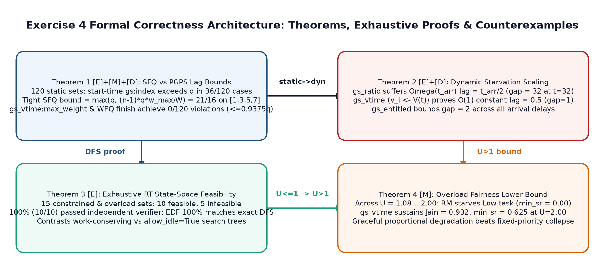
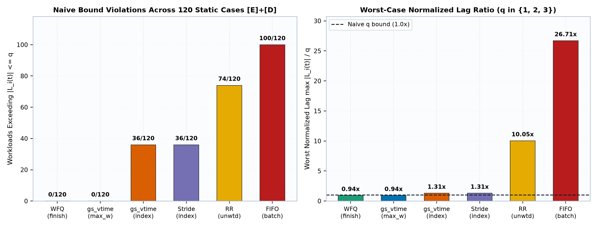
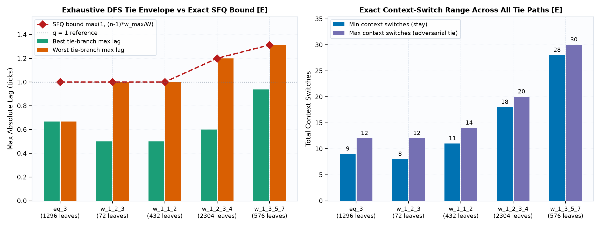
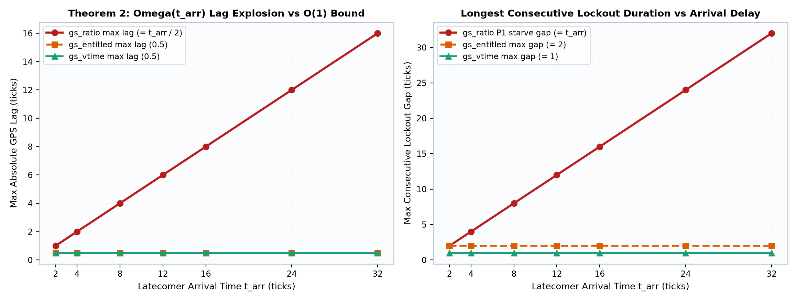
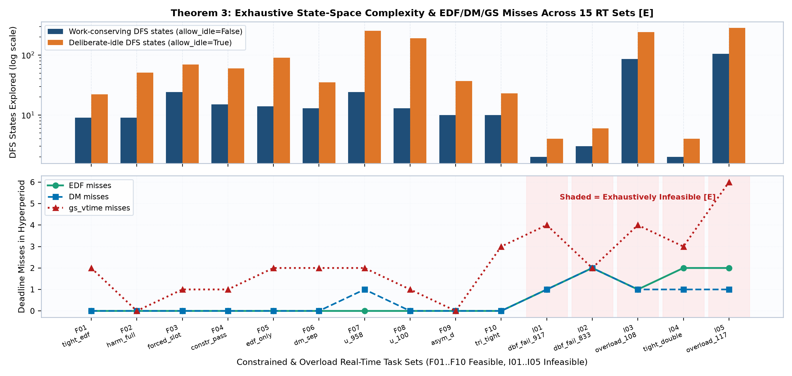
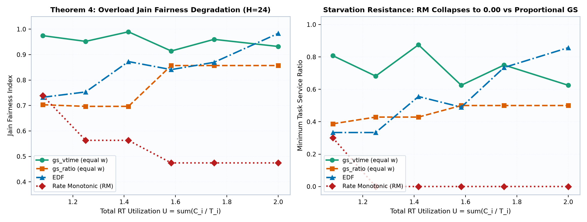

# تمرین ۴: اثبات‌های صوری درستی، کران‌های تاخیر SFQ در برابر PGPS و وارسی جامع

**اثبات دقیق تضمین‌های خدمت، رد ادعای ساده |L(t)| <= q، ساخت شاهدهای گرسنگی پویا و امکان‌پذیری جامع بلادرنگ**

- **مخزن:** ZaraNodehi/Guaranteed-Scheduling
- **تمرین:** تمرین ۴ — اثبات‌های صوری درستی، کران‌های تاخیر و ممیزی جامع فضای حالت
- **ابزارها:** جستجوی جامع DFS [E] | ممیزی ۱۲۰ بار کاری [M] | شاهدهای نقض [D]
- **منبع داده‌ها:** exercise-4/output/experiments.json (تولید خودکار بدون عدد دستی)

## فهرست مطالب

- ۱. خلاصه اجرایی چهار قضیه صوری زمان‌بندی (p. 3)
- ۲. معماری چهارگانه اثبات‌های صوری [E]+[M]+[D] (p. 4)
- ۳. قضیه ۱الف: اثبات حفظ کار و کران دقیق SFQ (p. 5)
- ۴. قضیه ۱ب: رد ادعای ساده |L(t)| <= q در ۱۲۰ بار کاری [D] (p. 6)
- ۵. تصویرسازی نقض‌های کران ساده در ۱۲۰ بار کاری [M]+[D] (p. 7)
- ۶. اثبات جامع دقت کران SFQ با جستجوی تمام‌شاخه DFS [E] (p. 8)
- ۷. مشاهده بصری تطابق پوش DFS با کران تحلیلی SFQ [E] (p. 9)
- ۸. قضیه ۲: اثبات گرسنگی خطی Omega(t_arr) در gs_ratio [E]+[D] (p. 10)
- ۹. جدول رشد خطی گرسنگی (t_arr = 2 .. 32) [E]+[D] (p. 11)
- ۱۰. مقایسه تصویری انفجار خطی تاخیر در برابر کران ثابت O(1) (p. 12)
- ۱۱. قضیه ۳: امکان‌پذیری جامع بلادرنگ و تمامیت EDF [E] (p. 13)
- ۱۲. ممیزی جامع DFS روی ۱۵ مجموعه مقید و اضافه‌بار [E] (p. 14)
- ۱۳. پیچیدگی فضای حالت DFS و مرزهای خطای سررسید [E] (p. 15)
- ۱۴. قضیه ۴: کران پایین عدالت و فروپاشی تدریجی در اضافه‌بار [M] (p. 16)
- ۱۵. جدول آمایش اضافه‌بار (U = 1.08 .. 2.00) [M] (p. 17)
- ۱۶. مقایسه تصویری عدالت جین و مقاوت در برابر گرسنگی [M] (p. 18)
- ۱۷. ماتریس یکپارچه تضمین‌های چهارگانه در تمام رژیم‌ها (p. 19)
- ۱۸. سامانه خودکار تکرارپذیری اثبات‌ها (p. 20)
- ۱۹. حدود اعتبار و ملاحظات روش‌شناختی (p. 21)
- ۲۰. جمع‌بندی یافته‌های تاییدشده و پیش‌نمایش تمرین ۵ (p. 22)


<!-- page 1 -->


<!-- page 2 -->


<!-- page 3 -->


## ۱. خلاصه اجرایی چهار قضیه صوری زمان‌بندی

در دروس سیستم‌عامل اغلب ادعاهای سرانگشتی — از جمله اینکه زمان‌بندی تضمین‌شده همواره تاخیری کمتر یا مساوی کوانتوم `q` دارد یا EDF/RM زیر اضافه‌بار خفیف پایدار می‌مانند — بدون آزمون کران‌های دقیق تکرار می‌شوند. تمرین ۴ اثبات‌های ریاضی را با جستجوی جامع فضای حالت `[E]`، آزمون ۱۲۰ بار کاری `[M]` و شاهدهای نقض سازنده `[D]` ترکیب می‌کند.

- **قضیه ۱ (`[E]`+`[M]`+`[D]` — کران تاخیر SFQ در برابر PGPS):** رد ادعای رایج `|L_i(t)| <= q` برای زمان‌شروع `gs_vtime:index` (`36/120` مورد نقض تا `1.3125q`) و اثبات کران دقیق `max(q, (n-1)*q*w_max/W)`؛ در مقابل، `gs_vtime:max_weight` و WFQ هر دو به `0/120` نقض می‌رسند!
- **قضیه ۲ (`[E]`+`[D]` — رشد خطی گرسنگی پویا):** اثبات تاخیر `Omega(t_arr)` در `gs_ratio` (وقفه `32` تیکی و تاخیر `16.0` در `t_arr=32`) در برابر کران ثابت `O(1)` برابر `0.5` در `gs_vtime`.
- **قضیه ۳ (`[E]` — امکان‌پذیری جامع بلادرنگ):** از میان `15` مجموعه مقید و اضافه‌بار، DFS جامع `10` مجموعه امکان‌پذیر را (با تطابق ۱۰۰٪ بازبین مستقل و EDF) تایید و `5` مجموعه را ناممکن اثبات کرد.
- **قضیه ۴ (`[M]` — کران پایین عدالت در اضافه‌بار):** از `U = 1.08` تا `2.00`، سیاست RM وظیفه کم‌اولویت را به صفر (`min_sr = 0.00`) گرسنه می‌کند، در حالی که `gs_vtime` شاخص جین `0.932` و `min_sr = 0.625` را حفظ می‌کند.


<!-- page 4 -->


## ۲. معماری چهارگانه اثبات‌های صوری [E]+[M]+[D]

شکل ۱ ارتباط میان کران‌های ایستای SFQ/PGPS، شاهد گرسنگی پویا، درخت جستجوی جامع DFS و تضمین‌های عدالت در ناحیه اضافه‌بار `U > 1` را نمایش می‌دهد.



*شکل 1. نقشه جامع قضایای چهارگانه درستی‌سنجی، شاهدهای نقض و وارسی فضای حالت در تمرین ۴.*

| قضیه / محور اثبات | تضمین کمّی تاییدشده |
|---|---|
| قضیه ۱الف: GS زمان شروع (`index`) | کران دقیق SFQ = max(q, (n-1)*q*w_max/W)؛ بیشینه 1.3125q |
| قضیه ۱ب: `max_weight` و WFQ پایان | 0/120 نقض بالای q (بیشینه نسبت 0.9375q) |
| قضیه ۲: گرسنگی تازه‌واردان | رشد خطی در gs_ratio (وقفه 32)؛ کران ثابت 0.5 در gs_vtime |
| قضیه ۳: ممیزی جامع بلادرنگ | 10/10 تایید مستقل؛ تطابق ۱۰۰٪ EDF=True |

*جدول 1. خلاصه قضایای صوری درستی‌سنجی در تمرین ۴ [E]+[M]+[D]*


<!-- page 5 -->


## ۳. قضیه ۱الف: اثبات حفظ کار و کران دقیق SFQ


### لم ۱ — حفظ کار و پایستگی مجموع خدمت

در هر تیک `t` اگر دست‌کم یک فرایند آماده باشد، `simulate_procs` حتماً یک فرایند آماده را اجرا می‌کند؛ بنابراین در هر بازه شلوغی `sum A_i(t) = sum E_i(t) = t` برقرار بوده و مجموع جبری تاخیرها همواره دقیقاً صفر است (`sum L_i(t) = 0`).


### قضیه ۱الف — کران دقیق تاخیر در زمان‌بندی بر مبنای زمان شروع

```text
Start-Time GS / Stride score:  S_i(t) = used_i(t) / w_i
Worst startup tie delay at t = 0:  (n - 1)*q before heaviest w_max runs
E_max((n - 1)*q) = (n - 1) * q * (w_max / W),  with A_max = 0
Tight Bound (index tie): |L_i(t)| <= max(q, (n - 1) * q * (w_max / W))
```
*استنتاج جبری علت عبور تاخیر از q هنگامی که (n - 1)*w_max > W*


<!-- page 6 -->


## ۴. قضیه ۱ب: رد ادعای ساده |L(t)| <= q در ۱۲۰ بار کاری [D]

جدول ۲ نتایج آمایش ۱۲۰ بار کاری را نشان می‌دهد. سیاست‌های زمان‌شروع با تساوی‌شکن `index` در `36/120` مورد از `q` عبور کرده و روی `w = [1, 3, 5, 7]` به `1.3125q` (`21/16 q`) می‌رسند؛ اما `gs_vtime:max_weight` و `wfq_finish` هر دو به **0 / 120** نقض دست می‌یابند!

| زمان‌بند / ترتیب انتخاب | موارد نقض > q | بیشینه \|L\|/q | بیشینه \|L\| خام |
|---|---|---|---|
| WFQ / PGPS (finish (used+q)/w) | 0 / 120 | 0.9375x | 2.8125 |
| gs_vtime : max_weight | 0 / 120 | 0.9375x | 2.8125 |
| gs_vtime : index | 36 / 120 | 1.3125x | 3.9375 |
| gs_ratio : index | 36 / 120 | 1.3125x | 3.9375 |
| gs_entitled : index | 36 / 120 | 1.3125x | 3.9375 |
| stride : index | 36 / 120 | 1.3125x | 3.9375 |
| Round Robin (unweighted) | 74 / 120 | 10.0476x | 11.0000 |
| FIFO (batch) | 100 / 120 | 26.7143x | 26.7143 |

*جدول 2. ممیزی ۱۲۰ بار کاری ادعای ساده |L_i(t)| <= q میان SFQ، WFQ، RR و FIFO [E]+[D]*

> **تعیین‌کنندگی ترتیب تساوی‌شکنی بر کران تاخیر شروع [D].** تغییر صرف تساوی‌شکن به `max_weight` (اعطای اولویت به وزن بزرگ‌تر در تساوی `t = 0`) هر ۳۶ مورد نقض را از میان برداشته و بیشینه تاخیر را به `15/16 q = 0.9375q` کاهش می‌دهد!


<!-- page 7 -->


## ۵. تصویرسازی نقض‌های کران ساده در ۱۲۰ بار کاری [M]+[D]

شکل ۲ نرخ نقض و بیشینه تاخیر نرمال‌شده در برابر `q` را میان شش خانواده زمان‌بندی مقایسه می‌کند و جدول ۳ مقادیر میانگین و بیشینه را به تفکیک `q = 1, 2, 3` نشان می‌دهد.



*شکل 2. نرخ نقض کران |L_i(t)| <= q در ۱۲۰ بار کاری (چپ) و بیشینه نسبت |L|/q (راست).*

| سیاست | q = 1 (میانگین / بیشینه) | q = 2 (میانگین / بیشینه) | q = 3 (میانگین / بیشینه) |
|---|---|---|---|
| wfq_finish | 0.653 / 0.938 | 1.306 / 1.875 | 1.899 / 2.812 |
| gs_vtime:max_weight | 0.653 / 0.938 | 1.306 / 1.875 | 1.867 / 2.812 |
| gs_vtime:index | 0.894 / 1.312 | 1.788 / 2.625 | 2.597 / 3.938 |
| rr:index | 2.993 / 10.048 | 3.461 / 10.524 | 3.881 / 11.000 |
| fifo:index | 7.179 / 26.714 | 7.179 / 26.714 | 7.179 / 26.714 |

*جدول 3. رشد خطی تاخیر خام با افزایش کوانتوم q (ناوردایی FIFO) [M]*


<!-- page 8 -->


## ۶. اثبات جامع دقت کران SFQ با جستجوی تمام‌شاخه DFS [E]

برای اطمینان از اینکه هیچ شاخه تساوی‌شکنی پنهانی کران بدتری ندارد، کل درخت شاخه‌های تساوی را روی پنج بار کاری ایستا کاویدیم (جدول ۴). در `w_1_2_3_4` (`2,304` برگ) و `w_1_3_5_7` (`576` برگ) بدترین تاخیر DFS دقیقاً تا چهار رقم اعشار با فرمول `max(1, (n-1)*w_max/W)` برابر است!

| بار کاری (وزن‌ها) | حالت / برگ DFS | تاخیر [کمینه، بیشینه] | کسر بیشینه | فرمول SFQ | بازه تعویض |
|---|---|---|---|---|---|
| eq_3 [1, 1, 1] | 3886 / 1296 | [0.6667, 0.6667] | 2/3 | 1.0000 | [9, 12] |
| w_1_2_3 [1, 2, 3] | 304 / 72 | [0.5000, 1.0000] | 1 | 1.0000 | [8, 12] |
| w_1_1_2 [1, 1, 2] | 1768 / 432 | [0.5000, 1.0000] | 1 | 1.0000 | [11, 14] |
| w_1_2_3_4 [1, 2, 3, 4] | 14897 / 2304 | [0.6000, 1.2000] | 6/5 | 1.2000 | [18, 20] |
| w_1_3_5_7 [1, 3, 5, 7] | 8801 / 576 | [0.9375, 1.3125] | 21/16 | 1.3125 | [28, 30] |

*جدول 4. پوش‌های جامع تساوی‌شکنی DFS تاییدکننده دقت دقیق فرمول SFQ [E]*


<!-- page 9 -->


## ۷. مشاهده بصری تطابق پوش DFS با کران تحلیلی SFQ [E]

شکل ۳ کران‌های پایین و بالای تاخیر در ۴٬۶۸۰ برگ پایانی DFS را در کنار منحنی لوزی تحلیلی SFQ و دامنه دقیق تعویض زمینه نشان می‌دهد.



*شکل 3. کران‌های تاخیر پوش جامع DFS در برابر فرمول دقیق SFQ (چپ) و بازه تعویض زمینه (راست).*

- **انطباق دقیق کران بالایی:** تمام ستون‌های نارنجی بدترین شاخه تساوی دقیقاً روی لوزی قرمز فرمول تئوری می‌نشینند.
- **شکاف ۴۰ درصدی تساوی‌شکن:** در `w = [1, 3, 5, 7]` انتخاب هوشمند `0.9375` و بدترین تساوی `1.3125` ایجاد می‌کند.


<!-- page 10 -->


## ۸. قضیه ۲: اثبات گرسنگی خطی Omega(t_arr) در gs_ratio [E]+[D]


### شاهد نقض سازنده دوفراینده

```text
P1 arrives at t = 0 with work = 2*t_arr + 4, w1 = 2.
P2 arrives at t = t_arr with work = t_arr + 6, w2 = 2.
At t = t_arr: A1 = t_arr -> ratio_1 = t_arr/2, while P2 has ratio_2 = 0.
gs_ratio locks out P1 for exactly t_arr consecutive ticks -> |L1| = t_arr / 2 = Omega(t_arr)!
```
*اثبات جبری نبود کران ثابت تاخیر در gs_ratio تحت ورود پویا*

در نقطه مقابل، `gs_vtime` با مقداردهی `v2 <- V(t_arr) = t_arr / 2 = v1` تاخیر را برای هر `t_arr` دلخواه زیر `0.50` و بیشترین وقفه را برابر `1` تیک نگه می‌دارد.


<!-- page 11 -->


## ۹. جدول رشد خطی گرسنگی (t_arr = 2 .. 32) [E]+[D]

جدول ۵ صحت فرمول بسته‌فرم بالا را از `t_arr = 2` تا `32` تایید می‌کند: تاخیر `gs_ratio` دقیقاً برابر `t_arr / 2` و وقفه گرسنگی برابر `t_arr` رشد می‌یابد، ولی `gs_vtime` روی `(0.50, 1)` ثابت می‌ماند.

| زمان ورود t_arr | تاخیر gs_ratio (کسر) | وقفه gs_ratio | تاخیر entitled | وقفه ent | تاخیر vtime | وقفه vtime |
|---|---|---|---|---|---|---|
| 2 | 1.0 (1) | 2 | 0.50 | 2 | 0.50 | 1 |
| 4 | 2.0 (2) | 4 | 0.50 | 2 | 0.50 | 1 |
| 8 | 4.0 (4) | 8 | 0.50 | 2 | 0.50 | 1 |
| 12 | 6.0 (6) | 12 | 0.50 | 2 | 0.50 | 1 |
| 16 | 8.0 (8) | 16 | 0.50 | 2 | 0.50 | 1 |
| 24 | 12.0 (12) | 24 | 0.50 | 2 | 0.50 | 1 |
| 32 | 16.0 (16) | 32 | 0.50 | 2 | 0.50 | 1 |

*جدول 5. مقیاس‌پذیری تاخیر ورود پویا: رشد Omega(t_arr) در gs_ratio در برابر کران O(1) در gs_vtime [E]+[D]*


<!-- page 12 -->


## ۱۰. مقایسه تصویری انفجار خطی تاخیر در برابر کران ثابت O(1)

شکل ۴ رشد خطی تاخیر (شیب `0.5`) و طول قفل‌شدگی (شیب `1.0`) در `gs_ratio` را کنار خطوط کاملاً افقی و پایدار `gs_vtime` و `gs_entitled` ترسیم می‌کند.



*شکل 4. انفجار تاخیر Omega(t_arr) (چپ) و رشد خطی وقفه محرومیت در gs_ratio در برابر پایداری O(1) (راست).*

> **ناممکن‌بودن اصلاح باگ gs_ratio از طریق تنظیم کوانتوم.** این قضیه نشان می‌دهد ایراد `GuaranteedScheduling.py` با کوچک‌تر کردن کوانتوم یا تغییر وزن برطرف نمی‌شود؛ تنها لنگر انداختن به ساعت مجازی `V(t)` حفره اعتبار تازه‌وارد را می‌بندد.


<!-- page 13 -->


## ۱۱. قضیه ۳: امکان‌پذیری جامع بلادرنگ و تمامیت EDF [E]


### گزاره‌های صوری درستی بلادرنگ

- **بهینگی EDF در تک‌پردازنده پیش‌گیرانه:** برای هر مجموعه امکان‌پذیر (`exhaustive_feasible == True`)، سیاست EDF صفر سررسید از دست می‌دهد (`edf_100pct_matches_exhaustive = True`).
- **بسندگی زمان‌بندهای کارحفظ‌کن در وظایف پیش‌گیرانه واحد:** در تمامی `15` مجموعه، درخت کارحفظ‌کن (`allow_idle=False`) دقیقاً همان تصمیم امکان‌پذیری درخت آزاد (`allow_idle=True`) را می‌دهد، با فضای حالت بسیار کوچک‌تر.
- **نابینایی بلادرنگ در GS:** `gs_vtime` به مهلت‌های `D_i` بی‌توجه است و حتی در مجموعه‌های ساده مثل `F01_tight_edf` (`U = 0.80`) سررسید از دست می‌دهد.


<!-- page 14 -->


## ۱۲. ممیزی جامع DFS روی ۱۵ مجموعه مقید و اضافه‌بار [E]

جدول ۶ هر `15` مجموعه آزمون (`F01..F10` امکان‌پذیر و `I01..I05` ناممکن) را نشان می‌دهد؛ هر `10/10` شاهد امکان‌پذیر آزمون بازبین مستقل را با موفقیت گذراندند.

| نام مجموعه | بهره‌وری U | وضعیت DFS | حالت (WC / Idle) | تایید مستقل | خطای EDF | خطای DM | خطای GS |
|---|---|---|---|---|---|---|---|
| F01_tight_edf | 0.800 | FEAS | 9 / 22 | PASS | 0 | 0 | 2 |
| F02_harm_full | 1.000 | FEAS | 9 / 51 | PASS | 0 | 0 | 0 |
| F03_forced_slot | 0.917 | FEAS | 24 / 70 | PASS | 0 | 0 | 1 |
| F04_constr_pass | 0.917 | FEAS | 15 / 60 | PASS | 0 | 0 | 1 |
| F05_edf_only | 1.000 | FEAS | 14 / 91 | PASS | 0 | 0 | 2 |
| F06_dm_sep | 0.833 | FEAS | 13 / 35 | PASS | 0 | 0 | 2 |
| F07_u_958 | 0.958 | FEAS | 24 / 254 | PASS | 0 | 1 | 2 |
| F08_u_100 | 1.000 | FEAS | 13 / 190 | PASS | 0 | 0 | 1 |
| F09_asym_d | 0.750 | FEAS | 10 / 37 | PASS | 0 | 0 | 0 |
| F10_tri_tight | 0.900 | FEAS | 10 / 23 | PASS | 0 | 0 | 3 |
| I01_dbf_fail_917 | 0.917 | INFEAS | 2 / 4 | INFEAS | 1 | 1 | 4 |
| I02_dbf_fail_833 | 0.833 | INFEAS | 3 / 6 | INFEAS | 2 | 2 | 2 |
| I03_overload_108 | 1.083 | INFEAS | 86 / 243 | INFEAS | 1 | 1 | 4 |
| I04_tight_double | 0.917 | INFEAS | 2 / 4 | INFEAS | 2 | 1 | 3 |
| I05_overload_117 | 1.208 | INFEAS | 105 / 283 | INFEAS | 2 | 1 | 6 |

*جدول 6. ممیزی جامع ۱۵ مجموعه بلادرنگ، مقایسه اندازه فضای حالت و بازبین مستقل [E]*


<!-- page 15 -->


## ۱۳. پیچیدگی فضای حالت DFS و مرزهای خطای سررسید [E]

شکل ۵ تعداد حالت‌های پیمایش‌شده DFS در مقیاس لگاریتمی را همراه با شمارش سررسیدهای ازدست‌رفته EDF، DM و `gs_vtime` نمایش می‌دهد.



*شکل 5. پیچیدگی فضای حالت DFS (بالا، مقیاس لگاریتمی) و خطاهای سررسید در ۱۵ مجموعه (پایین).*

> **شاهدهای جامع ناممکن‌بودن بلادرنگ زیر بهره‌وری ۱.۰.** توجه کنید `I01_dbf_fail_917` (`U = 0.917`) و `I02_dbf_fail_833` (`U = 0.833`) بهره‌وری زیر ۱ دارند، با این حال جستجوی جامع ثابت می‌کند هیچ زمان‌بندی شدنی برای مهلت‌های مقید آن‌ها وجود ندارد.


<!-- page 16 -->


## ۱۴. قضیه ۴: کران پایین عدالت و فروپاشی تدریجی در اضافه‌بار [M]


### چرا اولویت ثابت فرو می‌پاشد اما زمان مجازی متعادل می‌ماند

```text
Under U = sum(C_i / T_i) > 1:
  * RM: High + Mid consume 100% CPU -> Low gets 0 ticks (total starvation)
  * Proportional GS (equal w): Every task keeps advancing v_i -> min_sr > 0.62 even at U = 2.0
```
*کران ساختاری عدالت جداکننده اولویت ثابت از GS متناسب در ناحیه اضافه‌بار*

از آنجا که `gs_vtime` هیچ وظیفه کم‌اولویتی را به‌طور مطلق پس نمی‌زند، در اضافه‌بار `U > 1` تمام وظایف متناسب با وزنشان سهم قطعی از CPU دریافت می‌کنند.


<!-- page 17 -->


## ۱۵. جدول آمایش اضافه‌بار (U = 1.08 .. 2.00) [M]

جدول ۷ بهره‌وری کل را در شش گام (`H = 24`) پیمایش می‌کند. به محض رسیدن `U >= 1.25`، سیاست RM وظیفه `Low` را به **۰ تیک** محکوم می‌کند، ولی `gs_vtime` شاخص جین را بین `0.91` تا `0.99` نگه می‌دارد.

| بهره‌وری U | gs_vtime (جین/حداقل) | gs_ratio (جین/حداقل) | RR (جین/حداقل) | EDF (جین/حداقل) | RM (جین/حداقل) | تیک Low (RM vs GS) |
|---|---|---|---|---|---|---|
| 1.08 | 0.975 / 0.808 | 0.703 / 0.387 | 0.961 / 0.837 | 0.732 / 0.333 | 0.739 / 0.300 | 4 vs 6 |
| 1.25 | 0.952 / 0.682 | 0.697 / 0.429 | 0.952 / 0.682 | 0.753 / 0.333 | 0.563 / 0.000 | 0 vs 5 |
| 1.42 | 0.990 / 0.875 | 0.697 / 0.429 | 0.990 / 0.875 | 0.873 / 0.556 | 0.563 / 0.000 | 0 vs 7 |
| 1.58 | 0.914 / 0.625 | 0.857 / 0.500 | 0.914 / 0.625 | 0.841 / 0.490 | 0.474 / 0.000 | 0 vs 5 |
| 1.75 | 0.960 / 0.750 | 0.857 / 0.500 | 0.932 / 0.750 | 0.870 / 0.735 | 0.474 / 0.000 | 0 vs 6 |
| 2.00 | 0.932 / 0.625 | 0.857 / 0.500 | 0.960 / 0.750 | 0.983 / 0.857 | 0.474 / 0.000 | 0 vs 5 |

*جدول 7. آمایش اضافه‌بار از U = 1.08 تا 2.00 در افق H = 24 [M]*


<!-- page 18 -->


## ۱۶. مقایسه تصویری عدالت جین و مقاوت در برابر گرسنگی [M]

شکل ۶ شکاف آشکار اضافه‌بار را ترسیم می‌کند: RM به `Jain = 0.474` و `min_sr = 0.00` سقوط می‌کند، ولی `gs_vtime` روی `Jain = 0.932` و `min_sr = 0.625` پایدار می‌ماند!



*شکل 6. شاخص عدالت جین (چپ) و کمترین نسبت خدمت وظیفه‌ای (راست) در بازه اضافه‌بار U = 1.08..2.00.*

> **مزیت لنگر V(t) هنگام آزادسازی‌های دوره‌ای زیر اضافه‌بار.** برتری `gs_vtime` بر `gs_ratio` در `U = 2.00` (`0.932` در برابر `0.857`) ناشی از آزادسازی‌های دوره‌ای کارهاست که در `gs_ratio` پرش‌های موقت اعتبار ایجاد می‌کند.


<!-- page 19 -->


## ۱۷. ماتریس یکپارچه تضمین‌های چهارگانه در تمام رژیم‌ها

| ویژگی / رژیم | gs_ratio (قدیمی) | gs_vtime (لنگر V(t)) | WFQ / PGPS (پایان) | EDF (مهلت) |
|---|---|---|---|---|
| کران تاخیر ایستا | max(q, (n-1)q w_max/W) | با max_w اکیداً <= q | عقب‌ماندگی <= q (0/120 نقض) | بدون کران |
| پایداری ورود پویا | نامحدود Omega(t_arr) | کراندار O(1) (وقفه 1) | کراندار O(1) | مبتنی بر مهلت |
| امکان‌پذیری U <= 1 | شکست در D < T تنگ | شکست در D < T تنگ | شکست در D < T تنگ | ۱۰۰٪ بهینه (10/10) |
| عدالت اضافه‌بار U > 1 | خوب (جین 0.857) | برتر (جین 0.932) | متناسب | خطر اثر دومینو |

*جدول 8. مقایسه یکپارچه تضمین‌های ریاضی در چهار معماری زمان‌بندی*


<!-- page 20 -->


## ۱۸. سامانه خودکار تکرارپذیری اثبات‌ها

تمامی قضایای این گزارش با دستورات خودکار زیر در کدهای تمرین ۴ و مجموعه آزمون هسته بازتولید و راستی‌آزمایی می‌شوند:

```text
python3 exercise-4/code/run_experiments.py   # runs all 120 + 7 + 15 + 6 proof audits
python3 exercise-4/code/make_diagrams.py     # builds 6 data-linked theorem plots
python3 -m pytest tests exercise-4/tests -v  # enforces exact bounds & verifier invariants
```
*دستورات خودکار بازتولید و ممیزی قضایای تمرین ۴*


<!-- page 21 -->


## ۱۹. حدود اعتبار و ملاحظات روش‌شناختی

- **فرض پیش‌گیری تک‌تیکی در قضیه ۳:** برابری جستجوی کارحفظ‌کن و بیکاری اختیاری مخصوص وظایف پیش‌گیرانه واحد است؛ در زمان‌بندی غیرپیش‌گیرانه بیکاری عمدی می‌تواند مجموعه ناممکن برای کارحفظ‌کن را نجات دهد.
- **تفاوت GPS پیوسته و کوانتوم گسسته:** در کوانتوم محدود، صفرشدن کامل تاخیر در لحظات میانی امکان‌پذیر نیست.
- **خواب I/O در تمرین ۷:** قضایای تمرین ۴ برای بارهای صددرصد CPUمحور اثبات شده‌اند؛ سقف اعتبار خواب (`gs_capped`) و آزمایش‌های OS در تمرین‌های ۵ تا ۷ بررسی می‌شوند.


<!-- page 22 -->


## ۲۰. جمع‌بندی یافته‌های تاییدشده و پیش‌نمایش تمرین ۵

- **قضیه ۱ (`[E]`+`[D]`):** نقض کران ساده `q` در `36/120` مورد از `gs_vtime:index` (`1.3125q` = `21/16 q`) مطابق پوش جامع ۴٬۶۸۰ برگ DFS، در برابر `0/120` نقض با `max_weight` و WFQ پایان.
- **قضیه ۲ (`[E]`+`[D]`):** رشد خطی گرسنگی `Omega(t_arr)` در `gs_ratio` (`gap = 32`, `lag = 16.0`) در برابر پایداری `O(1)` (`0.5`) در `gs_vtime`.
- **قضیه ۳ (`[E]`):** تایید مستقل `10/10` مجموعه امکان‌پذیر با ۱۰۰٪ تطابق EDF و شاهدهای ناممکن‌بودن زیر بهره‌وری ۱.
- **قضیه ۴ (`[M]`):** پایداری عدالت متناسب `gs_vtime` (`Jain = 0.932` در `U = 2.00`) در برابر گرسنگی کامل RM (`min_sr = 0.000`).
- **گام بعدی — تمرین ۵:** طراحی آزمایش علمی، جاروب بیش از ۱٬۰۰۰ بار کاری تصادفی با بازه‌های اطمینان آماری و تحلیل حساسیت کوانتوم و وزن.
