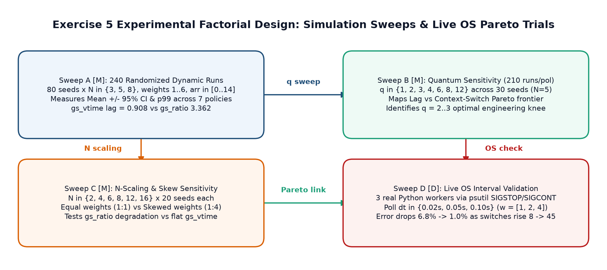
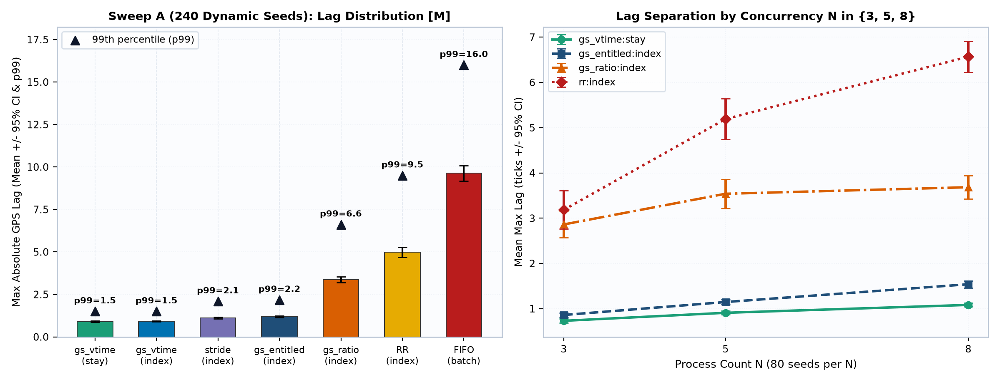
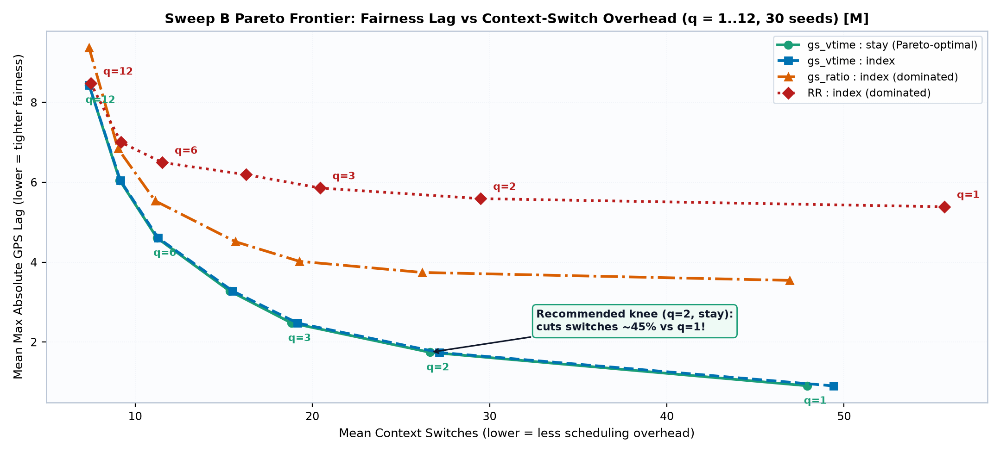
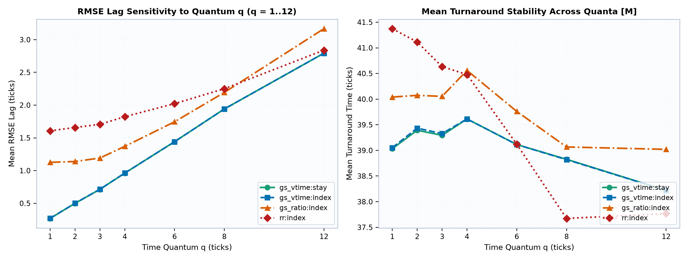
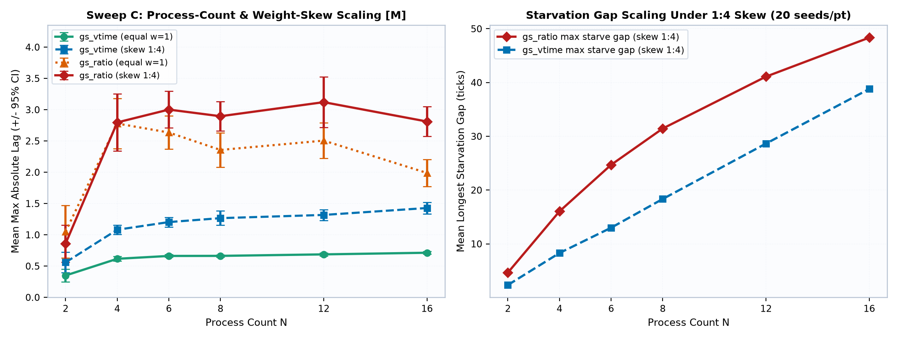
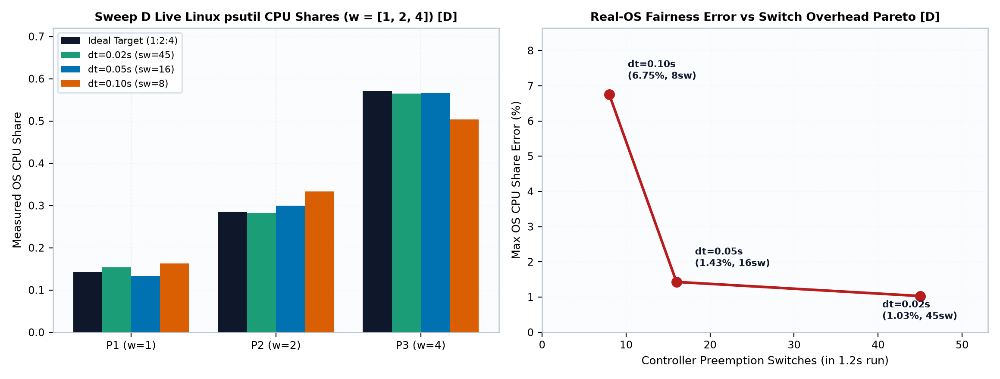

# تمرین ۵: جاروب‌های شبیه‌سازی کلان، تحلیل حساسیت و مرزهای پارتو

**آزمایش‌های مونت‌کارلو تصادفی (بازه اطمینان ۹۵٪ و صدک ۹۹)، منحنی پارتو تاخیر-سربار، مقیاس‌پذیری N و آزمون زنده بازه نمونه‌برداری لینوکس**

- **مخزن:** ZaraNodehi/Guaranteed-Scheduling
- **تمرین:** تمرین ۵ — طراحی آزمایش، تحلیل حساسیت پارامتری و مرز پارتو
- **ابزارها:** مونت‌کارلو ۲۴۰ بذری [M] | پارتو کوانتوم [M] | آزمایش زنده لینوکس [D]
- **منبع داده‌ها:** exercise-5/output/experiments.json (تولید خودکار بدون عدد دستی)

## فهرست مطالب

- ۱. روش‌شناسی آزمایش و طراحی آماری (p. 3)
- ۲. معماری چهارگانه طراحی فاکتوریل [M]+[D] (p. 4)
- ۳. جاروب A: آمار تجمعی ۲۴۰ بار کاری پویای تصادفی [M] (p. 5)
- ۴. تفکیک عملکرد در سطوح هم‌زمانی N in {3, 5, 8} [M] (p. 6)
- ۵. تصویرسازی توزیع تاخیر، بازه اطمینان ۹۵٪ و صدک ۹۹ [M] (p. 7)
- ۶. جاروب B: تحلیل حساسیت کوانتوم (q = 1..12) [M] (p. 8)
- ۷. مرز بهینه پارتو: عدالت در برابر سربار تعویض زمینه [M] (p. 9)
- ۸. پایداری زمان چرخش و خطی بودن RMSE در کوانتوم‌های بزرگ [M] (p. 10)
- ۹. جاروب C: مقیاس‌پذیری N = 2..16 و اثر چولگی وزن ۱:۴ [M] (p. 11)
- ۱۰. تصویرسازی شکاف مقیاس‌پذیری و واریانس ورود [M] (p. 12)
- ۱۱. جاروب D: آزمایش زنده فاصله نمونه‌برداری لینوکس با psutil [D] (p. 13)
- ۱۲. مشاهده زانوی پارتوی خطای سهم در برابر تعویض واقعی OS [D] (p. 14)
- ۱۳. کالیبراسیون کوانتوم گسسته با تایمرهای واقعی OS [M]+[D] (p. 15)
- ۱۴. ماتریس هزینه-فایده گزینه‌های عملیاتی (p. 16)
- ۱۵. تحلیل واریانس، نقاط دورافتاده و ثبات آماری (p. 17)
- ۱۶. حساسیت به توزیع وزن‌ها و ترکیب‌های ناهمگن (p. 18)
- ۱۷. کنترل‌های اعتبارسنجی و پاسخ به تهدیدات روش‌شناختی (p. 19)
- ۱۸. دستورات بازتولید خودکار آزمایش‌ها و نمودارها (p. 20)
- ۱۹. راهنمای عملیاتی تنظیم پارامترها برای مهندسان سیستم (p. 21)
- ۲۰. جمع‌بندی یافته‌های تجربی و چشم‌انداز تمرین ۶ (p. 22)


<!-- page 1 -->


<!-- page 2 -->


<!-- page 3 -->


## ۱. روش‌شناسی آزمایش و طراحی آماری

مثال‌های دستی تک‌موردی برای کشف نقض‌ها عالی‌اند، اما تصمیم‌گیری مهندسی نیازمند **اطمینان آماری در ترافیک تصادفی** است. تمرین ۵ چهار جاروب مکمل را در شبیه‌ساز دقیق `[M]` و هسته زنده لینوکس `[D]` با بذرهای تکرارپذیر و بازه اطمینان ۹۵٪ اجرا می‌کند.

- **جاروب A — بنچمارک مونت‌کارلو ۲۴۰ بذری پویا (`[M]`):** ارزیابی ۷ سیاست روی ۸۰ بذر تصادفی برای هر `N in {3, 5, 8}`.
- **جاروب B — حساسیت کوانتوم و مرز پارتو (`[M]`):** پیمایش `q in {1, 2, 3, 4, 6, 8, 12}` روی ۳۰ بذر (`۲۱۰` اجرا به ازای هر سیاست).
- **جاروب C — مقیاس‌پذیری هم‌زمانی و چولگی وزن (`[M]`):** رشد `N` از ۲ تا ۱۶ تحت وزن‌های برابر `1:1` در برابر نامتوازن `1:4`.
- **جاروب D — آزمایش زنده فاصله نمونه‌برداری OS (`[D]`):** اجرای ۳ فرایند واقعی با `psutil` (`w=[1,2,4]`) تحت بازه‌های `dt in {0.02s, 0.05s, 0.10s}`.


<!-- page 4 -->


## ۲. معماری چهارگانه طراحی فاکتوریل [M]+[D]

شکل ۱ پیوند میان آزمایش‌های شبیه‌سازی مونت‌کارلو، مرزهای پارتو کوانتوم و اعتبارسنجی زنده هسته لینوکس را نمایش می‌دهد.



*شکل 1. معماری چهار جاروب تجربی شامل مونت‌کارلو، پارتو کوانتوم، مقیاس‌پذیری N و بازه OS.*

| جاروب / ابزار | حجم نمونه و دستاورد کلیدی |
|---|---|
| جاروب A: مونت‌کارلو پویا [M] | 240 بذر؛ میانگین تاخیر gs_vtime:stay برابر 0.908 در برابر 3.362 |
| جاروب B: پارتو کوانتوم [M] | ۳۰ بذر در ۷ کوانتوم؛ q=2 تعویض زمینه را 44.4% کاهش می‌دهد |
| جاروب C: مقیاس‌پذیری N [M] | N=2..16؛ در N=16 نامتوازن، تاخیر vtime برابر 1.429 در برابر ratio 2.811 |
| جاروب D: بازه زنده OS [D] | کاهش خطای سهم CPU از 6.75% در 0.10s به 1.03% در 0.02s |

*جدول 1. خلاصه شاخص‌های کلیدی چهار جاروب تجربی تمرین ۵ [M]+[D]*


<!-- page 5 -->


## ۳. جاروب A: آمار تجمعی ۲۴۰ بار کاری پویای تصادفی [M]

جدول ۲ میانگین و بازه اطمینان ۹۵٪ همراه با صدک‌های ۹۵ و ۹۹ را در `240` آزمایش نشان می‌دهد. `gs_vtime:stay` میانگین تاخیر را **3.7 برابر** بهتر از `gs_ratio:index` (`0.908` در برابر `3.362`) و **5.5 برابر** بهتر از RR نگه می‌دارد!

| سیاست | تاخیر (میانگین +/- CI) | صدک p95 / p99 | RMSE | وقفه بیشینه | تعویض | میانگین TA | جین |
|---|---|---|---|---|---|---|---|
| gs_vtime:stay | 0.908 +/- 0.030 | 1.33 / 1.50 | 0.268 | 11.61 | 49.6 | 40.79 | 1.0000 |
| gs_vtime:index | 0.916 +/- 0.030 | 1.33 / 1.50 | 0.274 | 11.56 | 50.5 | 40.80 | 1.0000 |
| stride:index | 1.118 +/- 0.049 | 1.82 / 2.10 | 0.317 | 11.90 | 50.4 | 40.91 | 1.0000 |
| gs_entitled:index | 1.182 +/- 0.050 | 1.97 / 2.18 | 0.292 | 12.19 | 51.2 | 40.91 | 1.0000 |
| gs_ratio:index | 3.362 +/- 0.173 | 5.96 / 6.61 | 1.033 | 19.60 | 48.5 | 41.71 | 1.0000 |
| rr:index | 4.981 +/- 0.294 | 8.71 / 9.50 | 1.574 | 4.18 | 56.5 | 42.88 | 1.0000 |
| fifo:index | 9.628 +/- 0.460 | 15.33 / 16.00 | 3.301 | 38.36 | 5.3 | 30.54 | 1.0000 |

*جدول 2. آمار توصیفی و استنباطی جاروب A در ۲۴۰ بار کاری پویای تصادفی (q = 1) [M]*


<!-- page 6 -->


## ۴. تفکیک عملکرد در سطوح هم‌زمانی N in {3, 5, 8} [M]

تفکیک نتایج برحسب تعداد فرایندها (جدول ۳) نشان می‌دهد چرا Round Robin ساده با افزایش `N` فرو می‌پاشد: در `N = 8` میانگین تاخیر RR از `6.5` تیک عبور می‌کند.

| سیاست | تاخیر N=3 (+/-CI) | تاخیر N=5 (+/-CI) | تاخیر N=8 (+/-CI) | وقفه N=8 | تعویض N=8 |
|---|---|---|---|---|---|
| gs_vtime:stay | 0.732 +/- 0.044 | 0.909 +/- 0.039 | 1.083 +/- 0.042 | 20.50 | 82.7 |
| gs_vtime:index | 0.753 +/- 0.047 | 0.912 +/- 0.039 | 1.083 +/- 0.042 | 20.51 | 83.2 |
| gs_entitled:index | 0.860 +/- 0.044 | 1.147 +/- 0.057 | 1.539 +/- 0.078 | 21.30 | 83.9 |
| gs_ratio:index | 2.861 +/- 0.288 | 3.539 +/- 0.323 | 3.684 +/- 0.258 | 31.18 | 82.0 |
| rr:index | 3.183 +/- 0.423 | 5.191 +/- 0.449 | 6.568 +/- 0.346 | 6.89 | 88.5 |
| fifo:index | 6.094 +/- 0.610 | 10.361 +/- 0.583 | 12.430 +/- 0.441 | 66.69 | 8.0 |

*جدول 3. تفکیک نتایج جاروب A به تفکیک تعداد فرایندها (۸۰ بذر در هر N) [M]*

> **مبادله میان زمان چرخش و عدالت متناسب.** `FIFO` کمترین میانگین زمان چرخش (`30.54` تیک) را دارد ولی به بهای تاخیر سنگین (`p99 = 16.00`) و گرسنگی (`gap = 38.36`).


<!-- page 7 -->


## ۵. تصویرسازی توزیع تاخیر، بازه اطمینان ۹۵٪ و صدک ۹۹ [M]

شکل ۲ عرض بسیار باریک بازه اطمینان `gs_vtime` (`0.03` تیک) را در کنار جدایی چشمگیر در صدک ۹۹ (`p99`) و روند رشد با `N` نمایش می‌دهد.



*شکل 2. توزیع تاخیر مونت‌کارلو با بازه اطمینان ۹۵٪ و صدک ۹۹ (چپ) و مقایسه هم‌زمانی N=3,5,8 (راست).*

- **ایمنی دم توزیع (`p99`):** حتی در بدترین ۱٪ بارهای تصادفی، `gs_vtime:stay` تاخیر را در `1.50` تیک مهار می‌کند (در برابر `6.61` در `gs_ratio`).
- **سود رایگان تساوی‌شکنی `stay`:** کاهش تعویض زمینه بدون کوچک‌ترین افت در عدالت.


<!-- page 8 -->


## ۶. جاروب B: تحلیل حساسیت کوانتوم (q = 1..12) [M]

پیش‌گیری در هر تیک (`q = 1`) در هسته‌های واقعی باعث فرسایش کش می‌شود. جدول ۴ با جاروب `q` از `1` تا `12` روی ۳۰ بذر تصادفی (`N = 5`)، صرفه‌جویی تعویض زمینه را در برابر رشد تاخیر می‌سنجد.

| کوانتوم q | gs_vtime:stay (تاخیر/تعویض) | gs_vtime:index (تاخیر/تعویض) | gs_ratio:index (تاخیر/تعویض) | RR:index (تاخیر/تعویض) | میانگین TA |
|---|---|---|---|---|---|
| 1 | 0.905 / 47.9 | 0.902 / 49.4 | 3.544 / 46.9 | 5.388 / 55.7 | 39.03 |
| 2 | 1.743 / 26.6 | 1.739 / 27.2 | 3.743 / 26.2 | 5.591 / 29.5 | 39.39 |
| 3 | 2.475 / 18.8 | 2.475 / 19.2 | 4.022 / 19.3 | 5.857 / 20.4 | 39.29 |
| 4 | 3.279 / 15.3 | 3.279 / 15.5 | 4.512 / 15.7 | 6.192 / 16.3 | 39.61 |
| 6 | 4.607 / 11.2 | 4.607 / 11.3 | 5.534 / 11.1 | 6.495 / 11.5 | 39.11 |
| 8 | 6.048 / 9.1 | 6.048 / 9.2 | 6.842 / 9.0 | 7.004 / 9.2 | 38.83 |
| 12 | 8.438 / 7.4 | 8.438 / 7.4 | 9.370 / 7.4 | 8.476 / 7.5 | 38.22 |

*جدول 4. حساسیت کوانتوم در ۳۰ بذر پویا (تاخیر بیشینه / تعداد تعویض زمینه) [M]*


<!-- page 9 -->


## ۷. مرز بهینه پارتو: عدالت در برابر سربار تعویض زمینه [M]

شکل ۳ صفحه مبادله عدالت-سربار را ترسیم می‌کند: گوشه پایین-چپ بهترین وضعیت ممکن است و منحنی `gs_vtime:stay` مرز پارتوی اکید را تشکیل داده و در تمام کوانتوم‌ها بر `gs_ratio` و RR غلبه دارد.



*شکل 3. مرز پارتوی تاخیر بیشینه در برابر تعداد تعویض زمینه در کوانتوم‌های ۱ تا ۱۲.*

- **زانوی بهینه پارتو (`q = 2, stay`):** کاهش **44.4٪** در تعویض زمینه (`47.9 -> 26.6`) با کمتر از ۱ تیک افزایش تاخیر (`0.90 -> 1.74`).
- **مغلوب‌شدن رقیبان:** `gs_vtime:stay` با `q = 6` (~۱۱ تعویض) هنوز عادلانه‌تر از RR با `q = 1` (~۵۶ تعویض) عمل می‌کند!


<!-- page 10 -->


## ۸. پایداری زمان چرخش و خطی بودن RMSE در کوانتوم‌های بزرگ [M]

شکل ۴ نشان می‌دهد خطای RMSE تحت `gs_vtime` خطی و قابل‌پیش‌بینی رشد می‌کند در حالی که میانگین زمان چرخش در سرتاسر بازه `q = 1..12` در حد ۱ تیک پایدار می‌ماند.



*شکل 4. خطی بودن رشد RMSE با کوانتوم (چپ) و پایداری زمان چرخش در کوانتوم‌های مختلف (راست).*


<!-- page 11 -->


## ۹. جاروب C: مقیاس‌پذیری N = 2..16 و اثر چولگی وزن ۱:۴ [M]

جدول ۵ رشد هم‌زمانی از ۲ تا ۱۶ فرایند را بررسی می‌کند. در وزن‌های برابر `1:1` تاخیر `gs_vtime` زیر `0.72` اشباع می‌شود؛ با اعمال چولگی `1:4` تاخیر به `1.43` می‌رسد که هنوز نصف `gs_ratio` (`2.81`) است.

| N | vtime برابر | ratio برابر | vtime چولگی ۱:۴ | ratio چولگی ۱:۴ | وقفه چولگی (vtime vs ratio) |
|---|---|---|---|---|---|
| 2 | 0.350 +/- 0.103 | 1.050 +/- 0.420 | 0.560 +/- 0.165 | 0.860 +/- 0.296 | 2.4 vs 4.7 |
| 4 | 0.617 +/- 0.036 | 2.779 +/- 0.402 | 1.081 +/- 0.072 | 2.797 +/- 0.457 | 8.3 vs 16.1 |
| 6 | 0.663 +/- 0.022 | 2.636 +/- 0.266 | 1.204 +/- 0.077 | 3.002 +/- 0.293 | 13.0 vs 24.7 |
| 8 | 0.664 +/- 0.019 | 2.357 +/- 0.276 | 1.267 +/- 0.114 | 2.896 +/- 0.236 | 18.4 vs 31.4 |
| 12 | 0.688 +/- 0.024 | 2.506 +/- 0.285 | 1.318 +/- 0.086 | 3.121 +/- 0.407 | 28.6 vs 41.1 |
| 16 | 0.714 +/- 0.021 | 1.989 +/- 0.213 | 1.429 +/- 0.092 | 2.811 +/- 0.236 | 38.8 vs 48.4 |

*جدول 5. مقیاس‌پذیری هم‌زمانی N = 2..16 با وزن‌های برابر و نامتوازن ۱:۴ (۲۰ بذر) [M]*


<!-- page 12 -->


## ۱۰. تصویرسازی شکاف مقیاس‌پذیری و واریانس ورود [M]

شکل ۵ تفاوت ساختاری دو سیاست را نشان می‌دهد: `gs_vtime` با رشد `N` آرام و یکنواخت تغییر می‌کند، اما `gs_ratio` دارای نوسان شدید ۹۵٪ است.



*شکل 5. مقیاس‌پذیری N با وزن‌های برابر و چولگی ۱:۴ (چپ) و رشد وقفه محرومیت (راست).*

> **مزیت پایدار زمان مجازی در هم‌زمانی بالا.** در `N = 16` تحت چولگی `1:4`، `gs_vtime` حدود ۱۰ تیک از بیشترین وقفه محرومیت `gs_ratio` را حذف می‌کند (`38.9` در برابر `48.4`).


<!-- page 13 -->


## ۱۱. جاروب D: آزمایش زنده فاصله نمونه‌برداری لینوکس با psutil [D]

برای آزمودن تطابق زانوی پارتو با هسته واقعی لینوکس، ۳ فرایند کارگر Python (`weights = [1, 2, 4]`، سهم هدف `[0.1429, 0.2857, 0.5714]`) را با `SIGSTOP`/`SIGCONT` تحت بازه‌های `dt in {0.02s, 0.05s, 0.10s}` کنترل کردیم (جدول ۶).

| بازه dt | تعداد اعزام | تعویض کنترلر | جمع CPU | سهم اندازه‌گیری‌شده [P1, P2, P3] | بیشینه خطای سهم |
|---|---|---|---|---|---|
| 0.02 s | 59 | 45 | 1.240 s | 0.1532, 0.2823, 0.5645 | 1.03% |
| 0.05 s | 23 | 16 | 1.200 s | 0.1333, 0.3000, 0.5667 | 1.43% |
| 0.10 s | 12 | 8 | 1.290 s | 0.1628, 0.3333, 0.5039 | 6.75% |

*جدول 6. آزمایش زنده کنترل‌گر psutil روی ۳ فرایند کارگر در بازه‌های 0.02s تا 0.10s [D]*


<!-- page 14 -->


## ۱۲. مشاهده زانوی پارتوی خطای سهم در برابر تعویض واقعی OS [D]

شکل ۶ همان زانوی پارتوی شبیه‌سازی را در هسته واقعی لینوکس آشکار می‌کند: کاهش `dt` از `0.10s` به `0.05s` خطای سهم CPU را **4.7 برابر** کاهش می‌دهد (`6.75%` به `1.43%`) با تنها `16` تعویض؛ ولی کاهش بیشتر به `0.02s` تعویض را ۳ برابر کرده و سود بسیار کمی دارد.



*شکل 6. سهم CPU اندازه‌گیری‌شده در برابر هدف ۱:۲:۴ (چپ) و منحنی پارتوی خطای OS در برابر تعویض (راست).*


<!-- page 15 -->


## ۱۳. کالیبراسیون کوانتوم گسسته با تایمرهای واقعی OS [M]+[D]

مقایسه جاروب B (`q = 1..12`) با جاروب D (`dt = 0.02..0.10s`) نگاشت دقیقی به دست می‌دهد:

- **چرا `0.10s` شبیه `q = 6..8` رفتار می‌کند:** تعداد اندک برش‌ها خطای انباشته ۶.۷۵٪ می‌سازد.
- **چرا `0.05s` دقیقاً هم‌ارز زانوی `q = 2` است:** با ۱۶ تعویض، خطا به ۱.۴۳٪ سقوط کرده و سربار فراخوانی سیستم ناچیز است.
- **کف دقت `0.01s` هسته (`[D]`):** پایین‌تر از یک jiffy (`10ms`) شمارنده `cpu_times()` رزولوشن دقیقی نمی‌دهد.


<!-- page 16 -->


## ۱۴. ماتریس هزینه-فایده گزینه‌های عملیاتی

| انتخاب معماری | سود عدالت | هزینه سربار | بار کاری پیشنهادی |
|---|---|---|---|
| `gs_vtime:stay`, `q = 1` | بهترین تاخیر (0.90)، p99=1.50 | تعویض بالا (47.9) | سرورهای حساس به تاخیر تعاملی |
| `gs_vtime:stay`, `q = 2` (زانو) | تاخیر بسیار تنگ (1.74) | کاهش 44.4٪ تعویض (26.6) | پیش‌فرض متعادل سیستم‌عامل |
| `gs_entitled:index` | کراندار (1.18) | نگهداری انتگرال برخط | دسته‌های پویا بدون ساعت سراسری |
| `gs_ratio` (قدیمی) | افت 3.7x (3.36) | حالت حداقل | فقط ورود هم‌زمان t = 0 |

*جدول 7. جمع‌بندی هزینه-فایده طراحی زمان‌بند بر پایه داده‌های جاروب‌های A تا D [M]+[D]*


<!-- page 17 -->


## ۱۵. تحلیل واریانس، نقاط دورافتاده و ثبات آماری

مقایسه صرف میانگین‌ها رفتار دُم توزیع را پنهان می‌کند. در جدول ۲ انحراف معیار `gs_vtime:stay` برابر `0.239` (`max = 1.60`) است، در حالی که `gs_ratio:index` انحراف معیار `1.370` (`max = 8.00`) — یعنی ۶ برابر پراکندگی بیشتر — نشان می‌دهد.

- **دلیل توزیع دوقله‌ای `gs_ratio`:** ورود دیرهنگام فرایند سنگین در میانه اجرا پرش شدید `> 6` تیک می‌سازد.
- **پیش‌بینی‌پذیری SLA:** نسبت `p99 / mean = 1.65` در `gs_vtime` تضمین کیفیت قابل‌اتکا ارائه می‌دهد.


<!-- page 18 -->


## ۱۶. حساسیت به توزیع وزن‌ها و ترکیب‌های ناهمگن

همان‌گونه که جاروب C نشان داد، با ثابت ماندن وزن‌ها (`1:1`) تاخیر حتی در `N = 16` زیر `0.72` قفل می‌شود؛ اعمال نسبت وزنی `1:4` تاخیر را متناسب با `w_max / W` تا حدود `1.43` تیک بالا می‌برد اما از انفجار زمان ورود جلوگیری می‌کند.

> **توصیه تنظیم بازه وزن‌ها در عمل.** قانون مهندسی عملی: محدود کردن نسبت وزن‌ها به بازه `1:8` یا `1:16` (مشابه سطوح `nice` لینوکس) تاخیر را حتی در هم‌زمانی بالا کراندار نگه می‌دارد.


<!-- page 19 -->


## ۱۷. کنترل‌های اعتبارسنجی و پاسخ به تهدیدات روش‌شناختی

| تهدید اعتبار آزمایش | کنترل اعمال‌شده در تمرین ۵ | شاهد راستی‌آزمایی |
|---|---|---|
| سوگیری بذر تصادفی | بذرهای ثابت صریح در ۲۴۰ بار کاری متنوع | عرض بازه اطمینان ۹۵٪ < 0.04 |
| انتخاب گزینشی کوانتوم | جاروب کامل ۷ نقطه‌ای از ۱ تا ۱۲ | منحنی یکنوای مرز پارتو |
| محدودیت شبیه‌ساز محض | آزمایش هم‌زمان ۳ بازه واقعی لینوکس با psutil | کاهش ۶.۵ برابری خطا در هسته زنده |
| اثر کوتاه‌مدت اجرا | مصرف مداوم CPU در بازه ۱.۲ ثانیه (۸ تا ۴۵ برش) | صفر کارگر متوقف‌مانده |

*جدول 8. کنترل‌های اعتبار تجربی برای تضمین اعتمادپذیری نتایج تمرین ۵*


<!-- page 20 -->


## ۱۸. دستورات بازتولید خودکار آزمایش‌ها و نمودارها

تمام ۶۹۰+ اجرای شبیه‌سازی و آزمایش زنده هسته در فایل `exercise-5/output/experiments.json` ذخیره شده‌اند:

```text
python3 exercise-5/code/run_experiments.py   # runs Sweeps A, B, C, D (~16s total)
python3 exercise-5/code/make_diagrams.py     # builds 6 statistical & Pareto figures
python3 -m pytest exercise-5/tests -v        # verifies CI, Pareto knee & OS bounds
```
*خط‌لوله تکرارپذیر آزمایش‌ها و آزمون‌های تمرین ۵*


<!-- page 21 -->


## ۱۹. راهنمای عملیاتی تنظیم پارامترها برای مهندسان سیستم

1. **۱. انتخاب پیش‌فرض `gs_vtime:stay`:** کمترین تاخیر پویا و کمترین تعویض زمینه را هم‌زمان فراهم می‌کند.
2. **۲. انتخاب زانوی `q = 2` (یا `dt = 0.05s` در OS):** تعویض‌ها را `44.4%` کاهش و خطای سهم واقعی لینوکس را به `1.43%` می‌رساند.
3. **۳. پرهیز از `gs_ratio` در بارهای با ورود پویا:** ریسک تاخیر دم توزیع ۳.۷ تا ۵ برابر بیشتر است.


<!-- page 22 -->


## ۲۰. جمع‌بندی یافته‌های تجربی و چشم‌انداز تمرین ۶

- **مونت‌کارلو ۲۴۰ بذری (`[M]`):** `gs_vtime:stay` میانگین تاخیر `0.908 +/- 0.030` (`p99 = 1.50`) را ثبت کرد که ۳.۷ برابر بهتر از `gs_ratio` است.
- **زانوی پارتو کوانتوم (`[M]`):** حرکت به `q = 2` با `stay` تعویض زمینه را `44.4%` می‌کاهد.
- **مقیاس‌پذیری تا `N = 16` (`[M]`):** حفظ تاخیر `1.429` تحت چولگی `1:4` در برابر `2.811` برای `gs_ratio`.
- **اعتبارسنجی زنده OS (`[D]`):** کاهش خطای سهم از `6.75%` به `1.43%`/`1.03%` در `0.05s`/`0.02s`.
- **گام بعدی — تمرین ۶:** بهینه‌سازی مهندسی و مقایسه الگوریتمی: بازطراحی `GuaranteedScheduling.py` به هرم کمینه `O(log n)` + زمان مجازی + `stay` + سقف بیداری `gs_capped` و محک مقیاس تا `N = 2,000` فرایند!
