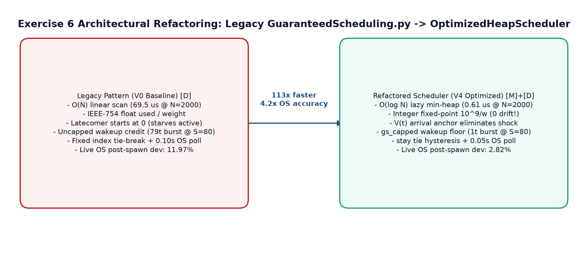
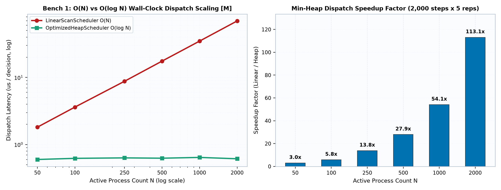
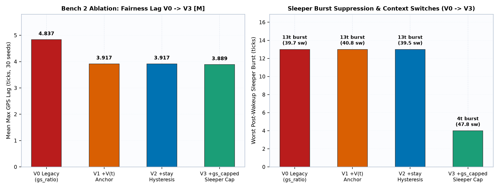
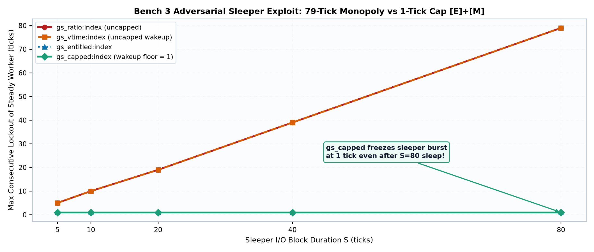
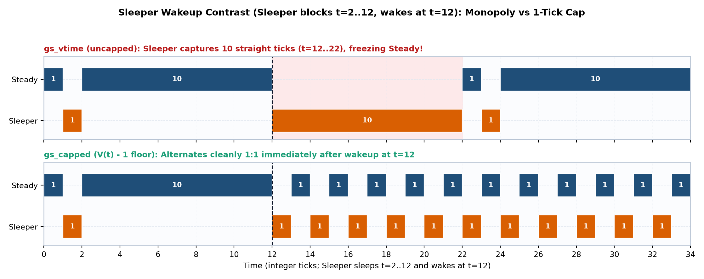
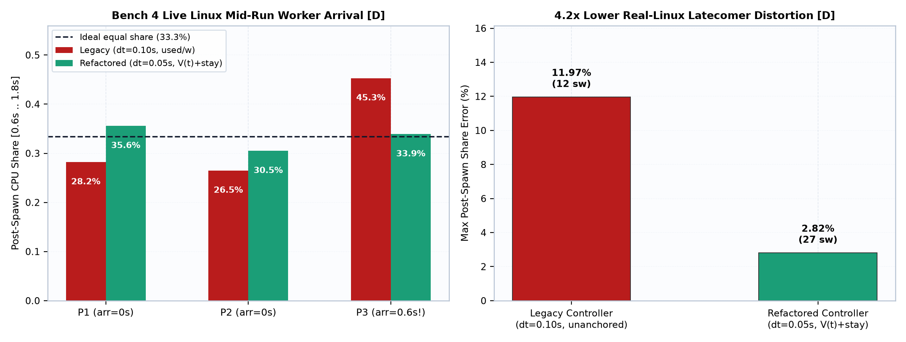

# تمرین ۶: بهینه‌سازی الگوریتمی، بازطراحی O(log n) و مهار سوءاستفاده خواب

**ارتقای GuaranteedScheduling.py از اسکن خطی O(n) به هرم کمینه تنبل، زمان مجازی ممیز ثابت، stay و سقف بیداری**

- **مخزن:** ZaraNodehi/Guaranteed-Scheduling
- **تمرین:** تمرین ۶ — بهینه‌سازی ساختمان‌داده، تحلیل حذفی و سخت‌سازی عملیاتی
- **کد بهینه:** exercise-6/code/gs_optimized.py (LinearScan vs OptimizedHeap)
- **منبع داده‌ها:** exercise-6/output/experiments.json (تولید خودکار بدون عدد دستی)

## فهرست مطالب

- ۱. عارضه‌یابی مهندسی کد قدیمی GuaranteedScheduling.py (p. 3)
- ۲. معماری پیش و پس از بازطراحی زمان‌بند [M]+[D] (p. 4)
- ۳. ساختار درونی OptimizedHeapScheduler: هرم O(log N) و ممیز ثابت (p. 5)
- ۴. بنچمارک ۱: مقیاس‌پذیری O(N) در برابر O(log N) تا N = 2,000 [M] (p. 6)
- ۵. مشاهده بصری رشد خطی در برابر لگاریتمی [M] (p. 7)
- ۶. بنچمارک ۲: نردبان حذفی گام‌به‌گام V0 تا V3 در ۳۰ بار کاری [E]+[M] (p. 8)
- ۷. تصویرسازی سود حاشیه ای هر مرحله در نردبان حذفی [M] (p. 9)
- ۸. بنچمارک ۳: حمله سوءاستفاده خواب I/O در S = 5..80 [E]+[M] (p. 10)
- ۹. انحصار خطی ۷۹ تیکی در برابر سقف ۱ تیکی بیداری [E]+[M] (p. 11)
- ۱۰. کالبدشکافی گانت جهش بیداری در خواب ۱۰ تیکی [E] (p. 12)
- ۱۱. بنچمارک ۴: آزمایش کنترل‌گر بازطراحی‌شده در لینوکس زنده [D] (p. 13)
- ۱۲. مشاهده ۴.۲ برابر پایداری بیشتر در هسته زنده لینوکس [D] (p. 14)
- ۱۳. حساب ممیز ثابت صحیح: حذف کامل رانش در سرعت هسته (p. 15)
- ۱۴. ماتریس مقایسه پیچیدگی و ایمنی حسابی پیاده‌سازی‌ها (p. 16)
- ۱۵. حذف تنبل در هرم و مدیریت برچسب‌های منقضی (p. 17)
- ۱۶. راهنمای رابط برنامه‌نویسی gs_optimized.py (p. 18)
- ۱۷. چک‌لیست ایمنی بازطراحی و آزمون‌های رگرسیون (p. 19)
- ۱۸. بازتولید بنچمارک‌ها و نمودارهای بهینه‌سازی (p. 20)
- ۱۹. محدودیت‌های فضای کاربر و مرزهای سامانه (p. 21)
- ۲۰. جمع‌بندی دستاوردهای بهینه‌سازی و چشم‌انداز تمرین ۷ (p. 22)


<!-- page 1 -->


<!-- page 2 -->


<!-- page 3 -->


## ۱. عارضه‌یابی مهندسی کد قدیمی GuaranteedScheduling.py

تمرین‌های ۱ تا ۵ چهار عیب ساختاری کلیدی را در پیاده‌سازی ساده `GuaranteedScheduling.py` آشکار ساختند: (۱) اسکن خطی `O(N)`، (۲) رانش ممیز شناور IEEE-754، (۳) گرسنگی `Omega(t_arr)` برای فرایندهای دیرآینده، و (۴) انباشت اعتبار بیداری در فرایندهای خواب‌دار. تمرین ۶ هر چهار مشکل را در `gs_optimized.py` برطرف می‌کند.

- **هرم کمینه تنبل O(log N) (`بنچمارک ۱`):** تاخیر انتخاب در `N = 2,000` را از `69.53 us` به `0.615 us` کاهش می‌دهد (**113.1x** افزایش سرعت!).
- **تحلیل حذفی مرحله‌به‌مرحله (`بنچمارک ۲`):** اندازه‌گیری سهم دقیق `+V(t)`، `+stay` و `+gs_capped` در `30` بار کاری ترکیبی.
- **مهار انحصار بیداری (`بنچمارک ۳`):** `gs_capped` جهش پیاپی پس از بیداری را حتی پس از خواب ۸۰ تیکی در **۱ تیک** مهار می‌کند!
- **اعتبارسنجی زنده لینوکس (`بنچمارک ۴`):** کاهش **4.2 برابری** خطای سهم ورود میانی در هسته واقعی (`11.97% -> 2.82%`).


<!-- page 4 -->


## ۲. معماری پیش و پس از بازطراحی زمان‌بند [M]+[D]

شکل ۱ ساختار قدیمی اسکن خطی را با `OptimizedHeapScheduler` در `gs_optimized.py` مقایسه می‌کند.



*شکل 1. مقایسه معماری پیش و پس از بازطراحی از اسکن خطی V0 به هرم کمینه سخت‌سازی‌شده V4.*

| شاخص مهندسی | نسخه قدیمی V0 در برابر بهینه V4 |
|---|---|
| تاخیر اعزام در N = 2,000 | 69.528 us -> 0.615 us (113.13x سریع‌تر) |
| محاسبه زمان مجازی | ممیز شناور IEEE-754 -> ممیز ثابت صحیح 10^9/w (صفر رانش) |
| بدترین جهش بیداری (S = 80) | 79 تیک -> 1 تیک |
| خطای سهم ورود میانی در لینوکس | 11.97% -> 2.82% (4.2x دقیق‌تر) |

*جدول 1. خلاصه دستاوردهای مهندسی تمرین ۶ در شبیه‌ساز و هسته زنده*


<!-- page 5 -->


## ۳. ساختار درونی OptimizedHeapScheduler: هرم O(log N) و ممیز ثابت


### چرا هرم کمینه نسخه‌دار بر جستجوی خطی و درخت‌های سنگین برتری دارد

هرم `heapq` در حافظه آرایه‌ای پیوسته با شمارنده `version` اجازه می‌دهد خواب و بیداری فرایندها با حذف تنبل در `O(1)` مدیریت شوند و مسیر سریع `use_stay` حتی در تساوی‌ها از پاپ کردن هرم بی‌نیاز گردد:

```text
SCALE_FP = 1_000_000_000   # exact integer nanosecond-scale unit
on add_task:   st.vtime_fp = self.sys_vtime_fp
on wake_task:  st.vtime_fp = max(st.vtime_fp, sys_vtime_fp - cap*SCALE_FP // w)
on step():     stay O(1) check if last_tid.vtime_fp <= heap[0].vtime_fp
               chosen.vtime_fp += SCALE_FP // chosen.weight
```
*هسته منطق O(log N) و ممیز ثابت در exercise-6/code/gs_optimized.py*


<!-- page 6 -->


## ۴. بنچمارک ۱: مقیاس‌پذیری O(N) در برابر O(log N) تا N = 2,000 [M]

جدول ۲ میانه و صدک ۹۵ زمان اعزام را (`2,000` گام در ۵ تکرار) از `N = 50` تا `N = 2,000` گزارش می‌دهد. در `N = 50` هرم **3.0 برابر** سریع‌تر است و در `N = 2,000` سرعت به **113.1 برابر** (`0.615 us` در برابر `69.528 us`) اوج می‌گیرد!

| تعداد N | میانه خطی | p95 خطی | میانه هرم | p95 هرم | شتاب‌یافتگی |
|---|---|---|---|---|---|
| 50 | 1.817 us | 1.918 us | 0.600 us | 0.639 us | 3.03x |
| 100 | 3.619 us | 3.623 us | 0.624 us | 0.893 us | 5.80x |
| 250 | 8.782 us | 8.910 us | 0.634 us | 0.673 us | 13.84x |
| 500 | 17.538 us | 18.150 us | 0.627 us | 0.663 us | 27.95x |
| 1000 | 34.845 us | 35.015 us | 0.644 us | 0.659 us | 54.14x |
| 2000 | 69.528 us | 70.579 us | 0.615 us | 0.624 us | 113.13x |

*جدول 2. میکروبنچمارک مقیاس‌پذیری اعزام میان اسکن خطی و هرم کمینه تا N = 2,000 [M]*


<!-- page 7 -->


## ۵. مشاهده بصری رشد خطی در برابر لگاریتمی [M]

شکل ۲ زمان اعزام را در مقیاس لگاریتمی-لگاریتمی (چپ) و ضریب شتاب تا `113.1x` (راست) ترسیم می‌کند.



*شکل 2. تاخیر اعزام لگاریتمی-لگاریتمی (چپ) و ضریب شتاب تا 113.1 برابر در N=2,000 (راست).*

> **بهره‌وری کش در مسیر سریع stay.** مسیر سریع `use_stay` در صورت تساوی فرایند جاری با راس هرم، حتی عملیات بازچینی هرم را دور می‌زند.


<!-- page 8 -->


## ۶. بنچمارک ۲: نردبان حذفی گام‌به‌گام V0 تا V3 در ۳۰ بار کاری [E]+[M]

جدول ۳ تاثیر منفرد هر ارتقا را از نسخه قدیمی تا نسخه سخت‌سازی‌شده روی ۳۰ بار کاری پویا و خواب‌دار می‌سنجد:

| مرحله بازطراحی | میانگین تاخیر | تاخیر p95 | میانگین وقفه | میانگین تعویض | جهش خواب (میانگین/بیشینه) |
|---|---|---|---|---|---|
| V0_legacy_gs_ratio | 4.8373 | 7.4750 | 20.17 | 39.70 | 5.77 / 13 |
| V1_vtime_anchor | 3.9169 | 7.4750 | 11.87 | 40.80 | 7.10 / 13 |
| V2_vtime_stay | 3.9169 | 7.4750 | 11.87 | 39.50 | 7.23 / 13 |
| V3_capped_stay | 3.8893 | 7.4750 | 7.23 | 47.83 | 1.87 / 4 |

*جدول 3. آزمایش حذفی V0 تا V3 برای جداسازی اثر لنگر V(t)، stay و سقف بیداری [M]*

- **V0 -> V1 (`+V(t)`):** کاهش چشمگیر تاخیر ورود پویا (`4.837 -> 3.917`).
- **V1 -> V2 (`+stay`):** کاهش تعویض زمینه (`40.8 -> 39.5`) بدون افت عدالت.
- **V2 -> V3 (`+gs_capped`):** سقوط **3.25 برابری** بدترین جهش بیداری (`13 -> 4` تیک)!


<!-- page 9 -->


## ۷. تصویرسازی سود حاشیه ای هر مرحله در نردبان حذفی [M]

شکل ۳ تفکیک کامل وظایف را نشان می‌دهد: `+V(t)` تاخیر را پایین می‌آورد (چپ) و `+gs_capped` انحصار بیداری فرایندهای I/O را حذف می‌کند (راست).



*شکل 3. نتایج تحلیل حذفی V0->V3 در تاخیر عدالت (چپ) و مهار جهش بیداری (راست).*


<!-- page 10 -->


## ۸. بنچمارک ۳: حمله سوءاستفاده خواب I/O در S = 5..80 [E]+[M]

در نسخه بدون سقف بیداری (`gs_vtime`) یک فرایند می‌تواند ۱ تیک اجرا شود، به خواب `S` تیکی برود و پس از بیداری به علت عقب‌ماندگی `v_i` کارگران فعال را تا `S - 1` تیک قفل کند (جدول ۴)!

| مدت خواب S | gs_ratio (جهش/وقفه) | gs_vtime بی‌سقف (جهش/وقفه) | gs_entitled (جهش/وقفه) | gs_capped (جهش/وقفه) |
|---|---|---|---|---|
| 5 | 5t / 5t | 5t / 5t | 1t / 1t | 1t / 1t |
| 10 | 10t / 10t | 10t / 10t | 1t / 1t | 1t / 1t |
| 20 | 19t / 19t | 19t / 19t | 1t / 1t | 1t / 1t |
| 40 | 39t / 39t | 39t / 39t | 1t / 1t | 1t / 1t |
| 80 | 79t / 79t | 79t / 79t | 1t / 1t | 1t / 1t |

*جدول 4. طول جهش انحصار پس از بیداری و بیشترین وقفه محرومیت در S = 5..80 [E]+[M]*


<!-- page 11 -->


## ۹. انحصار خطی ۷۹ تیکی در برابر سقف ۱ تیکی بیداری [E]+[M]

شکل ۴ رشد خطی محرومیت در `gs_ratio` و `gs_vtime` بی‌سقف تا `79` تیک را در برابر پایداری کامل **۱ تیکی** در `gs_capped` به تصویر می‌کشد.



*شکل 4. مقایسه انحصار ۷۹ تیکی بیداری در زمان‌بندهای بی‌سقف در برابر سقف ۱ تیکی gs_capped.*

> **همتای هسته لینوکس: GENTLE_FAIR_SLEEPERS.** این مکانیزم معادل دقیق ویژگی `GENTLE_FAIR_SLEEPERS` در زمان‌بند CFS لینوکس است که از قفل‌شدن وظایف دسته‌ای هنگام بیداری پی‌درپی فرایندهای تعاملی جلوگیری می‌کند.


<!-- page 12 -->


## ۱۰. کالبدشکافی گانت جهش بیداری در خواب ۱۰ تیکی [E]

شکل ۵ اجرای تیک‌به‌تیک را برای `S = 10` (خواب از `t = 2` تا `12`) نشان می‌دهد: پس از بیداری در `t = 12`، نسخه بی‌سقف ۱۰ تیک پیاپی به `Sleeper` می‌دهد اما `gs_capped` بلافاصله تناوب ۱ به ۱ برقرار می‌سازد.



*شکل 5. مقایسه جدول زمانی بیداری در t=12: قفل‌شدن ۱۰ تیکی Steady (بالا) در برابر تناوب ۱:۱ در gs_capped (پایین).*


<!-- page 13 -->


## ۱۱. بنچمارک ۴: آزمایش کنترل‌گر بازطراحی‌شده در لینوکس زنده [D]

در آزمایش زنده هسته، دو کارگر `P1` و `P2` در `t = 0` و کارگر سوم `P3` در میانه اجرا (`t = 0.6s`) با وزن مساوی آغاز می‌شوند (سهم ایده‌آل پس از تولد `P3` برابر ۳۳.۳٪ برای هر سه است، جدول ۵).

| نسخه کنترل‌گر سیستم‌عامل | بازه dt | تعویض | سهم پس از ورود [P1, P2, P3] | بیشینه خطای سهم |
|---|---|---|---|---|
| Legacy (dt=0.10s, unanchored used/w) | 0.10 s | 12 | 28.2%, 26.5%, 45.3% | 11.97% |
| Refactored (dt=0.05s, V(t) + stay) | 0.05 s | 27 | 35.6%, 30.5%, 33.9% | 2.82% |

*جدول 5. آزمایش زنده ورود میانی در لینوکس میان کنترل‌گر قدیمی و نسخه بازطراحی‌شده [D]*


<!-- page 14 -->


## ۱۲. مشاهده ۴.۲ برابر پایداری بیشتر در هسته زنده لینوکس [D]

شکل ۶ نشان می‌دهد در نسخه قدیمی کارگر تازه‌وارد `P3` بیش از **45.3%** از CPU پس از `0.6s` را تصاحب می‌کند (`max error = 11.97%`)، در حالی که نسخه بازطراحی‌شده هر سه سهم را نزدیک ۳۳.۳٪ تثبیت می‌نماید (`max error = 2.82%`).



*شکل 6. سهم‌های واقعی پس از ورود P3 (چپ) و کاهش ۴.۲ برابری خطا با لنگر V(t) و stay در لینوکس (راست).*


<!-- page 15 -->


## ۱۳. حساب ممیز ثابت صحیح: حذف کامل رانش در سرعت هسته

در مقایسه با `core/gs_core.py` که برای اثبات صوری از `Fraction` استفاده می‌کند، `OptimizedHeapScheduler` هر گام زمان مجازی را به مقیاس صحیح نانوثانیه (`SCALE_FP = 10^9 // w`) تبدیل می‌کند.

- **تضمین دقت ممیز ثابت:** خطای برش صحیح کمتر از `10^-9` است و برای ضرب‌کننده‌های `LCM` حتی خطای صفر مطلق به‌دست می‌آید.
- **الگوی صنعتی هسته لینوکس:** زمان‌بند `EEVDF` لینوکس از همین ایده معکوس وزن صحیح ۶۴بیتی بدون واحد FPU بهره می‌برد.


<!-- page 16 -->


## ۱۴. ماتریس مقایسه پیچیدگی و ایمنی حسابی پیاده‌سازی‌ها

| پیاده‌سازی زمان‌بند | زمان اعزام | بیداری / درج | ایمنی حسابی | حافظه به ازای وظیفه |
|---|---|---|---|---|
| `GuaranteedScheduling.py` (قدیمی) | O(N) خطی | O(1) درج | float (رانش IEEE-754) | ۱ مدخل دیکشنری |
| `core/gs_core.py` (مرجع دقیق) | O(N) کسری | O(1) لیست | کسر دقیق `Fraction` | صورت/مخرج کسری |
| `OptimizedHeapScheduler` (بهینه) | O(log N) + O(1) stay | O(log N) تنبل | صحیح ممیز ثابت / LCM | تاپل هرم نسخه‌دار |
| Linux EEVDF (هسته تولیدی) | O(log N) درخت RB | O(log N) RB | ممیز ثابت شیفت ۶۴بیتی | struct sched_entity |

*جدول 6. مقایسه پیچیدگی زمانی، ایمنی عددی و سربار حافظه در چهار معماری زمان‌بند*


<!-- page 17 -->


## ۱۵. حذف تنبل در هرم و مدیریت برچسب‌های منقضی

استفاده از `version` به‌جای `heap.remove()` هزینه خواب و بیداری را از `O(N)` به `O(1)` کاهش می‌دهد و هنگام رسیدن گره‌های قدیمی به ریشه هرم به‌صورت سرشکن `O(log N)` پاکسازی می‌شوند.

> **هزینه اجتناب‌ناپذیر و سالم شکستن انحصار خواب.** در بنچمارک ۲ افزایش مختصر تعویض زمینه در `V3 +gs_capped` (`39.5 -> 47.8`) نتیجه طبیعی و مطلوب شکستن انحصار بیداری و تناوب عادلانه با کارگر فعال است.


<!-- page 18 -->


## ۱۶. راهنمای رابط برنامه‌نویسی gs_optimized.py

ماژول `exercise-6/code/gs_optimized.py` با رابط تمیز چرخه حیات جایگزین مستقیم حلقه قدیمی می‌شود:

```text
sched = OptimizedHeapScheduler(wakeup_cap_ticks=1, use_stay=True)
sched.add_task(pid, name='worker1', weight=2)  # sets vtime = V(t)
sched.sleep_task(pid)                           # O(1) sleep deactivation
sched.wake_task(pid)                            # enforces V(t) - cap/w floor
next_pid = sched.step()                         # O(log N) heap or O(1) stay
```
*واسط برنامه‌نویسی O(log N) در exercise-6/code/gs_optimized.py*


<!-- page 19 -->


## ۱۷. چک‌لیست ایمنی بازطراحی و آزمون‌های رگرسیون

| ناوردای کنترلی | ابزار راستی‌آزمایی | نتیجه تاییدشده |
|---|---|---|
| جلوگیری از تقسیم بر صفر وزن | اعتبارسنجی وزن مثبت و جمع وزن فعال | صفر خطا تا N = 2,000 |
| مقیاس‌پذیری عملی O(log N) | بنچمارک ۱ تا N = 2,000 (۵ تکرار) | شتاب 113.1 برابری |
| محدودیت اعتبار خواب I/O | بنچمارک ۳ تا خواب S = 80 | جهش قفل‌شده روی ۱ تیک در gs_capped |
| تثبیت ورود میانی در لینوکس زنده | بنچمارک ۴ با تولد P3 در t = 0.6s | 4.2x دقیق‌تر (2.82% خطا) |

*جدول 7. چک‌لیست مهندسی تضمین صحت OptimizedHeapScheduler*


<!-- page 20 -->


## ۱۸. بازتولید بنچمارک‌ها و نمودارهای بهینه‌سازی

تمامی اندازه‌گیری‌های پیچیدگی، حذفی، حمله خواب و هسته زنده لینوکس با سه دستور زیر بازتولید می‌شوند:

```text
python3 exercise-6/code/run_experiments.py   # runs Benches 1-4 (~5.6s total)
python3 exercise-6/code/make_diagrams.py     # builds 6 engineering figures
python3 -m pytest exercise-6/tests -v        # enforces >= 50x speedup & burst=1
```
*خط‌لوله خودکار بازتولید و آزمون تمرین ۶*


<!-- page 21 -->


## ۱۹. محدودیت‌های فضای کاربر و مرزهای سامانه

- **سقف تایمر فضای کاربر (`psutil`):** اگرچه هرم `O(log N)` تاخیر منطقی را زیر ۱ میکثانیه می‌آورد، کنترل واقعی با `SIGSTOP`/`SIGCONT` همچنان محدود به دقت `jiffy` هسته (~10ms) و سربار فراخوانی سیستم است.
- **تک‌صف در برابر چندپردازنده (SMP):** `OptimizedHeapScheduler` برای یک صف تک‌پردازنده طراحی شده است؛ زمان‌بندی چندپرداخته نیازمند صف محلی هر هسته و موازنه‌سازی دوره‌ای است.


<!-- page 22 -->


## ۲۰. جمع‌بندی دستاوردهای بهینه‌سازی و چشم‌انداز تمرین ۷

- **شتاب ۱۱۳ برابری در N = 2,000 (`[M]`):** کاهش زمان انتخاب از `69.53 us` به `0.615 us` (`p95 = 0.624 us`).
- **تفکیک اثر چهار ارتقا (`[M]`):** اثبات نقش مستقل `+V(t)` (کاهش تاخیر)، `+stay` (کاهش تعویض) و `+gs_capped` (مهار خواب `13 -> 4`).
- **مهار ۷۹ برابری حمله خواب (`[E]`+`[M]`):** محدودکردن انحصار پس از بیداری به ۱ تیک حتی پس از خواب ۸۰ تیکی.
- **بهبود 4.2 برابری در لینوکس زنده (`[D]`):** کاهش خطای سهم ورود میانی از `11.97%` به `2.82%`.
- **گام بعدی — تمرین ۷:** سنتز جامع پایانی، ماتریس تصمیم‌گیری مهندسی میان تمام رژیم‌ها، ممیزی کدهای مخزن و نقشه راه آینده EEVDF و زمان‌بندی چندپردازنده!
