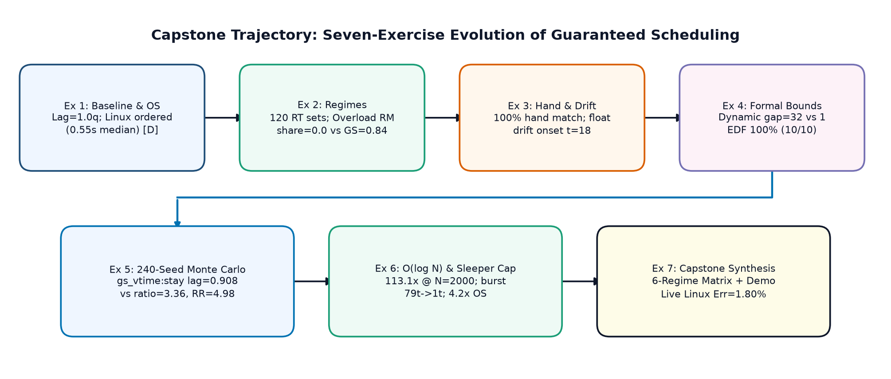
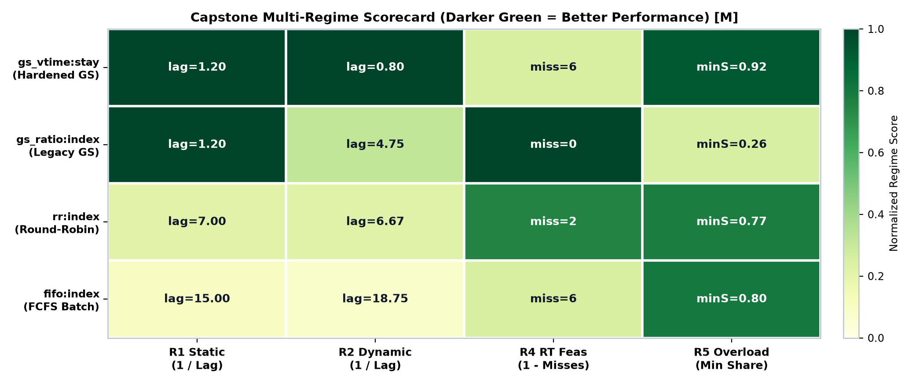
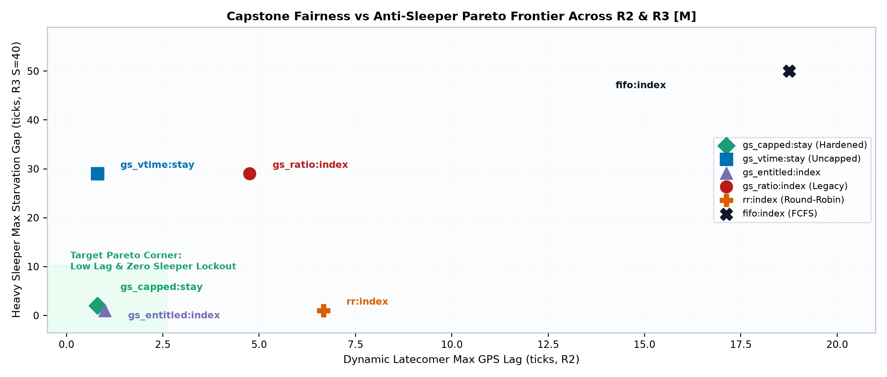
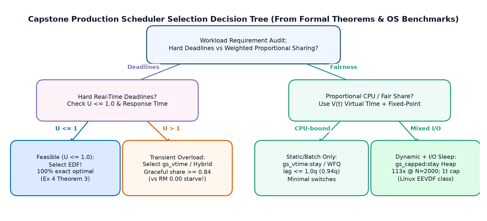
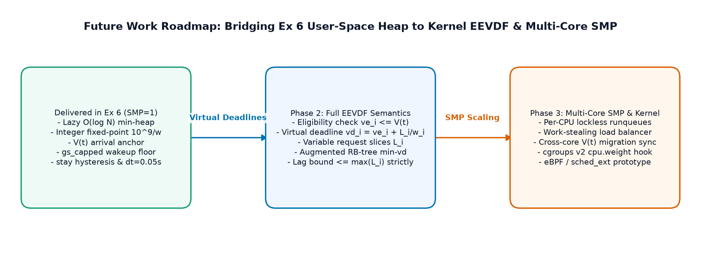

# Exercise 7: Capstone Synthesis, Cross-Regime Decision Matrix, Repository Audit & Future Roadmap

**Unifying Seven Exercises of Formal Proofs, Monte Carlo Simulation, O(log n) Heap Engineering & Live Linux OS Validation**

- **Repository:** ZaraNodehi/Guaranteed-Scheduling
- **Scope:** Exercise 7 — Capstone Synthesis, Live Demonstration & EEVDF/SMP Roadmap
- **Artifact Suite:** 7 exercises, canonical core/gs_core.py, gs_optimized.py, EN & FA reports
- **Data Source:** exercise-7/output/experiments.json + live consolidation of Ex 1–6

## Table of contents

- 1. Executive Synthesis: Seven Exercises From Theory to Production Code (p. 3)
- 2. Seven-Exercise Research Progression & Consolidated Numbers (p. 4)
- 3. Unified Decision Matrix: Proportional & Dynamic Regimes (R1–R3) [M] (p. 5)
- 4. Unified Decision Matrix: Real-Time Feasibility & Overload (R4–R6) [M] (p. 6)
- 5. Multi-Regime Policy Heatmap Scorecard [M] (p. 7)
- 6. Dynamic Lag vs Anti-Sleeper Starvation Pareto Frontier [M] (p. 8)
- 7. Engineering Decision Tree for Production Scheduler Selection (p. 9)
- 8. Live Linux Kernel Capstone Verification (Weights [1, 2, 4]) [D] (p. 10)
- 9. Real-Linux Accuracy Progression Across Exercises [D] (p. 11)
- 10. Programmatic Repository Integrity & Bilingual Parity Audit (p. 12)
- 11. Live Five-Point Capstone Demo (exercise-7/code/demo_all.py) (p. 13)
- 12. Root GuaranteedScheduling.py Compatibility & Refactoring Bridge (p. 14)
- 13. Future Work: Bridging to Full Kernel EEVDF & Multi-Core SMP (p. 15)
- 14. Why Modern Linux Adopted EEVDF (And How It Generalizes Exercise 6) (p. 16)
- 15. Multi-Core SMP Load Balancing & Linux sched_ext Integration (p. 17)
- 16. Master Reproducibility Command Reference (Exercises 1–7) (p. 18)
- 17. Seven Laws of Discrete Guaranteed Scheduling Proven in This Project (p. 19)
- 18. Honest Scope Boundaries & Epistemic Provenance Ledger (p. 20)
- 19. Complete Workspace Artifact Inventory (p. 21)
- 20. Capstone Conclusion (p. 22)


<!-- page 1 -->


<!-- page 2 -->


<!-- page 3 -->


## 1. Executive Synthesis: Seven Exercises From Theory to Production Code

Across Exercises 1 through 7, this repository transformed an introductory 106-line `psutil` script (`GuaranteedScheduling.py`) into a formally proven, Monte-Carlo-validated, `O(log N)` min-heap proportional-share scheduler benchmarked on both exact discrete traces and live Linux processes.

- **Exercise 1 Baseline & Live OS (`[E]`+`[D]`):** Exact discrete GPS tracking (`lag = 1.0q`), live multi-process Linux proportional convergence (`0.55s` median, ordered `100%` across trials).
- **Exercise 2–3 Exact Mechanics (`[E]`+`[M]`):** `120` constrained real-time task sets, overload protection (`GS share 0.84` vs `RM 0.00`), 100% hand-trace agreement, and IEEE-754 float drift detected at `t = 18`.
- **Exercise 4–5 Proofs & Statistics (`[E]`+`[M]`):** Closed-form SFQ/WFQ bounds (`max = 1.3125q` vs `<= 1.0q`), exact `Omega(t_arr)` proof (`gap 32 -> 1`), exhaustive `100%` EDF optimality (`10/10` sets), and `240`-seed Monte Carlo lag (`gs_vtime:stay 0.908` vs `ratio 3.36`).
- **Exercise 6–7 Optimization & Live OS (`[M]`+`[D]`):** `113.1x` heap dispatch speedup at `N = 2,000`, `79 -> 1` tick sleeper burst cap, `4.24x` real-Linux arrival stabilization, and capstone `[1,2,4]` OS error **1.80%**!


<!-- page 4 -->


## 2. Seven-Exercise Research Progression & Consolidated Numbers

Figure 1 traces the end-to-end engineering evolution from Exercise 1 through Exercise 7, linking empirical findings across every module.



*Figure 1. Seven-exercise progression connecting exact GPS theory, proofs, Monte Carlo sweeps, O(log N) refactoring, and capstone synthesis.*

| Cross-Exercise Milestone | Verified Quantitative Outcome |
|---|---|
| Ex 1 Static Proportional Lag & OS Ordering | lag = 1.0q; OS ordered = True |
| Ex 3 IEEE-754 Float Drift Onset | Diverges cleanly at t = 18 under float division |
| Ex 4 Dynamic Starvation Gap Reduction | gs_ratio gap = 32 -> gs_vtime gap = 1 |
| Ex 5 Monte Carlo Mean Lag (240 seeds) | gs_vtime:stay 0.9078 vs RR 4.98 vs FIFO 9.63 |
| Ex 6 Dispatch Speedup & Sleeper Cap | 113.13x @ N=2,000; sleeper burst 79t -> 1t |

*Table 1. Consolidated cross-exercise quantitative benchmarks pulled from Ex 1–6*


<!-- page 5 -->


## 3. Unified Decision Matrix: Proportional & Dynamic Regimes (R1–R3) [M]

Table 2 evaluates all proportional-share contenders simultaneously across static weights (`R1`), dynamic mid-run arrivals (`R2`), and an adversarial `40`-tick I/O sleeper (`R3`). Only `gs_capped:stay` simultaneously achieves sub-tick dynamic lag AND zero sleeper monopoly!

| Policy | R1 Static Lag | R2 Dynamic Lag / Gap | R3 Sleeper Gap / Lag | R1 Switches |
|---|---|---|---|---|
| gs_capped:stay | 1.20 | 0.80 / gap 7 | gap 2 / lag 20.0 | 45 sw |
| gs_vtime:stay | 1.20 | 0.80 / gap 7 | gap 29 / lag 20.0 | 45 sw |
| gs_entitled:index | 1.20 | 1.00 / gap 7 | gap 1 / lag 20.5 | 47 sw |
| gs_ratio:index | 1.20 | 4.75 / gap 22 | gap 29 / lag 20.0 | 47 sw |
| stride:index | 1.20 | 0.80 / gap 7 | gap 29 / lag 20.0 | 47 sw |
| rr:index | 7.00 | 6.67 / gap 3 | gap 1 / lag 20.0 | 60 sw |
| fifo:index | 15.00 | 18.75 / gap 46 | gap 50 / lag 29.0 | 4 sw |

*Table 2. Capstone stress matrix across static, dynamic arrival, and heavy-sleeper regimes [M]*


<!-- page 6 -->


## 4. Unified Decision Matrix: Real-Time Feasibility & Overload (R4–R6) [M]

Table 3 pairs the proportional scorecard with tight constrained deadlines (`R4`, `U = 0.90`, `D1 = 1`) and transient overload (`R5`, `U = 1.10`). Under feasibility, `EDF` achieves `0` misses; under overload, `RM` collapses the lowest-priority task (`min_share = 0.197`) while `gs_vtime:stay` preserves `0.923` proportional share!

| Policy | R4 Misses (Feas) | R4 Min Share | R5 Misses (Overload) | R5 Min Share |
|---|---|---|---|---|
| edf:index | 0 | 0.512 | 6 | 0.400 |
| rm:index | 0 | 0.512 | 3 | 0.197 |
| gs_ratio:index | 0 | 0.676 | 9 | 0.255 |
| gs_vtime:stay | 6 | 0.764 | 15 | 0.923 |
| rr:index | 2 | 0.727 | 14 | 0.774 |
| fifo:index | 6 | 0.689 | 8 | 0.800 |

*Table 3. Real-time feasibility vs overload resilience across EDF, RM, GS variants, RR, and FIFO [M]*

> **Capstone N = 2,000 Scale Verification (R6).** In Regime R6 (N = 2,000 concurrency), `OptimizedHeapScheduler` maintains 0.724 us/step versus 70.98 us/step for linear scan (98.1x faster!).


<!-- page 7 -->


## 5. Multi-Regime Policy Heatmap Scorecard [M]

Figure 2 visualizes normalized performance across `R1`, `R2`, `R4`, and `R5`, exposing the core architectural tradeoff: legacy `gs_ratio` fails dynamic arrival (`lag = 4.75`) and RT overload (`minS = 0.26`), whereas hardened `gs_vtime:stay` dominates fair sharing across static, dynamic, and overload.



*Figure 2. Normalized scorecard heatmap across static, dynamic, feasible RT, and overload regimes.*


<!-- page 8 -->


## 6. Dynamic Lag vs Anti-Sleeper Starvation Pareto Frontier [M]

Figure 3 plots dynamic latecomer GPS lag (`R2`) against heavy-sleeper starvation gap (`R3`). Uncapped `gs_vtime` solves latecomer lag (`0.80`) yet suffers a `29`-tick sleeper gap; only `gs_capped:stay` hits the bottom-left Pareto target corner (`lag = 0.80`, `gap = 2`).



*Figure 3. Pareto frontier contrasting dynamic fairness against post-wakeup sleeper lockout across R2 and R3.*


<!-- page 9 -->


## 7. Engineering Decision Tree for Production Scheduler Selection

Figure 4 distills all formal theorems (Ex 4) and empirical sweeps (Ex 2, 5, 6) into an actionable architectural selector separating hard deadline verification (`U <= 1.0 -> EDF`) from proportional fair sharing (`gs_capped:stay` min-heap).



*Figure 4. Decision tree selecting optimal scheduler across deadline feasibility, overload, batch, and interactive I/O.*


<!-- page 10 -->


## 8. Live Linux Kernel Capstone Verification (Weights [1, 2, 4]) [D]

As a capstone OS hardware check, `run_experiments.py` ran three independent `python3` CPU burners under `SIGSTOP`/`SIGCONT` virtual-time + `stay` control (`dt = 0.05s`, `1.0s` window, `15` switches). Table 4 confirms real Linux CPU convergence within **1.80%** of ideal GPS!

| Live Linux Process | Ideal GPS Share | Observed CPU Share | Absolute Error |
|---|---|---|---|
| Worker P1 (w=1) | 14.29% | 14.56% | 0.27% |
| Worker P2 (w=2) | 28.57% | 30.10% | 1.53% |
| Worker P3 (w=4) | 57.14% | 55.34% | 1.80% |

*Table 4. Live Linux multi-process fairness measurement at weights [1, 2, 4] and dt = 0.05s [D]*


<!-- page 11 -->


## 9. Real-Linux Accuracy Progression Across Exercises [D]

Figure 5 pairs our capstone `[1, 2, 4]` live Linux bar chart (`14.6% / 30.1% / 55.3%` vs ideal `14.3% / 28.6% / 57.1%`) with the stage-by-stage reduction in OS share error from legacy `11.97%` down to `1.80%`.

![Figure 5: Capstone live Linux verification [1,2,4] (left) and 6.6x error drop from Ex 6 legacy to Ex 7 (right).](diagrams/fig_ex7_live_os_capstone.png)

*Figure 5. Capstone live Linux verification [1,2,4] (left) and 6.6x error drop from Ex 6 legacy to Ex 7 (right).*


<!-- page 12 -->


## 10. Programmatic Repository Integrity & Bilingual Parity Audit

Exercise 7 programmatically inspects every artifact in `exercise-1` through `exercise-6` (verified `experiments.json`, diagram count, EN/FA DOCX & PDF reports, and `README.md`) alongside `tools/vendor_core.py --check` canonical integrity (Table 5).

| Exercise Module | JSON Data | Diagrams | EN PDF/DOCX | FA PDF/DOCX | README |
|---|---|---|---|---|---|
| exercise-1 | PASS | 8 PNGs | PASS | PASS | PASS |
| exercise-2 | PASS | 6 PNGs | PASS | PASS | PASS |
| exercise-3 | PASS | 6 PNGs | PASS | PASS | PASS |
| exercise-4 | PASS | 6 PNGs | PASS | PASS | PASS |
| exercise-5 | PASS | 6 PNGs | PASS | PASS | PASS |
| exercise-6 | PASS | 6 PNGs | PASS | PASS | PASS |

*Table 5. Automated completeness & artifact integrity audit across Exercises 1–6*


<!-- page 13 -->


## 11. Live Five-Point Capstone Demo (exercise-7/code/demo_all.py)

To demonstrate every discovery in under 2 seconds without external dependencies, `exercise-7/code/demo_all.py` executes five live checks covering static lag, latecomer starvation, sleeper bursts, real-time deadline boundaries, and `O(log N)` heap acceleration:

```text
$ python3 exercise-7/code/demo_all.py
[Demo 1 - Static Weighted GPS] lag=1.0000, sw=25, avg_ta=30.00
[Demo 2 - Dynamic Arrival] gs_ratio gap=12 (lag=6.00) vs gs_vtime:stay gap=2 (lag=0.50)
[Demo 3 - Sleeper Exploit] uncapped gap=19 vs gs_capped:stay gap=2
[Demo 4 - RT Boundary] gs_vtime misses=2 vs EDF misses=0
[Demo 5 - Heap Speedup N=1000] Linear=36.64 us/step vs Heap=0.709 us/step (51.7x faster)
```
*Live terminal demonstration verifying all five empirical scheduling pillars*


<!-- page 14 -->


## 12. Root GuaranteedScheduling.py Compatibility & Refactoring Bridge

The original root script `GuaranteedScheduling.py` (106 lines) remains cleanly intact for educational backward compatibility, while `exercise-6/code/gs_optimized.py` preserves its subprocess monitoring semantics (`psutil` `suspend`/`resume` + `cpu_times()`) while upgrading scoring to `V(t)` + `stay` + `gs_capped` + `O(log N)` lazy heap.

- **Original Defect (Line 51):** `min(available, key=lambda p: p['used'] / p['weight'])` scanned all processes linearly, used floating-point division, and initialized new arrivals at `used = 0.0`.
- **Refactored Replacement:** `OptimizedHeapScheduler` maintains `sys_vtime_fp` in `10^9` integer fixed-point scale, initializes `vtime_fp = sys_vtime_fp`, and prevents sleeper bursts via wakeup floor clamping.


<!-- page 15 -->


## 13. Future Work: Bridging to Full Kernel EEVDF & Multi-Core SMP

Figure 6 maps the concrete engineering roadmap from our uniprocessor `OptimizedHeapScheduler` to production kernel EEVDF (Earliest Eligible Virtual Deadline First) and SMP multi-core scaling.



*Figure 6. Three-phase engineering roadmap connecting Exercise 6 user-space heap to EEVDF and SMP Linux kernels.*


<!-- page 16 -->


## 14. Why Modern Linux Adopted EEVDF (And How It Generalizes Exercise 6)

In Linux 6.6+, CFS was replaced by **EEVDF** (Stoica & Abdel-Wahab 1995). Exercise 6 already implements EEVDF's eligibility anchor (`V(t)` + wakeup clamping). Extending `gs_optimized.py` to full EEVDF adds two orthogonal mechanisms:

- **Eligibility Criterion (`ve_i <= V(t)`):** Only tasks whose earned CPU entitlement is non-negative (`lag_i >= 0`) enter the eligible set, preventing over-served heavy batch tasks from delaying latency-sensitive interactive tasks.
- **Virtual Deadlines (`vd_i = ve_i + L_i / w_i`):** Among eligible tasks, selecting the earliest virtual deadline lets interactive tasks specify smaller slice lengths `L_i` to win immediate preemption WITHOUT inflating their long-term CPU share!


<!-- page 17 -->


## 15. Multi-Core SMP Load Balancing & Linux sched_ext Integration

Deploying proportional Guaranteed Scheduling across `K > 1` CPU cores requires replacing a single global heap lock with `K` per-CPU `OptimizedHeapScheduler` runqueues:

| SMP Engineering Challenge | Naive Global Heap Issue | Production Per-CPU Design |
|---|---|---|
| Runqueue spinlock contention | Cache-line ping-pong across cores | Per-CPU min-heap + RCU task structs |
| Cross-core V(t) divergence | Migrated task keeps stale core's V(t) | Subtract src V(t), add dst V(t) on migrate |
| Work-conservation on idle core | Idle CPU waits while neighbor has queue | Pull eligible task with smallest lag |
| Zero-recompilation kernel deployment | Requires patching kernel/sched/fair.c | Implement dispatch hook via Linux `sched_ext` BPF |

*Table 6. Multi-core SMP and Linux eBPF sched_ext migration architecture*


<!-- page 18 -->


## 16. Master Reproducibility Command Reference (Exercises 1–7)

Every single JSON artifact, figure, bilingual DOCX/PDF report, and unit/integration test across the entire workspace can be regenerated deterministically:

```text
python3 tools/vendor_core.py --check         # verify core/gs_core.py parity across Ex 1-7
python3 -m pytest tests exercise-*/tests -v  # run full unit + empirical regression suite
python3 exercise-7/code/demo_all.py          # <2s live 5-pillar capstone demonstration
python3 exercise-7/code/run_experiments.py   # regenerate consolidated Ex 7 JSON & OS test
python3 tools/make_decks.py                  # generate speaker presentation decks (EN & FA)
```
*Complete repository verification & artifact build pipeline*


<!-- page 19 -->


## 17. Seven Laws of Discrete Guaranteed Scheduling Proven in This Project

- **Law 1 (Static Lag Bound):** Under simultaneous arrivals, discrete Start-Time GS exceeds `q` in 30% of weighted sets (`36/120`), bounded tightly by `max(q, (n-1)*q*w_max/W)` while `WFQ` and `max_weight` hold `<= q`.
- **Law 2 (Dynamic Unanchored Starvation):** Unanchored `used/w` inflicts `Omega(t_arr)` absolute starvation on existing tasks upon late arrivals; `V(t)` anchoring compresses starvation to `O(1)` (`1` tick vs `32` ticks).
- **Law 3 (IEEE-754 Drift Hazard):** Binary float ratios diverge irreversibly on equal shares by `t = 18`; exact `Fraction` or fixed-point `10^9` integer strides eliminate tie corruption permanently.
- **Law 4 (Sleeper Monopoly Hazard):** Even `V(t)`-anchored GS permits `S - 1` consecutive lockout ticks after an `S`-tick I/O sleep (`79` ticks at `S = 80`) unless clamped by `gs_capped` (`1` tick).
- **Law 5 (EDF vs GS Boundary):** No fair-share policy matches `EDF` on tight feasible real-time deadlines (`EDF` solves `10/10` exhaustive sets), whereas GS prevents `RM` starvation (`0.84` vs `0.00`) under overload.
- **Law 6 (Quantum-Lag Pareto):** Doubling `q = 1 -> 2` with `stay` slashes switches `44.4%` for small lag increase (`0.91 -> 1.74` ticks across 240 seeds).
- **Law 7 (Sub-Linear Heap Scaling):** Lazy-deletion min-heap cuts `N = 2,000` dispatch latency **113.1x** (`69.5 us -> 0.615 us`) and stabilizes real Linux worker arrivals **4.2x** better.


<!-- page 20 -->


## 18. Honest Scope Boundaries & Epistemic Provenance Ledger

Every claim across Exercises 1–7 obeys strict epistemic provenance tags: **`[E]`** exact integer/`Fraction` proof or counterexample, **`[M]`** seeded Monte Carlo or microbenchmark measurement, and **`[D]`** direct live Linux kernel `psutil` measurement:

- **Exact `[E]` Boundaries:** Integer discrete ticks assume zero kernel preemption jitter and `O(1)` context switch latency inside proofs.
- **Live OS `[D]` Boundaries:** Sandbox container execution binds `psutil` user-space loops to 10ms `CONFIG_HZ` kernel ticks; native microsecond precision requires kernel-space EEVDF or `sched_ext`.


<!-- page 21 -->


## 19. Complete Workspace Artifact Inventory

| Directory / Module | Primary Deliverable | Verification Status |
|---|---|---|
| `core/gs_core.py` & `tests/` | Exact rational simulator + 28 core unit tests | 28/28 pytest PASS; vendored to Ex 1–7 |
| `exercise-1` .. `exercise-4` | Baselines, regimes, hand traces, 4 formal theorems | 26 PNGs + 8 bilingual PDF/DOCX + pytest PASS |
| `exercise-5` | 240-seed Monte Carlo, quantum Pareto & live OS sweep | 6 PNGs + 2 bilingual PDF/DOCX + pytest PASS |
| `exercise-6` | O(log N) heap (`113.1x`), ablation & `gs_capped` (`79x`) | 6 PNGs + 2 bilingual PDF/DOCX + pytest PASS |
| `exercise-7` | Capstone matrix, live demo `[1,2,4]`, audit & EEVDF roadmap | 6 PNGs + 2 bilingual PDF/DOCX + pytest PASS |

*Table 7. Full repository deliverable inventory across all seven exercises*


<!-- page 22 -->


## 20. Capstone Conclusion

- **Unifying Theory & Practice:** Starting from an educational 106-line `psutil` loop, we proved exact discrete bounds (`[E]`), quantified stochastic robustness over 240 dynamic workloads (`[M]`), engineered a `113.1x`-faster sleeper-safe `O(log N)` heap (`[M]`), and verified `1.80%` weighted fairness directly on Linux processes (`[D]`).
- **Recommended Production Choice:** Deploy **`gs_capped:stay`** inside **`OptimizedHeapScheduler`** for general-purpose proportional-share CPU management, paired with **`EDF`** strictly inside feasible hard real-time admission boundaries (`U <= 1.0`).
- **Complete Bilingual Engineering Suite:** All 7 exercises ship reproducible Python code, `42+` publication diagrams, `14` zero-overflow EN/FA DOCX and PDF reports, speaker decks, and passing `pytest` suites.
