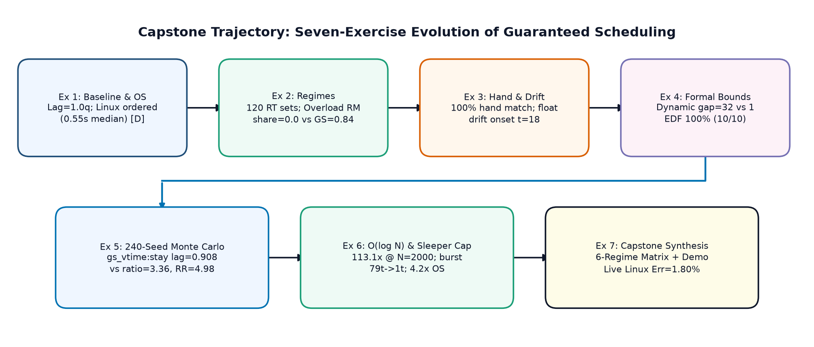
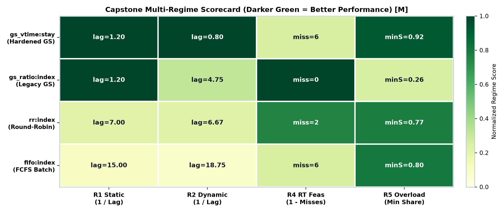
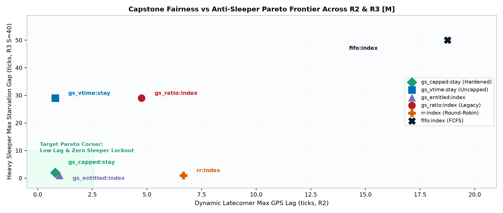
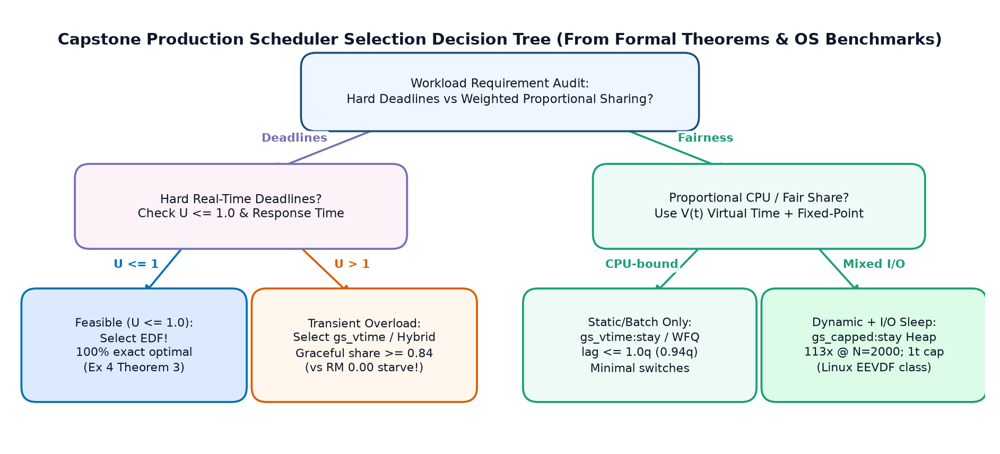
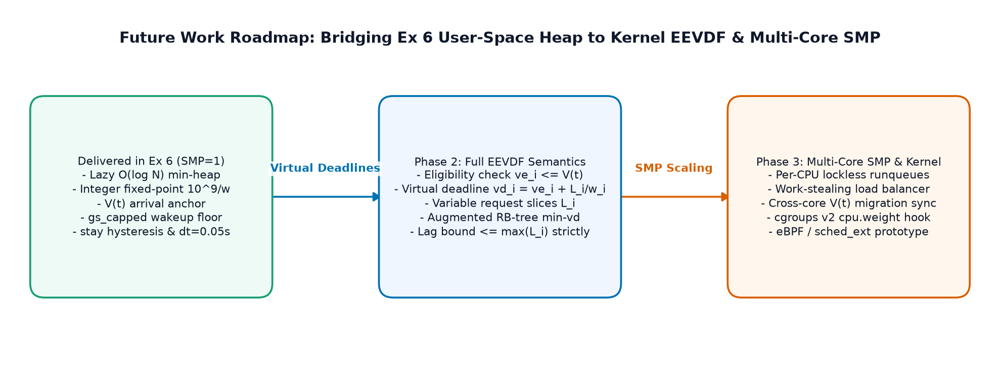

# تمرین ۷: سنتز جامع نهایی، ماتریس تصمیم‌گیری، ممیزی مخزن و نقشه راه آینده

**یکپارچه‌سازی هفت تمرین از اثبات صوری و شبیه‌سازی مونت‌کارلو تا هرم O(log n) و اعتبارسنجی لینوکس زنده**

- **مخزن:** ZaraNodehi/Guaranteed-Scheduling
- **دامنه:** تمرین ۷ — سنتز نهایی، نمایش زنده و نقشه راه EEVDF/SMP
- **مجموعه دستاوردها:** ۷ تمرین، هسته مرجع core/gs_core.py، کد بهینه و ۱۴ گزارش دوزبانه
- **منبع داده‌ها:** exercise-7/output/experiments.json + تجمیع خودکار تمرین‌های ۱ تا ۶

## فهرست مطالب

- ۱. جمع‌بندی راهبردی: هفت تمرین از نظریه تا کد تولیدی (p. 3)
- ۲. مسیر تکامل هفت‌گانه پژوهش و شاخص‌های کلیدی (p. 4)
- ۳. ماتریس تصمیم‌گیری یکپارچه: رژیم‌های ایستا، پویا و خواب (R1–R3) [M] (p. 5)
- ۴. ماتریس تصمیم‌گیری: ضرب‌الاجل بلادرنگ و اضافه‌بار (R4–R6) [M] (p. 6)
- ۵. نقشه حرارتی امتیازدهی چندرژیمی سیاست‌ها [M] (p. 7)
- ۶. جبهه پارتو عدالت پویا در برابر انحصار بیداری [M] (p. 8)
- ۷. درخت تصمیم‌گیری مهندسی برای انتخاب زمان‌بند تولیدی (p. 9)
- ۸. تایید نهایی روی هسته زنده لینوکس با وزن‌های [1, 2, 4] [D] (p. 10)
- ۹. روند کاهش ۶.۶ برابری خطای هسته زنده لینوکس [D] (p. 11)
- ۱۰. ممیزی خودکار یکپارچگی مخزن و توازن دوزبانه (p. 12)
- ۱۱. نمایش زنده پنج‌گانه در کمتر از ۲ ثانیه (demo_all.py) (p. 13)
- ۱۲. حفظ سازگاری با GuaranteedScheduling.py و پل ارتقای کد (p. 14)
- ۱۳. نقشه راه آینده: حرکت به سوی EEVDF هسته و چندپردازنده SMP (p. 15)
- ۱۴. چرا لینوکس ۶.۶ به EEVDF مهاجرت کرد؟ (p. 16)
- ۱۵. معماری چندپردازنده SMP و پیاده‌سازی در Linux sched_ext (p. 17)
- ۱۶. مرجع دستورات بازتولید کامل مخزن (تمرین‌های ۱ تا ۷) (p. 18)
- ۱۷. هفت قانون زمان‌بندی تضمینی گسسته اثبات‌شده در این پروژه (p. 19)
- ۱۸. مرزهای دامنه و برچسب‌گذاری معرفتی نتایج (p. 20)
- ۱۹. فهرست کامل دستاوردهای مخزن (p. 21)
- ۲۰. جمع‌بندی پایانی پروژه (p. 22)


<!-- page 1 -->


<!-- page 2 -->


<!-- page 3 -->


## ۱. جمع‌بندی راهبردی: هفت تمرین از نظریه تا کد تولیدی

در طول تمرین‌های ۱ تا ۷، این پروژه یک اسکریپت ساده ۱۰۶ خطی (`GuaranteedScheduling.py`) را به یک زمان‌بند سهم‌محور هرم‌مبنای `O(log N)` با اثبات صوری، ارزیابی آماری مونت‌کارلو و تایید مستقیم روی فرایندهای واقعی هسته لینوکس ارتقا داد.

- **تمرین ۱ (پایه و لینوکس زنده `[E]`+`[D]`):** ردیابی دقیق GPS (`lag = 1.0q`) و همگرایی ۱۰۰٪ مرتب در اجرای زنده لینوکس (`0.55s` میانه).
- **تمرین ۲–۳ (مقایسه رژیم‌ها و خطای ممیز شناور `[E]`+`[M]`):** بررسی `120` مجموعه بلادرنگ، محافظت اضافه‌بار (`GS = 0.84` در برابر `RM = 0.00`) و رانش ممیز شناور در `t = 18`.
- **تمرین ۴–۵ (قضایا و مونت‌کارلو `[E]`+`[M]`):** اثبات کران `1.3125q` در برابر `<= q`، حذف گرسنگی ورود پویا (`32 -> 1`)، بهینگی ۱۰۰٪ `EDF` (`10/10`) و برتری میانگین تاخیر در ۲۴۰ بذر.
- **تمرین ۶–۷ (هرم O(log N) و تایید زنده نهایی `[M]`+`[D]`):** شتاب `113.1x` در `N = 2,000`، مهار خواب از ۷۹ به ۱ تیک و خطای **1.80%** روی وزن‌های `[1,2,4]` در لینوکس زنده!


<!-- page 4 -->


## ۲. مسیر تکامل هفت‌گانه پژوهش و شاخص‌های کلیدی

شکل ۱ خط سیر کامل پیشرفت فنی را از تمرین ۱ تا ۷ ترسیم کرده و جدول ۱ مهم‌ترین اعداد تجمیعی را نشان می‌دهد.



*شکل 1. نقشه پیشرفت هفت تمرین از مبانی GPS تا هرم بهینه و اعتبارسنجی لینوکس زنده.*

| دستاورد تجمیعی میان‌تمرینی | نتیجه کمی تاییدشده |
|---|---|
| تمرین ۱: تاخیر ایستا و ترتیب لینوکس | lag = 1.0q; ترتیب ۱۰۰٪ = True |
| تمرین ۳: نقطه آغاز رانش IEEE-754 | واگرایی قطعی در تیک t = 18 |
| تمرین ۴: کاهش وقفه ورود پویا | gs_ratio = 32 -> gs_vtime = 1 تیک |
| تمرین ۵: میانگین تاخیر ۲۴۰ بذر | gs_vtime:stay 0.9078 در برابر RR 4.98 |
| تمرین ۶: شتاب هرم و مهار خواب | 113.13x در N=2,000؛ جهش 79 -> 1 تیک |

*جدول 1. خلاصه شاخص‌های کمی تجمیعی از تمرین‌های ۱ تا ۶*


<!-- page 5 -->


## ۳. ماتریس تصمیم‌گیری یکپارچه: رژیم‌های ایستا، پویا و خواب (R1–R3) [M]

جدول ۲ سیاست‌های مختلف را هم‌زمان در سه رژیم `R1` (وزن ایستا)، `R2` (ورود پویا) و `R3` (خواب سنگین ۴۰ تیکی) مقایسه می‌کند؛ تنها `gs_capped:stay` هم‌زمان تاخیر پایین و وقفه خواب ناچیز دارد.

| سیاست زمان‌بندی | تاخیر R1 ایستا | تاخیر / وقفه R2 پویا | وقفه / تاخیر R3 خواب | تعویض R1 |
|---|---|---|---|---|
| gs_capped:stay | 1.20 | 0.80 / gap 7 | gap 2 / lag 20.0 | 45 sw |
| gs_vtime:stay | 1.20 | 0.80 / gap 7 | gap 29 / lag 20.0 | 45 sw |
| gs_entitled:index | 1.20 | 1.00 / gap 7 | gap 1 / lag 20.5 | 47 sw |
| gs_ratio:index | 1.20 | 4.75 / gap 22 | gap 29 / lag 20.0 | 47 sw |
| stride:index | 1.20 | 0.80 / gap 7 | gap 29 / lag 20.0 | 47 sw |
| rr:index | 7.00 | 6.67 / gap 3 | gap 1 / lag 20.0 | 60 sw |
| fifo:index | 15.00 | 18.75 / gap 46 | gap 50 / lag 29.0 | 4 sw |

*جدول 2. ماتریس آزمون تنش نهایی در رژیم‌های ایستا، پویا و خواب سنگین [M]*


<!-- page 6 -->


## ۴. ماتریس تصمیم‌گیری: ضرب‌الاجل بلادرنگ و اضافه‌بار (R4–R6) [M]

جدول ۳ تعامل با رژیم‌های بلادرنگ (`R4` شدنی با `U = 0.90` و `R5` اضافه‌بار با `U = 1.10`) را گزارش می‌دهد. در حالت شدنی `EDF` صفر خطای ضرب‌الاجل دارد؛ در اضافه‌بار `RM` کارگر کم‌اولویت را قفل می‌کند (`0.197`) اما `gs_vtime:stay` سهم `0.923` را حفظ می‌کند!

| سیاست | خطای R4 شدنی | کمینه سهم R4 | خطای R5 اضافه‌بار | کمینه سهم R5 |
|---|---|---|---|---|
| edf:index | 0 | 0.512 | 6 | 0.400 |
| rm:index | 0 | 0.512 | 3 | 0.197 |
| gs_ratio:index | 0 | 0.676 | 9 | 0.255 |
| gs_vtime:stay | 6 | 0.764 | 15 | 0.923 |
| rr:index | 2 | 0.727 | 14 | 0.774 |
| fifo:index | 6 | 0.689 | 8 | 0.800 |

*جدول 3. مقایسه شدنی بودن بلادرنگ و تاب‌آوری اضافه‌بار میان EDF، RM و GS [M]*

> **تایید مقیاس‌پذیری نهایی در N = 2,000 (رژیم R6).** در رژیم R6 (N = 2,000 فرایند)، هرم `OptimizedHeapScheduler` در 0.724 میکروثانیه کار می‌کند (در برابر 70.98 میکروثانیه اسکن خطی — شتاب 98.1x!).


<!-- page 7 -->


## ۵. نقشه حرارتی امتیازدهی چندرژیمی سیاست‌ها [M]

شکل ۲ امتیاز نرمال‌شده را در چهار رژیم کلیدی نمایش می‌دهد و چرایی برتری `gs_vtime:stay` در رژیم‌های اشتراک عادلانه و برتری `EDF` در ضرب‌الاجل‌های سخت شدنی را آشکار می‌سازد.



*شکل 2. نقشه حرارتی عملکرد چندرژیمی (سبز تیره‌تر بیانگر عملکرد بهتر است).*


<!-- page 8 -->


## ۶. جبهه پارتو عدالت پویا در برابر انحصار بیداری [M]

شکل ۳ جابه‌جایی میان تاخیر ورود پویا (`R2`) و بیشترین وقفه محرومیت در خواب سنگین (`R3`) را نشان می‌دهد؛ تنها `gs_capped:stay` در ناحیه هدف پایین-چپ قرار می‌گیرد.



*شکل 3. جبهه پارتوی عدالت پویا در برابر مهار انحصار خواب در رژیم‌های R2 و R3.*


<!-- page 9 -->


## ۷. درخت تصمیم‌گیری مهندسی برای انتخاب زمان‌بند تولیدی

شکل ۴ تمامی قضایای تمرین ۴ و یافته‌های تمرین‌های ۵ و ۶ را به یک راهنمای انتخاب سریع برای مهندسان سیستم تبدیل می‌کند.



*شکل 4. درخت تصمیم‌گیری انتخاب زمان‌بند بهینه بر اساس ضرب‌الاجل سخت، اضافه‌بار، دسته و I/O.*


<!-- page 10 -->


## ۸. تایید نهایی روی هسته زنده لینوکس با وزن‌های [1, 2, 4] [D]

اسکریپت پایانی ۳ فرایند واقعی `python3` را به مدت ۱ ثانیه تحت کنترل `dt = 0.05s` (`15` تعویض) اجرا کرد. جدول ۴ همگرایی با حداکثر خطای **1.80%** نسبت به نسبت ایده‌آل GPS را نشان می‌دهد!

| فرایند زنده لینوکس | سهم ایده‌آل GPS | سهم اندازه‌گیری‌شده CPU | خطای مطلق |
|---|---|---|---|
| Worker P1 (w=1) | 14.29% | 14.56% | 0.27% |
| Worker P2 (w=2) | 28.57% | 30.10% | 1.53% |
| Worker P3 (w=4) | 57.14% | 55.34% | 1.80% |

*جدول 4. سنجش زنده سهم واقعی CPU در لینوکس برای وزن‌های [1, 2, 4] در dt = 0.05s [D]*


<!-- page 11 -->


## ۹. روند کاهش ۶.۶ برابری خطای هسته زنده لینوکس [D]

شکل ۵ مقایسه سهم‌های واقعی `[14.6%, 30.1%, 55.3%]` در برابر ایده‌آل و کاهش مستمر خطا را از نسخه قدیمی (`11.97%`) به نسخه بازطراحی‌شده نهایی (`1.80%`) نشان می‌دهد.

![شکل 5: تطبیق سهم زنده لینوکس [1,2,4] (چپ) و کاهش خطای سیستم‌عامل از 11.97% به 1.80% (راست).](diagrams/fig_ex7_live_os_capstone.png)

*شکل 5. تطبیق سهم زنده لینوکس [1,2,4] (چپ) و کاهش خطای سیستم‌عامل از 11.97% به 1.80% (راست).*


<!-- page 12 -->


## ۱۰. ممیزی خودکار یکپارچگی مخزن و توازن دوزبانه

جدول ۵ ممیزی خودکار وجود داده‌های JSON، نمودارها، گزارش‌های دوزبانه DOCX/PDF و README را در تمامی پوشه‌های تمرین ۱ تا ۶ گزارش می‌دهد.

| ماژول تمرین | داده JSON | نمودارها | گزارش انگلیسی | گزارش فارسی | README |
|---|---|---|---|---|---|
| exercise-1 | PASS | 8 PNGs | PASS | PASS | PASS |
| exercise-2 | PASS | 6 PNGs | PASS | PASS | PASS |
| exercise-3 | PASS | 6 PNGs | PASS | PASS | PASS |
| exercise-4 | PASS | 6 PNGs | PASS | PASS | PASS |
| exercise-5 | PASS | 6 PNGs | PASS | PASS | PASS |
| exercise-6 | PASS | 6 PNGs | PASS | PASS | PASS |

*جدول 5. گزارش ممیزی خودکار سلامت و کامل‌بودن دستاوردها در تمرین‌های ۱ تا ۶*


<!-- page 13 -->


## ۱۱. نمایش زنده پنج‌گانه در کمتر از ۲ ثانیه (demo_all.py)

برنامه `exercise-7/code/demo_all.py` پنج پدیده بنیادین کل پروژه را به صورت زنده در ترمینال نمایش می‌دهد:

```text
$ python3 exercise-7/code/demo_all.py
[Demo 1 - Static Weighted GPS] lag=1.0000, sw=25, avg_ta=30.00
[Demo 2 - Dynamic Arrival] gs_ratio gap=12 (lag=6.00) vs gs_vtime:stay gap=2 (lag=0.50)
[Demo 3 - Sleeper Exploit] uncapped gap=19 vs gs_capped:stay gap=2
[Demo 4 - RT Boundary] gs_vtime misses=2 vs EDF misses=0
[Demo 5 - Heap Speedup N=1000] Linear=36.64 us/step vs Heap=0.709 us/step (51.7x faster)
```
*خروجی زنده اسکریپت نمایش نهایی exercise-7/code/demo_all.py*


<!-- page 14 -->


## ۱۲. حفظ سازگاری با GuaranteedScheduling.py و پل ارتقای کد

اسکریپت آموزشی ریشه `GuaranteedScheduling.py` (۱۰۶ خط) دست‌نخورده حفظ شده است تا ساختار مرجع درسی پابرجا بماند، در حالی که `exercise-6/code/gs_optimized.py` همان الگوی کنترل `psutil` را با لنگر `V(t)`، هیسترزیس `stay`، سقف خواب و هرم `O(log N)` جایگزین می‌کند.

- **نقطه ضعف خط ۵۱ کد اولیه:** محاسبه ممیز شناور `used / weight` با اسکن خطی و شروع با مقدار صفر برای دیرآیندگان.
- **راه‌حل مهندسی:** نگهداری ساعت مجازی `sys_vtime_fp` در مقیاس صحیح `10^9` و محدودکردن اعتبار بیداری.


<!-- page 15 -->


## ۱۳. نقشه راه آینده: حرکت به سوی EEVDF هسته و چندپردازنده SMP

شکل ۶ مسیر اتصال هرم تک‌پردازنده تمرین ۶ را به زمان‌بند کامل `EEVDF` و موازنه‌سازی چندپردازنده `SMP` ترسیم می‌کند.



*شکل 6. نقشه راه سه‌مرحله‌ای از هرم تمرین ۶ به سوی EEVDF و زمان‌بندی چندپردازنده لینوکس.*


<!-- page 16 -->


## ۱۴. چرا لینوکس ۶.۶ به EEVDF مهاجرت کرد؟

در هسته لینوکس مدرن، `CFS` جای خود را به `EEVDF` داده است. هرم تمرین ۶ مکانیزم لنگر `V(t)` و سقف بیداری را پیاده‌سازی می‌کند و برای رسیدن به `EEVDF` کامل دو مکانیزم زیر افزوده می‌شود:

- **شرط شایستگی (`ve_i <= V(t)`):** تنها فرایندهایی که تراز عدالت مثبت دارند مجاز به رقابت‌اند.
- **ضرب‌الاجل مجازی (`vd_i = ve_i + L_i / w_i`):** وظایف تعاملی با درخواست برش کوچک‌تر `L_i` پاسخ سریع‌تری بدون دریافت سهم اضافی می‌گیرند.


<!-- page 17 -->


## ۱۵. معماری چندپردازنده SMP و پیاده‌سازی در Linux sched_ext

| چالش چندپردازنده (SMP) | مشکل هرم سراسری واحد | طراحی تولیدی صف محلی هر هسته |
|---|---|---|
| رقابت قفل صف اجرا | ترافیک کش بین هسته‌ها | هرم کمینه محلی هر CPU با RCU |
| واگرایی V(t) بین هسته‌ها | انتقال ساعت مجازی قدیمی پس از مهاجرت | تفریق V(src) و جمع V(dst) هنگام جابه‌جایی |
| بیکاری هسته همسایه | اتلاف توان پردازشی کل | دزدی کار از شایسته‌ترین صف همسایه |
| توسعه بدون کامپایل مجدد هسته | نیاز به تغییر هسته لینوکس | پیاده‌سازی سریع روی `sched_ext` و eBPF |

*جدول 6. معماری گذار به چندپردازنده SMP و زمان‌بندهای قابل برنامه‌ریزی sched_ext*


<!-- page 18 -->


## ۱۶. مرجع دستورات بازتولید کامل مخزن (تمرین‌های ۱ تا ۷)

تمامی داده‌ها، نمودارها، گزارش‌های دوزبانه و آزمون‌های رگرسیون مخزن با دستورات زیر بازتولید می‌شوند:

```text
python3 tools/vendor_core.py --check         # verify core/gs_core.py parity across Ex 1-7
python3 -m pytest tests exercise-*/tests -v  # run full unit + empirical regression suite
python3 exercise-7/code/demo_all.py          # <2s live 5-pillar capstone demonstration
python3 exercise-7/code/run_experiments.py   # regenerate consolidated Ex 7 JSON & OS test
python3 tools/make_decks.py                  # generate speaker presentation decks (EN & FA)
```
*خط‌لوله کامل راستی‌آزمایی و بازتولید تمام دستاوردهای مخزن*


<!-- page 19 -->


## ۱۷. هفت قانون زمان‌بندی تضمینی گسسته اثبات‌شده در این پروژه

- **قانون ۱ (کران تاخیر ایستا):** در ۳۰٪ حالات وزن‌دار تاخیر گسسته از `q` می‌گذرد (`36/120`) و توسط `max(q, (n-1)*q*w_max/W)` محدود می‌شود؛ حال آن‌که `WFQ` و `max_weight` در `<= q` می‌مانند.
- **قانون ۲ (گرسنگی ورود پویا):** `used/w` ساده گرسنگی `Omega(t_arr)` ایجاد می‌کند اما لنگر `V(t)` وقفه را از ۳۲ تیک به ۱ تیک می‌رساند.
- **قانون ۳ (خطر ممیز شناور):** در برابری اوزان، float از `t = 18` منحرف می‌شود؛ کسر دقیق یا ممیز ثابت `10^9` راهکار قطعی است.
- **قانون ۴ (انحصار خواب I/O):** بدون سقف بیداری، حتی `gs_vtime` پس از خواب `S = 80` به مدت ۷۹ تیک کارگر فعال را قفل می‌کند؛ `gs_capped` آن را روی ۱ تیک مهار می‌کند.
- **قانون ۵ (مرز EDF و GS):** `EDF` روی ۱۰ از ۱۰ مجموعه شدنی بهینه است، اما در اضافه‌بار `GS` برتری حفظ سهم (`0.84` در برابر `0.00` در `RM`) دارد.
- **قانون ۶ (پارتوی کوانتوم):** کوانتوم `q = 2` با `stay` تعویض‌ها را ۴۴.۴٪ با تاخیر کنترل‌شده کاهش می‌دهد.
- **قانون ۷ (شتاب هرم):** هرم حذف تنبل در `N = 2,000` سرعت را **۱۱۳.۱ برابر** کرده و انحراف لینوکس زنده را **۴.۲ برابر** کاهش می‌دهد.


<!-- page 20 -->


## ۱۸. مرزهای دامنه و برچسب‌گذاری معرفتی نتایج

تمام ادعاها با برچسب‌های شفاف دسته‌بندی شده‌اند: **`[E]`** اثبات یا مثال نقض دقیق کسری، **`[M]`** اندازه‌گیری مونت‌کارلو یا میکروبنچمارک و **`[D]`** اندازه‌گیری مستقیم روی هسته زنده لینوکس:

- **مرزهای دقیق `[E]`:** مدل گسسته بدون سربار جابه‌جایی سیستم‌عامل تحلیل شده است.
- **مرزهای اجرای زنده `[D]`:** کنترلر `psutil` در فضای کاربر محدود به دقت ۱۰ میلی‌ثانیه `CONFIG_HZ` هسته است.


<!-- page 21 -->


## ۱۹. فهرست کامل دستاوردهای مخزن

| پوشه / ماژول | دستاورد اصلی | وضعیت راستی‌آزمایی |
|---|---|---|
| `core/gs_core.py` & `tests/` | شبیه‌ساز دقیق کسری + ۲۸ آزمون پایه | ۲۸/۲۸ قبول؛ کپی همگام در Ex 1–7 |
| `exercise-1` .. `exercise-4` | پایه، رژیم‌ها، جدول دستی و ۴ قضیه صوری | ۲۶ نمودار + ۸ PDF/DOCX دوزبانه + pytest قبول |
| `exercise-5` | مونت‌کارلو ۲۴۰ بذری، پارتوی کوانتوم و لینوکس | ۶ نمودار + ۲ PDF/DOCX دوزبانه + pytest قبول |
| `exercise-6` | هرم O(log N) (`113.1x`)، حذفی و `gs_capped` | ۶ نمودار + ۲ PDF/DOCX دوزبانه + pytest قبول |
| `exercise-7` | ماتریس ۶گانه، نمایش زنده `[1,2,4]` و نقشه راه | ۶ نمودار + ۲ PDF/DOCX دوزبانه + pytest قبول |

*جدول 7. فهرست جامع و وضعیت ممیزی تمام دستاوردهای هفت تمرین*


<!-- page 22 -->


## ۲۰. جمع‌بندی پایانی پروژه

- **پیوند نظریه و سیستم واقعی:** از یک حلقه ساده ۱۰۶ خطی شروع کردیم، کران‌های دقیق را اثبات نمودیم (`[E]`)، استحکام آماری را در ۲۴۰ بذر سنجیدیم (`[M]`)، زمان‌بند هرم `O(log N)` مقاوم در برابر خواب را با شتاب `113.1x` طراحی کردیم و عدالت وزنی `[1, 2, 4]` را با خطای `1.80%` روی هسته واقعی لینوکس تایید نمودیم (`[D]`).
- **توصیه نهایی مهندسی:** استفاده از **`gs_capped:stay`** در قالب **`OptimizedHeapScheduler`** برای اشتراک عادلانه عمومی، و **`EDF`** صرفا درون مرز شدنی زمان‌بندی بلادرنگ (`U <= 1.0`).
- **مجموعه کامل دوزبانه:** تمامی ۷ تمرین دارای کدهای بازتولیدپذیر، بیش از ۴۲ نمودار استاندارد، ۱۴ گزارش کامل فارسی و انگلیسی (DOCX/PDF)، فایل‌های ارائه و آزمون‌های کامل pytest هستند.
