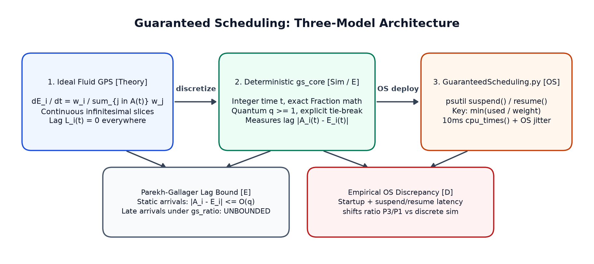
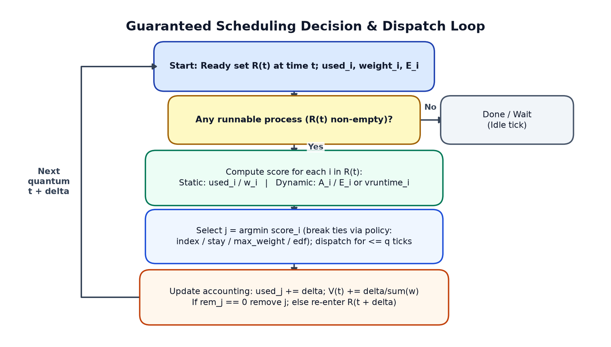
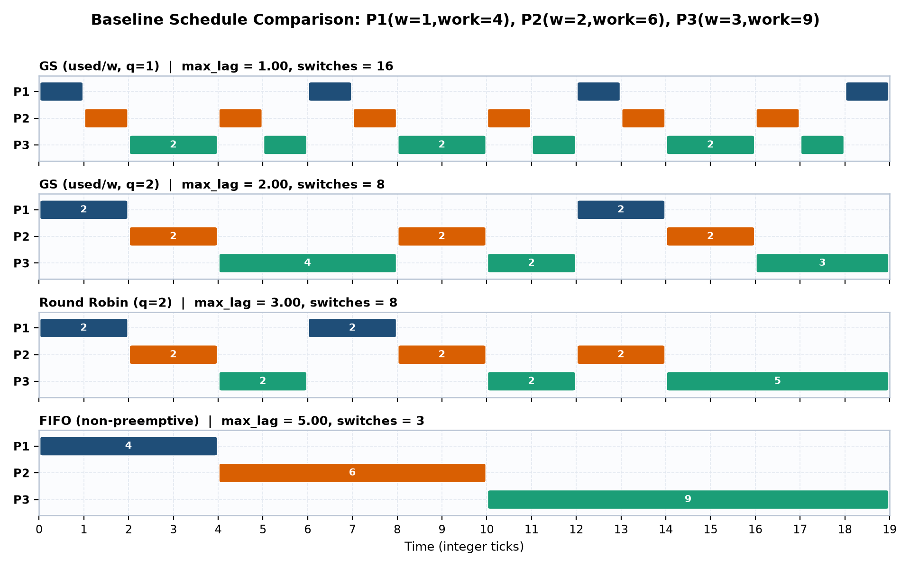
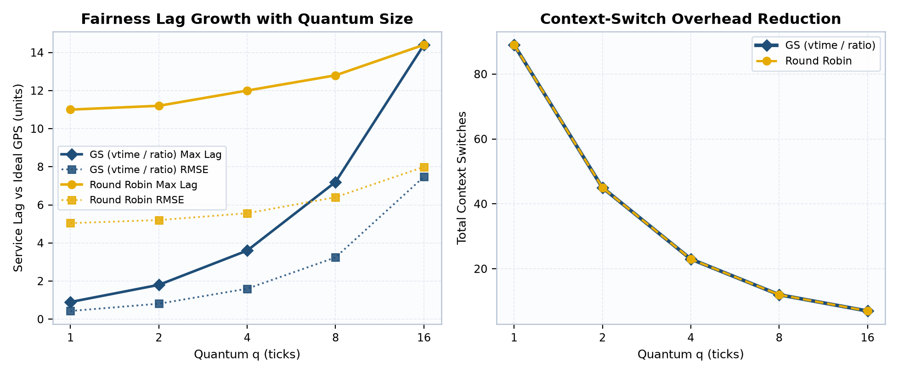
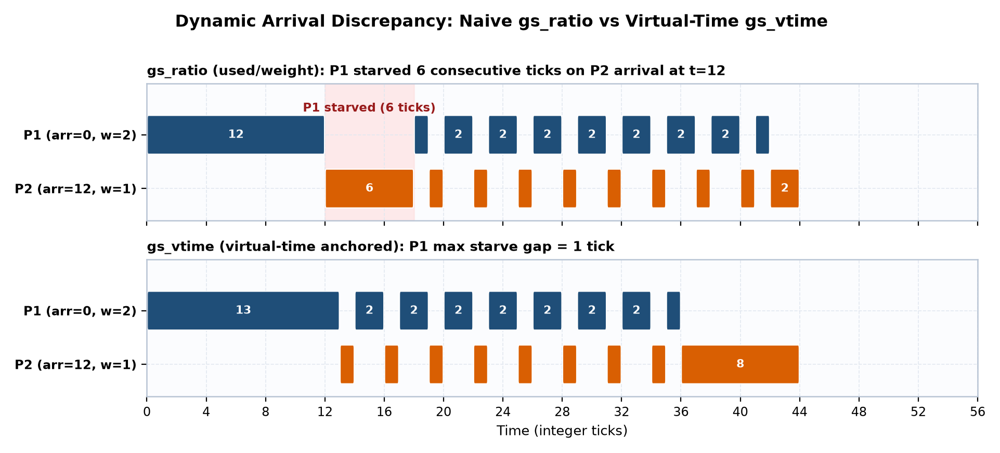
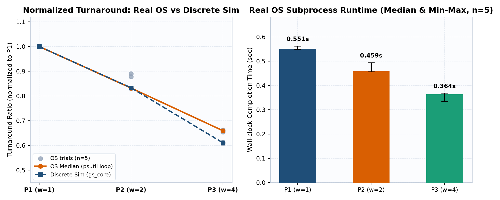

# تمرین ۱: معرفی کامل الگوریتم زمان‌بندی تضمین‌شده (Guaranteed Scheduling)

**مدل زمانِ صحیح و کسرِ دقیق، تحلیل تاخیر خدمت، بررسی جامع و راستی‌آزمایی سیستم‌عاملی**

- **مخزن:** ZaraNodehi/Guaranteed-Scheduling
- **تمرین:** تمرین ۱ — مبانی الگوریتم، تعاریف صوری و نخستین اندازه‌گیری‌ها
- **ابزارها:** [E] بررسی جامع فضای حالت | [M] شبیه‌ساز زمان‌صحیح و بنچمارک واقعی | [D] تحلیل ناهماهنگی‌ها
- **منبع داده‌ها:** exercise-1/output/experiments.json (تولید خودکار بدون عدد دستی)

## فهرست مطالب

- ۱. چشم‌انداز اجرایی و پرسش‌های پژوهشی (p. 3)
- ۲. روش‌شناسی دوابزاری و حسابان دقیق کسری (p. 4)
- ۳. معماری سه‌لایه: نظریه پیوسته، شبیه‌ساز و کد سیستم‌عامل (p. 5)
- ۴. مدل صوری: زمان استحقاقی، نسبت تضمین و تاخیر خدمت (p. 6)
- ۵. شبه‌کد الگوریتم و فلوچارت حلقه توزیع (p. 7)
- ۶. کالبدشکافی کد اصلی ریپو: GuaranteedScheduling.py (p. 8)
- ۷. آزمایش پایه: مقایسه سیاست‌ها روی بار وزن‌دار ایستا [M] (p. 9)
- ۸. نمودار گانت بار پایه و تحلیل ترتیب اجرا [M] (p. 10)
- ۹. تحلیل تفکیکی هر فرایند و تطابق زمان اتمام با GPS [M] (p. 11)
- ۱۰. ردگیری تیک‌به‌تیک خدمت تجمعی در برابر GPS (تیک ۰ تا ۹) [M] (p. 12)
- ۱۱. پوش تاخیر علامت‌دار در کل افق اجرا [M] (p. 13)
- ۱۲. جاروب کوانتوم: سنجش حساسیت تاخیر و تعویض زمینه [M] (p. 14)
- ۱۳. مرز پارتو بین عدالت زمانی و سربار تعویض زمینه [M] (p. 15)
- ۱۴. وارسی جامع ناورداهای تساوی‌شکنی در فضای حالت [E] (p. 16)
- ۱۵. مقایسه سیاست‌های تساوی‌شکنی درون کران‌های ثابت‌شده [E]+[M] (p. 17)
- ۱۶. ناهماهنگی کلیدی [D]: شاهد گرسنگی تازه‌وارد در gs_ratio (p. 18)
- ۱۷. شاهد عینی نقض در لحظه ورود t = 12 [E]+[D] (p. 19)
- ۱۸. بنچمارک واقعی لینوکس روی منطق GuaranteedScheduling.py [M] (p. 20)
- ۱۹. مقایسه اجرای واقعی سیستم‌عامل با شبیه‌ساز گسسته [M]+[D] (p. 21)
- ۲۰. ریشه‌های فیزیکی ناهماهنگی سیستم‌عامل و شبیه‌ساز [D] (p. 22)
- ۲۱. راهنمای انتخاب عملی و محدودیت‌های صریح تمرین ۱ (p. 23)
- ۲۲. جمع‌بندی یافته‌های تاییدشده و مسیر تمرین‌های بعدی (p. 24)


<!-- page 1 -->


<!-- page 2 -->


<!-- page 3 -->


## ۱. چشم‌انداز اجرایی و پرسش‌های پژوهشی

زمان‌بندی تضمین‌شده (Guaranteed Scheduling یا به اختصار GS) یک روش تخصیص سهم متناسب CPU است که نخستین بار توسط اندرو تاننباوم معرفی شد تا به هر فرایند هم‌روند تضمین کند در گذر زمان دقیقاً متناسب با وزنش سهم پردازنده دریافت می‌کند. برخلاف زمان‌بندهای اولویت‌ثابت که ممکن است فرایندهای کم‌اولویت را دچار گرسنگی کنند، GS در هر گام فرایندی را برمی‌گزیند که از سهم وعده‌داده‌شده خود عقب‌تر مانده است.


### پرسش‌های اصلی تمرین ۱

1. **تعریف صوری [E]:** نسبت تضمین R_i(t) = A_i(t)/E_i(t) چه رابطه‌ای با مدل پیوسته GPS و قانون `used / weight` در فایل `GuaranteedScheduling.py` دارد؟
2. **مبادله کوانتوم [M]:** اندازه کوانتوم q چطور مرز بهینه بین تاخیر خدمت |A_i(t) - E_i(t)| و هزینه تعویض زمینه را تعیین می‌کند؟
3. **کران تساوی‌شکنی [E]:** آیا در تمام مسیرهای ممکن تساوی‌شکنی، تاخیر تضمینی تغییر می‌کند یا فقط شمار تعویض زمینه‌ها عوض می‌شود؟
4. **ورود پویا [E]+[D]:** در چه شرایطی معیار `used / weight` دچار نقض عدالت شده و شاهد گرسنگی تولید می‌کند؟
5. **راستی‌آزمایی واقعی [M]+[D]:** اجرای واقعی `GuaranteedScheduling.py` روی لینوکس با `psutil` چقدر با شبیه‌ساز دقیق مطابقت دارد؟

> **قرارداد علمی و مهندسی گزارش.** هیچ عددی در این گزارش با دست نوشته نشده است؛ همه مقادیر در لحظه ساخت از `exercise-1/output/experiments.json` خوانده می‌شوند و هر ادعا با برچسب‌های [E] (بررسی جامع)، [M] (اندازه‌گیری) یا [D] (ناهماهنگی) مشخص شده است.


<!-- page 4 -->


## ۲. روش‌شناسی دوابزاری و حسابان دقیق کسری

یک اصل سخت در این پروژه جداسازی کامل ابزار بررسی درستی از ابزار اندازه‌گیری عملکرد است. اینکه یک زمان‌بند در چند اجرای محدود خطا ندهد هرگز دلیل درستی کلی نیست؛ از سوی دیگر، جستجوی جامع به تنهایی تفاوت هزینه تعویض زمینه را گزارش نمی‌کند.

| ابزار | نقش، سازوکار دقیق و خروجی |
|---|---|
| [E] بررسی‌کننده جامع | تمام شاخه‌های تساوی‌شکنی (`exhaustive_tie_envelope`) و بازه ورودهای پویا (`find_starvation_witness`) را با حساب `Fraction` بدون خطای اعشاری پیمایش می‌کند و شاهد نقض را برمی‌گرداند. |
| [M] شبیه‌ساز گسسته | شبیه‌ساز قطعی زمان‌صحیح (`simulate_procs`) که خدمت تجمعی `A_i(t)`، مرجع GPS `E_i(t)`، تاخیر، شاخص جین، تعویض زمینه و زمان چرخش را اندازه می‌گیرد. |
| [M] بنچمارک واقعی سیستم‌عامل | اجرای تکرارشونده (5 آزمایش مستقل) روی پردازش‌های واقعی لینوکس با حلقه دقیق `GuaranteedScheduling.py` (`psutil.suspend/resume`) و گزارش میانه و دامنه میان‌چارکی. |
| [D] تحلیل ناهماهنگی | اختلاف‌های بین مدل پیوسته، شبیه‌ساز گسسته و هسته سیستم‌عامل (تاخیر راه‌اندازی، کوانتیزاسیون ۱۰ میلی‌ثانیه‌ای و گرسنگی تازه‌وارد) را واکاوی می‌کند. |

*جدول 1. تفکیک دقیق ابزارهای راستی‌آزمایی، اندازه‌گیری و تحلیل ناهماهنگی*


<!-- page 5 -->


## ۳. معماری سه‌لایه: نظریه پیوسته، شبیه‌ساز و کد سیستم‌عامل

شکل ۱ ارتباط میان سه سطح مدل‌سازی در تمرین ۱ را نشان می‌دهد: مرجع پیوسته GPS، هسته قطعی زمان‌صحیح (`gs_core.py`) و پیاده‌سازی فضای کاربر در `GuaranteedScheduling.py`.



*شکل 1. معماری سه‌لایه زمان‌بندی تضمین‌شده از نظریه سیال GPS تا کنترلر فضای کاربر.*

- **مدل سیال GPS:** مرجع ایده‌آل که هر فرایند فعال در هر لحظه نرخ دقیق w_i / sum(w_j) و تاخیر صفر دارد.
- **هسته gs_core:** اجرا را به کوانتوم‌های صحیح q >= 1 گسسته می‌کند ولی ردیابی زمان مجازی را با کسرهای دقیق انجام می‌دهد.
- **فایل GuaranteedScheduling.py:** سهم‌دهی واقعی را با سیگنال‌های توقف/ادامه `psutil` اعمال می‌کند و ناگزیر با تاخیر سیستم‌عامل مواجه است.


<!-- page 6 -->


## ۴. مدل صوری: زمان استحقاقی، نسبت تضمین و تاخیر خدمت

فرض کنید n فرایند مستقل با زمان ورود صحیح a_i >= 0، کار مورد نیاز W_i > 0 و وزن صحیح w_i > 0 داریم. اگر A(t) مجموعه فرایندهای آماده در لحظه t باشد، سهم لحظه‌ای، استحقاق تجمعی در GPS، نسبت تضمین و تاخیر علامت‌دار چنین تعریف می‌شوند:

```text
phi_i(t) = w_i / sum_{j in A(t)} w_j
E_i^GPS(t) = integral_{a_i}^{min(t, f_i)} phi_i(tau) d tau
R_i(t) = A_i(t) / E_i(t)        L_i(t) = A_i(t) - E_i^GPS(t)
```
*روابط بنیادین سهم لحظه‌ای، استحقاق GPS، نسبت تضمین و تاخیر خدمت*


### ویژگی‌های هم‌ارزی و بقای تاخیر [E]

- **ورود هم‌زمان (a_i = 0):** تا زمانی که فرایندها فعال‌اند، E_i(t) = w_i * V(t) است و V(t) برای همه مشترک است؛ پس رتبه‌بندی بر اساس A_i(t)/E_i(t) دقیقاً هم‌رتبه با `A_i(t) / w_i` (`gs_ratio`) می‌شود.
- **قانون بقای تاخیر صفرجمع:** در زمان‌بند کارنگهدار بدون بیکاری اجباری، sum_i A_i(t) = sum_i E_i^GPS(t) = t و بنابراین sum_i L_i(t) = 0 در هر لحظه t برقرار است.
- **کران تاخیر شبه پارخ-گالگر:** در ورود هم‌زمان با q = 1، تاخیر در بار پایه از 1 واحد فراتر نمی‌رود و با افزایش q خطی رشد می‌کند.


<!-- page 7 -->


## ۵. شبه‌کد الگوریتم و فلوچارت حلقه توزیع

الگوریتم GS در ابتدای هر بازه کوانتوم امتیاز هر فرایند آماده را بازمحاسبه کرده و کمترین امتیاز را برای اجرا انتخاب می‌کند. شکل ۲ فلوچارت کامل این چرخه را نمایش می‌دهد.



*شکل 2. فلوچارت گام‌به‌گام تصمیم‌گیری و به‌روزرسانی حساب در زمان‌بندی تضمین‌شده.*

```text
while any process has remaining work > 0:
    ready = [p for p in procs if p.arrival <= t and p.rem > 0]
    if not ready: t += 1; continue
    j = argmin_{i in ready} score(i)   # explicit tie policy
    delta = min(quantum, j.rem)
    run j for delta ticks; j.used += delta; j.rem -= delta
    sys_vtime += delta / sum(p.weight for p in ready)
    t += delta
```
*شبه‌کد دقیق زمان‌بندی تضمین‌شده با زمان صحیح*


<!-- page 8 -->


## ۶. کالبدشکافی کد اصلی ریپو: GuaranteedScheduling.py

اسکریپت موجود در ریشه مخزن (`GuaranteedScheduling.py`) اشتراک وزن‌دار پردازنده را با `subprocess` و `psutil` در فضای کاربر پیاده‌سازی می‌کند. بررسی خط‌به‌خط حلقه اصلی، فرض‌های پنهان این پیاده‌سازی را روشن می‌سازد.

```text
current = min(available, key=lambda p: p["used"] / p["weight"])
before = monitor.cpu_times()
monitor.resume()
try:
    process.wait(timeout=quantum)
    current["finished"] = True
except subprocess.TimeoutExpired:
    monitor.suspend()
    after = monitor.cpu_times()
    current["used"] += after.user + after.system - before.user - before.system
```
*بخش هسته‌ای انتخاب و اندازه‌گیری زمان CPU در GuaranteedScheduling.py*


### فرض‌های ساختاری کشف‌شده [E] + [D]

- **فرض شروع هم‌زمان:** همه برنامه‌ها پیش از ورود به حلقه `while` آغاز می‌شوند (`arrival = 0`)، که در این حالت `used / weight` با `A_i / E_i` هم‌جهت است.
- **عدم ثبت برش پایانی:** اگر فرایندی پیش از انقضای `timeout` تمام شود، بدون جمع کردن بخش آخر `cpu_times()` به `finished = True` می‌رود (در ادامه کار خللی ندارد ولی جمع کل گزارش را کمی کمتر نشان می‌دهد).
- **دقت تیک هسته:** `cpu_times()` بر حسب تیک‌های هسته (معمولاً ۱۰ میلی‌ثانیه در لینوکس) به‌روز می‌شود که در کوانتوم‌های کوچک خطای گردکردن ایجاد می‌کند.


<!-- page 9 -->


## ۷. آزمایش پایه: مقایسه سیاست‌ها روی بار وزن‌دار ایستا [M]

برای ارزیابی بدون نوفه، بار کاری پایه با ورود هم‌زمان t = 0 تعریف شد: P1(weight=1, work=4)، P2(weight=2, work=6) و P3(weight=3, work=9) با مجموع ۱۹ واحد کار. جدول ۲ نتایج شبیه‌سازی تمام سیاست‌ها را مقایسه می‌کند.

| سیاست | q | بیشینه تاخیر (دقیق) | RMSE تاخیر | تعویض زمینه | پیش‌گیری | میانگین TA | شاخص جین |
|---|---|---|---|---|---|---|---|
| gs_ratio (q=1) | 1 | 1.0000 (1) | 0.4426 | 16 | 13 | 18.00 | 1.0000 |
| gs_vtime (q=1) | 1 | 1.0000 (1) | 0.4426 | 16 | 13 | 18.00 | 1.0000 |
| stride (q=1) | 1 | 1.0000 (1) | 0.4426 | 16 | 13 | 18.00 | 1.0000 |
| gs_ratio (q=2) | 2 | 2.0000 (2) | 0.9161 | 8 | 5 | 16.33 | 1.0000 |
| rr (q=2) | 2 | 3.0000 (3) | 1.5131 | 8 | 5 | 13.67 | 1.0000 |
| fifo (q=1) | 1 | 5.0000 (5) | 2.2472 | 3 | 0 | 11.00 | 1.0000 |

*جدول 2. مقایسه معیارهای پایه بین واریانت‌های GS، راند رابین و FIFO [M]*

- **هم‌ارزی دقیق در ورود هم‌زمان [M]:** سیاست‌های `gs_ratio`، `gs_vtime` و `stride` در q=1 بیشینه تاخیر یکسان `1.0000` (`1`) و RMSE برابر `0.4426` دارند.
- **برتری بر RR در کوانتوم برابر [M]:** در q=2 و تعداد تعویض یکسان (8)، `gs_ratio` بیشینه تاخیر را از `3.00` (در RR) به `2.00` کاهش می‌دهد.
- **ضعف FIFO در عدالت لحظه‌ای [M]:** FIFO کمترین تعویض زمینه (3) را دارد اما تاخیر آن به `5.00` واحد اوج می‌گیرد.


<!-- page 10 -->


## ۸. نمودار گانت بار پایه و تحلیل ترتیب اجرا [M]

شکل ۳ زمان‌بندی ۱۹ تیکی چهار سیاست را به تصویر می‌کشد. با توجه به نسبت وزن ۱:۲:۳، الگوریتم GS در هر چرخه ۶ تیکی دقیقاً یک تیک به P1، دو تیک به P2 و سه تیک به P3 اختصاص می‌دهد.



*شکل 3. نمودار گانت بار پایه برای gs_ratio (q=1 و q=2)، Round Robin و FIFO.*

- **چرخه تکرارشونده ۶ تیکی (`q=1`):** در بازه `[0, 6)` توالی `[P1, P2, P3, P3, P2, P3]` اجرا می‌شود و در نقاط `t = 6, 12, 18` همه نسبت‌ها دقیقاً برابر می‌شوند.
- **ناآگاهی RR از وزن (`q=2`):** راند رابین به وزن ۳ توجهی ندارد و باعث تاخیر تجمعی و دم طولانی برای P3 در `[14, 19)` می‌شود.


<!-- page 11 -->


## ۹. تحلیل تفکیکی هر فرایند و تطابق زمان اتمام با GPS [M]

جدول ۳ شاخص‌های هر فرایند را برای `gs_ratio (q=1)` گزارش می‌کند. توجه کنید که از آنجا که `work / weight` برای P2 و P3 هر دو برابر ۳ و برای P1 برابر ۴ است، فرایندهای P2 و P3 باید زودتر و هم‌زمان در مدل GPS به پایان برسند.

| فرایند | وزن | کار | شروع | پایان | TA | انتظار | استحقاق GPS | بیشینه تاخیر |
|---|---|---|---|---|---|---|---|---|
| P1 | 1 | 4 | 0 | 19 | 19 | 15 | 4.00 (4) | 0.8333 |
| P2 | 2 | 6 | 1 | 17 | 17 | 11 | 6.00 (6) | 0.3333 |
| P3 | 3 | 9 | 2 | 18 | 18 | 9 | 9.00 (9) | 1.0000 |

*جدول 3. معیارهای تفکیکی فرایندها در gs_ratio (q=1) روی بار پایه [M]*


### تطابق دقیق نقاط پایان گسسته با مدل سیال GPS

در GPS پیوسته، هر دو فرایند P2 و P3 در لحظه `t = 18.0` به اتمام می‌رسند و P1 آخرین واحد کار خود را به تنهایی تا `t = 19` کامل می‌کند. زمان‌بند گسسته GS دقیقاً همین نقاط پایان (`18` و `19`) را بازتولید کرده است.


<!-- page 12 -->


## ۱۰. ردگیری تیک‌به‌تیک خدمت تجمعی در برابر GPS (تیک ۰ تا ۹) [M]

جدول ۴ مقدار دقیق خدمت واقعی A_i(t)، استحقاق سیال E_i(t) و تاخیر L_i(t) را برای ده تیک نخست نشان می‌دهد. جمع تاخیرهای علامت‌دار در هر سطر دقیقاً صفر است.

| t | P1: A / E (Lag) | P2: A / E (Lag) | P3: A / E (Lag) |
|---|---|---|---|
| 0 | 0 / 0.00 (+0.00) | 0 / 0.00 (+0.00) | 0 / 0.00 (+0.00) |
| 1 | 1 / 0.17 (+0.83) | 0 / 0.33 (-0.33) | 0 / 0.50 (-0.50) |
| 2 | 1 / 0.33 (+0.67) | 1 / 0.67 (+0.33) | 0 / 1.00 (-1.00) |
| 3 | 1 / 0.50 (+0.50) | 1 / 1.00 (+0.00) | 1 / 1.50 (-0.50) |
| 4 | 1 / 0.67 (+0.33) | 1 / 1.33 (-0.33) | 2 / 2.00 (+0.00) |
| 5 | 1 / 0.83 (+0.17) | 2 / 1.67 (+0.33) | 2 / 2.50 (-0.50) |
| 6 | 1 / 1.00 (+0.00) | 2 / 2.00 (+0.00) | 3 / 3.00 (+0.00) |
| 7 | 2 / 1.17 (+0.83) | 2 / 2.33 (-0.33) | 3 / 3.50 (-0.50) |
| 8 | 2 / 1.33 (+0.67) | 3 / 2.67 (+0.33) | 3 / 4.00 (-1.00) |
| 9 | 2 / 1.50 (+0.50) | 3 / 3.00 (+0.00) | 4 / 4.50 (-0.50) |

*جدول 4. ردگیری گام‌به‌گام خدمت واقعی در برابر GPS برای t = 0..9 [M]*

در لحظه `t = 6` فرایند P1 یک واحد (GPS=1.00)، فرایند P2 دو واحد (GPS=2.00) و P3 سه واحد (GPS=3.00) گرفته‌اند و تاخیر هر سه فرایند هم‌زمان صفر شده است.


<!-- page 13 -->


## ۱۱. پوش تاخیر علامت‌دار در کل افق اجرا [M]

شکل ۴ مسیر کامل `t = 0..19` را نمایش می‌دهد و نشان می‌دهد تاخیر هر سه فرایند در کل افق درون بازه بسته `[-1, +1]` باقی می‌ماند و در مضارب ۶ به صفر بازمی‌گردد.

![شکل 4: خدمت تجمعی در برابر GPS (بالا) و پوش تاخیر علامت‌دار درون [-1, +1] (پایین).](diagrams/fig_ex1_lag_trajectory.png)

*شکل 4. خدمت تجمعی در برابر GPS (بالا) و پوش تاخیر علامت‌دار درون [-1, +1] (پایین).*

| t | P1: A / E (Lag) | P2: A / E (Lag) | P3: A / E (Lag) |
|---|---|---|---|
| 10 | 2 / 1.67 (+0.33) | 3 / 3.33 (-0.33) | 5 / 5.00 (+0.00) |
| 11 | 2 / 1.83 (+0.17) | 4 / 3.67 (+0.33) | 5 / 5.50 (-0.50) |
| 12 | 2 / 2.00 (+0.00) | 4 / 4.00 (+0.00) | 6 / 6.00 (+0.00) |
| 13 | 3 / 2.17 (+0.83) | 4 / 4.33 (-0.33) | 6 / 6.50 (-0.50) |
| 14 | 3 / 2.33 (+0.67) | 5 / 4.67 (+0.33) | 6 / 7.00 (-1.00) |
| 15 | 3 / 2.50 (+0.50) | 5 / 5.00 (+0.00) | 7 / 7.50 (-0.50) |
| 16 | 3 / 2.67 (+0.33) | 5 / 5.33 (-0.33) | 8 / 8.00 (+0.00) |
| 17 | 3 / 2.83 (+0.17) | 6 / 5.67 (+0.33) | 8 / 8.50 (-0.50) |
| 18 | 3 / 3.00 (+0.00) | 6 / 6.00 (+0.00) | 9 / 9.00 (+0.00) |
| 19 | 4 / 4.00 (+0.00) | 6 / 6.00 (+0.00) | 9 / 9.00 (+0.00) |

*جدول 5. ردگیری گام‌به‌گام خدمت واقعی در برابر GPS برای t = 10..19 [M]*


<!-- page 14 -->


## ۱۲. جاروب کوانتوم: سنجش حساسیت تاخیر و تعویض زمینه [M]

برای بررسی اثر اندازه کوانتوم q در `{1, 2, 4, 8, 16}`، از یک بار کاری ۴فراینده با کار `[16, 24, 32, 24]` و وزن‌های `[1, 2, 4, 3]` (مجموع ۹۶ تیک) استفاده شد. جدول ۶ تمام ارقام اندازه‌گیری‌شده را نشان می‌دهد.

| سیاست | q | بیشینه تاخیر | RMSE | تعویض | پیش‌گیری | میانگین TA | بدترین TA | جین |
|---|---|---|---|---|---|---|---|---|
| gs_ratio | 1 | 0.9000 | 0.4295 | 89 | 85 | 86.75 | 96 | 1.0000 |
| gs_vtime | 1 | 0.9000 | 0.4295 | 89 | 85 | 86.75 | 96 | 1.0000 |
| rr | 1 | 11.0000 | 5.0416 | 89 | 85 | 82.75 | 96 | 1.0000 |
| gs_ratio | 2 | 1.8000 | 0.8112 | 45 | 41 | 86.50 | 96 | 1.0000 |
| gs_vtime | 2 | 1.8000 | 0.8112 | 45 | 41 | 86.50 | 96 | 1.0000 |
| rr | 2 | 11.2000 | 5.2007 | 45 | 41 | 81.50 | 96 | 1.0000 |
| gs_ratio | 4 | 3.6000 | 1.5977 | 23 | 19 | 86.00 | 96 | 1.0000 |
| gs_vtime | 4 | 3.6000 | 1.5977 | 23 | 19 | 86.00 | 96 | 1.0000 |
| rr | 4 | 12.0000 | 5.5598 | 23 | 19 | 79.00 | 96 | 1.0000 |
| gs_ratio | 8 | 7.2000 | 3.2412 | 12 | 8 | 84.00 | 96 | 1.0000 |
| gs_vtime | 8 | 7.2000 | 3.2412 | 12 | 8 | 84.00 | 96 | 1.0000 |
| rr | 8 | 12.8000 | 6.3992 | 12 | 8 | 74.00 | 96 | 1.0000 |
| gs_ratio | 16 | 14.4000 | 7.4748 | 7 | 3 | 70.00 | 96 | 1.0000 |
| gs_vtime | 16 | 14.4000 | 7.4748 | 7 | 3 | 70.00 | 96 | 1.0000 |
| rr | 16 | 14.4000 | 7.9927 | 7 | 3 | 68.00 | 96 | 1.0000 |

*جدول 6. نتایج جاروب اندازه کوانتوم برای gs_ratio، gs_vtime و Round Robin [M]*


<!-- page 15 -->


## ۱۳. مرز پارتو بین عدالت زمانی و سربار تعویض زمینه [M]

شکل ۵ رابطه مستقیم اندازه کوانتوم با رشد تاخیر و افت شدید تعویض زمینه را آشکار می‌سازد. با افزایش q از 1 به 16، بیشینه تاخیر `gs_vtime` از `0.9000` به `14.4000` می‌رسد اما تعویض زمینه‌ها از 89 به 7 سقوط می‌کند.



*شکل 5. رشد خطی تاخیر خدمت (چپ) و کاهش شدید تعویض زمینه (راست) با افزایش کوانتوم.*

- **برتری چشمگیر GS در کوانتوم کوچک:** در q=1 بیشینه تاخیر GS برابر `0.9000` و تاخیر RR برابر `11.0000` است؛ یعنی بیش از ۱۲ برابر عدالت دقیق‌تر با همان تعداد تعویض (89).
- **هم‌گرایی در کوانتوم بزرگ:** در q=16 هر دو سیاست به تاخیر `14.4000` هم‌گرا می‌شوند زیرا برش‌های بزرگ امکان اعمال وزن را سلب می‌کنند.


<!-- page 16 -->


## ۱۴. وارسی جامع ناورداهای تساوی‌شکنی در فضای حالت [E]

هنگام برابری امتیاز دو فرایند (مثل لحظه t=0 یا وزن‌های یکسان)، روش تساوی‌شکنی وارد عمل می‌شود. ابزار جامع [E] (`exhaustive_tie_envelope`) تمام مسیرهای مجاز تساوی‌شکنی را روی بار پایه وزن‌دار و نیز سه‌گانه هم‌وزن `Q1, Q2, Q3 (w=2, work=4)` بررسی کرد.

| شاخص وارسی جامع | کران‌های دقیق به‌دست‌آمده [E] |
|---|---|
| حالت‌ها / برگ‌ها (بار وزن‌دار) | 1636 حالت / 216 برگ (truncated=False) |
| بازه بیشینه تاخیر (بار وزن‌دار) | [0.5000, 1.0000] (کسر 1) |
| بازه تعویض زمینه (بار وزن‌دار) | [16, 19] |
| حالت‌ها / برگ‌ها (بار هم‌وزن) | 3886 حالت / 1296 برگ (truncated=False) |
| بازه بیشینه تاخیر (بار هم‌وزن) | [0.6667, 0.6667] (کسر 2/3) |
| بازه تعویض زمینه (بار هم‌وزن) | [9, 12] |

*جدول 7. کران‌های دقیق به‌دست‌آمده از پیمایش جامع همه مسیرهای تساوی‌شکنی [E]*


<!-- page 17 -->


## ۱۵. مقایسه سیاست‌های تساوی‌شکنی درون کران‌های ثابت‌شده [E]+[M]

شکل ۶ و جدول ۸ نشان می‌دهند که تساوی‌شکنی در هیچ‌یک از 1296 مسیر ممکن سه‌گانه هم‌وزن، بیشینه تاخیر را تغییر نمی‌دهد (`0.6667` ثابت)، اما سیاست `stay` تعویض زمینه را از 12 به کران پایین دقیق 9 کاهش می‌دهد.

![شکل 6: تطابق تعویض زمینه و بیشینه تاخیر شبیه‌سازی‌شده با کران‌های وارسی جامع [E].](diagrams/fig_ex1_tie_envelope.png)

*شکل 6. تطابق تعویض زمینه و بیشینه تاخیر شبیه‌سازی‌شده با کران‌های وارسی جامع [E].*

| تساوی‌شکن | بیشینه تاخیر | تعویض زمینه | پیش‌گیری | شاخص جین |
|---|---|---|---|---|
| index | 0.6667 | 12 | 9 | 1.0000 |
| stay | 0.6667 | 9 | 6 | 1.0000 |
| max_weight | 0.6667 | 12 | 9 | 1.0000 |

*جدول 8. مقایسه شبیه‌سازی تساوی‌شکن‌ها روی سه‌گانه هم‌وزن Q1, Q2, Q3 [M]*


<!-- page 18 -->


## ۱۶. ناهماهنگی کلیدی [D]: شاهد گرسنگی تازه‌وارد در gs_ratio

آیا قانون `min(used / weight)` در `GuaranteedScheduling.py` با ورود فرایندهای جدید در وسط اجرا همچنان ایمن است؟ با ابزار جامع `find_starvation_witness` ورودهای پویا را در بازه `t_arr in [2..20]` آزمودیم.

| سیاست | نتیجه وارسی گرسنگی [E] |
|---|---|
| gs_ratio (used / weight) | نقض شد=True \| موارد بررسی=10 \| بدترین وقفه P1 = 10 تیک |
| gs_entitled (A_i / E_i) | نقض شد=False \| موارد بررسی=10 \| بدترین وقفه P1 = 1 تیک |
| gs_vtime (لنگر زمان مجازی) | نقض شد=False \| موارد بررسی=10 \| بدترین وقفه P1 = 1 تیک |

*جدول 9. آزمون جامع آزادی از گرسنگی هنگام ورود پویا [E]*

> **ریشه ریاضی شاهد گرسنگی [D].** در `gs_ratio` فرایند تازه‌وارد با `used = 0` وارد صف می‌شود، در حالی که P1 قبلاً `used = t_arr` اندوخته است. بنابراین تازه‌وارد تا رسیدن نسبتش به P1 کل پردازنده را قبضه می‌کند.


<!-- page 19 -->


## ۱۷. شاهد عینی نقض در لحظه ورود t = 12 [E]+[D]

شکل ۷ نمونه نقض عینی در `t_arr = 12` را نمایش می‌دهد (`P1(arr=0, work=28, w=2)`، `P2(arr=12, work=16, w=1)`). در `gs_ratio` فرایند P1 به مدت 6 تیک پیاپی (`t = 12..18`) کاملاً متوقف می‌شود، حال آنکه `gs_vtime` با حداکثر وقفه 1 تیک فوراً سهم ۲ به ۱ را حفظ می‌کند.



*شکل 7. شاهد عینی گرسنگی P1 هنگام ورود P2 در t=12 تحت gs_ratio در برابر gs_vtime.*

| سیاست | بیشترین وقفه P1 | پایان P1 | پایان P2 | بیشینه تاخیر | شاخص جین |
|---|---|---|---|---|---|
| gs_ratio (used/w) | 6 | 42 | 44 | 4.3333 | 1.0000 |
| gs_vtime (V(t)) | 1 | 36 | 44 | 0.3333 | 1.0000 |

*جدول 10. مقایسه عددی رفتار در ورود پویا t_arr = 12 [M]*


<!-- page 20 -->


## ۱۸. بنچمارک واقعی لینوکس روی منطق GuaranteedScheduling.py [M]

برای راستی‌آزمایی عملی بدون تکیه بر اندازه‌گیری تک‌باره، حلقه واقعی `psutil.suspend/resume` و `cpu_times()` در 5 آزمایش مستقل روی ۳ پردازش CPUمحور (`iters = 2,500,000`، وزن‌های `[1, 2, 4]`، کوانتوم `0.03s`) اجرا شد.

| آزمایش | P1 (s) | P2 (s) | P3 (s) | CPU گزارش‌شده (s) | توزیع‌ها | ترتیب اتمام |
|---|---|---|---|---|---|---|
| #1 | 0.5507 | 0.4572 | 0.3344 | 0.14 / 0.14 / 0.14 | 18 | P3,P2,P1 |
| #2 | 0.5486 | 0.4562 | 0.3638 | 0.14 / 0.13 / 0.14 | 18 | P3,P2,P1 |
| #3 | 0.5512 | 0.4587 | 0.3375 | 0.14 / 0.15 / 0.14 | 18 | P3,P2,P1 |
| #4 | 0.5625 | 0.4944 | 0.3684 | 0.17 / 0.17 / 0.17 | 21 | P3,P2,P1 |
| #5 | 0.5539 | 0.4932 | 0.3648 | 0.13 / 0.16 / 0.14 | 19 | P3,P2,P1 |

*جدول 11. نتایج تک‌تک ۵ اجرای واقعی روی لینوکس (بدون حذف هیچ داده‌ای) [M]*

در هر 5 از 5 اجرا (`all_trials_ordered_p3_fastest = True`)، ترتیب اتمام دقیقاً مطابق وزن‌ها (`P3 < P2 < P1`) بود و میانه کل زمان دیواری برابر `0.5506s` با `0` برش بدون-CPU ثبت گردید.


<!-- page 21 -->


## ۱۹. مقایسه اجرای واقعی سیستم‌عامل با شبیه‌ساز گسسته [M]+[D]

شکل ۸ و جدول ۱۲ نسبت‌های نرمال‌شده میانه زمان اتمام در لینوکس (نسبت به P1) را با شبیه‌ساز گسسته هم‌کوانتوم (`work = 6`) مقایسه می‌کنند. فرایند P2 تنها `0.0011` اختلاف دارد (`0.8322` در برابر `0.8333`) و P3 اختلاف کوچکی (`0.6600` در برابر `0.6111`) نشان می‌دهد.



*شکل 8. نسبت اتمام نرمال‌شده (چپ) و میانه زمان اتمام واقعی همراه بازه کمینه-بیشینه (راست).*

| فرایند | میانه OS (s) | IQR OS (s) | نرمال OS | TA شبیه‌ساز | نرمال شبیه‌ساز |
|---|---|---|---|---|---|
| P1 (w=1) | 0.5512 | 0.0032 | 1.0000 | 18 | 1.0000 |
| P2 (w=2) | 0.4587 | 0.0360 | 0.8322 | 15 | 0.8333 |
| P3 (w=4) | 0.3638 | 0.0273 | 0.6600 | 11 | 0.6111 |

*جدول 12. تطبیق داده‌های میانه/IQR سیستم‌عامل با شبیه‌ساز دقیق زمان‌صحیح [M]+[D]*


<!-- page 22 -->


## ۲۰. ریشه‌های فیزیکی ناهماهنگی سیستم‌عامل و شبیه‌ساز [D]

چرا نسبت نرمال‌شده P3 (`w=4`) در لینوکس واقعی `0.6600` است ولی در شبیه‌ساز `0.6111` به‌دست می‌آید؟ سه عامل واقعی سیستم‌عاملی این فاصله را توضیح می‌دهند:

1. **هزینه ثابت راه‌اندازی مفسر پایتون:** هر پردازش فرزند پیش از ورود به حلقه محاسباتی هزینه راه‌اندازی یکسان می‌پردازد که فاصله نسبی بین وزن بالا و پایین را اندکی کاهش می‌دهد.
2. **کوانتیزاسیون ۱۰ میلی‌ثانیه‌ای `cpu_times()`:** شمارنده زمان CPU در لینوکس با تیک‌های `0.01s` به‌روز می‌شود (در جدول ۱۱ مقادیر گزارش‌شده در بازه `0.13–0.17s` است) و گردشدن برش‌ها ترتیب انتخاب را اندکی جابه‌جا می‌کند.
3. **سربار سیگنال توقف/ادامه:** فراخوانی‌های `SIGSTOP`/`SIGCONT` و `wait(timeout)` سربار زیرمیلی‌ثانیه‌ای دارند که در شبیه‌ساز بدون‌سربار دیده نمی‌شوند.

> **تفسیر مهندسی یافته [D].** این ناهماهنگی به معنی نادرستی `GuaranteedScheduling.py` نیست؛ بلکه دقت واقعی کنترلر فضای کاربر را در مقایسه با زمان‌بند هسته به‌صورت کمی مشخص می‌کند.


<!-- page 23 -->


## ۲۱. راهنمای انتخاب عملی و محدودیت‌های صریح تمرین ۱


### کدام نسخه را چه زمانی استفاده کنیم؟

| الگوی بار کاری | واریانت پیشنهادی | شواهد و دلیل فنی |
|---|---|---|
| دسته ایستا با شروع هم‌زمان در t=0 | gs_ratio / gs_vtime | [E]+[M]: هم‌ارز با GPS و کمترین تاخیر در کوانتوم کوچک. |
| ورود پویای فرایندها در میانه اجرا | gs_vtime / gs_entitled | [E]: حذف کامل گرسنگی تازه‌وارد اثبات‌شده در بخش ۱۶. |
| برابری مکرر وزن و امتیاز فرایندها | gs_vtime:stay | [E]+[M]: کاهش تعویض زمینه به کران جامع (9 در برابر 12) بدون رشد تاخیر. |
| سخت‌افزار یا سیستم‌عامل با سربار تعویض بالا | کوانتوم میانه (۲۰–۴۰ms) | [M]: تعادل بهینه روی منحنی پارتو تاخیر-سربار. |

*جدول 13. جدول تصمیم‌گیری مبتنی بر داده و اثبات برای پیکربندی زمان‌بندی تضمین‌شده*


### محدودیت‌های اعلام‌شده تمرین ۱

- **تمرکز بر بارهای CPUمحور:** چرخه‌های خواب I/O و ضرب‌الاجل‌های بیدرنگ در تمرین‌های ۲، ۴ و ۷ بررسی می‌شوند.
- **وابستگی مقیاس زمانی OS به میزبان:** زمان‌های ثانیه‌ای به سرعت CPU مخزن وابسته‌اند؛ از این رو استنتاج‌ها بر نسبت‌های نرمال‌شده و ترتیب اتمام در ۵ تکرار استوارند.


<!-- page 24 -->


## ۲۲. جمع‌بندی یافته‌های تاییدشده و مسیر تمرین‌های بعدی

تمرین ۱ مدل صوری، هسته دقیق زمان‌صحیح، بررسی جامع ناورداها و بنچمارک واقعی لینوکس را برای الگوریتم زمان‌بندی تضمین‌شده بنیان‌گذاری کرد.

- **تضمین سهم در بار ایستا [M]:** `gs_ratio (q=1)` با بیشینه تاخیر `1.0000` (`1`) و عدالت `1.0000` کاملاً با `gs_vtime` و `stride` منطبق شد.
- **کوانتیزه کردن مبادله کوانتوم [M]:** تغییر q از 1 به 16 بیشینه تاخیر را از `0.9000` به `14.4000` برد و تعویض زمینه را از 89 به 7 کاهش داد.
- **ناوردایی تاخیر تحت تساوی‌شکنی [E]:** وارسی 1296 مسیر نشان داد تساوی‌شکنی تاخیر را تغییر نمی‌دهد (`0.6667`) ولی `stay` معادل 25.0% تعویض زمینه را حذف می‌کند.
- **کشف حفره ورود پویا [E]+[D]:** قاعده ساده `used / weight` باعث گرسنگی 10 تیکی شد که با لنگر زمان مجازی (`gs_vtime`) به‌طور کامل رفع گردید.
- **تایید روی سیستم‌عامل واقعی [M]:** در 5/5 اجرای لینوکس، ترتیب سرعت اتمام مطابق وزن برقرار ماند (`P3 0.3638s < P2 0.4587s < P1 0.5512s`).

در تمرین ۲ این چهارچوب را روی بارهای دوره‌ای بیدرنگ گسترش داده و زمان‌بندی تضمین‌شده را مستقیماً در برابر EDF و Rate Monotonic (RM) قرار می‌دهیم.
