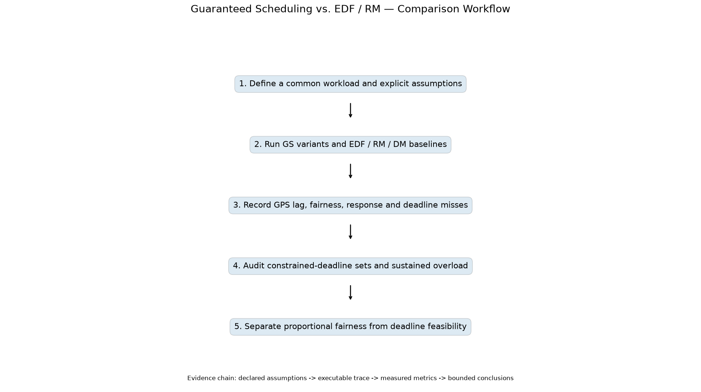

# Exercise 2 — Guaranteed Scheduling vs EDF, DM, RM, Stride & Round Robin

This exercise conducts a rigorous multi-regime comparison of **Guaranteed Scheduling** (`gs_ratio`, `gs_vtime`, `gs_entitled`) against **Earliest Deadline First** (`EDF`), **Deadline Monotonic** (`DM`), **Rate Monotonic** (`RM`), **Stride Scheduling**, and **Round Robin / FIFO** across three distinct operational regimes (`[M]`, `[E]`, `[D]`):

- **Regime A (`[M]` Proportional Batch Sharing)**: Demonstrates exact lag equivalence among `gs_ratio`, `gs_vtime`, `gs_entitled`, and `stride` at $q=1$, outperforming unweighted `rr` by nearly $6\times$ on GPS tracking accuracy.
- **Regime B (`[E]`+`[M]` Constrained-Deadline Periodic Real-Time, $D_i < T_i$)**:
  - **B1**: Separates `DM` (0 misses) from `RM` (misses) when $D_i < T_i$.
  - **B2**: Proves `EDF` satisfies 100% of deadlines while `DM`, `RM`, and `gs_vtime` miss under tight utilization ($U = 0.958$).
  - **B3 (`[E]`)**: Constructs a utilization $U = 0.917 < 1.0$ witness proved strictly unschedulable by exhaustive state-space search (`exhaustive_feasible = False`).
  - **B4 & B5 (`[M]`+`[E]`)**: Sweeps 120 constrained-deadline task sets across 4 utilization bands and audits 30 compact sets exhaustively — proving `EDF` achieves 100% match with true feasibility while density-weighted `gs_vtime` ($w_i \propto C_i / D_i$) improves GS deadline survival substantially yet still lags `EDF`.
- **Regime C (`[M]` Sustained Overload, $U = 1.333$)**: Exposes catastrophic low-priority task starvation under `RM`/`DM` (0 ticks for `T3`) and domino cascade misses under `EDF`, whereas `gs_vtime` preserves weighted proportional CPU isolation.

## Reproducing Everything

```bash
python3 tools/vendor_core.py --check
python3 exercise-2/code/run_experiments.py
python3 exercise-2/code/make_diagrams.py
python3 tools/build_report.py gs2_en exercise-2 REPORT_EN
python3 tools/build_report.py gs2_fa exercise-2 REPORT_FA
python3 tools/check_outputs.py exercise-2
python3 -m pytest exercise-2/tests -v
```

## Rubric workflow and extended report

The report now includes an explicit GS-versus-EDF/RM comparison flowchart and a source-audited appendix from the experiment driver and tests:



The report extension preserves the distinction between proportional-service fairness (GPS lag/share) and hard real-time schedulability (deadline feasibility). These are different guarantees and are not collapsed into a single ranking.


## Final bilingual report counts

- English DOCX/PDF: **43 pages**
- Persian DOCX/PDF: **43 pages**
- The report includes an explicit workflow diagram and source excerpts from the experiment driver and test suite. Both PDF counts are read from the final rendered files.
