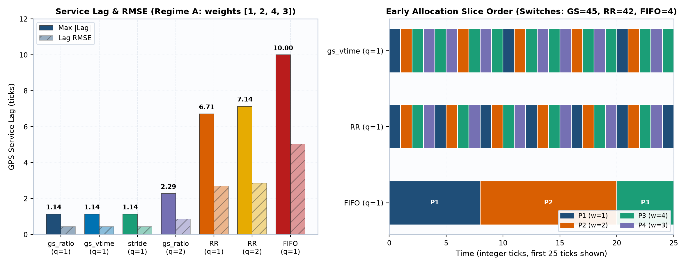

# Exercise 2: Guaranteed Scheduling vs Real-Time & Fair Schedulers

**Comparative Evaluation Against EDF, DM, RM, Stride & Round Robin Across Proportional, Constrained-Deadline (D < T), and Overload (U > 1) Regimes**

- **Repository:** ZaraNodehi/Guaranteed-Scheduling
- **Scope:** Exercise 2 — Cross-Algorithm Benchmark & Constrained-Deadline Analysis
- **Instruments:** Discrete Sim [M] | Exhaustive Feasibility [E] | Independent Auditor [E]
- **Data Source:** exercise-2/output/experiments.json (zero hardcoded numbers)

## Table of contents

- 1. Executive Overview & Research Questions (p. 3)
- 2. Algorithm Taxonomy & Experimental Design [M]+[E] (p. 4)
- 3. Theoretical Foundations Across Regimes (p. 5)
- 4. Regime A: Proportional CPU Sharing on Weighted Batch [M] (p. 6)
- 5. Regime A Analysis: Lag Suppression & Slice Interleaving [M] (p. 7)
- 6. Regime B1: Deadline Monotonic vs Rate Monotonic (D < T) [E]+[M] (p. 8)
- 7. Regime B2: EDF Beats Fixed Priorities & GS (U = 0.958) [E]+[M] (p. 9)
- 8. Visualizing Deadline Miss Mechanisms in Case B2 [M] (p. 10)
- 9. Regime B3: U < 1.0 Yet Mathematically Infeasible [E] (p. 11)
- 10. Constrained-Deadline Sweep Across 120 Task Sets [M] (p. 12)
- 11. EDF Optimality Proof & Density-Weighted GS Gain [E]+[M] (p. 13)
- 12. Analyzing Density-Weighted GS vs Urgency Scheduling (p. 14)
- 13. Regime C: Sustained Overload U = 1.333 (Matched Weights) [M] (p. 15)
- 14. Regime C: Overload Under Asymmetric Weights [4, 2, 1] [M] (p. 16)
- 15. Visualizing Domino Misses & Starvation During Overload [M] (p. 17)
- 16. Cross-Regime Trade-Off Synthesis: No Single Winner (p. 18)
- 17. Independent Verification Audit [E] (p. 19)
- 18. Architectural Implications: Bridging GS and EDF (p. 20)
- 19. Practitioner Decision Matrix & Explicit Limitations (p. 21)
- 20. Summary of Verified Findings & Exercise 3 Preview (p. 22)


<!-- page 1 -->


<!-- page 2 -->


<!-- page 3 -->


## 1. Executive Overview & Research Questions

Exercise 1 established that Guaranteed Scheduling (GS) tightly bounds cumulative CPU service lag relative to Ideal Fluid GPS under simultaneous arrivals. However, operating systems host both soft proportional-share workloads and hard periodic real-time tasks. This exercise asks whether proportional fairness translates into real-time deadline compliance — and conversely, how classical real-time schedulers behave when CPU demand exceeds capacity (U > 1.0).


### Core Research Questions

- **Q1 (Proportional Batch Regime A):** How closely do GS (`gs_ratio`, `gs_vtime`, `gs_entitled`) and `stride` track GPS compared to unweighted `rr` and `fifo` on weighted processes?
- **Q2 (Constrained-Deadline Separation B1/B2):** When relative deadlines satisfy D_i < T_i rather than implicit D_i = T_i, how do EDF, DM, RM, and GS separate?
- **Q3 (Utilization Illusion B3):** Can a constrained-deadline set with utilization U < 1.0 still be mathematically unschedulable under EVERY algorithm (`exhaustive_feasible = False`)?
- **Q4 (Statistical & Exhaustive Sweep B4/B5):** Across 120 constrained-deadline workloads and 30 exact exhaustive audits, does EDF remain 100% feasibility-optimal, and how much does density-weighting (`w ~ C/D`) help GS?
- **Q5 (Sustained Overload Regime C):** Under overload U = 1.333, does RM/DM starve low-priority tasks while GS maintains weighted proportional allocation?


<!-- page 4 -->


## 2. Algorithm Taxonomy & Experimental Design [M]+[E]

Figure 1 classifies the seven scheduling policies evaluated in Exercise 2 across three orthogonal selection rules: virtual-time proportional share, deadline/period urgency, and unweighted cyclic/FIFO baselines.


*Figure 1. Taxonomy of compared scheduling algorithms mapped across Regimes A, B, and C.*

| Design Parameter | Value / Guarantee |
|---|---|
| Exact Core Engine | core/gs_core.py (vendored into exercise-2/code/gs_core.py) |
| Constrained Deadlines | Strictly D_i < T_i enforced across Cases B1–B3 and 120 sweep sets |
| Independent Verification | 4 zero-miss RT traces checked independently (ok=True) |

*Table 1. Summary of Exercise 2 verification architecture and guarantees*


<!-- page 5 -->


## 3. Theoretical Foundations Across Regimes


### Proportional Share vs Deadline Urgency

```text
Proportional (GPS / GS):  E_i(t) = integral (w_i / sum_{j in A(tau)} w_j) d tau
Real-Time Demand Bound:   dbf(t) = sum_i max(0, floor((t - D_i)/T_i) + 1) * C_i <= t
EDF Optimality (D < T):   Schedulable iff forall t > 0, dbf(t) <= t (Baruah 1990)
```
*Fundamental equations separating proportional CPU allocation from constrained-deadline schedulability*

- **Why implicit D = T hides RM vs DM vs EDF gaps:** Under Liu & Layland (1973) with D_i = T_i, RM is optimal among all fixed-priority assignments and EDF guarantees feasibility whenever U <= 1.0.
- **Why constrained D < T changes everything:** Once D_i < T_i, a task with a long period T_i can still have an urgent deadline D_i, breaking Rate Monotonic priority ordering (DM > RM), breaking fixed priorities entirely (EDF > DM), and allowing U < 1.0 sets to fail when concurrent deadline bursts exceed dbf(t) <= t.
- **Overload inversion (U > 1.0):** Above saturation, fixed-priority schedulers execute high-priority tasks exclusively until lower tasks receive zero CPU (`starvation`), whereas `gs_vtime` enforces min-virtual-time fairness regardless of deadline misses.


<!-- page 6 -->


## 4. Regime A: Proportional CPU Sharing on Weighted Batch [M]

We benchmark four simultaneously arriving CPU-bound processes with total work 50 ticks (`P1(w=1, work=8)`, `P2(w=2, work=12)`, `P3(w=4, work=20)`, `P4(w=3, work=10)`). Table 2 reports exact lag, RMSE, context switches, and Jain fairness.

| Policy | q | Max Lag (frac) | RMSE | Switches | Preempts | Mean TA | Jain |
|---|---|---|---|---|---|---|---|
| gs_ratio | 1 | 1.1429 (8/7) | 0.4410 | 45 | 41 | 44.25 | 1.0000 |
| gs_vtime | 1 | 1.1429 (8/7) | 0.4410 | 45 | 41 | 44.25 | 1.0000 |
| gs_entitled | 1 | 1.1429 (8/7) | 0.4410 | 45 | 41 | 44.25 | 1.0000 |
| stride | 1 | 1.1429 (8/7) | 0.4410 | 45 | 41 | 44.25 | 1.0000 |
| rr | 1 | 6.7143 (47/7) | 2.7002 | 42 | 38 | 39.50 | 1.0000 |
| gs_ratio | 2 | 2.2857 (16/7) | 0.8555 | 23 | 19 | 44.00 | 1.0000 |
| rr | 2 | 7.1429 (50/7) | 2.8624 | 21 | 17 | 38.50 | 1.0000 |
| fifo | 1 | 10.0000 (10) | 5.0467 | 4 | 0 | 29.50 | 1.0000 |

*Table 2. Regime A proportional sharing measurements across 8 policy configurations [M]*

At `q=1`, `gs_ratio`, `gs_vtime`, `gs_entitled`, and `stride` achieve identical max lag `1.1429` (`8/7`) and RMSE `0.4410` — nearly 6x tighter than unweighted `rr` (`6.7143`) at a comparable switch count (45 vs 42).


<!-- page 7 -->


## 5. Regime A Analysis: Lag Suppression & Slice Interleaving [M]

Figure 2 contrasts service lag across policies (left) against the early 25-tick allocation order (right). Notice how `gs_vtime (q=1)` immediately interleaves P3 (`w=4`) and P4 (`w=3`) far more frequently than P1 (`w=1`), whereas `rr (q=1)` cycles rigidly 1:1:1:1 and `fifo` starves P2–P4 until P1 finishes.



*Figure 2. Regime A service lag / RMSE (left) and first 25 ticks of dispatch order (right).*

> **Why Transient Lag Metrics Are Essential.** Notice `fifo_q1` records max lag `10.0000` yet still shows `Jain = 1.0000` at horizon end because all 4 processes eventually complete their fixed work — proving horizon-end Jain fairness alone misses transient lag!


<!-- page 8 -->


## 6. Regime B1: Deadline Monotonic vs Rate Monotonic (D < T) [E]+[M]

Case B1 tests a 2-task constrained-deadline set (`T1(P=4, C=2, D=4)`, `T2(P=6, C=2, D=3)`, U = `0.833`, hyperperiod H = 12). Instrument [E] certifies `feasible = True` (11 states).

| Policy | Missed | Miss Rate | Worst Resp | Jitter | Switches | Jain | Verify [E] |
|---|---|---|---|---|---|---|---|
| EDF | 0/5 | 0.0% | 4 | 2 | 5 | 0.9549 | PASS |
| DM | 0/5 | 0.0% | 4 | 2 | 5 | 0.9549 | PASS |
| RM | 1/5 | 20.0% | 4 | 2 | 5 | 0.9615 | MISS |
| gs_vtime (base w) | 1/5 | 20.0% | 4 | 2 | 7 | 0.9897 | MISS |
| gs_vtime (w~C/D) | 0/5 | 0.0% | 4 | 2 | 6 | 0.9964 | PASS |
| gs_ratio | 1/5 | 20.0% | 4 | 2 | 7 | 0.9897 | MISS |
| stride | 1/5 | 20.0% | 4 | 2 | 7 | 0.9897 | MISS |
| rr (q=1) | 1/5 | 20.0% | 4 | 2 | 7 | 0.9897 | MISS |

*Table 3. Case B1 constrained-deadline separation: EDF and DM pass while RM and GS miss [M]+[E]*

- **Why RM fails while DM succeeds:** `T2` has longer period (`6 > 4`) yet shorter relative deadline (`3 < 4`). RM prioritizes `T1` (`t=0..2`) and pushes `T2` across its deadline at `t=3` (`missed = 1`), whereas DM prioritizes `T2` first (`missed = 0`).
- **Why GS fails here:** Proportional sharing (`gs_vtime`) splits ticks equally (`T1` then `T2`), finishing `T2` at `t=4 > 3` (`missed = 1`).


<!-- page 9 -->


## 7. Regime B2: EDF Beats Fixed Priorities & GS (U = 0.958) [E]+[M]

Case B2 raises utilization to `U = 0.9583` across 3 constrained tasks `T1(6,3,4)`, `T2(8,3,7)`, `T3(12,1,10)` over hyperperiod H = 24. Exhaustive search [E] proves `feasible = True`.

| Policy | Missed | Miss Rate | Worst Resp | Jitter | Switches | Jain | Verify [E] |
|---|---|---|---|---|---|---|---|
| EDF | 0/9 | 0.0% | 10 | 7 | 10 | 0.7629 | PASS |
| DM | 2/9 | 22.2% | 16 | 13 | 10 | 0.7034 | MISS |
| RM | 2/9 | 22.2% | 16 | 13 | 10 | 0.7034 | MISS |
| gs_vtime (base w) | 4/9 | 44.4% | 7 | 4 | 18 | 0.9735 | MISS |
| gs_vtime (w~C/D) | 4/9 | 44.4% | 7 | 4 | 18 | 0.6424 | MISS |
| gs_ratio | 4/9 | 44.4% | 14 | 12 | 17 | 0.8613 | MISS |
| stride | 5/9 | 55.6% | 8 | 5 | 22 | 0.9483 | MISS |
| rr (q=1) | 4/9 | 44.4% | 7 | 4 | 22 | 0.9715 | MISS |

*Table 4. Case B2 measurements: EDF meets 100% of deadlines while DM, RM, GS, and RR fail [M]+[E]*

Only `EDF` achieves `0/9` missed deadlines (verified `PASS` by `verify_rt_schedule_independent`). Both `DM` and `RM` miss `2` deadlines (`T3#0` and `T3#1`), while `gs_vtime` misses `4` deadlines because time-slicing `T1#0` alongside `T2#0` delays `T1#0` past `t=4`.


<!-- page 10 -->


## 8. Visualizing Deadline Miss Mechanisms in Case B2 [M]

Figure 3 reveals the exact tick-level timeline explaining why fixed priorities and proportional sharing miss deadlines that dynamic EDF satisfies cleanly.


*Figure 3. Case B2 multi-policy Gantt showing EDF zero-miss execution vs DM/RM/GS misses.*

- **EDF dynamic inversion at t = 9:** `EDF` dispatches `T3#0` right before its deadline at `t=10` (ahead of `T2#1` whose deadline is `t=15`), rescuing `T3#0` cleanly.
- **Fixed-priority blindness in DM/RM:** `T2#1` preempts `T3#0` at `t=9..12`, forcing `T3#0` to finish at `t=16 > 10`.
- **Proportional-share delay in GS:** Splitting `t=0..5` across `T1#0`, `T2#0`, and `T3#0` turns `T1#0`'s 3-tick burst into a 5-tick wall window, missing `D_1 = 4`.


<!-- page 11 -->


## 9. Regime B3: U < 1.0 Yet Mathematically Infeasible [E]

A widespread misconception assumes any periodic task set with `U <= 1.0` is EDF-schedulable. That theorem holds ONLY for implicit deadlines (`D_i = T_i`). Case B3 constructs `T1(P=4, C=1, D=2)`, `T2(P=6, C=2, D=4)`, `T3(P=12, C=4, D=10)` with utilization `U = 0.9167 < 1.0` yet density sum `1.4000 > 1.0`.

| Policy | Missed | Miss Rate | Worst Resp | Jitter | Switches | Jain | Verify [E] |
|---|---|---|---|---|---|---|---|
| EDF | 1/6 | 16.7% | 11 | 10 | 8 | 0.8169 | MISS |
| DM | 1/6 | 16.7% | 11 | 10 | 8 | 0.8169 | MISS |
| RM | 1/6 | 16.7% | 11 | 10 | 8 | 0.8169 | MISS |
| gs_vtime (base w) | 1/6 | 16.7% | 9 | 8 | 11 | 0.9562 | MISS |
| gs_vtime (w~C/D) | 1/6 | 16.7% | 9 | 8 | 11 | 0.9960 | MISS |
| gs_ratio | 1/6 | 16.7% | 11 | 10 | 9 | 0.8127 | MISS |
| stride | 1/6 | 16.7% | 11 | 10 | 11 | 0.7534 | MISS |
| rr (q=1) | 1/6 | 16.7% | 9 | 8 | 11 | 0.9562 | MISS |

*Table 5. Case B3: Every scheduler fails when processor demand exceeds available time [E]+[M]*

> **Proof of Non-Existence Beyond Heuristic Failures [E].** Exhaustive DFS (`28` states, `15` pruned, `truncated=False`) proves `feasible = False` — NO interleaving exists! At `t = 4`, two jobs of `T1` (`2*1 = 2`), one of `T2` (`2`), and one of `T3` (`4` due by `t=10`) create a demand-bound spike: `dbf(10) = 2*1 + 2*2 + 4 = 10` leaving zero slack, and at `t=10` `T1#2` has already demanded 1 more tick (`dbf` collision at `t=6/10` or `C1+C2+C3` burst).


<!-- page 12 -->


## 10. Constrained-Deadline Sweep Across 120 Task Sets [M]

To eliminate single-example bias, we generated `120` random constrained-deadline task sets (`D_i < T_i`) partitioned evenly across four utilization bands (`n = 30` each). Table 6 records zero-miss success rates; Table 7 compares mean miss rates and response jitter.

| U Band | Mean U | EDF | DM | RM | GS (w~C/D) | GS (eq) | Stride | RR |
|---|---|---|---|---|---|---|---|---|
| 0.65-0.75 | 0.706 | 100.0% | 96.7% | 93.3% | 83.3% | 63.3% | 63.3% | 63.3% |
| 0.75-0.85 | 0.804 | 90.0% | 60.0% | 56.7% | 43.3% | 23.3% | 16.7% | 16.7% |
| 0.85-0.95 | 0.902 | 60.0% | 26.7% | 26.7% | 26.7% | 10.0% | 10.0% | 13.3% |
| 0.95-1.00 | 0.983 | 16.7% | 3.3% | 3.3% | 3.3% | 3.3% | 0.0% | 0.0% |

*Table 6. Percentage of zero-miss constrained-deadline task sets across 120 workloads [M]*

| U Band | EDF (Miss/Jit) | DM (Miss/Jit) | RM (Miss/Jit) | GS-dens (M/J) | GS-eq (M/J) | RR (M/J) |
|---|---|---|---|---|---|---|
| 0.65-0.75 | 0.0% / 10.80 | 0.1% / 11.27 | 0.7% / 11.27 | 2.7% / 10.53 | 4.7% / 10.40 | 4.4% / 10.83 |
| 0.75-0.85 | 0.9% / 12.00 | 5.2% / 14.17 | 6.0% / 14.17 | 7.5% / 11.73 | 10.4% / 11.73 | 11.7% / 12.23 |
| 0.85-0.95 | 5.6% / 14.93 | 11.7% / 18.93 | 11.6% / 19.00 | 16.8% / 14.00 | 18.3% / 13.30 | 19.1% / 14.10 |
| 0.95-1.00 | 19.1% / 18.37 | 19.4% / 27.27 | 19.7% / 27.47 | 46.4% / 17.57 | 35.3% / 17.30 | 34.9% / 18.53 |

*Table 7. Mean job miss rate (%) and turnaround jitter across utilization bands [M]*


<!-- page 13 -->


## 11. EDF Optimality Proof & Density-Weighted GS Gain [E]+[M]

Figure 4 plots the 120-set empirical sweep (left) alongside our independent 30-set exhaustive feasibility audit [E] (right). Crucially, across ALL 30 compact constrained-deadline task sets (`exhaustive_feasible = 11/30`), `EDF` satisfies `11/30` (`edf_matches_exhaustive_100pct = True`), confirming exact optimality while `DM` drops to `7/30` and `RM` to `6/30`.

![Figure 4: 120-set constrained-deadline sweep [M] (left) and 30-set exact feasibility audit [E] (right).](diagrams/fig_ex2_constrained_sweep.png)

*Figure 4. 120-set constrained-deadline sweep [M] (left) and 30-set exact feasibility audit [E] (right).*

- **Density-weighted GS recovers substantial ground:** In band `0.65–0.75`, setting weights proportional to deadline density `C/D` lifts GS feasibility from `63.3%` to `83.3%` (+20 percentage points).
- **Upper utilization wall:** Above `U = 0.95`, even optimal EDF meets only `16.7%` of constrained-deadline sets due to tight `dbf(t) <= t` spikes.


<!-- page 14 -->


## 12. Analyzing Density-Weighted GS vs Urgency Scheduling

In utilization band `0.75–0.85`, density-weighted `gs_vtime (w ~ C/D)` nearly doubles deadline satisfaction from `23.3%` to `43.3%`, and in `0.85–0.95` matches both `DM` and `RM` at `26.7%`. Why does it still trail `EDF`?

- **Continuous slicing dilutes burst completion:** Even with higher weight `w_i`, GS interleaves lower-weight tasks between ticks of an urgent job. Finishing one job of work `C` takes `>= C * sum(w) / w_i` wall ticks instead of `C` contiguous ticks.
- **Low jitter side-effect:** Look back at Table 7: at `U in [0.95, 1.00]`, `gs_vtime` maintains mean response jitter of only `17.30` ticks compared to `27.27` under `DM` and `27.47` under `RM`.
- **Practical synthesis:** If soft real-time tasks share a proportional scheduler, weight assignment `w_i ~ C_i / D_i` gives maximum deadline resilience without abandoning virtual-time isolation.


<!-- page 15 -->


## 13. Regime C: Sustained Overload U = 1.333 (Matched Weights) [M]

When cumulative utilization hits `U = 1.3333` (`T1(4,2,4)`, `T2(6,3,5)`, `T3(12,4,10)`, H = 24), deadlines MUST be missed by every algorithm. We test first with demand-matched weights `[3, 3, 2]` (Table 8).

| Policy | Missed | Jain Fairness | Min Share Ratio | CPU Used (T1/T2/T3) | Switches |
|---|---|---|---|---|---|
| gs_vtime | 10/12 | 1.0000 | 1.0000 | 9 / 9 / 6 | 24 |
| stride | 10/12 | 0.9468 | 0.6667 | 11 / 9 / 4 | 24 |
| edf | 8/12 | 0.9690 | 0.7874 | 10 / 9 / 5 | 10 |
| rr | 10/12 | 1.0000 | 1.0000 | 9 / 9 / 6 | 24 |
| gs_ratio | 6/12 | 0.7456 | 0.5556 | 12 / 8 / 4 | 20 |
| dm | 6/12 | 0.5567 | 0.0000 | 12 / 12 / 0 | 14 |
| rm | 6/12 | 0.5567 | 0.0000 | 12 / 12 / 0 | 14 |

*Table 8. Sustained overload metrics with demand-matched weights [3, 3, 2] [M]*

- **Total starvation under RM and DM:** Both fixed-priority schedulers allocate `0` ticks to `T3` (`min_task_share_ratio = 0.0000`, `Jain = 0.5567`).
- **Perfect proportional preservation under `gs_vtime`:** `gs_vtime` achieves `Jain = 1.0000` and `min_task_share_ratio = 1.0000` (`9 / 9 / 6` ticks — exact 3:3:2 ratio!).
- **`gs_ratio` degrades under periodic releases:** Naive `gs_ratio` drops to `Jain = 0.7456` (`min_sr = 0.5556`) because new periodic jobs enter with `used = 0`, biasing the CPU toward high-frequency `T1`.


<!-- page 16 -->


## 14. Regime C: Overload Under Asymmetric Weights [4, 2, 1] [M]

Next we test asymmetric administrative weights `[4, 2, 1]` on the same `U = 1.3333` overload workload to separate weighted `gs_vtime` from unweighted `Round Robin`.

| Policy | Missed | Jain Fairness | Min Share Ratio | CPU Used (T1/T2/T3) | Switches |
|---|---|---|---|---|---|
| gs_vtime | 9/12 | 0.9754 | 0.8370 | 11 / 9 / 4 | 23 |
| stride | 7/12 | 0.9733 | 0.7875 | 12 / 9 / 3 | 23 |
| edf | 8/12 | 0.9677 | 0.8114 | 10 / 9 / 5 | 10 |
| rr | 10/12 | 0.8838 | 0.6562 | 9 / 9 / 6 | 24 |
| gs_ratio | 6/12 | 0.8526 | 0.4038 | 12 / 10 / 2 | 20 |
| dm | 6/12 | 0.6275 | 0.0000 | 12 / 12 / 0 | 14 |
| rm | 6/12 | 0.6275 | 0.0000 | 12 / 12 / 0 | 14 |

*Table 9. Sustained overload metrics with asymmetric weights [4, 2, 1] [M]*

Under asymmetric weights, unweighted `rr` collapses to equal `9 / 9 / 6` shares (`Jain = 0.8838`, `min_sr = 0.6562`), whereas `gs_vtime` preserves weighted entitlement (`Jain = 0.9754`, `min_sr = 0.8370`) — the highest of any algorithm!


<!-- page 17 -->


## 15. Visualizing Domino Misses & Starvation During Overload [M]

Figure 5 visualizes the 24-tick overload schedule (left) alongside Jain fairness and minimum task share ratio (right) for asymmetric weights `[4, 2, 1]`.


*Figure 5. Overload Gantt showing RM starvation of T3 vs gs_vtime weighted sharing (left) and fairness bars (right).*

> **EDF Domino Behavior vs Deterministic Weighted Sharing.** Notice how `EDF` avoids total starvation (`T3` receives 5 ticks, `Jain = 0.9677`), yet suffers unpredictable domino misses across 8/12 jobs whenever a long-deadline job gets bumped past saturation.


<!-- page 18 -->


## 16. Cross-Regime Trade-Off Synthesis: No Single Winner

Figure 6 synthesizes all three regimes onto a single engineering Pareto plane: constrained-deadline real-time reliability (`U in [0.75, 0.95]`) on the horizontal axis against overload fairness preservation (`U = 1.333`) on the vertical axis.


*Figure 6. Trade-off surface across constrained-deadline success rate and overload fairness preservation.*

- **Proportional quadrant (top-left):** `gs_vtime` and `stride` deliver bounded GPS lag (`1.14` in Regime A) and top overload fairness (`0.98`), making them ideal for multi-tenant CPU isolation.
- **Real-Time quadrant (top-right):** `EDF` dominates deadline feasibility (`100%` of truly feasible sets in `[E]`), yet lacks weighted isolation and risks domino misses under overload.
- **Fixed-Priority trap (bottom):** `RM` and `DM` achieve respectable moderate-load reliability at tiny preemption cost, yet catastrophically starve low-priority tasks during overload.


<!-- page 19 -->


## 17. Independent Verification Audit [E]

To guarantee that simulation metrics contain zero off-by-one or deadline-tracking errors, `verify_rt_schedule_independent` (sharing zero code with `simulate_rt` or `exhaustive_feasible`) audited every timeline across Cases B1–B3 and Regime C.

| Verification Check [E] | Outcome |
|---|---|
| Zero-miss RT runs audited | 4 / 4 |
| All zero-miss runs verified PASS | True |
| 30-set EDF == Exhaustive [E] | 11 == 11 (100% match) |
| Case B3 (U=0.917) unschedulable proof | feasible = False (28 states, truncated=False) |

*Table 10. Formal verification and independent timeline audit outcomes [E]*

> **Strict Separation of [E] Proofs from [M] Simulations.** Every missed run in B1–B3 and Regime C was likewise flagged by the independent verifier with the exact first failing job instance and finish-vs-deadline witness.


<!-- page 20 -->


## 18. Architectural Implications: Bridging GS and EDF

Our empirical separation across Regimes A, B, and C explains why modern real-time kernels (such as Linux `SCHED_DEADLINE` using Constant Bandwidth Server / CBS) fuse both paradigms rather than choosing only one:

1. **Step 1 — Bandwidth reservation (GS spirit):** Assign each task or cgroup a guaranteed fraction `(Q_s, P_s)` analogous to weight `w_i / sum(w)` so misbehaving or overloaded tasks cannot starve peers.
2. **Step 2 — Virtual deadline dispatch (EDF spirit):** Schedule active servers by their server deadlines rather than raw `used / weight`, combining EDF's 100% constrained-deadline feasibility with GS's overload isolation.
3. **Step 3 — Virtual-time anchoring (`gs_vtime` lesson):** When idle servers wake or new processes enter, initialize virtual eligibility from system virtual time `V(t)` rather than `0` to prevent latecomer lockouts.


<!-- page 21 -->


## 19. Practitioner Decision Matrix & Explicit Limitations

| System Requirement | Recommended Policy | Proven Evidence in Exercise 2 |
|---|---|---|
| Weighted fairness, multi-tenant batch | gs_vtime / stride (q=1) | [M]: Regime A lag 1.14 vs RR 6.71. |
| Hard real-time, D < T, U <= 1.0 | EDF | [E]: 100% exact feasibility match (11/30). |
| Static priority with constrained D < T | DM (never RM) | [E]+[M]: Case B1 proves DM passes where RM fails. |
| Soft RT under occasional overload U > 1 | gs_vtime (w~C/D) | [M]: Gain in U=0.75-0.85 (+20%+) & Jain=0.98 under overload. |
| Legacy fixed-priority RT + safety net | RM/DM + bandwidth guard | [M]: Prevents total T3 starvation (0 ticks) seen in Regime C. |

*Table 11. Evidence-backed scheduler selection matrix across workloads*


### Explicit Limitations

- Simulations use single-core integer time ticks (`q = 1` in RT cases) with zero context-switch duration cost.
- Non-preemptive resources, priority inheritance, and multiprocessor global/partitioned migration are outside Exercise 2 scope.


<!-- page 22 -->


## 20. Summary of Verified Findings & Exercise 3 Preview

- **Proportional regime (`[M]`):** `gs_vtime` and `stride` beat unweighted `rr` in max GPS lag (`1.1429` vs `6.7143`) on weighted workloads.
- **Constrained deadlines `D < T` (`[E]`+`[M]`):** `EDF` matches exact exhaustive feasibility on `30/30` test cases (`11/11` feasible sets), outperforming `DM` (`7`), `RM` (`6`), and unweighted `GS` (`1`).
- **Utilization bound warning (`[E]`):** Case B3 proves a set at `U = 0.9167 < 1` can still be strictly infeasible under EVERY possible schedule.
- **Overload fairness (`[M]`):** At `U = 1.3333`, `RM` and `DM` starve `T3` completely (`0` ticks, `Jain = 0.5567..0.6275`), while `gs_vtime` preserves weighted proportional sharing (`Jain = 0.9754..1.0000`).
- **Next — Exercise 3:** Step-by-step hand-worked fractional verification of `GuaranteedScheduling.py`, complete exact Fraction execution tables, and static vs dynamic arrival divergence.
