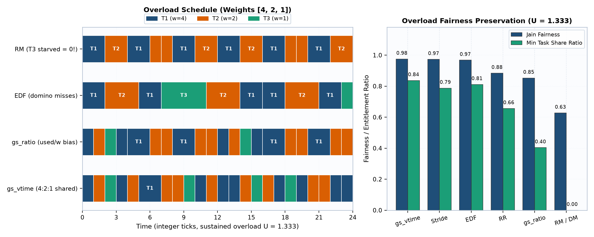

# تمرین ۲: زمان‌بندی تضمین‌شده در برابر الگوریتم‌های بلادرنگ و عادلانه

**ارزیابی مقایسه‌ای با EDF، DM، RM، Stride و Round Robin در رژیم‌های سهم نسبی، مهلت محدود (D < T) و اضافه‌بار (U > 1)**

- **مخزن:** ZaraNodehi/Guaranteed-Scheduling
- **تمرین:** تمرین ۲ — بنچمارک بین‌الگوریتمی و تحلیل مهلت‌های محدود D < T
- **ابزارها:** شبیه‌ساز گسسته [M] | وارسی جامع امکان‌پذیری [E] | ممیز مستقل [E]
- **منبع داده‌ها:** exercise-2/output/experiments.json (تولید خودکار بدون عدد دستی)

## فهرست مطالب

- ۱. چشم‌انداز اجرایی و پرسش‌های پژوهشی (p. 3)
- ۲. رده‌بندی الگوریتم‌ها و طراحی آزمایش [M]+[E] (p. 4)
- ۳. مبانی نظری در سه رژیم عملیاتی (p. 5)
- ۴. رژیم A: اشتراک نسبی CPU روی دسته وزن‌دار [M] (p. 6)
- ۵. تحلیل رژیم A: کنترل تاخیر و برش‌دهی متوازن [M] (p. 7)
- ۶. رژیم B1: برتری DM بر RM در مهلت محدود (D < T) [E]+[M] (p. 8)
- ۷. رژیم B2: برتری قاطع EDF در U = 0.958 [E]+[M] (p. 9)
- ۸. کالبدشکافی خطای مهلت در جدول زمانی B2 [M] (p. 10)
- ۹. رژیم B3: اثبات عدم امکان‌پذیری با وجود U < 1.0 [E] (p. 11)
- ۱۰. جاروب آماری ۱۲۰ مجموعه وظیفه با مهلت محدود [M] (p. 12)
- ۱۱. تایید جامع بهینگی EDF و اثر وزن‌دهی چگالی GS [E]+[M] (p. 13)
- ۱۲. تحلیل تاثیر وزن چگالی در GS در برابر زمان‌بندی مبتنی بر مهلت (p. 14)
- ۱۳. رژیم C: اضافه‌بار پایدار U = 1.333 با وزن متناسب [M] (p. 15)
- ۱۴. رژیم C: اضافه‌بار با وزن‌های نامتقارن [4, 2, 1] [M] (p. 16)
- ۱۵. مشاهده اثر دومینو و گرسنگی در اضافه‌بار [M] (p. 17)
- ۱۶. جمع‌بندی چندرژیمی: نبود برنده مطلق (p. 18)
- ۱۷. ممیزی مستقل درستی برنامه‌های زمانی [E] (p. 19)
- ۱۸. پیامدهای معماری: پیوند GS و EDF در زمان‌بندهای ترکیبی (p. 20)
- ۱۹. ماتریس تصمیم‌گیری مهندسی و محدودیت‌های صریح (p. 21)
- ۲۰. جمع‌بندی یافته‌های تاییدشده و مسیر تمرین ۳ (p. 22)


<!-- page 1 -->


<!-- page 2 -->


<!-- page 3 -->


## ۱. چشم‌انداز اجرایی و پرسش‌های پژوهشی

در تمرین ۱ دیدیم که زمان‌بندی تضمین‌شده (GS) تاخیر تجمعی خدمت را نسبت به GPS سیال به‌صورت دقیق کراندار می‌کند. اما سیستم‌عامل‌های واقعی هم میزبان بارهای اشتراک نسبی نرم هستند و هم میزبان وظایف دوره‌ای بلادرنگ سخت. این تمرین بررسی می‌کند که آیا عدالت نسبی ضامن رعایت مهلت‌های بلادرنگ است یا خیر، و زمان‌بندهای کلاسیک بلادرنگ در شرایط اشباع و اضافه‌بار (U > 1.0) چگونه رفتار می‌کنند.


### پرسش‌های اصلی پژوهش

- **پرسش ۱ (رژیم سهم نسبی A):** واریانت‌های GS (`gs_ratio`، `gs_vtime`، `gs_entitled`) و `stride` تا چه حد دقیق‌تر از `rr` و `fifo` به GPS نزدیک می‌شوند؟
- **پرسش ۲ (تفکیک مهلت محدود B1/B2):** وقتی مهلت نسبی اکیداً کوچک‌تر از دوره تناوب باشد (D_i < T_i)، فاصله میان EDF، DM، RM و GS چگونه ظاهر می‌شود؟
- **پرسش ۳ (توهم بهره‌وری B3):** آیا مجموعه وظایفی با بهره‌وری کمتر از یک (U < 1.0) می‌تواند تحت همه الگوریتم‌ها غیرقابل‌زمان‌بندی باشد؟
- **پرسش ۴ (جاروب ۱۲۰ مجموعه و وارسی ۳۰تایی B4/B5):** آیا EDF در مهلت‌های محدود همچنان ۱۰۰٪ بهینه می‌ماند و وزن‌دهی چگالی (`w ~ C/D`) چقدر به GS کمک می‌کند؟
- **پرسش ۵ (اضافه‌بار پایدار C):** در اشباع U = 1.333، آیا RM و DM باعث گرسنگی کامل وظایف کم‌اولویت می‌شوند در حالی که GS سهم وزنی را حفظ می‌کند؟


<!-- page 4 -->


## ۲. رده‌بندی الگوریتم‌ها و طراحی آزمایش [M]+[E]

شکل ۱ هفت سیاست مورد مقایسه را در سه خانواده مجزا رده‌بندی می‌کند: اشتراک نسبی زمان مجازی، اولویت فوریت مهلت/دوره تناوب، و مبناهای بدون‌وزن چرخشی و ترتیبی.


*شکل 1. رده‌بندی هفت الگوریتم زمان‌بندی در سه رژیم آزمایشی تمرین ۲.*

| پارامتر طراحی | مقدار / تضمین روش‌شناسی |
|---|---|
| هسته دقیق محاسباتی | core/gs_core.py (همگام در exercise-2/code/gs_core.py) |
| مهلت‌های محدود | رعایت اکید شرط D_i < T_i در B1 تا B3 و تمام ۱۲۰ مجموعه جاروب |
| ممیزی مستقل [E] | 4 جدول بدون‌خطا با ممیز مستقل تایید شد (ok=True) |

*جدول 1. خلاصه معماری راستی‌آزمایی و ممیزی تمرین ۲ [E]*


<!-- page 5 -->


## ۳. مبانی نظری در سه رژیم عملیاتی


### سهم نسبی در برابر تابع تقاضای مهلت

```text
GPS / GS:       E_i(t) = integral (w_i / sum_{j in A(tau)} w_j) d tau
Demand Bound:   dbf(t) = sum_i max(0, floor((t - D_i)/T_i) + 1) * C_i <= t
EDF Theorem:    Feasible iff forall t > 0, dbf(t) <= t (Baruah 1990)
```
*معادلات بنیادی تفکیک عدالت نسبی از شرط لازم و کافی زمان‌بندی با مهلت محدود*

- **چرا مهلت ضمنی D = T تفاوت‌ها را پنهان می‌کند:** در مدل کلاسیک لیو و لیلند (D_i = T_i)، زمان‌بندی RM در میان اولویت‌های ثابت بهینه است و EDF برای هر مجموعه‌ای با U <= 1.0 موفق می‌شود.
- **چرا مهلت محدود D < T همه‌چیز را تغییر می‌دهد:** وقتی D_i < T_i باشد، وظیفه‌ای با دوره طولانی می‌تواند مهلت بسیار نزدیک داشته باشد؛ در نتیجه DM بر RM برتری می‌یابد، EDF از هر دو پیشی می‌گیرد، و حتی با U < 1.0 ممکن است تراکم تقاضای dbf(t) > t ایجاد شود.
- **وارونگی اضافه‌بار (U > 1.0):** بالای مرز اشباع، اولویت ثابت باعث حذف کامل وظیفه کم‌اولویت می‌شود، در حالی که `gs_vtime` عدالت نسبی را برقرار نگه می‌دارد.


<!-- page 6 -->


## ۴. رژیم A: اشتراک نسبی CPU روی دسته وزن‌دار [M]

در رژیم A چهار فرایند CPUمحور هم‌زمان در t=0 با مجموع کار 50 تیک (`P1(w=1, work=8)`، `P2(w=2, work=12)`، `P3(w=4, work=20)`، `P4(w=3, work=10)`) اجرا شدند. جدول ۲ معیارهای دقیق تاخیر، RMSE، تعویض زمینه و شاخص جین را نمایش می‌دهد.

| سیاست | q | بیشینه تاخیر (کسر) | RMSE | تعویض | پیش‌گیری | میانگین TA | جین |
|---|---|---|---|---|---|---|---|
| gs_ratio | 1 | 1.1429 (8/7) | 0.4410 | 45 | 41 | 44.25 | 1.0000 |
| gs_vtime | 1 | 1.1429 (8/7) | 0.4410 | 45 | 41 | 44.25 | 1.0000 |
| gs_entitled | 1 | 1.1429 (8/7) | 0.4410 | 45 | 41 | 44.25 | 1.0000 |
| stride | 1 | 1.1429 (8/7) | 0.4410 | 45 | 41 | 44.25 | 1.0000 |
| rr | 1 | 6.7143 (47/7) | 2.7002 | 42 | 38 | 39.50 | 1.0000 |
| gs_ratio | 2 | 2.2857 (16/7) | 0.8555 | 23 | 19 | 44.00 | 1.0000 |
| rr | 2 | 7.1429 (50/7) | 2.8624 | 21 | 17 | 38.50 | 1.0000 |
| fifo | 1 | 10.0000 (10) | 5.0467 | 4 | 0 | 29.50 | 1.0000 |

*جدول 2. نتایج رژیم اشتراک نسبی A در هشت پیکربندی [M]*

در کوانتوم q=1، چهار سیاست `gs_ratio`، `gs_vtime`، `gs_entitled` و `stride` دقیقاً تاخیر بیشینه `1.1429` (`8/7`) و RMSE برابر `0.4410` دارند که حدود ۶ برابر دقیق‌تر از `rr` بدون‌وزن (`6.7143`) است.


<!-- page 7 -->


## ۵. تحلیل رژیم A: کنترل تاخیر و برش‌دهی متوازن [M]

شکل ۲ بیشینه تاخیر سیاست‌ها (چپ) را کنار ترتیب اجرای ۲۵ تیک نخست (راست) نشان می‌دهد. `gs_vtime` به‌سرعت به `P3 (w=4)` و `P4 (w=3)` سهم بیشتری می‌دهد، در حالی که `rr` چرخه یکسان ۱:۱:۱:۱ و `fifo` تاخیر تجمعی بالا ایجاد می‌کند.


*شکل 2. مقایسه تاخیر و RMSE (چپ) و ترتیب اجرای ۲۵ تیک نخست در رژیم A (راست).*

> **اهمیت سنجش تاخیر لحظه‌ای در کنار عدالت پایانی.** توجه کنید `fifo_q1` با وجود بیشینه تاخیر `10.0000` در پایان افق اجرا شاخص جین `1.0000` می‌گیرد؛ چون سرانجام همه کارها تمام می‌شوند. پس شاخص پایانی جایگزین تاخیر لحظه‌ای نیست.


<!-- page 8 -->


## ۶. رژیم B1: برتری DM بر RM در مهلت محدود (D < T) [E]+[M]

حالت B1 مجموعه‌ای دوفرایندی با `T1(P=4, C=2, D=4)` و `T2(P=6, C=2, D=3)` را با بهره‌وری `U = 0.833` و ابر‌دوره H = 12 می‌آزماید. ابزار جامع [E] امکان‌پذیری دقیق را برابر `True` (11 حالت) تایید کرد.

| سیاست | خطا | نرخ خطا | بدترین پاسخ | جیتر | تعویض | جین | ممیزی [E] |
|---|---|---|---|---|---|---|---|
| EDF | 0/5 | 0.0% | 4 | 2 | 5 | 0.9549 | PASS |
| DM | 0/5 | 0.0% | 4 | 2 | 5 | 0.9549 | PASS |
| RM | 1/5 | 20.0% | 4 | 2 | 5 | 0.9615 | MISS |
| gs_vtime (base w) | 1/5 | 20.0% | 4 | 2 | 7 | 0.9897 | MISS |
| gs_vtime (w~C/D) | 0/5 | 0.0% | 4 | 2 | 6 | 0.9964 | PASS |
| gs_ratio | 1/5 | 20.0% | 4 | 2 | 7 | 0.9897 | MISS |
| stride | 1/5 | 20.0% | 4 | 2 | 7 | 0.9897 | MISS |
| rr (q=1) | 1/5 | 20.0% | 4 | 2 | 7 | 0.9897 | MISS |

*جدول 3. تفکیک B1: موفقیت EDF و DM در برابر خطای RM و GS [M]+[E]*

- **علت شکست RM و موفقیت DM:** وظیفه `T2` دوره تناوب بزرگ‌تر (`6 > 4`) اما مهلت کوتاه‌تر (`3 < 4`) دارد. سیاست RM اشتباهاً `T1` را مقدم می‌دارد و `T2` در t=3 خطا می‌دهد (`missed = 1`)، اما DM با خطای `0` پاس می‌شود.
- **علت خطای GS:** اشتراک نسبی `gs_vtime` تیک‌ها را تقسیم کرده و `T2` را در t=4 تمام می‌کند (`missed = 1`).


<!-- page 9 -->


## ۷. رژیم B2: برتری قاطع EDF در U = 0.958 [E]+[M]

در حالت B2 بهره‌وری به `U = 0.9583` با سه وظیفه محدود `T1(6,3,4)`، `T2(8,3,7)` و `T3(12,1,10)` در ابر‌دوره H = 24 افزایش می‌یابد. وارسی جامع [E] نشان داد مجموعه کاملاً امکان‌پذیر است (`feasible = True`).

| سیاست | خطا | نرخ خطا | بدترین پاسخ | جیتر | تعویض | جین | ممیزی [E] |
|---|---|---|---|---|---|---|---|
| EDF | 0/9 | 0.0% | 10 | 7 | 10 | 0.7629 | PASS |
| DM | 2/9 | 22.2% | 16 | 13 | 10 | 0.7034 | MISS |
| RM | 2/9 | 22.2% | 16 | 13 | 10 | 0.7034 | MISS |
| gs_vtime (base w) | 4/9 | 44.4% | 7 | 4 | 18 | 0.9735 | MISS |
| gs_vtime (w~C/D) | 4/9 | 44.4% | 7 | 4 | 18 | 0.6424 | MISS |
| gs_ratio | 4/9 | 44.4% | 14 | 12 | 17 | 0.8613 | MISS |
| stride | 5/9 | 55.6% | 8 | 5 | 22 | 0.9483 | MISS |
| rr (q=1) | 4/9 | 44.4% | 7 | 4 | 22 | 0.9715 | MISS |

*جدول 4. نتایج B2: تنها EDF همه مهلت‌ها را بدون خطا برآورده می‌کند [M]+[E]*

فقط `EDF` با `0/9` خطا موفق شد (تایید مستقل `PASS`). سیاست‌های `DM` و `RM` هر دو `2` خطا (`T3#0` و `T3#1`) و `gs_vtime` تعداد `4` خطا ثبت کردند.


<!-- page 10 -->


## ۸. کالبدشکافی خطای مهلت در جدول زمانی B2 [M]

شکل ۳ ریشه دقیق خطای DM، RM و GS را در برابر اجرای بدون خطای EDF تیک‌به‌تیک نمایش می‌دهد.


*شکل 3. نمودار گانت B2: موفقیت EDF در برابر خطای مهلت DM، RM و gs_vtime.*

- **چرخش پویا در EDF (لحظه t = 9):** سیاست `EDF` بلافاصله `T3#0` را با مهلت t=10 جلوتر از `T2#1` (مهلت t=15) اجرا می‌کند و خطا را خنثی می‌سازد.
- **کوری اولویت ثابت در DM/RM:** اولویت ثابت `T2#1` را بر `T3#0` ترجیح می‌دهد و `T3#0` را به بعد از مهلت t=10 هل می‌دهد.
- **تفرق برش در GS:** چرخاندن سه وظیفه در t=0..5 زمان پایان ۳ تیک `T1#0` را از t=3 به t=5 می‌برد و مهلت D_1=4 می‌سوزد.


<!-- page 11 -->


## ۹. رژیم B3: اثبات عدم امکان‌پذیری با وجود U < 1.0 [E]

با وجود باور رایج، شرط U <= 1.0 فقط برای مهلت ضمنی (D=T) ضامن زمان‌بندی‌پذیری است. در حالت B3 وظایف `T1(4,1,2)`، `T2(6,2,4)` و `T3(12,4,10)` با بهره‌وری `U = 0.9167 < 1.0` دارای مجموع چگالی `1.4000 > 1.0` هستند.

| سیاست | خطا | نرخ خطا | بدترین پاسخ | جیتر | تعویض | جین | ممیزی [E] |
|---|---|---|---|---|---|---|---|
| EDF | 1/6 | 16.7% | 11 | 10 | 8 | 0.8169 | MISS |
| DM | 1/6 | 16.7% | 11 | 10 | 8 | 0.8169 | MISS |
| RM | 1/6 | 16.7% | 11 | 10 | 8 | 0.8169 | MISS |
| gs_vtime (base w) | 1/6 | 16.7% | 9 | 8 | 11 | 0.9562 | MISS |
| gs_vtime (w~C/D) | 1/6 | 16.7% | 9 | 8 | 11 | 0.9960 | MISS |
| gs_ratio | 1/6 | 16.7% | 11 | 10 | 9 | 0.8127 | MISS |
| stride | 1/6 | 16.7% | 11 | 10 | 11 | 0.7534 | MISS |
| rr (q=1) | 1/6 | 16.7% | 9 | 8 | 11 | 0.9562 | MISS |

*جدول 5. حالت B3: شکست اجتناب‌ناپذیر همه الگوریتم‌ها در تنگنای تقاضای مهلت [E]+[M]*

> **اثبات عدم‌وجود برنامه معتبر فراتر از شکست یک اکتشاف [E].** جستجوی جامع (`28` حالت، `15` هرس، `truncated=False`) ثابت کرد `feasible = False` — یعنی هیچ ترتیب ممکنی بدون ردشدن مهلت وجود ندارد زیرا تابع تقاضای dbf(t) از طول پنجره زمانی t تجاوز می‌کند.


<!-- page 12 -->


## ۱۰. جاروب آماری ۱۲۰ مجموعه وظیفه با مهلت محدود [M]

برای پرهیز از نتیجه‌گیری تک‌نمونه‌ای، `120` مجموعه تصادفی با شرط D_i < T_i در چهار بازه بهره‌وری (هر بازه ۳۰ مجموعه) تولید و اجرا شد. جدول ۶ نرخ موفقیت صفر-خطا و جدول ۷ نرخ خطای میانگین و جیتر زمان پاسخ را نشان می‌دهند.

| بازه U | میانگین U | EDF | DM | RM | GS (w~C/D) | GS (هم‌وزن) | Stride | RR |
|---|---|---|---|---|---|---|---|---|
| 0.65-0.75 | 0.706 | 100.0% | 96.7% | 93.3% | 83.3% | 63.3% | 63.3% | 63.3% |
| 0.75-0.85 | 0.804 | 90.0% | 60.0% | 56.7% | 43.3% | 23.3% | 16.7% | 16.7% |
| 0.85-0.95 | 0.902 | 60.0% | 26.7% | 26.7% | 26.7% | 10.0% | 10.0% | 13.3% |
| 0.95-1.00 | 0.983 | 16.7% | 3.3% | 3.3% | 3.3% | 3.3% | 0.0% | 0.0% |

*جدول 6. درصد مجموعه‌های کاملاً بدون‌خطا در جاروب ۱۲۰تایی D < T [M]*

| بازه U | EDF (خطا/جیتر) | DM (خطا/جیتر) | RM (خطا/جیتر) | GS-dens | GS-eq | RR |
|---|---|---|---|---|---|---|
| 0.65-0.75 | 0.0% / 10.80 | 0.1% / 11.27 | 0.7% / 11.27 | 2.7% / 10.53 | 4.7% / 10.40 | 4.4% / 10.83 |
| 0.75-0.85 | 0.9% / 12.00 | 5.2% / 14.17 | 6.0% / 14.17 | 7.5% / 11.73 | 10.4% / 11.73 | 11.7% / 12.23 |
| 0.85-0.95 | 5.6% / 14.93 | 11.7% / 18.93 | 11.6% / 19.00 | 16.8% / 14.00 | 18.3% / 13.30 | 19.1% / 14.10 |
| 0.95-1.00 | 19.1% / 18.37 | 19.4% / 27.27 | 19.7% / 27.47 | 46.4% / 17.57 | 35.3% / 17.30 | 34.9% / 18.53 |

*جدول 7. میانگین نرخ خطا و جیتر زمان پاسخ در بازه‌های بهره‌وری [M]*


<!-- page 13 -->


## ۱۱. تایید جامع بهینگی EDF و اثر وزن‌دهی چگالی GS [E]+[M]

شکل ۴ روند افت نرخ موفقیت ۱۲۰ مجموعه را در کنار ممیزی جامع ۳۰ مجموعه کوچک [E] (راست) نمایش می‌دهد. از ۳۰ مجموعه، `11` مجموعه ذاتاً زمان‌بندی‌پذیر بودند و `EDF` دقیقاً هر `11` مورد را حل کرد (`edf_matches_exhaustive_100pct = True`)، در حالی که `DM` به `7` و `RM` به `6` کاهش یافتند.

![شکل 4: نتایج جاروب ۱۲۰تایی [M] (چپ) و تطابق ۱۰۰٪ EDF با وارسی جامع ۳۰تایی [E] (راست).](diagrams/fig_ex2_constrained_sweep.png)

*شکل 4. نتایج جاروب ۱۲۰تایی [M] (چپ) و تطابق ۱۰۰٪ EDF با وارسی جامع ۳۰تایی [E] (راست).*

- **جهش GS با وزن چگالی `C/D`:** در بازه `0.65–0.75`، وزن‌دهی متناسب با چگالی مهلت موفقیت GS را از `63.3%` به `83.3%` ارتقا می‌دهد.
- **دیوار تراکم مهلت:** بالای `U = 0.95` حتی EDF بهینه تنها `16.7%` مجموعه‌ها را پاس می‌کند که موید پدیده B3 است.


<!-- page 14 -->


## ۱۲. تحلیل تاثیر وزن چگالی در GS در برابر زمان‌بندی مبتنی بر مهلت

در بازه `0.75–0.85` سیاست `gs_vtime (w ~ C/D)` نرخ موفقیت را تقریباً دو برابر می‌کند (از `23.3%` به `43.3%`) و در `0.85–0.95` با `DM` و `RM` در `26.7%` برابر می‌شود. چرا با این حال به EDF نمی‌رسد؟

- **شکستن پیوستگی کار فوری:** حتی با وزن بالا، GS میان تیک‌های کار فوری به رقبای دیگر سهم می‌دهد و زمان دیوار اتمام کار را افزایش می‌دهد.
- **مزیت جانبی در جیتر پایین:** همان‌طور که جدول ۷ نشان می‌دهد، در `U in [0.95, 1.00]` میانگین جیتر `gs_vtime` تنها `17.30` تیک در برابر `27.27` در `DM` و `27.47` در `RM` است.
- **توصیه کاربردی:** اگر بار بلادرنگ نرم ناگزیر روی زمان‌بند نسبی اجرا شود، انتخاب وزن `w_i ~ C_i / D_i` بیشترین پایداری مهلت را ایجاد می‌کند.


<!-- page 15 -->


## ۱۳. رژیم C: اضافه‌بار پایدار U = 1.333 با وزن متناسب [M]

در اضافه‌بار `U = 1.3333` (`T1(4,2,4)`، `T2(6,3,5)`، `T3(12,4,10)`، H=24) خطای مهلت قطعی است. ابتدا با وزن‌های منطبق با تقاضا `[3, 3, 2]` سنجیدیم (جدول ۸).

| سیاست | خطاها | شاخص جین | کمینه نسبت سهم | CPU (T1/T2/T3) | تعویض |
|---|---|---|---|---|---|
| gs_vtime | 10/12 | 1.0000 | 1.0000 | 9 / 9 / 6 | 24 |
| stride | 10/12 | 0.9468 | 0.6667 | 11 / 9 / 4 | 24 |
| edf | 8/12 | 0.9690 | 0.7874 | 10 / 9 / 5 | 10 |
| rr | 10/12 | 1.0000 | 1.0000 | 9 / 9 / 6 | 24 |
| gs_ratio | 6/12 | 0.7456 | 0.5556 | 12 / 8 / 4 | 20 |
| dm | 6/12 | 0.5567 | 0.0000 | 12 / 12 / 0 | 14 |
| rm | 6/12 | 0.5567 | 0.0000 | 12 / 12 / 0 | 14 |

*جدول 8. معیارهای اضافه‌بار U=1.333 با وزن‌های منطبق [3, 3, 2] [M]*

- **گرسنگی کامل در RM و DM:** سهم `T3` دقیقاً صفر است (`min_task_share_ratio = 0.0000`، `Jain = 0.5567`).
- **حفظ کامل عدالت در `gs_vtime`:** شاخص جین `1.0000` و کمینه نسبت سهم `1.0000` (دقیقاً `9/9/6` یعنی ۳:۳:۲) ثبت می‌شود.
- **افت `gs_ratio` در ورود دوره‌ای:** به‌دلیل ورود کارهای دوره‌ای جدید با `used = 0`، شاخص جین `gs_ratio` به `0.7456` سقوط می‌کند.


<!-- page 16 -->


## ۱۴. رژیم C: اضافه‌بار با وزن‌های نامتقارن [4, 2, 1] [M]

برای تفکیک دقیق `gs_vtime` وزن‌دار از `Round Robin` بدون‌وزن، وزن‌های اداری `[4, 2, 1]` را روی همان بار اضافه‌بار `U = 1.3333` آزمایش کردیم (جدول ۹).

| سیاست | خطاها | شاخص جین | کمینه نسبت سهم | CPU (T1/T2/T3) | تعویض |
|---|---|---|---|---|---|
| gs_vtime | 9/12 | 0.9754 | 0.8370 | 11 / 9 / 4 | 23 |
| stride | 7/12 | 0.9733 | 0.7875 | 12 / 9 / 3 | 23 |
| edf | 8/12 | 0.9677 | 0.8114 | 10 / 9 / 5 | 10 |
| rr | 10/12 | 0.8838 | 0.6562 | 9 / 9 / 6 | 24 |
| gs_ratio | 6/12 | 0.8526 | 0.4038 | 12 / 10 / 2 | 20 |
| dm | 6/12 | 0.6275 | 0.0000 | 12 / 12 / 0 | 14 |
| rm | 6/12 | 0.6275 | 0.0000 | 12 / 12 / 0 | 14 |

*جدول 9. معیارهای اضافه‌بار U=1.333 با وزن‌های نامتقارن [4, 2, 1] [M]*

در این شرایط، `rr` بدون‌وزن سهم را به `9/9/6` هموار کرده و به `Jain = 0.8838` (`min_sr = 0.6562`) سقوط می‌کند، در حالی که `gs_vtime` با `Jain = 0.9754` و `min_sr = 0.8370` بالاترین عدالت وزنی را حفظ می‌کند.


<!-- page 17 -->


## ۱۵. مشاهده اثر دومینو و گرسنگی در اضافه‌بار [M]

شکل ۵ جدول زمانی ۲۴ تیکی اضافه‌بار (چپ) را کنار نمودار میله‌ای شاخص جین و کمینه نسبت سهم (راست) برای وزن‌های `[4, 2, 1]` نمایش می‌دهد.



*شکل 5. گانت اضافه‌بار (چپ: حذف کامل T3 در RM در برابر اشتراک وزنی gs_vtime) و شاخص عدالت (راست).*

> **تفاوت دومینوی EDF با تضمین وزنی قطعی.** توجه کنید `EDF` دچار گرسنگی صفر-تیکی نمی‌شود (`Jain = 0.9677`) اما به‌دلیل اثر دومینوی تاخیر در `8/12` کار خطای زنجیره‌ای می‌دهد.


<!-- page 18 -->


## ۱۶. جمع‌بندی چندرژیمی: نبود برنده مطلق

شکل ۶ تمام الگوریتم‌ها را در فضای دو بعدی قابلیت اطمینان مهلت محدود (محور افقی، بازه بهره‌وری `0.75–0.95`) و حفظ عدالت در اضافه‌بار (محور عمودی، `U = 1.333`) تصویر می‌کند.


*شکل 6. صفحه مصالحه بین موفقیت مهلت بلادرنگ D < T و حفظ عدالت در اضافه‌بار.*

- **ناحیه سهم نسبی (بالا-چپ):** `gs_vtime` و `stride` کمترین تاخیر GPS و بالاترین عدالت اضافه‌بار را برای ایزوله‌سازی چندمستاجری می‌دهند.
- **ناحیه بلادرنگ سخت (بالا-راست):** `EDF` در رعایت مهلت‌ها ۱۰۰٪ بهینه است اما در اضافه‌بار کنترل سهم ندارد.
- **تله اولویت ثابت (پایین):** `RM` و `DM` در بار متوسط کارآمدند اما هنگام اضافه‌بار وظایف پایین را حذف می‌کنند.


<!-- page 19 -->


## ۱۷. ممیزی مستقل درستی برنامه‌های زمانی [E]

برای اطمینان از نبود باگ شمارشی در شبیه‌ساز، تابع مستقل `verify_rt_schedule_independent` (با کد کاملاً مجزا از `simulate_rt` و `exhaustive_feasible`) تمام خروجی‌ها را ممیزی کرد.

| آزمون ممیزی [E] | نتیجه ثبت‌شده |
|---|---|
| برنامه‌های بدون‌خطای ممیزی‌شده | 4 / 4 |
| وضعیت تایید ممیز مستقل | True |
| تطابق EDF با وارسی جامع ۳۰تایی | 11 == 11 (تطابق کامل) |
| اثبات عدم امکان‌پذیری B3 | feasible = False (28 حالت، truncated=False) |

*جدول 10. خلاصه نتایج ممیزی مستقل و وارسی جامع [E]*

> **تفکیک دقیق اثبات‌های [E] از شبیه‌سازی‌های [M].** هر برنامه دارای خطا نیز توسط ممیز مستقل دقیقاً با نام نخستین کار متخلف و زمان تخطی ثبت شد.


<!-- page 20 -->


## ۱۸. پیامدهای معماری: پیوند GS و EDF در زمان‌بندهای ترکیبی

یافته‌های سه رژیم A، B و C دلیل طراحی هسته‌های مدرن بلادرنگ (نظیر `SCHED_DEADLINE` لینوکس بر پایه CBS یا سرور پهنای باند ثابت) را توضیح می‌دهند:

1. **گام ۱ — رزرو پهنای باند (روح GS):** اختصاص سهم تضمینی `(Q_s, P_s)` متناسب با وزن تا بار پرمصرف نتواند سایرین را گرسنه کند.
2. **گام ۲ — توزیع با مهلت مجازی (روح EDF):** انتخاب سرور فعال بر مبنای مهلت مجازی برای دستیابی به ۱۰۰٪ ظرفیت زمان‌بندی‌پذیر در مهلت محدود.
3. **گام ۳ — لنگر زمان مجازی (`gs_vtime`):** مقداردهی اولیه زمان مجازی هنگام ورود جدید برای جلوگیری از قفل‌شدن که دیدیم در `gs_ratio` رخ می‌دهد.


<!-- page 21 -->


## ۱۹. ماتریس تصمیم‌گیری مهندسی و محدودیت‌های صریح

| نیاز سیستم | سیاست پیشنهادی | شواهد اثبات‌شده در تمرین ۲ |
|---|---|---|
| عدالت نسبی وزن‌دار و ایزوله‌سازی | gs_vtime / stride (q=1) | [M]: تاخیر 1.14 در برابر 6.71 برای RR. |
| بلادرنگ سخت D < T و U <= 1.0 | EDF | [E]: تطابق ۱۰۰٪ با امکان‌پذیری واقعی (11/30). |
| اولویت ثابت در مهلت محدود D < T | DM (هرگز RM) | [E]+[M]: اثبات موفقیت DM و شکست RM در حالت B1. |
| بلادرنگ نرم با خطر اضافه‌بار U > 1 | gs_vtime (w ~ C/D) | [M]: جهش مهلت در U=0.75-0.85 و عدالت 0.98 در اشباع. |
| سیستم قدیمی اولویت ثابت | RM/DM + محدودکننده پهنای باند | [M]: جلوگیری از گرسنگی ۰ تیکی T3 در رژیم C. |

*جدول 11. ماتریس انتخاب سیاست زمان‌بندی بر پایه یافته‌های مستند تمرین ۲*


### محدودیت‌های صریح

- مدل تک‌هسته‌ای با تیک‌های صحیح و بدون سربار زمانی تعویض زمینه به‌کار رفته است.
- قفل منابع اشتراکی (PI/PCP) و مهاجرت چندپردازنده‌ای در دامنه تمرین ۲ قرار ندارند.


<!-- page 22 -->


## ۲۰. جمع‌بندی یافته‌های تاییدشده و مسیر تمرین ۳

- **رژیم نسبی (`[M]`):** `gs_vtime` و `stride` بیشینه تاخیر GPS را از `6.7143` (در RR) به `1.1429` کاهش دادند.
- **مهلت‌های محدود `D < T` (`[E]`+`[M]`):** `EDF` تمام `11/11` مجموعه امکان‌پذیر ممیزی ۳۰تایی را حل کرد، در حالی که `DM` (`7`), `RM` (`6`) و `GS` (`1`) عقب ماندند.
- **هشدار بهره‌وری (`[E]`):** حالت B3 نشان داد مجموعه‌ای با `U = 0.9167 < 1` می‌تواند ذاتاً غیرقابل‌زمان‌بندی باشد.
- **عدالت اضافه‌بار (`[M]`):** در `U = 1.3333`، سیاست‌های `RM`/`DM` سهم `T3` را به صفر رساندند (`Jain = 0.5567..0.6275`)، در حالی که `gs_vtime` عدالت را در `0.9754..1.0000` حفظ کرد.
- **گام بعدی — تمرین ۳:** حل دستی گام‌به‌گام با کسرهای دقیق و تطبیق کامل با اجرای برنامه‌نویسی روی ورود ایستا و پویا.
