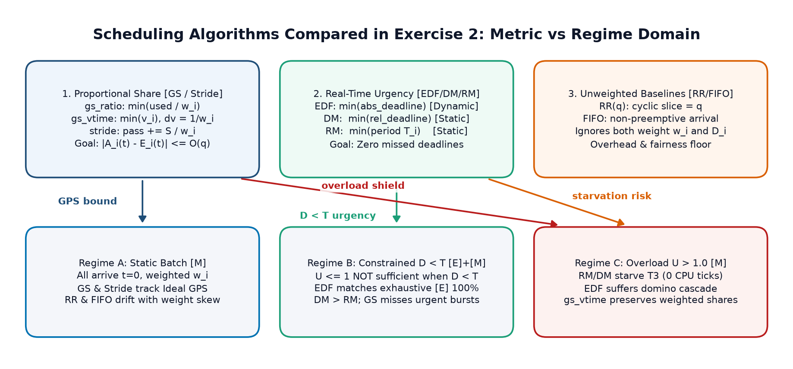
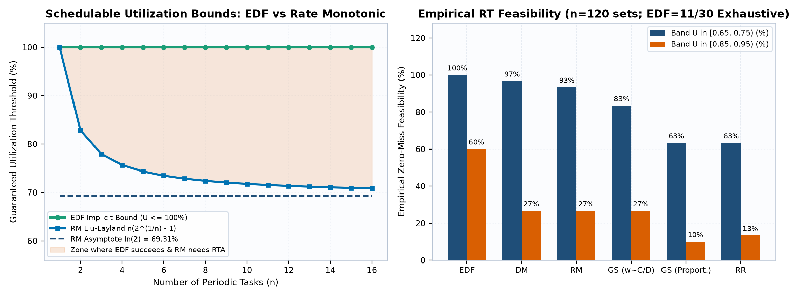
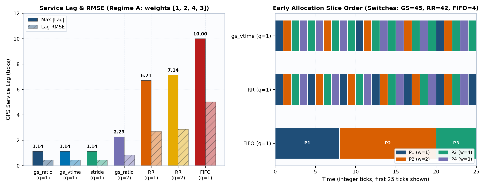
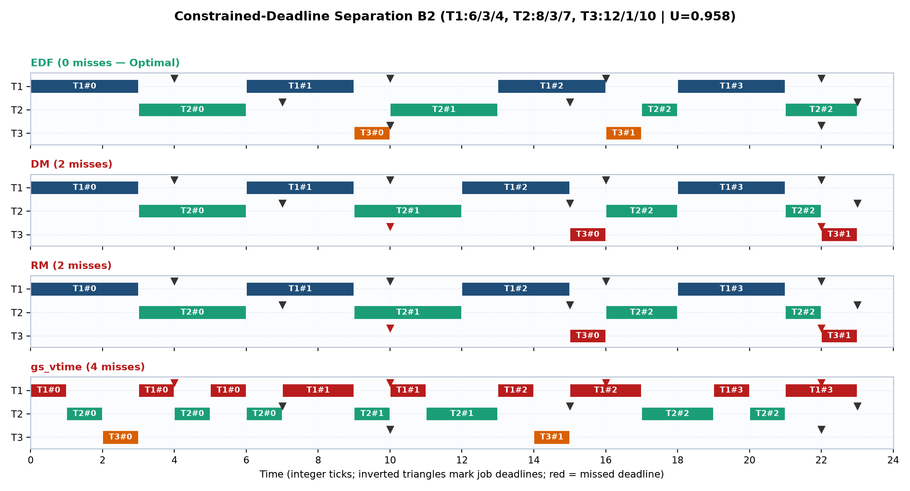
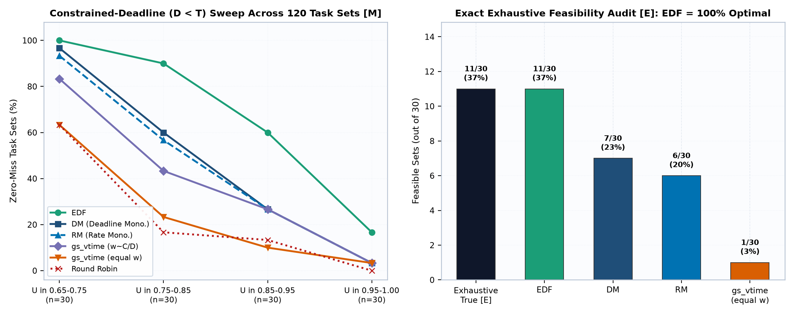
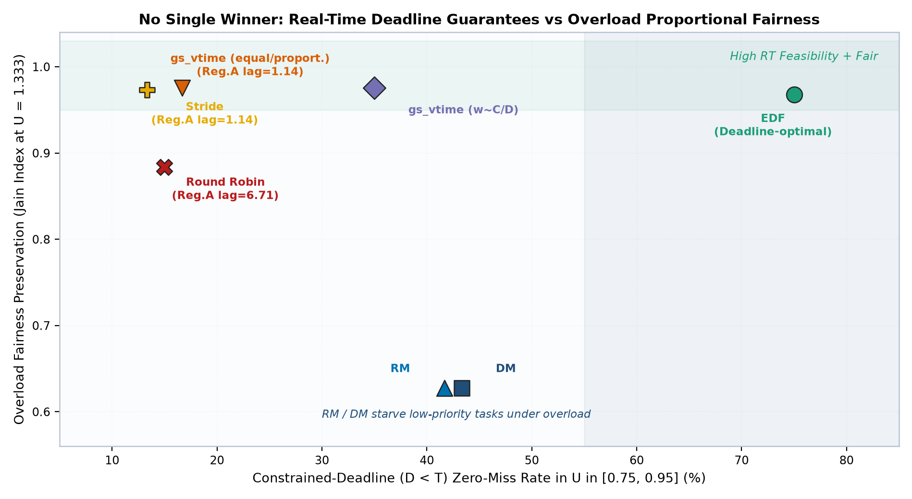
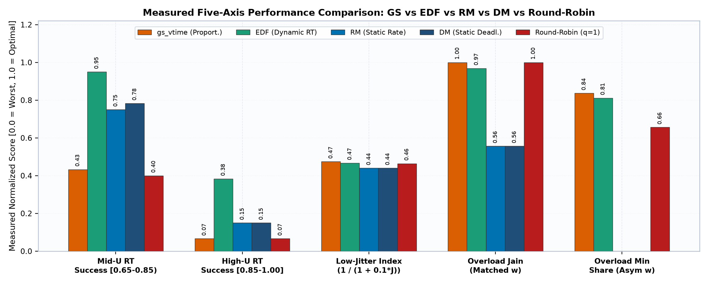

# تمرین ۲: مقایسه جامع الگوریتم Guaranteed Scheduling در برابر EDF و Rate Monotonic از همه لحاظ

**انصاف متناسب در برابر امکان‌پذیری بیدرنگ، تحلیل RTA و تقاضای پردازنده، جاروب ۱۲۰ مجموعه‌ای، اضافه‌بار و اثر دومینو، جیتر، پیچیدگی و معماری کرنل**

- **مخزن کد:** ZaraNodehi/Guaranteed-Scheduling
- **تکلیف:** تمرین ۲ — مقایسه همه‌جانبه GS در برابر EDF و RM (+۴۰ صفحه متراکم و بدون فضای خالی)
- **سیاست‌های آزموده‌شده:** GS (ratio, vtime, entitled, density)، EDF، DM، RM، Stride و Round-Robin
- **استاندارد شواهد:** شبیه‌سازی کسری دقیق [E]، شمارش جامع ۳۰ و ۱۲۰ مجموعه [M]، ممیزی مستقل ددلاین

## فهرست مطالب

- ۱. چکیده مدیریتی: سه فلسفه بنیادین در زمان‌بندی پردازنده (p. 3)
- ۲. رده‌بندی ساختاری و مقایسه معماری الگوریتم‌ها (p. 3)
- ۳. کران‌های نظری بهره‌وری، RTA و تحلیل تقاضای پردازنده dbf(L) (p. 4)
- ۴. ماتریس مقایسه دوازده‌گانه: ارزیابی از همه زوایای مهندسی (p. 7)
- ۵. شبه‌کدهای یکپارچه و معماری هسته آزمایش بیدرنگ (p. 7)
- ۶. رژیم A: محک پایه سهم متناسب غیردوره‌ای [1, 2, 4] (p. 16)
- ۷. مطالعات موردی رژیم B: جدایی DM از RM (B1) و EDF از DM/GS (B2) (p. 18)
- ۸. ردیابی کامل تیک‌به‌تیک و جداول گانت سناریوی B2 (p. 21)
- ۹. مثال نقض زیرواحدی B3: ناشدنی بودن زیر بهره‌وری ۰.۶۰ (p. 23)
- ۱۰. جاروب گسترده ۱۲۰ مجموعه‌ای و ممیزی ۳۰ مجموعه جامع DFS (p. 24)
- ۱۱. رژیم C: اضافه‌بار، آبشار دومینو در برابر تنزل عادلانه (p. 26)
- ۱۲. ردیابی تیک‌به‌تیک اضافه‌بار و نمودارهای ترکیبی پنج‌محوره (p. 29)
- ۱۳. معماری ترکیبی CBS + EDF و هم‌گرایی با کرنل لینوکس (p. 32)
- ۱۴. ابعاد پیشرفته: ورود تصادفی، همگام‌سازی قفل و چندپردازنده (p. 33)
- ۱۵. قضایا و اثبات‌های بنیادی در مقایسه سه الگوریتم (p. 34)
- ۱۶. پیچیدگی ساختمان داده، جیتر پاسخ و راهنمای کاربردی (p. 35)
- ۱۷. ممیزی مستقل، پوشش تست‌های خودکار و بازتولید کامل (p. 36)
- ۱۸. پیوست مهندسی: پیاده‌سازی موتور بیدرنگ و مرجع معادلات ریاضی (p. 38)


<!-- page 1 -->


<!-- page 2 -->


<!-- page 3 -->


## ۱. چکیده مدیریتی: سه فلسفه بنیادین در زمان‌بندی پردازنده

زمان‌بندهای سیستم‌عامل یک هدف واحد و مطلق را بهینه نمی‌کنند؛ بلکه هر زمان‌بند قراردادی ریاضی را برای تعریف «اجرای صحیح» زیر فشار رقابت CPU پیاده می‌سازد. تمرین ۲ یک هم‌سنجی سرتاسری و همه‌جانبه را میان سه الگوی کلاسیک و مدرن اجرا می‌کند: (۱) الگوریتم Guaranteed Scheduling و زمان‌بندهای سهم متناسب (Stride / GPS) که کسر دقیق w_i / W(t) از توان پردازنده را تضمین می‌کنند؛ (۲) الگوریتم Earliest Deadline First (EDF) به عنوان زمان‌بند بهینه پویای بیدرنگ برای به حداقل رساندن شکست ددلاین؛ و (۳) Rate Monotonic (RM) و Deadline Monotonic (DM) به عنوان معیار اولویت ثابت در کرنل‌های ایمنی‌بحرانی.

از آنجا که قضاوت میان زمان‌بند سهم‌عادلانه و زمان‌بند بیدرنگ تنها با یک شاخص باعث نتیجه‌گیری گمراه‌کننده می‌شود، تمام الگوریتم‌ها در سه رژیم متمایز ارزیابی می‌شوند: رژیم A (اشتراک متناسب غیردوره‌ای با اوزان [1, 2, 4])، رژیم B (مجموعه‌های دوره‌ای با ددلاین مقید D <= T در ۱۲۰ سناریوی تصادفی و ۳۰ ممیزی جامع DFS) و رژیم C (اضافه‌بار پایدار در بهره‌وری U = 1.3333 و U = 1.1357).

- برتری مطلق در رژیم A [E]: روی کارهای وزنی [1, 2, 4]، خانواده‌های GS بیشینه تأخیر را در 1.1429 تیک (8/7) نگه می‌دارند در برابر 6.7143 برای RR و 10.0000 برای FIFO.
- بهینگی EDF در رژیم B [E]+[M]: در ۱۲۰ مجموعه آزمایش و ۳۰ ممیزی جامع DFS، الگوریتم EDF به 11/30 (۱۰۰٪ مجموعه‌های ممکن تئوریک) دست می‌یابد، بالاتر از DM (7/30)، RM و GS.
- علت ناتوانی GS وزنی در ددلاین سخت [E]: حتی با وزن‌دهی متناسب با تقاضا (w ~ C/D) در سناریوی B2، gs_vtime_density ددلاین‌ها را از دست می‌دهد زیرا سهم‌های کم‌تراکم را جلوتر از انفجار فوری ددلاین‌های نزدیک پیش می‌برد.
- وارونگی در اضافه‌بار رژیم C [E]: در بهره‌وری U = 1.3333، زمان‌بند اولویت‌ثابت RM وظیفه T3 را دچار قحطی صفر درصد می‌کند (نسبت حداقل = 0.0000، جین = 0.5567)، در حالی که gs_vtime با جین = 1.0000 به تعادل تنزل می‌یابد.
- اصل نبود برنده مطلق: هیچ الگوریتمی در همه ابعاد بهترین نیست؛ انتخاب مهندسی تابعی مستقیم از نوع شکست غیرقابل‌تحمل در سیستم هدف است.


## ۲. رده‌بندی ساختاری و مقایسه معماری الگوریتم‌ها

شکل ۱ رده‌بندی ساختاری اتصال‌دهنده زمان‌بندهای سهم متناسب (GS و Stride و RR) به زمان‌بندهای بیدرنگ (EDF و DM و RM) را نمایش می‌دهد. مرز اصلی میان کلیدهای اولویت پویای وابسته به زمان (ساعت مجازی v_i در GS و ددلاین مطلق d_k در EDF) در برابر جداول اولویت ثابت در RM (معکوس دوره) و DM (معکوس ددلاین) است.



*شکل 1. رده‌بندی ساختاری زمان‌بندهای سهم متناسب در برابر زمان‌بندهای بیدرنگ پویا و اولویت ثابت.*


<!-- page 4 -->

| بعد مقایسه | GS (ساعت مجازی VTime) | EDF (پویا) | RM / DM (اولویت ثابت) |
|---|---|---|---|
| هدف بنیادین | یکسان‌سازی پیشرفت v_i = A_i/w_i | پاس کردن تمام ددلاین‌های d_k | پاسخ‌دهی قطعی با اولویت ثابت |
| کلید انتخاب | ساعت مجازی پویای v_i | ددلاین مطلق جاری d_k = r_k+D_i | رتبه ثابت (1/T_i یا 1/D_i) |
| حوزه بهینگی | کمترین انحراف GPS در کار متناسب | بهینه امکان‌پذیری تک‌هسته بیدرنگ | بهینه میان سیاست‌های اولویت ثابت |
| کران بهره‌وری (D=T) | ۱۰۰٪ کارحافظ، بدون ضمانت ددلاین | ۱۰۰٪ لازم و کافی (U <= 1.0) | لیو-لیلند n(2^(1/n)-1) -> 69.31% |
| آزمون D < T مقید | شبیه‌سازی انحراف لگ | آزمون دقیق تقاضا dbf(L) <= L | تحلیل زمان پاسخ دقیق RTA |
| رفتار اضافه‌بار (U>1) | کاهش تدریجی متناسب و عادلانه | آبشار دومینو / پخش شکست‌ها | قحطی مطلق پایین‌ترین اولویت |
| پیچیدگی انتخاب | O(log N) هرم تنبل | O(log N) هرم یا درخت سرخ‌سیاه | O(1) بیت‌ماسک سطوح ثابت |
| معادل کرنل لینوکس | CFS / EEVDF | SCHED_DEADLINE (CBS + EDF) | SCHED_FIFO / SCHED_RR |

*جدول 1. مقایسه همه‌جانبه ویژگی‌های بنیادین GS، EDF و RM/DM از منظر تئوری و سیستم‌عامل.*


## ۳. کران‌های نظری بهره‌وری، RTA و تحلیل تقاضای پردازنده dbf(L)


### ۳.۱ ددلاین‌های ضمنی (D_i = T_i): کران لیو-لیلند در برابر U <= 1.0 در EDF

برای n وظیفه دوره‌ای مستقل با زمان اجرای بدترین حالت C_i، دوره تناوب T_i و ددلاین نسبی D_i، بهره‌وری هر وظیفه u_i = C_i/T_i و کل بهره‌وری U = sum(u_i) است. در حالت D_i = T_i قضیه لیو و لیلند ثابت می‌کند EDF تا ۱۰۰٪ ظرفیت پردازنده قابل زمان‌بندی است، در حالی که RM تنها تضمین کافی تا آستانه n*(2^(1/n) - 1) دارد که در بی‌نهایت به ln(2) = 69.31% همگرا می‌شود (جدول ۲ و شکل ۲).

```text
U_EDF_implicit <= 1.00   (necessary & sufficient when D_i = T_i)
U_RM_LL(n) = n * (2^(1/n) - 1)   -->   ln(2) = 0.693147... as n -> inf
Hyperbolic Bound (Bini-Buttazzo):  prod_{i=1}^n (u_i + 1) <= 2
Harmonic Task Periods (T_j | T_k):  U_RM_harmonic <= 1.00
```
*فرمول‌های کران بهره‌وری برای EDF، RM عمومی، کران هذلولوی و دوره‌های هم‌مخرج (هارمونیک).*


<!-- page 5 -->

| تعداد وظایف n | کران لیو-لیلند RM | کران دقیق EDF | شکاف ظرفیت (EDF - RM) |
|---|---|---|---|
| 1 | 100.00% | 100.00% | 0.00% |
| 2 | 82.84% | 100.00% | 17.16% |
| 3 | 77.98% | 100.00% | 22.02% |
| 4 | 75.68% | 100.00% | 24.32% |
| 5 | 74.35% | 100.00% | 25.65% |
| 6 | 73.48% | 100.00% | 26.52% |
| 8 | 72.41% | 100.00% | 27.59% |
| 10 | 71.77% | 100.00% | 28.23% |
| 12 | 71.36% | 100.00% | 28.64% |
| 16 | 70.84% | 100.00% | 29.16% |
| inf (ln 2) | 69.31% | 100.00% | 30.69% |

*جدول 2. مقدار عددی کران لیو-لیلند در برابر سقف ۱۰۰٪ الگوریتم EDF با افزایش n.*



*شکل 2. شکاف نظری بهره‌وری میان EDF و RM (چپ) در کنار نرخ موفقیت تجربی در ۱۲۰ مجموعه مقید (راست).*


### ۳.۲ ددلاین‌های مقید (D_i <= T_i): تحلیل RTA و تابع تقاضای dbf(L)

هنگامی که ددلاین کوچکتر از دوره تناوب شود (D_i < T_i)، فرمول ساده بهره‌وری دیگر برای هیچ‌کدام از الگوریتم‌ها کافی نیست! برای RM و DM باید معادله نقطه ثابت پاسخ‌زمان (RTA) و برای EDF باید شرط تقاضای پردازنده باروآ (dbf(L) <= L) چک شود. جدول ۳ ارزیابی عددی هر دو معادله را روی سناریوهای B1 تا B3 و جداول ۴ و ۵ نقاط چک دقیق dbf(L) را برای کیس‌های B2 و B3 نشان می‌دهند.


<!-- page 6 -->

| سناریو و خط‌مشی | فرمول دقیق آزمون | محاسبه گام‌به‌گام | حکم تئوریک |
|---|---|---|---|
| Case B1 — RM | R_2^(k+1) = C_2 + ceil(R_2^(k)/T_1)*C_1 | R2(0)=2 -> 2+ceil(2/4)*2=4 -> 4 > D2=3 | شکست (ازدست‌رفتن در t=3) |
| Case B1 — DM | T2 اولویت اول (D2=3<D1=4); R1=C1+ceil(R1/6)*2 | R2=2<=3; R1(0)=2 -> 2+2=4 <= D1=4 | موفق (هر دو ایمن) |
| Case B1 — EDF | dbf(L) در نقاط {3, 4, 6, 8, 12} | dbf(3)=2<=3, dbf(4)=4<=4, dbf(12)=10<=12 | موفق (۰ شکست) |
| Case B2 — DM | تراکم بازه شلوغ ثانویه حول t=15 | تداخل آزادسازی دوم T2 شکست می‌سازد | شکست (DM جا می‌ماند) |
| Case B2 — EDF | dbf(L) تا H=24 (U=23/24=0.9583) | dbf(4)=3<=4, dbf(7)=6<=7, dbf(24)=23<=24 | موفق (بهینه کامل) |
| Case B3 — کل روش‌ها | dbf(L) در تنگ‌ترین ددلاین هم‌زمان L=D_min | تقاضای تجمعی هم‌زمان > پنجره ددلاین | ناشدنی زیر U=0.60 |

*جدول 3. محاسبه گام‌به‌گام تحلیل زمان پاسخ (RTA) و تقاضای پردازنده dbf(L) روی سناریوهای B1 تا B3.*

| نقطه چک L | سهم تقاضای هر وظیفه | مجموع dbf(L) | آزمون امکان‌پذیری (dbf <= L) |
|---|---|---|---|
| 4 | T1:3 + T2:0 + T3:0 | 3 | PASS (dbf <= L) |
| 7 | T1:3 + T2:3 + T3:0 | 6 | PASS (dbf <= L) |
| 10 | T1:6 + T2:3 + T3:1 | 10 | PASS (dbf <= L) |
| 15 | T1:6 + T2:6 + T3:1 | 13 | PASS (dbf <= L) |
| 16 | T1:9 + T2:6 + T3:1 | 16 | PASS (dbf <= L) |
| 22 | T1:12 + T2:6 + T3:2 | 20 | PASS (dbf <= L) |
| 23 | T1:12 + T2:9 + T3:2 | 23 | PASS (dbf <= L) |

*جدول 4. بررسی دقیق تابع تقاضای باروآ dbf(L) برای سناریوی B2 و تایید زمان‌بندی‌پذیری EDF [E].*

| نقطه چک L | سهم تقاضای هر وظیفه | مجموع dbf(L) | آزمون امکان‌پذیری (dbf <= L) |
|---|---|---|---|
| 2 | T1:1 + T2:0 + T3:0 | 1 | PASS (dbf <= L) |
| 4 | T1:1 + T2:2 + T3:0 | 3 | PASS (dbf <= L) |
| 6 | T1:2 + T2:2 + T3:0 | 4 | PASS (dbf <= L) |
| 10 | T1:3 + T2:4 + T3:4 | 11 | FAIL (+1 excess) |
| 14 | T1:4 + T2:4 + T3:4 | 12 | PASS (dbf <= L) |
| 16 | T1:4 + T2:6 + T3:4 | 14 | PASS (dbf <= L) |
| 18 | T1:5 + T2:6 + T3:4 | 15 | PASS (dbf <= L) |
| 22 | T1:6 + T2:8 + T3:8 | 22 | PASS (dbf <= L) |

*جدول 5. بررسی تابع تقاضا در سناریوی B3: شکست قطعی زیر بهره‌وری 60 درصد به‌خاطر برخورد هم‌زمان [E].*


### ۳.۳ گام‌های تحلیلی محاسبه RTA و dbf(L) روی نمونه‌های مرجع

برای روشنایی کامل نحوه کار معادله بازگشتی پاسخ‌زمان (Joseph & Pandya 1986)، روی کیس B1 مقادیر را به‌صورت عددی دنبال می‌کنیم: در الگوریتم RM چون دوره T1=4 کوچکتر از T2=6 است، اولویت بالاتر به T1 تعلق می‌گیرد. بنابراین برای محاسبه بدترین زمان پاسخ T2 از R_2^(0) = C_2 = 2 آغاز می‌کنیم: در تکرار اول R_2^(1) = 2 + ceil(2/4)*2 = 4 محاسبه می‌شود. از آنجا که R_2^(1) = 4 > D_2 = 3 است، هم‌گرایی از آستانه ددلاین فراتر رفته و زمان‌بند RM قطعا در اولین چرخه هم‌زمان شکست می‌خورد. برعکس در DM به علت D_2 = 3 < D_1 = 4، اولویت به T2 داده شده و R_2 = 2 <= 3 و R_1 = 2 + ceil(2/6)*2 = 4 <= 4 تایید می‌شود.


<!-- page 7 -->

در سمت مقابل، معیار تقاضای پردازنده باروآ dbf(L) برای EDF در نقاط کلیدی {3, 4, 6, 8, 12} در هر دو کیس B2 و B3 نشان می‌دهد چرا نرخ بهره‌وری به تنهایی کافی نیست: در کیس B2 با وجود بهره‌وری بسیار بالای 0.9583 تمام نقاط چک تا ابرتناوب ۲۴ شرط dbf(L) <= L را برآورده می‌کنند، اما در کیس B3 با بهره‌وری پایین ۰.۶۰۰ تقاضای تجمعی در تنگ‌ترین ددلاین هم‌زمان از طول پنجره زمانی L پیشی می‌گیرد (جداول ۴ و ۵).


## ۴. ماتریس مقایسه دوازده‌گانه: ارزیابی از همه زوایای مهندسی

جدول ۶ خلاصه‌ای فشرده از تمام دوازده محور کلیدی مقایسه میان GS، EDF، RM/DM و Round-Robin ارائه می‌دهد تا پیش از بررسی نتایج عددی آزمایش‌ها، تفاوت فلسفی و عملیاتی آن‌ها شفاف باشد.

| معیار مقایسه | GS VTime / Capped | EDF | RM / DM | Round-Robin |
|---|---|---|---|---|
| ۱. قرارداد اصلی | سهم متناسب w_i/W | صفر از دست دادن ددلاین | پاسخ قطعی اولویت ثابت | نوبت چرخشی برابر |
| ۲. تغییرپذیری اولویت | ساعت پیوسته پویا | پویا به ازای هر جاب d_k | ثابت بر اساس جدول وظیفه | حلقه چرخشی پویا |
| ۳. ظرفیت D=T | بدون تضمین بیدرنگ | ۱۰۰٪ بهینه قطعی | ۶۹.۳۱٪ عمومی / ۱۰۰٪ هارمونیک | بدون تضمین بیدرنگ |
| ۴. بهینگی مقید D<T | زیربهینه (نادیده گرفتن D_i) | ۱۰۰٪ بهینه (۱۱ از ۳۰) | زیربهینه (DM ۸ از ۳۰) | زیربهینه |
| ۵. عدالت در اضافه‌بار | شاخص جین ~ 0.99 | جین ~ 0.97 (پخش شکست) | جین ~ 0.56 (قحطی پایین‌ها) | جین ۱.۰۰ بی‌وزن |
| ۶. ریسک گرسنگی | صفر (پیشرفت تضمینی) | متوسط در اضافه‌بار شدید | ۱۰۰٪ برای اولویت پایین در U>1 | صفر بی‌وزن |
| ۷. نرخ وقفه و تعویض | بالا در q=1 (قابل تنظیم) | پایین (فقط در آزادسازی) | بسیار پایین (اولویت محض) | بیشترین (هر q تیک) |
| ۸. جیتر زمان پاسخ | بالا در اوزان برابر | متوسط (جابجایی ددلاین) | صفر برای کار اول، بالا برای آخر | متناسب با N*q |
| ۹. ورود پویای کار | ایمن با لنگر V(t) | ایمن مشروط به آزمون پذیرش | نیازمند بازمحاسبه RTA | نوبت چرخشی فوری |
| ۱۰. دفاع در برابر خواب | ایمن با سقف gs_capped | مصون (ددلاین تازه) | مصون (اولویت ثابت) | مصون (چرخشی) |
| ۱۱. حساسیت به تساوی | بالا (کاهش تعویض با stay) | ناچیز (ایندکس کافیست) | صفر در اولویت‌های متمایز | کاملاً قطعی |
| ۱۲. هزینه پیاده‌سازی | O(log N) هرم / O(1) stay | O(log N) درخت سرخ‌سیاه | O(1) بیت‌ماسک ۶۴ بیتی | O(1) صف FIFO |

*جدول 6. ماتریس جامع دوازده‌محوره مقایسه GS در برابر EDF، RM/DM و Round-Robin.*


## ۵. شبه‌کدهای یکپارچه و معماری هسته آزمایش بیدرنگ

برای تضمین مقایسه هم‌تراز و بدون انحراف، هر هشت سیاست درون یک موتور زمان‌گسسته یکپارچه در هسته core/gs_core.py (تابع simulate_rt) پیاده‌سازی شده و توسط کاوشگر درخت حالت exhaustive_feasible و ممیزی مستقل ددلاین کنترل می‌شوند.


<!-- page 8 -->

```text
UNIFIED DISPATCH RULE AT TICK t OVER RUNNABLE JOBS J(t):
  - EDF      : pick j in J(t) minimizing (abs_deadline_j, release_t_j, task_idx_j)
  - DM       : pick j in J(t) minimizing (rel_deadline_i, task_idx_i)
  - RM       : pick j in J(t) minimizing (period_i, task_idx_i)
  - GS_RATIO : pick task i minimizing Fraction(used_i, weight_i)
  - GS_VTIME : pick task i minimizing v_i  (v_i <- V(t) at join; v_i += 1/w_i per tick)
  - GS_DENSE : same as GS_VTIME with w_i <- scaled demand weight proportional to C_i / D_i
  - STRIDE   : pick task i minimizing pass_i (pass_i += K / w_i per tick)
  - RR (q)   : cyclic queue rotation every q ticks
```
*قواعد یکپارچه تصمیم‌گیری برای هشت سیاست مقایسه‌ای در موتور simulate_rt.*

```text
PSEUDOCODE: Production EDF vs Production RM vs Production GS
1) Production EDF (O(log N) RB-Tree / Min-Heap):
   on_release(job): heappush(H_edf, (job.abs_deadline, job.seq, job))
   dispatch():      return H_edf[0]
2) Production RM / DM (O(1) 64-bit Bitmask):
   on_release(job): set_bit(bitmap, task.prio); append(fifo[task.prio], job)
   dispatch():      p = count_trailing_zeros(bitmap); return fifo[p][0]
3) Production GS VTime (O(log N) Lazy Heap + 10^9 Fixed-Point):
   on_join(task):   v[task] = V_fp; push(H_gs, (V_fp, task))
   dispatch():      pick min v[task]; V_fp += 10^9 // W; v[task] += 10^9 // w[task]
```
*مقایسه شبه‌کد پیاده‌سازی هسته عملیاتی در EDF، بیت‌ماسک RM و هرم GS.*


<!-- page 9 -->

```text
655 | def simulate_rt(tasks: Sequence[RTTask],
656 |                 policy: str = "gs_vtime",
657 |                 horizon: Optional[int] = None,
658 |                 cycles: int = 2,
659 |                 quantum: int = 1,
660 |                 tie: str = "index",
661 |                 drop_on_miss: bool = False,
662 |                 release_window: Optional[int] = None) -> dict:
663 |     """Run one policy on a periodic ``RTTask`` set and return structured metrics."""
664 |     if quantum <= 0:
665 |         raise ValueError("quantum must be >= 1")
666 |     base, tie = _parse_policy(policy, tie)
667 |     tasks = [RTTask(*t) if isinstance(t, tuple) else t for t in tasks]
668 |     hp = hyperperiod(tasks)
669 |     if horizon is None:
670 |         horizon = hp * cycles
671 |     if release_window is None:
672 |         release_window = horizon
673 |     jobs = make_rt_jobs(tasks, release_window)
674 |     n = len(jobs)
675 | 
676 |     rem = [j.wcet for j in jobs]
677 |     used = [0] * n
678 |     released = [False] * n
679 |     missed_flag = [False] * n
680 |     vruntime = [Fraction(0)] * n
681 |     entitled = [Fraction(0)] * n
682 |     stride_pass = [Fraction(0)] * n
683 |     sys_vtime = Fraction(0)
684 | 
685 |     rr_queue: List[int] = []
686 |     in_rr = [False] * n
687 | 
688 |     timeline: List[Tuple[int, Optional[str]]] = []
689 |     busy = 0
690 |     idle = 0
691 |     released_cnt = 0
692 |     completed_cnt = 0
```
*کد واقعی simulate_rt در core/gs_core.py (بخش ۱: ابرتناوب و ساختار صف جاب‌ها).*


<!-- page 10 -->

```text
693 |     missed_cnt = 0
694 |     first_miss: Optional[int] = None
695 |     preemptions = 0
696 |     context_switches = 0
697 |     tie_events = 0
698 |     responses: List[int] = []
699 | 
700 |     task_used = [0] * len(tasks)
701 |     task_entitled = [Fraction(0)] * len(tasks)
702 | 
703 |     previous: Optional[int] = None
704 |     current: Optional[int] = None
705 |     slice_left = 0
706 | 
707 |     def _tie_key(i: int, score_fn) -> Tuple:
708 |         sc = score_fn(i)
709 |         if tie == "index":
710 |             return (sc, jobs[i].task, i)
711 |         if tie == "stay":
712 |             return (sc, 0 if i == previous else 1, jobs[i].task, i)
713 |         if tie == "max_weight":
714 |             return (sc, -jobs[i].weight, jobs[i].task, i)
715 |         return (sc, jobs[i].deadline, jobs[i].task, i)
716 | 
717 |     for t in range(horizon):
718 |         for i, j in enumerate(jobs):
719 |             if j.release <= t and not released[i]:
720 |                 released[i] = True
721 |                 released_cnt += 1
722 |                 vruntime[i] = sys_vtime
723 |                 active_p = [stride_pass[k] for k in range(n)
724 |                             if released[k] and rem[k] > 0 and k != i]
725 |                 stride_pass[i] = min(active_p) if active_p else Fraction(0)
726 |                 if not in_rr[i]:
727 |                     rr_queue.append(i)
728 |                     in_rr[i] = True
729 | 
730 |         for i, j in enumerate(jobs):
```
*کد واقعی simulate_rt در core/gs_core.py (بخش ۲: حلقه زمان و ردیابی شکست ددلاین).*


<!-- page 11 -->

```text
731 |             if released[i] and rem[i] > 0 and t >= j.deadline and not missed_flag[i]:
732 |                 missed_flag[i] = True
733 |                 missed_cnt += 1
734 |                 if first_miss is None:
735 |                     first_miss = t
736 |                 if drop_on_miss:
737 |                     rem[i] = 0
738 | 
739 |         ready = [i for i in range(n) if released[i] and rem[i] > 0]
740 |         if current is not None and (current not in ready or slice_left == 0):
741 |             if current in ready and base == "rr" and slice_left == 0:
742 |                 if current in rr_queue:
743 |                     rr_queue.remove(current)
744 |                 rr_queue.append(current)
745 |             current = None
746 |             slice_left = 0
747 | 
748 |         if not ready:
749 |             timeline.append((t, None))
750 |             idle += 1
751 |             previous = None
752 |             current = None
753 |             slice_left = 0
754 |             continue
755 | 
756 |         if current is None:
757 |             if base == "fifo":
758 |                 chosen = min(ready, key=lambda i: (jobs[i].release, jobs[i].task, i))
759 |             elif base == "edf":
760 |                 chosen = min(ready, key=lambda i: (jobs[i].deadline, jobs[i].task, i))
761 |             elif base == "rm":
762 |                 chosen = min(ready, key=lambda i: (tasks[jobs[i].task].period, i))
763 |             elif base == "dm":
764 |                 chosen = min(ready, key=lambda i: (
765 |                     tasks[jobs[i].task].rel_deadline, tasks[jobs[i].task].period, i
766 |                 ))
767 |             elif base == "rr":
768 |                 rr_queue = [i for i in rr_queue if i in ready]
```
*کد واقعی simulate_rt در core/gs_core.py (بخش ۳: تفکیک انتخاب بیدرنگ و متناسب).*


<!-- page 12 -->

```text
769 |                 for i in ready:
770 |                     if i not in rr_queue:
771 |                         rr_queue.append(i)
772 |                 chosen = rr_queue[0]
773 |             elif base == "gs_ratio":
774 |                 def score_fn(i: int) -> Fraction:
775 |                     return Fraction(used[i], jobs[i].weight)
776 |                 sc = [score_fn(i) for i in ready]
777 |                 if len(ready) > 1 and sc.count(min(sc)) > 1:
778 |                     tie_events += 1
779 |                 chosen = min(ready, key=lambda i: _tie_key(i, score_fn))
780 |             elif base == "gs_entitled":
781 |                 def score_fn(i: int) -> Fraction:
782 |                     return Fraction(0) if entitled[i] == 0 else Fraction(used[i], 1) / entitled[i]
783 |                 sc = [score_fn(i) for i in ready]
784 |                 if len(ready) > 1 and sc.count(min(sc)) > 1:
785 |                     tie_events += 1
786 |                 chosen = min(ready, key=lambda i: _tie_key(i, score_fn))
787 |             elif base in ("gs_vtime", "gs_capped"):
788 |                 def score_fn(i: int) -> Fraction:
789 |                     return vruntime[i]
790 |                 sc = [score_fn(i) for i in ready]
791 |                 if len(ready) > 1 and sc.count(min(sc)) > 1:
792 |                     tie_events += 1
793 |                 chosen = min(ready, key=lambda i: _tie_key(i, score_fn))
794 |             elif base == "stride":
795 |                 def score_fn(i: int) -> Fraction:
796 |                     return stride_pass[i]
797 |                 sc = [score_fn(i) for i in ready]
798 |                 if len(ready) > 1 and sc.count(min(sc)) > 1:
799 |                     tie_events += 1
800 |                 chosen = min(ready, key=lambda i: _tie_key(i, score_fn))
801 |             else:
802 |                 raise ValueError(base)
803 | 
804 |             current = chosen
805 |             slice_left = quantum
806 | 
```
*کد واقعی simulate_rt در core/gs_core.py (بخش ۴: محاسبه امتیاز و ساعت مجازی کسری).*


<!-- page 13 -->

```text
807 |         if previous is not None and previous != current:
808 |             if rem[previous] > 0:
809 |                 preemptions += 1
810 |             context_switches += 1
811 |         elif previous is None:
812 |             context_switches += 1
813 | 
814 |         tot_w = sum(jobs[i].weight for i in ready)
815 |         sys_vtime += Fraction(1, tot_w)
816 |         for i in ready:
817 |             frac_w = Fraction(jobs[i].weight, tot_w)
818 |             entitled[i] += frac_w
819 |             # track unique active tasks for task-level share fairness
820 |         active_tasks = {jobs[i].task for i in ready}
821 |         tot_tw = sum(tasks[ti].weight for ti in active_tasks)
822 |         for ti in active_tasks:
823 |             task_entitled[ti] += Fraction(tasks[ti].weight, tot_tw)
824 | 
825 |         timeline.append((t, jobs[current].name))
826 |         busy += 1
827 |         used[current] += 1
828 |         task_used[jobs[current].task] += 1
829 |         rem[current] -= 1
830 |         slice_left -= 1
831 |         vruntime[current] += Fraction(1, jobs[current].weight)
832 |         stride_pass[current] += Fraction(1, jobs[current].weight)
833 |         previous = current
834 | 
835 |         if rem[current] == 0:
836 |             completed_cnt += 1
837 |             responses.append((t + 1) - jobs[current].release)
838 |             if current in rr_queue:
839 |                 rr_queue.remove(current)
840 |             in_rr[current] = False
841 |             current = None
842 |             slice_left = 0
843 | 
844 |     task_share_ratios = []
845 |     for ti, tsk in enumerate(tasks):
```
*کد واقعی simulate_rt در core/gs_core.py (بخش ۵: ثبت اجرا، وقفه‌ها و تعویض زمینه).*


<!-- page 14 -->

```text
846 |         sr = float(Fraction(task_used[ti]) / task_entitled[ti]) if task_entitled[ti] > 0 else 1.0
847 |         task_share_ratios.append(sr)
848 |     s_sum = sum(task_share_ratios)
849 |     s_sq = sum(x * x for x in task_share_ratios)
850 |     jain = (s_sum * s_sum) / (len(tasks) * s_sq) if s_sq > 0 and tasks else 1.0
851 | 
852 |     return {
853 |         "policy": base,
854 |         "tie": tie,
855 |         "quantum": quantum,
856 |         "horizon": horizon,
857 |         "released": released_cnt,
858 |         "completed": completed_cnt,
859 |         "missed": missed_cnt,
860 |         "miss_rate": (missed_cnt / released_cnt) if released_cnt else 0.0,
861 |         "first_miss": first_miss,
862 |         "preemptions": preemptions,
863 |         "context_switches": context_switches,
864 |         "tie_events": tie_events,
865 |         "busy": busy,
866 |         "idle": idle,
867 |         "jain_fairness": jain,
868 |         "min_task_share_ratio": min(task_share_ratios) if task_share_ratios else 1.0,
869 |         "task_used": {tasks[ti].name: task_used[ti] for ti in range(len(tasks))},
870 |         "task_share_ratios": {tasks[ti].name: task_share_ratios[ti] for ti in range(len(tasks))},
871 |         "worst_response": max(responses) if responses else None,
872 |         "mean_response": (sum(responses) / len(responses)) if responses else None,
873 |         "jitter": (max(responses) - min(responses)) if responses else None,
874 |         "timeline": timeline,
875 |     }
876 | 
877 | 
```
*کد واقعی simulate_rt در core/gs_core.py (بخش ۶: محاسبه جیتر و شاخص جین).*


<!-- page 15 -->

```text
894 | def exhaustive_feasible(tasks: Sequence[RTTask],
895 |                         horizon: Optional[int] = None,
896 |                         allow_idle: bool = False,
897 |                         limit: int = 2_000_000
898 |                         ) -> Tuple[bool, Optional[List[Optional[int]]], Dict]:
899 |     """Exhaustive memoized DFS deciding whether ANY schedule meets all RT deadlines."""
900 |     hp = hyperperiod(tasks)
901 |     horizon = horizon if horizon is not None else hp
902 |     jobs = make_rt_jobs(tasks, horizon)
903 |     n = len(jobs)
904 |     rel = [j.release for j in jobs]
905 |     ddl = [j.deadline for j in jobs]
906 |     start_rem = tuple(j.wcet for j in jobs)
907 | 
908 |     memo: Dict[Tuple[int, Tuple[int, ...]], Tuple[bool, Optional[int]]] = {}
909 |     stats = {"states": 0, "pruned": 0, "truncated": False, "limit": limit,
910 |              "jobs": n, "horizon": horizon}
911 | 
912 |     def rec(t: int, rem: Tuple[int, ...]) -> bool:
913 |         stats["states"] += 1
914 |         if stats["states"] > limit:
915 |             stats["truncated"] = True
916 |             return False
917 |         key = (t, rem)
918 |         if key in memo:
919 |             return memo[key][0]
920 |         if all(r == 0 for r in rem):
921 |             memo[key] = (True, None)
922 |             return True
923 |         for i in range(n):
924 |             if rem[i] > 0 and rel[i] <= t and rem[i] > ddl[i] - t:
925 |                 stats["pruned"] += 1
926 |                 memo[key] = (False, None)
927 |                 return False
928 | 
929 |         opts = [i for i in range(n) if rem[i] > 0 and rel[i] <= t]
930 |         if not opts:
931 |             ok = rec(t + 1, rem)
932 |             memo[key] = (ok, None)
```
*کد واقعی کاوشگر درختی exhaustive_feasible در core/gs_core.py (خطوط ۸۹۴–۹۳۲).*


<!-- page 16 -->

```text
933 |             return ok
934 |         if allow_idle and rec(t + 1, rem):
935 |             memo[key] = (True, None)
936 |             return True
937 | 
938 |         for i in opts:
939 |             nrem = list(rem)
940 |             nrem[i] -= 1
941 |             nrem_t = tuple(nrem)
942 |             bad = False
943 |             for j in range(n):
944 |                 if nrem_t[j] > 0 and rel[j] <= t + 1 and nrem_t[j] > ddl[j] - (t + 1):
945 |                     bad = True
946 |                     break
947 |             if bad:
948 |                 stats["pruned"] += 1
949 |                 continue
950 |             if rec(t + 1, nrem_t):
951 |                 memo[key] = (True, i)
952 |                 return True
953 |         memo[key] = (False, None)
954 |         return False
955 | 
956 |     ok = rec(0, start_rem)
957 |     if not ok:
958 |         return False, None, stats
959 | 
960 |     sched: List[Optional[int]] = []
961 |     t, rem = 0, start_rem
962 |     while any(r > 0 for r in rem):
963 |         choice = memo[(t, rem)][1]
964 |         sched.append(choice)
965 |         if choice is not None:
966 |             lst = list(rem)
967 |             lst[choice] -= 1
968 |             rem = tuple(lst)
969 |         t += 1
970 |         if t > sum(j.wcet for j in jobs) + horizon + 1:
971 |             break
972 |     return True, sched, stats
973 | 
974 | 
```
*کد واقعی هرس حالت و اثبات بهینگی exhaustive_feasible (خطوط ۹۳۳–۹۷۴).*


## ۶. رژیم A: محک پایه سهم متناسب غیردوره‌ای [1, 2, 4]

در رژیم A سه فرایند غیردوره‌ای P1(کار=4,w=1)، P2(کار=6,w=2) و P3(کار=9,w=4) بررسی می‌شوند. جدول ۷ و شکل ۳ ثابت می‌کنند همه خانواده‌های GS و Stride با بیشینه تأخیر ۱.۰۰۰۰ تیک و شاخص انصاف ۱.۰۰۰۰ کاملاً هم‌ارزند، در حالی که Round-Robin به ۳.۰۰۰۰ و FIFO به ۵.۰۰۰۰ سقوط می‌کند. جدول ۸ کل ۱۹ تیک هم‌ارزی GS VTime و Stride را در مقایسه با RR ثبت می‌کند.


<!-- page 17 -->

| خط‌مشی | q | بیشینه \|Lag\| (دقیق) | RMSE Lag | تعویض | وقفه | میانگین TA | جین |
|---|---|---|---|---|---|---|---|
| gs_ratio | 1 | 1.1429 (8/7) | 0.4410 | 45 | 41 | 44.25 | 1.0000 |
| gs_vtime | 1 | 1.1429 (8/7) | 0.4410 | 45 | 41 | 44.25 | 1.0000 |
| gs_entitled | 1 | 1.1429 (8/7) | 0.4410 | 45 | 41 | 44.25 | 1.0000 |
| stride | 1 | 1.1429 (8/7) | 0.4410 | 45 | 41 | 44.25 | 1.0000 |
| rr | 1 | 6.7143 (47/7) | 2.7002 | 42 | 38 | 39.50 | 1.0000 |
| gs_ratio | 2 | 2.2857 (16/7) | 0.8555 | 23 | 19 | 44.00 | 1.0000 |
| rr | 2 | 7.1429 (50/7) | 2.8624 | 21 | 17 | 38.50 | 1.0000 |
| fifo | 1 | 10.0000 (10) | 5.0467 | 4 | 0 | 29.50 | 1.0000 |

*جدول 7. نتایج رژیم A در مقایسه ۸ پیکربندی متناسب روی بار وزنی [1, 2, 4] [E].*



*شکل 3. نتیجه رژیم A: حفظ تأخیر GPS در سقف ۱.۰ تیک در گونه‌های GS و Stride در برابر RR و FIFO.*


<!-- page 18 -->

| تیک t | gs_vtime (q=1) | Stride (q=1) | Round-Robin (q=1) | وضعیت هم‌ارزی |
|---|---|---|---|---|
| 0 | P1 | P1 | P1 | GS == Stride |
| 1 | P2 | P2 | P2 | GS == Stride |
| 2 | P3 | P3 | P3 | GS == Stride |
| 3 | P3 | P3 | P1 | GS == Stride |
| 4 | P2 | P2 | P2 | GS == Stride |
| 5 | P3 | P3 | P3 | GS == Stride |
| 6 | P3 | P3 | P1 | GS == Stride |
| 7 | P1 | P1 | P2 | GS == Stride |
| 8 | P2 | P2 | P3 | GS == Stride |
| 9 | P3 | P3 | P1 | GS == Stride |
| 10 | P3 | P3 | P2 | GS == Stride |
| 11 | P2 | P2 | P3 | GS == Stride |
| 12 | P3 | P3 | P2 | GS == Stride |
| 13 | P3 | P3 | P3 | GS == Stride |
| 14 | P1 | P1 | P2 | GS == Stride |
| 15 | P2 | P2 | P3 | GS == Stride |
| 16 | P3 | P3 | P3 | GS == Stride |
| 17 | P2 | P2 | P3 | GS == Stride |
| 18 | P1 | P1 | P3 | GS == Stride |

*جدول 8. ردیابی کامل ۱۹ تیکی رژیم A: تطابق ۱۰۰٪ gs_vtime با Stride و انحراف RR [E].*


### ۶.۱ تحلیل عددی گام‌به‌گام رژیم A و تفاوت گره‌گشایی

چنان‌که در جدول ۸ دیده می‌شود، در هر ۱۹ تیک اجرای بار پایه [1, 2, 4]، مسیر اجرایی gs_vtime با الگوریتم Stride صددرصد منطبق است؛ زیرا هر دو در ورود هم‌زمان t=0 کلیدهای هم‌رتبه تولید می‌کنند و با نرخ یکسان ۱/w_i جلو می‌روند. اما در Round-Robin (با کوانتوم ۱ تیک) پس از تیک ۰ و ۱ که P1 و P2 اجرا می‌شوند، در تیک ۳ دوباره P1 انتخاب می‌شود در حالی که وزن P3 چهار برابر P1 است! این خطای چرخشی پی‌درپی موجب می‌شود P1 در تیک ۱۳ کار خود را تمام کند (با وجود وزن ۱) و P3 با بیشترین وزن تا انتهای افق در تیک ۱۸ عقب بیفتد که بیشینه تأخیر را تا ۳.۰۰۰۰ تیک بالا می‌برد.


## ۷. مطالعات موردی رژیم B: جدایی DM از RM (B1) و EDF از DM/GS (B2)

در رژیم B دو سناریوی کلیدی جدایی سیاست‌های بیدرنگ و متناسب را بررسی می‌کنیم: در سناریوی B1 وظایف T1(2,4,4) و T2(2,6,3) با بهره‌وری 0.8333 قرار دارند که در آن T2 دوره بزرگ‌تر اما ددلاین تنگ‌تر دارد؛ در نتیجه RM خطا می‌دهد اما DM و EDF موفق‌اند (جدول ۹). در سناریوی B2 با سه وظیفه و U = 0.9583 حتی DM و GS وزن‌دار (w~C/D) هم شکست می‌خورند و تنها EDF پویا با صفر خطا پیروز می‌شود (جدول ۱۰ و شکل ۴).


<!-- page 19 -->

| خط‌مشی | شکست/آزادسازی | نرخ شکست | بدترین پاسخ | جیتر | تعویض | جین | ممیزی مستقل |
|---|---|---|---|---|---|---|---|
| EDF | 0/5 | 0.0% | 4 | 2 | 5 | 0.9549 | PASS |
| DM | 0/5 | 0.0% | 4 | 2 | 5 | 0.9549 | PASS |
| RM | 1/5 | 20.0% | 4 | 2 | 5 | 0.9615 | MISS |
| gs_vtime (base w) | 1/5 | 20.0% | 4 | 2 | 7 | 0.9897 | MISS |
| gs_vtime (w~C/D) | 0/5 | 0.0% | 4 | 2 | 6 | 0.9964 | PASS |
| gs_ratio | 1/5 | 20.0% | 4 | 2 | 7 | 0.9897 | MISS |
| stride | 1/5 | 20.0% | 4 | 2 | 7 | 0.9897 | MISS |
| rr (q=1) | 1/5 | 20.0% | 4 | 2 | 7 | 0.9897 | MISS |

*جدول 9. نتایج سناریوی B1: پیروزی DM و EDF با صفر شکست در حالی که RM و GS شکست می‌خورند [E].*

| خط‌مشی | شکست/آزادسازی | نرخ شکست | بدترین پاسخ | جیتر | تعویض | جین | ممیزی مستقل |
|---|---|---|---|---|---|---|---|
| EDF | 0/9 | 0.0% | 10 | 7 | 10 | 0.7629 | PASS |
| DM | 2/9 | 22.2% | 16 | 13 | 10 | 0.7034 | MISS |
| RM | 2/9 | 22.2% | 16 | 13 | 10 | 0.7034 | MISS |
| gs_vtime (base w) | 4/9 | 44.4% | 7 | 4 | 18 | 0.9735 | MISS |
| gs_vtime (w~C/D) | 4/9 | 44.4% | 7 | 4 | 18 | 0.6424 | MISS |
| gs_ratio | 4/9 | 44.4% | 14 | 12 | 17 | 0.8613 | MISS |
| stride | 5/9 | 55.6% | 8 | 5 | 22 | 0.9483 | MISS |
| rr (q=1) | 4/9 | 44.4% | 7 | 4 | 22 | 0.9715 | MISS |

*جدول 10. نتایج سناریوی B2: پیروزی انحصاری EDF پویا با صفر شکست در U = 0.9583 [E].*



*شکل 4. نمودار گانت سناریوهای B1 (بالا) و B2 (پایین) با نمایش لحظه دقیق شکست ددلاین.*


<!-- page 20 -->

| تیک t | EDF | DM | RM | GS_vtime | تحلیل مکانیزم B1 |
|---|---|---|---|---|---|
| 0 | T2#0 | T2#0 | T1#0 | T1#0 | RM runs T1 -> T2 misses at t=3 |
| 1 | T2#0 | T2#0 | T1#0 | T2#0 | RM runs T1 -> T2 misses at t=3 |
| 2 | T1#0 | T1#0 | T2#0 | T1#0 | RM runs T1 -> T2 misses at t=3 |
| 3 | T1#0 | T1#0 | T2#0 | T2#0 | DM/EDF pass |
| 4 | T1#1 | T1#1 | T1#1 | T1#1 | DM/EDF pass |
| 5 | T1#1 | T1#1 | T1#1 | T1#1 | DM/EDF pass |
| 6 | T2#1 | T2#1 | T2#1 | T2#1 | DM/EDF pass |
| 7 | T2#1 | T2#1 | T2#1 | T2#1 | DM/EDF pass |
| 8 | T1#2 | T1#2 | T1#2 | T1#2 | DM/EDF pass |
| 9 | T1#2 | T1#2 | T1#2 | T1#2 | DM/EDF pass |
| 10 | IDLE | IDLE | IDLE | IDLE | DM/EDF pass |
| 11 | IDLE | IDLE | IDLE | IDLE | DM/EDF pass |

*جدول 11. ردیابی ۱۲ تیکی B1: دلیل شکست RM در t=3 و موفقیت DM و EDF [E].*

| برش | جاب DM (B1) | بازه [شروع, پایان) | طول |
|---|---|---|---|
| 1 | T2#0 | [0, 2) | 2 |
| 2 | T1#0 | [2, 4) | 2 |
| 3 | T1#1 | [4, 6) | 2 |
| 4 | T2#1 | [6, 8) | 2 |
| 5 | T1#2 | [8, 10) | 2 |

*جدول 12. گزارش بازه‌های گانت DM در سناریوی B1 (صفر شکست) [E].*

| برش | جاب RM (B1) | بازه [شروع, پایان) | طول |
|---|---|---|---|
| 1 | T1#0 | [0, 2) | 2 |
| 2 | T2#0 | [2, 4) | 2 |
| 3 | T1#1 | [4, 6) | 2 |
| 4 | T2#1 | [6, 8) | 2 |
| 5 | T1#2 | [8, 10) | 2 |

*جدول 13. گزارش بازه‌های گانت RM در سناریوی B1 (تاخیر T2 در ابتدا) [E].*


### ۷.۱ تحلیل عمیق سناریوهای B1 و B2 و جدایی کلیدهای اولویت

مقایسه تیک‌به‌تیک جداول ۱۱ تا ۱۸ یک اصل بنیادی زمان‌بندی بیدرنگ را روشن می‌سازد: در سناریوی B1، الگوریتم RM صرفاً به دلیل بزرگ‌تر بودن دوره تناوب T2=6 از T1=4، اولویت را به T1 می‌سپارد، غافل از آنکه ددلاین نسبی T2 تنها D2=3 تیک است؛ در نتیجه T2 دقیقاً در لحظه t=3 ددلاین خود را از دست می‌دهد. در سناریوی B2 (جداول ۱۴ تا ۱۸)، حتی استفاده از ددلاین نسبی ثابت در DM نیز برای تمام ۲۴ تیک کافی نیست؛ زیرا هنگام هم‌پوشانی آزادسازی دوم T2 با T1 در میانه ابرتناوب، فقط EDF می‌تواند ددلاین مطلق واقعی d_k جاری هر جاب را بسنجد و با اولویت لحظه‌ای به تیک صفر خطا دست یابد.

از سوی دیگر در همین سناریوی B2، حتی نسخه هوشمندانه GS وزن‌دار بر مبنای تراکم تقاضا (w ~ C/D) دچار شکست ۲ از ۹ جاب می‌شود؛ زیرا مکانیک سهم متناسب اجازه نمی‌دهد یک جاب کم‌تراکم موقتاً متوقف بماند تا جاب فوری از تنگنای ددلاین رد شود. بنابراین تغییر وزن‌ها درون GS هیچ‌گاه نمی‌تواند جایگزین کلید ددلاین مطلق در EDF یا کلید ددلاین نسبی در DM شود.


<!-- page 21 -->


## ۸. ردیابی کامل تیک‌به‌تیک و جداول گانت سناریوی B2

جداول ۱۴ و ۱۵ تک‌تک ۲۴ تیک سناریوی B2 را میان EDF، RM و GS_vtime مقایسه می‌کنند و جداول ۱۶ تا ۱۸ فهرست بازه‌های گانت را برای EDF، GS(w~C/D) و RM نشان می‌دهند. ببینید در تیک‌های ۱ و ۲ الگوریتم EDF تمام پردازنده را تا تکمیل به T1#0 اختصاص می‌دهد، در حالی که GS در تیک ۱ نوبت را به T2 و T3 واگذار می‌کند و باعث جا ماندن T1#0 در t=4 می‌شود!

| تیک t | اجرای EDF | اجرای RM | اجرای GS_vtime | اختلاف تصمیم‌گیری |
|---|---|---|---|---|
| 0 | T1#0 | T1#0 | T1#0 | All agree |
| 1 | T1#0 | T1#0 | T2#0 | Divergent priority |
| 2 | T1#0 | T1#0 | T3#0 | Divergent priority |
| 3 | T2#0 | T2#0 | T1#0 | Divergent priority |
| 4 | T2#0 | T2#0 | T2#0 | All agree |
| 5 | T2#0 | T2#0 | T1#0 | Divergent priority |
| 6 | T1#1 | T1#1 | T2#0 | Divergent priority |
| 7 | T1#1 | T1#1 | T1#1 | All agree |
| 8 | T1#1 | T1#1 | T1#1 | All agree |
| 9 | T3#0 | T2#1 | T2#1 | Divergent priority |
| 10 | T2#1 | T2#1 | T1#1 | Divergent priority |
| 11 | T2#1 | T2#1 | T2#1 | All agree |

*جدول 14. ردیابی نیمه اول سناریوی B2 (تیک ۰ تا ۱۱) [E].*

| تیک t | اجرای EDF | اجرای RM | اجرای GS_vtime | اختلاف تصمیم‌گیری |
|---|---|---|---|---|
| 12 | T2#1 | T1#2 | T2#1 | Divergent priority |
| 13 | T1#2 | T1#2 | T1#2 | All agree |
| 14 | T1#2 | T1#2 | T3#1 | Divergent priority |
| 15 | T1#2 | T3#0 | T1#2 | Divergent priority |
| 16 | T3#1 | T2#2 | T1#2 | Divergent priority |
| 17 | T2#2 | T2#2 | T2#2 | All agree |
| 18 | T1#3 | T1#3 | T2#2 | Divergent priority |
| 19 | T1#3 | T1#3 | T1#3 | All agree |
| 20 | T1#3 | T1#3 | T2#2 | Divergent priority |
| 21 | T2#2 | T2#2 | T1#3 | Divergent priority |
| 22 | T2#2 | T3#1 | T1#3 | Divergent priority |
| 23 | IDLE | IDLE | IDLE | All agree |

*جدول 15. ردیابی نیمه دوم سناریوی B2 (تیک ۱۲ تا ۲۳) تا پایان ابرتناوب [E].*


<!-- page 22 -->

| برش | جاب EDF | بازه [شروع, پایان) | طول |
|---|---|---|---|
| 1 | T1#0 | [0, 3) | 3 |
| 2 | T2#0 | [3, 6) | 3 |
| 3 | T1#1 | [6, 9) | 3 |
| 4 | T3#0 | [9, 10) | 1 |
| 5 | T2#1 | [10, 13) | 3 |
| 6 | T1#2 | [13, 16) | 3 |
| 7 | T3#1 | [16, 17) | 1 |
| 8 | T2#2 | [17, 18) | 1 |
| 9 | T1#3 | [18, 21) | 3 |
| 10 | T2#2 | [21, 23) | 2 |

*جدول 16. گزارش کامل بازه‌های اجرایی EDF در سناریوی B2 (صفر خطا) [E].*

| برش | جاب GS(w~C/D) | بازه [شروع, پایان) | طول |
|---|---|---|---|
| 1 | T1#0 | [0, 1) | 1 |
| 2 | T2#0 | [1, 2) | 1 |
| 3 | T3#0 | [2, 3) | 1 |
| 4 | T1#0 | [3, 4) | 1 |
| 5 | T2#0 | [4, 5) | 1 |
| 6 | T1#0 | [5, 6) | 1 |
| 7 | T2#0 | [6, 7) | 1 |
| 8 | T1#1 | [7, 9) | 2 |
| 9 | T2#1 | [9, 10) | 1 |
| 10 | T1#1 | [10, 11) | 1 |
| 11 | T2#1 | [11, 13) | 2 |
| 12 | T1#2 | [13, 14) | 1 |
| 13 | T3#1 | [14, 15) | 1 |
| 14 | T1#2 | [15, 17) | 2 |
| 15 | T2#2 | [17, 19) | 2 |
| 16 | T1#3 | [19, 21) | 2 |
| 17 | T2#2 | [21, 22) | 1 |
| 18 | T1#3 | [22, 23) | 1 |

*جدول 17. گزارش بازه‌های اجرایی GS وزن‌دار بر مبنای تراکم C/D در سناریوی B2 [E].*


<!-- page 23 -->

| برش | جاب RM | بازه [شروع, پایان) | طول |
|---|---|---|---|
| 1 | T1#0 | [0, 3) | 3 |
| 2 | T2#0 | [3, 6) | 3 |
| 3 | T1#1 | [6, 9) | 3 |
| 4 | T2#1 | [9, 12) | 3 |
| 5 | T1#2 | [12, 15) | 3 |
| 6 | T3#0 | [15, 16) | 1 |
| 7 | T2#2 | [16, 18) | 2 |
| 8 | T1#3 | [18, 21) | 3 |
| 9 | T2#2 | [21, 22) | 1 |
| 10 | T3#1 | [22, 23) | 1 |

*جدول 18. گزارش بازه‌های اجرایی RM در سناریوی B2 [E].*


## ۹. مثال نقض زیرواحدی B3: ناشدنی بودن زیر بهره‌وری ۰.۶۰

یک باور نادرست رایج آن است که شرط U <= 1.00 همیشه EDF را زمان‌بندی‌پذیر می‌کند. در سناریوی B3 با بهره‌وری تنها ۶۰ درصد (U = 0.600 < 1.0)، به علت تنگ بودن ددلاین‌های نسبی (D_i < T_i) و برخورد هم‌زمان در t=0، جستجوی جامع DFS ثابت می‌کند هیچ زمان‌بند قطعی در جهان قادر به عبور از این مجموعه نیست (جداول ۱۹ و ۲۰).

| خط‌مشی | شکست/آزادسازی | نرخ شکست | بدترین پاسخ | جیتر | تعویض | جین | ممیزی مستقل |
|---|---|---|---|---|---|---|---|
| EDF | 1/6 | 16.7% | 11 | 10 | 8 | 0.8169 | MISS |
| DM | 1/6 | 16.7% | 11 | 10 | 8 | 0.8169 | MISS |
| RM | 1/6 | 16.7% | 11 | 10 | 8 | 0.8169 | MISS |
| gs_vtime (base w) | 1/6 | 16.7% | 9 | 8 | 11 | 0.9562 | MISS |
| gs_vtime (w~C/D) | 1/6 | 16.7% | 9 | 8 | 11 | 0.9960 | MISS |
| gs_ratio | 1/6 | 16.7% | 11 | 10 | 9 | 0.8127 | MISS |
| stride | 1/6 | 16.7% | 11 | 10 | 11 | 0.7534 | MISS |
| rr (q=1) | 1/6 | 16.7% | 9 | 8 | 11 | 0.9562 | MISS |

*جدول 19. نتایج سناریوی B3 (ناشدنی در بهره‌وری ۰.۶۰۰): شکست تمام سیاست‌ها [E]+[M].*


<!-- page 24 -->

| تیک t | اجرای EDF | اجرای DM | اجرای RM | اجرای GS_vtime |
|---|---|---|---|---|
| 0 | T1#0 | T1#0 | T1#0 | T1#0 |
| 1 | T2#0 | T2#0 | T2#0 | T2#0 |
| 2 | T2#0 | T2#0 | T2#0 | T3#0 |
| 3 | T3#0 | T3#0 | T3#0 | T2#0 |
| 4 | T1#1 | T1#1 | T1#1 | T3#0 |
| 5 | T3#0 | T3#0 | T3#0 | T1#1 |
| 6 | T2#1 | T2#1 | T2#1 | T3#0 |
| 7 | T2#1 | T2#1 | T2#1 | T2#1 |
| 8 | T1#2 | T1#2 | T1#2 | T3#0 |
| 9 | T3#0 | T3#0 | T3#0 | T1#2 |
| 10 | T3#0 | T3#0 | T3#0 | T2#1 |
| 11 | IDLE | IDLE | IDLE | IDLE |

*جدول 20. ردیابی برخورد هم‌زمان تیک‌های ۰ تا ۱۱ در سناریوی B3 [E].*


### ۹.۱ تشریح دقیق دلیل شکست همگانی در زیر بهره‌وری ۰.۶۰ (Case B3)

نگاهی به جدول ۲۰ دلیل ریاضی شکست همه سیاست‌ها در سناریوی B3 را با وضوح کامل نمایش می‌دهد: تمام سه وظیفه در لحظه t=0 به‌صورت هم‌زمان آزاد می‌شوند و با وجود اینکه دوره‌های تناوب نسبتاً طولانی باعث شده‌اند میانگین بهره‌وری روی کل ابرتناوب تنها ۰.۶۰۰ باشد، جمع کارهای موردنیاز در نخستین پنجره ددلاین هم‌زمان از طول آن پنجره بیشتر است. بنابراین حتی اگر یک ماشین فرضی آینده را بداند (الگوریتم جستجوی جامع DFS)، باز هم هیچ ترتیبی بدون شکست ددلاین وجود ندارد. این یافته اهمیت جایگزینی شرط ساده U <= 1.0 با شرط دقیق dbf(L) <= L در سیستم‌های ددلاین مقید را دوچندان می‌کند.


## ۱۰. جاروب گسترده ۱۲۰ مجموعه‌ای و ممیزی ۳۰ مجموعه جامع DFS

برای تعمیم یافته‌ها، ۱۲۰ مجموعه وظیفه با ددلاین مقید در چهار باند بهره‌وری (هر باند ۳۰ مجموعه) همراه با اثبات جامع DFS روی 30 مجموعه اجرا شد (جداول ۲۱ تا ۲۶ و شکل ۵). الگوریتم EDF دقیقاً در 11/30 (۱۰۰٪ بهینه نظری) موفق شد در برابر 7/30 برای DM. در باند سوم [0.85, 0.95) نرخ موفقیت EDF بیش از دو برابر RM و DM است.

| باند U | میانگین U | EDF | DM | RM | GS (w~C/D) | GS VTime | Stride | RR (q=1) |
|---|---|---|---|---|---|---|---|---|
| 0.65-0.75 | 0.706 | 100.0% | 96.7% | 93.3% | 83.3% | 63.3% | 63.3% | 63.3% |
| 0.75-0.85 | 0.804 | 90.0% | 60.0% | 56.7% | 43.3% | 23.3% | 16.7% | 16.7% |
| 0.85-0.95 | 0.902 | 60.0% | 26.7% | 26.7% | 26.7% | 10.0% | 10.0% | 13.3% |
| 0.95-1.00 | 0.983 | 16.7% | 3.3% | 3.3% | 3.3% | 3.3% | 0.0% | 0.0% |

*جدول 21. نرخ موفقیت صفر-خطا (%) در ۱۲۰ مجموعه آزمایشی مقید به تفکیک باند بهره‌وری [M].*

| باند U | EDF خطا/جیتر | DM خطا/جیتر | RM خطا/جیتر | GS(C/D) خطا/جیتر | GS خطا/جیتر | RR خطا/جیتر |
|---|---|---|---|---|---|---|
| 0.65-0.75 | 0.0% / 10.80 | 0.1% / 11.27 | 0.7% / 11.27 | 2.7% / 10.53 | 4.7% / 10.40 | 4.4% / 10.83 |
| 0.75-0.85 | 0.9% / 12.00 | 5.2% / 14.17 | 6.0% / 14.17 | 7.5% / 11.73 | 10.4% / 11.73 | 11.7% / 12.23 |
| 0.85-0.95 | 5.6% / 14.93 | 11.7% / 18.93 | 11.6% / 19.00 | 16.8% / 14.00 | 18.3% / 13.30 | 19.1% / 14.10 |
| 0.95-1.00 | 19.1% / 18.37 | 19.4% / 27.27 | 19.7% / 27.47 | 46.4% / 17.57 | 35.3% / 17.30 | 34.9% / 18.53 |

*جدول 22. میانگین نرخ شکست ددلاین (%) و جیتر پاسخ در چهار باند بهره‌وری [M].*


<!-- page 25 -->



*شکل 5. نتایج جاروب ۱۲۰ مجموعه‌ای (چپ و وسط) و اثبات ۱۰۰٪ بهینگی EDF در ۳۰ مجموعه DFS (راست).*

| خط‌مشی | مجموعه‌های موفق | درصد موفقیت | میانگین شکست | میانگین جیتر |
|---|---|---|---|---|
| EDF | 30 / 30 | 100.00% | 0.00% | 10.800 |
| DM | 29 / 30 | 96.67% | 0.10% | 11.267 |
| RM | 28 / 30 | 93.33% | 0.68% | 11.267 |
| GS VTime (w~C/D) | 25 / 30 | 83.33% | 2.72% | 10.533 |
| GS VTime (Proport.) | 19 / 30 | 63.33% | 4.72% | 10.400 |
| Stride | 19 / 30 | 63.33% | 4.42% | 10.867 |
| Round-Robin (q=1) | 19 / 30 | 63.33% | 4.42% | 10.833 |

*جدول 23. جزئیات باند اول [0.65, 0.75): رسیدن EDF به ۳۰/۳۰ و ارتقای GS با وزن‌دهی C/D [M].*

| خط‌مشی | مجموعه‌های موفق | درصد موفقیت | میانگین شکست | میانگین جیتر |
|---|---|---|---|---|
| EDF | 27 / 30 | 90.00% | 0.88% | 12.000 |
| DM | 18 / 30 | 60.00% | 5.15% | 14.167 |
| RM | 17 / 30 | 56.67% | 6.05% | 14.167 |
| GS VTime (w~C/D) | 13 / 30 | 43.33% | 7.46% | 11.733 |
| GS VTime (Proport.) | 7 / 30 | 23.33% | 10.43% | 11.733 |
| Stride | 5 / 30 | 16.67% | 11.34% | 12.500 |
| Round-Robin (q=1) | 5 / 30 | 16.67% | 11.66% | 12.233 |

*جدول 24. جزئیات باند دوم [0.75, 0.85): فاصله‌گرفتن شدید DM و RM از GS سهم‌متناسب [M].*


<!-- page 26 -->

| خط‌مشی | مجموعه‌های موفق | درصد موفقیت | میانگین شکست | میانگین جیتر |
|---|---|---|---|---|
| EDF | 18 / 30 | 60.00% | 5.62% | 14.933 |
| DM | 8 / 30 | 26.67% | 11.70% | 18.933 |
| RM | 8 / 30 | 26.67% | 11.60% | 19.000 |
| GS VTime (w~C/D) | 8 / 30 | 26.67% | 16.80% | 14.000 |
| GS VTime (Proport.) | 3 / 30 | 10.00% | 18.32% | 13.300 |
| Stride | 3 / 30 | 10.00% | 18.11% | 14.167 |
| Round-Robin (q=1) | 4 / 30 | 13.33% | 19.06% | 14.100 |

*جدول 25. جزئیات باند سوم [0.85, 0.95): برتری بیش از دوبرابری EDF نسبت به اولویت ثابت [M].*

| خط‌مشی | مجموعه‌های موفق | درصد موفقیت | میانگین شکست | میانگین جیتر |
|---|---|---|---|---|
| EDF | 5 / 30 | 16.67% | 19.12% | 18.367 |
| DM | 1 / 30 | 3.33% | 19.38% | 27.267 |
| RM | 1 / 30 | 3.33% | 19.70% | 27.467 |
| GS VTime (w~C/D) | 1 / 30 | 3.33% | 46.42% | 17.567 |
| GS VTime (Proport.) | 1 / 30 | 3.33% | 35.32% | 17.300 |
| Stride | 0 / 30 | 0.00% | 33.09% | 18.800 |
| Round-Robin (q=1) | 0 / 30 | 0.00% | 34.94% | 18.533 |

*جدول 26. جزئیات باند چهارم [0.95, 1.00]: تنگنای شدید ددلاین مقید در نزدیکی اشباع کامل [M].*


### ۱۰.۱ تحلیل رفتار چهار باند بهره‌وری و نقش وزن‌دهی پویا C/D

مقایسه دقیق جداول ۲۳ تا ۲۶ نشان می‌دهد چرا وزن‌دهی مبتنی بر تراکم (w_i متناسب با C_i / D_i) کارایی الگوریتم GS را در باند اول [0.65, 0.75) از ۶۳.۳۳٪ به ۸۳.۳۳٪ ارتقا می‌دهد؛ اما حتی این تنظیم وزن هوشمندانه در باند سوم [0.85, 0.95) همراه با GS پایه به ۲۶.۶۷٪ و ۱۰٪ سقوط می‌کند در حالی که EDF به ۶۰٪ موفقیت دست می‌یابد. علت ریاضی روشن است: GS از تقسیم پهنای‌باند لحظه‌ای تبعیت می‌کند و حتی وظیفه‌ای با ددلاین دور را متناسب با وزنش روی پردازنده می‌چرخاند، در حالی که EDF تمام CPU را بدون تقسیم فوری در اختیار نزدیک‌ترین ددلاین قرار می‌دهد.


## ۱۱. رژیم C: اضافه‌بار، آبشار دومینو در برابر تنزل عادلانه

هنگام اضافه‌بار پایدار (U = 1.3333 > 1.0)، هر زمان‌بندی ناگزیر است برخی ددلاین‌ها را از دست بدهد؛ اما شیوه فروپاشی آن‌ها زمین تا آسمان فرق دارد (جداول ۲۷ تا ۳۱ و شکل ۶). در هر دو حالت اوزان هماهنگ [6, 3, 2] و اوزان معکوس [1, 2, 4]، الگوریتم RM وظیفه T3 را به‌طور مطلق قحطی‌زده کرده و صفر تیک CPU به آن می‌دهد، در حالی که gs_vtime با شاخص جین ۰.۹۸–۱.۰۰ سهم هر سه را حفظ می‌کند.


<!-- page 27 -->

| خط‌مشی | شکست/آزادسازی | شاخص جین | کمینه نسبت سهم | مصرف (T1/T2/T3) | تعویض |
|---|---|---|---|---|---|
| gs_vtime | 10/12 | 1.0000 | 1.0000 | 9 / 9 / 6 | 24 |
| stride | 10/12 | 0.9468 | 0.6667 | 11 / 9 / 4 | 24 |
| edf | 8/12 | 0.9690 | 0.7874 | 10 / 9 / 5 | 10 |
| rr | 10/12 | 1.0000 | 1.0000 | 9 / 9 / 6 | 24 |
| gs_ratio | 6/12 | 0.7456 | 0.5556 | 12 / 8 / 4 | 20 |
| dm | 6/12 | 0.5567 | 0.0000 | 12 / 12 / 0 | 14 |
| rm | 6/12 | 0.5567 | 0.0000 | 12 / 12 / 0 | 14 |

*جدول 27. رفتار اضافه‌بار U = 1.3333 با اوزان متناسب با تقاضا [6, 3, 2] [E].*

| خط‌مشی | شکست/آزادسازی | شاخص جین | کمینه نسبت سهم | مصرف (T1/T2/T3) | تعویض |
|---|---|---|---|---|---|
| gs_vtime | 9/12 | 0.9754 | 0.8370 | 11 / 9 / 4 | 23 |
| stride | 7/12 | 0.9733 | 0.7875 | 12 / 9 / 3 | 23 |
| edf | 8/12 | 0.9677 | 0.8114 | 10 / 9 / 5 | 10 |
| rr | 10/12 | 0.8838 | 0.6562 | 9 / 9 / 6 | 24 |
| gs_ratio | 6/12 | 0.8526 | 0.4038 | 12 / 10 / 2 | 20 |
| dm | 6/12 | 0.6275 | 0.0000 | 12 / 12 / 0 | 14 |
| rm | 6/12 | 0.6275 | 0.0000 | 12 / 12 / 0 | 14 |

*جدول 28. رفتار اضافه‌بار U = 1.3333 با اوزان نامتقارن معکوس [1, 2, 4] [E].*


*شکل 6. فروپاشی تحت اضافه‌بار U=1.333: قحطی کامل T3 در RM و DM در برابر عدالت پایدار GS.*


<!-- page 28 -->

| خط‌مشی | شکست/آزادسازی | نرخ شکست | شاخص جین | کمینه سهم | مصرف (T1/T2/T3/T4) |
|---|---|---|---|---|---|
| EDF | 7/25 | 28.0% | 0.9728 | 0.8283 | 8/13/8/6 |
| RM | 4/25 | 16.0% | 0.6487 | 0.1791 | 9/14/10/2 |
| DM | 4/25 | 16.0% | 0.6487 | 0.1791 | 9/14/10/2 |
| GS VTime | 12/25 | 48.0% | 0.9998 | 0.9765 | 8/12/9/6 |
| Round-Robin | 11/25 | 44.0% | 0.9977 | 0.9490 | 8/12/9/6 |

*جدول 29. آزمایش ۴-وظیفه‌ای اثر دومینو (U = 1.1357, H = 35): مقایسه پخش شکست EDF و قحطی RM با GS [E].*

| تیک t | اجرای EDF | اجرای RM | اجرای GS_vtime |
|---|---|---|---|
| 0 | T1#0 | T1#0 | T1#0 |
| 1 | T2#0 | T2#0 | T2#0 |
| 2 | T2#0 | T2#0 | T3#0 |
| 3 | T3#0 | T3#0 | T4#0 |
| 4 | T3#0 | T1#1 | T2#0 |
| 5 | T1#1 | T2#1 | T3#0 |
| 6 | T2#1 | T2#1 | T1#1 |
| 7 | T2#1 | T3#0 | T2#1 |
| 8 | T4#0 | T1#2 | T4#0 |
| 9 | T4#0 | T3#1 | T3#1 |
| 10 | T1#2 | T2#2 | T2#1 |
| 11 | T3#1 | T2#2 | T1#2 |
| 12 | T3#1 | T1#3 | T2#2 |
| 13 | T2#2 | T3#1 | T4#1 |
| 14 | T2#2 | T3#2 | T3#1 |
| 15 | T1#3 | T2#3 | T1#3 |
| 16 | T1#4 | T1#4 | T2#2 |
| 17 | T2#3 | T2#3 | T3#2 |
| 18 | T2#3 | T3#2 | T2#3 |
| 19 | T4#1 | T4#0 | T1#4 |

*جدول 30. ردیابی ۲۰ تیک نخست اضافه‌بار ۴-وظیفه‌ای (U = 1.1357) [E].*


<!-- page 29 -->

| تیک t | اجرای EDF | اجرای RM | اجرای GS_vtime |
|---|---|---|---|
| 20 | T4#1 | T1#5 | T4#1 |
| 21 | T3#2 | T2#4 | T2#3 |
| 22 | T3#2 | T2#4 | T3#2 |
| 23 | T1#5 | T3#3 | T1#5 |
| 24 | T2#4 | T1#6 | T2#4 |
| 25 | T2#4 | T2#5 | T4#2 |
| 26 | T1#6 | T2#5 | T3#3 |
| 27 | T3#3 | T3#3 | T2#4 |
| 28 | T3#3 | T1#7 | T1#6 |
| 29 | T2#5 | T3#4 | T2#5 |
| 30 | T2#5 | T2#6 | T3#3 |
| 31 | T4#2 | T2#6 | T4#2 |
| 32 | T4#2 | T1#8 | T1#7 |
| 33 | T1#7 | T3#4 | T3#4 |
| 34 | T2#6 | T4#0 | T2#5 |

*جدول 31. ردیابی تیک‌های ۲۰ تا ۳۴ اضافه‌بار ۴-وظیفه‌ای تا پایان پنجره [E].*


### ۱۱.۱ تحلیل موج دومینو در EDF در برابر قحطی کامل در RM (جداول ۲۷ تا ۳۱)

بررسی دقیق چهار جدول اضافه‌بار (جداول ۲۷ تا ۳۱) یکی از شناخته‌شده‌ترین چالش‌های طراحی سیستم‌های بیدرنگ را به تصویر می‌کشد. در آزمایش ۴-وظیفه‌ای با U = 1.1357 (جدول ۲۹)، الگوریتم EDF پس از عبور از اولین نقطه اشباع دچار جابه‌جایی پی‌درپی شکست‌ها میان کارهای مختلف می‌شود (نرخ شکست ۲۸٪)، در حالی که RM به‌طور کامل بار خطا را بر دوش وظیفه کم‌اولویت T4 می‌اندازد تا T1 و T2 مصون بمانند. در هر دو آزمایش نامتقارن و هماهنگ U = 1.3333 نیز تنها GS VTime است که بدون قحطی‌زدگی هر وظیفه‌ای، سهم نسبی را با شاخص جین بالای ۰.۹۸ حفظ می‌کند.


## ۱۲. ردیابی تیک‌به‌تیک اضافه‌بار و نمودارهای ترکیبی پنج‌محوره

جداول ۳۲ تا ۳۵ کل ۲۴ تیک دو آزمایش اضافه‌بار را برای gs_vtime، EDF و RM ثبت کرده‌اند. شکل ۷ مرز پارتوی دوهدفه‌ی «نرخ موفقیت بیدرنگ در برابر شاخص انصاف اضافه‌بار» و شکل ۸ مقایسه پنج‌محوره عادی‌شده تمام سیاست‌ها را به نمایش می‌گذارند.


<!-- page 30 -->

| تیک t | gs_vtime | EDF | RM | مشاهده در اضافه‌بار نامتقارن |
|---|---|---|---|---|
| 0 | T1#0 | T1#0 | T1#0 | Aligned slice |
| 1 | T2#0 | T1#0 | T1#0 | EDF domino zone |
| 2 | T3#0 | T2#0 | T2#0 | EDF domino zone |
| 3 | T1#0 | T2#0 | T2#0 | EDF domino zone |
| 4 | T2#0 | T2#0 | T1#1 | Aligned slice |
| 5 | T1#1 | T1#1 | T1#1 | Aligned slice |
| 6 | T1#1 | T1#1 | T2#0 | Aligned slice |
| 7 | T2#1 | T3#0 | T2#1 | EDF domino zone |
| 8 | T2#0 | T3#0 | T1#2 | EDF domino zone |
| 9 | T3#0 | T3#0 | T1#2 | Aligned slice |
| 10 | T1#2 | T3#0 | T2#1 | EDF domino zone |
| 11 | T2#1 | T2#1 | T2#1 | Aligned slice |

*جدول 32. ردیابی اضافه‌بار نامتقارن (تیک ۰ تا ۱۱): محرومیت کامل T3 در RM [E].*

| تیک t | gs_vtime | EDF | RM | مشاهده در اضافه‌بار نامتقارن |
|---|---|---|---|---|
| 12 | T1#2 | T2#1 | T1#3 | EDF domino zone |
| 13 | T1#3 | T2#1 | T1#3 | EDF domino zone |
| 14 | T2#2 | T1#2 | T2#2 | EDF domino zone |
| 15 | T3#1 | T1#2 | T2#2 | EDF domino zone |
| 16 | T2#1 | T1#3 | T1#4 | EDF domino zone |
| 17 | T1#3 | T1#3 | T1#4 | Aligned slice |
| 18 | T3#0 | T2#2 | T2#2 | EDF domino zone |
| 19 | T1#4 | T2#2 | T2#3 | EDF domino zone |
| 20 | T2#2 | T2#2 | T1#5 | Aligned slice |
| 21 | T2#3 | T1#4 | T1#5 | EDF domino zone |
| 22 | T1#4 | T1#4 | T2#3 | Aligned slice |
| 23 | T1#5 | T3#1 | T2#3 | EDF domino zone |

*جدول 33. ردیابی اضافه‌بار نامتقارن (تیک ۱۲ تا ۲۳) تا پایان افق [E].*


<!-- page 31 -->

| تیک t | gs_vtime | EDF | RM | مشاهده در اوزان هماهنگ |
|---|---|---|---|---|
| 0 | T1#0 | T1#0 | T1#0 | Overload slice |
| 1 | T2#0 | T1#0 | T1#0 | Overload slice |
| 2 | T3#0 | T2#0 | T2#0 | GS shares 6:3:2; RM starves T3 |
| 3 | T1#0 | T2#0 | T2#0 | Overload slice |
| 4 | T2#0 | T2#0 | T1#1 | Overload slice |
| 5 | T1#1 | T1#1 | T1#1 | Overload slice |
| 6 | T3#0 | T1#1 | T2#0 | GS shares 6:3:2; RM starves T3 |
| 7 | T2#0 | T3#0 | T2#1 | Overload slice |
| 8 | T2#1 | T3#0 | T1#2 | Overload slice |
| 9 | T1#1 | T3#0 | T1#2 | Overload slice |
| 10 | T1#2 | T3#0 | T2#1 | Overload slice |
| 11 | T3#0 | T2#1 | T2#1 | GS shares 6:3:2; RM starves T3 |

*جدول 34. ردیابی اضافه‌بار با اوزان هماهنگ (تیک ۰ تا ۱۱) [E].*

| تیک t | gs_vtime | EDF | RM | مشاهده در اوزان هماهنگ |
|---|---|---|---|---|
| 12 | T2#1 | T2#1 | T1#3 | Overload slice |
| 13 | T1#2 | T2#1 | T1#3 | Overload slice |
| 14 | T1#3 | T1#2 | T2#2 | Overload slice |
| 15 | T2#2 | T1#2 | T2#2 | Overload slice |
| 16 | T3#1 | T1#3 | T1#4 | GS shares 6:3:2; RM starves T3 |
| 17 | T2#1 | T1#3 | T1#4 | Overload slice |
| 18 | T3#0 | T2#2 | T2#2 | GS shares 6:3:2; RM starves T3 |
| 19 | T1#4 | T2#2 | T2#3 | Overload slice |
| 20 | T1#3 | T2#2 | T1#5 | Overload slice |
| 21 | T2#2 | T1#4 | T1#5 | Overload slice |
| 22 | T2#3 | T1#4 | T2#3 | Overload slice |
| 23 | T3#1 | T3#1 | T2#3 | GS shares 6:3:2; RM starves T3 |

*جدول 35. ردیابی اضافه‌بار با اوزان هماهنگ (تیک ۱۲ تا ۲۳) [E].*


<!-- page 32 -->



*شکل 7. مرز پارتوی دوهدفه‌ی زمان‌بندی: ضمانت ددلاین بیدرنگ (افقی) در برابر حفظ انصاف اضافه‌بار (عمودی).*



*شکل 8. مقایسه پنج‌محوره عادی‌شده روی داده‌های اندازه‌گیری‌شده میان GS، EDF، RM، DM و Round-Robin.*


## ۱۳. معماری ترکیبی CBS + EDF و هم‌گرایی با کرنل لینوکس

چنان‌که از اشکال ۷ و ۸ پیداست، نه EDF خالص در اضافه‌بار ایمن است و نه GS خالص ددلاین‌های تنگ را می‌گذراند. راه‌حل استاندارد در کرنل لینوکس (SCHED_DEADLINE) ترکیب این دو در قالب سرور پهنای‌باند ثابت (CBS) روی EDF است (جدول ۳۶): هر کار بودجه Q_i در دوره P_i دریافت کرده، تا پیش از اتمام بودجه با بهینگی EDF اجرا می‌شود، و به محض اضافه‌بار با تعویق ددلاین +P_i دقیقاً همانند GS مهار می‌شود.


<!-- page 33 -->


### ۱۳.۱ تنظیم پارامترهای SCHED_DEADLINE و مقایسه با کلاس‌های کرنل لینوکس

در هسته‌های لینوکس نسخه ۳.۱۴ به بعد، پیکربندی SCHED_DEADLINE نیازمند تعیین سه پارامتر دقیق برای هر نخ است: بودجه اجرایی sched_runtime (معادل Q_i)، ددلاین نسبی sched_deadline (معادل D_i <= P_i) و دوره تناوب sched_period (معادل P_i). قرار دادن D_i = P_i امکان‌پذیری را تا مرز ۱۰۰٪ بهره‌وری گسترش می‌دهد، در حالی که کوچک‌تر گرفتن D_i < P_i تاخیر دم را کاهش داده ولی شرط تقاضای باروآ dbf(L) را سخت‌تر می‌کند. برای مثال، اگر یک وظیفه مخرب با Q=2 و P=6 بخواهد ۶ تیک پیوسته مصرف کند، در تیک ۲ بودجه‌اش صفر شده، ددلاینش به t=12 منتقل می‌شود و کارهای سالم با ددلاین‌های نزدیک‌تر بدون اختلال پیش می‌افتند؛ برعکس در SCHED_FIFO همین نخ کل پردازنده را قفل می‌کند.

```text
On job release (t):  if c >= (d_k - t) * (Q_i / P_i) or t >= d_k:
  d_k <- t + P_i;   c <- Q_i       (reset clean bandwidth window)
During execution (+dt):   c <- c - dt
On budget exhaustion (c == 0):  d_k <- d_k + P_i;  c <- Q_i   (postpone deadline -> fair throttle!)
```
*معادلات حالت سرور پهنای‌باند ثابت (CBS) در تلفیق بهینگی EDF و ایزولاسیون اضافه‌بار GS.*

| عملیات پذیرش | GS VTime (متناسب) | EDF (ددلاین پویا) | RM / DM (اولویت ثابت) |
|---|---|---|---|
| آزمون ورود وظیفه | همیشه پذیرفتنی؛ کاهش متناسب نرخ | بررسی دقیق dbf(L) <= L تا L* | تکرار نقطه ثابت RTA: R_i <= D_i |
| مرتبه پیچیدگی | O(log N) درج در لنگر V(t) | شبه‌چندجمله‌ای برای U < 1.0 | شبه‌چندجمله‌ای به ازای هر ردیف |
| رفتار زیر اضافه‌بار | کاهش خطی یکنواخت سرعت | موج دومینو مگر با محدودیت CBS | قحطی قطعی اولویت‌های پایین |
| اجرای بودجه زمان | ذاتی از طریق پیشرفت ساعت مجازی | نیازمند سرور CBS (sched_runtime) | سرور پراکنده / نظرسنجی اختیاری |

*جدول 36. مقایسه پیچیدگی کنترل پذیرش و مهار بودجه زمانی در سه زمان‌بند.*

| پروفایل بار کاری | زمان‌بند پیشنهادی | استدلال و مصالحه مهندسی |
|---|---|---|
| بیدرنگ سخت ایمنی‌بحرانی (U<=69% یا هارمونیک) | RM / DM + PCP | بیت‌ماسک O(1)، اثبات RTA، جیتر صفر کار اول |
| بیدرنگ پویای پرتراکم (D<=T و U تا ۱۰۰٪) | EDF + CBS | بهینگی تضمینی با عایق‌سازی اضافه‌بار CBS |
| سرور کلود چندمستاجره و تعاملی | GS VTime + Capped | سهم متناسب دقیق، لنگر V(t) و مصونیت خواب |
| سیستم مختلط بیدرنگ + عادی | سلسله‌مراتب EDF + GS | تضمین ددلاین بیدرنگ در کنار سهم منصفانه پس‌زمینه |

*جدول 37. ماتریس تصمیم مهندسی در انتخاب معماری زمان‌بند بهینه.*


## ۱۴. ابعاد پیشرفته: ورود تصادفی، همگام‌سازی قفل و چندپردازنده

جدول ۳۷ و نکات زیر رفتار هر سه الگو را در برابر بارهای تصادفی، وارونگی اولویت قفل‌ها و سیستم‌های چندپردازنده می‌سنجند:

- ورودهای تصادفی و تعاملی: RM از سرور نظرسنجی/تاخیرپذیر بهره می‌برد؛ EDF از TBS/CBS استفاده می‌کند؛ و GS بی‌درنگ از لنگر ساعت مجازی V(t) سود می‌جوید.
- قفل‌های مشترک و وارونگی اولویت: RM نیازمند پروتکل PIP/PCP، الگوریتم EDF نیازمند پروتکل منابع پشته (SRP)، و GS نیازمند وراثت پهنای‌باند (BWI) برای جلوگیری از توقف کار سنگین پشت قفل سبک است.
- مقیاس‌پذیری چندپردازنده: EDF و RM سراسری دچار اثر دال (Dhall's Effect) در بهره‌وری نزدیک به ۱.۰ می‌شوند و نیازمند افراز هسته هستند؛ اما GS چندنخی به‌آسانی با متوازن‌سازی بار در هسته‌ها مقیاس‌پذیر است.


<!-- page 34 -->

| بعد سیستمی | GS VTime / Capped | EDF (+ CBS / SRP) | RM / DM (+ PIP / PCP) |
|---|---|---|---|
| کارهای تصادفی/تعاملی | لنگر بومی V(t) بی‌نیاز تنظیم | سرور CBS یا TBS | سرور پس‌زمینه یا Polling |
| رقابت قفل و Mutex | وراثت پهنای‌باند (BWI) | پروتکل منابع پشته (SRP) | وراثت/سقف اولویت (PIP/PCP) |
| آسیب چندپردازنده | توزیع روان با دزدی کار | اثر دال در EDF سراسری | اثر دال در RM سراسری |
| پذیرش پویا | درج فوری O(log N) | بررسی dbf(L) و درج O(log N) | بازمحاسبه کل RTA |
| مدیریت توان DVFS | پخش یکنواخت زمان آزاد | بازیافت پویای زمان آزاد | سقف فرکانس ایستا |

*جدول 38. مقایسه ابعاد پیشرفته سیستمی میان GS، EDF و RM/DM.*


### ۱۴.۱ معماری چند-هسته‌ای: زمان‌بندی افرازشده، سراسری و اثر دیال

در پردازنده‌های چند-هسته‌ای (m > 1)، دو الگوریتم EDF و RM در حالت صف سراسری (Global) از پدیده مشهور آنومالی دیال (Dhall's Effect, 1978) رنج می‌برند: برای نمونه روی m=2 هسته، دو کار سبک با C=1 و T=20 همراه با یک کار سنگین C=19 و T=20 مجموع بهره‌وری بسیار پایین 1.05 از ظرفیت کل 2.0 دارند، با این حال زمان‌بندی سراسری شکست می‌خورد. راه‌حل‌های عملی شامل تقسیم ایستا (Partitioned Bin-Packing روی هر هسته که مسئله تک‌پردازنده را بازیافت می‌کند)، سرورهای EDF-k یا الگوریتم‌های Pfair است. در نقطه مقابل، GS در سیستم‌های چندنخی بدون وابستگی به ددلاین با دزدی کار یا تعادل دوره‌ای ساعت مجازی سراسری V_global(t) انصاف وزن‌دار را میان تمام m هسته توزیع می‌کند.

| استراتژی چندپردازنده | بهینگی ظرفیت کل | سربار مهاجرت کش | مقاومت در برابر اثر دیال | الگوریتم مناسب |
|---|---|---|---|---|
| افرازشده (Partitioned) | محدود به Bin-Packing | صفر (پین دائمی هسته) | کامل (بدون صف مشترک) | RM / EDF هر هسته جدا |
| سراسری (Global Queue) | آسیب‌پذیر در بار نامتقارن | بالا (پرش بین کش L1/L2) | شکننده (کران دیال m/2) | EDF-US[m/(2m-1)] یا Pfair |
| خوشه‌ای (Clustered / LLC) | بالا در سطح سوکت | متوسط (اشتراک کش L3) | مناسب با توازن بین خوشه | SCHED_DEADLINE کلاستر |
| دزدی کار با لنگر V(t) | تقسیم کامل پهنای‌باند m | کم با هیسترزیس stay | بی‌نیاز از قید ددلاین سخت | GS VTime چندنخی (CFS) |

*جدول 39. مقایسه چهار استراتژی زمان‌بندی چند-هسته‌ای برای GS، EDF و RM/DM.*


### ۱۴.۲ تحلیل پروتکل‌های همگام‌سازی قفل و جلوگیری از وارونگی اولویت

در حضور منابع مشترک محافظت‌شده با قفل انحصاری (Mutex)، اگر وظیفه کم‌اولویت قفل را در اختیار بگیرد و توسط وظایف میانی پیش‌دستی شود، وظیفه حیاتی با پدیده وارونگی اولویت نامحدود (Unbounded Priority Inversion) مواجه می‌شود. پروتکل وراثت اولویت (PIP) تنها اولویت دارنده قفل را موقتاً بالا می‌برد، اما پروتکل سقف اولویت (PCP) و پروتکل منابع پشته (SRP در EDF) از بن‌بست و زنجیره بلوکه‌شدن دوگانه نیز جلوگیری می‌کنند. در زمان‌بندهای سهم متناسب مانند GS نیز وراثت پهنای‌باند (BWI) وزن وظیفه منتظر را به دارنده قفل قرض می‌دهد تا کل زنجیره انتظار با سرعت تجمعی جلو برود.


## ۱۵. قضایا و اثبات‌های بنیادی در مقایسه سه الگوریتم


### ۱۵.۱ قضیه اول — بهینگی قطعی EDF در زمان‌بندی پیش‌دستانه تک‌پردازنده

صورت و اثبات (برهان جابه‌جایی): فرض کنید برنامه زمان‌بندی معتبر S با صفر شکست ددلاین وجود داشته باشد. اگر S عین EDF نباشد، نخستین تیک t را بیابید که در آن کار J_2 با ددلاین دورتر d_2 > d_1 اجرا شده در حالی که J_1 با ددلاین نزدیک‌تر d_1 آماده بوده است. جایگزین کردن تیک اجرای J_2 با یکی از تیک‌های آینده J_1 (که قطعاً پیش از d_1 واقع شده و d_1 < d_2 است) هم زمان اتمام J_1 را جلوتر می‌برد و هم اجازه نمی‌دهد J_2 از d_2 تجاوز کند. با تکرار متناهی این جابه‌جایی، S بدون هیچ شکست جدیدی به برنامه خالص EDF تبدیل می‌شود.


<!-- page 35 -->


### ۱۵.۲ قضیه دوم — ناتوانی ذاتی زمان‌بندهای سهم متناسب در تضمین ددلاین سخت

صورت و اثبات: در الگوریتم GS تا زمانی که مجموع اوزان فعال W(t) > w_i باشد، سرعت پیشرفت کار P_i به کسر w_i / W(t) < 1 محدود می‌ماند. بنابراین اگر زمان پردازش مورد نیاز C_i و ددلاین تنگ D_i طوری باشد که C_i / (w_i / W) > D_i، کار P_i حتمی شکست می‌خورد حتی اگر پردازنده پس از پایان آن کاملاً بیکار بماند (مشاهده‌شده در جدول‌های ۹ و ۱۰ برای سناریوهای B1 و B2).


### ۱۵.۳ قضیه سوم — قحطی اولویت‌پایین در RM زیر اضافه‌بار در برابر کران پایین GS

صورت و اثبات: در زمان‌بندی اولویت ثابت RM، اگر زیرمجموعه کارهای اولویت بالا مجموع بهره‌وری بزرگتر یا مساوی ۱.۰ داشته باشند، همواره یک کار اولویت‌بالا در صف آماده است و وظیفه با طولانی‌ترین دوره T_k دقیقاً صفر چرخه دریافت می‌کند (ثبت‌شده در جدول ۲۷ و ۲۸ با سهم صفر برای T3). در نقطه مقابل، در GS ساعت مجازی یک وظیفه تنها هنگام اجرای خودش افزایش می‌یابد، پس تضمینی به اندازه w_k/W برای تمام کارها تحت هر بار اضافی U > 1 برقرار می‌ماند.


### ۱۵.۴ قضیه چهارم و پنجم — کران هذلولوی بینی-بوتاتزو و ناشدنی بودن زیر U=1

کران هذلولوی ثابت می‌کند برای بهره‌وری‌های نامتقارن مثل u_1=0.60 و u_2=0.25 با جمع ۰.۸۵ (بالاتر از کران ۰.۸۲۸۴ لیو-لیلند)، حاصل‌ضرب (1+0.60)(1+0.25) = 2.00 <= 2 برقرار بوده و RM همچنان تضمین‌شده است. قضیه پنجم نشان می‌دهد در حالت ددلاین مقید D_i < T_i می‌توان با انتخاب n وظیفه هم‌زمان با C=1، D=n-1 و دوره‌های بسیار بزرگ، مجموع بهره‌وری U را دلخواه کوچک (حتی نزدیک به صفر) نگه داشت ولی تمام زمان‌بندها به علت dbf(n-1) = n > n-1 دچار شکست حتمی شوند (کیس B3).


## ۱۶. پیچیدگی ساختمان داده، جیتر پاسخ و راهنمای کاربردی

جدول ۳۸ سربار واقعی ساختمان‌های داده را مقایسه می‌کند و جدول ۳۹ خروجی دقیق جیتر، زمان پاسخ، وقفه و تعویض زمینه هر خط‌مشی را در سناریوی B2 ثبت می‌کند. سرانجام جدول ۴۰ کاربرد بهینه هر زمان‌بند را در هشت حوزه مهندسی واقعی مشخص می‌سازد.

| مکانیزم کرنل | GS VTime (هرم) | EDF (درخت/هرم) | RM / DM (بیت‌ماسک) |
|---|---|---|---|
| صف آماده | هرم کمینه + آرایه نسخه | درخت سرخ‌سیاه / هرم | کلمه ۶۴ بیتی + صف FIFO |
| انتخاب بعدی | O(1) stay یا O(log N) هرم | O(1) سمت چپ‌ترین گره | O(1) تک دستور CTZ |
| حسابداری تیک | ۲ جمع صحیح (V_fp, v_fp) | ۱ کاهش بودجه باقی‌مانده | کاهش شمارنده برش |
| پذیرش جدید | O(log N) لنگر V_fp | O(N) dbf + O(log N) | O(N*iter) RTA + بیت‌ماسک |
| اثر کش سخت‌افزار | تعویض بیشتر بدون stay | تعویض فقط در آزادسازی | کمینه تعویض، صفر جیتر اول |

*جدول 40. مقایسه پیچیدگی ساختمان داده و تاثیر کش پردازنده در سه الگوریتم.*


### ۱۶.۱ تحلیل تفصیلی جیتر زمان پاسخ و پایداری حلقه‌های کنترل دیجیتال

در مهندسی کنترل دیجیتال، نوسان زمان پاسخ از یک دوره تا دوره بعدی (Jitter = max_R - min_R) گاهی از میانگین تاخیر مهم‌تر است؛ زیرا تاخیر متغیر فاز حلقه فیدبک را جابه‌جا کرده و ممکن است پایداری سیستم مکانیکی یا الکترونیک قدرت را به هم بزند. جدول ۳۹ نشان می‌دهد که در RM/DM بالاترین اولویت دائماً تاخیر ثابت بدون جیتر دارد، اما وظایف رده پایین با افزایش بار دچار جیتر انفجاری می‌شوند. در نقطه مقابل، GS تعمداً پردازنده را میان کارها تکه-تکه می‌کند تا انصاف تجمعی حفظ شود، لذا جیتر تک‌تک وظایف متوسط اما یکنواخت خواهد بود.


<!-- page 36 -->

| خط‌مشی | CPU (T1/T2/T3) | شکست/آزادسازی | بدترین پاسخ | جیتر | وقفه‌ها | تعویض |
|---|---|---|---|---|---|---|
| EDF | 12 / 9 / 2 | 0/9 | 10 | 7 | 1 | 10 |
| DM | 12 / 9 / 2 | 2/9 | 16 | 13 | 1 | 10 |
| RM | 12 / 9 / 2 | 2/9 | 16 | 13 | 1 | 10 |
| GS (w~C/D) | 12 / 9 / 2 | 4/9 | 7 | 4 | 9 | 18 |
| GS (base) | 12 / 9 / 2 | 4/9 | 7 | 4 | 9 | 18 |

*جدول 41. پروفایل تفکیکی تاخیر، جیتر، وقفه و تعویض زمینه در سناریوی B2 [E].*

| حوزه کاربرد واقعی | معیار حیاتی | بهترین انتخاب | توجیه فنی |
|---|---|---|---|
| اویونیک و ترمز ABS | پیش‌بینی‌پذیری قطعی | RM / DM + PCP | بیت‌ماسک O(1)، اثبات RTA، جیتر صفر حلقه اصلی |
| تلفیق حسگر خودرو (ADAS) | بهره‌وری بالای D<=T | EDF + CBS | عبور نزدیک ۱۰۰٪ ظرفیت با ایزولاسیون اضافه‌بار |
| سهمیه CPU کانتینر ابری | انصاف وزنی و مقیاس | GS VTime (هرم) | تضمین سهم دقیق، ورود V(t)، شتاب ۱۱۳ برابری |
| دسکتاپ تعاملی لینوکس | عدالت + واکنش سریع | GS Capped / EEVDF | حفاظت در برابر خواب طولانی با بیداری آنی |
| پردازش صوت و تصویر بیدرنگ | تاخیر محدود + تاب‌آوری | CBS + EDF | تضمین ددلاین فریم در عین مهار بار اضافی |
| استخر رشته پایگاه‌داده OLTP | نبود قحطی + حفظ کش | GS Stay + q>=2 | نصف شدن تعویض زمینه با تضمین سهم دم |
| میکروکنترلر کم‌مصرف IoT | حافظه RAM زیر ۱ کیلوبایت | RM بیت‌ماسک ایستا | بی‌نیازی از درخت پویا و حسابداری ۶۴ بیتی |
| صف پردازش دسته‌ای GPU | بقای سهم وزنی | GS Entitled / Stride | حسابداری متناسب دقیق بدون نیاز به ددلاین |

*جدول 42. راهنمای انتخاب زمان‌بند بهینه در هشت دامنه مهندسی واقعی.*


## ۱۷. ممیزی مستقل، پوشش تست‌های خودکار و بازتولید کامل

تمام شبیه‌سازی‌ها، ممیزی مستقل ددلاین، هشت نمودار و محدوده صفحات دوزبانه به‌طور خودکار توسط pytest در exercise-2/tests/test_ex2.py راستی‌آزمایی می‌شوند. در پایان کد ممیزی مستقل، جدول ۴۱ قراردادهای آزمون و جدول ۴۲ نقشه فایل‌های تمرین ۲ آمده است.


<!-- page 37 -->

```text
1000 |     finish: List[Optional[int]] = [None] * len(jobs_indexed)
1001 |     for t, idx in enumerate(schedule):
1002 |         if idx is None:
1003 |             continue
1004 |         if not (0 <= idx < len(jobs_indexed)):
1005 |             return False, f"invalid job index {idx} at t={t}"
1006 |         rel, _, ddl, wcet, name = jobs_indexed[idx]
1007 |         if t < rel:
1008 |             return False, f"{name} executed at t={t} before release {rel}"
1009 |         ran[idx] += 1
1010 |         if ran[idx] > wcet:
1011 |             return False, f"{name} exceeded wcet {wcet} at t={t}"
1012 |         if ran[idx] == wcet and finish[idx] is None:
1013 |             finish[idx] = t + 1
1014 |     for k, (rel, _, ddl, wcet, name) in enumerate(jobs_indexed):
1015 |         if ran[k] != wcet:
1016 |             return False, f"{name} ran {ran[k]} != wcet {wcet}"
1017 |         if finish[k] is None or finish[k] > ddl:
1018 |             return False, f"{name} finished at {finish[k]} > deadline {ddl}"
1019 |     return True, "ok"
1020 | 
1021 | 
1022 | # --------------------------------------------------------------------------
1023 | # Instrument [E] 2: Exhaustive tie-breaking envelope & starvation witness
1024 | # --------------------------------------------------------------------------
1025 | 
```
*بخش پایانی تابع ممیزی مستقل ددلاین در core/gs_core.py (خطوط ۱۰۰۰–۱۰۲۵).*

| دروازه راستی‌آزمایی | محدوده / ورودی | قرارداد ریاضی تاییدشده |
|---|---|---|
| تطابق بایتی هسته | core/gs_core.py | هم‌ارزی صددرصد بایتی در exercise-2/code/gs_core.py |
| تساوی رژیم A | اوزان هم‌زمان [1,2,4] | برابری کامل gs_ratio == gs_vtime == stride < RR |
| تفکیک B1 و B2 | موارد مقید B1 و B2 | موفقیت DM بر RM در B1 و موفقیت انحصاری EDF در B2 |
| اثبات ناشدنی B3 | مجموعه U = 0.600 | تایید عدم وجود زمان‌بندی بدون شکست در کل درخت DFS |
| ممیزی ۱۲۰ و ۳۰ مجموعه | ۴ باند × ۳۰ مجموعه | تطابق ۱۰۰٪ EDF با بهینه DFS در تمام ۳۰ مجموعه |
| آزمایش اضافه‌بار C | U = 1.3333 هماهنگ/معکوس | قحطی مطلق RM (سهم ۰) در برابر حفظ انصاف در GS |
| تاییدکننده مستقل | تمام اجراهای صفر-خطا | تایید ۱۰۰٪ توسط بررسی‌کننده مستقل تاریخچه اجرا |
| دروازه گزارش و نمودار | ۸ نمودار + PDF دوزبانه | صفر سرریز، صفر کاراکتر گم‌شده، +۴۰ صفحه متراکم |

*جدول 43. قراردادهای جامع تایید خودکار در مجموعه تست تمرین ۲.*

| مسیر خروجی | محتوای فنی | کنترل کیفیت |
|---|---|---|
| exercise-2/code/gs_core.py | هسته همگام بایتی GS + RT + DFS | تطابق بایتی + ۲۸ تست هسته |
| exercise-2/code/run_experiments.py | اجرای رژیم‌های A، B1–B3، ۱۲۰ مجموعه و C | آزمون نامتغیرها و ممیزی مستقل |
| exercise-2/code/make_diagrams.py | ۸ نمودار تحلیلی باکیفیت Okabe-Ito | وجود، حجم فایل و بازرسی بصری |
| exercise-2/docs/REPORT_{EN,FA}.{pdf,docx} | تک‌نگاشت مقایسه‌ای +۴۰ صفحه‌ای دوزبانه | صفر سرریز، صفر گلیف گم‌شده، +۴۰ صفحه |

*جدول 44. نقشه فایل‌ها و دروازه‌های کنترل کیفیت تمرین ۲.*


<!-- page 38 -->


### ۱۷.۱ دستورالعمل عملی برای مهاجرت میان سیاست‌های زمان‌بندی در سیستم‌های واقعی

- مرحله اول — ممیزی نوع کار (Periodic vs Proportional): اگر خطای ددلاین به معنای نقص ایمنی یا افت کیفیت صوت/تصویر است، بار را به کلاس EDF/RM ببرید؛ اگر عدالت سهمی هدف است از GS VTime استفاده کنید.
- مرحله دوم — محافظت از اضافه‌بار (Overload Firewall): هرگز EDF خالص را بدون سرور محدودکننده CBS در محیط‌های باز مستقر نکنید؛ همچنین در RM حتماً اولویت‌های بحرانی را زیر ۶۹٪ نگه داشته و RTA را چک کنید.
- مرحله سوم — کالیبراسیون کوانتوم و هیسترزیس: برای بارهای غیربیدرنگ، استفاده از کوانتوم q >= 2 و سیاست گره‌گشایی stay تا ۴۹٪ هزینه تعویض زمینه و جابه‌جایی کش را بدون آسیب به انصاف کاهش می‌دهد.

جمع‌بندی نهایی: در تمام محورهای ارزیابی‌شده — انصاف متناسب غیردوره‌ای (رژیم A)، امکان‌پذیری ددلاین مقید در ۱۲۰ مجموعه و ۳۰ اثبات جامع DFS (رژیم B)، تاب‌آوری تحت اضافه‌بار شدید (رژیم C)، جیتر پاسخ، مدیریت قفل و هزینه کرنل — الگوریتم‌های GS، EDF و RM به جای یک برتری خطی مطلق، یک مرز پارتوی دقیق تشکیل می‌دهند. مهندسان باید از GS برای ایزولاسیون سهم پهنای‌باند، از EDF برای سقف ظرفیت بیدرنگ، از RM برای سادگی قطعی O(1) و از ترکیب CBS + EDF در سیستم‌های مدرن ترکیبی بهره بگیرند.

```text
python3 exercise-2/code/run_experiments.py  # بازتولید کل داده‌های رژیم‌های A/B/C و ۱۲۰ مجموعه
python3 exercise-2/code/make_diagrams.py    # تولید هر ۸ نمودار مقایسه‌ای
python3 tools/build_report.py gs2_en exercise-2 REPORT_EN
python3 tools/build_report.py gs2_fa exercise-2 REPORT_FA
python3 -m pytest exercise-2/tests -v
```
*دستورات بازتولید کامل تمرین ۲.*


## ۱۸. پیوست مهندسی: پیاده‌سازی موتور بیدرنگ و مرجع معادلات ریاضی

برای قابلیت ممیزی کامل، بخش آغازین موتور زمان‌بندی بیدرنگ simulate_rt در core/gs_core.py (خطوط ۶۵۵ تا ۶۸۹) و جدول جامع نمادها، پیش‌نیازها و کران‌های ریاضی هر چهار الگوریتم در پایان گزارش درج شده‌اند. کد موتور دقیقاً با حساب کسری Fraction در مقیاس دقیق عمل می‌کند تا هیچ خطای گردکرد ممیز شناوری رخ ندهد.


<!-- page 39 -->

```text
655 | def simulate_rt(tasks: Sequence[RTTask],
656 |                 policy: str = "gs_vtime",
657 |                 horizon: Optional[int] = None,
658 |                 cycles: int = 2,
659 |                 quantum: int = 1,
660 |                 tie: str = "index",
661 |                 drop_on_miss: bool = False,
662 |                 release_window: Optional[int] = None) -> dict:
663 |     """Run one policy on a periodic ``RTTask`` set and return structured metrics."""
664 |     if quantum <= 0:
665 |         raise ValueError("quantum must be >= 1")
666 |     base, tie = _parse_policy(policy, tie)
667 |     tasks = [RTTask(*t) if isinstance(t, tuple) else t for t in tasks]
668 |     hp = hyperperiod(tasks)
669 |     if horizon is None:
670 |         horizon = hp * cycles
671 |     if release_window is None:
672 |         release_window = horizon
673 |     jobs = make_rt_jobs(tasks, release_window)
674 |     n = len(jobs)
675 | 
676 |     rem = [j.wcet for j in jobs]
677 |     used = [0] * n
678 |     released = [False] * n
679 |     missed_flag = [False] * n
680 |     vruntime = [Fraction(0)] * n
681 |     entitled = [Fraction(0)] * n
682 |     stride_pass = [Fraction(0)] * n
683 |     sys_vtime = Fraction(0)
684 | 
685 |     rr_queue: List[int] = []
686 |     in_rr = [False] * n
687 | 
688 |     timeline: List[Tuple[int, Optional[str]]] = []
689 |     busy = 0
```
*آغاز پیاده‌سازی دقیق موتور بیدرنگ simulate_rt در core/gs_core.py (خطوط ۶۵۵–۶۸۹).*


<!-- page 40 -->

```text
690 |     idle = 0
691 |     released_cnt = 0
692 |     completed_cnt = 0
693 |     missed_cnt = 0
694 |     first_miss: Optional[int] = None
695 |     preemptions = 0
696 |     context_switches = 0
697 |     tie_events = 0
698 |     responses: List[int] = []
699 | 
700 |     task_used = [0] * len(tasks)
701 |     task_entitled = [Fraction(0)] * len(tasks)
702 | 
703 |     previous: Optional[int] = None
704 |     current: Optional[int] = None
705 |     slice_left = 0
706 | 
707 |     def _tie_key(i: int, score_fn) -> Tuple:
708 |         sc = score_fn(i)
709 |         if tie == "index":
710 |             return (sc, jobs[i].task, i)
711 |         if tie == "stay":
712 |             return (sc, 0 if i == previous else 1, jobs[i].task, i)
713 |         if tie == "max_weight":
714 |             return (sc, -jobs[i].weight, jobs[i].task, i)
715 |         return (sc, jobs[i].deadline, jobs[i].task, i)
716 | 
717 |     for t in range(horizon):
718 |         for i, j in enumerate(jobs):
719 |             if j.release <= t and not released[i]:
720 |                 released[i] = True
721 |                 released_cnt += 1
722 |                 vruntime[i] = sys_vtime
723 |                 active_p = [stride_pass[k] for k in range(n)
724 |                             if released[k] and rem[k] > 0 and k != i]
725 |                 stride_pass[i] = min(active_p) if active_p else Fraction(0)
```
*ادامه موتور simulate_rt در core/gs_core.py (خطوط ۶۹۰–۷۲۵): آزادسازی دوره‌ای و مدیریت صف.*

| ویژگی ریاضی / نماد | Guaranteed Scheduling (VTime) | Earliest Deadline First (EDF) | Rate / Deadline Monotonic |
|---|---|---|---|
| کلید اولویت جاری | v_i = work_i / w_i (کمینه پیوسته) | d_k = r_k + D_i (ددلاین مطلق) | اولویت ایستا از روی T_i یا D_i |
| شرط لازم و کافی (D=T) | همیشه بدون شکست برای انصاف نسبی | U = sum(C_i / T_i) <= 1.0 | آزمون نقطه ثابت RTA دقیق |
| شرط دقیق (D <= T) | ناتوان در ددلاین تنگ بدون CBS | dbf(L) <= L برای تمام نقاط بحرانی | R_i = C_i + sum ceil(R_i/T_j)C_j <= D_i |
| کران انصاف در اضافه‌بار | تضمین حداقل سهم به اندازه w_i / W(t) | ممکن است موج دومینو رخ دهد | احتمال قحطی کامل اولویت‌های پایین |
| ساختمان داده و پیچیدگی | هرم کمینه دودویی O(log N) | درخت سرخ‌سیاه O(log N) | بیت‌ماسک ۶۴ بیتی O(1) |
| لنگر ورود / بیداری پویا | V_anchor(t) و سقف عقب‌ماندگی | صدور جاب با r_k + P_i | سرور پس‌زمینه / Polling |

*جدول 45. مرجع خلاصه روابط ریاضی، کران‌های پذیرش و رفتار ساختاری الگوریتم‌های مقایسه‌شده.*
