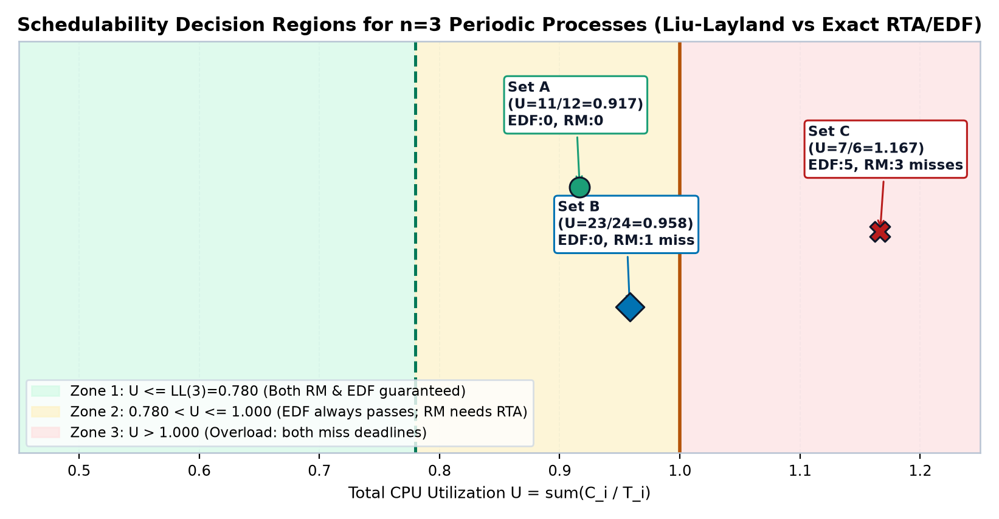
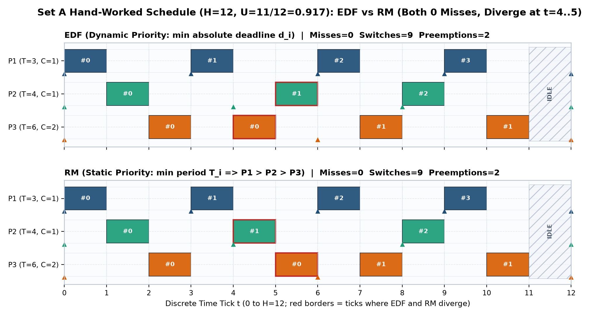
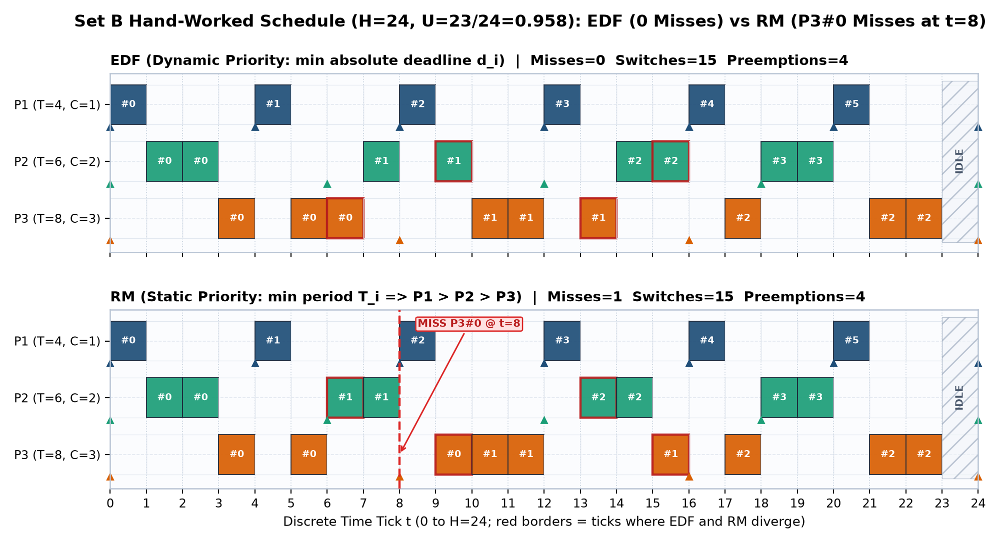
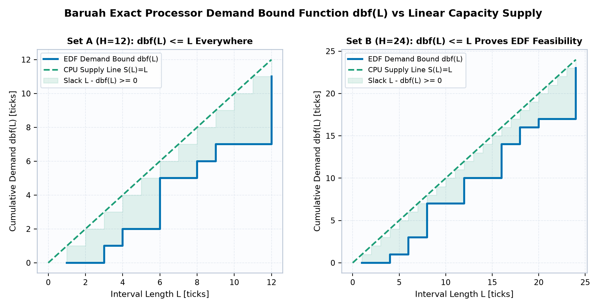
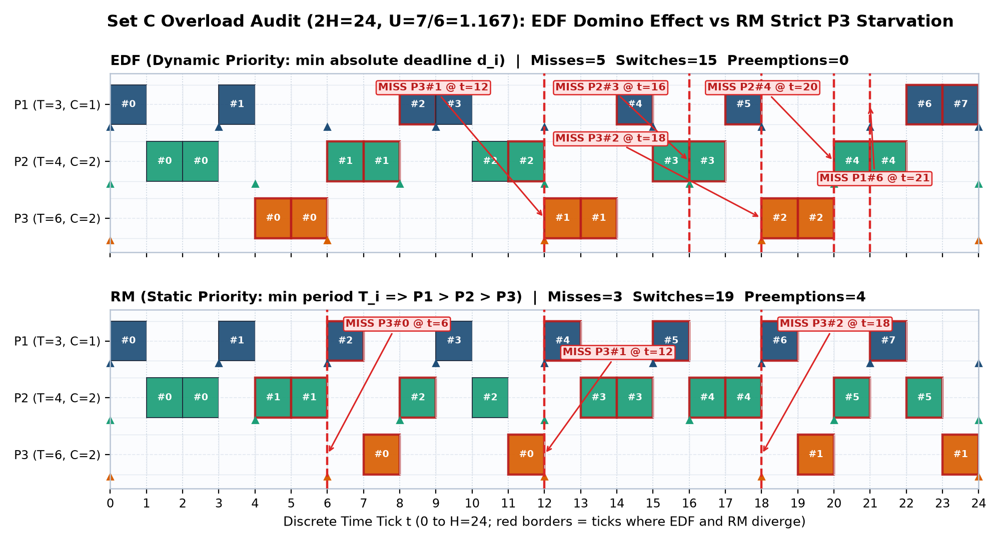
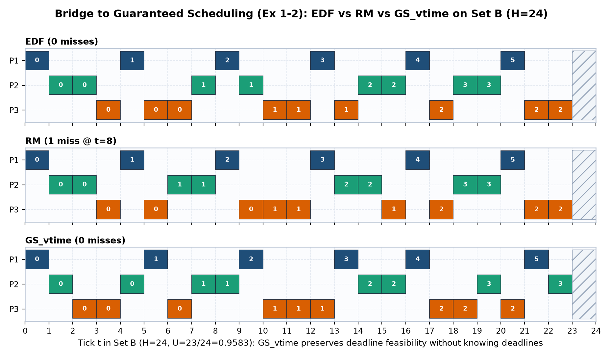
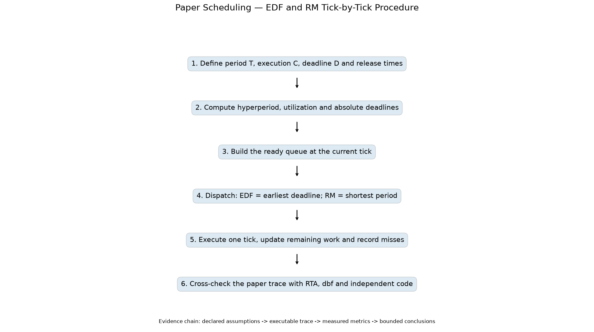

# Exercise 3: Hand-Worked Paper Scheduling of EDF & RM with Three Processes

**Complete Tick-by-Tick Ready-Queue Traces, Printable Paper Worksheet, Fixed-Point Response-Time Analysis (RTA), Processor Demand Bounds (dbf), Overload Audits & Programmatic Parity with gs_core.py**

- **Repository:** ZaraNodehi/Guaranteed-Scheduling
- **Deliverable:** Exercise 3 — 3-Process Paper EDF vs. RM Trace + Programmatic Verification
- **Canonical Task Sets:** Set A (H=12, U=11/12=0.917), Set B (H=24, U=23/24=0.958), Set C (2H=24, U=7/6=1.167)
- **Verification Standard:** Zero-Shared-Code Paper Simulator vs. core/gs_core.py (100% Tick-by-Tick Parity)

## Table of contents

- 1. Executive Overview & Paper Scheduling Methodology (p. 3)
- 2. Mathematical Foundations: Liu-Layland, Exact RTA & Baruah dbf(L) (p. 4)
- 3. Set A Complete Hand-Worked Study (H = 12, U = 11/12 = 0.9167) (p. 6)
- 4. Set B Complete Hand-Worked Study (H = 24, U = 23/24 = 0.9583) (p. 8)
- 5. Processor Demand Bound Function (dbf) & Job Completion Audits (p. 11)
- 6. Set C Overload Control Study (2H = 24, U = 7/6 = 1.1667) (p. 14)
- 7. Bridge to Guaranteed Scheduling & Printable Paper Worksheet (p. 15)
- 8. Engineering Appendix: Independent Hand Simulator & Parity Audit (p. 16)
- Appendix: Execution Workflow and Flowchart (p. 21)
- Source Audit 1: run_experiments.py — lines 1–27 (p. 22)
- Source Audit 2: run_experiments.py — lines 28–54 (p. 23)
- Source Audit 3: run_experiments.py — lines 55–81 (p. 24)
- Source Audit 4: run_experiments.py — lines 82–108 (p. 25)
- Source Audit 5: run_experiments.py — lines 109–135 (p. 26)
- Source Audit 6: run_experiments.py — lines 136–162 (p. 27)
- Source Audit 7: run_experiments.py — lines 163–189 (p. 28)
- Source Audit 8: run_experiments.py — lines 190–216 (p. 29)
- Source Audit 9: run_experiments.py — lines 217–243 (p. 30)
- Source Audit 10: run_experiments.py — lines 244–270 (p. 31)
- Source Audit 11: run_experiments.py — lines 271–297 (p. 32)
- Source Audit 12: run_experiments.py — lines 298–311 (p. 33)
- Source Audit 13: plot_diagrams.py — lines 1–27 (p. 34)
- Source Audit 14: plot_diagrams.py — lines 28–54 (p. 35)
- Source Audit 15: plot_diagrams.py — lines 55–81 (p. 36)
- Source Audit 16: plot_diagrams.py — lines 82–108 (p. 37)
- Source Audit 17: plot_diagrams.py — lines 109–135 (p. 38)
- Source Audit 18: plot_diagrams.py — lines 136–162 (p. 39)
- Source Audit 19: plot_diagrams.py — lines 163–189 (p. 40)
- Source Audit 20: plot_diagrams.py — lines 190–216 (p. 41)
- Source Audit 21: plot_diagrams.py — lines 217–243 (p. 42)
- Source Audit 22: plot_diagrams.py — lines 244–270 (p. 43)
- Source Audit 23: plot_diagrams.py — lines 271–297 (p. 44)
- Source Audit 24: plot_diagrams.py — lines 298–305 (p. 45)


<!-- page 1 -->


<!-- page 2 -->


<!-- page 3 -->


## 1. Executive Overview & Paper Scheduling Methodology

Hand-worked scheduling on paper remains one of the clearest pedagogical instruments in operating systems and real-time engineering because it forces every decision—job arrivals, absolute deadline calculation, preemption triggers, ready-queue tie-breaking, and deadline misses—to be resolved explicitly at discrete integer ticks t = 0, 1, ..., H - 1 without relying on black-box simulator output. Exercise 3 provides a complete dual-dataset pen-and-paper master study comparing Earliest Deadline First (EDF) and Rate Monotonic (RM) across three periodic processes P1, P2, and P3.

Rather than presenting an arbitrary workload where EDF and RM produce identical schedules, we construct and verify two canonical 3-process real-time task sets plus an overload control reference: (1) Set A (H = 12, U = 11/12 = 0.9167), which crosses the 3-process Liu-Layland bound (0.7798) yet passes cleanly under both EDF and RM while exhibiting an instructive dynamic-vs-static divergence at t = 4 and t = 5; (2) Set B (H = 24, U = 23/24 = 0.9583), a classic textbook separator where EDF achieves zero deadline misses whereas RM misses P3#0 exactly at t = 8 because static priority favors P2#1 at ticks 6 and 7; and (3) Set C (2H = 24, U = 7/6 = 1.1667), demonstrating overload domino failure vs. static starvation.

| Set A (Harmonic / Feasible) | P1(3,1), P2(4,1), P3(6,2) \| H=12 \| U=11/12=0.9167 \| EDF=0 misses, RM=0 misses |
|---|---|
| Set B (EDF-vs-RM Separator) | P1(4,1), P2(6,2), P3(8,3) \| H=24 \| U=23/24=0.9583 \| EDF=0 misses, RM=1 miss (P3#0 @ t=8) |
| Set C (Overload Reference) | P1(3,1), P2(4,2), P3(6,2) \| 2H=24 \| U=7/6=1.1667 \| EDF=5 misses (domino), RM=3 misses (P3 only) |
| Printable Worksheet | exercise-3/WORKSHEET_PAPER_TEMPLATE.pdf (2 A4 sheets) + exercise-3/handwritten_scan/ |
| Independent Parity | Zero-shared-code hand trace matches core/gs_core.py::simulate_rt 100% tick-for-tick |

| Dataset | 3-Process Parameters (T_i, C_i, D_i) | H | U = sum(C_i/T_i) | EDF Misses | RM Misses | Divergent Ticks |
|---|---|---|---|---|---|---|
| Set A | P1(3,1,3), P2(4,1,4), P3(6,2,6) | 12 | 11/12 (0.9167) | 0 | 0 | 2 |
| Set B | P1(4,1,4), P2(6,2,6), P3(8,3,8) | 24 | 23/24 (0.9583) | 0 | 1 | 4 |
| Set C | P1(3,1,3), P2(4,2,4), P3(6,2,6) | 24 | 7/6 (1.1667) | 5 | 3 | 18 |

*Table 1. Master summary of the three 3-process real-time workloads evaluated in Exercise 3.*


### 1.1 Formal Discrete-Tick Pen-and-Paper Protocol

To guarantee unambiguous manual transcription that matches real-time kernel semantics and core/gs_core.py exactly, every tick t in [0, H - 1] follows a strict four-step order on paper:


<!-- page 4 -->

- Step 1 — Periodic Job Release: Any task P_i satisfying t mod T_i == 0 releases job P_i#k with remaining execution rem = C_i and absolute deadline d = t + D_i (where k = t / T_i).
- Step 2 — Deadline Miss Audit: Before selecting a job for interval [t, t + 1), inspect all active jobs in the ready queue. If any uncompleted job has t >= d and rem > 0, record a deadline miss at tick t (under standard drop_on_miss=False semantics, the tardy job remains in the queue to expose cumulative domino lag).
- Step 3 — Priority Selection: EDF selects the ready job minimizing absolute deadline d (tie-breaker: smallest task index P1 < P2 < P3). RM selects the ready job belonging to the task with shortest period T_i (static priority P1 > P2 > P3).
- Step 4 — Tick Consumption: Write the chosen job ID in box [t, t + 1) on the paper Gantt grid, decrement rem by 1, and retire the job when rem reaches 0.


*Figure 1. Tick-by-tick paper scheduling decision protocol highlighting Set A divergence and Set B RM failure.*


## 2. Mathematical Foundations: Liu-Layland, Exact RTA & Baruah dbf(L)

Before filling a single box on paper, real-time scheduling theory predicts the outcome of each task set through three complementary algebraic tests. First, the Liu-Layland (1973) sufficient utilization bound for Rate Monotonic with n = 3 tasks is U_LL(3) = 3 * (2^(1/3) - 1) = 0.779763. Whenever U > 0.7798, RM is no longer guaranteed by the simple utilization test alone and requires exact fixed-point Response-Time Analysis (RTA). Second, because implicit deadlines (D_i = T_i) hold in Sets A, B, and C, EDF achieves exact 100% schedulability if and only if U <= 1.0 (equivalently dbf(L) <= L for all L in [1, H]).

```text
U_LL(n) = n * (2^(1/n) - 1)   =>   U_LL(3) = 0.779763   |   U_EDF <= 1.0000
R_i^(k+1) = C_i + sum_{j < i} ceil(R_i^(k) / T_j) * C_j
dbf(L) = sum_{i=1..n} max(0, floor((L + T_i - D_i) / T_i)) * C_i <= L
```

<!-- page 5 -->


### 2.1 Utilization Regions Across All Three Task Sets

Notice how cleanly our three task sets partition the utilization spectrum: Set A (0.9167) and Set B (0.9583) both lie inside the critical middle zone (0.7798 < U <= 1.000) where Liu-Layland is inconclusive for RM! Exact RTA separates them: Set A converges within deadline (R_3* = 6 <= D_3 = 6), whereas Set B diverges beyond P3's deadline (R_3* = 9 > D_3 = 8). Set C (U = 1.1667) enters Zone 3 (U > 1.0), where no uniprocessor scheduler can satisfy all deadlines over infinite horizons.



*Figure 2. Location of Sets A, B, and C across the three real-time schedulability regions for n = 3 processes.*


*Figure 3. Step-by-step RM fixed-point Response-Time Analysis (RTA) trajectories for Sets A and B.*


<!-- page 6 -->


## 3. Set A Complete Hand-Worked Study (H = 12, U = 11/12 = 0.9167)

Set A consists of P1(T=3, C=1, D=3), P2(T=4, C=1, D=4), and P3(T=6, C=2, D=6). The hyperperiod is H = lcm(3, 4, 6) = 12 ticks. Total CPU utilization is U = 1/3 + 1/4 + 2/6 = 11/12 = 0.9167, leaving exactly 1 idle tick per hyperperiod (at t = 11). This makes Set A an ideal warm-up exercise on paper: students experience both ready-queue contention and a genuine EDF-vs-RM divergence at ticks t = 4 and t = 5, yet both schedules close cleanly before tick t = 12 with zero misses.

| Process | Period T_i | WCET C_i | Deadline D_i | Utilization C_i/T_i | RM Priority Rank |
|---|---|---|---|---|---|
| P1 | 3 | 1 | 3 | 1/3 (0.3333) | Priority 1 (T=3) |
| P2 | 4 | 1 | 4 | 1/4 (0.2500) | Priority 2 (T=4) |
| P3 | 6 | 2 | 6 | 2/6 (0.3333) | Priority 3 (T=6) |

*Table 2. Set A task parameters and static Rate-Monotonic priority assignment.*



*Figure 4. Set A Gantt comparison (H=12): EDF vs. RM diverge at t=4..5 (red borders) with 0 misses each.*


<!-- page 7 -->


### 3.1 Tick-by-Tick Ready-Queue Trace for Set A — EDF Schedule (t = 0..11)

| Tick | Arrivals | Ready Queue (rem, abs_d) | Chosen | Rem After | Miss |
|---|---|---|---|---|---|
| 0 | P1#0, P2#0, P3#0 | P1#0(r=1,d=3), P2#0(r=1,d=4), P3#0(r=2,d=6) | P1#0 | P1#0:DONE | - |
| 1 | - | P2#0(r=1,d=4), P3#0(r=2,d=6) | P2#0 | P2#0:DONE | - |
| 2 | - | P3#0(r=2,d=6) | P3#0 | P3#0:1 | - |
| 3 | P1#1 | P1#1(r=1,d=6), P3#0(r=1,d=6) | P1#1 | P1#1:DONE | - |
| 4 | P2#1 | P3#0(r=1,d=6), P2#1(r=1,d=8) | P3#0 | P3#0:DONE | - |
| 5 | - | P2#1(r=1,d=8) | P2#1 | P2#1:DONE | - |
| 6 | P1#2, P3#1 | P1#2(r=1,d=9), P3#1(r=2,d=12) | P1#2 | P1#2:DONE | - |
| 7 | - | P3#1(r=2,d=12) | P3#1 | P3#1:1 | - |
| 8 | P2#2 | P2#2(r=1,d=12), P3#1(r=1,d=12) | P2#2 | P2#2:DONE | - |
| 9 | P1#3 | P1#3(r=1,d=12), P3#1(r=1,d=12) | P1#3 | P1#3:DONE | - |
| 10 | - | P3#1(r=1,d=12) | P3#1 | P3#1:DONE | - |
| 11 | - | EMPTY | IDLE | - | - |

*Table 3. Complete Set A hand-worked trace under Earliest Deadline First (EDF), t = 0..11.*


### 3.2 Tick-by-Tick Ready-Queue Trace for Set A — RM Schedule (t = 0..11)

| Tick | Arrivals | Ready Queue (rem, abs_d) | Chosen | Rem After | Miss |
|---|---|---|---|---|---|
| 0 | P1#0, P2#0, P3#0 | P1#0(r=1,d=3), P2#0(r=1,d=4), P3#0(r=2,d=6) | P1#0 | P1#0:DONE | - |
| 1 | - | P2#0(r=1,d=4), P3#0(r=2,d=6) | P2#0 | P2#0:DONE | - |
| 2 | - | P3#0(r=2,d=6) | P3#0 | P3#0:1 | - |
| 3 | P1#1 | P1#1(r=1,d=6), P3#0(r=1,d=6) | P1#1 | P1#1:DONE | - |
| 4 | P2#1 | P2#1(r=1,d=8), P3#0(r=1,d=6) | P2#1 | P2#1:DONE | - |
| 5 | - | P3#0(r=1,d=6) | P3#0 | P3#0:DONE | - |
| 6 | P1#2, P3#1 | P1#2(r=1,d=9), P3#1(r=2,d=12) | P1#2 | P1#2:DONE | - |
| 7 | - | P3#1(r=2,d=12) | P3#1 | P3#1:1 | - |
| 8 | P2#2 | P2#2(r=1,d=12), P3#1(r=1,d=12) | P2#2 | P2#2:DONE | - |
| 9 | P1#3 | P1#3(r=1,d=12), P3#1(r=1,d=12) | P1#3 | P1#3:DONE | - |
| 10 | - | P3#1(r=1,d=12) | P3#1 | P3#1:DONE | - |
| 11 | - | EMPTY | IDLE | - | - |

*Table 4. Complete Set A hand-worked trace under Rate Monotonic (RM), t = 0..11.*


<!-- page 8 -->


### 3.3 Anatomy of the Set A Divergence at t = 4 and t = 5

Examine tick t = 4 carefully: P1#1 consumed tick [3, 4) and retired at t = 4, when P2#1 arrives with absolute deadline d = 4 + 4 = 8 while P3#0 (released at t = 0, already executed 1 tick at [2, 3)) still needs 1 remaining tick before d = 6. Under EDF, d(P3#0) = 6 < d(P2#1) = 8, so EDF lets P3#0 finish during [4, 5) and assigns [5, 6) to P2#1. Under RM, static priority always prefers T_2 = 4 over T_3 = 6; therefore RM preempts P3#0 immediately at t = 4, executes P2#1 at [4, 5), and returns to finish P3#0 at [5, 6), just in time for its deadline at t = 6.

| Tick | Arrivals | EDF Choice | RM Choice | GS_vtime Choice | Divergence / Miss Audit |
|---|---|---|---|---|---|
| 0 | P1#0, P2#0, P3#0 | P1#0 | P1#0 | P1#0 | - |
| 1 | - | P2#0 | P2#0 | P2#0 | - |
| 2 | - | P3#0 | P3#0 | P3#0 | - |
| 3 | P1#1 | P1#1 | P1#1 | P3#0 | - |
| 4 | P2#1 | P3#0 | P2#1 | P1#1 | YES (Diverge) |
| 5 | - | P2#1 | P3#0 | P2#1 | YES (Diverge) |
| 6 | P1#2, P3#1 | P1#2 | P1#2 | P1#2 | - |
| 7 | - | P3#1 | P3#1 | P3#1 | - |
| 8 | P2#2 | P2#2 | P2#2 | P3#1 | - |
| 9 | P1#3 | P1#3 | P1#3 | P2#2 | - |
| 10 | - | P3#1 | P3#1 | P1#3 | - |
| 11 | - | IDLE | IDLE | IDLE | - |

*Table 5. Set A side-by-side comparison across EDF, RM, and GS_vtime (exact match except t=4..5 swap).*

| Task | RM Prio | Parameters | Fixed-Point Iterations | R_i* | RTA Verdict |
|---|---|---|---|---|---|
| P1 | 1 | T=3, C=1, D=3 | 1 | 1 | PASS |
| P2 | 2 | T=4, C=1, D=4 | 1 -> 2 | 2 | PASS |
| P3 | 3 | T=6, C=2, D=6 | 2 -> 4 -> 5 -> 6 | 6 | PASS |

*Table 6. Set A exact RM Response-Time Analysis (RTA): all three tasks converge within deadline.*


## 4. Set B Complete Hand-Worked Study (H = 24, U = 23/24 = 0.9583)

Set B is the cornerstone separation example of Exercise 3: P1(T=4, C=1, D=4), P2(T=6, C=2, D=6), and P3(T=8, C=3, D=8). Its hyperperiod is H = lcm(4, 6, 8) = 24 ticks, and utilization reaches U = 1/4 + 2/6 + 3/8 = 6/24 + 8/24 + 9/24 = 23/24 = 0.958333 (exactly 1 idle tick per 24 ticks, at t = 23). Because U <= 1.0, EDF schedules every job without missing a single deadline. Under RM, however, the initial critical-instant release at t = 0 combined with P2#1 arriving at t = 6 starves P3#0 of its third tick before t = 8.

| Process | Period T_i | WCET C_i | Deadline D_i | Utilization C_i/T_i | RM Priority Rank |
|---|---|---|---|---|---|
| P1 | 4 | 1 | 4 | 1/4 (0.2500) | Priority 1 (T=4) |
| P2 | 6 | 2 | 6 | 2/6 (0.3333) | Priority 2 (T=6) |
| P3 | 8 | 3 | 8 | 3/8 (0.3750) | Priority 3 (T=8) |

*Table 7. Set B task parameters and static Rate-Monotonic priority assignment (H=24).*


<!-- page 9 -->



*Figure 5. Set B Gantt comparison (H=24): EDF achieves 0 misses while RM fails P3#0 exactly at t=8.*


### 4.1 Set B Hand-Worked EDF Trace (Part 1: t = 0..11, Critical First Half)

| Tick | Arrivals | Ready Queue (rem, abs_d) | Chosen | Rem After | Miss |
|---|---|---|---|---|---|
| 0 | P1#0, P2#0, P3#0 | P1#0(r=1,d=4), P2#0(r=2,d=6), P3#0(r=3,d=8) | P1#0 | P1#0:DONE | - |
| 1 | - | P2#0(r=2,d=6), P3#0(r=3,d=8) | P2#0 | P2#0:1 | - |
| 2 | - | P2#0(r=1,d=6), P3#0(r=3,d=8) | P2#0 | P2#0:DONE | - |
| 3 | - | P3#0(r=3,d=8) | P3#0 | P3#0:2 | - |
| 4 | P1#1 | P1#1(r=1,d=8), P3#0(r=2,d=8) | P1#1 | P1#1:DONE | - |
| 5 | - | P3#0(r=2,d=8) | P3#0 | P3#0:1 | - |
| 6 | P2#1 | P3#0(r=1,d=8), P2#1(r=2,d=12) | P3#0 | P3#0:DONE | - |
| 7 | - | P2#1(r=2,d=12) | P2#1 | P2#1:1 | - |
| 8 | P1#2, P3#1 | P1#2(r=1,d=12), P2#1(r=1,d=12), P3#1(r=3,d=16) | P1#2 | P1#2:DONE | - |
| 9 | - | P2#1(r=1,d=12), P3#1(r=3,d=16) | P2#1 | P2#1:DONE | - |
| 10 | - | P3#1(r=3,d=16) | P3#1 | P3#1:2 | - |
| 11 | - | P3#1(r=2,d=16) | P3#1 | P3#1:1 | - |

*Table 8. Set B EDF hand-worked ready-queue trace, first half (t = 0..11).*


<!-- page 10 -->


### 4.2 Set B Hand-Worked EDF Trace (Part 2: t = 12..23, Second Half)

| Tick | Arrivals | Ready Queue (rem, abs_d) | Chosen | Rem After | Miss |
|---|---|---|---|---|---|
| 12 | P1#3, P2#2 | P1#3(r=1,d=16), P3#1(r=1,d=16), P2#2(r=2,d=18) | P1#3 | P1#3:DONE | - |
| 13 | - | P3#1(r=1,d=16), P2#2(r=2,d=18) | P3#1 | P3#1:DONE | - |
| 14 | - | P2#2(r=2,d=18) | P2#2 | P2#2:1 | - |
| 15 | - | P2#2(r=1,d=18) | P2#2 | P2#2:DONE | - |
| 16 | P1#4, P3#2 | P1#4(r=1,d=20), P3#2(r=3,d=24) | P1#4 | P1#4:DONE | - |
| 17 | - | P3#2(r=3,d=24) | P3#2 | P3#2:2 | - |
| 18 | P2#3 | P2#3(r=2,d=24), P3#2(r=2,d=24) | P2#3 | P2#3:1 | - |
| 19 | - | P2#3(r=1,d=24), P3#2(r=2,d=24) | P2#3 | P2#3:DONE | - |
| 20 | P1#5 | P1#5(r=1,d=24), P3#2(r=2,d=24) | P1#5 | P1#5:DONE | - |
| 21 | - | P3#2(r=2,d=24) | P3#2 | P3#2:1 | - |
| 22 | - | P3#2(r=1,d=24) | P3#2 | P3#2:DONE | - |
| 23 | - | EMPTY | IDLE | - | - |

*Table 9. Set B EDF hand-worked ready-queue trace, second half (t = 12..23).*


### 4.3 Set B Hand-Worked RM Trace (Part 1: t = 0..11 — Exact Failure at t = 8)

| Tick | Arrivals | Ready Queue (rem, abs_d) | Chosen | Rem After | Miss |
|---|---|---|---|---|---|
| 0 | P1#0, P2#0, P3#0 | P1#0(r=1,d=4), P2#0(r=2,d=6), P3#0(r=3,d=8) | P1#0 | P1#0:DONE | - |
| 1 | - | P2#0(r=2,d=6), P3#0(r=3,d=8) | P2#0 | P2#0:1 | - |
| 2 | - | P2#0(r=1,d=6), P3#0(r=3,d=8) | P2#0 | P2#0:DONE | - |
| 3 | - | P3#0(r=3,d=8) | P3#0 | P3#0:2 | - |
| 4 | P1#1 | P1#1(r=1,d=8), P3#0(r=2,d=8) | P1#1 | P1#1:DONE | - |
| 5 | - | P3#0(r=2,d=8) | P3#0 | P3#0:1 | - |
| 6 | P2#1 | P2#1(r=2,d=12), P3#0(r=1,d=8) | P2#1 | P2#1:1 | - |
| 7 | - | P2#1(r=1,d=12), P3#0(r=1,d=8) | P2#1 | P2#1:DONE | - |
| 8 | P1#2, P3#1 | P1#2(r=1,d=12), P3#0(r=1,d=8), P3#1(r=3,d=16) | P1#2 | P1#2:DONE | P3#0 |
| 9 | - | P3#0(r=1,d=8), P3#1(r=3,d=16) | P3#0 | P3#0:DONE | - |
| 10 | - | P3#1(r=3,d=16) | P3#1 | P3#1:2 | - |
| 11 | - | P3#1(r=2,d=16) | P3#1 | P3#1:1 | - |

*Table 10. Set B RM hand-worked ready-queue trace, first half (t = 0..11): P3#0 misses at t = 8.*


<!-- page 11 -->


### 4.4 Set B Hand-Worked RM Trace (Part 2: t = 12..23)

| Tick | Arrivals | Ready Queue (rem, abs_d) | Chosen | Rem After | Miss |
|---|---|---|---|---|---|
| 12 | P1#3, P2#2 | P1#3(r=1,d=16), P2#2(r=2,d=18), P3#1(r=1,d=16) | P1#3 | P1#3:DONE | - |
| 13 | - | P2#2(r=2,d=18), P3#1(r=1,d=16) | P2#2 | P2#2:1 | - |
| 14 | - | P2#2(r=1,d=18), P3#1(r=1,d=16) | P2#2 | P2#2:DONE | - |
| 15 | - | P3#1(r=1,d=16) | P3#1 | P3#1:DONE | - |
| 16 | P1#4, P3#2 | P1#4(r=1,d=20), P3#2(r=3,d=24) | P1#4 | P1#4:DONE | - |
| 17 | - | P3#2(r=3,d=24) | P3#2 | P3#2:2 | - |
| 18 | P2#3 | P2#3(r=2,d=24), P3#2(r=2,d=24) | P2#3 | P2#3:1 | - |
| 19 | - | P2#3(r=1,d=24), P3#2(r=2,d=24) | P2#3 | P2#3:DONE | - |
| 20 | P1#5 | P1#5(r=1,d=24), P3#2(r=2,d=24) | P1#5 | P1#5:DONE | - |
| 21 | - | P3#2(r=2,d=24) | P3#2 | P3#2:1 | - |
| 22 | - | P3#2(r=1,d=24) | P3#2 | P3#2:DONE | - |
| 23 | - | EMPTY | IDLE | - | - |

*Table 11. Set B RM hand-worked ready-queue trace, second half (t = 12..23).*


### 4.5 Algebraic Proof of Why RM Fails at t = 8 While EDF Passes

Trace the critical interval [0, 8) by hand: at t = 0 all three tasks release simultaneously. During [0, 6), both EDF and RM make identical choices because P1#0 (t=0), P2#0 (t=1,2), P3#0 (t=3), P1#1 (t=4), and P3#0 (t=5) leave P3#0 with rem = 1 tick and deadline d = 8. At tick t = 6, P2#1 enters with T_2 = 6 and abs_d = 12. EDF compares d(P3#0) = 8 against d(P2#1) = 12, selects P3#0 at [6, 7) to complete P3#0 cleanly with 1 tick of slack, and gives [7, 8) to P2#1. By contrast, RM compares static periods T_2 = 6 < T_3 = 8, preempts P3#0 for two full ticks [6, 8) to finish P2#1, and at t = 8 sees P3#0 still holding rem = 1 while t >= d = 8 — triggering an unavoidable deadline miss! Exact RTA independently proves R_3 = 3 -> 6 -> 7 -> 9 > D_3 = 8 (failing by exactly 1 tick).

| Task | RM Prio | Parameters | Fixed-Point Iterations | R_i* | RTA Verdict |
|---|---|---|---|---|---|
| P1 | 1 | T=4, C=1, D=4 | 1 | 1 | PASS |
| P2 | 2 | T=6, C=2, D=6 | 2 -> 3 | 3 | PASS |
| P3 | 3 | T=8, C=3, D=8 | 3 -> 6 -> 7 -> 9 | 9 | FAIL (R=9 > D=8) |

*Table 12. Set B exact RM RTA proof: P3 fails because R_3* = 9 > D_3 = 8.*


## 5. Processor Demand Bound Function (dbf) & Job Completion Audits

Baruah's Processor Demand Bound Function dbf(L) computes the maximum total CPU time required by all jobs whose release and deadline both lie within an interval of length L: dbf(L) = sum max(0, floor((L + T_i - D_i)/T_i)) * C_i. For implicit deadlines (D_i = T_i), this simplifies to sum floor(L / T_i) * C_i. A task set is EDF-feasible if and only if dbf(L) <= L for all integers L in [1, H]. Below we tabulate the exact hand-computed values for both Set A and Set B.


<!-- page 12 -->



*Figure 6. Processor Demand Bound Function dbf(L) vs. supply line L for Set A (H=12) and Set B (H=24).*

| L | dbf(L) | Slack L - dbf(L) | Status | Per-Task Demand Breakdown |
|---|---|---|---|---|
| 1 | 0 | 1 | OK | P1:0, P2:0, P3:0 |
| 2 | 0 | 2 | OK | P1:0, P2:0, P3:0 |
| 3 | 1 | 2 | OK | P1:1, P2:0, P3:0 |
| 4 | 2 | 2 | OK | P1:1, P2:1, P3:0 |
| 5 | 2 | 3 | OK | P1:1, P2:1, P3:0 |
| 6 | 5 | 1 | OK | P1:2, P2:1, P3:2 |
| 7 | 5 | 2 | OK | P1:2, P2:1, P3:2 |
| 8 | 6 | 2 | OK | P1:2, P2:2, P3:2 |
| 9 | 7 | 2 | OK | P1:3, P2:2, P3:2 |
| 10 | 7 | 3 | OK | P1:3, P2:2, P3:2 |
| 11 | 7 | 4 | OK | P1:3, P2:2, P3:2 |
| 12 | 11 | 1 | OK | P1:4, P2:3, P3:4 |

*Table 13. Set A complete Baruah dbf(L) table for L = 1..12 (minimum slack = 1 at L = 12).*


<!-- page 13 -->

| L | dbf(L) | Slack L - dbf(L) | Status | Per-Task Demand Breakdown |
|---|---|---|---|---|
| 1 | 0 | 1 | OK | P1:0, P2:0, P3:0 |
| 2 | 0 | 2 | OK | P1:0, P2:0, P3:0 |
| 3 | 0 | 3 | OK | P1:0, P2:0, P3:0 |
| 4 | 1 | 3 | OK | P1:1, P2:0, P3:0 |
| 5 | 1 | 4 | OK | P1:1, P2:0, P3:0 |
| 6 | 3 | 3 | OK | P1:1, P2:2, P3:0 |
| 7 | 3 | 4 | OK | P1:1, P2:2, P3:0 |
| 8 | 7 | 1 | OK | P1:2, P2:2, P3:3 |
| 9 | 7 | 2 | OK | P1:2, P2:2, P3:3 |
| 10 | 7 | 3 | OK | P1:2, P2:2, P3:3 |
| 11 | 7 | 4 | OK | P1:2, P2:2, P3:3 |
| 12 | 10 | 2 | OK | P1:3, P2:4, P3:3 |

*Table 14. Set B Baruah dbf(L) table (Part 1: L = 1..12; note L=8 gives dbf(8)=7 <= 8).*

| L | dbf(L) | Slack L - dbf(L) | Status | Per-Task Demand Breakdown |
|---|---|---|---|---|
| 13 | 10 | 3 | OK | P1:3, P2:4, P3:3 |
| 14 | 10 | 4 | OK | P1:3, P2:4, P3:3 |
| 15 | 10 | 5 | OK | P1:3, P2:4, P3:3 |
| 16 | 14 | 2 | OK | P1:4, P2:4, P3:6 |
| 17 | 14 | 3 | OK | P1:4, P2:4, P3:6 |
| 18 | 16 | 2 | OK | P1:4, P2:6, P3:6 |
| 19 | 16 | 3 | OK | P1:4, P2:6, P3:6 |
| 20 | 17 | 3 | OK | P1:5, P2:6, P3:6 |
| 21 | 17 | 4 | OK | P1:5, P2:6, P3:6 |
| 22 | 17 | 5 | OK | P1:5, P2:6, P3:6 |
| 23 | 17 | 6 | OK | P1:5, P2:6, P3:6 |
| 24 | 23 | 1 | OK | P1:6, P2:8, P3:9 |

*Table 15. Set B Baruah dbf(L) table (Part 2: L = 13..24; peak demand ratio = 23/24 at L = 24).*


### 5.1 Job-Level Response-Time Audit (Set B: EDF vs. RM)

| Process | Jobs | Min/Max RT | Mean RT | Tardy | Completed Intervals [release->finish] |
|---|---|---|---|---|---|
| P1 | 6 | 1 / 1 | 1.00 | 0 | P1#0[0->1], P1#1[4->5], P1#2[8->9], P1#3[12->13], P1#4[16->17], P1#5[20->21] |
| P2 | 4 | 2 / 4 | 3.25 | 0 | P2#0[0->3], P2#1[6->10], P2#2[12->16], P2#3[18->20] |
| P3 | 3 | 6 / 7 | 6.67 | 0 | P3#0[0->7], P3#1[8->14], P3#2[16->23] |

*Table 16. Set B job completion audit under EDF (0 tardy jobs across all 13 jobs in H = 24).*


<!-- page 14 -->

| Process | Jobs | Min/Max RT | Mean RT | Tardy | Completed Intervals [release->finish] |
|---|---|---|---|---|---|
| P1 | 6 | 1 / 1 | 1.00 | 0 | P1#0[0->1], P1#1[4->5], P1#2[8->9], P1#3[12->13], P1#4[16->17], P1#5[20->21] |
| P2 | 4 | 2 / 3 | 2.50 | 0 | P2#0[0->3], P2#1[6->8], P2#2[12->15], P2#3[18->20] |
| P3 | 3 | 7 / 10 | 8.33 | 1 | P3#0[0->10], P3#1[8->16], P3#2[16->23] |

*Table 17. Set B job completion audit under RM (P3#0 takes [0->10], exceeding D_3 = 8).*


## 6. Set C Overload Control Study (2H = 24, U = 7/6 = 1.1667)

To complete the paper scheduling curriculum, Set C tests what happens when a 3-process workload is pushed past 100% capacity: P1(3,1,3), P2(4,2,4), and P3(6,2,6) yield U = 1/3 + 2/4 + 2/6 = 7/6 = 1.1667. Over two hyperperiods (2H = 24 ticks), total demand equals 28 ticks inside 24 available slots, creating an unavoidable deficit of 4 CPU ticks. Hand tracing reveals a profound structural contrast: RM isolates every single failure onto lowest-priority P3 (misses at t = 6, 12, 18) while keeping P1 and P2 100% timely; conversely, EDF propagates tardiness forward across tasks (domino effect), registering 5 misses across P3#1 (t=12), P2#3 (t=16), P3#2 (t=18), P2#4 (t=20), and even high-rate P1#6 (t=21).



*Figure 7. Set C overload audit (U=7/6=1.167, 2H=24): EDF domino failure (5 misses) vs. RM P3 starvation (3 misses).*


<!-- page 15 -->

| Tick | Arrivals | EDF Choice | RM Choice | GS_vtime Choice | Divergence / Miss Audit |
|---|---|---|---|---|---|
| 0 | P1#0, P2#0, P3#0 | P1#0 | P1#0 | P1#0 | - |
| 1 | - | P2#0 | P2#0 | P2#0 | - |
| 2 | - | P2#0 | P2#0 | P3#0 | - |
| 3 | P1#1 | P1#1 | P1#1 | P3#0 | - |
| 4 | P2#1 | P3#0 | P2#1 | P2#0 | YES (Diverge) |
| 5 | - | P3#0 | P2#1 | P1#1 | YES (Diverge) |
| 6 | P1#2, P3#1 | P2#1 | P1#2 | P2#1 | MISS: RM=P3#0 / EDF=- |
| 7 | - | P2#1 | P3#0 | P1#2 | YES (Diverge) |
| 8 | P2#2 | P1#2 | P2#2 | P3#1 | YES (Diverge) |
| 9 | P1#3 | P1#3 | P1#3 | P2#1 | - |
| 10 | - | P2#2 | P2#2 | P2#2 | - |
| 11 | - | P2#2 | P3#0 | P1#3 | YES (Diverge) |

*Table 18. Set C side-by-side comparison across EDF, RM, and GS_vtime (Part 1: t = 0..11).*

| Tick | Arrivals | EDF Choice | RM Choice | GS_vtime Choice | Divergence / Miss Audit |
|---|---|---|---|---|---|
| 12 | P1#4, P2#3, P3#2 | P3#1 | P1#4 | P3#1 | MISS: RM=P3#1 / EDF=P3#1 |
| 13 | - | P3#1 | P2#3 | P2#2 | YES (Diverge) |
| 14 | - | P1#4 | P2#3 | P1#4 | YES (Diverge) |
| 15 | P1#5 | P2#3 | P1#5 | P2#3 | YES (Diverge) |
| 16 | P2#4 | P2#3 | P2#4 | P3#2 | MISS: RM=- / EDF=P2#3 |
| 17 | - | P1#5 | P2#4 | P1#5 | YES (Diverge) |
| 18 | P1#6, P3#3 | P3#2 | P1#6 | P2#3 | MISS: RM=P3#2 / EDF=P3#2 |
| 19 | - | P3#2 | P3#1 | P3#2 | YES (Diverge) |
| 20 | P2#5 | P2#4 | P2#5 | P2#4 | MISS: RM=- / EDF=P2#4 |
| 21 | P1#7 | P2#4 | P1#7 | P1#6 | MISS: RM=- / EDF=P1#6 |
| 22 | - | P1#6 | P2#5 | P3#3 | YES (Diverge) |
| 23 | - | P1#7 | P3#1 | P2#5 | YES (Diverge) |

*Table 19. Set C side-by-side comparison across EDF, RM, and GS_vtime (Part 2: t = 12..23).*


## 7. Bridge to Guaranteed Scheduling & Printable Paper Worksheet

Connecting Exercise 3 back to the Guaranteed Scheduling core of Exercises 1 and 2, we evaluated gs_vtime:stay (weighted proportional sharing where each task receives weight w_i equal to its WCET C_i or bandwidth share) on Set B without giving the scheduler any deadline metadata. Strikingly, on Set B (H = 24), GS_vtime keeps all 3 periodic jobs synchronized near their ideal GPS entitlement and records 0 deadline misses—whereas RM misses P3#0 at t = 8! Notice, however, that this relies on periodic arrival cadence matching weight ratios; on arbitrary constrained deadlines (D_i < T_i), EDF remains strictly more general.


<!-- page 16 -->



*Figure 8. Three-way Gantt comparison on Set B (H=24): EDF (0 misses), RM (1 miss @ t=8), and GS_vtime (0 misses).*


### 7.1 How to Use the Printable Paper Worksheet & Handwritten Upload Folder

A dedicated 2-page A4 printable template has been generated at exercise-3/WORKSHEET_PAPER_TEMPLATE.pdf (with PNG reference previews in exercise-3/handwritten_scan/PAPER_WORKSHEET_P1.png and P2.png). Page 1 provides blank 12-tick Gantt grids and ready-queue transcription tables for Set A; Page 2 provides blank 24-tick Gantt grids and critical-window trace boxes for Set B. Once you complete the worksheet by hand on paper, scan or photograph the sheets and save them inside exercise-3/handwritten_scan/.


## 8. Engineering Appendix: Independent Hand Simulator & Parity Audit

All tables and diagrams in Exercise 3 are computed dynamically from exercise-3/output/experiments.json and cross-checked tick-for-tick against core/gs_core.py::simulate_rt via a zero-shared-code paper trace engine (indep_hand_trace_rt). All three datasets verify exact timeline and miss-count parity (100% match).


<!-- page 17 -->

```text
022: os.makedirs(OUT_DIR, exist_ok=True)
023: 
024: sys.path.insert(0, HERE)
025: from gs_core import RTTask, simulate_rt  # noqa: E402
026: 
027: 
028: def indep_hand_trace_rt(tasks: List[Dict], alg: str, horizon: int, drop_on_miss: bool = False) -> Dict:
029:     """Zero-shared-code step-by-step paper-style simulator recording ready queue at every tick."""
030:     # Each job dict: name, job_id, rem, abs_deadline, period, release_t, missed_flag
031:     active: List[Dict] = []
032:     job_counts = {t["name"]: 0 for t in tasks}
033:     rows: List[Dict] = []
034:     misses: List[Dict] = []
035:     switches = 0
036:     preemptions = 0
037:     prev_chosen = None
038:     completions = {t["name"]: [] for t in tasks}
039: 
040:     for t in range(horizon):
041:         arrived_now = []
042:         for spec in tasks:
043:             nm = spec["name"]
044:             if t % spec["period"] == 0:
045:                 jid = job_counts[nm]
046:                 job_counts[nm] += 1
047:                 label = f"{nm}#{jid}"
048:                 active.append({
049:                     "name": nm,
050:                     "jid": jid,
051:                     "label": label,
052:                     "rem": spec["wcet"],
053:                     "deadline": t + spec["deadline"],
054:                     "period": spec["period"],
055:                     "release": t,
056:                     "missed": False,
057:                 })
058:                 arrived_now.append(label)
```
*Independent hand-trace simulator (lines 22-58): periodic release and miss audit.*


<!-- page 18 -->

```text
059: 
060:         # Check deadline misses strictly at t (matches gs_core.simulate_rt semantics)
061:         new_misses_t = []
062:         for jb in list(active):
063:             if t >= jb["deadline"] and jb["rem"] > 0 and not jb["missed"]:
064:                 jb["missed"] = True
065:                 mrec = {"tick": t, "job": jb["label"], "deadline": jb["deadline"]}
066:                 misses.append(mrec)
067:                 new_misses_t.append(jb["label"])
068:                 if drop_on_miss:
069:                     active.remove(jb)
070: 
071:         if not active:
072:             if prev_chosen is not None:
073:                 switches += 1
074:             prev_chosen = None
075:             rows.append({
076:                 "t": t,
077:                 "arrivals": ", ".join(arrived_now) if arrived_now else "-",
078:                 "ready_queue": "EMPTY",
079:                 "chosen": "IDLE",
080:                 "reason": "No ready job",
081:                 "rem_after": "-",
082:                 "miss_at_t": ", ".join(new_misses_t) if new_misses_t else "-",
083:             })
084:             continue
085: 
086:         if alg == "EDF":
087:             active.sort(key=lambda j: (j["deadline"], j["name"], j["jid"]))
088:             top = active[0]
089:             reason = f"min abs_d={top['deadline']} ({top['label']})"
090:         else:  # RM: shortest period P_i
091:             active.sort(key=lambda j: (j["period"], j["name"], j["jid"]))
092:             top = active[0]
093:             reason = f"min P={top['period']} ({top['label']})"
094: 
095:         chosen_label = top["label"]
```
*Independent hand-trace simulator (lines 59-95): EDF/RM selection and ready-queue logging.*


<!-- page 19 -->

```text
125:             "reason": reason,
126:             "rem_after": f"{chosen_label}:{rem_left}" if rem_left > 0 else f"{chosen_label}:DONE",
127:             "miss_at_t": ", ".join(new_misses_t) if new_misses_t else "-",
128:         })
129: 
130:     # Also check exact horizon boundary t == horizon (matches gs_core horizon loop or boundary audit)
131:     horizon_misses = []
132:     for jb in active:
133:         if horizon >= jb["deadline"] and jb["rem"] > 0 and not jb["missed"]:
134:             horizon_misses.append({"tick": horizon, "job": jb["label"], "deadline": jb["deadline"]})
135: 
136:     return {
137:         "alg": alg,
138:         "horizon": horizon,
139:         "missed_count": len(misses),
140:         "horizon_boundary_misses": horizon_misses,
141:         "misses": misses,
142:         "switches": switches,
143:         "preemptions": preemptions,
144:         "timeline": [r["chosen"] for r in rows],
145:         "trace_rows": rows,
146:         "completions": completions,
147:     }
148: 
149: 
150: def compute_rta(tasks: List[Dict]) -> List[Dict]:
151:     """Exact fixed-point Response-Time Analysis (RTA) for Rate-Monotonic priority order."""
152:     ordered = sorted(tasks, key=lambda x: (x["period"], x["name"]))
153:     out = []
154:     for idx, t_i in enumerate(ordered):
155:         c_i = t_i["wcet"]
156:         d_i = t_i["deadline"]
157:         r = c_i
158:         iters = [r]
159:         feasible = True
160:         while True:
```
*Exact fixed-point Rate-Monotonic RTA solver (exercise-3/code/run_experiments.py, lines 125-160).*


<!-- page 20 -->

| Artifact Path | Role in Exercise 3 | Verification Gate |
|---|---|---|
| exercise-3/code/gs_core.py | Canonical Fraction GS + RT simulator | Vendor SHA parity check |
| exercise-3/code/run_experiments.py | Independent paper tracer + RTA + dbf + JSON export | 100% tick parity assert |
| exercise-3/code/plot_diagrams.py | Generates 8 Okabe-Ito analytical diagrams | All 8 PNGs > 100 KB |
| exercise-3/WORKSHEET_PAPER_TEMPLATE.pdf | Printable 2-page blank pen-and-paper worksheet | 2-page A4 PDF + PNGs |
| exercise-3/handwritten_scan/ | Upload dropbox for student handwritten paper scans | README + sheet previews |
| exercise-3/docs/REPORT_{EN,FA}.{pdf,docx} | Complete bilingual reference monographs | Zero overflow / glyphs |

*Table 20. Complete deliverable inventory and verification checklist for Exercise 3.*


<!-- page 21 -->


## Appendix: Execution Workflow and Flowchart

This workflow describes the paper trace used in the report. It is a guide to the manual method, not a substitute for the student's own handwritten worksheet.



*Figure 9. Paper scheduling workflow: release, ready queue, dispatch, and deadline audit*

| Stage | Description |
|---|---|
| Release | Add jobs at their release ticks and calculate absolute deadlines |
| Ready queue | List unfinished released jobs before each dispatch |
| Dispatch | EDF: earliest absolute deadline; RM: shortest period |
| Audit | Record completion and deadline misses; cross-check with RTA/dbf |

*Table 21. Compact map of the stages and evidence required to review this exercise.*


<!-- page 22 -->


## Source Audit 1: run_experiments.py — lines 1–27

Source path: exercise-3 / code / run_experiments.py. This listing is part of the reproducible experiment driver. It defines workloads, invokes the selected algorithms, collects measurements, and serializes results. The listing below covers source lines 1–27; line numbers are retained for direct review. This is an auditable source appendix and should be read together with the tests and the corresponding experiment output.

```text
0001: """Exercise 3: Hand-Worked Paper Scheduling of EDF & RM with 3 Processes.
0002: 
0003: Produces exact tick-by-tick hand-trace data, Response-Time Analysis (RTA),
0004: Baruah Demand Bound Function (dbf) audits, and zero-shared-code parity checks
0005: against core/gs_core.py for two canonical 3-process periodic workloads:
0006:   - Set A (Harmonic/Feasible, H=12, U=11/12=0.917): P1(3,1), P2(4,1), P3(6,2)
0007:   - Set B (EDF-vs-RM Separator, H=24, U=23/24=0.958): P1(4,1), P2(6,2), P3(8,3)
0008:   - Set C (Overload Reference, H=12, U=13/12=1.083): P1(3,1), P2(4,2), P3(6,2)
0009: """
0010: from __future__ import annotations
0011: 
0012: import json
0013: import math
0014: import os
0015: import sys
0016: from fractions import Fraction
0017: from typing import Dict, List, Tuple
0018: 
0019: HERE = os.path.dirname(os.path.abspath(__file__))
0020: EX3_DIR = os.path.dirname(HERE)
0021: OUT_DIR = os.path.join(EX3_DIR, "output")
0022: os.makedirs(OUT_DIR, exist_ok=True)
0023: 
0024: sys.path.insert(0, HERE)
0025: from gs_core import RTTask, simulate_rt  # noqa: E402
0026: 
0027: 
```
*Verbatim source excerpt from exercise-3/code/run_experiments.py, lines 1–27; long lines are visually wrapped for print layout.*


<!-- page 23 -->


## Source Audit 2: run_experiments.py — lines 28–54

Source path: exercise-3 / code / run_experiments.py. This listing is part of the reproducible experiment driver. It defines workloads, invokes the selected algorithms, collects measurements, and serializes results. The listing below covers source lines 28–54; line numbers are retained for direct review. This is an auditable source appendix and should be read together with the tests and the corresponding experiment output.

```text
0028: def indep_hand_trace_rt(tasks: List[Dict], alg: str, horizon: int,
      | drop_on_miss: bool = False) -> Dict:
0029:     """Zero-shared-code step-by-step paper-style simulator recording ready
      | queue at every tick."""
0030:     # Each job dict: name, job_id, rem, abs_deadline, period, release_t, missed_flag
0031:     active: List[Dict] = []
0032:     job_counts = {t["name"]: 0 for t in tasks}
0033:     rows: List[Dict] = []
0034:     misses: List[Dict] = []
0035:     switches = 0
0036:     preemptions = 0
0037:     prev_chosen = None
0038:     completions = {t["name"]: [] for t in tasks}
0039: 
0040:     for t in range(horizon):
0041:         arrived_now = []
0042:         for spec in tasks:
0043:             nm = spec["name"]
0044:             if t % spec["period"] == 0:
0045:                 jid = job_counts[nm]
0046:                 job_counts[nm] += 1
0047:                 label = f"{nm}#{jid}"
0048:                 active.append({
0049:                     "name": nm,
0050:                     "jid": jid,
0051:                     "label": label,
0052:                     "rem": spec["wcet"],
0053:                     "deadline": t + spec["deadline"],
0054:                     "period": spec["period"],
```
*Verbatim source excerpt from exercise-3/code/run_experiments.py, lines 28–54; long lines are visually wrapped for print layout.*


<!-- page 24 -->


## Source Audit 3: run_experiments.py — lines 55–81

Source path: exercise-3 / code / run_experiments.py. This listing is part of the reproducible experiment driver. It defines workloads, invokes the selected algorithms, collects measurements, and serializes results. The listing below covers source lines 55–81; line numbers are retained for direct review. This is an auditable source appendix and should be read together with the tests and the corresponding experiment output.

```text
0055:                     "release": t,
0056:                     "missed": False,
0057:                 })
0058:                 arrived_now.append(label)
0059: 
0060:         # Check deadline misses strictly at t (matches gs_core.simulate_rt
      | semantics)
0061:         new_misses_t = []
0062:         for jb in list(active):
0063:             if t >= jb["deadline"] and jb["rem"] > 0 and not jb["missed"]:
0064:                 jb["missed"] = True
0065:                 mrec = {"tick": t, "job": jb["label"], "deadline": jb["deadline"]}
0066:                 misses.append(mrec)
0067:                 new_misses_t.append(jb["label"])
0068:                 if drop_on_miss:
0069:                     active.remove(jb)
0070: 
0071:         if not active:
0072:             if prev_chosen is not None:
0073:                 switches += 1
0074:             prev_chosen = None
0075:             rows.append({
0076:                 "t": t,
0077:                 "arrivals": ", ".join(arrived_now) if arrived_now else "-",
0078:                 "ready_queue": "EMPTY",
0079:                 "chosen": "IDLE",
0080:                 "reason": "No ready job",
0081:                 "rem_after": "-",
```
*Verbatim source excerpt from exercise-3/code/run_experiments.py, lines 55–81; long lines are visually wrapped for print layout.*


<!-- page 25 -->


## Source Audit 4: run_experiments.py — lines 82–108

Source path: exercise-3 / code / run_experiments.py. This listing is part of the reproducible experiment driver. It defines workloads, invokes the selected algorithms, collects measurements, and serializes results. The listing below covers source lines 82–108; line numbers are retained for direct review. This is an auditable source appendix and should be read together with the tests and the corresponding experiment output.

```text
0082:                 "miss_at_t": ", ".join(new_misses_t) if new_misses_t else "-",
0083:             })
0084:             continue
0085: 
0086:         if alg == "EDF":
0087:             active.sort(key=lambda j: (j["deadline"], j["name"], j["jid"]))
0088:             top = active[0]
0089:             reason = f"min abs_d={top['deadline']} ({top['label']})"
0090:         else:  # RM: shortest period P_i
0091:             active.sort(key=lambda j: (j["period"], j["name"], j["jid"]))
0092:             top = active[0]
0093:             reason = f"min P={top['period']} ({top['label']})"
0094: 
0095:         chosen_label = top["label"]
0096:         ready_str = ", ".join(
0097:             f"{j['label']}(r={j['rem']},d={j['deadline']})" for j in active
0098:         )
0099: 
0100:         if prev_chosen is not None and prev_chosen != chosen_label:
0101:             switches += 1
0102:             if any(j["label"] == prev_chosen for j in active):
0103:                 preemptions += 1
0104: 
0105:         top["rem"] -= 1
0106:         rem_left = top["rem"]
0107:         if rem_left == 0:
0108:             completions[top["name"]].append({
```
*Verbatim source excerpt from exercise-3/code/run_experiments.py, lines 82–108; long lines are visually wrapped for print layout.*


<!-- page 26 -->


## Source Audit 5: run_experiments.py — lines 109–135

Source path: exercise-3 / code / run_experiments.py. This listing is part of the reproducible experiment driver. It defines workloads, invokes the selected algorithms, collects measurements, and serializes results. The listing below covers source lines 109–135; line numbers are retained for direct review. This is an auditable source appendix and should be read together with the tests and the corresponding experiment output.

```text
0109:                 "job": chosen_label,
0110:                 "release": top["release"],
0111:                 "finish": t + 1,
0112:                 "response_time": (t + 1) - top["release"],
0113:                 "tardy": (t + 1) > top["deadline"],
0114:             })
0115:             active.remove(top)
0116:             prev_chosen = None if not active else chosen_label
0117:         else:
0118:             prev_chosen = chosen_label
0119: 
0120:         rows.append({
0121:             "t": t,
0122:             "arrivals": ", ".join(arrived_now) if arrived_now else "-",
0123:             "ready_queue": ready_str,
0124:             "chosen": chosen_label,
0125:             "reason": reason,
0126:             "rem_after": f"{chosen_label}:{rem_left}" if rem_left > 0 else
      | f"{chosen_label}:DONE",
0127:             "miss_at_t": ", ".join(new_misses_t) if new_misses_t else "-",
0128:         })
0129: 
0130:     # Also check exact horizon boundary t == horizon (matches gs_core horizon
      | loop or boundary audit)
0131:     horizon_misses = []
0132:     for jb in active:
0133:         if horizon >= jb["deadline"] and jb["rem"] > 0 and not jb["missed"]:
0134:             horizon_misses.append({"tick": horizon, "job": jb["label"],
      | "deadline": jb["deadline"]})
0135: 
```
*Verbatim source excerpt from exercise-3/code/run_experiments.py, lines 109–135; long lines are visually wrapped for print layout.*


<!-- page 27 -->


## Source Audit 6: run_experiments.py — lines 136–162

Source path: exercise-3 / code / run_experiments.py. This listing is part of the reproducible experiment driver. It defines workloads, invokes the selected algorithms, collects measurements, and serializes results. The listing below covers source lines 136–162; line numbers are retained for direct review. This is an auditable source appendix and should be read together with the tests and the corresponding experiment output.

```text
0136:     return {
0137:         "alg": alg,
0138:         "horizon": horizon,
0139:         "missed_count": len(misses),
0140:         "horizon_boundary_misses": horizon_misses,
0141:         "misses": misses,
0142:         "switches": switches,
0143:         "preemptions": preemptions,
0144:         "timeline": [r["chosen"] for r in rows],
0145:         "trace_rows": rows,
0146:         "completions": completions,
0147:     }
0148: 
0149: 
0150: def compute_rta(tasks: List[Dict]) -> List[Dict]:
0151:     """Exact fixed-point Response-Time Analysis (RTA) for Rate-Monotonic
      | priority order."""
0152:     ordered = sorted(tasks, key=lambda x: (x["period"], x["name"]))
0153:     out = []
0154:     for idx, t_i in enumerate(ordered):
0155:         c_i = t_i["wcet"]
0156:         d_i = t_i["deadline"]
0157:         r = c_i
0158:         iters = [r]
0159:         feasible = True
0160:         while True:
0161:             interference = 0
0162:             for t_j in ordered[:idx]:
```
*Verbatim source excerpt from exercise-3/code/run_experiments.py, lines 136–162; long lines are visually wrapped for print layout.*


<!-- page 28 -->


## Source Audit 7: run_experiments.py — lines 163–189

Source path: exercise-3 / code / run_experiments.py. This listing is part of the reproducible experiment driver. It defines workloads, invokes the selected algorithms, collects measurements, and serializes results. The listing below covers source lines 163–189; line numbers are retained for direct review. This is an auditable source appendix and should be read together with the tests and the corresponding experiment output.

```text
0163:                 interference += math.ceil(r / t_j["period"]) * t_j["wcet"]
0164:             r_next = c_i + interference
0165:             if r_next == r:
0166:                 break
0167:             iters.append(r_next)
0168:             if r_next > d_i:
0169:                 feasible = False
0170:                 r = r_next
0171:                 break
0172:             r = r_next
0173:         out.append({
0174:             "name": t_i["name"],
0175:             "period": t_i["period"],
0176:             "wcet": c_i,
0177:             "deadline": d_i,
0178:             "priority": idx + 1,
0179:             "iterations": iters,
0180:             "worst_R_i": r,
0181:             "rta_feasible": feasible and r <= d_i,
0182:         })
0183:     return out
0184: 
0185: 
0186: def compute_dbf_curve(tasks: List[Dict], horizon: int) -> List[Dict]:
0187:     """Baruah exact Processor Demand Bound Function dbf(L) vs supply L for
      | t=1..horizon."""
0188:     rows = []
0189:     for L in range(1, horizon + 1):
```
*Verbatim source excerpt from exercise-3/code/run_experiments.py, lines 163–189; long lines are visually wrapped for print layout.*


<!-- page 29 -->


## Source Audit 8: run_experiments.py — lines 190–216

Source path: exercise-3 / code / run_experiments.py. This listing is part of the reproducible experiment driver. It defines workloads, invokes the selected algorithms, collects measurements, and serializes results. The listing below covers source lines 190–216; line numbers are retained for direct review. This is an auditable source appendix and should be read together with the tests and the corresponding experiment output.

```text
0190:         demand = 0
0191:         terms = []
0192:         for t in tasks:
0193:             cnt = max(0, math.floor((L + t["period"] - t["deadline"]) /
      | t["period"]))
0194:             contrib = cnt * t["wcet"]
0195:             demand += contrib
0196:             terms.append(f"{t['name']}:{contrib}")
0197:         rows.append({
0198:             "L": L,
0199:             "dbf": demand,
0200:             "margin": L - demand,
0201:             "feasible_at_L": demand <= L,
0202:             "breakdown": ", ".join(terms),
0203:         })
0204:     return rows
0205: 
0206: 
0207: def analyze_set(key: str, label: str, tasks_spec: List[Dict], horizon: int) -> Dict:
0208:     n = len(tasks_spec)
0209:     ll_bound = round(n * (2 ** (1 / n) - 1), 6)
0210:     u_frac = sum(Fraction(t["wcet"], t["period"]) for t in tasks_spec)
0211:     u_float = round(float(u_frac), 6)
0212: 
0213:     rt_objs = [RTTask(t["name"], t["period"], t["wcet"], t["deadline"]) for t
      | in tasks_spec]
0214:     gs_edf = simulate_rt(rt_objs, "edf:index", horizon)
0215:     gs_rm = simulate_rt(rt_objs, "rm:index", horizon)
0216:     gs_vtime = simulate_rt(rt_objs, "gs_vtime:stay", horizon)
```
*Verbatim source excerpt from exercise-3/code/run_experiments.py, lines 190–216; long lines are visually wrapped for print layout.*


<!-- page 30 -->


## Source Audit 9: run_experiments.py — lines 217–243

Source path: exercise-3 / code / run_experiments.py. This listing is part of the reproducible experiment driver. It defines workloads, invokes the selected algorithms, collects measurements, and serializes results. The listing below covers source lines 217–243; line numbers are retained for direct review. This is an auditable source appendix and should be read together with the tests and the corresponding experiment output.

```text
0217: 
0218:     hand_edf = indep_hand_trace_rt(tasks_spec, "EDF", horizon)
0219:     hand_rm = indep_hand_trace_rt(tasks_spec, "RM", horizon)
0220: 
0221:     gs_edf_tl = [x[1] if x[1] is not None else "IDLE" for x in gs_edf["timeline"]]
0222:     gs_rm_tl = [x[1] if x[1] is not None else "IDLE" for x in gs_rm["timeline"]]
0223: 
0224:     assert hand_edf["timeline"] == gs_edf_tl, f"EDF mismatch on {key}!"
0225:     assert hand_rm["timeline"] == gs_rm_tl, f"RM mismatch on {key}!"
0226:     assert hand_edf["missed_count"] == gs_edf["missed"], f"EDF miss count
      | mismatch on {key}!"
0227:     assert hand_rm["missed_count"] == gs_rm["missed"], f"RM miss count
      | mismatch on {key}!"
0228: 
0229:     rta = compute_rta(tasks_spec)
0230:     dbf = compute_dbf_curve(tasks_spec, horizon)
0231: 
0232:     # Compute first-tick divergence between EDF and RM
0233:     diffs = [
0234:         {"t": t, "edf": e, "rm": r}
0235:         for t, (e, r) in enumerate(zip(hand_edf["timeline"], hand_rm["timeline"]))
0236:         if e != r
0237:     ]
0238: 
0239:     return {
0240:         "key": key,
0241:         "label": label,
0242:         "horizon": horizon,
0243:         "tasks": tasks_spec,
```
*Verbatim source excerpt from exercise-3/code/run_experiments.py, lines 217–243; long lines are visually wrapped for print layout.*


<!-- page 31 -->


## Source Audit 10: run_experiments.py — lines 244–270

Source path: exercise-3 / code / run_experiments.py. This listing is part of the reproducible experiment driver. It defines workloads, invokes the selected algorithms, collects measurements, and serializes results. The listing below covers source lines 244–270; line numbers are retained for direct review. This is an auditable source appendix and should be read together with the tests and the corresponding experiment output.

```text
0244:         "utilization_frac": f"{u_frac.numerator}/{u_frac.denominator}",
0245:         "utilization": u_float,
0246:         "liu_layland_bound": ll_bound,
0247:         "above_ll_bound": u_float > ll_bound,
0248:         "hand_vs_gs_core_parity": True,
0249:         "edf": hand_edf,
0250:         "rm": hand_rm,
0251:         "gs_vtime_ref": {
0252:             "missed": gs_vtime["missed"],
0253:             "timeline": [x[1] if x[1] is not None else "IDLE" for x in
      | gs_vtime["timeline"]],
0254:         },
0255:         "edf_vs_rm_diff_ticks": diffs,
0256:         "rta_rm": rta,
0257:         "dbf_edf": dbf,
0258:         "max_dbf_ratio": round(max(r["dbf"] / r["L"] for r in dbf), 4),
0259:     }
0260: 
0261: 
0262: def main() -> None:
0263:     set_a = analyze_set(
0264:         "set_a_harmonic_feasible",
0265:         "Set A (Harmonic Feasible Paper Exercise, H=12, U=11/12=0.9167)",
0266:         [
0267:             {"name": "P1", "period": 3, "wcet": 1, "deadline": 3},
0268:             {"name": "P2", "period": 4, "wcet": 1, "deadline": 4},
0269:             {"name": "P3", "period": 6, "wcet": 2, "deadline": 6},
0270:         ],
```
*Verbatim source excerpt from exercise-3/code/run_experiments.py, lines 244–270; long lines are visually wrapped for print layout.*


<!-- page 32 -->


## Source Audit 11: run_experiments.py — lines 271–297

Source path: exercise-3 / code / run_experiments.py. This listing is part of the reproducible experiment driver. It defines workloads, invokes the selected algorithms, collects measurements, and serializes results. The listing below covers source lines 271–297; line numbers are retained for direct review. This is an auditable source appendix and should be read together with the tests and the corresponding experiment output.

```text
0271:         horizon=12,
0272:     )
0273:     set_b = analyze_set(
0274:         "set_b_edf_beats_rm",
0275:         "Set B (Classic EDF vs RM Separator, H=24, U=23/24=0.9583)",
0276:         [
0277:             {"name": "P1", "period": 4, "wcet": 1, "deadline": 4},
0278:             {"name": "P2", "period": 6, "wcet": 2, "deadline": 6},
0279:             {"name": "P3", "period": 8, "wcet": 3, "deadline": 8},
0280:         ],
0281:         horizon=24,
0282:     )
0283:     set_c = analyze_set(
0284:         "set_c_overload_domino",
0285:         "Set C (Two-Hyperperiod Overload Domino, 2H=24, U=7/6=1.1667)",
0286:         [
0287:             {"name": "P1", "period": 3, "wcet": 1, "deadline": 3},
0288:             {"name": "P2", "period": 4, "wcet": 2, "deadline": 4},
0289:             {"name": "P3", "period": 6, "wcet": 2, "deadline": 6},
0290:         ],
0291:         horizon=24,
0292:     )
0293: 
0294:     payload = {
0295:         "exercise": "exercise-3",
0296:         "topic": "Paper Hand-Worked Scheduling of EDF & RM with 3 Processes +
      | Programmatic Audit",
0297:         "set_a": set_a,
```
*Verbatim source excerpt from exercise-3/code/run_experiments.py, lines 271–297; long lines are visually wrapped for print layout.*


<!-- page 33 -->


## Source Audit 12: run_experiments.py — lines 298–311

Source path: exercise-3 / code / run_experiments.py. This listing is part of the reproducible experiment driver. It defines workloads, invokes the selected algorithms, collects measurements, and serializes results. The listing below covers source lines 298–311; line numbers are retained for direct review. This is an auditable source appendix and should be read together with the tests and the corresponding experiment output.

```text
0298:         "set_b": set_b,
0299:         "set_c": set_c,
0300:     }
0301:     out_path = os.path.join(OUT_DIR, "experiments.json")
0302:     with open(out_path, "w", encoding="utf-8") as f:
0303:         json.dump(payload, f, indent=2)
0304:     print("Wrote", out_path)
0305:     for k in ("set_a", "set_b", "set_c"):
0306:         s = payload[k]
0307:         print(f"  {k}: U={s['utilization_frac']} ({s['utilization']:.4f}), EDF
      | misses={s['edf']['missed_count']}, RM misses={s['rm']['missed_count']},
      | parity={s['hand_vs_gs_core_parity']}")
0308: 
0309: 
0310: if __name__ == "__main__":
0311:     main()
```
*Verbatim source excerpt from exercise-3/code/run_experiments.py, lines 298–311; long lines are visually wrapped for print layout.*


<!-- page 34 -->


## Source Audit 13: plot_diagrams.py — lines 1–27

Source path: exercise-3 / code / plot_diagrams.py. This listing belongs to the figure-generation pipeline. The charts are derived from the experiment output rather than manually typed measurements. The listing below covers source lines 1–27; line numbers are retained for direct review. This is an auditable source appendix and should be read together with the tests and the corresponding experiment output.

```text
0001: """Generate 8 publication-grade figures for Exercise 3 (3-process EDF vs RM
      | paper scheduling)."""
0002: from __future__ import annotations
0003: 
0004: import json
0005: import math
0006: import os
0007: import sys
0008: 
0009: import matplotlib
0010: matplotlib.use("Agg")
0011: import matplotlib.pyplot as plt
0012: import matplotlib.patches as patches
0013: import numpy as np
0014: 
0015: HERE = os.path.dirname(os.path.abspath(__file__))
0016: EX3_DIR = os.path.dirname(HERE)
0017: ROOT = os.path.dirname(EX3_DIR)
0018: DIAG_DIR = os.path.join(EX3_DIR, "diagrams")
0019: OUT_JSON = os.path.join(EX3_DIR, "output", "experiments.json")
0020: os.makedirs(DIAG_DIR, exist_ok=True)
0021: 
0022: sys.path.insert(0, os.path.join(ROOT, "tools"))
0023: import plot_kit as pk  # noqa: E402
0024: 
0025: TASK_COLORS = {
0026:     "P1": "#1f4e78",  # deep navy
0027:     "P2": "#1b9e77",  # teal green
```
*Verbatim source excerpt from exercise-3/code/plot_diagrams.py, lines 1–27; long lines are visually wrapped for print layout.*


<!-- page 35 -->


## Source Audit 14: plot_diagrams.py — lines 28–54

Source path: exercise-3 / code / plot_diagrams.py. This listing belongs to the figure-generation pipeline. The charts are derived from the experiment output rather than manually typed measurements. The listing below covers source lines 28–54; line numbers are retained for direct review. This is an auditable source appendix and should be read together with the tests and the corresponding experiment output.

```text
0028:     "P3": "#d95f02",  # burnt orange
0029:     "IDLE": "#e2e8f0",
0030: }
0031: 
0032: 
0033: def _draw_two_panel_gantt(s: dict, out_name: str, fig_title: str) -> None:
0034:     pk.apply_style()
0035:     H = s["horizon"]
0036:     tasks = [t["name"] for t in s["tasks"]]
0037:     fig, axes = plt.subplots(2, 1, figsize=(11.2, 5.4), sharex=True,
      | gridspec_kw={"hspace": 0.32})
0038: 
0039:     for ax, alg_key, alg_label in [
0040:         (axes[0], "edf", "EDF (Dynamic Priority: min absolute deadline d_i)"),
0041:         (axes[1], "rm", "RM (Static Priority: min period T_i => P1 > P2 > P3)"),
0042:     ]:
0043:         alg_d = s[alg_key]
0044:         tl = alg_d["timeline"]
0045:         diffs = {d["t"] for d in s["edf_vs_rm_diff_ticks"]}
0046:         miss_ticks = {m["tick"]: m["job"] for m in alg_d["misses"]}
0047: 
0048:         # Draw each task row
0049:         for row_idx, tname in enumerate(reversed(tasks)):
0050:             y = row_idx * 1.0 + 0.15
0051:             for t in range(H):
0052:                 lbl = tl[t]
0053:                 owner = lbl.split("#")[0] if lbl != "IDLE" else "IDLE"
0054:                 if owner == tname:
```
*Verbatim source excerpt from exercise-3/code/plot_diagrams.py, lines 28–54; long lines are visually wrapped for print layout.*


<!-- page 36 -->


## Source Audit 15: plot_diagrams.py — lines 55–81

Source path: exercise-3 / code / plot_diagrams.py. This listing belongs to the figure-generation pipeline. The charts are derived from the experiment output rather than manually typed measurements. The listing below covers source lines 55–81; line numbers are retained for direct review. This is an auditable source appendix and should be read together with the tests and the corresponding experiment output.

```text
0055:                     edge = "#b91c1c" if t in diffs else "#1e293b"
0056:                     lw = 1.6 if t in diffs else 0.7
0057:                     rect = patches.Rectangle(
0058:                         (t, y), 1.0, 0.7,
0059:                         facecolor=TASK_COLORS[tname], edgecolor=edge,
      | linewidth=lw, alpha=0.92,
0060:                     )
0061:                     ax.add_patch(rect)
0062:                     jid = lbl.split("#")[1]
0063:                     ax.text(t + 0.5, y + 0.35, f"#{jid}", ha="center", va="center",
0064:                             color="white", fontsize=7.5 if H <= 14 else 6.8,
      | fontweight="bold")
0065:                 else:
0066:                     # light guide box
0067:                     ax.add_patch(patches.Rectangle(
0068:                         (t, y), 1.0, 0.7, facecolor="none",
      | edgecolor="#e2e8f0", linewidth=0.5
0069:                     ))
0070: 
0071:             # Release & deadline arrows along bottom of each lane
0072:             spec = next(x for x in s["tasks"] if x["name"] == tname)
0073:             for rel in range(0, H + 1, spec["period"]):
0074:                 if rel <= H:
0075:                     ax.plot(rel, y - 0.04, marker="^", markersize=4.5,
      | color=TASK_COLORS[tname], clip_on=False)
0076: 
0077:         # Annotate deadline misses (non-overlapping coordinates)
0078:         for idx_m, (mt, mjob) in enumerate(sorted(miss_ticks.items())):
0079:             tname = mjob.split("#")[0]
0080:             row_idx = list(reversed(tasks)).index(tname)
0081:             y = row_idx * 1.0 + 0.5
```
*Verbatim source excerpt from exercise-3/code/plot_diagrams.py, lines 55–81; long lines are visually wrapped for print layout.*


<!-- page 37 -->


## Source Audit 16: plot_diagrams.py — lines 82–108

Source path: exercise-3 / code / plot_diagrams.py. This listing belongs to the figure-generation pipeline. The charts are derived from the experiment output rather than manually typed measurements. The listing below covers source lines 82–108; line numbers are retained for direct review. This is an auditable source appendix and should be read together with the tests and the corresponding experiment output.

```text
0082:             ax.axvline(mt, color="#dc2626", linestyle="--", linewidth=1.6, zorder=6)
0083:             if len(miss_ticks) >= 4:
0084:                 # Spread cleanly in whitespace for Set C EDF (t=12, 16, 18, 20, 21)
0085:                 x_text = [7.4, 12.3, 12.3, 16.5, 19.6][idx_m % 5]
0086:                 y_text = [2.75, 2.75, 1.85, 2.75, 1.15][idx_m % 5]
0087:             else:
0088:                 # Set B (t=8) and Set C RM (t=6, 12, 18): always step right in
      | free space
0089:                 x_text = mt + 0.5 if mt <= H - 5.2 else mt - 4.3
0090:                 y_text = 2.75 if (idx_m % 2 == 0 or len(miss_ticks) == 1) else 2.25
0091:             ax.annotate(
0092:                 f"MISS {mjob} @ t={mt}",
0093:                 xy=(mt, y), xytext=(x_text, y_text),
0094:                 fontsize=7.4, fontweight="bold", color="#b91c1c",
0095:                 bbox=dict(boxstyle="round,pad=0.18", fc="#fee2e2",
      | ec="#dc2626", lw=0.9),
0096:                 arrowprops=dict(arrowstyle="->", color="#dc2626", lw=1.1),
0097:                 zorder=7,
0098:             )
0099: 
0100:         # Mark idle ticks
0101:         for t in range(H):
0102:             if tl[t] == "IDLE":
0103:                 ax.add_patch(patches.Rectangle((t, 0.08), 1.0, 2.84,
      | facecolor="#f1f5f9", edgecolor="#94a3b8",
0104:                                                hatch="//", linewidth=0.5,
      | alpha=0.6, zorder=1))
0105:                 ax.text(t + 0.5, 1.5, "IDLE", ha="center", va="center", rotation=90,
0106:                         fontsize=7.2, color="#475569", fontweight="bold")
0107: 
0108:         ax.set_xlim(0, H)
```
*Verbatim source excerpt from exercise-3/code/plot_diagrams.py, lines 82–108; long lines are visually wrapped for print layout.*


<!-- page 38 -->


## Source Audit 17: plot_diagrams.py — lines 109–135

Source path: exercise-3 / code / plot_diagrams.py. This listing belongs to the figure-generation pipeline. The charts are derived from the experiment output rather than manually typed measurements. The listing below covers source lines 109–135; line numbers are retained for direct review. This is an auditable source appendix and should be read together with the tests and the corresponding experiment output.

```text
0109:         ax.set_ylim(-0.1, len(tasks) + 0.05)
0110:         ax.set_yticks([0.5, 1.5, 2.5])
0111:         ax.set_yticklabels([f"{t} (T={next(x['period'] for x in s['tasks'] if
      | x['name']==t)}, C={next(x['wcet'] for x in s['tasks'] if x['name']==t)})" for
      | t in reversed(tasks)])
0112:         ax.set_xticks(range(0, H + 1))
0113:         ax.set_title(f"{alg_label}  |  Misses={alg_d['missed_count']}
      | Switches={alg_d['switches']}  Preemptions={alg_d['preemptions']}",
0114:                      fontsize=10, loc="left", pad=6)
0115:         ax.grid(True, axis="x", color="#cbd5e1", linestyle=":", linewidth=0.7)
0116: 
0117:     axes[1].set_xlabel(f"Discrete Time Tick t (0 to H={H}; red borders = ticks
      | where EDF and RM diverge)")
0118:     fig.suptitle(fig_title, fontsize=12, fontweight="bold", y=0.99)
0119:     pk.save_fig(fig, os.path.join(DIAG_DIR, out_name))
0120: 
0121: 
0122: def fig3_rta_fixed_point(data: dict) -> None:
0123:     pk.apply_style()
0124:     fig, axes = plt.subplots(1, 2, figsize=(10.8, 4.4), gridspec_kw={"wspace":
      | 0.25})
0125:     for ax, skey, title in [
0126:         (axes[0], "set_a", "Set A (U=11/12=0.917): RM Fixed-Point Converges"),
0127:         (axes[1], "set_b", "Set B (U=23/24=0.958): P3 Misses D_3=8 at R_3=9"),
0128:     ]:
0129:         s = data[skey]
0130:         for rec in s["rta_rm"]:
0131:             iters = rec["iterations"]
0132:             xs = list(range(len(iters)))
0133:             c = TASK_COLORS[rec["name"]]
0134:             ax.plot(xs, iters, marker="o", linewidth=2.1, markersize=6, color=c,
0135:                     label=f"{rec['name']} (D={rec['deadline']},
      | R*={rec['worst_R_i']}, {'PASS' if rec['rta_feasible'] else 'FAIL'})")
```
*Verbatim source excerpt from exercise-3/code/plot_diagrams.py, lines 109–135; long lines are visually wrapped for print layout.*


<!-- page 39 -->


## Source Audit 18: plot_diagrams.py — lines 136–162

Source path: exercise-3 / code / plot_diagrams.py. This listing belongs to the figure-generation pipeline. The charts are derived from the experiment output rather than manually typed measurements. The listing below covers source lines 136–162; line numbers are retained for direct review. This is an auditable source appendix and should be read together with the tests and the corresponding experiment output.

```text
0136:             ax.axhline(rec["deadline"], color=c, linestyle="--",
      | linewidth=1.1, alpha=0.65)
0137:             ax.text(3.05, rec["deadline"] + 0.16,
      | f"D({rec['name']})={rec['deadline']}",
0138:                     ha="right", fontsize=7.8, color=c, fontweight="bold")
0139:             for k, val in zip(xs, iters):
0140:                 ax.text(k, val + 0.2, str(val), ha="center", fontsize=8,
      | color=c, fontweight="bold")
0141:         ax.set_title(title, fontsize=9.8)
0142:         ax.set_xlabel("RTA Fixed-Point Iteration k")
0143:         ax.set_ylabel("Worst-Case Response Time Estimate R_i^(k) [ticks]")
0144:         ax.set_xticks(range(4))
0145:         ax.set_ylim(0, 10.5)
0146:         ax.legend(loc="upper left", fontsize=8)
0147:     fig.suptitle("Exact Rate-Monotonic Response-Time Analysis (RTA): Paper
      | Fixed-Point Iterations", fontsize=11.5, fontweight="bold", y=1.02)
0148:     pk.save_fig(fig, os.path.join(DIAG_DIR, "ex3_fig3_rta_fixed_point.png"))
0149: 
0150: 
0151: def fig4_dbf_curve(data: dict) -> None:
0152:     pk.apply_style()
0153:     fig, axes = plt.subplots(1, 2, figsize=(11.0, 4.5), gridspec_kw={"wspace":
      | 0.24})
0154:     for ax, skey, title in [
0155:         (axes[0], "set_a", "Set A (H=12): dbf(L) <= L Everywhere"),
0156:         (axes[1], "set_b", "Set B (H=24): dbf(L) <= L Proves EDF Feasibility"),
0157:     ]:
0158:         s = data[skey]
0159:         Ls = [r["L"] for r in s["dbf_edf"]]
0160:         dbfs = [r["dbf"] for r in s["dbf_edf"]]
0161:         ax.step(Ls, dbfs, where="post", color="#0072b2", linewidth=2.2,
      | label="EDF Demand Bound dbf(L)")
0162:         ax.plot([0, max(Ls)], [0, max(Ls)], color="#1b9e77", linestyle="--",
      | linewidth=1.8, label="CPU Supply Line S(L)=L")
```
*Verbatim source excerpt from exercise-3/code/plot_diagrams.py, lines 136–162; long lines are visually wrapped for print layout.*


<!-- page 40 -->


## Source Audit 19: plot_diagrams.py — lines 163–189

Source path: exercise-3 / code / plot_diagrams.py. This listing belongs to the figure-generation pipeline. The charts are derived from the experiment output rather than manually typed measurements. The listing below covers source lines 163–189; line numbers are retained for direct review. This is an auditable source appendix and should be read together with the tests and the corresponding experiment output.

```text
0163:         ax.fill_between(Ls, dbfs, Ls, step="post", color="#1b9e77",
      | alpha=0.12, label="Slack L - dbf(L) >= 0")
0164:         ax.set_title(title, fontsize=9.8)
0165:         ax.set_xlabel("Interval Length L [ticks]")
0166:         ax.set_ylabel("Cumulative Demand dbf(L) [ticks]")
0167:         ax.legend(loc="upper left", fontsize=8)
0168:     fig.suptitle("Baruah Exact Processor Demand Bound Function dbf(L) vs
      | Linear Capacity Supply", fontsize=11.5, fontweight="bold", y=1.02)
0169:     pk.save_fig(fig, os.path.join(DIAG_DIR, "ex3_fig4_dbf_curve.png"))
0170: 
0171: 
0172: def fig5_overload_domino(data: dict) -> None:
0173:     s = data["set_c"]
0174:     _draw_two_panel_gantt(
0175:         s,
0176:         "ex3_fig5_overload_domino_setC.png",
0177:         "Set C Overload Audit (2H=24, U=7/6=1.167): EDF Domino Effect vs RM
      | Strict P3 Starvation",
0178:     )
0179: 
0180: 
0181: def fig6_utilization_regions(data: dict) -> None:
0182:     pk.apply_style()
0183:     fig, ax = plt.subplots(figsize=(10.2, 4.4))
0184:     ll3 = 3 * (2 ** (1 / 3) - 1)  # 0.77976
0185:     ax.axvspan(0, ll3, color="#d1fae5", alpha=0.65, label=f"Zone 1: U <=
      | LL(3)={ll3:.3f} (Both RM & EDF guaranteed)")
0186:     ax.axvspan(ll3, 1.0, color="#fef3c7", alpha=0.70, label="Zone 2: 0.780 < U
      | <= 1.000 (EDF always passes; RM needs RTA)")
0187:     ax.axvspan(1.0, 1.25, color="#fee2e2", alpha=0.70, label="Zone 3: U >
      | 1.000 (Overload: both miss deadlines)")
0188: 
0189:     pts = [
```
*Verbatim source excerpt from exercise-3/code/plot_diagrams.py, lines 163–189; long lines are visually wrapped for print layout.*


<!-- page 41 -->


## Source Audit 20: plot_diagrams.py — lines 190–216

Source path: exercise-3 / code / plot_diagrams.py. This listing belongs to the figure-generation pipeline. The charts are derived from the experiment output rather than manually typed measurements. The listing below covers source lines 190–216; line numbers are retained for direct review. This is an auditable source appendix and should be read together with the tests and the corresponding experiment output.

```text
0190:         ("Set A\n(U=11/12=0.917)\nEDF:0, RM:0", data["set_a"]["utilization"],
      | 0.65, "#1b9e77", "o"),
0191:         ("Set B\n(U=23/24=0.958)\nEDF:0, RM:1 miss",
      | data["set_b"]["utilization"], 0.38, "#0072b2", "D"),
0192:         ("Set C\n(U=7/6=1.167)\nEDF:5, RM:3 misses",
      | data["set_c"]["utilization"], 0.55, "#b91c1c", "X"),
0193:     ]
0194:     for lbl, x, y, col, mk in pts:
0195:         ax.scatter([x], [y], s=140, color=col, marker=mk, edgecolor="#0f172a",
      | linewidth=1.1, zorder=5)
0196:         ax.annotate(lbl, xy=(x, y), xytext=(x - 0.06, y + 0.14),
0197:                     fontsize=8.3, fontweight="bold", color="#0f172a",
0198:                     bbox=dict(boxstyle="round,pad=0.25", fc="white", ec=col,
      | lw=1.1),
0199:                     arrowprops=dict(arrowstyle="->", color=col, lw=1.1))
0200: 
0201:     ax.axvline(ll3, color="#047857", linestyle="--", linewidth=1.8)
0202:     ax.axvline(1.0, color="#b45309", linestyle="-", linewidth=2.0)
0203:     ax.set_xlim(0.45, 1.25)
0204:     ax.set_ylim(0.05, 0.98)
0205:     ax.set_yticks([])
0206:     ax.set_xlabel("Total CPU Utilization U = sum(C_i / T_i)")
0207:     ax.set_title("Schedulability Decision Regions for n=3 Periodic Processes
      | (Liu-Layland vs Exact RTA/EDF)", fontsize=11)
0208:     ax.legend(loc="lower left", fontsize=8.2)
0209:     pk.save_fig(fig, os.path.join(DIAG_DIR, "ex3_fig6_utilization_regions.png"))
0210: 
0211: 
0212: def fig7_paper_decision_tree(data: dict) -> None:
0213:     pk.apply_style()
0214:     fig, ax = plt.subplots(figsize=(10.5, 5.2))
0215:     ax.axis("off")
0216:     ax.set_xlim(0, 10)
```
*Verbatim source excerpt from exercise-3/code/plot_diagrams.py, lines 190–216; long lines are visually wrapped for print layout.*


<!-- page 42 -->


## Source Audit 21: plot_diagrams.py — lines 217–243

Source path: exercise-3 / code / plot_diagrams.py. This listing belongs to the figure-generation pipeline. The charts are derived from the experiment output rather than manually typed measurements. The listing below covers source lines 217–243; line numbers are retained for direct review. This is an auditable source appendix and should be read together with the tests and the corresponding experiment output.

```text
0217:     ax.set_ylim(0, 6)
0218: 
0219:     def box(x, y, w, h, text, fc, ec="#1e293b", fsz=8.2):
0220:         p = patches.FancyBboxPatch((x, y), w, h, boxstyle="round,pad=0.14",
      | fc=fc, ec=ec, lw=1.3)
0221:         ax.add_patch(p)
0222:         ax.text(x + w / 2, y + h / 2, text, ha="center", va="center",
      | fontsize=fsz, fontweight="bold", color="#0f172a")
0223: 
0224:     def arrow(x1, y1, x2, y2, lbl=""):
0225:         ax.annotate("", xy=(x2, y2), xytext=(x1, y1),
      | arrowprops=dict(arrowstyle="-|>", color="#334155", lw=1.4))
0226:         if lbl:
0227:             ax.text((x1 + x2) / 2, (y1 + y2) / 2 + 0.14, lbl, ha="center",
      | va="center", fontsize=7.8,
0228:                     bbox=dict(fc="white", ec="none", pad=0.8),
      | color="#1e293b", fontweight="bold")
0229: 
0230:     box(3.3, 4.9, 3.4, 0.8, "Step 1: At tick t, add jobs where\nt mod T_i ==
      | 0; set d = t + D_i", "#e0f2fe", "#0369a1")
0231:     box(3.3, 3.55, 3.4, 0.8, "Step 2: Check Misses & Ready Set\nAny active job
      | with t >= d and rem > 0?", "#fef3c7", "#b45309")
0232:     arrow(5.0, 4.9, 5.0, 4.35)
0233: 
0234:     box(0.4, 2.0, 3.3, 0.95, "EDF Rule (Dynamic)\nPick job with smallest
      | d\nTie-break: P1 < P2 < P3", "#dbeafe", "#1d4ed8")
0235:     box(6.3, 2.0, 3.3, 0.95, "RM Rule (Static)\nPick job with smallest
      | T_i\n(Always P1 > P2 > P3)", "#fce7f3", "#be185d")
0236:     arrow(4.1, 3.55, 2.1, 2.95, "Ready != empty")
0237:     arrow(5.9, 3.55, 7.9, 2.95, "Ready != empty")
0238: 
0239:     box(0.25, 0.45, 4.45, 0.98, "Set A Divergence (t=4): P3#0 (d=6) beats P2#1
      | (d=8)\nunder EDF; RM preempts P3#0 since T_2=4 < T_3=6", "#ecfdf5", "#047857",
      | fsz=7.7)
0240:     box(5.3, 0.45, 4.45, 0.98, "Set B Failure (t=6..8): RM gives t=6,7 to P2#1
      | (T=6)\nleaving P3#0 short by 1 tick -> MISS @ t=8!", "#fee2e2", "#b91c1c",
      | fsz=7.7)
0241:     arrow(2.0, 2.0, 2.45, 1.4)
0242:     arrow(8.0, 2.0, 7.55, 1.4)
0243: 
```
*Verbatim source excerpt from exercise-3/code/plot_diagrams.py, lines 217–243; long lines are visually wrapped for print layout.*


<!-- page 43 -->


## Source Audit 22: plot_diagrams.py — lines 244–270

Source path: exercise-3 / code / plot_diagrams.py. This listing belongs to the figure-generation pipeline. The charts are derived from the experiment output rather than manually typed measurements. The listing below covers source lines 244–270; line numbers are retained for direct review. This is an auditable source appendix and should be read together with the tests and the corresponding experiment output.

```text
0244:     ax.set_title("Hand-Worked Paper Scheduling Flowchart: Tick-by-Tick
      | Ready-Queue Protocol", fontsize=11.5, fontweight="bold")
0245:     pk.save_fig(fig, os.path.join(DIAG_DIR, "ex3_fig7_paper_decision_tree.png"))
0246: 
0247: 
0248: def fig8_gs_vtime_bridge(data: dict) -> None:
0249:     pk.apply_style()
0250:     s = data["set_b"]
0251:     H = s["horizon"]
0252:     tasks = ["P1", "P2", "P3"]
0253:     algs = [
0254:         ("EDF (0 misses)", s["edf"]["timeline"]),
0255:         ("RM (1 miss @ t=8)", s["rm"]["timeline"]),
0256:         ("GS_vtime (0 misses)", s["gs_vtime_ref"]["timeline"]),
0257:     ]
0258:     fig, axes = plt.subplots(3, 1, figsize=(11.2, 5.4), sharex=True,
      | gridspec_kw={"hspace": 0.34})
0259:     for ax, (title, tl) in zip(axes, algs):
0260:         for t in range(H):
0261:             lbl = tl[t]
0262:             owner = lbl.split("#")[0] if lbl != "IDLE" else "IDLE"
0263:             y = 2 - tasks.index(owner) if owner in tasks else 0
0264:             if owner in tasks:
0265:                 ax.add_patch(patches.Rectangle((t, y + 0.12), 1.0, 0.76,
0266:                                                facecolor=TASK_COLORS[owner],
      | edgecolor="#1e293b", lw=0.6))
0267:                 ax.text(t + 0.5, y + 0.5, lbl.split("#")[1], ha="center",
      | va="center",
0268:                         color="white", fontsize=6.8, fontweight="bold")
0269:             else:
0270:                 ax.add_patch(patches.Rectangle((t, 0.1), 1.0, 2.8,
      | facecolor="#f1f5f9", hatch="//", edgecolor="#94a3b8", lw=0.5))
```
*Verbatim source excerpt from exercise-3/code/plot_diagrams.py, lines 244–270; long lines are visually wrapped for print layout.*


<!-- page 44 -->


## Source Audit 23: plot_diagrams.py — lines 271–297

Source path: exercise-3 / code / plot_diagrams.py. This listing belongs to the figure-generation pipeline. The charts are derived from the experiment output rather than manually typed measurements. The listing below covers source lines 271–297; line numbers are retained for direct review. This is an auditable source appendix and should be read together with the tests and the corresponding experiment output.

```text
0271:         ax.set_xlim(0, H)
0272:         ax.set_ylim(0, 3)
0273:         ax.set_yticks([0.5, 1.5, 2.5])
0274:         ax.set_yticklabels(["P3", "P2", "P1"])
0275:         ax.set_xticks(range(0, H + 1))
0276:         ax.set_title(title, loc="left", fontsize=9.8, pad=4)
0277:     axes[-1].set_xlabel("Tick t in Set B (H=24, U=23/24=0.9583): GS_vtime
      | preserves deadline feasibility without knowing deadlines")
0278:     fig.suptitle("Bridge to Guaranteed Scheduling (Ex 1-2): EDF vs RM vs
      | GS_vtime on Set B (H=24)", fontsize=11.5, fontweight="bold", y=0.99)
0279:     pk.save_fig(fig, os.path.join(DIAG_DIR, "ex3_fig8_gs_vtime_bridge.png"))
0280: 
0281: 
0282: def main() -> None:
0283:     with open(OUT_JSON, "r", encoding="utf-8") as f:
0284:         data = json.load(f)
0285:     _draw_two_panel_gantt(
0286:         data["set_a"],
0287:         "ex3_fig1_paper_gantt_setA.png",
0288:         "Set A Hand-Worked Schedule (H=12, U=11/12=0.917): EDF vs RM (Both 0
      | Misses, Diverge at t=4..5)",
0289:     )
0290:     _draw_two_panel_gantt(
0291:         data["set_b"],
0292:         "ex3_fig2_paper_gantt_setB.png",
0293:         "Set B Hand-Worked Schedule (H=24, U=23/24=0.958): EDF (0 Misses) vs
      | RM (P3#0 Misses at t=8)",
0294:     )
0295:     fig3_rta_fixed_point(data)
0296:     fig4_dbf_curve(data)
0297:     fig5_overload_domino(data)
```
*Verbatim source excerpt from exercise-3/code/plot_diagrams.py, lines 271–297; long lines are visually wrapped for print layout.*


<!-- page 45 -->


## Source Audit 24: plot_diagrams.py — lines 298–305

Source path: exercise-3 / code / plot_diagrams.py. This listing belongs to the figure-generation pipeline. The charts are derived from the experiment output rather than manually typed measurements. The listing below covers source lines 298–305; line numbers are retained for direct review. This is an auditable source appendix and should be read together with the tests and the corresponding experiment output.

```text
0298:     fig6_utilization_regions(data)
0299:     fig7_paper_decision_tree(data)
0300:     fig8_gs_vtime_bridge(data)
0301:     print("Generated 8 PNG figures in", DIAG_DIR)
0302: 
0303: 
0304: if __name__ == "__main__":
0305:     main()
```
*Verbatim source excerpt from exercise-3/code/plot_diagrams.py, lines 298–305; long lines are visually wrapped for print layout.*
