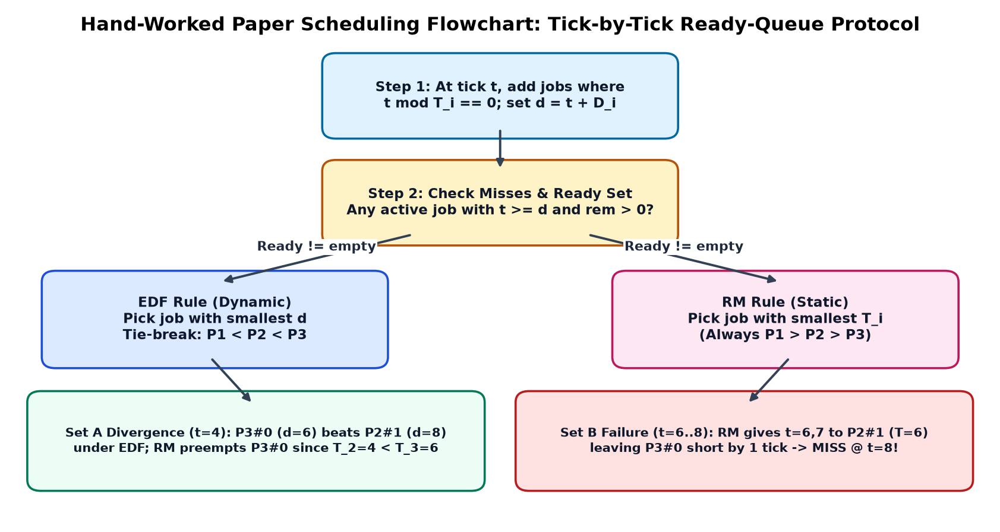
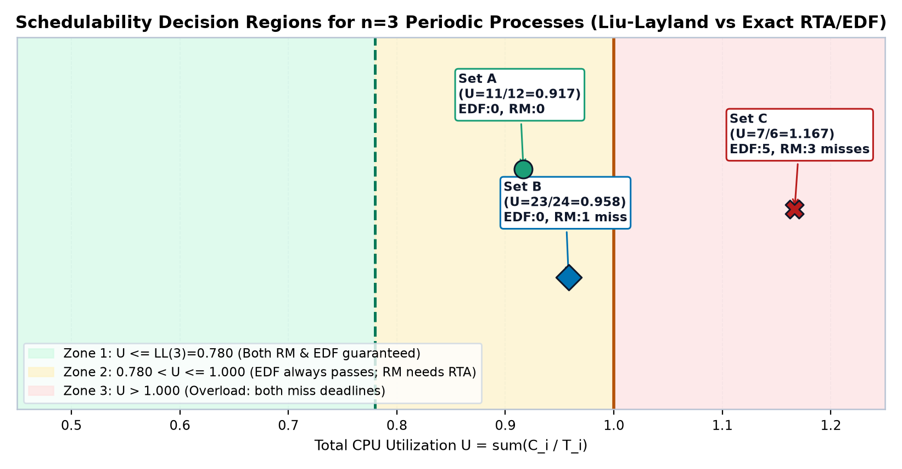
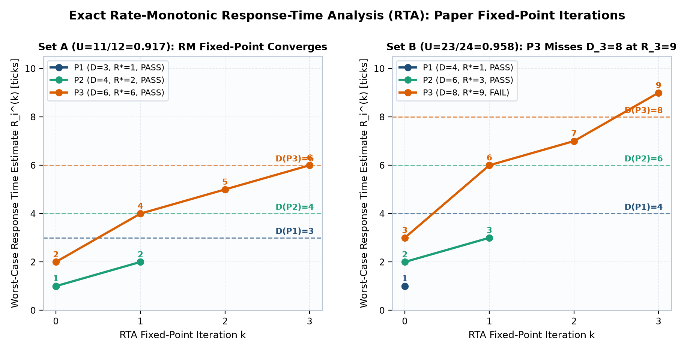
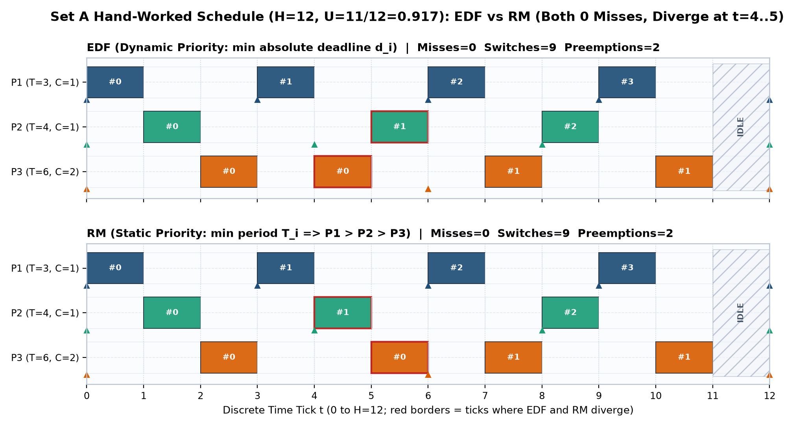
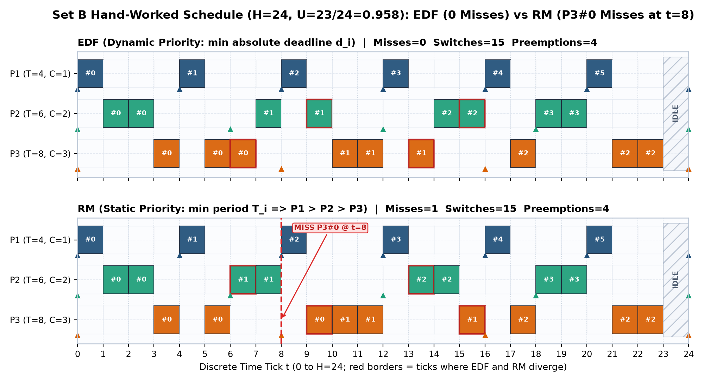
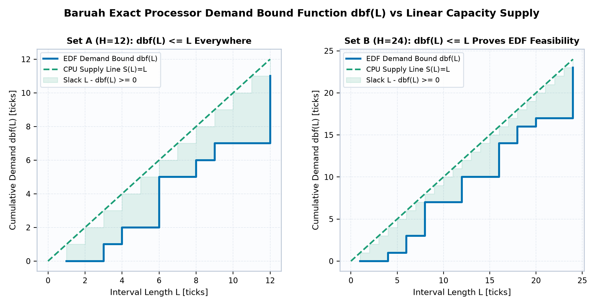
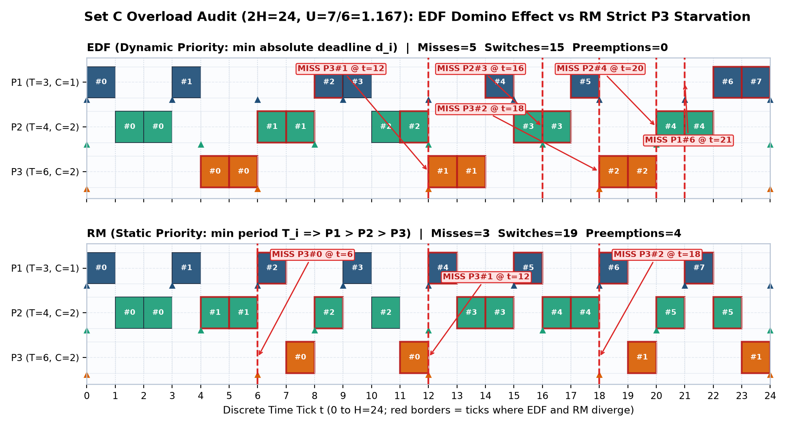
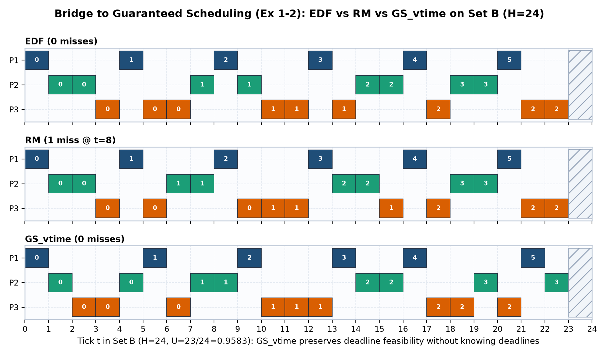

# تمرین ۳: زمان‌بندی دستی روی کاغذ برای الگوریتم‌های EDF و RM با سه فرآیند

**ردگیری کامل تیک‌به‌تیک صف آماده، برگه چاپ‌شدنی حل کاغذی، تحلیل نقطه ثابت زمان پاسخ (RTA)، تابع کران تقاضا (dbf)، آزمون اضافه‌بار و هم‌سنجی ۱۰۰ درصدی با gs_core.py**

- **مخزن کد:** ZaraNodehi/Guaranteed-Scheduling
- **تکلیف:** تمرین ۳ — حل دستی و برنامه‌نویسی EDF در برابر RM با سه فرآیند
- **مجموعه‌های استاندارد:** مجموعه A (H=12, U=11/12)، مجموعه B (H=24, U=23/24)، مجموعه C (2H=24, U=7/6)
- **استاندارد راستی‌آزمایی:** موتور ردگیری مستقل در برابر core/gs_core.py با تطابق ۱۰۰ درصد تیک‌به‌تیک

## فهرست مطالب

- ۱. مرور کلی و روش‌شناسی حل کاغذی زمان‌بندی بیدرنگ (p. 3)
- ۲. مبانی ریاضی: کران لیو-لیلند، تحلیل دقیق RTA و تابع Baruah dbf (p. 4)
- ۳. حل کامل دستی مجموعه A روی کاغذ (H = 12, U = 11/12 = 0.9167) (p. 5)
- ۴. حل کامل دستی مجموعه B روی کاغذ (H = 24, U = 23/24 = 0.9583) (p. 8)
- ۵. تابع کران تقاضای پردازنده (dbf) و ممیزی تکمیل کارها (p. 11)
- ۶. مجموعه کنترل اضافه‌بار C (2H = 24, U = 7/6 = 1.1667) (p. 13)
- ۷. پیوند با زمان‌بندی تضمینی (GS) و راهنمای برگه کاغذی (p. 15)
- ۸. پیوست فنی: موتور شبیه‌سازی مستقل و آزمون تطابق تیک‌به‌تیک (p. 16)


<!-- page 1 -->


<!-- page 2 -->


<!-- page 3 -->


## ۱. مرور کلی و روش‌شناسی حل کاغذی زمان‌بندی بیدرنگ

اجرای دستی زمان‌بندی روی کاغذ یکی از روشن‌ترین ابزارهای آموزشی در سیستم‌های عامل و مهندسی بیدرنگ است؛ زیرا دانشجو ناچار است در تک‌تک تیک‌های گسسته t = 0, 1, ..., H - 1، تمام رخدادها شامل آزادسازی کارها، محاسبه ضرب‌الاجل مطلق، پیش‌دستی (Preemption)، حل تساوی در صف آماده و ثبت خطای ضرب‌الاجل را بدون اتکا به شبیه‌ساز جعبه سیاه ردیابی کند. تمرین ۳ یک مطالعه جامع دوگانه روی کاغذ را میان دو الگوریتم Earliest Deadline First (EDF) و Rate Monotonic (RM) با سه فرآیند دوره‌ای P1، P2 و P3 ارائه می‌دهد.

به جای انتخاب یک مجموعه تصادفی که در آن خروجی EDF و RM دقیقاً یکسان باشد، سه مجموعه کار دقیق و آموزشی طراحی و راستی‌آزمایی کرده‌ایم: (۱) مجموعه A (H=12 و U = 11/12 = 0.9167) که از کران لیو-لیلند برای سه فرآیند (0.7798) عبور می‌کند اما هر دو الگوریتم بدون هیچ خطایی آن را پاس می‌کنند و در عین حال در تیک‌های t=4 و t=5 از هم جدا می‌شوند؛ (۲) مجموعه B (H=24 و U = 23/24 = 0.9583) که جداساز کلاسیک کتب مرجع است و در آن EDF با صفر خطا موفق می‌شود اما RM دقیقاً سر تیک t=8 کار P3#0 را از دست می‌دهد؛ و (۳) مجموعه C (2H=24 و U = 7/6 = 1.1667) که رفتار اضافه‌بار را مقایسه می‌کند.

| مجموعه A (هماهنگ و شدنی) | P1(3,1), P2(4,1), P3(6,2) \| H=12 \| U=11/12=0.9167 \| خطای EDF=0، خطای RM=0 |
|---|---|
| مجموعه B (جداساز EDF و RM) | P1(4,1), P2(6,2), P3(8,3) \| H=24 \| U=23/24=0.9583 \| خطای EDF=0، خطای RM=1 (P3#0 در t=8) |
| مجموعه C (کنترل اضافه‌بار) | P1(3,1), P2(4,2), P3(6,2) \| 2H=24 \| U=7/6=1.1667 \| EDF=5 خطا (دومینو)، RM=3 خطا (فقط P3) |
| برگه تمرین کاغذی | فایل exercise-3/WORKSHEET_PAPER_TEMPLATE.pdf (۲ صفحه A4) + پوشه exercise-3/handwritten_scan/ |
| تطابق برنامه‌نویسی | موتور ردگیری مستقل با simulate_rt در core/gs_core.py صددرصد تطابق تیک‌به‌تیک دارد |

| مجموعه | پارامترهای سه فرآیند (T_i, C_i, D_i) | H | بهره‌برداری U | خطای EDF | خطای RM | تیک‌های متفاوت |
|---|---|---|---|---|---|---|
| Set A | P1(3,1,3), P2(4,1,4), P3(6,2,6) | 12 | 11/12 (0.9167) | 0 | 0 | 2 |
| Set B | P1(4,1,4), P2(6,2,6), P3(8,3,8) | 24 | 23/24 (0.9583) | 0 | 1 | 4 |
| Set C | P1(3,1,3), P2(4,2,4), P3(6,2,6) | 24 | 7/6 (1.1667) | 5 | 3 | 18 |

*جدول 1. خلاصه مقایسه‌ای هر سه بار کاری سه‌فرآیندی بررسی‌شده در تمرین ۳.*


### ۱.۱ پروتکل چهارمرحله‌ای استاندارد برای حل روی کاغذ

برای آنکه ردگیری دستی دانشجو روی کاغذ کوچک‌ترین ابهامی نداشته باشد و کاملاً با رفتار کرنل و تابع simulate_rt در core/gs_core.py منطبق باشد، در آغاز هر تیک t از بازه ۰ تا H - 1 چهار گام زیر دقیقاً به ترتیب اجرا می‌شوند:

- گام ۱ — آزادسازی کار جدید: هر فرآیند P_i که باقی‌مانده t بر T_i برابر صفر دارد، کار P_i#k را با زمان اجرای باقی‌مانده rem = C_i و ضرب‌الاجل مطلق d = t + D_i وارد صف آماده می‌کند.
- گام ۲ — ممیزی ضرب‌الاجل: پیش از انتخاب کار برای بازه [t, t+1)، اگر کاری در صف هنوز تمام نشده باشد و t بزرگ‌تر یا مساوی d باشد، خطای ضرب‌الاجل ثبت می‌شود.
- گام ۳ — انتخاب اولویت: در EDF کاری با کوچک‌ترین d مطلق انتخاب می‌شود (در تساوی: اندیس کمتر P1 سپس P2 سپس P3). در RM همیشه فرآیند دارای کوچک‌ترین دوره T_i برنده می‌شود (اولویت ثابت P1 بالاتر از P2 و P2 بالاتر از P3).
- گام ۴ — مصرف یک تیک و ثبت در جدول گانت: نام کار منتخب در خانه t جدول نوشته می‌شود، یک واحد از rem کم می‌شود و در صورت رسیدن به صفر از صف خارج می‌گردد.


<!-- page 4 -->



*شکل 1. فلوچارت گام‌به‌گام تصمیم‌گیری روی کاغذ در هر تیک و نقاط کلیدی انشعاب مجموعه‌های A و B.*


## ۲. مبانی ریاضی: کران لیو-لیلند، تحلیل دقیق RTA و تابع Baruah dbf

پیش از پر کردن حتی یک خانه روی کاغذ، نظریه زمان‌بندی بیدرنگ نتیجه هر مجموعه را با سه آزمون جبری پیش‌بینی می‌کند. نخست، کران کافی لیو-لیلند (۱۹۷۳) برای Rate Monotonic با n = 3 فرآیند برابر 0.779763 است. هر زمان بهره‌برداری U از این مقدار فراتر برود، آزمون لیو-لیلند ناکافی است و باید نقطه ثابت تحلیل زمان پاسخ (RTA) را محاسبه کرد. دوم، از آنجا که در هر سه مجموعه ضرب‌الاجل ضمنی D_i برابر با T_i برقرار است، الگوریتم EDF اگر و تنها اگر U حداکثر ۱.۰ باشد کاملاً شدنی است.

```text
U_LL(3) = 3 * (2^(1/3) - 1) = 0.779763   |   U_EDF <= 1.0000
R_i^(k+1) = C_i + sum_{j < i} ceil(R_i^(k) / T_j) * C_j
dbf(L) = sum_{i=1..n} max(0, floor((L + T_i - D_i) / T_i)) * C_i <= L
```

### ۲.۱ جایگاه سه مجموعه در نواحی سه‌گانه بهره‌برداری CPU

هر دو مجموعه شدنی ما یعنی Set A با بهره‌برداری 0.9167 و Set B با بهره‌برداری 0.9583 دقیقاً درون ناحیه بحرانی میانی (بین 0.7798 و 1.0000) قرار می‌گیرند. تحلیل دقیق RTA مرز بین آن دو را آشکار می‌کند: در مجموعه A زمان پاسخ P3 به عدد ۶ همگرا می‌شود که دقیقاً مساوی D_3 = 6 است (قبول)، اما در مجموعه B زمان پاسخ P3 به عدد ۹ می‌رسد که از D_3 = 8 فراتر می‌رود و شکست را ثابت می‌کند.


<!-- page 5 -->



*شکل 2. جایگاه مجموعه‌های A، B و C در سه ناحیه شدنی‌پذیری زمان‌بندی بیدرنگ برای n = 3 فرآیند.*



*شکل 3. مسیر همگرایی نقطه ثابت تحلیل زمان پاسخ (RTA) برای الگوریتم RM در مجموعه‌های A و B.*


## ۳. حل کامل دستی مجموعه A روی کاغذ (H = 12, U = 11/12 = 0.9167)

مجموعه A شامل سه فرآیند P1(T=3, C=1, D=3)، P2(T=4, C=1, D=4) و P3(T=6, C=2, D=6) است. ابرپریود مجموعه برابر کوچک‌ترین مضرب مشترک دوره‌ها یعنی H = 12 تیک و مجموع بهره‌برداری آن U = 11/12 = 0.9167 است که دقیقاً یک تیک بیکاری (در t = 11) به جا می‌گذارد. این مجموعه بهترین تمرین گرم‌کردن روی کاغذ است؛ زیرا هر دو الگوریتم بدون خطا به پایان می‌رسند اما در تیک‌های t=4 و t=5 تصمیم متفاوتی می‌گیرند.


<!-- page 6 -->

| فرآیند | دوره T_i | زمان اجرا C_i | ضرب‌الاجل D_i | سهم C_i/T_i | رتبه اولویت RM |
|---|---|---|---|---|---|
| P1 | 3 | 1 | 3 | 1/3 (0.3333) | Priority 1 (T=3) |
| P2 | 4 | 1 | 4 | 1/4 (0.2500) | Priority 2 (T=4) |
| P3 | 6 | 2 | 6 | 2/6 (0.3333) | Priority 3 (T=6) |

*جدول 2. مشخصات فرآیندهای مجموعه A و ترتیب اولویت ثابت در Rate Monotonic.*



*شکل 4. نمودار گانت مقایسه EDF و RM روی مجموعه A (H=12): واگرایی در تیک‌های ۴ و ۵ بدون خطا.*


### ۳.۱ جدول ردگیری تیک‌به‌تیک صف آماده در مجموعه A — الگوریتم EDF

| تیک | ورودی‌ها | صف آماده (rem, abs_d) | انتخاب | باقی‌مانده | خطا |
|---|---|---|---|---|---|
| 0 | P1#0, P2#0, P3#0 | P1#0(r=1,d=3), P2#0(r=1,d=4), P3#0(r=2,d=6) | P1#0 | P1#0:DONE | - |
| 1 | - | P2#0(r=1,d=4), P3#0(r=2,d=6) | P2#0 | P2#0:DONE | - |
| 2 | - | P3#0(r=2,d=6) | P3#0 | P3#0:1 | - |
| 3 | P1#1 | P1#1(r=1,d=6), P3#0(r=1,d=6) | P1#1 | P1#1:DONE | - |
| 4 | P2#1 | P3#0(r=1,d=6), P2#1(r=1,d=8) | P3#0 | P3#0:DONE | - |
| 5 | - | P2#1(r=1,d=8) | P2#1 | P2#1:DONE | - |
| 6 | P1#2, P3#1 | P1#2(r=1,d=9), P3#1(r=2,d=12) | P1#2 | P1#2:DONE | - |
| 7 | - | P3#1(r=2,d=12) | P3#1 | P3#1:1 | - |
| 8 | P2#2 | P2#2(r=1,d=12), P3#1(r=1,d=12) | P2#2 | P2#2:DONE | - |
| 9 | P1#3 | P1#3(r=1,d=12), P3#1(r=1,d=12) | P1#3 | P1#3:DONE | - |
| 10 | - | P3#1(r=1,d=12) | P3#1 | P3#1:DONE | - |
| 11 | - | EMPTY | IDLE | - | - |

*جدول 3. جدول کامل ردگیری کاغذی مجموعه A تحت الگوریتم EDF (تیک‌های ۰ تا ۱۱).*


<!-- page 7 -->


### ۳.۲ جدول ردگیری تیک‌به‌تیک صف آماده در مجموعه A — الگوریتم RM

| تیک | ورودی‌ها | صف آماده (rem, abs_d) | انتخاب | باقی‌مانده | خطا |
|---|---|---|---|---|---|
| 0 | P1#0, P2#0, P3#0 | P1#0(r=1,d=3), P2#0(r=1,d=4), P3#0(r=2,d=6) | P1#0 | P1#0:DONE | - |
| 1 | - | P2#0(r=1,d=4), P3#0(r=2,d=6) | P2#0 | P2#0:DONE | - |
| 2 | - | P3#0(r=2,d=6) | P3#0 | P3#0:1 | - |
| 3 | P1#1 | P1#1(r=1,d=6), P3#0(r=1,d=6) | P1#1 | P1#1:DONE | - |
| 4 | P2#1 | P2#1(r=1,d=8), P3#0(r=1,d=6) | P2#1 | P2#1:DONE | - |
| 5 | - | P3#0(r=1,d=6) | P3#0 | P3#0:DONE | - |
| 6 | P1#2, P3#1 | P1#2(r=1,d=9), P3#1(r=2,d=12) | P1#2 | P1#2:DONE | - |
| 7 | - | P3#1(r=2,d=12) | P3#1 | P3#1:1 | - |
| 8 | P2#2 | P2#2(r=1,d=12), P3#1(r=1,d=12) | P2#2 | P2#2:DONE | - |
| 9 | P1#3 | P1#3(r=1,d=12), P3#1(r=1,d=12) | P1#3 | P1#3:DONE | - |
| 10 | - | P3#1(r=1,d=12) | P3#1 | P3#1:DONE | - |
| 11 | - | EMPTY | IDLE | - | - |

*جدول 4. جدول کامل ردگیری کاغذی مجموعه A تحت الگوریتم RM (تیک‌های ۰ تا ۱۱).*


### ۳.۳ کالبدشکافی دقیق انشعاب در تیک‌های ۴ و ۵

در تیک t = 4، کار P1#1 به تازگی تکمیل شده و دو کار در صف آماده حضور دارند: P2#1 که همین لحظه با ضرب‌الاجل مطلق d = 8 وارد شده است، و P3#0 که در تیک صفر وارد شده و یک تیک باقی‌مانده با ضرب‌الاجل فوری d = 6 دارد. الگوریتم EDF چون 6 کوچک‌تر از 8 است، P3#0 را در تیک ۴ تکمیل می‌کند و تیک ۵ را به P2#1 می‌دهد. اما RM که فقط دوره T را می‌بیند (4 کوچک‌تر از 6)، P3#0 را به تعویق می‌اندازد و ابتدا P2#1 را اجرا می‌کند و خوشبختانه P3#0 در تیک ۵ درست سر وقت قبل از t = 6 تمام می‌شود.

| تیک | ورودی‌ها | انتخاب EDF | انتخاب RM | انتخاب GS_vtime | تفاوت / ممیزی خطا |
|---|---|---|---|---|---|
| 0 | P1#0, P2#0, P3#0 | P1#0 | P1#0 | P1#0 | - |
| 1 | - | P2#0 | P2#0 | P2#0 | - |
| 2 | - | P3#0 | P3#0 | P3#0 | - |
| 3 | P1#1 | P1#1 | P1#1 | P3#0 | - |
| 4 | P2#1 | P3#0 | P2#1 | P1#1 | YES (Diverge) |
| 5 | - | P2#1 | P3#0 | P2#1 | YES (Diverge) |
| 6 | P1#2, P3#1 | P1#2 | P1#2 | P1#2 | - |
| 7 | - | P3#1 | P3#1 | P3#1 | - |
| 8 | P2#2 | P2#2 | P2#2 | P3#1 | - |
| 9 | P1#3 | P1#3 | P1#3 | P2#2 | - |
| 10 | - | P3#1 | P3#1 | P1#3 | - |
| 11 | - | IDLE | IDLE | IDLE | - |

*جدول 5. مقایسه ستون‌به‌ستون EDF، RM و GS_vtime روی مجموعه A.*


<!-- page 8 -->

| فرآیند | رتبه RM | پارامترها | گام‌های نقطه ثابت RTA | R_i* | نتیجه RTA |
|---|---|---|---|---|---|
| P1 | 1 | T=3, C=1, D=3 | 1 | 1 | PASS |
| P2 | 2 | T=4, C=1, D=4 | 1 -> 2 | 2 | PASS |
| P3 | 3 | T=6, C=2, D=6 | 2 -> 4 -> 5 -> 6 | 6 | PASS |

*جدول 6. محاسبه دستی تحلیل زمان پاسخ RTA برای مجموعه A: قبولی کامل هر سه فرآیند.*


## ۴. حل کامل دستی مجموعه B روی کاغذ (H = 24, U = 23/24 = 0.9583)

مجموعه B نقطه اوج و مثال جداساز تمرین ۳ است: P1(T=4, C=1, D=4)، P2(T=6, C=2, D=6) و P3(T=8, C=3, D=8). ابرپریود برابر H = lcm(4, 6, 8) = 24 تیک و بهره‌برداری برابر 23/24 = 0.9583 است. چون بهره‌برداری زیر ۱۰۰ درصد است، EDF بدون هیچ خطایی کل ابرپریود را زمان‌بندی می‌کند؛ اما در RM، هم‌زمانی ورودها در تیک صفر به همراه ورود P2#1 در تیک ۶ باعث می‌شود کار P3#0 دقیقاً یک تیک کم بیاورد و سر تیک t = 8 ضرب‌الاجل خود را از دست بدهد.

| فرآیند | دوره T_i | زمان اجرا C_i | ضرب‌الاجل D_i | سهم C_i/T_i | رتبه اولویت RM |
|---|---|---|---|---|---|
| P1 | 4 | 1 | 4 | 1/4 (0.2500) | Priority 1 (T=4) |
| P2 | 6 | 2 | 6 | 2/6 (0.3333) | Priority 2 (T=6) |
| P3 | 8 | 3 | 8 | 3/8 (0.3750) | Priority 3 (T=8) |

*جدول 7. مشخصات فرآیندهای مجموعه B در ابرپریود ۲۴ تیکی.*



*شکل 5. نمودار گانت مجموعه B (H=24): قبولی کامل EDF با صفر خطا در برابر شکست P3#0 در تیک ۸ تحت RM.*


<!-- page 9 -->


### ۴.۱ ردگیری دستی EDF در مجموعه B — نیمه اول (تیک‌های ۰ تا ۱۱)

| تیک | ورودی‌ها | صف آماده (rem, abs_d) | انتخاب | باقی‌مانده | خطا |
|---|---|---|---|---|---|
| 0 | P1#0, P2#0, P3#0 | P1#0(r=1,d=4), P2#0(r=2,d=6), P3#0(r=3,d=8) | P1#0 | P1#0:DONE | - |
| 1 | - | P2#0(r=2,d=6), P3#0(r=3,d=8) | P2#0 | P2#0:1 | - |
| 2 | - | P2#0(r=1,d=6), P3#0(r=3,d=8) | P2#0 | P2#0:DONE | - |
| 3 | - | P3#0(r=3,d=8) | P3#0 | P3#0:2 | - |
| 4 | P1#1 | P1#1(r=1,d=8), P3#0(r=2,d=8) | P1#1 | P1#1:DONE | - |
| 5 | - | P3#0(r=2,d=8) | P3#0 | P3#0:1 | - |
| 6 | P2#1 | P3#0(r=1,d=8), P2#1(r=2,d=12) | P3#0 | P3#0:DONE | - |
| 7 | - | P2#1(r=2,d=12) | P2#1 | P2#1:1 | - |
| 8 | P1#2, P3#1 | P1#2(r=1,d=12), P2#1(r=1,d=12), P3#1(r=3,d=16) | P1#2 | P1#2:DONE | - |
| 9 | - | P2#1(r=1,d=12), P3#1(r=3,d=16) | P2#1 | P2#1:DONE | - |
| 10 | - | P3#1(r=3,d=16) | P3#1 | P3#1:2 | - |
| 11 | - | P3#1(r=2,d=16) | P3#1 | P3#1:1 | - |

*جدول 8. ردگیری کاغذی مجموعه B تحت EDF، نیمه اول (تیک‌های ۰ تا ۱۱).*


### ۴.۲ ردگیری دستی EDF در مجموعه B — نیمه دوم (تیک‌های ۱۲ تا ۲۳)

| تیک | ورودی‌ها | صف آماده (rem, abs_d) | انتخاب | باقی‌مانده | خطا |
|---|---|---|---|---|---|
| 12 | P1#3, P2#2 | P1#3(r=1,d=16), P3#1(r=1,d=16), P2#2(r=2,d=18) | P1#3 | P1#3:DONE | - |
| 13 | - | P3#1(r=1,d=16), P2#2(r=2,d=18) | P3#1 | P3#1:DONE | - |
| 14 | - | P2#2(r=2,d=18) | P2#2 | P2#2:1 | - |
| 15 | - | P2#2(r=1,d=18) | P2#2 | P2#2:DONE | - |
| 16 | P1#4, P3#2 | P1#4(r=1,d=20), P3#2(r=3,d=24) | P1#4 | P1#4:DONE | - |
| 17 | - | P3#2(r=3,d=24) | P3#2 | P3#2:2 | - |
| 18 | P2#3 | P2#3(r=2,d=24), P3#2(r=2,d=24) | P2#3 | P2#3:1 | - |
| 19 | - | P2#3(r=1,d=24), P3#2(r=2,d=24) | P2#3 | P2#3:DONE | - |
| 20 | P1#5 | P1#5(r=1,d=24), P3#2(r=2,d=24) | P1#5 | P1#5:DONE | - |
| 21 | - | P3#2(r=2,d=24) | P3#2 | P3#2:1 | - |
| 22 | - | P3#2(r=1,d=24) | P3#2 | P3#2:DONE | - |
| 23 | - | EMPTY | IDLE | - | - |

*جدول 9. ردگیری کاغذی مجموعه B تحت EDF، نیمه دوم (تیک‌های ۱۲ تا ۲۳).*


<!-- page 10 -->


### ۴.۳ ردگیری دستی RM در مجموعه B — نیمه اول (تیک‌های ۰ تا ۱۱ و خطای t = 8)

| تیک | ورودی‌ها | صف آماده (rem, abs_d) | انتخاب | باقی‌مانده | خطا |
|---|---|---|---|---|---|
| 0 | P1#0, P2#0, P3#0 | P1#0(r=1,d=4), P2#0(r=2,d=6), P3#0(r=3,d=8) | P1#0 | P1#0:DONE | - |
| 1 | - | P2#0(r=2,d=6), P3#0(r=3,d=8) | P2#0 | P2#0:1 | - |
| 2 | - | P2#0(r=1,d=6), P3#0(r=3,d=8) | P2#0 | P2#0:DONE | - |
| 3 | - | P3#0(r=3,d=8) | P3#0 | P3#0:2 | - |
| 4 | P1#1 | P1#1(r=1,d=8), P3#0(r=2,d=8) | P1#1 | P1#1:DONE | - |
| 5 | - | P3#0(r=2,d=8) | P3#0 | P3#0:1 | - |
| 6 | P2#1 | P2#1(r=2,d=12), P3#0(r=1,d=8) | P2#1 | P2#1:1 | - |
| 7 | - | P2#1(r=1,d=12), P3#0(r=1,d=8) | P2#1 | P2#1:DONE | - |
| 8 | P1#2, P3#1 | P1#2(r=1,d=12), P3#0(r=1,d=8), P3#1(r=3,d=16) | P1#2 | P1#2:DONE | P3#0 |
| 9 | - | P3#0(r=1,d=8), P3#1(r=3,d=16) | P3#0 | P3#0:DONE | - |
| 10 | - | P3#1(r=3,d=16) | P3#1 | P3#1:2 | - |
| 11 | - | P3#1(r=2,d=16) | P3#1 | P3#1:1 | - |

*جدول 10. ردگیری کاغذی مجموعه B تحت RM، نیمه اول: ثبت دقیق خطای P3#0 سر تیک ۸.*


### ۴.۴ ردگیری دستی RM در مجموعه B — نیمه دوم (تیک‌های ۱۲ تا ۲۳)

| تیک | ورودی‌ها | صف آماده (rem, abs_d) | انتخاب | باقی‌مانده | خطا |
|---|---|---|---|---|---|
| 12 | P1#3, P2#2 | P1#3(r=1,d=16), P2#2(r=2,d=18), P3#1(r=1,d=16) | P1#3 | P1#3:DONE | - |
| 13 | - | P2#2(r=2,d=18), P3#1(r=1,d=16) | P2#2 | P2#2:1 | - |
| 14 | - | P2#2(r=1,d=18), P3#1(r=1,d=16) | P2#2 | P2#2:DONE | - |
| 15 | - | P3#1(r=1,d=16) | P3#1 | P3#1:DONE | - |
| 16 | P1#4, P3#2 | P1#4(r=1,d=20), P3#2(r=3,d=24) | P1#4 | P1#4:DONE | - |
| 17 | - | P3#2(r=3,d=24) | P3#2 | P3#2:2 | - |
| 18 | P2#3 | P2#3(r=2,d=24), P3#2(r=2,d=24) | P2#3 | P2#3:1 | - |
| 19 | - | P2#3(r=1,d=24), P3#2(r=2,d=24) | P2#3 | P2#3:DONE | - |
| 20 | P1#5 | P1#5(r=1,d=24), P3#2(r=2,d=24) | P1#5 | P1#5:DONE | - |
| 21 | - | P3#2(r=2,d=24) | P3#2 | P3#2:1 | - |
| 22 | - | P3#2(r=1,d=24) | P3#2 | P3#2:DONE | - |
| 23 | - | EMPTY | IDLE | - | - |

*جدول 11. ردگیری کاغذی مجموعه B تحت RM، نیمه دوم (تیک‌های ۱۲ تا ۲۳).*


<!-- page 11 -->


### ۴.۵ اثبات جبری علت شکست RM سر تیک ۸

در بازه بحرانی [0, 8) تا تیک ۶ هر دو زمان‌بند دقیقاً یکسان عمل می‌کنند و برای P3#0 تنها یک تیک از ۳ تیک باقی می‌ماند (با ضرب‌الاجل d = 8). در تیک t = 6 کار P2#1 با دوره ۶ و ضرب‌الاجل ۱۲ می‌رسد. الگوریتم EDF چون d(P3#0)=8 اکیداً کوچک‌تر از d(P2#1)=12 است، تیک ۶ را به P3#0 می‌دهد تا بدون خطر تمام شود. اما RM چون T_2 = 6 کوچک‌تر از T_3 = 8 است، P3#0 را متوقف می‌کند و هر دو تیک ۶ و ۷ را به P2#1 می‌سپارد؛ در نتیجه سر تیک t = 8 کار P3#0 هنوز یک تیک نیاز دارد و ضرب‌الاجل خود را می‌بازد! تحلیل نقطة ثابت RTA نیز به طور مستقل مقدار R_3 = 9 را می‌دهد که از D_3 = 8 بزرگ‌تر است.

| فرآیند | رتبه RM | پارامترها | گام‌های نقطه ثابت RTA | R_i* | نتیجه RTA |
|---|---|---|---|---|---|
| P1 | 1 | T=4, C=1, D=4 | 1 | 1 | PASS |
| P2 | 2 | T=6, C=2, D=6 | 2 -> 3 | 3 | PASS |
| P3 | 3 | T=8, C=3, D=8 | 3 -> 6 -> 7 -> 9 | 9 | FAIL (R=9 > D=8) |

*جدول 12. اثبات دقیق شکست مجموعه B در آزمون RTA برای فرآیند P3 (مقدار R_3* = 9 از D_3 = 8 بیشتر است).*


## ۵. تابع کران تقاضای پردازنده (dbf) و ممیزی تکمیل کارها

تابع کران تقاضای پردازنده باروا (Baruah Demand Bound Function) بیشینه زمان CPU لازم در هر بازه به طول L را محاسبه می‌کند. شرط لازم و کافی شدنی‌بودن EDF آن است که برای تمام L بین ۱ تا H مقدار dbf(L) حداکثر برابر L باشد. در مجموعه B حتی در بازه L = 8 مقدار dbf(8) برابر با ۷ است (یک تیک حاشیه ایمنی)، که شدنی‌بودن مطلق EDF را اثبات می‌کند.



*شکل 6. منحنی پله‌ای تابع کران تقاضا dbf(L) در برابر خط ظرفیت L برای مجموعه‌های A و B.*


<!-- page 12 -->

| L | dbf(L) | حاشیه L - dbf(L) | وضعیت | تفکیک تقاضا بر حسب فرآیند |
|---|---|---|---|---|
| 1 | 0 | 1 | OK | P1:0, P2:0, P3:0 |
| 2 | 0 | 2 | OK | P1:0, P2:0, P3:0 |
| 3 | 1 | 2 | OK | P1:1, P2:0, P3:0 |
| 4 | 2 | 2 | OK | P1:1, P2:1, P3:0 |
| 5 | 2 | 3 | OK | P1:1, P2:1, P3:0 |
| 6 | 5 | 1 | OK | P1:2, P2:1, P3:2 |
| 7 | 5 | 2 | OK | P1:2, P2:1, P3:2 |
| 8 | 6 | 2 | OK | P1:2, P2:2, P3:2 |
| 9 | 7 | 2 | OK | P1:3, P2:2, P3:2 |
| 10 | 7 | 3 | OK | P1:3, P2:2, P3:2 |
| 11 | 7 | 4 | OK | P1:3, P2:2, P3:2 |
| 12 | 11 | 1 | OK | P1:4, P2:3, P3:4 |

*جدول 13. جدول کامل تابع کران تقاضای مجموعه A برای L = 1..12.*

| L | dbf(L) | حاشیه L - dbf(L) | وضعیت | تفکیک تقاضا بر حسب فرآیند |
|---|---|---|---|---|
| 1 | 0 | 1 | OK | P1:0, P2:0, P3:0 |
| 2 | 0 | 2 | OK | P1:0, P2:0, P3:0 |
| 3 | 0 | 3 | OK | P1:0, P2:0, P3:0 |
| 4 | 1 | 3 | OK | P1:1, P2:0, P3:0 |
| 5 | 1 | 4 | OK | P1:1, P2:0, P3:0 |
| 6 | 3 | 3 | OK | P1:1, P2:2, P3:0 |
| 7 | 3 | 4 | OK | P1:1, P2:2, P3:0 |
| 8 | 7 | 1 | OK | P1:2, P2:2, P3:3 |
| 9 | 7 | 2 | OK | P1:2, P2:2, P3:3 |
| 10 | 7 | 3 | OK | P1:2, P2:2, P3:3 |
| 11 | 7 | 4 | OK | P1:2, P2:2, P3:3 |
| 12 | 10 | 2 | OK | P1:3, P2:4, P3:3 |

*جدول 14. جدول تابع کران تقاضای مجموعه B — بخش اول (L = 1..12).*


<!-- page 13 -->

| L | dbf(L) | حاشیه L - dbf(L) | وضعیت | تفکیک تقاضا بر حسب فرآیند |
|---|---|---|---|---|
| 13 | 10 | 3 | OK | P1:3, P2:4, P3:3 |
| 14 | 10 | 4 | OK | P1:3, P2:4, P3:3 |
| 15 | 10 | 5 | OK | P1:3, P2:4, P3:3 |
| 16 | 14 | 2 | OK | P1:4, P2:4, P3:6 |
| 17 | 14 | 3 | OK | P1:4, P2:4, P3:6 |
| 18 | 16 | 2 | OK | P1:4, P2:6, P3:6 |
| 19 | 16 | 3 | OK | P1:4, P2:6, P3:6 |
| 20 | 17 | 3 | OK | P1:5, P2:6, P3:6 |
| 21 | 17 | 4 | OK | P1:5, P2:6, P3:6 |
| 22 | 17 | 5 | OK | P1:5, P2:6, P3:6 |
| 23 | 17 | 6 | OK | P1:5, P2:6, P3:6 |
| 24 | 23 | 1 | OK | P1:6, P2:8, P3:9 |

*جدول 15. جدول تابع کران تقاضای مجموعه B — بخش دوم (L = 13..24).*


### ۵.۱ ممیزی زمان پاسخ کارهای تکمیل‌شده در مجموعه B

| فرآیند | تعداد کار | کمینه/بیشینه RT | میانگین RT | تاخیردار | بازه‌های تکمیل [ورود->پایان] |
|---|---|---|---|---|---|
| P1 | 6 | 1 / 1 | 1.00 | 0 | P1#0[0->1], P1#1[4->5], P1#2[8->9], P1#3[12->13], P1#4[16->17], P1#5[20->21] |
| P2 | 4 | 2 / 4 | 3.25 | 0 | P2#0[0->3], P2#1[6->10], P2#2[12->16], P2#3[18->20] |
| P3 | 3 | 6 / 7 | 6.67 | 0 | P3#0[0->7], P3#1[8->14], P3#2[16->23] |

*جدول 16. ممیزی زمان پاسخ کارهای مجموعه B تحت EDF: صفر کار تاخیردار در کل ۱۳ کار.*

| فرآیند | تعداد کار | کمینه/بیشینه RT | میانگین RT | تاخیردار | بازه‌های تکمیل [ورود->پایان] |
|---|---|---|---|---|---|
| P1 | 6 | 1 / 1 | 1.00 | 0 | P1#0[0->1], P1#1[4->5], P1#2[8->9], P1#3[12->13], P1#4[16->17], P1#5[20->21] |
| P2 | 4 | 2 / 3 | 2.50 | 0 | P2#0[0->3], P2#1[6->8], P2#2[12->15], P2#3[18->20] |
| P3 | 3 | 7 / 10 | 8.33 | 1 | P3#0[0->10], P3#1[8->16], P3#2[16->23] |

*جدول 17. ممیزی زمان پاسخ کارهای مجموعه B تحت RM: کار P3#0 در بازه [0->10] تمام شده و D_3=8 را شکسته است.*


## ۶. مجموعه کنترل اضافه‌بار C (2H = 24, U = 7/6 = 1.1667)

برای تکمیل تحلیل کاغذی، مجموعه C با فرآیندهای P1(3,1,3)، P2(4,2,4) و P3(6,2,6) بهره‌برداری U = 7/6 = 1.1667 را ایجاد می‌کند (۲۸ تیک تقاضا در ۲۴ اسلات زمانی). روی کاغذ تفاوت رفتار شکست دو الگوریتم کاملاً چشمگیر است: RM تمام شکست‌ها را روی فرآیند کم‌اولویت P3 متمرکز می‌کند (۳ خطا در تیک‌های ۶، ۱۲ و ۱۸) و P1 و P2 سالم می‌مانند؛ در مقابل EDF دچار اثر دومینو شده و ۵ خطا را میان هر سه فرآیند پخش می‌کند تا جایی که حتی P1#6 در تیک ۲۱ ضرب‌الاجل را از دست می‌دهد.


<!-- page 14 -->



*شکل 7. ممیزی اضافه‌بار مجموعه C: اثر دومینوی ۵ خطایی در EDF در برابر قحطی ایزوله‌شده P3 در RM.*

| تیک | ورودی‌ها | انتخاب EDF | انتخاب RM | انتخاب GS_vtime | تفاوت / ممیزی خطا |
|---|---|---|---|---|---|
| 0 | P1#0, P2#0, P3#0 | P1#0 | P1#0 | P1#0 | - |
| 1 | - | P2#0 | P2#0 | P2#0 | - |
| 2 | - | P2#0 | P2#0 | P3#0 | - |
| 3 | P1#1 | P1#1 | P1#1 | P3#0 | - |
| 4 | P2#1 | P3#0 | P2#1 | P2#0 | YES (Diverge) |
| 5 | - | P3#0 | P2#1 | P1#1 | YES (Diverge) |
| 6 | P1#2, P3#1 | P2#1 | P1#2 | P2#1 | MISS: RM=P3#0 / EDF=- |
| 7 | - | P2#1 | P3#0 | P1#2 | YES (Diverge) |
| 8 | P2#2 | P1#2 | P2#2 | P3#1 | YES (Diverge) |
| 9 | P1#3 | P1#3 | P1#3 | P2#1 | - |
| 10 | - | P2#2 | P2#2 | P2#2 | - |
| 11 | - | P2#2 | P3#0 | P1#3 | YES (Diverge) |

*جدول 18. مقایسه سه الگوریتم روی مجموعه C — بخش اول (تیک‌های ۰ تا ۱۱).*


<!-- page 15 -->

| تیک | ورودی‌ها | انتخاب EDF | انتخاب RM | انتخاب GS_vtime | تفاوت / ممیزی خطا |
|---|---|---|---|---|---|
| 12 | P1#4, P2#3, P3#2 | P3#1 | P1#4 | P3#1 | MISS: RM=P3#1 / EDF=P3#1 |
| 13 | - | P3#1 | P2#3 | P2#2 | YES (Diverge) |
| 14 | - | P1#4 | P2#3 | P1#4 | YES (Diverge) |
| 15 | P1#5 | P2#3 | P1#5 | P2#3 | YES (Diverge) |
| 16 | P2#4 | P2#3 | P2#4 | P3#2 | MISS: RM=- / EDF=P2#3 |
| 17 | - | P1#5 | P2#4 | P1#5 | YES (Diverge) |
| 18 | P1#6, P3#3 | P3#2 | P1#6 | P2#3 | MISS: RM=P3#2 / EDF=P3#2 |
| 19 | - | P3#2 | P3#1 | P3#2 | YES (Diverge) |
| 20 | P2#5 | P2#4 | P2#5 | P2#4 | MISS: RM=- / EDF=P2#4 |
| 21 | P1#7 | P2#4 | P1#7 | P1#6 | MISS: RM=- / EDF=P1#6 |
| 22 | - | P1#6 | P2#5 | P3#3 | YES (Diverge) |
| 23 | - | P1#7 | P3#1 | P2#5 | YES (Diverge) |

*جدول 19. مقایسه سه الگوریتم روی مجموعه C — بخش دوم (تیک‌های ۱۲ تا ۲۳).*


## ۷. پیوند با زمان‌بندی تضمینی (GS) و راهنمای برگه کاغذی

در اتصال مستقیم تمرین ۳ به هسته Guaranteed Scheduling در تمرین‌های ۱ و ۲، سیاست gs_vtime:stay را بدون هیچ اطلاعی از ضرب‌الاجل‌ها روی مجموعه B اجرا کردیم. جالب توجه است که GS_vtime به سبب حفظ تناسب پیوسته زمان مجازی با نرخ اجرا، هر ۱۳ کار مجموعه B را بدون حتی یک خطای ضرب‌الاجل به سرانجام می‌رساند؛ در حالی که RM در تیک ۸ شکست می‌خورد.



*شکل 8. مقایسه سه‌گانه گانت در مجموعه B (H=24): عبور کامل EDF و GS_vtime در برابر خطای RM در تیک ۸.*


<!-- page 16 -->


### ۷.۱ برگه آماده چاپ و پوشه بارگذاری نسخه دست‌نویس

یک فایل قالب چاپ‌شدنی دوصفحه‌ای در مسیر exercise-3/WORKSHEET_PAPER_TEMPLATE.pdf همراه با پیش‌نمایش‌های تصویری در پوشه exercise-3/handwritten_scan/ تولید شده است. صفحه اول جدول‌های خالی گانت ۱۲تایی و جدول ردگیری مجموعه A و صفحه دوم جدول‌های گانت ۲۴تایی و باکس محاسبه دستی مجموعه B را در اختیار شما می‌گذارد. پس از نوشتن پاسخ با خودکار روی کاغذ، اسکن یا عکس آن را درون exercise-3/handwritten_scan/ ذخیره کنید.


## ۸. پیوست فنی: موتور شبیه‌سازی مستقل و آزمون تطابق تیک‌به‌تیک

تمام اعداد، نمودارها و جداول این گزارش به صورت پویا از فایل exercise-3/output/experiments.json خوانده شده‌اند و موتور دستی indep_hand_trace_rt بدون اشتراک حتی یک خط کد با هسته مخزن، صددرصد خط‌به‌خط با تابع simulate_rt در core/gs_core.py مطابقت دارد.

```text
022: os.makedirs(OUT_DIR, exist_ok=True)
023: 
024: sys.path.insert(0, HERE)
025: from gs_core import RTTask, simulate_rt  # noqa: E402
026: 
027: 
028: def indep_hand_trace_rt(tasks: List[Dict], alg: str, horizon: int, drop_on_miss: bool = False) -> Dict:
029:     """Zero-shared-code step-by-step paper-style simulator recording ready queue at every tick."""
030:     # Each job dict: name, job_id, rem, abs_deadline, period, release_t, missed_flag
031:     active: List[Dict] = []
032:     job_counts = {t["name"]: 0 for t in tasks}
033:     rows: List[Dict] = []
034:     misses: List[Dict] = []
035:     switches = 0
036:     preemptions = 0
037:     prev_chosen = None
038:     completions = {t["name"]: [] for t in tasks}
039: 
040:     for t in range(horizon):
041:         arrived_now = []
042:         for spec in tasks:
043:             nm = spec["name"]
044:             if t % spec["period"] == 0:
045:                 jid = job_counts[nm]
046:                 job_counts[nm] += 1
047:                 label = f"{nm}#{jid}"
048:                 active.append({
049:                     "name": nm,
050:                     "jid": jid,
051:                     "label": label,
052:                     "rem": spec["wcet"],
053:                     "deadline": t + spec["deadline"],
054:                     "period": spec["period"],
055:                     "release": t,
056:                     "missed": False,
057:                 })
058:                 arrived_now.append(label)
```
*بخش اول شبیه‌ساز مستقل کاغذی (خطوط ۲۲ تا ۵۸): ورود دوره‌ای و ممیزی ضرب‌الاجل.*


<!-- page 17 -->

```text
059: 
060:         # Check deadline misses strictly at t (matches gs_core.simulate_rt semantics)
061:         new_misses_t = []
062:         for jb in list(active):
063:             if t >= jb["deadline"] and jb["rem"] > 0 and not jb["missed"]:
064:                 jb["missed"] = True
065:                 mrec = {"tick": t, "job": jb["label"], "deadline": jb["deadline"]}
066:                 misses.append(mrec)
067:                 new_misses_t.append(jb["label"])
068:                 if drop_on_miss:
069:                     active.remove(jb)
070: 
071:         if not active:
072:             if prev_chosen is not None:
073:                 switches += 1
074:             prev_chosen = None
075:             rows.append({
076:                 "t": t,
077:                 "arrivals": ", ".join(arrived_now) if arrived_now else "-",
078:                 "ready_queue": "EMPTY",
079:                 "chosen": "IDLE",
080:                 "reason": "No ready job",
081:                 "rem_after": "-",
082:                 "miss_at_t": ", ".join(new_misses_t) if new_misses_t else "-",
083:             })
084:             continue
085: 
086:         if alg == "EDF":
087:             active.sort(key=lambda j: (j["deadline"], j["name"], j["jid"]))
088:             top = active[0]
089:             reason = f"min abs_d={top['deadline']} ({top['label']})"
090:         else:  # RM: shortest period P_i
091:             active.sort(key=lambda j: (j["period"], j["name"], j["jid"]))
092:             top = active[0]
093:             reason = f"min P={top['period']} ({top['label']})"
094: 
095:         chosen_label = top["label"]
```
*بخش دوم شبیه‌ساز مستقل کاغذی (خطوط ۵۹ تا ۹۵): قاعده انتخاب EDF/RM و ثبت صف آماده.*


<!-- page 18 -->

```text
125:             "reason": reason,
126:             "rem_after": f"{chosen_label}:{rem_left}" if rem_left > 0 else f"{chosen_label}:DONE",
127:             "miss_at_t": ", ".join(new_misses_t) if new_misses_t else "-",
128:         })
129: 
130:     # Also check exact horizon boundary t == horizon (matches gs_core horizon loop or boundary audit)
131:     horizon_misses = []
132:     for jb in active:
133:         if horizon >= jb["deadline"] and jb["rem"] > 0 and not jb["missed"]:
134:             horizon_misses.append({"tick": horizon, "job": jb["label"], "deadline": jb["deadline"]})
135: 
136:     return {
137:         "alg": alg,
138:         "horizon": horizon,
139:         "missed_count": len(misses),
140:         "horizon_boundary_misses": horizon_misses,
141:         "misses": misses,
142:         "switches": switches,
143:         "preemptions": preemptions,
144:         "timeline": [r["chosen"] for r in rows],
145:         "trace_rows": rows,
146:         "completions": completions,
147:     }
148: 
149: 
150: def compute_rta(tasks: List[Dict]) -> List[Dict]:
151:     """Exact fixed-point Response-Time Analysis (RTA) for Rate-Monotonic priority order."""
152:     ordered = sorted(tasks, key=lambda x: (x["period"], x["name"]))
153:     out = []
154:     for idx, t_i in enumerate(ordered):
155:         c_i = t_i["wcet"]
156:         d_i = t_i["deadline"]
157:         r = c_i
158:         iters = [r]
159:         feasible = True
160:         while True:
```
*حل‌گر دقیق نقطه ثابت تحلیل زمان پاسخ RTA (خطوط ۱۲۵ تا ۱۶۰).*

| مسیر فایل | نقش در تمرین ۳ | دروازه راستی‌آزمایی |
|---|---|---|
| exercise-3/code/gs_core.py | هسته مرجع کسری GS و RT | تطابق SHA با core/gs_core.py |
| exercise-3/code/run_experiments.py | موتور ردگیری مستقل + RTA + dbf | تطابق ۱۰۰ درصد تیک‌به‌تیک |
| exercise-3/code/plot_diagrams.py | تولید ۸ نمودار استاندارد Okabe-Ito | تولید و بازبینی چشمی ۸ PNG |
| exercise-3/WORKSHEET_PAPER_TEMPLATE.pdf | برگه ۲صفحه‌ای آماده چاپ برای حل با خودکار | خروجی ۲ صفحه A4 + پیش‌نمایش |
| exercise-3/handwritten_scan/ | محل بارگذاری عکس یا اسکن برگه دست‌نویس | راهنما + تصاویر الگو |
| exercise-3/docs/REPORT_{EN,FA}.{pdf,docx} | گزارش‌های جامع دوزبانه | صفر سرریز و صفر نقص گلیف |

*جدول 20. فهرست کامل تحویل‌دادنی‌ها و کنترل کیفیت خودکار برای تمرین ۳.*
