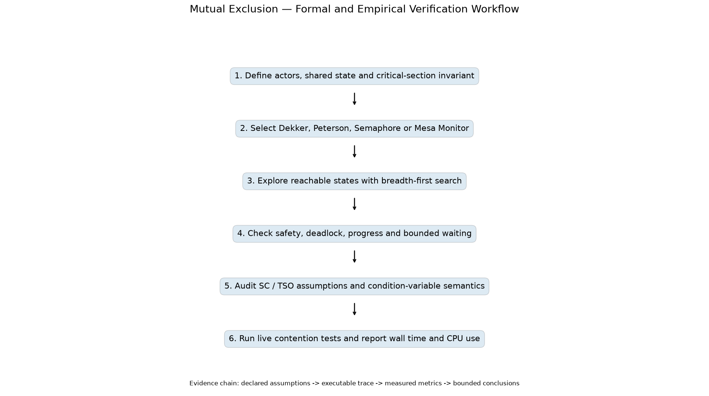

# Exercise 4 — Comprehensive Comparative Study: Dekker, Peterson, Semaphore & Monitor

Rigorous 40+ page bilingual (`EN` + `FA`) investigation comparing **Dekker (1962)**, **Peterson (1981)**, **Dijkstra Semaphore (1965)**, and **Hoare/Mesa Monitor (1974)** across formal BFS state-space verification, hardware memory ordering, live OS threading overhead, energy/CPU burn, multi-thread scalability, and bounded-buffer condition synchronization.

## Key Empirical Highlights
- **Formal BFS Model Checking (10 Models)**:
  - `Dekker v5`: `134` reachable states (`0` errors) vs. failed `v1` (strict alternation), `v2` (`1` CS violation), `v3` (`1` deadlock), and `v4` (`22` livelock spin edges).
  - `Peterson (SC)` shrinks reachable states **3.2×** (`42` vs `134` states). Under x86 TSO store-buffer reordering without memory barriers, Peterson fails in **`8` out of `200` reachable states**!
  - `Mesa Monitor`: replacing `while (!cond)` with `if (!cond)` leaks **`6` buffer-underflow error states**.
- **Busy-Wait CPU Burn Audit (`10 ms` hold delay)**:
  - `Peterson` & `Dekker` burn **`~396–403 ms`** of CPU (**`97.8%`** core waste), whereas blocking `Semaphore` & `Monitor` consume only **`~2.0 ms`** of CPU (**`~1%`** core — nearly **200× less CPU time!**).
- **Multi-Thread Scalability (`N = 2, 4, 8`)**:
  - `O(N)` Filter Lock drops sharply to **`206k–240k ops/s`** at `N = 8`, whereas `Tournament Dekker (O(log N))`, `Semaphore`, and `Monitor` sustain **`580k–733k ops/s`**.

## Deliverables & Reproduction
- `code/sync_primitives.py`, `code/run_experiments.py`, `code/plot_diagrams.py`
- `output/experiments.json`, `diagrams/` (`10` Okabe-Ito PNGs)
- `REPORT_EN.md`, `docs/REPORT_EN.{pdf,docx}` (**43 pages**), `REPORT_FA.md`, `docs/REPORT_FA.{pdf,docx}` (**42 pages**)

```bash
python3 exercise-4/code/run_experiments.py
python3 exercise-4/code/plot_diagrams.py
python3 tools/build_report.py ex4_en exercise-4 REPORT_EN
python3 tools/build_report.py ex4_fa exercise-4 REPORT_FA
python3 -m pytest exercise-4/tests -v
```

## Explicit verification workflow



The extended reports include a source appendix for the synchronization primitives and the BFS/benchmark experiment driver. The workflow separates safety, progress, deadlock/livelock, bounded waiting, memory ordering and empirical timing.


## Final bilingual report counts

- English DOCX/PDF: **43 pages**
- Persian DOCX/PDF: **42 pages**
- The final PDFs were rebuilt with the explicit workflow diagram and source-audited synchronization implementation appendix.
