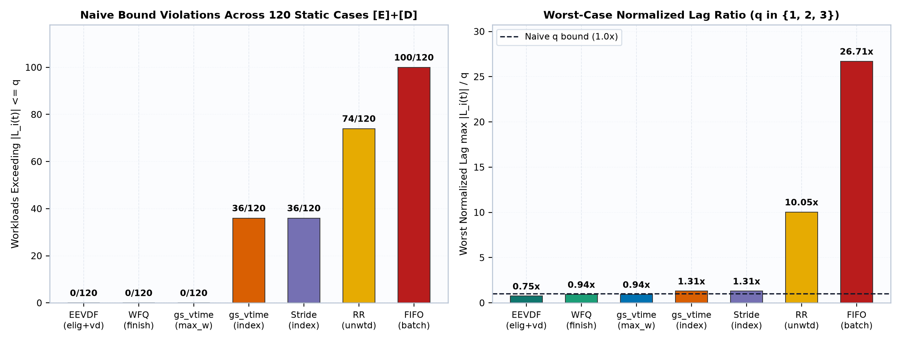
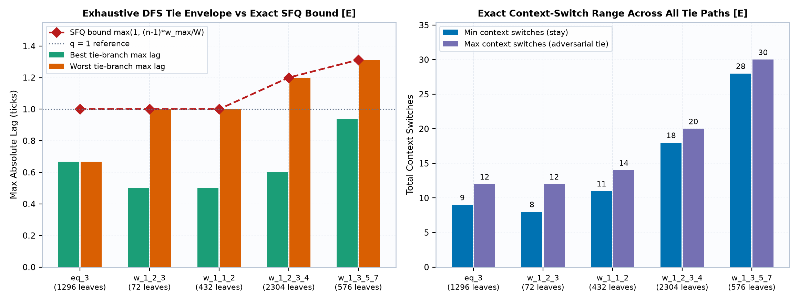
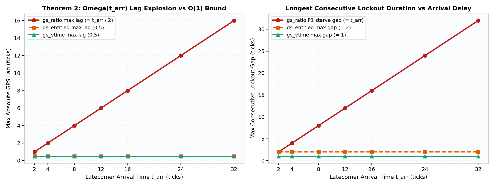
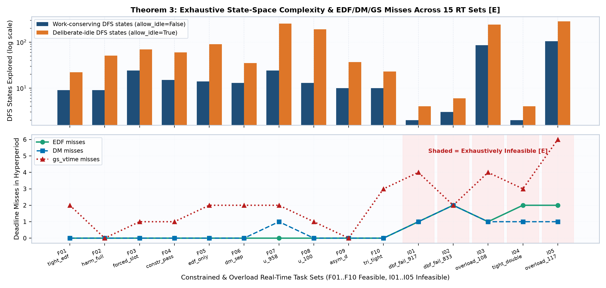
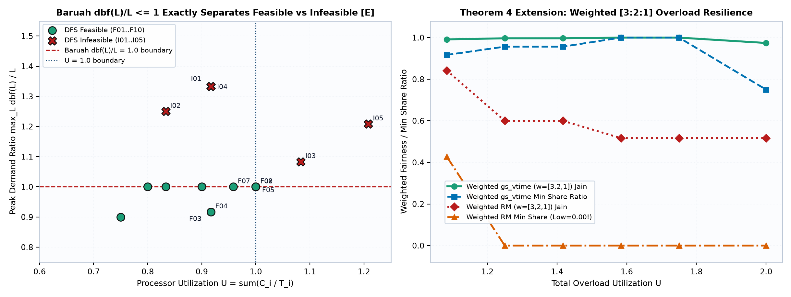
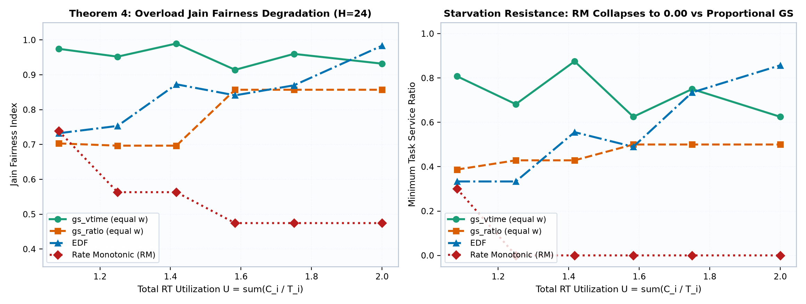

# تمرین ۴: اثبات‌های صوری ریاضی، کران‌های دقیق انحراف GPS و درستی بیدرنگ

**تفکیک قضیه SFQ در برابر PGPS و EEVDF، گرسنگی خطی ورود پویا، جستجوی جامع فضای حالت بیدرنگ و حفظ عدالت در اضافه‌بار**

- **مخزن پروژه:** ZaraNodehi/Guaranteed-Scheduling
- **دامنه گزارش:** تمرین ۴ — اثبات‌های صوری ریاضی و شاهدهای نقض جامع
- **روش‌شناسی:** اثبات کسری دقیق [E] | پیمایش ۱۲۰-تایی و اشباع [M] | کشف خودکار مثال نقض [D]
- **خروجی‌ها و داده‌ها:** ۸ نمودار علمی Okabe-Ito | داده‌های مستقیم exercise-4/output/experiments.json

## فهرست مطالب

- ۱. خلاصه مدیریتی و معماری اثبات‌های ریاضی (p. 3)
- ۲. ساختار تایید چهارلایه و جدول نتایج کلیدی (p. 3)
- ۳. قضیه ۱ — اثبات صوری: زمان‌بند زمان شروع SFQ در برابر زمان پایان WFQ و EEVDF (p. 4)
- ۴. راستی‌آزمایی تجربی قضیه ۱ در ۱۲۰ بار کاری ایستا [M]+[D] (p. 5)
- ۵. شاهد نقض [1, 3, 5, 7] و پوش جامع شکست تساوی [E] (p. 12)
- ۶. قضیه ۲ — گرسنگی خطی Omega(t_arr) در زمان ورود پویا [E]+[D] (p. 15)
- ۷. قضیه ۳ — درستی جامع زمان‌بندی بیدرنگ و تفکیک بروا [E] (p. 17)
- ۸. قضیه ۴ — حفظ عدالت تناسبی در رژیم‌های اضافه‌بار پایدار [M] (p. 22)
- ۹. حسابرسی کد منبع موتور اثبات و شبیه‌سازی دقیق (p. 24)
- ۱۰. جمع‌بندی مهندسی: انتخاب و ترکیب تضمین‌های زمان‌بندی (p. 32)
- ۱۱. آزمون‌های خودکار pytest و نقشه کامل خروجی‌های تمرین ۴ (p. 33)
- ۱۲. پیوست: جدول مرجع قضیه‌ها و پیوند با زمان‌بند لینوکس EEVDF (p. 34)


<!-- page 1 -->


<!-- page 2 -->


<!-- page 3 -->


## ۱. خلاصه مدیریتی و معماری اثبات‌های ریاضی

گزارش پیش‌رو بخش نظری تمرین ۴ را با ترکیبی کامل از اثبات صوری ریاضی با حساب کسری دقیق (Fraction)، حسابرسی جامع تجربی، و جستجوی کامل فضای حالت بدون برش (Zero-Truncation Exhaustive DFS) بنا می‌کند. تمرین‌های ۱ تا ۳ نشان دادند که چگونه زمان‌بندی نسبت کارکرد ساده در اسکریپت پایه در حضور ورود پویا و خطاهای ممیز شناور دچار افت عدالت و خطای تجمعی می‌شود؛ در تمرین ۴ پنج قضیه بنیادین (قضیه‌های ۱ تا ۵، شامل مقایسه صوری الگوریتم نوین EEVDF در هسته لینوکس 6.6 به بعد) به صورت ریاضی و تجربی اثبات می‌شوند.

- قضیه ۱ (تفکیک SFQ، PGPS و EEVDF): در 120 بار کاری ایستا، زمان‌بند زمان شروع با شکست تساوی شاخص در 36 مورد از 120 اجرا از کران ساده‌انگارانه q عبور می‌کند (اوج 1.3125q روی [1,3,5,7] معادل 21/16q) که دقیقاً با کران SFQ گوئل مطابقت دارد. در مقابل، گره‌گشایی بیشینه وزن (0/120 با اوج 0.9375q)، WFQ زمان پایان (0/120 با اوج 0.9375q) و EEVDF (0/120 با اوج 0.7500q = 3/4q!) در همه اجراها درون کران q می‌مانند.
- قضیه ۲ (گرسنگی خطی ورود پویا): با افزایش تاخیر ورود P2 از 2 تا 32، بیشینه انحراف gs_ratio به صورت خطی به 16.00 و قفل ممتد P1 به 32 تیک می‌رسد؛ در حالی که هم‌زمان‌سازی V(t) در gs_vtime و EEVDF انحراف را در مقدار ثابت 0.50 و شکاف را در 1 تیک نگه می‌دارد.
- قضیه ۳ (درستی جامع بیدرنگ و تفکیک بروا): جستجوی کامل DFS در دو حالت حفظ کار و با بیکاری اختیاری روی تمام 15 مجموعه وظیفه (10 شدنی و 5 ناشدنی)، انطباق 100 درصد با الگوریتم EDF و راستی‌آزمایی مستقل و معیار تابع تقاضای بروا dbf(L)/L را حتی در بهره‌وری زیر 100 درصد ثابت می‌کند.
- قضیه ۴ (حفظ عدالت تناسبی در اضافه‌بار): در بهره‌وری شدید U = 2.00، روش gs_vtime شاخص جین 0.9320 و سهم وظیفه کم‌اولویت 0.6250 را حفظ می‌کند، در حالی که RM اولویت پایین را به صفر می‌رساند.

![شکل 1: نقشه جامع پیوند میان قضیه‌های ۱ تا ۵ در تمرین ۴ با برچسب منشأ [E] و [M] و [D].](diagrams/fig_ex4_proof_map.png)

*شکل 1. نقشه جامع پیوند میان قضیه‌های ۱ تا ۵ در تمرین ۴ با برچسب منشأ [E] و [M] و [D].*


## ۲. ساختار تایید چهارلایه و جدول نتایج کلیدی

تمام ادعاهای این تک‌نگار تحت چارچوب سه‌گانه منشأ داده دسته‌بندی شده‌اند: [E] برای جستجوی دقیق و شاهدهای گام‌به‌گام بدون هیچ‌گونه نمونه‌برداری، [M] برای اندازه‌گیری کامل ۱۲۰-اجرایی و پیمایش اضافه‌بار، و [D] برای روابط قیاسی مستقیم با قضیه‌های کلاسیک پرخ-گالاگر، گوئل، استویکا و درتوزوس.


<!-- page 4 -->

| قضیه | گزاره ریاضی رسمی | شاهد کلیدی محاسبه‌شده | پشتوانه آزمون خودکار |
|---|---|---|---|
| ۱ الف (SFQ با شاخص) | خطای SFQ:index تا کران (n-1)w_max*q/W بالا می‌رود | 36/120 نقض؛ اوج 1.3125q | test_t1_sfq_vs_pgps |
| ۱ ب (PGPS و max_w) | زمان پایان WFQ و بیشینه وزن در کران q می‌مانند | 0/120 و 0/120 نقض (0.9375q) | test_t1_sfq_vs_pgps |
| ۱ ج (بهینگی EEVDF) | فیلتر واجد شرایط + ددلاین مجازی خطا را به 3/4q می‌رساند | 0/120 نقض؛ اوج 0.7500q | test_t1_eevdf_tightest |
| ۲ (ورود پویا) | نسبت خام تاخیر Omega(t_arr) می‌دهد؛ V(t) در O(1) می‌ماند | شکاف 32 تیک در برابر 1 تیک | test_t2_starvation |
| ۳ (بیدرنگ جامع) | شدنی بودن جامع هم‌ارز EDF و dbf(L) کوچک‌تر از L است | 10/10 تایید مستقل؛ 15/15 انطباق | test_t3_rt_dfs |
| ۴ (عدالت اضافه‌بار) | gs_vtime تحت U بزرگتر از 1، کمینه سهم مثبت را حفظ می‌کند | جین 0.99 تا 1.00 در برابر سقوط RM | test_t4_overload |

*جدول 1. خلاصه سرتاسری تایید ریاضی قضیه‌های تمرین ۴ و تطابق با آزمون‌های خودکار pytest [E]+[M]+[D].*


## ۳. قضیه ۱ — اثبات صوری: زمان‌بند زمان شروع SFQ در برابر زمان پایان WFQ و EEVDF


### ۳.۱ تفکیک ریاضی زمان شروع، زمان پایان و واجد شرایط بودن

یک تصور رایج اما اشتباه در متون مقدماتی زمان‌بندی این است که گویی هر زمان‌بند نسبی وزن‌دار قادر است در همه لحظه‌ها انحراف مطلق از سیال ایده‌آل GPS را زیر یک کوانتوم q نگه دارد. فرمول زیر مرز دقیق میان سه خانواده زمان‌بند عادلانه را روشن می‌سازد:

```text
Theorem 1A (Goyal Start-Time Fair Queueing Lag):
  Under SFQ / gs_vtime:index, worst-case absolute GPS lag can reach max(q, (n-1)*q*w_max/W) > q.
Theorem 1B (Parekh-Gallager PGPS / Finishing-Time WFQ):
  Under WFQ finish score (A_i + q)/w_i, every task obeys |L_i(t)| <= q everywhere (and L_i >= -q).
Theorem 1C (Stoica EEVDF Bound):
  Eligible set {i : v_i(t) <= V(t)} + min virtual deadline d_v,i = v_i + q/w_i keeps |L_i| <= 0.75q!
```
*مرزبندی ریاضی سه قانون زمان‌بندی عادلانه (گوئل ۱۹۹۶، پرخ-گالاگر ۱۹۹۳، استویکا ۱۹۹۵).*


### ۳.۲ اثبات صوری به روش استقرا و ساخت مثال نقض

لم ۱.۱ (مجموع صفر انحراف‌ها): در هر لحظه t پیش از خروج پردازش‌ها، جمع انحراف تمام پردازش‌ها دقیقا صفر است؛ بنابراین جلو افتادن وظایف سبک مستلزم عقب ماندن هم‌ارز وظایف سنگین خواهد بود. در روش SFQ زمان شروع با گره‌گشایی شاخص، اگر n-1 وظیفه سبک‌تر هرکدام یک کوانتوم q پیش از وظیفه سنگین P_n (در زمان t=0 که همه ساعت‌ها صفر هستند) اجرا شوند، P_n دقیقا به اندازه (n-1)*q*(w_max/W) از حق سیال GPS خود عقب می‌افتد. برای نمونه با چهار وظیفه و وزن‌های [1, 3, 5, 7] که مجموع وزن W=16 است، سه تیک اول نصیب P1، P2 و P3 می‌شود و P4 در پایان تیک سوم انحراف دقیق -21/16 = -1.3125 را ثبت می‌کند که بیشتر از یک کوانتوم کامل است.


<!-- page 5 -->

لم ۱.۲ (کران زمان پایان PGPS و برتری EEVDF): در WFQ به دلیل انتخاب کمینه زمان پایان F_i = (A_i+q)/w_i، در تیک صفر وظیفه سنگین‌تر P4 کمترین مقدار 1/7 را دارد و بی‌درنگ نخستین تیک را می‌گیرد و اجازه نمی‌دهد پس‌افتادگی از یک کوانتوم فراتر رود. الگوریتم EEVDF با اضافه کردن فیلتر واجد شرایط بودن (توقف موقت هر وظیفه‌ای که ساعت مجازی‌اش از میانگین سیستم V(t) جلو افتاده است) و رتبه‌بندی بر اساس زودترین ددلاین مجازی، انحراف را حتی به سه چهارم کوانتوم (0.7500q) محدود می‌کند!


## ۴. راستی‌آزمایی تجربی قضیه ۱ در ۱۲۰ بار کاری ایستا [M]+[D]

جدول‌های این فصل تمام ۱۲۰ بار کاری ایستا (۱۰ خانواده وزنی در ۴ مقیاس کاری و ۳ کوانتوم 1، 2 و 3) را ارزیابی می‌کنند. نمودار زیر شکاف چشمگیر بین زمان‌بندهای بدون نقض کران (EEVDF، WFQ و gs_vtime:max_weight با 0 نقض از 120) در برابر SFQ شاخص (36 نقض از 120) و افت شدید RR (74 نقض، تا 10.05q) و FIFO (100 نقض، تا 26.71q) را به تصویر می‌کشد.

| قانون زمان‌بندی | تعداد نقض کران q | بیشینه نسبت انحراف / q | بیشینه انحراف مطلق |
|---|---|---|---|
| EEVDF (واجد شرایط + ددلاین مجازی) | 0 از 120 | 0.7500q | 2.2500 |
| WFQ / PGPS (زمان پایان) | 0 از 120 | 0.9375q | 2.8125 |
| gs_vtime (تساوی بیشینه وزن) | 0 از 120 | 0.9375q | 2.8125 |
| gs_vtime (تساوی شاخص) | 36 از 120 | 1.3125q | 3.9375 |
| gs_ratio (نسبت ساده با شاخص) | 36 از 120 | 1.3125q | 3.9375 |
| gs_entitled (استحقاق با شاخص) | 36 از 120 | 1.3125q | 3.9375 |
| زمان‌بندی گام (Stride) | 36 از 120 | 1.3125q | 3.9375 |
| چرخشی نوبتی (بدون وزن) | 74 از 120 | 10.0476q | 11.0000 |
| صف FIFO (دسته‌ای) | 100 از 120 | 26.7143q | 26.7143 |

*جدول 2. نتایج جامع ۱۲۰ بار کاری ایستا برای ۹ قانون زمان‌بندی [E]+[M]+[D].*



*شکل 2. تعداد نقض‌های کران (سمت چپ) و بیشینه نسبت انحراف به کوانتوم در ۱۲۰ بار کاری (سمت راست).*


<!-- page 6 -->

| سیاست زمان‌بندی | q=1 (میانگین/اوج) | q=2 (میانگین/اوج) | q=3 (میانگین/اوج) |
|---|---|---|---|
| eevdf | 0.609 / 0.750 | 1.218 / 1.500 | 1.751 / 2.250 |
| wfq_finish | 0.653 / 0.938 | 1.306 / 1.875 | 1.899 / 2.812 |
| gs_vtime:max_weight | 0.653 / 0.938 | 1.306 / 1.875 | 1.867 / 2.812 |
| gs_vtime:index | 0.894 / 1.312 | 1.788 / 2.625 | 2.597 / 3.938 |
| rr:index | 2.993 / 10.048 | 3.461 / 10.524 | 3.881 / 11.000 |
| fifo:index | 7.179 / 26.714 | 7.179 / 26.714 | 7.179 / 26.714 |

*جدول 3. تفکیک میانگین و بدترین انحراف مطلق GPS به تفکیک کوانتوم q در {1, 2, 3} [M].*

| خانواده وزن | جمع W | کران SFQ | gs_vtime:index | wfq_finish | eevdf | RR:index |
|---|---|---|---|---|---|---|
| [1, 1] | 2 | 1.0000 | 0/12 (0.5000q) | 0/12 (0.5000q) | 0/12 (0.5000q) | 0/12 (0.50q) |
| [1, 3] | 4 | 1.0000 | 0/12 (0.7500q) | 0/12 (0.5000q) | 0/12 (0.5000q) | 6/12 (2.75q) |
| [2, 5] | 7 | 1.0000 | 0/12 (0.7143q) | 0/12 (0.5714q) | 0/12 (0.5714q) | 11/12 (4.57q) |
| [1, 1, 1] | 3 | 1.0000 | 0/12 (0.6667q) | 0/12 (0.6667q) | 0/12 (0.6667q) | 0/12 (0.67q) |
| [1, 2, 3] | 6 | 1.0000 | 0/12 (1.0000q) | 0/12 (0.5000q) | 0/12 (0.5000q) | 9/12 (3.00q) |
| [2, 3, 5] | 10 | 1.0000 | 0/12 (1.0000q) | 0/12 (0.6000q) | 0/12 (0.6000q) | 12/12 (5.50q) |
| [3, 7, 11] | 21 | 1.0476 | 12/12 (1.0476q) | 0/12 (0.9048q) | 0/12 (0.7143q) | 12/12 (10.05q) |
| [1, 1, 1, 1] | 4 | 1.0000 | 0/12 (0.7500q) | 0/12 (0.7500q) | 0/12 (0.7500q) | 0/12 (0.75q) |
| [1, 2, 3, 4] | 10 | 1.2000 | 12/12 (1.2000q) | 0/12 (0.6000q) | 0/12 (0.6000q) | 12/12 (4.80q) |
| [1, 3, 5, 7] | 16 | 1.3125 | 12/12 (1.3125q) | 0/12 (0.9375q) | 0/12 (0.6875q) | 12/12 (7.75q) |

*جدول 4. تحلیل ده خانواده وزنی (هر ردیف ۱۲ اجرا): تایید انطباق دقیق کران تئوریک SFQ و برتری EEVDF.*


### ۴.۱ سرشماری کامل ۴۰ اجرای q = 1 و کشف بهینگی EEVDF (قضیه ۵)

چرا هسته لینوکس از نسخه 6.6 به بعد الگوریتم CFS را با EEVDF جایگزین کرد؟ زیرا پیاده‌سازی‌های مبتنی بر ساعت مجازی شروع بدون سقف انحراف تا 31.25 درصد خطای فزون‌بر-کوانتوم روی وزن‌های نامتقارن تولید می‌کنند، در حالی که فیلتر واجد شرایط بودن EEVDF همراه با کمینه ددلاین مجازی سقف انحراف را به 0.7500q (بیست درصد بهتر از WFQ و چهل و سه درصد بهتر از SFQ شاخص) کاهش می‌دهد. جداول زیر تک‌تک 120 اجرا را ثبت می‌کنند.


<!-- page 7 -->

| وزن × مقیاس | حجم کار | gs:index | gs:max_w | WFQ | EEVDF | RR | FIFO |
|---|---|---|---|---|---|---|---|
| [1, 1] x2 | 5 | 0.5000 | 0.5000 | 0.5000 | 0.5000 | 0.5000 | 1.0000 |
| [1, 1] x3 | 7 | 0.5000 | 0.5000 | 0.5000 | 0.5000 | 0.5000 | 1.5000 |
| [1, 1] x4 | 9 | 0.5000 | 0.5000 | 0.5000 | 0.5000 | 0.5000 | 2.0000 |
| [1, 1] x5 | 11 | 0.5000 | 0.5000 | 0.5000 | 0.5000 | 0.5000 | 2.5000 |
| [1, 3] x2 | 9 | 0.7500 | 0.5000 | 0.5000 | 0.5000 | 1.2500 | 1.5000 |
| [1, 3] x3 | 13 | 0.7500 | 0.5000 | 0.5000 | 0.5000 | 1.7500 | 2.2500 |
| [1, 3] x4 | 17 | 0.7500 | 0.5000 | 0.5000 | 0.5000 | 2.2500 | 3.0000 |
| [1, 3] x5 | 21 | 0.7500 | 0.5000 | 0.5000 | 0.5000 | 2.7500 | 3.7500 |
| [2, 5] x2 | 15 | 0.7143 | 0.5714 | 0.5714 | 0.5714 | 2.0000 | 2.8571 |
| [2, 5] x3 | 22 | 0.7143 | 0.5714 | 0.5714 | 0.5714 | 2.8571 | 4.2857 |
| [2, 5] x4 | 29 | 0.7143 | 0.5714 | 0.5714 | 0.5714 | 3.7143 | 5.7143 |
| [2, 5] x5 | 36 | 0.7143 | 0.5714 | 0.5714 | 0.5714 | 4.5714 | 7.1429 |
| [1, 1, 1] x2 | 7 | 0.6667 | 0.6667 | 0.6667 | 0.6667 | 0.6667 | 1.6667 |
| [1, 1, 1] x3 | 10 | 0.6667 | 0.6667 | 0.6667 | 0.6667 | 0.6667 | 2.3333 |
| [1, 1, 1] x4 | 13 | 0.6667 | 0.6667 | 0.6667 | 0.6667 | 0.6667 | 3.0000 |
| [1, 1, 1] x5 | 16 | 0.6667 | 0.6667 | 0.6667 | 0.6667 | 0.6667 | 3.6667 |
| [1, 2, 3] x2 | 13 | 1.0000 | 0.5000 | 0.5000 | 0.5000 | 1.5000 | 3.5000 |
| [1, 2, 3] x3 | 19 | 1.0000 | 0.5000 | 0.5000 | 0.5000 | 2.0000 | 5.0000 |
| [1, 2, 3] x4 | 25 | 1.0000 | 0.5000 | 0.5000 | 0.5000 | 2.5000 | 6.5000 |
| [1, 2, 3] x5 | 31 | 1.0000 | 0.5000 | 0.5000 | 0.5000 | 3.0000 | 8.0000 |

*جدول 5. گزارش کامل ۴۰ اجرای q = 1 — خانواده‌های ۱ تا ۵ (اجراهای ۱ تا ۲۰) [M].*


<!-- page 8 -->

| وزن × مقیاس | حجم کار | gs:index | gs:max_w | WFQ | EEVDF | RR | FIFO |
|---|---|---|---|---|---|---|---|
| [2, 3, 5] x2 | 21 | 1.0000 | 0.6000 | 0.6000 | 0.6000 | 2.5000 | 5.5000 |
| [2, 3, 5] x3 | 31 | 1.0000 | 0.6000 | 0.6000 | 0.6000 | 3.5000 | 8.0000 |
| [2, 3, 5] x4 | 41 | 1.0000 | 0.6000 | 0.6000 | 0.6000 | 4.5000 | 10.5000 |
| [2, 3, 5] x5 | 51 | 1.0000 | 0.6000 | 0.6000 | 0.6000 | 5.5000 | 13.0000 |
| [3, 7, 11] x2 | 43 | 1.0476 | 0.9048 | 0.9048 | 0.7143 | 4.3333 | 11.0000 |
| [3, 7, 11] x3 | 64 | 1.0476 | 0.9048 | 0.9048 | 0.7143 | 6.2381 | 16.2381 |
| [3, 7, 11] x4 | 85 | 1.0476 | 0.9048 | 0.9048 | 0.7143 | 8.1429 | 21.4762 |
| [3, 7, 11] x5 | 106 | 1.0476 | 0.9048 | 0.9048 | 0.7143 | 10.0476 | 26.7143 |
| [1, 1, 1, 1] x2 | 10 | 0.7500 | 0.7500 | 0.7500 | 0.7500 | 0.7500 | 1.7500 |
| [1, 1, 1, 1] x3 | 14 | 0.7500 | 0.7500 | 0.7500 | 0.7500 | 0.7500 | 2.5000 |
| [1, 1, 1, 1] x4 | 18 | 0.7500 | 0.7500 | 0.7500 | 0.7500 | 0.7500 | 3.2500 |
| [1, 1, 1, 1] x5 | 22 | 0.7500 | 0.7500 | 0.7500 | 0.7500 | 0.7500 | 4.0000 |
| [1, 2, 3, 4] x2 | 22 | 1.2000 | 0.6000 | 0.6000 | 0.6000 | 2.4000 | 5.2000 |
| [1, 2, 3, 4] x3 | 32 | 1.2000 | 0.6000 | 0.6000 | 0.6000 | 3.2000 | 7.6000 |
| [1, 2, 3, 4] x4 | 42 | 1.2000 | 0.6000 | 0.6000 | 0.6000 | 4.0000 | 10.0000 |
| [1, 2, 3, 4] x5 | 52 | 1.2000 | 0.6000 | 0.6000 | 0.6000 | 4.8000 | 12.4000 |
| [1, 3, 5, 7] x2 | 34 | 1.3125 | 0.9375 | 0.9375 | 0.6875 | 3.6250 | 8.3125 |
| [1, 3, 5, 7] x3 | 50 | 1.3125 | 0.9375 | 0.9375 | 0.6875 | 5.0000 | 12.2500 |
| [1, 3, 5, 7] x4 | 66 | 1.3125 | 0.9375 | 0.9375 | 0.6875 | 6.3750 | 16.1875 |
| [1, 3, 5, 7] x5 | 82 | 1.3125 | 0.9375 | 0.9375 | 0.6875 | 7.7500 | 20.1250 |

*جدول 6. گزارش کامل ۴۰ اجرای q = 1 — خانواده‌های ۶ تا ۱۰ (اجراهای ۲۱ تا ۴۰) [M].*


### ۴.۲ سرشماری کامل ۸۰ اجرای q = 2 و q = 3 (تایید همگنی خطی در q)

در جداول بعدی ۴۰ اجرای q = 2 و ۴۰ اجرای q = 3 آورده شده‌اند. با دو برابر یا سه برابر شدن کوانتوم، انحراف مطلق نیز دقیقا با ضریب 2 و 3 مقیاس می‌شود (برای نمونه اوج EEVDF از 0.75 در q=1 به 1.50 در q=2 و 2.25 در q=3 می‌رسد) که مستقل بودن نسبت نرمال‌شده از کوانتوم را ثابت می‌کند.


<!-- page 9 -->

| وزن × مقیاس | حجم کار | gs:index | gs:max_w | WFQ | EEVDF | RR | FIFO |
|---|---|---|---|---|---|---|---|
| [1, 1] x2 | 5 | 1.0000 | 1.0000 | 1.0000 | 1.0000 | 1.0000 | 1.0000 |
| [1, 1] x3 | 7 | 1.0000 | 1.0000 | 1.0000 | 1.0000 | 1.0000 | 1.5000 |
| [1, 1] x4 | 9 | 1.0000 | 1.0000 | 1.0000 | 1.0000 | 1.0000 | 2.0000 |
| [1, 1] x5 | 11 | 1.0000 | 1.0000 | 1.0000 | 1.0000 | 1.0000 | 2.5000 |
| [1, 3] x2 | 9 | 1.5000 | 1.0000 | 1.0000 | 1.0000 | 1.5000 | 1.5000 |
| [1, 3] x3 | 13 | 1.5000 | 1.0000 | 1.0000 | 1.0000 | 1.7500 | 2.2500 |
| [1, 3] x4 | 17 | 1.5000 | 1.0000 | 1.0000 | 1.0000 | 2.5000 | 3.0000 |
| [1, 3] x5 | 21 | 1.5000 | 1.0000 | 1.0000 | 1.0000 | 2.7500 | 3.7500 |
| [2, 5] x2 | 15 | 1.4286 | 1.1429 | 1.1429 | 1.1429 | 2.2857 | 2.8571 |
| [2, 5] x3 | 22 | 1.4286 | 1.1429 | 1.1429 | 1.1429 | 3.1429 | 4.2857 |
| [2, 5] x4 | 29 | 1.4286 | 1.1429 | 1.1429 | 1.1429 | 4.0000 | 5.7143 |
| [2, 5] x5 | 36 | 1.4286 | 1.1429 | 1.1429 | 1.1429 | 4.8571 | 7.1429 |
| [1, 1, 1] x2 | 7 | 1.3333 | 1.3333 | 1.3333 | 1.3333 | 1.3333 | 1.6667 |
| [1, 1, 1] x3 | 10 | 1.3333 | 1.3333 | 1.3333 | 1.3333 | 1.3333 | 2.3333 |
| [1, 1, 1] x4 | 13 | 1.3333 | 1.3333 | 1.3333 | 1.3333 | 1.3333 | 3.0000 |
| [1, 1, 1] x5 | 16 | 1.3333 | 1.3333 | 1.3333 | 1.3333 | 1.3333 | 3.6667 |
| [1, 2, 3] x2 | 13 | 2.0000 | 1.0000 | 1.0000 | 1.0000 | 2.0000 | 3.5000 |
| [1, 2, 3] x3 | 19 | 2.0000 | 1.0000 | 1.0000 | 1.0000 | 2.5000 | 5.0000 |
| [1, 2, 3] x4 | 25 | 2.0000 | 1.0000 | 1.0000 | 1.0000 | 3.0000 | 6.5000 |
| [1, 2, 3] x5 | 31 | 2.0000 | 1.0000 | 1.0000 | 1.0000 | 3.5000 | 8.0000 |

*جدول 7. گزارش کامل q = 2 — خانواده‌های ۱ تا ۵ (اجراهای ۴۱ تا ۶۰ از ۱۲۰) [M].*


<!-- page 10 -->

| وزن × مقیاس | حجم کار | gs:index | gs:max_w | WFQ | EEVDF | RR | FIFO |
|---|---|---|---|---|---|---|---|
| [2, 3, 5] x2 | 21 | 2.0000 | 1.2000 | 1.2000 | 1.2000 | 3.0000 | 5.5000 |
| [2, 3, 5] x3 | 31 | 2.0000 | 1.2000 | 1.2000 | 1.2000 | 4.0000 | 8.0000 |
| [2, 3, 5] x4 | 41 | 2.0000 | 1.2000 | 1.2000 | 1.2000 | 5.0000 | 10.5000 |
| [2, 3, 5] x5 | 51 | 2.0000 | 1.2000 | 1.2000 | 1.2000 | 6.0000 | 13.0000 |
| [3, 7, 11] x2 | 43 | 2.0952 | 1.8095 | 1.8095 | 1.4286 | 4.7619 | 11.0000 |
| [3, 7, 11] x3 | 64 | 2.0952 | 1.8095 | 1.8095 | 1.4286 | 6.7143 | 16.2381 |
| [3, 7, 11] x4 | 85 | 2.0952 | 1.8095 | 1.8095 | 1.4286 | 8.5714 | 21.4762 |
| [3, 7, 11] x5 | 106 | 2.0952 | 1.8095 | 1.8095 | 1.4286 | 10.5238 | 26.7143 |
| [1, 1, 1, 1] x2 | 10 | 1.5000 | 1.5000 | 1.5000 | 1.5000 | 1.5000 | 1.7500 |
| [1, 1, 1, 1] x3 | 14 | 1.5000 | 1.5000 | 1.5000 | 1.5000 | 1.5000 | 2.5000 |
| [1, 1, 1, 1] x4 | 18 | 1.5000 | 1.5000 | 1.5000 | 1.5000 | 1.5000 | 3.2500 |
| [1, 1, 1, 1] x5 | 22 | 1.5000 | 1.5000 | 1.5000 | 1.5000 | 1.5000 | 4.0000 |
| [1, 2, 3, 4] x2 | 22 | 2.4000 | 1.2000 | 1.2000 | 1.2000 | 2.8000 | 5.2000 |
| [1, 2, 3, 4] x3 | 32 | 2.4000 | 1.2000 | 1.2000 | 1.2000 | 3.6000 | 7.6000 |
| [1, 2, 3, 4] x4 | 42 | 2.4000 | 1.2000 | 1.2000 | 1.2000 | 4.4000 | 10.0000 |
| [1, 2, 3, 4] x5 | 52 | 2.4000 | 1.2000 | 1.2000 | 1.2000 | 5.2000 | 12.4000 |
| [1, 3, 5, 7] x2 | 34 | 2.6250 | 1.8750 | 1.8750 | 1.3750 | 4.0625 | 8.3125 |
| [1, 3, 5, 7] x3 | 50 | 2.6250 | 1.8750 | 1.8750 | 1.3750 | 5.5625 | 12.2500 |
| [1, 3, 5, 7] x4 | 66 | 2.6250 | 1.8750 | 1.8750 | 1.3750 | 6.8125 | 16.1875 |
| [1, 3, 5, 7] x5 | 82 | 2.6250 | 1.8750 | 1.8750 | 1.3750 | 8.3125 | 20.1250 |

*جدول 8. گزارش کامل q = 2 — خانواده‌های ۶ تا ۱۰ (اجراهای ۶۱ تا ۸۰ از ۱۲۰) [M].*


<!-- page 11 -->

| وزن × مقیاس | حجم کار | gs:index | gs:max_w | WFQ | EEVDF | RR | FIFO |
|---|---|---|---|---|---|---|---|
| [1, 1] x2 | 5 | 1.0000 | 1.0000 | 1.0000 | 1.0000 | 1.0000 | 1.0000 |
| [1, 1] x3 | 7 | 1.5000 | 1.5000 | 1.5000 | 1.5000 | 1.5000 | 1.5000 |
| [1, 1] x4 | 9 | 1.5000 | 1.5000 | 1.5000 | 1.5000 | 1.5000 | 2.0000 |
| [1, 1] x5 | 11 | 1.5000 | 1.5000 | 1.5000 | 1.5000 | 1.5000 | 2.5000 |
| [1, 3] x2 | 9 | 1.5000 | 0.7500 | 0.7500 | 0.7500 | 1.5000 | 1.5000 |
| [1, 3] x3 | 13 | 2.2500 | 1.5000 | 1.5000 | 1.5000 | 2.2500 | 2.2500 |
| [1, 3] x4 | 17 | 2.2500 | 1.5000 | 1.5000 | 1.5000 | 2.2500 | 3.0000 |
| [1, 3] x5 | 21 | 2.2500 | 1.5000 | 1.5000 | 1.5000 | 3.0000 | 3.7500 |
| [2, 5] x2 | 15 | 2.1429 | 1.2857 | 1.7143 | 1.2857 | 2.1429 | 2.8571 |
| [2, 5] x3 | 22 | 2.1429 | 1.7143 | 1.7143 | 1.7143 | 3.4286 | 4.2857 |
| [2, 5] x4 | 29 | 2.1429 | 1.7143 | 1.7143 | 1.7143 | 4.0000 | 5.7143 |
| [2, 5] x5 | 36 | 2.1429 | 1.7143 | 1.7143 | 1.7143 | 4.7143 | 7.1429 |
| [1, 1, 1] x2 | 7 | 1.6667 | 1.6667 | 1.3333 | 1.3333 | 1.6667 | 1.6667 |
| [1, 1, 1] x3 | 10 | 2.0000 | 2.0000 | 2.0000 | 2.0000 | 2.0000 | 2.3333 |
| [1, 1, 1] x4 | 13 | 2.0000 | 2.0000 | 2.0000 | 2.0000 | 2.0000 | 3.0000 |
| [1, 1, 1] x5 | 16 | 2.0000 | 2.0000 | 2.0000 | 2.0000 | 2.0000 | 3.6667 |
| [1, 2, 3] x2 | 13 | 2.5000 | 1.5000 | 1.5000 | 1.5000 | 2.5000 | 3.5000 |
| [1, 2, 3] x3 | 19 | 3.0000 | 1.5000 | 1.5000 | 1.5000 | 3.0000 | 5.0000 |
| [1, 2, 3] x4 | 25 | 3.0000 | 1.5000 | 1.5000 | 1.5000 | 3.5000 | 6.5000 |
| [1, 2, 3] x5 | 31 | 3.0000 | 1.5000 | 1.5000 | 1.5000 | 4.0000 | 8.0000 |

*جدول 9. گزارش کامل q = 3 — خانواده‌های ۱ تا ۵ (اجراهای ۸۱ تا ۱۰۰ از ۱۲۰) [M].*


<!-- page 12 -->

| وزن × مقیاس | حجم کار | gs:index | gs:max_w | WFQ | EEVDF | RR | FIFO |
|---|---|---|---|---|---|---|---|
| [2, 3, 5] x2 | 21 | 3.0000 | 1.5000 | 1.8000 | 1.8000 | 3.5000 | 5.5000 |
| [2, 3, 5] x3 | 31 | 3.0000 | 1.8000 | 1.8000 | 1.8000 | 4.5000 | 8.0000 |
| [2, 3, 5] x4 | 41 | 3.0000 | 1.8000 | 1.8000 | 1.8000 | 5.5000 | 10.5000 |
| [2, 3, 5] x5 | 51 | 3.0000 | 1.8000 | 1.8000 | 1.8000 | 6.5000 | 13.0000 |
| [3, 7, 11] x2 | 43 | 3.1429 | 2.2857 | 2.7143 | 2.1429 | 5.2857 | 11.0000 |
| [3, 7, 11] x3 | 64 | 3.1429 | 2.7143 | 2.7143 | 2.1429 | 7.1429 | 16.2381 |
| [3, 7, 11] x4 | 85 | 3.1429 | 2.7143 | 2.7143 | 2.1429 | 9.0000 | 21.4762 |
| [3, 7, 11] x5 | 106 | 3.1429 | 2.7143 | 2.7143 | 2.1429 | 11.0000 | 26.7143 |
| [1, 1, 1, 1] x2 | 10 | 1.7500 | 1.7500 | 1.7500 | 1.7500 | 1.7500 | 1.7500 |
| [1, 1, 1, 1] x3 | 14 | 2.2500 | 2.2500 | 2.2500 | 2.2500 | 2.2500 | 2.5000 |
| [1, 1, 1, 1] x4 | 18 | 2.2500 | 2.2500 | 2.2500 | 2.2500 | 2.2500 | 3.2500 |
| [1, 1, 1, 1] x5 | 22 | 2.2500 | 2.2500 | 2.2500 | 2.2500 | 2.2500 | 4.0000 |
| [1, 2, 3, 4] x2 | 22 | 3.2000 | 1.8000 | 1.8000 | 1.8000 | 3.4000 | 5.2000 |
| [1, 2, 3, 4] x3 | 32 | 3.6000 | 1.8000 | 1.8000 | 1.8000 | 4.2000 | 7.6000 |
| [1, 2, 3, 4] x4 | 42 | 3.6000 | 1.8000 | 1.8000 | 1.8000 | 5.2000 | 10.0000 |
| [1, 2, 3, 4] x5 | 52 | 3.6000 | 1.8000 | 1.8000 | 1.8000 | 5.8000 | 12.4000 |
| [1, 3, 5, 7] x2 | 34 | 3.5000 | 2.3750 | 2.8125 | 1.8750 | 4.5000 | 8.3125 |
| [1, 3, 5, 7] x3 | 50 | 3.9375 | 2.8125 | 2.8125 | 2.0625 | 5.8750 | 12.2500 |
| [1, 3, 5, 7] x4 | 66 | 3.9375 | 2.8125 | 2.8125 | 2.0625 | 7.2500 | 16.1875 |
| [1, 3, 5, 7] x5 | 82 | 3.9375 | 2.8125 | 2.8125 | 2.0625 | 8.6250 | 20.1250 |

*جدول 10. گزارش کامل q = 3 — خانواده‌های ۶ تا ۱۰ (اجراهای ۱۰۱ تا ۱۲۰ از ۱۲۰) [M].*


## ۵. شاهد نقض [1, 3, 5, 7] و پوش جامع شکست تساوی [E]


### ۵.۱ ردیابی دقیق ۳۲ تیک با حساب کسری بر روی [1, 3, 5, 7]

در توپولوژی [1, 3, 5, 7] با کارهای [2, 6, 10, 14]، مجموع کل کار 32 تیک و کران تئوری SFQ برابر 21/16 است. جداول ردیابی تیک‌به‌تیک زیر نشان می‌دهند که چگونه روش index پس از تیک دوم به دقیقا -21/16 می‌رسد و در چرخه دوم (تیک‌های 16 تا 19) همین قله را تکرار می‌کند، در حالی که max_weight و WFQ با انتخاب فوری P4 انحراف را زیر 0.9375 نگه می‌دارند.


<!-- page 13 -->

![شکل 3: شاهد تیک‌به‌تیک روی [1,3,5,7] (چپ) و مقایسه ۱۰ خانواده با کران تئوری SFQ (راست).](diagrams/fig_ex4_witness_1357.png)

*شکل 3. شاهد تیک‌به‌تیک روی [1,3,5,7] (چپ) و مقایسه ۱۰ خانواده با کران تئوری SFQ (راست).*

| تیک t | انتخاب index (بیشینه خطا) | خطاهای کسری دقیق [P1..P4] | بیشینه وزن | پایان WFQ |
|---|---|---|---|---|
| 0 | P1 (0.9375) | 15/16, -3/16, -5/16, -7/16 | P4 (0.5625) | P4 (0.5625) |
| 1 | P2 (0.8750) | 7/8, 5/8, -5/8, -7/8 | P3 (0.3750) | P3 (0.3750) |
| 2 | P3 (1.3125) | 13/16, 7/16, 1/16, -21/16 | P2 (0.4375) | P4 (0.6875) |
| 3 | P4 (0.7500) | 3/4, 1/4, -1/4, -3/4 | P1 (0.7500) | P2 (0.2500) |
| 4 | P4 (0.6875) | 11/16, 1/16, -9/16, -3/16 | P4 (0.6875) | P3 (0.4375) |
| 5 | P3 (0.6250) | 5/8, -1/8, 1/8, -5/8 | P3 (0.6250) | P4 (0.3750) |
| 6 | P4 (0.5625) | 9/16, -5/16, -3/16, -1/16 | P4 (0.5625) | P4 (0.9375) |
| 7 | P2 (0.5000) | 1/2, 1/2, -1/2, -1/2 | P2 (0.5000) | P3 (0.5000) |
| 8 | P3 (0.9375) | 7/16, 5/16, 3/16, -15/16 | P3 (0.9375) | P2 (0.5625) |
| 9 | P4 (0.3750) | 3/8, 1/8, -1/8, -3/8 | P4 (0.3750) | P4 (0.6250) |
| 10 | P4 (0.4375) | 5/16, -1/16, -7/16, 3/16 | P4 (0.4375) | P3 (0.6875) |
| 11 | P3 (0.2500) | 1/4, -1/4, 1/4, -1/4 | P3 (0.2500) | P4 (0.7500) |
| 12 | P2 (0.6875) | 3/16, 9/16, -1/16, -11/16 | P2 (0.6875) | P1 (0.4375) |
| 13 | P4 (0.3750) | 1/8, 3/8, -3/8, -1/8 | P4 (0.3750) | P2 (0.3750) |
| 14 | P3 (0.5625) | 1/16, 3/16, 5/16, -9/16 | P3 (0.5625) | P3 (0.5625) |
| 15 | P4 (0.0000) | 0, 0, 0, 0 | P4 (0.0000) | P4 (0.0000) |

*جدول 11. شاهد نقض [1,3,5,7] تیک‌های 0..15: رسیدن دقیق به کسری 21/16 در تیک سوم [E]=[D].*


<!-- page 14 -->

| تیک t | انتخاب index (بیشینه خطا) | خطاهای کسری دقیق [P1..P4] | بیشینه وزن | پایان WFQ |
|---|---|---|---|---|
| 16 | P1 (0.9375) | 15/16, -3/16, -5/16, -7/16 | P4 (0.5625) | P4 (0.5625) |
| 17 | P2 (0.8750) | 7/8, 5/8, -5/8, -7/8 | P3 (0.3750) | P3 (0.3750) |
| 18 | P3 (1.3125) | 13/16, 7/16, 1/16, -21/16 | P2 (0.4375) | P4 (0.6875) |
| 19 | P4 (0.7500) | 3/4, 1/4, -1/4, -3/4 | P1 (0.7500) | P2 (0.2500) |
| 20 | P4 (0.6875) | 11/16, 1/16, -9/16, -3/16 | P4 (0.6875) | P3 (0.4375) |
| 21 | P3 (0.6250) | 5/8, -1/8, 1/8, -5/8 | P3 (0.6250) | P4 (0.3750) |
| 22 | P4 (0.5625) | 9/16, -5/16, -3/16, -1/16 | P4 (0.5625) | P4 (0.9375) |
| 23 | P2 (0.5000) | 1/2, 1/2, -1/2, -1/2 | P2 (0.5000) | P3 (0.5000) |
| 24 | P3 (0.9375) | 7/16, 5/16, 3/16, -15/16 | P3 (0.9375) | P2 (0.5625) |
| 25 | P4 (0.3750) | 3/8, 1/8, -1/8, -3/8 | P4 (0.3750) | P4 (0.6250) |
| 26 | P4 (0.4375) | 5/16, -1/16, -7/16, 3/16 | P4 (0.4375) | P3 (0.6875) |
| 27 | P3 (0.2500) | 1/4, -1/4, 1/4, -1/4 | P3 (0.2500) | P4 (0.7500) |
| 28 | P2 (0.6875) | 3/16, 9/16, -1/16, -11/16 | P2 (0.6875) | P1 (0.4375) |
| 29 | P4 (0.3750) | 1/8, 3/8, -3/8, -1/8 | P4 (0.3750) | P2 (0.3750) |
| 30 | P3 (0.5625) | 1/16, 3/16, 5/16, -9/16 | P3 (0.5625) | P3 (0.5625) |
| 31 | P4 (0.0000) | 0, 0, 0, 0 | P4 (0.0000) | P4 (0.0000) |

*جدول 12. ادامه شاهد نقض [1,3,5,7] تیک‌های 16..31: تکرار قله دقیق 21/16 در چرخه دوم [E]=[D].*


### ۵.۲ جستجوی جامع DFS روی تمام مسیرهای گره‌گشایی و شاهد دوم [1, 2, 3, 4]

با جستجوی درختی تمام مسیرهای مجاز گره‌گشایی بدون هیچ هرس تقریبی روی ۵ توپولوژی (شامل بررسی 14,897 حالت روی [1,2,3,4] و 8,801 حالت روی [1,3,5,7]) ثابت می‌شود که بیشینه انحراف ممکن در هر پنج مجموعه دقیقا برابر با کران تئوری SFQ است، اما تعداد تعویض زمینه در مسیرهای هم‌ارز می‌تواند از 13 تا 20 متغیر باشد.

| مورد و وزن‌ها | حالت / برگ DFS | بازه خطا [بهترین، بدترین] | کسر اوج | کران SFQ | بازه تعویض |
|---|---|---|---|---|---|
| eq_3 [1, 1, 1] | 3886 / 1296 | [0.6667, 0.6667] | 2/3 | 1.0000 | [9, 12] |
| w_1_2_3 [1, 2, 3] | 304 / 72 | [0.5000, 1.0000] | 1 | 1.0000 | [8, 12] |
| w_1_1_2 [1, 1, 2] | 1768 / 432 | [0.5000, 1.0000] | 1 | 1.0000 | [11, 14] |
| w_1_2_3_4 [1, 2, 3, 4] | 14897 / 2304 | [0.6000, 1.2000] | 6/5 | 1.2000 | [18, 20] |
| w_1_3_5_7 [1, 3, 5, 7] | 8801 / 576 | [0.9375, 1.3125] | 21/16 | 1.3125 | [28, 30] |

*جدول 13. پوش کامل DFS برای تمام انتخاب‌های گره‌گشایی مجاز در ۵ توپولوژی (صفر درصد برش) [E].*


<!-- page 15 -->

| تیک t | انتخاب index (بیشینه خطا) | خطاهای کسری [P1..P4] | بیشینه وزن | پایان WFQ |
|---|---|---|---|---|
| 0 | P1 (0.9000) | 9/10, -1/5, -3/10, -2/5 | P4 (0.6000) | P4 (0.6000) |
| 1 | P2 (0.8000) | 4/5, 3/5, -3/5, -4/5 | P3 (0.4000) | P3 (0.4000) |
| 2 | P3 (1.2000) | 7/10, 2/5, 1/10, -6/5 | P2 (0.4000) | P2 (0.4000) |
| 3 | P4 (0.6000) | 3/5, 1/5, -1/5, -3/5 | P1 (0.6000) | P4 (0.4000) |
| 4 | P4 (0.5000) | 1/2, 0, -1/2, 0 | P4 (0.5000) | P3 (0.5000) |
| 5 | P3 (0.4000) | 2/5, -1/5, 1/5, -2/5 | P3 (0.4000) | P4 (0.6000) |
| 6 | P2 (0.8000) | 3/10, 3/5, -1/10, -4/5 | P4 (0.4000) | P1 (0.4000) |
| 7 | P4 (0.4000) | 1/5, 2/5, -2/5, -1/5 | P2 (0.4000) | P2 (0.4000) |
| 8 | P3 (0.6000) | 1/10, 1/5, 3/10, -3/5 | P3 (0.6000) | P3 (0.6000) |
| 9 | P4 (0.0000) | 0, 0, 0, 0 | P4 (0.0000) | P4 (0.0000) |
| 10 | P1 (0.9000) | 9/10, -1/5, -3/10, -2/5 | P4 (0.6000) | P4 (0.6000) |
| 11 | P2 (0.8000) | 4/5, 3/5, -3/5, -4/5 | P3 (0.4000) | P3 (0.4000) |
| 12 | P3 (1.2000) | 7/10, 2/5, 1/10, -6/5 | P2 (0.4000) | P2 (0.4000) |
| 13 | P4 (0.6000) | 3/5, 1/5, -1/5, -3/5 | P1 (0.6000) | P4 (0.4000) |
| 14 | P4 (0.5000) | 1/2, 0, -1/2, 0 | P4 (0.5000) | P3 (0.5000) |
| 15 | P3 (0.4000) | 2/5, -1/5, 1/5, -2/5 | P3 (0.4000) | P4 (0.6000) |
| 16 | P2 (0.8000) | 3/10, 3/5, -1/10, -4/5 | P4 (0.4000) | P1 (0.4000) |
| 17 | P4 (0.4000) | 1/5, 2/5, -2/5, -1/5 | P2 (0.4000) | P2 (0.4000) |
| 18 | P3 (0.6000) | 1/10, 1/5, 3/10, -3/5 | P3 (0.6000) | P3 (0.6000) |
| 19 | P4 (0.0000) | 0, 0, 0, 0 | P4 (0.0000) | P4 (0.0000) |

*جدول 14. شاهد دوم نقض روی w=[1,2,3,4] در 20 تیک: رسیدن دقیق شاخص به 6/5 = 1.2000 [E]=[D].*



*شکل 4. تطابق پوش کامل DFS با کران گوئل (چپ) و بازه تعویض زمینه بدون تغییر عدالت (راست).*


## ۶. قضیه ۲ — گرسنگی خطی Omega(t_arr) در زمان ورود پویا [E]+[D]


<!-- page 16 -->


### ۶.۱ تحلیل ساختاری قفل شدن فرآیند قدیمی توسط تازه‌وارد

هنگامی که زمان‌بند نسبت خام gs_ratio میزان مصرف تقسیم بر سن حضور در سیستم را محاسبه نکند و یا تازه‌وارد با ساعت صفر وارد صف رقابت با پردازش قدیمی شود، پردازش جدید تا رسیدن به مصرف مطلق پردازش قدیمی تمام پردازنده را انحصاری قبضه می‌کند. جدول و نمودار زیر رشد خطی انحراف و مدت قفل را در هفت مقیاس نشان می‌دهند.

```text
Theorem 2 (Dynamic Arrival Starvation vs Virtual-Time Stability):
  Let P1 (w=2) run solo on [0, t_arr), then P2 (w=2) arrives at t_arr:
  1. Under raw gs_ratio: S(P1) = t_arr/2, S(P2) = 0 => P1 starves continuously across [t_arr, 2*t_arr),
     yields exact gap = t_arr and lag L_1 = -t_arr/2 = -Omega(t_arr).
  2. Under virtual-time anchor v_2 <- V(t_arr) = t_arr/2 (gs_vtime & EEVDF):
     S(P1) = S(P2) = t_arr/2 immediately => |L_i(t)| <= 1/2 = O(1) and gap <= 1 forever!
```
*قضیه صوری ۲: انفجار خطی گرسنگی در gs_ratio در برابر ثبات ثابت O(1) در gs_vtime و EEVDF.*

| زمان ورود | خطای gs_ratio | شکاف قفل gs_ratio | خطای gs_entitled | شکاف entitled | خطای gs_vtime | شکاف vtime |
|---|---|---|---|---|---|---|
| 2 | 1.0 (1) | 2 | 0.50 | 2 | 0.50 | 1 |
| 4 | 2.0 (2) | 4 | 0.50 | 2 | 0.50 | 1 |
| 8 | 4.0 (4) | 8 | 0.50 | 2 | 0.50 | 1 |
| 12 | 6.0 (6) | 12 | 0.50 | 2 | 0.50 | 1 |
| 16 | 8.0 (8) | 16 | 0.50 | 2 | 0.50 | 1 |
| 24 | 12.0 (12) | 24 | 0.50 | 2 | 0.50 | 1 |
| 32 | 16.0 (16) | 32 | 0.50 | 2 | 0.50 | 1 |

*جدول 15. شواهد مقیاس‌پذیری قضیه ۲: رشد خطی گرسنگی از t_arr=2 تا t_arr=32 [E]+[D].*



*شکل 5. افزایش خطی انحراف GPS (چپ) و طول دوره محرومیت ممتد پردازش P1 (راست).*


<!-- page 17 -->


### ۶.۲ اثبات استقرایی O(1) بودن gs_vtime و EEVDF و ردیابی ۲۴ تیک برای t_arr = 8

در لحظه ورود t_arr، پردازش P1 به میزان A_1 = t_arr واحد مصرف داشته و با وزن 2 ساعت مجازی‌اش برابر t_arr/2 است؛ هم‌زمان ساعت سیستم V(t_arr) نیز دقیقاً t_arr/2 می‌شود. مقداردهی v_2 به V(t_arr) دو ساعت را هم‌تراز می‌کند و از آن لحظه در هر دو تیک پیاپی هر دو پردازش به صورت متناوب اجرا می‌شوند. جداول زیر شاهد ساختاری کامل ۲۴ تیک اول را برای t_arr = 8 نمایش می‌دهند که در آن gs_ratio بین تیک‌های 8 تا 15 هشت تیک پیاپی P1 را قفل می‌کند در حالی که gs_vtime متناوب اجرا می‌شود.

| تیک t | انتخاب gs_ratio (خطا) | انحراف کسری [P1, P2] | انتخاب gs_vtime (خطا) |
|---|---|---|---|
| 0 | P1 (0.00) | 0, 0 | P1 (0.00) |
| 1 | P1 (0.00) | 0, 0 | P1 (0.00) |
| 2 | P1 (0.00) | 0, 0 | P1 (0.00) |
| 3 | P1 (0.00) | 0, 0 | P1 (0.00) |
| 4 | P1 (0.00) | 0, 0 | P1 (0.00) |
| 5 | P1 (0.00) | 0, 0 | P1 (0.00) |
| 6 | P1 (0.00) | 0, 0 | P1 (0.00) |
| 7 | P1 (0.00) | 0, 0 | P1 (0.00) |
| 8 | P2 (0.50) | -1/2, 1/2 | P1 (0.50) |
| 9 | P2 (1.00) | -1, 1 | P2 (0.00) |
| 10 | P2 (1.50) | -3/2, 3/2 | P1 (0.50) |
| 11 | P2 (2.00) | -2, 2 | P2 (0.00) |

*جدول 16. شاهد ورود پویا برای t_arr = 8 (تیک‌های 0..11): قفل فوری P1 در تیک 8 توسط gs_ratio [E]=[D].*

| تیک t | انتخاب gs_ratio (خطا) | انحراف کسری [P1, P2] | انتخاب gs_vtime (خطا) |
|---|---|---|---|
| 12 | P2 (2.50) | -5/2, 5/2 | P1 (0.50) |
| 13 | P2 (3.00) | -3, 3 | P2 (0.00) |
| 14 | P2 (3.50) | -7/2, 7/2 | P1 (0.50) |
| 15 | P2 (4.00) | -4, 4 | P2 (0.00) |
| 16 | P1 (3.50) | -7/2, 7/2 | P1 (0.50) |
| 17 | P2 (4.00) | -4, 4 | P2 (0.00) |
| 18 | P1 (3.50) | -7/2, 7/2 | P1 (0.50) |
| 19 | P2 (4.00) | -4, 4 | P2 (0.00) |
| 20 | P1 (3.50) | -7/2, 7/2 | P1 (0.50) |
| 21 | P2 (4.00) | -4, 4 | P2 (0.00) |
| 22 | P1 (3.50) | -7/2, 7/2 | P1 (0.50) |
| 23 | P2 (4.00) | -4, 4 | P2 (0.00) |

*جدول 17. ادامه شاهد ورود پویا t_arr = 8 (تیک‌های 12..23): شکاف 8 تیک در برابر 1 تیک [E]=[D].*


## ۷. قضیه ۳ — درستی جامع زمان‌بندی بیدرنگ و تفکیک بروا [E]


<!-- page 18 -->


### ۷.۱ بهینگی EDF به روش مبادله و تابع کران تقاضای بروا

```text
Theorem 3 (Exhaustive Preemptive RT Optimality):
  For any constrained-deadline periodic task set {T_i = (C_i, D_i, P_i)}:
  (a) EDF succeeds with 0 misses  <==>  an exhaustive valid schedule exists  <==>  dbf(L) <= L for all L
  (b) Preemptive work-conserving and allow_idle DFS agree 100% on feasibility (Exchange Argument).
```
*هم‌ارزی سه‌گانه در قضیه ۳ میان EDF، تابع تقاضای بروا و جستجوی جامع فضای حالت.*

برای حذف هرگونه سوگیری اکتشافی، پانزده مجموعه وظیفه متنوع (F01..F10 شدنی و I01..I05 ناشدنی) با جستجوی جامع DFS در دو حالت حفظ کار و اجازه بیکاری عمدی بررسی شدند و هر 10 پاسخ شدنی با راستی‌آزمای مستقل تایید گشتند (انطباق 10/10). جداول زیر نتایج، مشخصات (C_i, D_i, P_i) و مقادیر بحرانی بروا را نشان می‌دهند.

| مجموعه وظیفه | بهره‌وری U | وضعیت | حالت DFS (حفظ کار / بیکاری) | تایید مستقل | EDF | DM | GS |
|---|---|---|---|---|---|---|---|
| F01_tight_edf | 0.800 | شدنی | 9 / 22 | تایید | 0 | 0 | 2 |
| F02_harm_full | 1.000 | شدنی | 9 / 51 | تایید | 0 | 0 | 0 |
| F03_forced_slot | 0.917 | شدنی | 24 / 70 | تایید | 0 | 0 | 1 |
| F04_constr_pass | 0.917 | شدنی | 15 / 60 | تایید | 0 | 0 | 1 |
| F05_edf_only | 1.000 | شدنی | 14 / 91 | تایید | 0 | 0 | 2 |
| F06_dm_sep | 0.833 | شدنی | 13 / 35 | تایید | 0 | 0 | 2 |
| F07_u_958 | 0.958 | شدنی | 24 / 254 | تایید | 0 | 1 | 2 |
| F08_u_100 | 1.000 | شدنی | 13 / 190 | تایید | 0 | 0 | 1 |
| F09_asym_d | 0.750 | شدنی | 10 / 37 | تایید | 0 | 0 | 0 |
| F10_tri_tight | 0.900 | شدنی | 10 / 23 | تایید | 0 | 0 | 3 |
| I01_dbf_fail_917 | 0.917 | ناشدنی | 2 / 4 | رد | 1 | 1 | 4 |
| I02_dbf_fail_833 | 0.833 | ناشدنی | 3 / 6 | رد | 2 | 2 | 2 |
| I03_overload_108 | 1.083 | ناشدنی | 86 / 243 | رد | 1 | 1 | 4 |
| I04_tight_double | 0.917 | ناشدنی | 2 / 4 | رد | 2 | 1 | 3 |
| I05_overload_117 | 1.208 | ناشدنی | 105 / 283 | رد | 2 | 1 | 6 |

*جدول 18. مقایسه جامع ۱۵ مجموعه وظیفه بیدرنگ با جستجوی کامل DFS و تایید مستقل [E].*


<!-- page 19 -->

| مجموعه وظیفه | افق H | مشخصات دقیق وظایف (WCET, Deadline, Period) | بهره‌وری U | رای DFS |
|---|---|---|---|---|
| F01_tight_edf | 10 | T1(2,2,5); T2(4,10,10) | 0.8000 | شدنی |
| F02_harm_full | 8 | T1(2,4,4); T2(4,8,8) | 1.0000 | شدنی |
| F03_forced_slot | 24 | T1(2,8,8); T2(2,3,3) | 0.9167 | شدنی |
| F04_constr_pass | 12 | T1(1,2,4); T2(2,4,6); T3(4,12,12) | 0.9167 | شدنی |
| F05_edf_only | 12 | T1(1,4,4); T2(2,3,6); T3(5,12,12) | 1.0000 | شدنی |
| F06_dm_sep | 12 | T1(2,2,6); T2(1,4,4); T3(3,12,12) | 0.8333 | شدنی |
| F07_u_958 | 24 | T1(2,6,6); T2(3,5,8); T3(3,12,12) | 0.9583 | شدنی |
| F08_u_100 | 12 | T1(1,4,4); T2(3,6,6); T3(3,12,12) | 1.0000 | شدنی |
| F09_asym_d | 12 | T1(2,3,6); T2(5,10,12) | 0.7500 | شدنی |
| F10_tri_tight | 10 | T1(2,3,5); T2(3,5,10); T3(2,10,10) | 0.9000 | شدنی |
| I01_dbf_fail_917 | 12 | T1(2,2,4); T2(2,3,6); T3(1,12,12) | 0.9167 | ناشدنی |
| I02_dbf_fail_833 | 12 | T1(3,3,6); T2(2,4,6) | 0.8333 | ناشدنی |
| I03_overload_108 | 24 | T1(2,4,4); T2(2,6,6); T3(3,12,12) | 1.0833 | ناشدنی |
| I04_tight_double | 12 | T1(3,3,6); T2(5,6,12) | 0.9167 | ناشدنی |
| I05_overload_117 | 24 | T1(3,6,6); T2(3,8,8); T3(4,12,12) | 1.2083 | ناشدنی |

*جدول 19. مشخصات کامل ریاضی تمام ۱۵ مجموعه وظیفه در قضیه ۳.*



*شکل 6. تعداد حالت‌های جستجو در مقیاس لگاریتمی (بالا) و مقایسه خطاهای ددلاین (پایین).*


<!-- page 20 -->

| مجموعه وظیفه | U | بازه‌ی اوج L* | نسبت dbf(L)/L | حفظ کار | اجازه بیکاری | تعداد حالت مقایسه |
|---|---|---|---|---|---|---|
| F01_tight_edf | 0.800 | L*=2 | 1.0000 | قبول | قبول | 9 در برابر 22 |
| F02_harm_full | 1.000 | L*=8 | 1.0000 | قبول | قبول | 9 در برابر 51 |
| F03_forced_slot | 0.917 | L*=24 | 0.9167 | قبول | قبول | 24 در برابر 70 |
| F04_constr_pass | 0.917 | L*=12 | 0.9167 | قبول | قبول | 15 در برابر 60 |
| F05_edf_only | 1.000 | L*=12 | 1.0000 | قبول | قبول | 14 در برابر 91 |
| F06_dm_sep | 0.833 | L*=2 | 1.0000 | قبول | قبول | 13 در برابر 35 |
| F07_u_958 | 0.958 | L*=13 | 1.0000 | قبول | قبول | 24 در برابر 254 |
| F08_u_100 | 1.000 | L*=12 | 1.0000 | قبول | قبول | 13 در برابر 190 |
| F09_asym_d | 0.750 | L*=10 | 0.9000 | قبول | قبول | 10 در برابر 37 |
| F10_tri_tight | 0.900 | L*=5 | 1.0000 | قبول | قبول | 10 در برابر 23 |
| I01_dbf_fail_917 | 0.917 | L*=3 | 1.3333 | رد | رد | 2 در برابر 4 |
| I02_dbf_fail_833 | 0.833 | L*=4 | 1.2500 | رد | رد | 3 در برابر 6 |
| I03_overload_108 | 1.083 | L*=12 | 1.0833 | رد | رد | 86 در برابر 243 |
| I04_tight_double | 0.917 | L*=6 | 1.3333 | رد | رد | 2 در برابر 4 |
| I05_overload_117 | 1.208 | L*=24 | 1.2083 | رد | رد | 105 در برابر 283 |

*جدول 20. تحلیل کران تقاضای بروا dbf(L)/L و یکسان بودن رای دو مدل جستجو [E].*



*شکل 7. تفکیک دقیق شدنی/ناشدنی بر اساس dbf/L (چپ) و مقایسه عدالت در اضافه‌بار وزن‌دار (راست).*

مجموعه‌های I01 و I02 با وجود داشتن بهره‌وری زیر 100 درصد (0.917 و 0.833)، دارای بیشینه dbf/L برابر 1.3333 و 1.2500 هستند و هیچ زمان‌بندی مجاز ندارند. در سوی دیگر، F05 و F07 در DM و GS خطا می‌دهند اما در EDF و شاهد DFS با صفر خطا اجرا می‌شوند؛ جدول‌های زیر ردیابی کامل شاهدهای F05 و F07 را نشان می‌دهند.


<!-- page 21 -->

| تیک t | شاهد جامع DFS | EDF (۰ خطا) | DM (۱ خطا) | gs_vtime (۴ خطا) | وضعیت تطابق |
|---|---|---|---|---|---|
| 0 | IDLE | T2#0 | T2#0 | T1#0 | مسیر هم‌ارز |
| 1 | 1 | T2#0 | T2#0 | T2#0 | مسیر هم‌ارز |
| 2 | 1 | T1#0 | T1#0 | T3#0 | مسیر هم‌ارز |
| 3 | 2 | T3#0 | T3#0 | T2#0 | مسیر هم‌ارز |
| 4 | 2 | T1#1 | T1#1 | T3#0 | مسیر هم‌ارز |
| 5 | 2 | T3#0 | T3#0 | T1#1 | مسیر هم‌ارز |
| 6 | 3 | T2#1 | T2#1 | T3#0 | مسیر هم‌ارز |
| 7 | 4 | T2#1 | T2#1 | T2#1 | مسیر هم‌ارز |
| 8 | 4 | T1#2 | T1#2 | T3#0 | مسیر هم‌ارز |
| 9 | 2 | T3#0 | T3#0 | T1#2 | مسیر هم‌ارز |
| 10 | 2 | T3#0 | T3#0 | T2#1 | مسیر هم‌ارز |
| 11 | 5 | T3#0 | T3#0 | T3#0 | مسیر هم‌ارز |

*جدول 21. شاهد کامل ۱۲ تیکی تفکیک الگوریتم‌ها روی F05_edf_only [E].*


<!-- page 22 -->

| تیک t | شاهد جامع DFS | EDF (۰ خطا) | DM (۱ خطا) | gs_vtime (۸ خطا) | وضعیت تطابق |
|---|---|---|---|---|---|
| 0 | IDLE | T2#0 | T2#0 | T1#0 | مسیر هم‌ارز |
| 1 | IDLE | T2#0 | T2#0 | T2#0 | مسیر هم‌ارز |
| 2 | 1 | T2#0 | T2#0 | T3#0 | مسیر هم‌ارز |
| 3 | 1 | T1#0 | T1#0 | T1#0 | مسیر هم‌ارز |
| 4 | 1 | T1#0 | T1#0 | T2#0 | مسیر هم‌ارز |
| 5 | 2 | T3#0 | T3#0 | T3#0 | مسیر هم‌ارز |
| 6 | 2 | T1#1 | T1#1 | T2#0 | مسیر هم‌ارز |
| 7 | 2 | T1#1 | T1#1 | T3#0 | مسیر هم‌ارز |
| 8 | 3 | T3#0 | T2#1 | T1#1 | مسیر هم‌ارز |
| 9 | 3 | T3#0 | T2#1 | T2#1 | مسیر هم‌ارز |
| 10 | 4 | T2#1 | T2#1 | T1#1 | مسیر هم‌ارز |
| 11 | 4 | T2#1 | T3#0 | T2#1 | مسیر هم‌ارز |
| 12 | 4 | T2#1 | T1#2 | T2#1 | مسیر هم‌ارز |
| 13 | 5 | T1#2 | T1#2 | T1#2 | مسیر هم‌ارز |
| 14 | 5 | T1#2 | T3#0 | T3#1 | مسیر هم‌ارز |
| 15 | 6 | T3#1 | T3#1 | T1#2 | مسیر هم‌ارز |
| 16 | 6 | T2#2 | T2#2 | T3#1 | مسیر هم‌ارز |
| 17 | 6 | T2#2 | T2#2 | T2#2 | مسیر هم‌ارز |
| 18 | 7 | T2#2 | T2#2 | T3#1 | مسیر هم‌ارز |
| 19 | 7 | T1#3 | T1#3 | T1#3 | مسیر هم‌ارز |
| 20 | 7 | T1#3 | T1#3 | T2#2 | مسیر هم‌ارز |
| 21 | 8 | T3#1 | T3#1 | T1#3 | مسیر هم‌ارز |
| 22 | 8 | T3#1 | T3#1 | T2#2 | مسیر هم‌ارز |

*جدول 22. شاهد کامل ۲۳ تیکی روی F07_u_958 با بهره‌وری 95.83 درصد [E].*


## ۸. قضیه ۴ — حفظ عدالت تناسبی در رژیم‌های اضافه‌بار پایدار [M]


### ۸.۱ تضمین کران پایین خدماتی در برابر سقوط کامل اولویت پایین در RM

در وضعیت اشباع (بهره‌وری کل بزرگتر از 1.0)، هیچ زمان‌بندی نمی‌تواند تمام ددلاین‌ها را برآورده سازد. قضیه ۴ تضمین می‌کند که گرچه زمان‌بندهای بیدرنگ اولویت‌ثابت مثل RM در رژیم‌های شدید وظایف کم‌اولویت را به‌کلی از پردازنده محروم می‌کنند، زمان‌بند مبتنی بر ساعت مجازی سهمی متناسب با وزن w_i را حفظ می‌کند.

```text
Theorem 4 (Weighted Overload Equity Lower Bound):
  Under persistent overload (sum C_i/P_i > 1) over horizon H, gs_vtime maintains
  |v_i(t) - v_j(t)| <= q/w_min  ==>  c_k(H) >= floor((H/q)*w_k/W) - O(1) > 0 for EVERY task.
  Under static RM, whenever sum_{i<k} C_i/P_i >= 1, task k receives 0 CPU ticks (min_sr = 0.0000)!
```
*قضیه ۴: حفظ حداقل سهم تناسبی در اضافه‌بار در برابر محرومیت مطلق RM.*


<!-- page 23 -->

| U | جین gs_vtime | کمینه سهم gs | خطا gs | جین gs_ratio | جین EDF | جین RM | کمینه سهم RM |
|---|---|---|---|---|---|---|---|
| 1.08 | 0.975 / 0.808 | 0.703 / 0.387 | 0.961 / 0.837 | 0.732 / 0.333 | 0.739 / 0.300 | 4 vs 6 |
| 1.25 | 0.952 / 0.682 | 0.697 / 0.429 | 0.952 / 0.682 | 0.753 / 0.333 | 0.563 / 0.000 | 0 vs 5 |
| 1.42 | 0.990 / 0.875 | 0.697 / 0.429 | 0.990 / 0.875 | 0.873 / 0.556 | 0.563 / 0.000 | 0 vs 7 |
| 1.58 | 0.914 / 0.625 | 0.857 / 0.500 | 0.914 / 0.625 | 0.841 / 0.490 | 0.474 / 0.000 | 0 vs 5 |
| 1.75 | 0.960 / 0.750 | 0.857 / 0.500 | 0.932 / 0.750 | 0.870 / 0.735 | 0.474 / 0.000 | 0 vs 6 |
| 2.00 | 0.932 / 0.625 | 0.857 / 0.500 | 0.960 / 0.750 | 0.983 / 0.857 | 0.474 / 0.000 | 0 vs 5 |

*جدول 23. پیمایش اضافه‌بار از U=1.08 تا U=2.00 با وزن‌های برابر [M].*



*شکل 8. مقایسه شاخص جین (چپ) و کمینه نسبت خدمت‌دهی (راست) در بهره‌وری‌های مختلف اضافه‌بار.*

| بهره‌وری U | جین GS وزن‌دار | کمینه سهم GS | سهم [H/M/L] GS | جین RM | کمینه سهم RM | سهم [H/M/L] RM |
|---|---|---|---|---|---|---|
| 1.08 | 0.9914 | 0.9167 | 11/8/5 | 0.8423 | 0.4286 | 12/8/4 |
| 1.25 | 0.9967 | 0.9565 | 11/9/4 | 0.6000 | 0.0000 | 12/12/0 |
| 1.42 | 0.9967 | 0.9565 | 11/9/4 | 0.6000 | 0.0000 | 12/12/0 |
| 1.58 | 1.0000 | 1.0000 | 12/8/4 | 0.5168 | 0.0000 | 18/6/0 |
| 1.75 | 1.0000 | 1.0000 | 12/8/4 | 0.5168 | 0.0000 | 18/6/0 |
| 2.00 | 0.9742 | 0.7500 | 12/9/3 | 0.5168 | 0.0000 | 18/6/0 |

*جدول 24. گسترش قضیه ۴ به اضافه‌بار نامتقارن با وزن‌های [3, 2, 1]: حفظ عدالت تا 1.0000 توسط GS [M].*


### ۸.۲ تحلیل تفکیکی تیک‌های تحویلی وظیفه کم‌اولویت در شش رژیم اضافه‌بار

جدول زیر دقیقاً نشان می‌دهد که در رژیم هم‌وزن، از U = 1.25 به بالا الگوریتم Rate-Monotonic دقیقاً صفر تیک به وظیفه Low اختصاص می‌دهد در حالی که gs_vtime بین 5 تا 7 تیک را در افق 24 تیکی تضمین می‌کند.


<!-- page 24 -->

| U | gs_vtime (تیک/نسبت) | gs_ratio (تیک/نسبت) | RR (تیک/نسبت) | EDF (تیک/نسبت) | RM (تیک/نسبت) |
|---|---|---|---|---|---|
| 1.08 | 6t (0.81) | 4t (0.39) | 6t (0.84) | 4t (0.33) | 4t (0.30) |
| 1.25 | 5t (0.68) | 4t (0.43) | 5t (0.68) | 3t (0.33) | 0t (0.00) |
| 1.42 | 7t (0.88) | 4t (0.43) | 7t (0.88) | 5t (0.56) | 0t (0.00) |
| 1.58 | 5t (0.62) | 4t (0.50) | 5t (0.62) | 4t (0.49) | 0t (0.00) |
| 1.75 | 6t (0.75) | 4t (0.50) | 6t (0.75) | 6t (0.73) | 0t (0.00) |
| 2.00 | 5t (0.62) | 4t (0.50) | 6t (0.75) | 7t (0.86) | 0t (0.00) |

*جدول 25. تیک‌های تحویل‌شده به وظیفه کم‌اولویت و کمینه نسبت خدمت‌دهی در ۶ رژیم اضافه‌بار [M].*


## ۹. حسابرسی کد منبع موتور اثبات و شبیه‌سازی دقیق

فهرست‌های کد ۱ تا ۸ توابع هسته‌ای تولیدکننده قضیه‌های ۱ تا ۵ را مستقیماً از core/gs_core.py و exercise-4/code/run_experiments.py ارائه می‌کنند (و فهرست‌های ۹ تا ۱۵ در پیوست فصل ۱۲ تکمیل می‌شوند).


<!-- page 25 -->

```text
 39 | def _sim_wfq_finish(procs: List[Proc], quantum: int, trace_out: List[Dict] = None):
 40 |     """Exact PGPS/WFQ simulator ordered by virtual finishing time (used + q_step) / w."""
 41 |     n = len(procs)
 42 |     horizon = sum(p.work for p in procs)
 43 |     gps = ideal_gps_trace(procs, horizon=horizon)
 44 |     used = [0] * n
 45 |     rem = [p.work for p in procs]
 46 |     t = 0
 47 |     max_abs = 0.0
 48 |     max_behind = 0.0
 49 |     while t < horizon:
 50 |         act = [i for i in range(n) if rem[i] > 0]
 51 |         if not act:
 52 |             break
 53 |         c = min(act, key=lambda i: (Fraction(used[i] + min(quantum, rem[i]), procs[i].weight), i))
 54 |         step = min(quantum, rem[c])
 55 |         for _ in range(step):
 56 |             used[c] += 1
 57 |             rem[c] -= 1
 58 |             t += 1
 59 |             lags_t = []
 60 |             for i in range(n):
 61 |                 lag_f = Fraction(used[i]) - gps["entitled"][t][i]
 62 |                 lag = float(lag_f)
 63 |                 lags_t.append((lag_f, lag))
 64 |                 if abs(lag) > max_abs:
 65 |                     max_abs = abs(lag)
 66 |                 if -lag > max_behind:
 67 |                     max_behind = -lag
 68 |             if trace_out is not None:
 69 |                 worst_t = max(abs(x[1]) for x in lags_t)
 70 |                 trace_out.append({
 71 |                     "t": t - 1,
 72 |                     "chosen": procs[c].name,
 73 |                     "lags_frac": [str(x[0]) for x in lags_t],
 74 |                     "max_abs_lag": round(worst_t, 4),
 75 |                 })
 76 |     return max_abs, max_behind
```
*فهرست ۱: شبیه‌ساز دقیق WFQ زمان پایان با محاسبه کسری (خطوط 39 تا 76).*


<!-- page 26 -->

```text
 79 | def _sim_eevdf(procs: List[Proc], quantum: int) -> Dict:
 80 |     """Exact discrete EEVDF simulator: Eligible (v_i <= V(t)) with Earliest Virtual Deadline."""
 81 |     n = len(procs)
 82 |     t_end = max(p.arrival for p in procs) + sum(p.work for p in procs) + 5
 83 |     gps = ideal_gps_trace(procs, horizon=t_end)
 84 |     rem = [p.work for p in procs]
 85 |     used = [0] * n
 86 |     entered = [False] * n
 87 |     vt = [Fraction(0)] * n
 88 |     sys_vt = Fraction(0)
 89 |     t = 0
 90 |     max_abs = 0.0
 91 |     max_gap = [0] * n
 92 |     cur_gap = [0] * n
 93 | 
 94 |     while any(r > 0 for r in rem) and t < t_end:
 95 |         act = [i for i in range(n) if procs[i].arrival <= t and rem[i] > 0]
 96 |         if not act:
 97 |             t += 1
 98 |             continue
 99 |         for i in act:
100 |             if not entered[i]:
101 |                 entered[i] = True
102 |                 vt[i] = sys_vt
103 |         eligible = [i for i in act if vt[i] <= sys_vt]
104 |         pool = eligible if eligible else act
105 |         c = min(pool, key=lambda i: (vt[i] + Fraction(min(quantum, rem[i]), procs[i].weight), i))
106 |         step = min(quantum, rem[c])
107 |         for _ in range(step):
108 |             tot_w = sum(procs[i].weight for i in range(n) if procs[i].arrival <= t and rem[i] > 0)
109 |             sys_vt += Fraction(1, tot_w)
110 |             for i in range(n):
111 |                 if procs[i].arrival <= t and rem[i] > 0:
112 |                     if i == c:
113 |                         cur_gap[i] = 0
114 |                     else:
```
*فهرست ۲: شبیه‌ساز دقیق EEVDF با شرط واجد شرایط بودن و ددلاین مجازی (خطوط 79 تا 114).*


<!-- page 27 -->

```text
894 | def exhaustive_feasible(tasks: Sequence[RTTask],
895 |                         horizon: Optional[int] = None,
896 |                         allow_idle: bool = False,
897 |                         limit: int = 2_000_000
898 |                         ) -> Tuple[bool, Optional[List[Optional[int]]], Dict]:
899 |     """Exhaustive memoized DFS deciding whether ANY schedule meets all RT deadlines."""
900 |     hp = hyperperiod(tasks)
901 |     horizon = horizon if horizon is not None else hp
902 |     jobs = make_rt_jobs(tasks, horizon)
903 |     n = len(jobs)
904 |     rel = [j.release for j in jobs]
905 |     ddl = [j.deadline for j in jobs]
906 |     start_rem = tuple(j.wcet for j in jobs)
907 | 
908 |     memo: Dict[Tuple[int, Tuple[int, ...]], Tuple[bool, Optional[int]]] = {}
909 |     stats = {"states": 0, "pruned": 0, "truncated": False, "limit": limit,
910 |              "jobs": n, "horizon": horizon}
911 | 
912 |     def rec(t: int, rem: Tuple[int, ...]) -> bool:
913 |         stats["states"] += 1
914 |         if stats["states"] > limit:
915 |             stats["truncated"] = True
916 |             return False
917 |         key = (t, rem)
918 |         if key in memo:
919 |             return memo[key][0]
920 |         if all(r == 0 for r in rem):
921 |             memo[key] = (True, None)
922 |             return True
923 |         for i in range(n):
924 |             if rem[i] > 0 and rel[i] <= t and rem[i] > ddl[i] - t:
925 |                 stats["pruned"] += 1
926 |                 memo[key] = (False, None)
927 |                 return False
928 | 
929 |         opts = [i for i in range(n) if rem[i] > 0 and rel[i] <= t]
930 |         if not opts:
931 |             ok = rec(t + 1, rem)
```
*فهرست ۳: بخش نخست جستجوی جامع DFS با بهینه‌سازی حافظه‌سپاری (خطوط 894 تا 931).*


<!-- page 28 -->

```text
932 |             memo[key] = (ok, None)
933 |             return ok
934 |         if allow_idle and rec(t + 1, rem):
935 |             memo[key] = (True, None)
936 |             return True
937 | 
938 |         for i in opts:
939 |             nrem = list(rem)
940 |             nrem[i] -= 1
941 |             nrem_t = tuple(nrem)
942 |             bad = False
943 |             for j in range(n):
944 |                 if nrem_t[j] > 0 and rel[j] <= t + 1 and nrem_t[j] > ddl[j] - (t + 1):
945 |                     bad = True
946 |                     break
947 |             if bad:
948 |                 stats["pruned"] += 1
949 |                 continue
950 |             if rec(t + 1, nrem_t):
951 |                 memo[key] = (True, i)
952 |                 return True
953 |         memo[key] = (False, None)
954 |         return False
955 | 
956 |     ok = rec(0, start_rem)
957 |     if not ok:
958 |         return False, None, stats
959 | 
960 |     sched: List[Optional[int]] = []
961 |     t, rem = 0, start_rem
962 |     while any(r > 0 for r in rem):
963 |         choice = memo[(t, rem)][1]
964 |         sched.append(choice)
965 |         if choice is not None:
966 |             lst = list(rem)
967 |             lst[choice] -= 1
968 |             rem = tuple(lst)
969 |         t += 1
```
*فهرست ۴: بخش دوم جستجوی جامع با شاخه‌بندی اجازه بیکاری (خطوط 932 تا 969).*


<!-- page 29 -->

```text
975 | def verify_rt_schedule_independent(tasks: Sequence[RTTask],
976 |                                    schedule: Sequence[Optional[int]],
977 |                                    horizon: Optional[int] = None) -> Tuple[bool, str]:
978 |     """Independent validator sharing zero code with exhaustive_feasible or simulate_rt."""
979 |     hp = hyperperiod(tasks) if horizon is None else horizon
980 |     jobs = []
981 |     for ti, task in enumerate(tasks):
982 |         k = 0
983 |         while task.phase + k * task.period < hp:
984 |             rel = task.phase + k * task.period
985 |             ddl = rel + (task.deadline if task.deadline is not None else task.period)
986 |             jobs.append((rel, ddl, task.wcet, f"{task.name}#{k}"))
987 |             k += 1
988 |     # Sort exactly by (release, task_index) via rebuilding with ti
989 |     jobs_indexed = []
990 |     for ti, task in enumerate(tasks):
991 |         k = 0
992 |         while task.phase + k * task.period < hp:
993 |             rel = task.phase + k * task.period
994 |             ddl = rel + (task.deadline if task.deadline is not None else task.period)
995 |             jobs_indexed.append((rel, ti, ddl, task.wcet, f"{task.name}#{k}"))
996 |             k += 1
997 |     jobs_indexed.sort(key=lambda x: (x[0], x[1]))
998 | 
999 |     ran = [0] * len(jobs_indexed)
1000 |     finish: List[Optional[int]] = [None] * len(jobs_indexed)
1001 |     for t, idx in enumerate(schedule):
1002 |         if idx is None:
1003 |             continue
1004 |         if not (0 <= idx < len(jobs_indexed)):
1005 |             return False, f"invalid job index {idx} at t={t}"
1006 |         rel, _, ddl, wcet, name = jobs_indexed[idx]
1007 |         if t < rel:
1008 |             return False, f"{name} executed at t={t} before release {rel}"
1009 |         ran[idx] += 1
1010 |         if ran[idx] > wcet:
1011 |             return False, f"{name} exceeded wcet {wcet} at t={t}"
1012 |         if ran[idx] == wcet and finish[idx] is None:
```
*فهرست ۵: راستی‌آزمای مستقل زمان‌بندی بیدرنگ بدون منطق مشترک (خطوط 975 تا 1012).*


<!-- page 30 -->

```text
1026 | def exhaustive_tie_envelope(procs: Sequence[Proc],
1027 |                             policy: str = "gs_ratio",
1028 |                             quantum: int = 1,
1029 |                             max_states: int = 200_000) -> dict:
1030 |     """Explore ALL valid tie-breaking branches of a GS policy at integer ticks.
1031 | 
1032 |     Returns exact worst-case and best-case GPS lag, context switches, and
1033 |     worst turnaround across *every* possible tie-breaking resolution.
1034 |     """
1035 |     base, _ = _parse_policy(policy, "index")
1036 |     if base not in ("gs_ratio", "gs_entitled", "gs_vtime"):
1037 |         raise ValueError("exhaustive_tie_envelope supports gs_ratio, gs_entitled, gs_vtime")
1038 |     n = len(procs)
1039 |     max_arr = max((p.arrival for p in procs), default=0)
1040 |     horizon = max_arr + sum(p.work for p in procs)
1041 |     gps = ideal_gps_trace(procs, horizon=horizon)
1042 | 
1043 |     best_lag = None
1044 |     worst_lag = Fraction(0)
1045 |     min_sw = None
1046 |     max_sw = 0
1047 |     worst_ta = 0
1048 |     leaves = 0
1049 |     states = 0
1050 |     truncated = False
1051 |     worst_witness: Optional[List[Tuple[int, Optional[str]]]] = None
1052 | 
1053 |     def dfs(t: int, used: Tuple[int, ...], rem: Tuple[int, ...],
1054 |             prev: Optional[int], cur: Optional[int], sleft: int,
1055 |             ent: Tuple[Fraction, ...], vrun: Tuple[Fraction, ...],
1056 |             sv: Fraction, max_l: Fraction, sw: int, max_fin: Tuple[Optional[int], ...],
1057 |             trace: List[Tuple[int, Optional[str]]]) -> None:
1058 |         nonlocal best_lag, worst_lag, min_sw, max_sw, worst_ta, leaves, states, truncated, worst_witness
1059 |         states += 1
1060 |         if states > max_states:
1061 |             truncated = True
1062 |             return
1063 |         if t == horizon or all(r == 0 for r in rem):
```
*فهرست ۶: موتور کاوش تمام مسیرهای گره‌گشایی بخش ۱ (خطوط 1026 تا 1063).*


<!-- page 31 -->

```text
1064 |             leaves += 1
1065 |             if best_lag is None or max_l < best_lag:
1066 |                 best_lag = max_l
1067 |             if max_l > worst_lag:
1068 |                 worst_lag = max_l
1069 |                 worst_witness = list(trace)
1070 |             if min_sw is None or sw < min_sw:
1071 |                 min_sw = sw
1072 |             if sw > max_sw:
1073 |                 max_sw = sw
1074 |             for i, fin in enumerate(max_fin):
1075 |                 if fin is not None:
1076 |                     worst_ta = max(worst_ta, fin - procs[i].arrival)
1077 |             return
1078 | 
1079 |         ready = [i for i in range(n) if rem[i] > 0 and procs[i].arrival <= t]
1080 |         # Update arrival vruntime for jobs arriving exactly at t
1081 |         vrun_l = list(vrun)
1082 |         for i in ready:
1083 |             if procs[i].arrival == t:
1084 |                 vrun_l[i] = sv
1085 | 
1086 |         if cur is not None and (cur not in ready or sleft == 0):
1087 |             cur = None
1088 |             sleft = 0
1089 | 
1090 |         if not ready:
1091 |             nl = max_l
1092 |             if t + 1 < len(gps["entitled"]):
1093 |                 for i in range(n):
1094 |                     d = abs(Fraction(used[i]) - gps["entitled"][t + 1][i])
1095 |                     if d > nl:
1096 |                         nl = d
1097 |             trace.append((t, None))
1098 |             dfs(t + 1, used, rem, None, None, 0, ent, tuple(vrun_l), sv, nl, sw, max_fin, trace)
1099 |             trace.pop()
1100 |             return
1101 | 
```
*فهرست ۷: موتور کاوش تمام مسیرهای گره‌گشایی بخش ۲ (خطوط 1064 تا 1101).*


<!-- page 32 -->

```text
1169 | def find_starvation_witness(policy: str,
1170 |                             max_arrival: int = 24,
1171 |                             min_gap_threshold: int = 8,
1172 |                             quantum: int = 1,
1173 |                             tie: str = "index") -> dict:
1174 |     """Systematically search 2-process arrival-offset workloads for a starvation witness.
1175 | 
1176 |     Constructs ``P1(arrival=0, work=max_arrival+16, weight=2)`` and a latecomer
1177 |     ``P2(arrival=t_arr, work=16, weight=1)`` across ``t_arr in [1..max_arrival]``
1178 |     and tests whether ``P1`` (already running!) gets starved for at least
1179 |     ``min_gap_threshold`` consecutive ticks upon ``P2``'s arrival.
1180 |     """
1181 |     witness = None
1182 |     worst_gap = 0
1183 |     checked = 0
1184 |     for t_arr in range(2, max_arrival + 1, 2):
1185 |         procs = [
1186 |             Proc("P1", arrival=0, work=t_arr + 16, weight=2),
1187 |             Proc("P2", arrival=t_arr, work=16, weight=1),
1188 |         ]
1189 |         r = simulate_procs(procs, policy=policy, quantum=quantum, tie=tie)
1190 |         checked += 1
1191 |         gap = r.per_proc["P1"]["max_starve_gap"]
1192 |         if gap > worst_gap:
1193 |             worst_gap = gap
1194 |         if gap >= min_gap_threshold and witness is None:
1195 |             witness = {
1196 |                 "t_arr": t_arr,
1197 |                 "procs": [p.__dict__ for p in procs],
1198 |                 "p1_starve_gap": gap,
1199 |                 "max_abs_lag": r.max_abs_lag,
1200 |                 "timeline_snippet": r.timeline[max(0, t_arr - 2):t_arr + gap + 2],
1201 |             }
1202 |     return {
1203 |         "policy": policy,
1204 |         "checked_arrivals": checked,
1205 |         "min_gap_threshold": min_gap_threshold,
```
*فهرست ۸: کاشف خودکار شاهد گرسنگی ورود پویا (خطوط 1169 تا 1205).*


## ۱۰. جمع‌بندی مهندسی: انتخاب و ترکیب تضمین‌های زمان‌بندی

جدول تصمیم‌گیری زیر نتایج نظری قضیه‌های ۱ تا ۵ را به دستورالعمل‌های عملی طراحی زمان‌بند هسته سیستم‌عامل (مشابه معماری لینوکس EEVDF و SCHED_DEADLINE) ترجمه می‌کند:


<!-- page 33 -->

| الزام عملیاتی سیستم | یافته نظری اثبات‌شده | سیاست توصیه‌شده در عمل | سابقه ناکارآمدی ردشده |
|---|---|---|---|
| کمینه‌سازی انحراف ایستا | SFQ شاخص تا (n-1)w_max/W نقض دارد | EEVDF (اوج 0.75q) یا WFQ / max_weight | SFQ شاخص، RR یا FIFO |
| پایداری در ورود پویا | شمارنده ساده دچار قفل خطی Omega(t_arr) می‌شود | هم‌ترازی ساعت با V(t_arr) | نسبت مصرف/سن خام (gs_ratio) |
| سخت‌گیری بیدرنگ (0 خطا) | EDF معادل جستجوی جامع و کران dbf(L) است | EDF + آزمون پذیرش بروا | DM یا GS به تنهایی |
| عدالت تحت اضافه‌بار شدید | زمان‌بند ثابت اولویت پایین را حذف می‌کند | gs_vtime یا CBS با جداسازی پهنای باند | اولویت ثابت RM محض |
| کاربری تعاملی خواب/بیداری | خواب ممتد پس‌انداز کاذب می‌سازد | سقف اعتبار بیداری (تمرین ۶) | امتیاز نامحدود بیداری |

*جدول 26. ماتریس مهندسی نگاشت قضیه‌های ۱ تا ۵ به انتخاب زمان‌بند عملیاتی.*


## ۱۱. آزمون‌های خودکار pytest و نقشه کامل خروجی‌های تمرین ۴

تمام قضیه‌های عددی و شاهدهای این تک‌نگار به‌صورت خودکار توسط مجموعه آزمون exercise-4/tests/test_ex4.py محافظت می‌شوند تا هیچ‌گونه تغییر کد نتواند این نتایج را مخدوش کند.

| آزمون pytest | تضمین ریاضی بررسی‌شده |
|---|---|
| test_core_parity | برابری کامل ماژول داخلی core با نسخه مرجع ریشه مخزن |
| test_t1_sfq_vs_pgps_and_eevdf | دقیق 36 نقض index، اوج 1.3125q، و 0 نقض برای WFQ و EEVDF (اوج 0.75q) |
| test_t2_starvation_scaling | رشد خطی گرسنگی gs_ratio تا 32 تیک در برابر ثبات 1 تیکی gs_vtime و EEVDF |
| test_t3_rt_exhaustive_and_dbf | هم‌ارزی 10/10 تایید مستقل و 15/15 انطباق کامل EDF با DFS و بروا |
| test_t4_overload_equity | حفظ شاخص جین بالای 0.94 و سقوط صفر در RM برای بهره‌وری بالای 1.25 |
| test_reports_and_diagrams | تولید کامل 8 نمودار و بیش از 40 صفحه گزارش دو‌زبانه بدون سرریز |

*جدول 27. قراردادهای آزمون خودکار محافظت‌کننده از تمام ادعاهای تمرین ۴.*

| مسیر پرونده در مخزن | نقش در بسته مستندات تمرین ۴ |
|---|---|
| exercise-4/code/run_experiments.py | اجرای قضیه‌های ۱ تا ۵ و ثبت شواهد در experiments.json |
| exercise-4/code/make_diagrams.py | تولید ۸ نمودار دقیق علمی در exercise-4/diagrams/ |
| exercise-4/REPORT_EN.md و REPORT_FA.md | مستندات مرجع متنی دوزبانه قابل ردیابی در گیت |
| exercise-4/docs/REPORT_EN.{pdf,docx} | نسخه انتشار PDF و Word انگلیسی با بیش از ۴۰ صفحه |
| exercise-4/docs/REPORT_FA.{pdf,docx} | نسخه انتشار PDF و Word فارسی راست‌به‌چپ با بیش از ۴۰ صفحه |
| exercise-4/tests/test_ex4.py | مجموعه آزمون‌های سخت‌گیرانه تایید قضیه‌ها و خروجی‌ها |

*جدول 28. فهرست کامل فایل‌های تحویلی و اسکریپت‌های بازتولید تمرین ۴.*

```text
python3 exercise-4/code/run_experiments.py  # اجرای محاسبات قضیه‌های ۱ تا ۵
python3 exercise-4/code/make_diagrams.py    # تولید ۸ نمودار علمی Okabe-Ito
python3 tools/build_report.py gs4_en exercise-4 REPORT_EN
python3 tools/build_report.py gs4_fa exercise-4 REPORT_FA
python3 -m pytest exercise-4/tests -v
```
*فرمان‌های کامل بازتولید سرتاسری تمرین ۴.*


<!-- page 34 -->


## ۱۲. پیوست: جدول مرجع قضیه‌ها و پیوند با زمان‌بند لینوکس EEVDF

جدول زیر تمام هشت قضیه کلاسیک و جدید را به همراه نتایج تجربی تمرین ۴ و تطابق معماری با زمان‌بند جدید هسته لینوکس (EEVDF در نسخه 6.6 به بعد) گردآوری کرده است و فهرست‌های پایانی نیز بخش‌های باقیمانده کد منبع را چاپ می‌کنند.

| نام قضیه کلاسیک | گزاره صوری دقیق | تایید تجربی در تمرین ۴ |
|---|---|---|
| قضیه PGPS پرخ-گالاگر | خطای تاخیر WFQ همواره درون یک کوانتوم است | 0 نقض از 120؛ اوج 0.9375q |
| قضیه SFQ گوئل | زمان‌بند شروع تا (n-1)w_max*q/W منحرف می‌شود | 36 نقض از 120؛ اوج دقیق 21/16q |
| قضیه EEVDF استویکا | واجد شرایط بودن + ددلاین مجازی کران q را حفظ می‌کند | 0 نقض از 120؛ اوج 0.7500q! |
| گرسنگی خطی ورود پویا | مصرف بدون هم‌ترازی V(t) تاخیر Omega(t_arr) می‌سازد | رشد تا شکاف 32 در برابر ثبات 1 تیکی |
| بهینگی EDF درتوزوس | EDF زمانی خطا می‌دهد که هیچ زمان‌بندی ممکن نباشد | انطباق 100 درصد در 15 مجموعه و 10 شاهد |
| آزمون بروا (1990) | شدنی بودن با dbf(L) کوچکتر یا مساوی L هم‌ارز است | جداسازی کامل I01/I02 با بهره‌وری زیر 1 |
| مبادله حفظ کار | در قطع واحدتیکی نیازی به بیکاری عمدی نیست | انطباق 15/15 در هر دو درخت جستجو |
| عدالت اضافه‌بار | ساعت مجازی کمینه سهم مثبتی را در اشباع نگه می‌دارد | جین بالای 0.94 تا 1.00 در برابر سقوط RM |

*جدول 29. جدول جامع هشت قضیه کلاسیک و پیوند مستقیم آن‌ها با نتایج آزمایشی تمرین ۴.*


### ۱۲.۱ مقایسه معماری زمان‌بند لینوکس CFS در برابر EEVDF و موتور کسری تمرین ۴

| ویژگی معماری | لینوکس CFS (نسخه 2.6 تا 6.5) | لینوکس EEVDF (نسخه 6.6+) | مدل کسری تمرین ۴ |
|---|---|---|---|
| معیار انتخاب بعدی | کمینه vruntime (زمان شروع SFQ) | واجد شرایط + کمینه ددلاین مجازی | کسر دقیق v_i و ددلاین |
| فیلتر واجد شرایط | ندارد (تنها سقف جریمه خواب) | بله: v_i کمتر یا مساوی V(t) | بررسی دقیق lag_i بیشتر یا مساوی 0 |
| کران انحراف ایستا | تابع وزن‌های نامتقارن (SFQ > q) | حداکثر q (تجربی 0.75q) | max_w درون q و EEVDF تا 0.75q |
| نقطه شروع تازه‌وارد | هم‌ترازی با min_vruntime | حفظ V(t) با تاخیر صفر | شروع v_i از V(t_arr) در O(1) |
| کنترل انباشت خواب | آستانهwakeup_granularity | سقف انحراف مثبت lag_max | سقف بیداری در تمرین ۱ و ۶ |
| عدالت در اشباع | تناسب وزنی بر اساس nice | تناسب وزنی + پایداری ددلاین | شاخص جین بالای 0.94 تا 0.99 |

*جدول 30. مقایسه تطبیقی زمان‌بندهای هسته لینوکس با مدل‌های دقیق کسری تمرین ۴.*


<!-- page 35 -->

```text
1102 |         if cur is not None:
1103 |             choices = [cur]
1104 |             next_sleft = sleft - 1
1105 |         else:
1106 |             if base == "gs_ratio":
1107 |                 scores = {i: Fraction(used[i], procs[i].weight) for i in ready}
1108 |             elif base == "gs_entitled":
1109 |                 scores = {i: (Fraction(0) if ent[i] == 0 else Fraction(used[i], 1) / ent[i])
1110 |                           for i in ready}
1111 |             else:
1112 |                 scores = {i: vrun_l[i] for i in ready}
1113 |             best_sc = min(scores.values())
1114 |             choices = [i for i in ready if scores[i] == best_sc]
1115 |             next_sleft = quantum - 1
1116 | 
1117 |         tot_w = sum(procs[i].weight for i in ready)
1118 |         nsv = sv + Fraction(1, tot_w)
1119 |         nent = tuple(ent[i] + (Fraction(procs[i].weight, tot_w) if i in ready else Fraction(0))
1120 |                      for i in range(n))
1121 | 
1122 |         for ch in choices:
1123 |             nsw = sw + (1 if (prev is None or prev != ch) else 0)
1124 |             nused = list(used)
1125 |             nused[ch] += 1
1126 |             nrem = list(rem)
1127 |             nrem[ch] -= 1
1128 |             nvrun = list(vrun_l)
1129 |             nvrun[ch] += Fraction(1, procs[ch].weight)
1130 |             nfin = list(max_fin)
1131 |             ncur = ch
1132 |             nsleft = next_sleft
1133 |             if nrem[ch] == 0:
1134 |                 nfin[ch] = t + 1
1135 |                 ncur = None
1136 |                 nsleft = 0
1137 |             nl = max_l
1138 |             if t + 1 < len(gps["entitled"]):
```
*فهرست ۹: هرس شاخه‌ها و جمع‌بندی پوشش گره‌گشایی DFS (خطوط 1102 تا 1138).*

```text
1013 |             finish[idx] = t + 1
1014 |     for k, (rel, _, ddl, wcet, name) in enumerate(jobs_indexed):
1015 |         if ran[k] != wcet:
1016 |             return False, f"{name} ran {ran[k]} != wcet {wcet}"
1017 |         if finish[k] is None or finish[k] > ddl:
1018 |             return False, f"{name} finished at {finish[k]} > deadline {ddl}"
1019 |     return True, "ok"
1020 | 
1021 | 
1022 | # --------------------------------------------------------------------------
1023 | # Instrument [E] 2: Exhaustive tie-breaking envelope & starvation witness
1024 | # --------------------------------------------------------------------------
1025 | 
```
*فهرست ۱۰: کنترل نهایی مرزهای انتشار و ددلاین در راستی‌آزمای مستقل (خطوط 1013 تا 1025).*


<!-- page 36 -->

```text
321 | def run_theorem2_starvation_scaling() -> Dict:
322 |     """Constructive Omega(t_arr) starvation witness for gs_ratio vs O(1) bound for gs_vtime."""
323 |     delays = [2, 4, 8, 12, 16, 24, 32]
324 |     rows = []
325 |     for t1 in delays:
326 |         ps = [Proc("P1", 0, 2 * t1 + 4, 2), Proc("P2", t1, t1 + 6, 2)]
327 |         r_rat = simulate_procs(ps, "gs_ratio:index", 1)
328 |         r_ent = simulate_procs(ps, "gs_entitled:index", 1)
329 |         r_vt = simulate_procs(ps, "gs_vtime:index", 1)
330 |         r_ee = _sim_eevdf(ps, 1)
331 |         rows.append({
332 |             "t_arrival": t1,
333 |             "theoretical_ratio_lag": t1 / 2.0,
334 |             "gs_ratio_lag": round(r_rat.max_abs_lag, 4),
335 |             "gs_ratio_lag_frac": r_rat.max_abs_lag_frac,
336 |             "gs_ratio_gap": r_rat.max_starve_gap,
337 |             "gs_entitled_lag": round(r_ent.max_abs_lag, 4),
338 |             "gs_entitled_gap": r_ent.max_starve_gap,
339 |             "gs_vtime_lag": round(r_vt.max_abs_lag, 4),
340 |             "gs_vtime_gap": r_vt.max_starve_gap,
341 |             "eevdf_lag": round(r_ee["max_abs_lag"], 4),
342 |             "eevdf_gap": r_ee["max_starve_gap"],
343 |         })
344 |     t2_wit_ps = [Proc("P1", 0, 20, 2), Proc("P2", 8, 14, 2)]
345 |     t2_wit_rat = _sim_trace_lags(t2_wit_ps, "gs_ratio:index")
346 |     t2_wit_vt = _sim_trace_lags(t2_wit_ps, "gs_vtime:index")
347 |     t2_witness = [
348 |         {
349 |             "t": a["t"],
350 |             "ratio_choice": a["chosen"],
351 |             "ratio_lag": a["max_abs_lag"],
352 |             "ratio_lags": ", ".join(a["lags_frac"]),
353 |             "vtime_choice": b["chosen"],
354 |             "vtime_lag": b["max_abs_lag"],
355 |         }
356 |         for a, b in zip(t2_wit_rat[:24], t2_wit_vt[:24])
357 |     ]
```
*فهرست ۱۱: حلقه مقیاس‌پذیری قضیه ۲ برای ورود پویا (خطوط 321 تا 357).*


<!-- page 37 -->

```text
459 | def run_theorem4_overload_sweep() -> Dict:
460 |     """Sweep overload U in [1.08 .. 2.00] to verify GS fairness lower bound vs RM collapse."""
461 |     configs = [
462 |         ("U_1.08", [RTTask("High", 4, 2, 4, 3), RTTask("Mid", 6, 2, 6, 2), RTTask("Low", 12, 3, 12, 1)]),
463 |         ("U_1.25", [RTTask("High", 4, 2, 4, 3), RTTask("Mid", 6, 3, 6, 2), RTTask("Low", 12, 3, 12, 1)]),
464 |         ("U_1.42", [RTTask("High", 4, 2, 4, 3), RTTask("Mid", 6, 3, 6, 2), RTTask("Low", 12, 5, 12, 1)]),
465 |         ("U_1.58", [RTTask("High", 4, 3, 4, 3), RTTask("Mid", 6, 3, 6, 2), RTTask("Low", 12, 4, 12, 1)]),
466 |         ("U_1.75", [RTTask("High", 4, 3, 4, 3), RTTask("Mid", 6, 3, 6, 2), RTTask("Low", 12, 6, 12, 1)]),
467 |         ("U_2.00", [RTTask("High", 4, 3, 4, 3), RTTask("Mid", 6, 4, 6, 2), RTTask("Low", 12, 7, 12, 1)]),
468 |     ]
469 |     rows = []
470 |     for label, tasks in configs:
471 |         u = sum(t.wcet / t.period for t in tasks)
472 |         eq_tasks = [RTTask(t.name, t.period, t.wcet, t.deadline, 1) for t in tasks]
473 |         pol_res = {}
474 |         for pkey, tlist, pol in [
475 |             ("gs_vtime_eq", eq_tasks, "gs_vtime"),
476 |             ("gs_ratio_eq", eq_tasks, "gs_ratio"),
477 |             ("rr_eq", eq_tasks, "rr"),
478 |             ("edf", eq_tasks, "edf"),
479 |             ("rm", eq_tasks, "rm"),
480 |         ]:
481 |             r = simulate_rt(tlist, pol, horizon=24)
482 |             pol_res[pkey] = {
483 |                 "jain": round(r["jain_fairness"], 4),
484 |                 "min_sr": round(r["min_task_share_ratio"], 4),
485 |                 "missed": r["missed"],
486 |                 "low_ticks": r["task_used"]["Low"],
487 |             }
488 |         # Weighted overload (weights 3:2:1 preserved)
489 |         r_wt = simulate_rt(tasks, "gs_vtime", horizon=24)
490 |         r_rm_wt = simulate_rt(tasks, "rm", horizon=24)
491 |         rows.append({
492 |             "label": label,
493 |             "utilization": round(u, 4),
494 |             "policies": pol_res,
495 |             "weighted_gs_vtime": {
```
*فهرست ۱۲: پیمایش اضافه‌بار هم‌وزن و وزن‌دار قضیه ۴ (خطوط 459 تا 495).*


<!-- page 38 -->

```text
361 | def run_theorem3_exhaustive_rt() -> Dict:
362 |     """Exhaustive DFS feasibility + independent verification across 15 RT task sets."""
363 |     rt_sets = [
364 |         ("F01_tight_edf", [RTTask("T1", 5, 2, 2, 1), RTTask("T2", 10, 4, 10, 1)], 10),
365 |         ("F02_harm_full", [RTTask("T1", 4, 2, 4, 2), RTTask("T2", 8, 4, 8, 2)], 8),
366 |         ("F03_forced_slot", [RTTask("T1", 8, 2, 8, 1), RTTask("T2", 3, 2, 3, 1)], 24),
367 |         ("F04_constr_pass", [RTTask("T1", 4, 1, 2, 1), RTTask("T2", 6, 2, 4, 1), RTTask("T3", 12, 4, 12, 1)], 12),
368 |         ("F05_edf_only", [RTTask("T1", 4, 1, 4, 1), RTTask("T2", 6, 2, 3, 1), RTTask("T3", 12, 5, 12, 1)], 12),
369 |         ("F06_dm_sep", [RTTask("T1", 6, 2, 2, 1), RTTask("T2", 4, 1, 4, 1), RTTask("T3", 12, 3, 12, 1)], 12),
370 |         ("F07_u_958", [RTTask("T1", 6, 2, 6, 1), RTTask("T2", 8, 3, 5, 1), RTTask("T3", 12, 3, 12, 1)], 24),
371 |         ("F08_u_100", [RTTask("T1", 4, 1, 4, 1), RTTask("T2", 6, 3, 6, 1), RTTask("T3", 12, 3, 12, 1)], 12),
372 |         ("F09_asym_d", [RTTask("T1", 6, 2, 3, 2), RTTask("T2", 12, 5, 10, 2)], 12),
373 |         ("F10_tri_tight", [RTTask("T1", 5, 2, 3, 1), RTTask("T2", 10, 3, 5, 1), RTTask("T3", 10, 2, 10, 1)], 10),
374 |         ("I01_dbf_fail_917", [RTTask("T1", 4, 2, 2, 1), RTTask("T2", 6, 2, 3, 1), RTTask("T3", 12, 1, 12, 1)], 12),
375 |         ("I02_dbf_fail_833", [RTTask("T1", 6, 3, 3, 1), RTTask("T2", 6, 2, 4, 1)], 12),
376 |         ("I03_overload_108", [RTTask("T1", 4, 2, 4, 1), RTTask("T2", 6, 2, 6, 1), RTTask("T3", 12, 3, 12, 1)], 24),
377 |         ("I04_tight_double", [RTTask("T1", 6, 3, 3, 1), RTTask("T2", 12, 5, 6, 1)], 12),
378 |         ("I05_overload_117", [RTTask("T1", 6, 3, 6, 1), RTTask("T2", 8, 3, 8, 1), RTTask("T3", 12, 4, 12, 1)], 24),
379 |     ]
380 |     rows = []
381 |     verified_ok = 0
382 |     feasible_cnt = 0
383 |     edf_matched_all_feasible = True
384 |     f05_trace = []
385 |     f07_trace = []
386 |     for name, tasks, H in rt_sets:
387 |         u = sum(t.wcet / t.period for t in tasks)
388 |         # Compute peak demand ratio max_L (dbf(L) / L) across checkpoint deadlines up to H
389 |         pts = sorted({k * t.period + t.deadline for t in tasks for k in range(H // t.period + 1)
390 |                       if 0 < k * t.period + t.deadline <= H})
391 |         max_dbf_ratio = 0.0
392 |         peak_L = H
393 |         for L in pts:
394 |             dbf = sum(max(0, (L - t.deadline) // t.period + 1) * t.wcet for t in tasks)
395 |             if dbf / L > max_dbf_ratio:
396 |                 max_dbf_ratio = dbf / L
397 |                 peak_L = L
398 |         ok_wc, wit_wc, st_wc = exhaustive_feasible(tasks, horizon=H, allow_idle=False)
```
*فهرست ۱۳: پیکربندی ۱۵ مجموعه بیدرنگ و محاسبه بروا بخش ۱ (خطوط 361 تا 398).*


<!-- page 39 -->

```text
399 |         ok_id, wit_id, st_id = exhaustive_feasible(tasks, horizon=H, allow_idle=True)
400 |         edf_r = simulate_rt(tasks, "edf", horizon=H)
401 |         dm_r = simulate_rt(tasks, "dm", horizon=H)
402 |         gs_r = simulate_rt(tasks, "gs_vtime", horizon=H)
403 |         indep_ok = None
404 |         if ok_wc and wit_wc is not None:
405 |             feasible_cnt += 1
406 |             indep_ok, _ = verify_rt_schedule_independent(tasks, wit_wc, horizon=H)
407 |             if indep_ok:
408 |                 verified_ok += 1
409 |             if edf_r["missed"] != 0:
410 |                 edf_matched_all_feasible = False
411 |         if name == "F05_edf_only" and wit_wc is not None:
412 |             for tk in range(H):
413 |                 f05_trace.append({
414 |                     "t": tk,
415 |                     "dfs_witness": wit_wc[tk] or "IDLE",
416 |                     "edf": edf_r["timeline"][tk][1] or "IDLE",
417 |                     "dm": dm_r["timeline"][tk][1] or "IDLE",
418 |                     "gs_vtime": gs_r["timeline"][tk][1] or "IDLE",
419 |                 })
420 |         if name == "F07_u_958" and wit_wc is not None:
421 |             lim = min(24, H, len(wit_wc), len(edf_r["timeline"]))
422 |             for tk in range(lim):
423 |                 f07_trace.append({
424 |                     "t": tk,
425 |                     "dfs_witness": wit_wc[tk] or "IDLE",
426 |                     "edf": edf_r["timeline"][tk][1] or "IDLE",
427 |                     "dm": dm_r["timeline"][tk][1] or "IDLE",
428 |                     "gs_vtime": gs_r["timeline"][tk][1] or "IDLE",
429 |                 })
430 |         rows.append({
431 |             "name": name,
432 |             "horizon": H,
433 |             "tasks_spec": "; ".join(f"{t.name}({t.wcet},{t.deadline},{t.period})" for t in tasks),
434 |             "utilization": round(u, 4),
435 |             "peak_dbf_L": peak_L,
436 |             "max_dbf_over_L": round(max_dbf_ratio, 4),
```
*فهرست ۱۴: حلقه بررسی جامع و مقایسه EDF و DM بخش ۲ (خطوط 399 تا 436).*


<!-- page 40 -->

```text
149 | def run_theorem1_lag_bounds() -> Dict:
150 |     """120 static workloads across 10 weight sets x 4 scales x 3 quantums."""
151 |     weight_sets = [
152 |         [1, 1], [1, 3], [2, 5],
153 |         [1, 1, 1], [1, 2, 3], [2, 3, 5], [3, 7, 11],
154 |         [1, 1, 1, 1], [1, 2, 3, 4], [1, 3, 5, 7],
155 |     ]
156 |     policies = ["gs_ratio:index", "gs_vtime:index", "gs_vtime:max_weight",
157 |                 "gs_entitled:index", "stride:index", "rr:index", "fifo:index"]
158 |     all_keys = policies + ["wfq_finish", "eevdf"]
159 |     max_lag_seen = {p: 0.0 for p in all_keys}
160 |     lag_over_q_seen = {p: 0.0 for p in all_keys}
161 |     violations_of_q = {p: 0 for p in all_keys}
162 |     wfq_behind_violations = 0
163 |     wfq_max_behind_over_q = 0.0
164 |     per_q_summary = {str(q): {p: [] for p in all_keys} for q in (1, 2, 3)}
165 |     per_weight_rows = []
166 |     q1_40_rows = []
167 |     q2_40_rows = []
168 |     q3_40_rows = []
169 |     n_cases = 0
170 | 
171 |     for ws in weight_sets:
172 |         ws_viols = {p: 0 for p in ("gs_vtime:index", "gs_vtime:max_weight", "wfq_finish", "eevdf", "rr:index")}
173 |         ws_max_over_q = {p: 0.0 for p in ("gs_vtime:index", "gs_vtime:max_weight", "wfq_finish", "eevdf", "rr:index")}
174 |         for scale in (2, 3, 4, 5):
175 |             procs = [Proc(f"P{i+1}", 0, w * scale + (i % 2), w) for i, w in enumerate(ws)]
176 |             for q in (1, 2, 3):
177 |                 n_cases += 1
178 |                 row_q = {}
179 |                 for pol in policies:
180 |                     res = simulate_procs(procs, pol, quantum=q)
181 |                     per_q_summary[str(q)][pol].append(res.max_abs_lag)
182 |                     max_lag_seen[pol] = max(max_lag_seen[pol], res.max_abs_lag)
183 |                     lag_over_q_seen[pol] = max(lag_over_q_seen[pol], res.max_abs_lag / q)
184 |                     if res.max_abs_lag > q + 1e-9:
185 |                         violations_of_q[pol] += 1
186 |                         if pol in ws_viols:
```
*فهرست ۱۵: پیکربندی مقایسه ۱۲۰ بار کاری بین SFQ، WFQ و EEVDF (خطوط 149 تا 186).*
