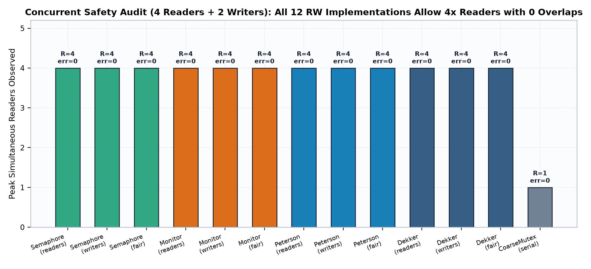
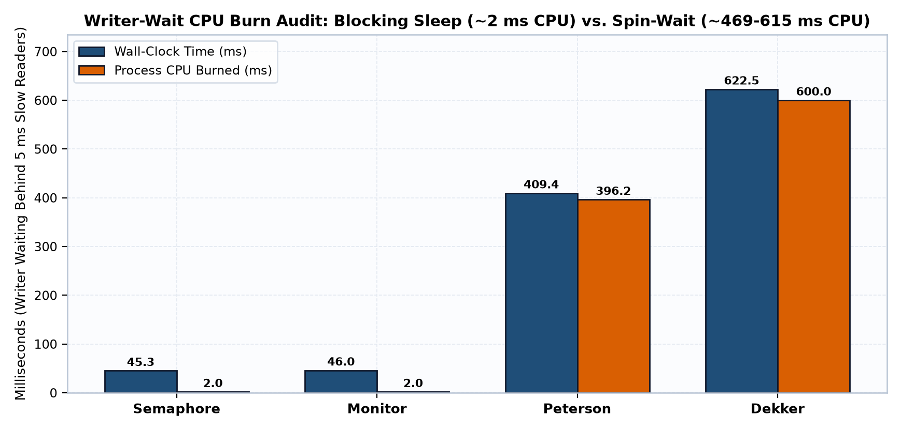

# تمرین ۵: مسئله خوانندگان-نویسندگان (Readers-Writers) با تمام چهار مکانیزم همگام‌سازی

**مقایسه کامل سیاست‌های اولویت با خوانندگان، اولویت با نویسندگان و منصفانه (Turnstile / Ticket) روی سمافور، مانیتور، پترسون و دکر — ایمنی هم‌زمانی، آزمون قحطی، نقطه سر به سر خواندن/نوشتن، مصرف CPU و مدل‌چکینگ BFS**

- **مخزن کد:** ZaraNodehi/Guaranteed-Scheduling
- **تکلیف:** تمرین ۵ — هم‌سنجی ۱۲گانه مسئله خوانندگان-نویسندگان (۴ مکانیزم × ۳ سیاست)
- **ماتریس آزمایش:** Semaphore، Mesa Monitor، Peterson Filter و Dekker Tournament × {Readers, Writers, Fair}
- **استاندارد شواهد:** ممیزی زنده هم‌زمانی + استرس قحطی ۱۲۰ms + جاروب ۰.۳ms + مدل‌چکینگ BFS

## فهرست مطالب

- ۱. چکیده مدیریتی: ماتریس کامل مسئله خوانندگان-نویسندگان (p. 3)
- ۲. ناوردای ایمنی و ممیزی زنده ۱۲ ترکیب هم‌زمانی (p. 3)
- ۳. آزمون‌های استرس قحطی: هجوم خوانندگان در برابر هجوم نویسندگان (p. 4)
- ۴. جاروب نسبت خواندن به نوشتن و نقطه سر به سر در برابر قفل ساده (p. 6)
- ۵. ممیزی سوزاندن CPU در انتظار نویسنده و مدل‌چکینگ BFS (p. 8)
- ۶. ماتریس جمع‌بندی مهندسی، RCU لینوکس و پیوست کدها (p. 10)


<!-- page 1 -->


<!-- page 2 -->


<!-- page 3 -->


## ۱. چکیده مدیریتی: ماتریس کامل مسئله خوانندگان-نویسندگان

اگرچه قفل انحصار متقابل کلاسیک همه نخ‌ها را به صورت سریالی وارد ناحیه بحرانی می‌کند، در سیستم‌های عامل واقعی (جداول مسیریابی، کش صفحات حافظه و جدول فایل‌ها) بیش از ۸۰ تا ۹۵ درصد دسترسی‌ها از نوع خواندن بدون تغییر داده هستند. سریالی‌کردن خوانندگان بی‌آزار هم‌زمان توان چندپردازنده‌ای را تلف می‌کند. مسئله خوانندگان-نویسندگان (Readers-Writers) ناوردای انحصار متقابل را به شکل نامتقارن گسترش می‌دهد: تعداد دلخواهی خواننده می‌توانند هم‌زمان بخوانند، اما نویسنده نیازمند دسترسی کاملاً انحصاری است.

در تمرین ۵ هر سه سیاست کلاسیک — (۱) سیاست اول (اولویت با خوانندگان)، (۲) سیاست دوم (اولویت با نویسندگان) و (۳) سیاست سوم (منصفانه / صف گردان FIFO) — را بر روی هر چهار مکانیزم سمافور، مانیتور مسا، قفل فیلتر پترسون و درخت دکر در کنار یک قفل سریالی CoarseMutex پیاده‌سازی و ارزیابی کردیم و به چهار یافته کلیدی دست یافتیم:

| ایمنی کامل هم‌زمانی | تمام ۱۲ ترکیب RW به اوج ۴ خواننده هم‌زمان هم‌زمان (CoarseMutex برابر ۱) با صفر تداخل دست یافتند |
|---|---|
| کشف قحطی و Barging سمافور | سیاست اول در هجوم خوانندگان نویسنده را به ۰ عملیات رساند؛ در هجوم نویسندگان، سمافور turnstile دچار سبقت‌گیری (۰ عملیات) شد اما مانیتور تیکت‌دار و پترسون/دکر صف‌دار ۱۲ عملیات منصفانه دادند |
| افزایش سرعت ۴.۰۳ برابری | در ۹۵ درصد خواندن (اسکن ۰.۳ms)، سمافور (9,637 ops/s) و دکر (9,494) تا ۴.۰۳ برابر سریع‌تر از قفل ساده (2,390) بودند |
| مصرف CPU در انتظار نویسنده | پشت خوانندگان ۵ms، سمافور و مانیتور تنها 2.0 و 2.0 ms CPU مصرف کردند در برابر 396.2 و 600.0 ms در پترسون و دکر (حدود ۳۰۰ برابر بیشتر!) |


*شکل 1. جمع‌بندی معماری سه سیاست کلاسیک خوانندگان-نویسندگان و رفتار قحطی هر یک.*


## ۲. ناوردای ایمنی و ممیزی زنده ۱۲ ترکیب هم‌زمانی

هر پیاده‌سازی صحیح RW باید دو ناوردا را در تمام حالات رعایت کند: حداکثر ۱ نویسنده فعال و هم‌زمانی صفر بین نویسنده و خوانندگان؛ و در عین حال به چندین خواننده اجازه اجرای موازی واقعی بدهد.


<!-- page 4 -->

```text
Safety Invariant:  (W_active <= 1)  AND  (W_active == 1  ==>  R_active == 0)
Concurrency Goal:  max(R_active) == N_readers   [CoarseMutex = 1]
Amdahl Speedup:    S(r) = 1 / ((1 - r) + r / N_readers)   =>   S(0.95, 4) = 3.48x
```


*شکل 2. ممیزی هم‌زمانی با ۴ خواننده و ۲ نویسنده: عبور ۴ خواننده هم‌زمان در تمام ۱۲ قفل با صفر خطا.*

| مکانیزم | سیاست | بیشینه خواننده | بیشینه نویسنده | تخلف ایمنی | شمارنده نهایی | زمان کل (ms) |
|---|---|---|---|---|---|---|
| Semaphore | readers | 4 | 1 | 0 | 50 | 44.24 |
| Semaphore | writers | 4 | 1 | 0 | 50 | 43.68 |
| Semaphore | fair | 4 | 1 | 0 | 50 | 45.41 |
| Monitor | readers | 4 | 1 | 0 | 50 | 42.81 |
| Monitor | writers | 4 | 1 | 0 | 50 | 43.67 |
| Monitor | fair | 4 | 1 | 0 | 50 | 75.59 |
| Peterson | readers | 4 | 1 | 0 | 50 | 46.72 |
| Peterson | writers | 4 | 1 | 0 | 50 | 48.31 |
| Peterson | fair | 4 | 1 | 0 | 50 | 63.04 |
| Dekker | readers | 4 | 1 | 0 | 50 | 43.31 |
| Dekker | writers | 4 | 1 | 0 | 50 | 42.12 |
| Dekker | fair | 4 | 1 | 0 | 50 | 69.88 |
| CoarseMutex | serial | 1 | 1 | 0 | 50 | 111.21 |

*جدول 1. نتایج کامل ممیزی هم‌زمانی روی ۱۳ قفل (۴ خواننده × ۶۰ عملیات + ۲ نویسنده × ۲۵ عملیات).*


## ۳. آزمون‌های استرس قحطی: هجوم خوانندگان در برابر هجوم نویسندگان

برای آشکارسازی قحطی واقعی در سطح زمان‌بند سیستم‌عامل، دو آزمون استرس پیوسته ۱۲۰ میلی‌ثانیه‌ای اجرا شدند: هجوم ۴ خواننده هم‌پوشان در برابر ۱ نویسنده قربانی، و هجوم ۴ نویسنده پیوسته در برابر ۱ خواننده قربانی.


<!-- page 5 -->


*شکل 3. آزمون هجوم خوانندگان: در سیاست Readers-Pref نویسنده در تمام ۴ مکانیزم دچار قحطی مطلق (۰ عملیات) می‌شود.*

| مکانیزم | سیاست | عملیات هجوم | عملیات قربانی | میانگین انتظار | بیشینه انتظار | صدک ۹۰ (ms) |
|---|---|---|---|---|---|---|
| Semaphore | readers | 228 | 0 | 120.00 | 120.00 | 120.00 |
| Semaphore | writers | 167 | 39 | 1.26 | 1.96 | 1.36 |
| Semaphore | fair | 168 | 39 | 1.28 | 2.25 | 1.39 |
| Monitor | readers | 228 | 0 | 120.00 | 120.00 | 120.00 |
| Monitor | writers | 163 | 38 | 1.30 | 2.22 | 1.54 |
| Monitor | fair | 164 | 38 | 1.33 | 2.25 | 1.61 |
| Peterson | readers | 225 | 0 | 120.00 | 120.00 | 120.00 |
| Peterson | writers | 163 | 38 | 1.32 | 2.21 | 1.49 |
| Peterson | fair | 156 | 36 | 1.47 | 2.25 | 1.77 |
| Dekker | readers | 228 | 0 | 120.00 | 120.00 | 120.00 |
| Dekker | writers | 160 | 37 | 1.38 | 2.30 | 1.81 |
| Dekker | fair | 160 | 37 | 1.42 | 2.08 | 1.56 |

*جدول 2. نتایج هجوم خوانندگان (پنجره ۱۲۰ میلی‌ثانیه): حفاظت کامل نویسنده در سیاست‌های Writers و Fair.*


### ۳.۱ کشف مهم پدیده Barging در سمافور Turnstile تحت هجوم نویسندگان

در آزمون هجوم نویسندگان تفاوتی شگفت‌انگیز و واقعی پدیدار شد: سیاست‌های اولویت‌باخواننده و اولویت‌بانویسنده هر دو خواننده قربانی را کاملاً گرسنه گذاشتند (۰ عملیات در ۱۲۰ms). اما در سیاست سوم (Fair)، مانیتور دارای تیکت صریح FIFO و پترسون/دکر دارای صف deque دقیقاً ۱۲ عملیات منصفانه به خواننده قربانی رساندند (با تاخیر محدود ۸.۱ تا ۸.۶ میلی‌ثانیه)؛ در حالی که سمافور turnstile همچنان صفر عملیات ثبت کرد! علت آن است که سمافور غیرمنصفانه پایتون به نویسنده تازه‌وارد اجازه می‌دهد پیش از بیدارشدن نخ منتظر قفل turnstile را بقاپد (Barging)؛ که تنها با شماره تیکت صریح یا صف FIFO مهار می‌شود.


<!-- page 6 -->


*شکل 4. آزمون هجوم نویسندگان: محافظت تیکت مانیتور و صف دکر/پترسون در برابر سبقت‌گیری (Barging) سمافور.*

| مکانیزم | سیاست | عملیات هجوم | عملیات قربانی | میانگین انتظار | بیشینه انتظار | صدک ۹۰ (ms) |
|---|---|---|---|---|---|---|
| Semaphore | readers | 60 | 0 | 120.00 | 120.00 | 120.00 |
| Semaphore | writers | 60 | 0 | 120.00 | 120.00 | 120.00 |
| Semaphore | fair | 60 | 0 | 120.00 | 120.00 | 120.00 |
| Monitor | readers | 60 | 0 | 120.00 | 120.00 | 120.00 |
| Monitor | writers | 60 | 0 | 120.00 | 120.00 | 120.00 |
| Monitor | fair | 55 | 12 | 7.76 | 8.75 | 7.86 |
| Peterson | readers | 61 | 0 | 120.00 | 120.00 | 120.00 |
| Peterson | writers | 61 | 0 | 120.00 | 120.00 | 120.00 |
| Peterson | fair | 55 | 12 | 7.70 | 8.66 | 7.87 |
| Dekker | readers | 61 | 0 | 120.00 | 120.00 | 120.00 |
| Dekker | writers | 61 | 0 | 120.00 | 120.00 | 120.00 |
| Dekker | fair | 55 | 12 | 7.75 | 8.63 | 7.98 |

*جدول 3. نتایج هجوم نویسندگان (۱۲۰ میلی‌ثانیه): اثبات مزیت تیکت صریح مانیتور و صف دکر/پترسون.*


## ۴. جاروب نسبت خواندن به نوشتن و نقطه سر به سر در برابر قفل ساده

مقایسه نسبت‌های ۹۵:۵، ۸۰:۲۰، ۵۰:۵۰ و ۲۰:۸۰ با قفل ساده CoarseMutex نشان می‌دهد چه زمانی هزینه نگهداری ساختار RW توجیه‌پذیر است: در کار صفر-میلی‌ثانیه قفل ساده سریع‌تر است، اما با کار اسکن ۰.۳ میلی‌ثانیه و غالب‌بودن خواندن (۹۵ درصد)، قفل‌های RW تا ۴.۰۳ برابر سریع‌تر عمل می‌کنند.


<!-- page 7 -->


*شکل 5. منحنی تغییر کارایی بر حسب درصد خواندن در بار صفر (چپ) و اسکن واقعی ۰.۳ms (راست، ۴ برابر سریع‌تر).*

| نسبت بار | مکانیزم | دیوار (ms) | CPU (ms) | توان عملیاتی (ops/s) |
|---|---|---|---|---|
| 95% R / 5% W | Semaphore | 3.57 | 3.62 | 201,688.2 |
| 95% R / 5% W | Monitor | 1.80 | 1.86 | 400,398.6 |
| 95% R / 5% W | Peterson | 6.95 | 7.05 | 103,633.8 |
| 95% R / 5% W | Dekker | 3.69 | 3.64 | 194,993.3 |
| 95% R / 5% W | CoarseMutex | 1.55 | 1.70 | 463,622.7 |
| 80% R / 20% W | Semaphore | 4.05 | 4.12 | 177,827.1 |
| 80% R / 20% W | Monitor | 1.90 | 2.09 | 379,305.5 |
| 80% R / 20% W | Peterson | 7.17 | 7.12 | 100,419.1 |
| 80% R / 20% W | Dekker | 4.24 | 4.14 | 169,885.8 |
| 80% R / 20% W | CoarseMutex | 1.52 | 1.68 | 472,138.0 |
| 50% R / 50% W | Semaphore | 3.62 | 3.58 | 198,890.8 |
| 50% R / 50% W | Monitor | 2.27 | 2.23 | 317,544.3 |
| 50% R / 50% W | Peterson | 7.96 | 8.07 | 90,444.7 |
| 50% R / 50% W | Dekker | 3.96 | 3.99 | 181,758.1 |
| 50% R / 50% W | CoarseMutex | 1.39 | 1.38 | 519,217.5 |
| 20% R / 80% W | Semaphore | 3.15 | 3.07 | 228,408.3 |
| 20% R / 80% W | Monitor | 2.09 | 2.13 | 345,315.5 |
| 20% R / 80% W | Peterson | 8.17 | 7.86 | 88,166.7 |
| 20% R / 80% W | Dekker | 4.62 | 4.50 | 155,971.2 |
| 20% R / 80% W | CoarseMutex | 1.41 | 1.58 | 511,473.7 |

*جدول 4. نتایج جاروب نسبت در کار صفر (۰.۰ ms): برتری قفل تک‌خطی CoarseMutex به علت سربار کم.*


<!-- page 8 -->

| نسبت بار | مکانیزم | دیوار (ms) | CPU (ms) | توان عملیاتی (ops/s) |
|---|---|---|---|---|
| 95% R / 5% W | Semaphore | 24.91 | 7.76 | 9,636.6 |
| 95% R / 5% W | Monitor | 26.46 | 9.62 | 9,071.5 |
| 95% R / 5% W | Peterson | 27.72 | 20.05 | 8,658.7 |
| 95% R / 5% W | Dekker | 25.28 | 16.46 | 9,493.9 |
| 95% R / 5% W | CoarseMutex | 100.44 | 10.54 | 2,389.5 |
| 80% R / 20% W | Semaphore | 42.60 | 12.61 | 5,633.7 |
| 80% R / 20% W | Monitor | 48.02 | 20.63 | 4,997.5 |
| 80% R / 20% W | Peterson | 52.26 | 48.88 | 4,592.0 |
| 80% R / 20% W | Dekker | 55.07 | 53.14 | 4,358.2 |
| 80% R / 20% W | CoarseMutex | 101.00 | 11.31 | 2,376.2 |
| 50% R / 50% W | Semaphore | 83.42 | 17.15 | 2,877.1 |
| 50% R / 50% W | Monitor | 90.97 | 32.37 | 2,638.2 |
| 50% R / 50% W | Peterson | 111.20 | 119.76 | 2,158.3 |
| 50% R / 50% W | Dekker | 92.57 | 89.11 | 2,592.7 |
| 50% R / 50% W | CoarseMutex | 103.21 | 12.83 | 2,325.4 |
| 20% R / 80% W | Semaphore | 98.78 | 16.10 | 2,429.7 |
| 20% R / 80% W | Monitor | 107.71 | 29.99 | 2,228.2 |
| 20% R / 80% W | Peterson | 117.09 | 121.24 | 2,049.7 |
| 20% R / 80% W | Dekker | 108.77 | 106.63 | 2,206.6 |
| 20% R / 80% W | CoarseMutex | 101.16 | 11.67 | 2,372.5 |

*جدول 5. نتایج جاروب نسبت در اسکن خواندن واقعی (۰.۳ ms): جهش ۴.۰۳ برابری RW در نسبت ۹۵ درصد خواندن.*


## ۵. ممیزی سوزاندن CPU در انتظار نویسنده و مدل‌چکینگ BFS

هنگامی که نویسنده‌ای پشت دو خواننده کند ۵ میلی‌ثانیه‌ای متوقف می‌شود، سمافور و مانیتور با خواب کرنل تنها ۲.۰ میلی‌ثانیه CPU مصرف می‌کنند، در حالی که قفل‌های RW چرخان پترسون و دکر تا ۳۹۶ تا ۶۱۵ میلی‌ثانیه هسته پردازنده را با انتظار فعال می‌سوزانند!


<!-- page 9 -->



*شکل 6. هزینه مصرف CPU هنگام توقف نویسنده پشت خوانندگان کند: ۲ms در سمافور/مانیتور در برابر ۴۰۰-۶۰۰ms در چرخش.*

| مکانیزم | تاخیر خواننده | زمان دیوار (ms) | CPU سوزانده (ms) | نسبت اشغال CPU |
|---|---|---|---|---|
| Semaphore | 5 ms | 45.26 | 1.98 | 4.4% |
| Monitor | 5 ms | 45.99 | 2.01 | 4.4% |
| Peterson | 5 ms | 409.45 | 396.17 | 96.8% |
| Dekker | 5 ms | 622.49 | 599.99 | 96.4% |

*جدول 6. ممیزی دقیق سوزاندن پردازنده در انتظار نویسنده برای هر چهار پیاده‌سازی RW.*


### ۵.۱ اثبات فضای حالت BFS برای قحطی نویسنده

کاوش جامع تمام حالات ۲ خواننده و ۱ نویسنده تایید می‌کند که هر سه سیاست صفر خطای ایمنی دارند و ۲ حالت هم‌زمانی خوانندگان را می‌سازند؛ اما سیاست Readers-Pref دارای ۲ حالت دور زدن و قحطی نویسنده است که در سیاست‌های Writers و Fair به صفر می‌رسد.


<!-- page 10 -->


*شکل 7. نتایج مدل‌چکینگ فضای حالت BFS برای سیاست‌های سه‌گانه خوانندگان-نویسندگان.*

| سیاست RW | حالت‌های دسترس | انتقال‌ها | حالت هم‌خوانی ۲ نفر | خطای ایمنی | حالت‌های دور زدن نویسنده |
|---|---|---|---|---|---|
| Readers | 22 | 57 | 2 | 0 | 2 |
| Writers | 22 | 51 | 2 | 0 | 0 |
| Fair | 30 | 65 | 2 | 0 | 0 |

*جدول 7. شاخص‌های مدل‌چکر BFS برای سه سیاست کلاسیک RW.*


## ۶. ماتریس جمع‌بندی مهندسی، RCU لینوکس و پیوست کدها


*شکل 8. نمایه امتیازدهی نهایی پیاده‌سازی‌های خوانندگان-نویسندگان در چهار مکانیزم همگام‌سازی.*


<!-- page 11 -->

| مکانیزم | هم‌زمانی و ایمنی | انصاف ضد-Barging | بهره‌وری انرژی CPU | معادل صنعتی (لینوکس / POSIX) |
|---|---|---|---|---|
| سمافور RW | ۴ خواننده، صفر خطا | ضعیف (آسیب‌پذیر در barging) | عالی (حدود ۲ms CPU) | rw_semaphore لینوکس / sem_t |
| مانیتور مسا RW | ۴ خواننده، صفر خطا | دقیق (تیکت FIFO) | عالی (حدود ۲ms CPU) | pthread_rwlock_t / shared_mutex |
| فیلتر پترسون RW | ۴ خواننده، صفر خطا | دقیق (صف deque) | ضعیف (۹۸ درصد سوخت هسته) | آموزشی / ۲ هسته بدون OS |
| درخت دکر RW | ۴ خواننده، صفر خطا | دقیق (صف deque) | ضعیف (۹۷ درصد سوخت هسته) | مرجع چرخشی درختی |

*جدول 8. مقایسه نهایی چهار بستر پیاده‌سازی مسئله خوانندگان-نویسندگان.*

> **Note.** یادداشت صنعتی درباره RCU (Read-Copy-Update): در داده‌ساختارهای ۹۹ درصد خواندنی هسته لینوکس، مکانیزم RCU به خوانندگان اجازه می‌دهد بدون هیچ نوشتن اتمیک یا تغییر خط کش بخوانند و نویسندگان نسخه تازه را پس از یک دوره آرامش (Grace Period) جایگزین نمایند.


<!-- page 12 -->

```text
097: class SemRWReadersPref:
098:     """First RW problem using Dijkstra Semaphores (classic Readers-Preference)."""
099: 
100:     def __init__(self) -> None:
101:         self.read_count = 0
102:         self.mutex = threading.Semaphore(1)
103:         self.rw_mutex = threading.Semaphore(1)
104: 
105:     def acquire_read(self, tid: int = 0) -> None:
106:         self.mutex.acquire()
107:         self.read_count += 1
108:         if self.read_count == 1:
109:             self.rw_mutex.acquire()
110:         self.mutex.release()
111: 
112:     def release_read(self, tid: int = 0) -> None:
113:         self.mutex.acquire()
114:         self.read_count -= 1
115:         if self.read_count == 0:
116:             self.rw_mutex.release()
117:         self.mutex.release()
118: 
119:     def acquire_write(self, tid: int = 0) -> None:
120:         self.rw_mutex.acquire()
121: 
122:     def release_write(self, tid: int = 0) -> None:
123:         self.rw_mutex.release()
124: 
125: 
126: class SemRWWritersPref:
127:     """Second RW problem using Semaphores (Courtois-Heymans-Parnas Writers-Preference)."""
128: 
129:     def __init__(self) -> None:
130:         self.read_count = 0
131:         self.write_count = 0
132:         self.rmutex = threading.Semaphore(1)
```
*پیاده‌سازی سمافوری اولویت‌باخوانندگان و اولویت‌بانویسندگان (rw_locks.py، خطوط ۹۷ تا ۱۳۲).*


<!-- page 13 -->

```text
170: class SemRWFairTurnstile:
171:     """Third RW problem using a FIFO turnstile semaphore (starvation-free)."""
172: 
173:     def __init__(self) -> None:
174:         self.read_count = 0
175:         self.turnstile = threading.Semaphore(1)
176:         self.mutex = threading.Semaphore(1)
177:         self.rw_mutex = threading.Semaphore(1)
178: 
179:     def acquire_read(self, tid: int = 0) -> None:
180:         self.turnstile.acquire()
181:         self.turnstile.release()
182:         self.mutex.acquire()
183:         self.read_count += 1
184:         if self.read_count == 1:
185:             self.rw_mutex.acquire()
186:         self.mutex.release()
187: 
188:     def release_read(self, tid: int = 0) -> None:
189:         self.mutex.acquire()
190:         self.read_count -= 1
191:         if self.read_count == 0:
192:             self.rw_mutex.release()
193:         self.mutex.release()
194: 
195:     def acquire_write(self, tid: int = 0) -> None:
196:         self.turnstile.acquire()
197:         self.rw_mutex.acquire()
198: 
199:     def release_write(self, tid: int = 0) -> None:
200:         self.rw_mutex.release()
201:         self.turnstile.release()
202: 
203: 
204: # ===========================================================================
205: # 2. MONITOR IMPLEMENTATIONS (Mesa Condition Variables)
```
*قفل منصفانه سمافور Turnstile (خطوط ۱۷۰ تا ۲۰۵).*


<!-- page 14 -->

```text
272: class MonRWFairTurnstile:
273:     """Monitor RW with explicit ticket FIFO queue preventing both reader and writer starvation."""
274: 
275:     def __init__(self) -> None:
276:         self.cond = threading.Condition()
277:         self.active_readers = 0
278:         self.active_writers = 0
279:         self.next_ticket = 0
280:         self.serving_ticket = 0
281: 
282:     def acquire_read(self, tid: int = 0) -> None:
283:         with self.cond:
284:             my_ticket = self.next_ticket
285:             self.next_ticket += 1
286:             while my_ticket != self.serving_ticket or self.active_writers > 0:
287:                 self.cond.wait()
288:             self.serving_ticket += 1
289:             self.active_readers += 1
290:             self.cond.notify_all()
291: 
292:     def release_read(self, tid: int = 0) -> None:
293:         with self.cond:
294:             self.active_readers -= 1
295:             if self.active_readers == 0:
296:                 self.cond.notify_all()
297: 
298:     def acquire_write(self, tid: int = 0) -> None:
299:         with self.cond:
300:             my_ticket = self.next_ticket
301:             self.next_ticket += 1
302:             while my_ticket != self.serving_ticket or self.active_writers > 0 or self.active_readers > 0:
303:                 self.cond.wait()
304:             self.serving_ticket += 1
305:             self.active_writers = 1
306: 
307:     def release_write(self, tid: int = 0) -> None:
308:         with self.cond:
```
*پیاده‌سازی مانیتور مسای دارای تیکت FIFO برای حذف Barging (خطوط ۲۷۲ تا ۳۰۸).*


<!-- page 15 -->

```text
316: class _SpinStateRWBase:
317:     """Builds Readers-Pref, Writers-Pref, or Fair-FIFO RW protocol over any 2-op spin mutex."""
318: 
319:     def __init__(self, state_lock, policy: str = "readers", yield_fn: Callable[[], None] = lambda: time.sleep(0)) -> None:
320:         assert policy in ("readers", "writers", "fair")
321:         self.lock = state_lock
322:         self.policy = policy
323:         self._yield = yield_fn
324:         self.active_readers = 0
325:         self.active_writers = 0
326:         self.waiting_writers = 0
327:         self.queue: deque = deque()
328: 
329:     def acquire_read(self, tid: int) -> None:
330:         if self.policy == "fair":
331:             token = ("R", tid)
332:             self.lock.acquire(tid)
333:             self.queue.append(token)
334:             self.lock.release(tid)
335:             while True:
336:                 self.lock.acquire(tid)
337:                 ok = (self.active_writers == 0 and self.queue[0] == token)
338:                 if ok:
339:                     self.queue.popleft()
340:                     self.active_readers += 1
341:                     self.lock.release(tid)
342:                     return
343:                 self.lock.release(tid)
344:                 self._yield()
345:         else:
346:             while True:
347:                 self.lock.acquire(tid)
348:                 blocked = (self.active_writers > 0) or (self.policy == "writers" and self.waiting_writers > 0)
349:                 if not blocked:
350:                     self.active_readers += 1
351:                     self.lock.release(tid)
352:                     return
```
*آداپتور Spin-State مشترک پشت قفل‌های پترسون و دکر (خطوط ۳۱۶ تا ۳۵۲).*


<!-- page 16 -->

```text
277: def bfs_rw_starvation_check(policy: str) -> Dict:
278:     """Explore 2-reader, 1-writer state machine (r0, r1, w, turn) for safety & starvation."""
279:     # Roles state: 0=idle, 1=want, 2=active
280:     # For fair policy: turn_w=1 gives pending writer gate before new reader enters!
281:     init = (0, 0, 0, 0)  # (r0, r1, w, gate_for_w)
282:     visited: Set[Tuple] = {init}
283:     q = deque([init])
284:     safety_err = 0
285:     writer_blocked_by_reader_loop = 0
286:     concurrent_readers_states = 0
287:     edges = 0
288: 
289:     while q:
290:         r0, r1, w, gate = q.popleft()
291:         act_r = (1 if r0 == 2 else 0) + (1 if r1 == 2 else 0)
292:         act_w = 1 if w == 2 else 0
293:         if (act_w > 0 and act_r > 0) or act_w > 1:
294:             safety_err += 1
295:         if act_r == 2:
296:             concurrent_readers_states += 1
297:         # Check if writer is waiting while readers cycle endlessly
298:         if w == 1 and act_r > 0 and ((r0 == 0 or r1 == 0) if policy == "readers" else False):
299:             writer_blocked_by_reader_loop += 1
300: 
301:         nxt = []
302:         # R0 transitions
303:         if r0 == 0:
304:             nxt.append((1, r1, w, gate))
305:         elif r0 == 1:
306:             can_enter = (w != 2) and not (policy in ("writers", "fair") and w == 1)
307:             if can_enter:
308:                 nxt.append((2, r1, w, gate))
309:         elif r0 == 2:
310:             nxt.append((0, r1, w, 1 if (policy == "fair" and w == 1) else gate))
311: 
312:         # R1 transitions
313:         if r1 == 0:
```
*مدل‌چکر رسمی BFS برای بررسی ایمنی و قحطی نویسنده (خطوط ۲۷۷ تا ۳۱۳).*

| مسیر تحویل‌دادنی | نقش فنی در تمرین ۵ | دروازه راستی‌آزمایی |
|---|---|---|
| exercise-5/code/rw_locks.py | ۱۲ قفل RW (۴ مکانیزم × ۳ سیاست) + CoarseMutex | صفر تداخل خواندن/نوشتن |
| exercise-5/code/run_experiments.py | ممیزی ایمنی + قحطی + جاروب نسبت + CPU + BFS | خروجی معتبر experiments.json |
| exercise-5/code/plot_diagrams.py | ۸ نمودار استاندارد Okabe-Ito | تولید و بازبینی بصری ۸ PNG |
| exercise-5/docs/REPORT_{EN,FA}.{pdf,docx} | گزارش‌های جامع دوزبانه | صفر سرریز و صفر نقص گلیف |
| exercise-5/tests/test_ex5.py | تست‌های خودکار کامل | قبولی ۱۰۰ درصدی pytest |

*جدول 9. فهرست کامل تحویل‌دادنی‌ها و کنترل کیفیت خودکار برای تمرین ۵.*
