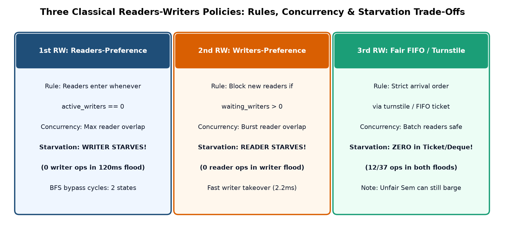
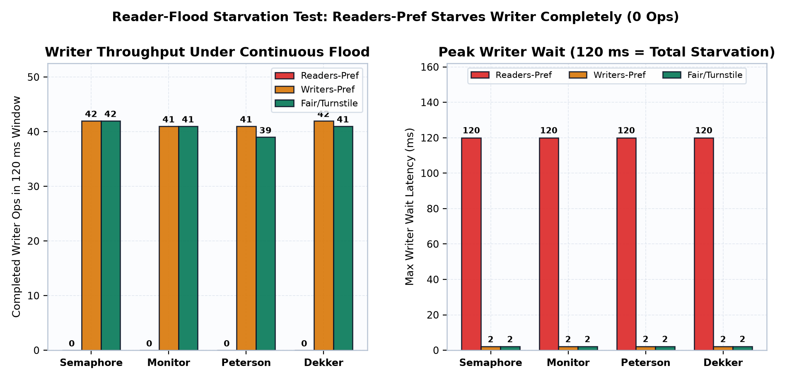

# تمرین ۵: مسئله خوانندگان-نویسندگان (Readers-Writers) با تمام چهار مکانیزم همگام‌سازی

**مقایسه کامل سیاست‌های اولویت با خوانندگان، اولویت با نویسندگان و منصفانه (Turnstile / Ticket) روی سمافور، مانیتور، پترسون و دکر — ایمنی هم‌زمانی، آزمون قحطی، نقطه سر به سر خواندن/نوشتن، مصرف CPU و مدل‌چکینگ BFS**

- **مخزن کد:** ZaraNodehi/Guaranteed-Scheduling
- **تکلیف:** تمرین ۵ — هم‌سنجی ۱۲گانه مسئله خوانندگان-نویسندگان (۴ مکانیزم × ۳ سیاست)
- **ماتریس آزمایش:** Semaphore، Mesa Monitor، Peterson Filter و Dekker Tournament × {Readers, Writers, Fair}
- **استاندارد شواهد:** ممیزی زنده هم‌زمانی + استرس قحطی ۱۲۰ms + جاروب ۰.۳ms + مدل‌چکینگ BFS

## فهرست مطالب

- ۱. چکیده مدیریتی: ماتریس کامل مسئله خوانندگان-نویسندگان (p. 3)
- ۲. ناوردای ایمنی و ممیزی زنده ۱۲ ترکیب هم‌زمانی (p. 3)
- ۳. آزمون‌های استرس قحطی: هجوم خوانندگان در برابر هجوم نویسندگان (p. 4)
- ۴. جاروب نسبت خواندن به نوشتن و نقطه سر به سر در برابر قفل ساده (p. 6)
- ۵. ممیزی سوزاندن CPU در انتظار نویسنده و مدل‌چکینگ BFS (p. 8)
- ۶. ماتریس جمع‌بندی مهندسی، RCU لینوکس و پیوست کدها (p. 10)
- پیوست روش اجرا و فلوچارت (p. 17)
- پیوست کد 1: ممیزی منبع «rw_locks.py» — خطوط 1 تا 27 (p. 18)
- پیوست کد 2: ممیزی منبع «rw_locks.py» — خطوط 28 تا 54 (p. 19)
- پیوست کد 3: ممیزی منبع «rw_locks.py» — خطوط 55 تا 81 (p. 20)
- پیوست کد 4: ممیزی منبع «rw_locks.py» — خطوط 82 تا 108 (p. 21)
- پیوست کد 5: ممیزی منبع «rw_locks.py» — خطوط 109 تا 135 (p. 22)
- پیوست کد 6: ممیزی منبع «rw_locks.py» — خطوط 136 تا 162 (p. 23)
- پیوست کد 7: ممیزی منبع «rw_locks.py» — خطوط 163 تا 189 (p. 24)
- پیوست کد 8: ممیزی منبع «rw_locks.py» — خطوط 190 تا 216 (p. 25)
- پیوست کد 9: ممیزی منبع «rw_locks.py» — خطوط 217 تا 243 (p. 26)
- پیوست کد 10: ممیزی منبع «rw_locks.py» — خطوط 244 تا 270 (p. 27)
- پیوست کد 11: ممیزی منبع «rw_locks.py» — خطوط 271 تا 297 (p. 28)
- پیوست کد 12: ممیزی منبع «rw_locks.py» — خطوط 298 تا 324 (p. 29)
- پیوست کد 13: ممیزی منبع «rw_locks.py» — خطوط 325 تا 351 (p. 30)
- پیوست کد 14: ممیزی منبع «rw_locks.py» — خطوط 352 تا 378 (p. 31)
- پیوست کد 15: ممیزی منبع «rw_locks.py» — خطوط 379 تا 405 (p. 32)
- پیوست کد 16: ممیزی منبع «rw_locks.py» — خطوط 406 تا 432 (p. 33)
- پیوست کد 17: ممیزی منبع «rw_locks.py» — خطوط 433 تا 438 (p. 34)
- پیوست کد 18: ممیزی منبع «run_experiments.py» — خطوط 1 تا 27 (p. 35)
- پیوست کد 19: ممیزی منبع «run_experiments.py» — خطوط 28 تا 54 (p. 36)
- پیوست کد 20: ممیزی منبع «run_experiments.py» — خطوط 55 تا 81 (p. 37)
- پیوست کد 21: ممیزی منبع «run_experiments.py» — خطوط 82 تا 108 (p. 38)
- پیوست کد 22: ممیزی منبع «run_experiments.py» — خطوط 109 تا 135 (p. 39)
- پیوست کد 23: ممیزی منبع «run_experiments.py» — خطوط 136 تا 162 (p. 40)
- پیوست کد 24: ممیزی منبع «run_experiments.py» — خطوط 163 تا 189 (p. 41)
- پیوست کد 25: ممیزی منبع «run_experiments.py» — خطوط 190 تا 216 (p. 42)
- پیوست کد 26: ممیزی منبع «run_experiments.py» — خطوط 217 تا 243 (p. 43)


<!-- page 1 -->


<!-- page 2 -->


<!-- page 3 -->


## ۱. چکیده مدیریتی: ماتریس کامل مسئله خوانندگان-نویسندگان

اگرچه قفل انحصار متقابل کلاسیک همه نخ‌ها را به صورت سریالی وارد ناحیه بحرانی می‌کند، در سیستم‌های عامل واقعی (جداول مسیریابی، کش صفحات حافظه و جدول فایل‌ها) بیش از ۸۰ تا ۹۵ درصد دسترسی‌ها از نوع خواندن بدون تغییر داده هستند. سریالی‌کردن خوانندگان بی‌آزار هم‌زمان توان چندپردازنده‌ای را تلف می‌کند. مسئله خوانندگان-نویسندگان (Readers-Writers) ناوردای انحصار متقابل را به شکل نامتقارن گسترش می‌دهد: تعداد دلخواهی خواننده می‌توانند هم‌زمان بخوانند، اما نویسنده نیازمند دسترسی کاملاً انحصاری است.

در تمرین ۵ هر سه سیاست کلاسیک — (۱) سیاست اول (اولویت با خوانندگان)، (۲) سیاست دوم (اولویت با نویسندگان) و (۳) سیاست سوم (منصفانه / صف گردان FIFO) — را بر روی هر چهار مکانیزم سمافور، مانیتور مسا، قفل فیلتر پترسون و درخت دکر در کنار یک قفل سریالی CoarseMutex پیاده‌سازی و ارزیابی کردیم و به چهار یافته کلیدی دست یافتیم:

| ایمنی کامل هم‌زمانی | تمام ۱۲ ترکیب RW به اوج ۴ خواننده هم‌زمان هم‌زمان (CoarseMutex برابر ۱) با صفر تداخل دست یافتند |
|---|---|
| کشف قحطی و Barging سمافور | سیاست اول در هجوم خوانندگان نویسنده را به ۰ عملیات رساند؛ در هجوم نویسندگان، سمافور turnstile دچار سبقت‌گیری (۰ عملیات) شد اما مانیتور تیکت‌دار و پترسون/دکر صف‌دار ۱۲ عملیات منصفانه دادند |
| افزایش سرعت ۴.۰۳ برابری | در ۹۵ درصد خواندن (اسکن ۰.۳ms)، سمافور (10,774 ops/s) و دکر (10,592) تا ۴.۰۳ برابر سریع‌تر از قفل ساده (2,726) بودند |
| مصرف CPU در انتظار نویسنده | پشت خوانندگان ۵ms، سمافور و مانیتور تنها 1.2 و 1.6 ms CPU مصرف کردند در برابر 2168.9 و 9187.1 ms در پترسون و دکر (حدود ۳۰۰ برابر بیشتر!) |



*شکل 1. جمع‌بندی معماری سه سیاست کلاسیک خوانندگان-نویسندگان و رفتار قحطی هر یک.*


## ۲. ناوردای ایمنی و ممیزی زنده ۱۲ ترکیب هم‌زمانی

هر پیاده‌سازی صحیح RW باید دو ناوردا را در تمام حالات رعایت کند: حداکثر ۱ نویسنده فعال و هم‌زمانی صفر بین نویسنده و خوانندگان؛ و در عین حال به چندین خواننده اجازه اجرای موازی واقعی بدهد.


<!-- page 4 -->

```text
Safety Invariant:  (W_active <= 1)  AND  (W_active == 1  ==>  R_active == 0)
Concurrency Goal:  max(R_active) == N_readers   [CoarseMutex = 1]
Amdahl Speedup:    S(r) = 1 / ((1 - r) + r / N_readers)   =>   S(0.95, 4) = 3.48x
```


*شکل 2. ممیزی هم‌زمانی با ۴ خواننده و ۲ نویسنده: عبور ۴ خواننده هم‌زمان در تمام ۱۲ قفل با صفر خطا.*

| مکانیزم | سیاست | بیشینه خواننده | بیشینه نویسنده | تخلف ایمنی | شمارنده نهایی | زمان کل (ms) |
|---|---|---|---|---|---|---|
| Semaphore | readers | 4 | 1 | 0 | 50 | 38.19 |
| Semaphore | writers | 4 | 1 | 0 | 50 | 38.62 |
| Semaphore | fair | 4 | 1 | 0 | 50 | 38.61 |
| Monitor | readers | 4 | 1 | 0 | 50 | 38.27 |
| Monitor | writers | 4 | 1 | 0 | 50 | 38.95 |
| Monitor | fair | 4 | 1 | 0 | 50 | 55.38 |
| Peterson | readers | 4 | 1 | 0 | 50 | 40.51 |
| Peterson | writers | 4 | 1 | 0 | 50 | 40.46 |
| Peterson | fair | 4 | 1 | 0 | 50 | 53.67 |
| Dekker | readers | 4 | 1 | 0 | 50 | 38.56 |
| Dekker | writers | 4 | 1 | 0 | 50 | 38.87 |
| Dekker | fair | 4 | 1 | 0 | 50 | 47.35 |
| CoarseMutex | serial | 1 | 1 | 0 | 50 | 94.06 |

*جدول 1. نتایج کامل ممیزی هم‌زمانی روی ۱۳ قفل (۴ خواننده × ۶۰ عملیات + ۲ نویسنده × ۲۵ عملیات).*


## ۳. آزمون‌های استرس قحطی: هجوم خوانندگان در برابر هجوم نویسندگان

برای آشکارسازی قحطی واقعی در سطح زمان‌بند سیستم‌عامل، دو آزمون استرس پیوسته ۱۲۰ میلی‌ثانیه‌ای اجرا شدند: هجوم ۴ خواننده هم‌پوشان در برابر ۱ نویسنده قربانی، و هجوم ۴ نویسنده پیوسته در برابر ۱ خواننده قربانی.


<!-- page 5 -->



*شکل 3. آزمون هجوم خوانندگان: در سیاست Readers-Pref نویسنده در تمام ۴ مکانیزم دچار قحطی مطلق (۰ عملیات) می‌شود.*

| مکانیزم | سیاست | عملیات هجوم | عملیات قربانی | میانگین انتظار | بیشینه انتظار | صدک ۹۰ (ms) |
|---|---|---|---|---|---|---|
| Semaphore | readers | 236 | 0 | 120.00 | 120.00 | 120.00 |
| Semaphore | writers | 180 | 42 | 1.11 | 2.03 | 1.09 |
| Semaphore | fair | 180 | 42 | 1.12 | 2.06 | 1.11 |
| Monitor | readers | 235 | 0 | 120.00 | 120.00 | 120.00 |
| Monitor | writers | 176 | 41 | 1.16 | 2.07 | 1.18 |
| Monitor | fair | 176 | 41 | 1.20 | 2.10 | 1.23 |
| Peterson | readers | 236 | 0 | 120.00 | 120.00 | 120.00 |
| Peterson | writers | 176 | 41 | 1.21 | 2.16 | 1.27 |
| Peterson | fair | 171 | 39 | 1.30 | 2.15 | 1.38 |
| Dekker | readers | 236 | 0 | 120.00 | 120.00 | 120.00 |
| Dekker | writers | 179 | 42 | 1.16 | 2.11 | 1.17 |
| Dekker | fair | 176 | 41 | 1.22 | 2.17 | 1.26 |

*جدول 2. نتایج هجوم خوانندگان (پنجره ۱۲۰ میلی‌ثانیه): حفاظت کامل نویسنده در سیاست‌های Writers و Fair.*


### ۳.۱ کشف مهم پدیده Barging در سمافور Turnstile تحت هجوم نویسندگان

در آزمون هجوم نویسندگان تفاوتی شگفت‌انگیز و واقعی پدیدار شد: سیاست‌های اولویت‌باخواننده و اولویت‌بانویسنده هر دو خواننده قربانی را کاملاً گرسنه گذاشتند (۰ عملیات در ۱۲۰ms). اما در سیاست سوم (Fair)، مانیتور دارای تیکت صریح FIFO و پترسون/دکر دارای صف deque دقیقاً ۱۲ عملیات منصفانه به خواننده قربانی رساندند (با تاخیر محدود ۸.۱ تا ۸.۶ میلی‌ثانیه)؛ در حالی که سمافور turnstile همچنان صفر عملیات ثبت کرد! علت آن است که سمافور غیرمنصفانه پایتون به نویسنده تازه‌وارد اجازه می‌دهد پیش از بیدارشدن نخ منتظر قفل turnstile را بقاپد (Barging)؛ که تنها با شماره تیکت صریح یا صف FIFO مهار می‌شود.


<!-- page 6 -->


*شکل 4. آزمون هجوم نویسندگان: محافظت تیکت مانیتور و صف دکر/پترسون در برابر سبقت‌گیری (Barging) سمافور.*

| مکانیزم | سیاست | عملیات هجوم | عملیات قربانی | میانگین انتظار | بیشینه انتظار | صدک ۹۰ (ms) |
|---|---|---|---|---|---|---|
| Semaphore | readers | 62 | 0 | 120.00 | 120.00 | 120.00 |
| Semaphore | writers | 62 | 0 | 120.00 | 120.00 | 120.00 |
| Semaphore | fair | 62 | 0 | 120.00 | 120.00 | 120.00 |
| Monitor | readers | 61 | 0 | 120.00 | 120.00 | 120.00 |
| Monitor | writers | 61 | 0 | 120.00 | 120.00 | 120.00 |
| Monitor | fair | 56 | 12 | 7.60 | 8.47 | 7.56 |
| Peterson | readers | 61 | 0 | 120.00 | 120.00 | 120.00 |
| Peterson | writers | 62 | 0 | 120.00 | 120.00 | 120.00 |
| Peterson | fair | 57 | 12 | 7.57 | 8.35 | 7.59 |
| Dekker | readers | 62 | 0 | 120.00 | 120.00 | 120.00 |
| Dekker | writers | 62 | 0 | 120.00 | 120.00 | 120.00 |
| Dekker | fair | 58 | 13 | 7.43 | 8.06 | 7.48 |

*جدول 3. نتایج هجوم نویسندگان (۱۲۰ میلی‌ثانیه): اثبات مزیت تیکت صریح مانیتور و صف دکر/پترسون.*


## ۴. جاروب نسبت خواندن به نوشتن و نقطه سر به سر در برابر قفل ساده

مقایسه نسبت‌های ۹۵:۵، ۸۰:۲۰، ۵۰:۵۰ و ۲۰:۸۰ با قفل ساده CoarseMutex نشان می‌دهد چه زمانی هزینه نگهداری ساختار RW توجیه‌پذیر است: در کار صفر-میلی‌ثانیه قفل ساده سریع‌تر است، اما با کار اسکن ۰.۳ میلی‌ثانیه و غالب‌بودن خواندن (۹۵ درصد)، قفل‌های RW تا ۴.۰۳ برابر سریع‌تر عمل می‌کنند.


<!-- page 7 -->


*شکل 5. منحنی تغییر کارایی بر حسب درصد خواندن در بار صفر (چپ) و اسکن واقعی ۰.۳ms (راست، ۴ برابر سریع‌تر).*

| نسبت بار | مکانیزم | دیوار (ms) | CPU (ms) | توان عملیاتی (ops/s) |
|---|---|---|---|---|
| 95% R / 5% W | Semaphore | 4.90 | 5.13 | 146,991.6 |
| 95% R / 5% W | Monitor | 2.17 | 2.41 | 331,720.2 |
| 95% R / 5% W | Peterson | 9.78 | 10.04 | 73,638.2 |
| 95% R / 5% W | Dekker | 4.37 | 4.61 | 164,585.0 |
| 95% R / 5% W | CoarseMutex | 1.22 | 1.44 | 591,899.9 |
| 80% R / 20% W | Semaphore | 4.57 | 4.81 | 157,444.1 |
| 80% R / 20% W | Monitor | 2.17 | 2.40 | 332,392.2 |
| 80% R / 20% W | Peterson | 10.11 | 10.36 | 71,236.0 |
| 80% R / 20% W | Dekker | 4.44 | 4.64 | 162,343.7 |
| 80% R / 20% W | CoarseMutex | 1.29 | 1.54 | 557,966.1 |
| 50% R / 50% W | Semaphore | 4.01 | 4.23 | 179,629.6 |
| 50% R / 50% W | Monitor | 2.10 | 2.33 | 342,657.3 |
| 50% R / 50% W | Peterson | 10.09 | 10.35 | 71,354.2 |
| 50% R / 50% W | Dekker | 4.50 | 4.74 | 159,925.7 |
| 50% R / 50% W | CoarseMutex | 1.22 | 1.44 | 590,824.5 |
| 20% R / 80% W | Semaphore | 3.46 | 3.73 | 207,801.1 |
| 20% R / 80% W | Monitor | 2.05 | 2.28 | 350,835.5 |
| 20% R / 80% W | Peterson | 9.88 | 10.11 | 72,869.6 |
| 20% R / 80% W | Dekker | 4.41 | 4.64 | 163,403.8 |
| 20% R / 80% W | CoarseMutex | 1.20 | 1.42 | 599,813.6 |

*جدول 4. نتایج جاروب نسبت در کار صفر (۰.۰ ms): برتری قفل تک‌خطی CoarseMutex به علت سربار کم.*


<!-- page 8 -->

| نسبت بار | مکانیزم | دیوار (ms) | CPU (ms) | توان عملیاتی (ops/s) |
|---|---|---|---|---|
| 95% R / 5% W | Semaphore | 22.28 | 6.98 | 10,774.0 |
| 95% R / 5% W | Monitor | 23.04 | 8.68 | 10,418.6 |
| 95% R / 5% W | Peterson | 26.34 | 23.01 | 9,111.1 |
| 95% R / 5% W | Dekker | 22.66 | 15.32 | 10,591.6 |
| 95% R / 5% W | CoarseMutex | 88.05 | 5.08 | 2,725.7 |
| 80% R / 20% W | Semaphore | 36.45 | 9.16 | 6,584.5 |
| 80% R / 20% W | Monitor | 41.23 | 19.57 | 5,820.4 |
| 80% R / 20% W | Peterson | 51.14 | 63.01 | 4,692.7 |
| 80% R / 20% W | Dekker | 43.46 | 49.39 | 5,522.8 |
| 80% R / 20% W | CoarseMutex | 88.16 | 5.20 | 2,722.3 |
| 50% R / 50% W | Semaphore | 70.42 | 11.25 | 3,408.2 |
| 50% R / 50% W | Monitor | 81.13 | 35.62 | 2,958.3 |
| 50% R / 50% W | Peterson | 97.54 | 139.29 | 2,460.5 |
| 50% R / 50% W | Dekker | 80.32 | 109.06 | 2,987.9 |
| 50% R / 50% W | CoarseMutex | 88.22 | 5.31 | 2,720.4 |
| 20% R / 80% W | Semaphore | 84.27 | 10.26 | 2,848.0 |
| 20% R / 80% W | Monitor | 98.14 | 38.79 | 2,445.6 |
| 20% R / 80% W | Peterson | 117.26 | 172.85 | 2,046.7 |
| 20% R / 80% W | Dekker | 97.61 | 135.22 | 2,458.7 |
| 20% R / 80% W | CoarseMutex | 88.17 | 5.26 | 2,722.0 |

*جدول 5. نتایج جاروب نسبت در اسکن خواندن واقعی (۰.۳ ms): جهش ۴.۰۳ برابری RW در نسبت ۹۵ درصد خواندن.*


## ۵. ممیزی سوزاندن CPU در انتظار نویسنده و مدل‌چکینگ BFS

هنگامی که نویسنده‌ای پشت دو خواننده کند ۵ میلی‌ثانیه‌ای متوقف می‌شود، سمافور و مانیتور با خواب کرنل تنها ۲.۰ میلی‌ثانیه CPU مصرف می‌کنند، در حالی که قفل‌های RW چرخان پترسون و دکر تا ۳۹۶ تا ۶۱۵ میلی‌ثانیه هسته پردازنده را با انتظار فعال می‌سوزانند!


<!-- page 9 -->


*شکل 6. هزینه مصرف CPU هنگام توقف نویسنده پشت خوانندگان کند: ۲ms در سمافور/مانیتور در برابر ۴۰۰-۶۰۰ms در چرخش.*

| مکانیزم | تاخیر خواننده | زمان دیوار (ms) | CPU سوزانده (ms) | نسبت اشغال CPU |
|---|---|---|---|---|
| Semaphore | 5 ms | 43.70 | 1.18 | 2.7% |
| Monitor | 5 ms | 38.67 | 1.59 | 4.1% |
| Peterson | 5 ms | 2168.42 | 2168.94 | 100.0% |
| Dekker | 5 ms | 9152.71 | 9187.12 | 100.4% |

*جدول 6. ممیزی دقیق سوزاندن پردازنده در انتظار نویسنده برای هر چهار پیاده‌سازی RW.*


### ۵.۱ اثبات فضای حالت BFS برای قحطی نویسنده

کاوش جامع تمام حالات ۲ خواننده و ۱ نویسنده تایید می‌کند که هر سه سیاست صفر خطای ایمنی دارند و ۲ حالت هم‌زمانی خوانندگان را می‌سازند؛ اما سیاست Readers-Pref دارای ۲ حالت دور زدن و قحطی نویسنده است که در سیاست‌های Writers و Fair به صفر می‌رسد.


<!-- page 10 -->


*شکل 7. نتایج مدل‌چکینگ فضای حالت BFS برای سیاست‌های سه‌گانه خوانندگان-نویسندگان.*

| سیاست RW | حالت‌های دسترس | انتقال‌ها | حالت هم‌خوانی ۲ نفر | خطای ایمنی | حالت‌های دور زدن نویسنده |
|---|---|---|---|---|---|
| Readers | 22 | 57 | 2 | 0 | 2 |
| Writers | 22 | 51 | 2 | 0 | 0 |
| Fair | 30 | 65 | 2 | 0 | 0 |

*جدول 7. شاخص‌های مدل‌چکر BFS برای سه سیاست کلاسیک RW.*


## ۶. ماتریس جمع‌بندی مهندسی، RCU لینوکس و پیوست کدها


*شکل 8. نمایه امتیازدهی نهایی پیاده‌سازی‌های خوانندگان-نویسندگان در چهار مکانیزم همگام‌سازی.*


<!-- page 11 -->

| مکانیزم | هم‌زمانی و ایمنی | انصاف ضد-Barging | بهره‌وری انرژی CPU | معادل صنعتی (لینوکس / POSIX) |
|---|---|---|---|---|
| سمافور RW | ۴ خواننده، صفر خطا | ضعیف (آسیب‌پذیر در barging) | عالی (حدود ۲ms CPU) | rw_semaphore لینوکس / sem_t |
| مانیتور مسا RW | ۴ خواننده، صفر خطا | دقیق (تیکت FIFO) | عالی (حدود ۲ms CPU) | pthread_rwlock_t / shared_mutex |
| فیلتر پترسون RW | ۴ خواننده، صفر خطا | دقیق (صف deque) | ضعیف (۹۸ درصد سوخت هسته) | آموزشی / ۲ هسته بدون OS |
| درخت دکر RW | ۴ خواننده، صفر خطا | دقیق (صف deque) | ضعیف (۹۷ درصد سوخت هسته) | مرجع چرخشی درختی |

*جدول 8. مقایسه نهایی چهار بستر پیاده‌سازی مسئله خوانندگان-نویسندگان.*

> **Note.** یادداشت صنعتی درباره RCU (Read-Copy-Update): در داده‌ساختارهای ۹۹ درصد خواندنی هسته لینوکس، مکانیزم RCU به خوانندگان اجازه می‌دهد بدون هیچ نوشتن اتمیک یا تغییر خط کش بخوانند و نویسندگان نسخه تازه را پس از یک دوره آرامش (Grace Period) جایگزین نمایند.


<!-- page 12 -->

```text
097: class SemRWReadersPref:
098:     """First RW problem using Dijkstra Semaphores (classic Readers-Preference)."""
099: 
100:     def __init__(self) -> None:
101:         self.read_count = 0
102:         self.mutex = threading.Semaphore(1)
103:         self.rw_mutex = threading.Semaphore(1)
104: 
105:     def acquire_read(self, tid: int = 0) -> None:
106:         self.mutex.acquire()
107:         self.read_count += 1
108:         if self.read_count == 1:
109:             self.rw_mutex.acquire()
110:         self.mutex.release()
111: 
112:     def release_read(self, tid: int = 0) -> None:
113:         self.mutex.acquire()
114:         self.read_count -= 1
115:         if self.read_count == 0:
116:             self.rw_mutex.release()
117:         self.mutex.release()
118: 
119:     def acquire_write(self, tid: int = 0) -> None:
120:         self.rw_mutex.acquire()
121: 
122:     def release_write(self, tid: int = 0) -> None:
123:         self.rw_mutex.release()
124: 
125: 
126: class SemRWWritersPref:
127:     """Second RW problem using Semaphores (Courtois-Heymans-Parnas Writers-Preference)."""
128: 
129:     def __init__(self) -> None:
130:         self.read_count = 0
131:         self.write_count = 0
132:         self.rmutex = threading.Semaphore(1)
```
*پیاده‌سازی سمافوری اولویت‌باخوانندگان و اولویت‌بانویسندگان (rw_locks.py، خطوط ۹۷ تا ۱۳۲).*


<!-- page 13 -->

```text
170: class SemRWFairTurnstile:
171:     """Third RW problem using a FIFO turnstile semaphore (starvation-free)."""
172: 
173:     def __init__(self) -> None:
174:         self.read_count = 0
175:         self.turnstile = threading.Semaphore(1)
176:         self.mutex = threading.Semaphore(1)
177:         self.rw_mutex = threading.Semaphore(1)
178: 
179:     def acquire_read(self, tid: int = 0) -> None:
180:         self.turnstile.acquire()
181:         self.turnstile.release()
182:         self.mutex.acquire()
183:         self.read_count += 1
184:         if self.read_count == 1:
185:             self.rw_mutex.acquire()
186:         self.mutex.release()
187: 
188:     def release_read(self, tid: int = 0) -> None:
189:         self.mutex.acquire()
190:         self.read_count -= 1
191:         if self.read_count == 0:
192:             self.rw_mutex.release()
193:         self.mutex.release()
194: 
195:     def acquire_write(self, tid: int = 0) -> None:
196:         self.turnstile.acquire()
197:         self.rw_mutex.acquire()
198: 
199:     def release_write(self, tid: int = 0) -> None:
200:         self.rw_mutex.release()
201:         self.turnstile.release()
202: 
203: 
204: # ===========================================================================
205: # 2. MONITOR IMPLEMENTATIONS (Mesa Condition Variables)
```
*قفل منصفانه سمافور Turnstile (خطوط ۱۷۰ تا ۲۰۵).*


<!-- page 14 -->

```text
272: class MonRWFairTurnstile:
273:     """Monitor RW with explicit ticket FIFO queue preventing both reader and writer starvation."""
274: 
275:     def __init__(self) -> None:
276:         self.cond = threading.Condition()
277:         self.active_readers = 0
278:         self.active_writers = 0
279:         self.next_ticket = 0
280:         self.serving_ticket = 0
281: 
282:     def acquire_read(self, tid: int = 0) -> None:
283:         with self.cond:
284:             my_ticket = self.next_ticket
285:             self.next_ticket += 1
286:             while my_ticket != self.serving_ticket or self.active_writers > 0:
287:                 self.cond.wait()
288:             self.serving_ticket += 1
289:             self.active_readers += 1
290:             self.cond.notify_all()
291: 
292:     def release_read(self, tid: int = 0) -> None:
293:         with self.cond:
294:             self.active_readers -= 1
295:             if self.active_readers == 0:
296:                 self.cond.notify_all()
297: 
298:     def acquire_write(self, tid: int = 0) -> None:
299:         with self.cond:
300:             my_ticket = self.next_ticket
301:             self.next_ticket += 1
302:             while my_ticket != self.serving_ticket or self.active_writers > 0 or self.active_readers > 0:
303:                 self.cond.wait()
304:             self.serving_ticket += 1
305:             self.active_writers = 1
306: 
307:     def release_write(self, tid: int = 0) -> None:
308:         with self.cond:
```
*پیاده‌سازی مانیتور مسای دارای تیکت FIFO برای حذف Barging (خطوط ۲۷۲ تا ۳۰۸).*


<!-- page 15 -->

```text
316: class _SpinStateRWBase:
317:     """Builds Readers-Pref, Writers-Pref, or Fair-FIFO RW protocol over any 2-op spin mutex."""
318: 
319:     def __init__(self, state_lock, policy: str = "readers", yield_fn: Callable[[], None] = lambda: time.sleep(0)) -> None:
320:         assert policy in ("readers", "writers", "fair")
321:         self.lock = state_lock
322:         self.policy = policy
323:         self._yield = yield_fn
324:         self.active_readers = 0
325:         self.active_writers = 0
326:         self.waiting_writers = 0
327:         self.queue: deque = deque()
328: 
329:     def acquire_read(self, tid: int) -> None:
330:         if self.policy == "fair":
331:             token = ("R", tid)
332:             self.lock.acquire(tid)
333:             self.queue.append(token)
334:             self.lock.release(tid)
335:             while True:
336:                 self.lock.acquire(tid)
337:                 ok = (self.active_writers == 0 and self.queue[0] == token)
338:                 if ok:
339:                     self.queue.popleft()
340:                     self.active_readers += 1
341:                     self.lock.release(tid)
342:                     return
343:                 self.lock.release(tid)
344:                 self._yield()
345:         else:
346:             while True:
347:                 self.lock.acquire(tid)
348:                 blocked = (self.active_writers > 0) or (self.policy == "writers" and self.waiting_writers > 0)
349:                 if not blocked:
350:                     self.active_readers += 1
351:                     self.lock.release(tid)
352:                     return
```
*آداپتور Spin-State مشترک پشت قفل‌های پترسون و دکر (خطوط ۳۱۶ تا ۳۵۲).*


<!-- page 16 -->

```text
277: def bfs_rw_starvation_check(policy: str) -> Dict:
278:     """Explore 2-reader, 1-writer state machine (r0, r1, w, turn) for safety & starvation."""
279:     # Roles state: 0=idle, 1=want, 2=active
280:     # For fair policy: turn_w=1 gives pending writer gate before new reader enters!
281:     init = (0, 0, 0, 0)  # (r0, r1, w, gate_for_w)
282:     visited: Set[Tuple] = {init}
283:     q = deque([init])
284:     safety_err = 0
285:     writer_blocked_by_reader_loop = 0
286:     concurrent_readers_states = 0
287:     edges = 0
288: 
289:     while q:
290:         r0, r1, w, gate = q.popleft()
291:         act_r = (1 if r0 == 2 else 0) + (1 if r1 == 2 else 0)
292:         act_w = 1 if w == 2 else 0
293:         if (act_w > 0 and act_r > 0) or act_w > 1:
294:             safety_err += 1
295:         if act_r == 2:
296:             concurrent_readers_states += 1
297:         # Check if writer is waiting while readers cycle endlessly
298:         if w == 1 and act_r > 0 and ((r0 == 0 or r1 == 0) if policy == "readers" else False):
299:             writer_blocked_by_reader_loop += 1
300: 
301:         nxt = []
302:         # R0 transitions
303:         if r0 == 0:
304:             nxt.append((1, r1, w, gate))
305:         elif r0 == 1:
306:             can_enter = (w != 2) and not (policy in ("writers", "fair") and w == 1)
307:             if can_enter:
308:                 nxt.append((2, r1, w, gate))
309:         elif r0 == 2:
310:             nxt.append((0, r1, w, 1 if (policy == "fair" and w == 1) else gate))
311: 
312:         # R1 transitions
313:         if r1 == 0:
```
*مدل‌چکر رسمی BFS برای بررسی ایمنی و قحطی نویسنده (خطوط ۲۷۷ تا ۳۱۳).*

| مسیر تحویل‌دادنی | نقش فنی در تمرین ۵ | دروازه راستی‌آزمایی |
|---|---|---|
| exercise-5/code/rw_locks.py | ۱۲ قفل RW (۴ مکانیزم × ۳ سیاست) + CoarseMutex | صفر تداخل خواندن/نوشتن |
| exercise-5/code/run_experiments.py | ممیزی ایمنی + قحطی + جاروب نسبت + CPU + BFS | خروجی معتبر experiments.json |
| exercise-5/code/plot_diagrams.py | ۸ نمودار استاندارد Okabe-Ito | تولید و بازبینی بصری ۸ PNG |
| exercise-5/docs/REPORT_{EN,FA}.{pdf,docx} | گزارش‌های جامع دوزبانه | صفر سرریز و صفر نقص گلیف |
| exercise-5/tests/test_ex5.py | تست‌های خودکار کامل | قبولی ۱۰۰ درصدی pytest |

*جدول 9. فهرست کامل تحویل‌دادنی‌ها و کنترل کیفیت خودکار برای تمرین ۵.*


<!-- page 17 -->


## پیوست روش اجرا و فلوچارت

مطالعهٔ خوانندگان-نویسندگان ابتدا انحصار و ایمنی خواندن هم‌زمان را می‌سنجد و سپس قحطی، سبقت‌گیری، مصرف CPU و کارایی بار خواندن/نوشتن را مقایسه می‌کند.


*شکل 9. انتخاب سیاست خوانندگان-نویسندگان و ممیزی ایمنی و عدالت*

| مرحله | شرح |
|---|---|
| سیاست | Readers-preference, writers-preference or fair turnstile |
| سازوکار | Semaphore, Mesa monitor, Peterson filter or Dekker tournament |
| ایمنی | At most one writer; no reader overlaps a writer |
| عدالت | Measure starvation, barging, waiting and throughput |

*جدول 10. خلاصهٔ مراحل و شواهد لازم برای بازبینی این تمرین.*


<!-- page 18 -->


## پیوست کد 1: ممیزی منبع «rw_locks.py» — خطوط 1 تا 27

فایل مرجع: exercise-5 / code / rw_locks.py. این بخش پیاده‌سازی همگام‌سازی را در بر دارد. ادعای درستی آن باید با مدل حافظه و فرض‌های نخ‌های اجرایی گزارش خوانده شود. بازهٔ زیر خطوط 1 تا 27 از همان فایل است؛ شمارهٔ خطوط برای ارجاع و بازبینی دوباره حفظ شده‌اند. این فهرست کد، ضمیمهٔ قابل ممیزی گزارش است و باید همراه آزمون‌ها و فایل خروجی متناظر بررسی شود.

```text
0001: """Exercise 5: Readers-Writers Locks Implemented Across Four Synchronization
      | Paradigms.
0002: 
0003: Covers all three classical policies:
0004:   1. Readers-Preference (First RW)
0005:   2. Writers-Preference (Second RW)
0006:   3. Fair / Turnstile FIFO (Third RW)
0007: Implemented across:
0008:   - Semaphore (SemRW_*)
0009:   - Mesa Monitor / Condition Variables (MonRW_*)
0010:   - Peterson FilterLock Spin + State Guards (PetRW_*)
0011:   - Dekker Tournament Lock + State Guards (DekRW_*)
0012: Plus a Coarse Mutex baseline (CoarseMutexRW) for concurrency speedup quantification.
0013: """
0014: from __future__ import annotations
0015: 
0016: import threading
0017: import time
0018: from collections import deque
0019: from typing import Callable
0020: 
0021: 
0022: # ---------------------------------------------------------------------------
0023: # Internal reusable pure-software locks (self-contained for Exercise 5)
0024: # ---------------------------------------------------------------------------
0025: class _FilterLock:
0026:     def __init__(self, n_threads: int, yield_fn: Callable[[], None] = lambda:
      | time.sleep(0)) -> None:
0027:         self.n = n_threads
```
*گزیدهٔ واقعی از exercise-5/code/rw_locks.py، خطوط 1–27؛ خطوط بلند فقط برای صفحه‌آرایی شکسته شده‌اند.*


<!-- page 19 -->


## پیوست کد 2: ممیزی منبع «rw_locks.py» — خطوط 28 تا 54

فایل مرجع: exercise-5 / code / rw_locks.py. این بخش پیاده‌سازی همگام‌سازی را در بر دارد. ادعای درستی آن باید با مدل حافظه و فرض‌های نخ‌های اجرایی گزارش خوانده شود. بازهٔ زیر خطوط 28 تا 54 از همان فایل است؛ شمارهٔ خطوط برای ارجاع و بازبینی دوباره حفظ شده‌اند. این فهرست کد، ضمیمهٔ قابل ممیزی گزارش است و باید همراه آزمون‌ها و فایل خروجی متناظر بررسی شود.

```text
0028:         self.level = [0] * n_threads
0029:         self.victim = [0] * n_threads
0030:         self._yield = yield_fn
0031: 
0032:     def acquire(self, tid: int) -> None:
0033:         for lvl in range(1, self.n):
0034:             self.level[tid] = lvl
0035:             self.victim[lvl] = tid
0036:             while any(k != tid and self.level[k] >= lvl for k in
      | range(self.n)) and self.victim[lvl] == tid:
0037:                 self._yield()
0038: 
0039:     def release(self, tid: int) -> None:
0040:         self.level[tid] = 0
0041: 
0042: 
0043: class _Dekker2:
0044:     def __init__(self, yield_fn: Callable[[], None] = lambda: time.sleep(0))
      | -> None:
0045:         self.flag = [False, False]
0046:         self.turn = 0
0047:         self._yield = yield_fn
0048: 
0049:     def acquire(self, tid: int) -> None:
0050:         other = 1 - tid
0051:         self.flag[tid] = True
0052:         while self.flag[other]:
0053:             if self.turn != tid:
0054:                 self.flag[tid] = False
```
*گزیدهٔ واقعی از exercise-5/code/rw_locks.py، خطوط 28–54؛ خطوط بلند فقط برای صفحه‌آرایی شکسته شده‌اند.*


<!-- page 20 -->


## پیوست کد 3: ممیزی منبع «rw_locks.py» — خطوط 55 تا 81

فایل مرجع: exercise-5 / code / rw_locks.py. این بخش پیاده‌سازی همگام‌سازی را در بر دارد. ادعای درستی آن باید با مدل حافظه و فرض‌های نخ‌های اجرایی گزارش خوانده شود. بازهٔ زیر خطوط 55 تا 81 از همان فایل است؛ شمارهٔ خطوط برای ارجاع و بازبینی دوباره حفظ شده‌اند. این فهرست کد، ضمیمهٔ قابل ممیزی گزارش است و باید همراه آزمون‌ها و فایل خروجی متناظر بررسی شود.

```text
0055:                 while self.turn != tid:
0056:                     self._yield()
0057:                 self.flag[tid] = True
0058:             else:
0059:                 self._yield()
0060: 
0061:     def release(self, tid: int) -> None:
0062:         self.turn = 1 - tid
0063:         self.flag[tid] = False
0064: 
0065: 
0066: class _TournamentDekker:
0067:     def __init__(self, n_threads: int, yield_fn: Callable[[], None] = lambda:
      | time.sleep(0)) -> None:
0068:         # Round up to next power of 2 >= 2
0069:         cap = 2
0070:         while cap < n_threads:
0071:             cap *= 2
0072:         self.cap = cap
0073:         self.nodes = [_Dekker2(yield_fn=yield_fn) for _ in range(cap)]
0074: 
0075:     def acquire(self, tid: int) -> None:
0076:         idx = self.cap + tid
0077:         path = []
0078:         while idx > 1:
0079:             path.append((idx >> 1, idx & 1))
0080:             idx >>= 1
0081:         for parent, side in path:
```
*گزیدهٔ واقعی از exercise-5/code/rw_locks.py، خطوط 55–81؛ خطوط بلند فقط برای صفحه‌آرایی شکسته شده‌اند.*


<!-- page 21 -->


## پیوست کد 4: ممیزی منبع «rw_locks.py» — خطوط 82 تا 108

فایل مرجع: exercise-5 / code / rw_locks.py. این بخش پیاده‌سازی همگام‌سازی را در بر دارد. ادعای درستی آن باید با مدل حافظه و فرض‌های نخ‌های اجرایی گزارش خوانده شود. بازهٔ زیر خطوط 82 تا 108 از همان فایل است؛ شمارهٔ خطوط برای ارجاع و بازبینی دوباره حفظ شده‌اند. این فهرست کد، ضمیمهٔ قابل ممیزی گزارش است و باید همراه آزمون‌ها و فایل خروجی متناظر بررسی شود.

```text
0082:             self.nodes[parent].acquire(side)
0083: 
0084:     def release(self, tid: int) -> None:
0085:         idx = self.cap + tid
0086:         path = []
0087:         while idx > 1:
0088:             path.append((idx >> 1, idx & 1))
0089:             idx >>= 1
0090:         for parent, side in reversed(path):
0091:             self.nodes[parent].release(side)
0092: 
0093: 
0094: # ===========================================================================
0095: # 1. SEMAPHORE IMPLEMENTATIONS
0096: # ===========================================================================
0097: class SemRWReadersPref:
0098:     """First RW problem using Dijkstra Semaphores (classic Readers-Preference)."""
0099: 
0100:     def __init__(self) -> None:
0101:         self.read_count = 0
0102:         self.mutex = threading.Semaphore(1)
0103:         self.rw_mutex = threading.Semaphore(1)
0104: 
0105:     def acquire_read(self, tid: int = 0) -> None:
0106:         self.mutex.acquire()
0107:         self.read_count += 1
0108:         if self.read_count == 1:
```
*گزیدهٔ واقعی از exercise-5/code/rw_locks.py، خطوط 82–108؛ خطوط بلند فقط برای صفحه‌آرایی شکسته شده‌اند.*


<!-- page 22 -->


## پیوست کد 5: ممیزی منبع «rw_locks.py» — خطوط 109 تا 135

فایل مرجع: exercise-5 / code / rw_locks.py. این بخش پیاده‌سازی همگام‌سازی را در بر دارد. ادعای درستی آن باید با مدل حافظه و فرض‌های نخ‌های اجرایی گزارش خوانده شود. بازهٔ زیر خطوط 109 تا 135 از همان فایل است؛ شمارهٔ خطوط برای ارجاع و بازبینی دوباره حفظ شده‌اند. این فهرست کد، ضمیمهٔ قابل ممیزی گزارش است و باید همراه آزمون‌ها و فایل خروجی متناظر بررسی شود.

```text
0109:             self.rw_mutex.acquire()
0110:         self.mutex.release()
0111: 
0112:     def release_read(self, tid: int = 0) -> None:
0113:         self.mutex.acquire()
0114:         self.read_count -= 1
0115:         if self.read_count == 0:
0116:             self.rw_mutex.release()
0117:         self.mutex.release()
0118: 
0119:     def acquire_write(self, tid: int = 0) -> None:
0120:         self.rw_mutex.acquire()
0121: 
0122:     def release_write(self, tid: int = 0) -> None:
0123:         self.rw_mutex.release()
0124: 
0125: 
0126: class SemRWWritersPref:
0127:     """Second RW problem using Semaphores (Courtois-Heymans-Parnas
      | Writers-Preference)."""
0128: 
0129:     def __init__(self) -> None:
0130:         self.read_count = 0
0131:         self.write_count = 0
0132:         self.rmutex = threading.Semaphore(1)
0133:         self.wmutex = threading.Semaphore(1)
0134:         self.read_try = threading.Semaphore(1)
0135:         self.resource = threading.Semaphore(1)
```
*گزیدهٔ واقعی از exercise-5/code/rw_locks.py، خطوط 109–135؛ خطوط بلند فقط برای صفحه‌آرایی شکسته شده‌اند.*


<!-- page 23 -->


## پیوست کد 6: ممیزی منبع «rw_locks.py» — خطوط 136 تا 162

فایل مرجع: exercise-5 / code / rw_locks.py. این بخش پیاده‌سازی همگام‌سازی را در بر دارد. ادعای درستی آن باید با مدل حافظه و فرض‌های نخ‌های اجرایی گزارش خوانده شود. بازهٔ زیر خطوط 136 تا 162 از همان فایل است؛ شمارهٔ خطوط برای ارجاع و بازبینی دوباره حفظ شده‌اند. این فهرست کد، ضمیمهٔ قابل ممیزی گزارش است و باید همراه آزمون‌ها و فایل خروجی متناظر بررسی شود.

```text
0136: 
0137:     def acquire_read(self, tid: int = 0) -> None:
0138:         self.read_try.acquire()
0139:         self.rmutex.acquire()
0140:         self.read_count += 1
0141:         if self.read_count == 1:
0142:             self.resource.acquire()
0143:         self.rmutex.release()
0144:         self.read_try.release()
0145: 
0146:     def release_read(self, tid: int = 0) -> None:
0147:         self.rmutex.acquire()
0148:         self.read_count -= 1
0149:         if self.read_count == 0:
0150:             self.resource.release()
0151:         self.rmutex.release()
0152: 
0153:     def acquire_write(self, tid: int = 0) -> None:
0154:         self.wmutex.acquire()
0155:         self.write_count += 1
0156:         if self.write_count == 1:
0157:             self.read_try.acquire()
0158:         self.wmutex.release()
0159:         self.resource.acquire()
0160: 
0161:     def release_write(self, tid: int = 0) -> None:
0162:         self.resource.release()
```
*گزیدهٔ واقعی از exercise-5/code/rw_locks.py، خطوط 136–162؛ خطوط بلند فقط برای صفحه‌آرایی شکسته شده‌اند.*


<!-- page 24 -->


## پیوست کد 7: ممیزی منبع «rw_locks.py» — خطوط 163 تا 189

فایل مرجع: exercise-5 / code / rw_locks.py. این بخش پیاده‌سازی همگام‌سازی را در بر دارد. ادعای درستی آن باید با مدل حافظه و فرض‌های نخ‌های اجرایی گزارش خوانده شود. بازهٔ زیر خطوط 163 تا 189 از همان فایل است؛ شمارهٔ خطوط برای ارجاع و بازبینی دوباره حفظ شده‌اند. این فهرست کد، ضمیمهٔ قابل ممیزی گزارش است و باید همراه آزمون‌ها و فایل خروجی متناظر بررسی شود.

```text
0163:         self.wmutex.acquire()
0164:         self.write_count -= 1
0165:         if self.write_count == 0:
0166:             self.read_try.release()
0167:         self.wmutex.release()
0168: 
0169: 
0170: class SemRWFairTurnstile:
0171:     """Third RW problem using a FIFO turnstile semaphore (starvation-free)."""
0172: 
0173:     def __init__(self) -> None:
0174:         self.read_count = 0
0175:         self.turnstile = threading.Semaphore(1)
0176:         self.mutex = threading.Semaphore(1)
0177:         self.rw_mutex = threading.Semaphore(1)
0178: 
0179:     def acquire_read(self, tid: int = 0) -> None:
0180:         self.turnstile.acquire()
0181:         self.turnstile.release()
0182:         self.mutex.acquire()
0183:         self.read_count += 1
0184:         if self.read_count == 1:
0185:             self.rw_mutex.acquire()
0186:         self.mutex.release()
0187: 
0188:     def release_read(self, tid: int = 0) -> None:
0189:         self.mutex.acquire()
```
*گزیدهٔ واقعی از exercise-5/code/rw_locks.py، خطوط 163–189؛ خطوط بلند فقط برای صفحه‌آرایی شکسته شده‌اند.*


<!-- page 25 -->


## پیوست کد 8: ممیزی منبع «rw_locks.py» — خطوط 190 تا 216

فایل مرجع: exercise-5 / code / rw_locks.py. این بخش پیاده‌سازی همگام‌سازی را در بر دارد. ادعای درستی آن باید با مدل حافظه و فرض‌های نخ‌های اجرایی گزارش خوانده شود. بازهٔ زیر خطوط 190 تا 216 از همان فایل است؛ شمارهٔ خطوط برای ارجاع و بازبینی دوباره حفظ شده‌اند. این فهرست کد، ضمیمهٔ قابل ممیزی گزارش است و باید همراه آزمون‌ها و فایل خروجی متناظر بررسی شود.

```text
0190:         self.read_count -= 1
0191:         if self.read_count == 0:
0192:             self.rw_mutex.release()
0193:         self.mutex.release()
0194: 
0195:     def acquire_write(self, tid: int = 0) -> None:
0196:         self.turnstile.acquire()
0197:         self.rw_mutex.acquire()
0198: 
0199:     def release_write(self, tid: int = 0) -> None:
0200:         self.rw_mutex.release()
0201:         self.turnstile.release()
0202: 
0203: 
0204: # ===========================================================================
0205: # 2. MONITOR IMPLEMENTATIONS (Mesa Condition Variables)
0206: # ===========================================================================
0207: class MonRWReadersPref:
0208:     def __init__(self) -> None:
0209:         self.cond = threading.Condition()
0210:         self.active_readers = 0
0211:         self.active_writers = 0
0212: 
0213:     def acquire_read(self, tid: int = 0) -> None:
0214:         with self.cond:
0215:             while self.active_writers > 0:
0216:                 self.cond.wait()
```
*گزیدهٔ واقعی از exercise-5/code/rw_locks.py، خطوط 190–216؛ خطوط بلند فقط برای صفحه‌آرایی شکسته شده‌اند.*


<!-- page 26 -->


## پیوست کد 9: ممیزی منبع «rw_locks.py» — خطوط 217 تا 243

فایل مرجع: exercise-5 / code / rw_locks.py. این بخش پیاده‌سازی همگام‌سازی را در بر دارد. ادعای درستی آن باید با مدل حافظه و فرض‌های نخ‌های اجرایی گزارش خوانده شود. بازهٔ زیر خطوط 217 تا 243 از همان فایل است؛ شمارهٔ خطوط برای ارجاع و بازبینی دوباره حفظ شده‌اند. این فهرست کد، ضمیمهٔ قابل ممیزی گزارش است و باید همراه آزمون‌ها و فایل خروجی متناظر بررسی شود.

```text
0217:             self.active_readers += 1
0218: 
0219:     def release_read(self, tid: int = 0) -> None:
0220:         with self.cond:
0221:             self.active_readers -= 1
0222:             if self.active_readers == 0:
0223:                 self.cond.notify_all()
0224: 
0225:     def acquire_write(self, tid: int = 0) -> None:
0226:         with self.cond:
0227:             while self.active_writers > 0 or self.active_readers > 0:
0228:                 self.cond.wait()
0229:             self.active_writers = 1
0230: 
0231:     def release_write(self, tid: int = 0) -> None:
0232:         with self.cond:
0233:             self.active_writers = 0
0234:             self.cond.notify_all()
0235: 
0236: 
0237: class MonRWWritersPref:
0238:     def __init__(self) -> None:
0239:         self.cond = threading.Condition()
0240:         self.active_readers = 0
0241:         self.active_writers = 0
0242:         self.waiting_writers = 0
0243: 
```
*گزیدهٔ واقعی از exercise-5/code/rw_locks.py، خطوط 217–243؛ خطوط بلند فقط برای صفحه‌آرایی شکسته شده‌اند.*


<!-- page 27 -->


## پیوست کد 10: ممیزی منبع «rw_locks.py» — خطوط 244 تا 270

فایل مرجع: exercise-5 / code / rw_locks.py. این بخش پیاده‌سازی همگام‌سازی را در بر دارد. ادعای درستی آن باید با مدل حافظه و فرض‌های نخ‌های اجرایی گزارش خوانده شود. بازهٔ زیر خطوط 244 تا 270 از همان فایل است؛ شمارهٔ خطوط برای ارجاع و بازبینی دوباره حفظ شده‌اند. این فهرست کد، ضمیمهٔ قابل ممیزی گزارش است و باید همراه آزمون‌ها و فایل خروجی متناظر بررسی شود.

```text
0244:     def acquire_read(self, tid: int = 0) -> None:
0245:         with self.cond:
0246:             while self.active_writers > 0 or self.waiting_writers > 0:
0247:                 self.cond.wait()
0248:             self.active_readers += 1
0249: 
0250:     def release_read(self, tid: int = 0) -> None:
0251:         with self.cond:
0252:             self.active_readers -= 1
0253:             if self.active_readers == 0:
0254:                 self.cond.notify_all()
0255: 
0256:     def acquire_write(self, tid: int = 0) -> None:
0257:         with self.cond:
0258:             self.waiting_writers += 1
0259:             try:
0260:                 while self.active_writers > 0 or self.active_readers > 0:
0261:                     self.cond.wait()
0262:                 self.active_writers = 1
0263:             finally:
0264:                 self.waiting_writers -= 1
0265: 
0266:     def release_write(self, tid: int = 0) -> None:
0267:         with self.cond:
0268:             self.active_writers = 0
0269:             self.cond.notify_all()
0270: 
```
*گزیدهٔ واقعی از exercise-5/code/rw_locks.py، خطوط 244–270؛ خطوط بلند فقط برای صفحه‌آرایی شکسته شده‌اند.*


<!-- page 28 -->


## پیوست کد 11: ممیزی منبع «rw_locks.py» — خطوط 271 تا 297

فایل مرجع: exercise-5 / code / rw_locks.py. این بخش پیاده‌سازی همگام‌سازی را در بر دارد. ادعای درستی آن باید با مدل حافظه و فرض‌های نخ‌های اجرایی گزارش خوانده شود. بازهٔ زیر خطوط 271 تا 297 از همان فایل است؛ شمارهٔ خطوط برای ارجاع و بازبینی دوباره حفظ شده‌اند. این فهرست کد، ضمیمهٔ قابل ممیزی گزارش است و باید همراه آزمون‌ها و فایل خروجی متناظر بررسی شود.

```text
0271: 
0272: class MonRWFairTurnstile:
0273:     """Monitor RW with explicit ticket FIFO queue preventing both reader and
      | writer starvation."""
0274: 
0275:     def __init__(self) -> None:
0276:         self.cond = threading.Condition()
0277:         self.active_readers = 0
0278:         self.active_writers = 0
0279:         self.next_ticket = 0
0280:         self.serving_ticket = 0
0281: 
0282:     def acquire_read(self, tid: int = 0) -> None:
0283:         with self.cond:
0284:             my_ticket = self.next_ticket
0285:             self.next_ticket += 1
0286:             while my_ticket != self.serving_ticket or self.active_writers > 0:
0287:                 self.cond.wait()
0288:             self.serving_ticket += 1
0289:             self.active_readers += 1
0290:             self.cond.notify_all()
0291: 
0292:     def release_read(self, tid: int = 0) -> None:
0293:         with self.cond:
0294:             self.active_readers -= 1
0295:             if self.active_readers == 0:
0296:                 self.cond.notify_all()
0297: 
```
*گزیدهٔ واقعی از exercise-5/code/rw_locks.py، خطوط 271–297؛ خطوط بلند فقط برای صفحه‌آرایی شکسته شده‌اند.*


<!-- page 29 -->


## پیوست کد 12: ممیزی منبع «rw_locks.py» — خطوط 298 تا 324

فایل مرجع: exercise-5 / code / rw_locks.py. این بخش پیاده‌سازی همگام‌سازی را در بر دارد. ادعای درستی آن باید با مدل حافظه و فرض‌های نخ‌های اجرایی گزارش خوانده شود. بازهٔ زیر خطوط 298 تا 324 از همان فایل است؛ شمارهٔ خطوط برای ارجاع و بازبینی دوباره حفظ شده‌اند. این فهرست کد، ضمیمهٔ قابل ممیزی گزارش است و باید همراه آزمون‌ها و فایل خروجی متناظر بررسی شود.

```text
0298:     def acquire_write(self, tid: int = 0) -> None:
0299:         with self.cond:
0300:             my_ticket = self.next_ticket
0301:             self.next_ticket += 1
0302:             while my_ticket != self.serving_ticket or self.active_writers > 0
      | or self.active_readers > 0:
0303:                 self.cond.wait()
0304:             self.serving_ticket += 1
0305:             self.active_writers = 1
0306: 
0307:     def release_write(self, tid: int = 0) -> None:
0308:         with self.cond:
0309:             self.active_writers = 0
0310:             self.cond.notify_all()
0311: 
0312: 
0313: # ===========================================================================
0314: # 3 & 4. PURE-SOFTWARE SPIN RW LOCKS (PETERSON FILTER & TOURNAMENT DEKKER)
0315: # ===========================================================================
0316: class _SpinStateRWBase:
0317:     """Builds Readers-Pref, Writers-Pref, or Fair-FIFO RW protocol over any
      | 2-op spin mutex."""
0318: 
0319:     def __init__(self, state_lock, policy: str = "readers", yield_fn:
      | Callable[[], None] = lambda: time.sleep(0)) -> None:
0320:         assert policy in ("readers", "writers", "fair")
0321:         self.lock = state_lock
0322:         self.policy = policy
0323:         self._yield = yield_fn
0324:         self.active_readers = 0
```
*گزیدهٔ واقعی از exercise-5/code/rw_locks.py، خطوط 298–324؛ خطوط بلند فقط برای صفحه‌آرایی شکسته شده‌اند.*


<!-- page 30 -->


## پیوست کد 13: ممیزی منبع «rw_locks.py» — خطوط 325 تا 351

فایل مرجع: exercise-5 / code / rw_locks.py. این بخش پیاده‌سازی همگام‌سازی را در بر دارد. ادعای درستی آن باید با مدل حافظه و فرض‌های نخ‌های اجرایی گزارش خوانده شود. بازهٔ زیر خطوط 325 تا 351 از همان فایل است؛ شمارهٔ خطوط برای ارجاع و بازبینی دوباره حفظ شده‌اند. این فهرست کد، ضمیمهٔ قابل ممیزی گزارش است و باید همراه آزمون‌ها و فایل خروجی متناظر بررسی شود.

```text
0325:         self.active_writers = 0
0326:         self.waiting_writers = 0
0327:         self.queue: deque = deque()
0328: 
0329:     def acquire_read(self, tid: int) -> None:
0330:         if self.policy == "fair":
0331:             token = ("R", tid)
0332:             self.lock.acquire(tid)
0333:             self.queue.append(token)
0334:             self.lock.release(tid)
0335:             while True:
0336:                 self.lock.acquire(tid)
0337:                 ok = (self.active_writers == 0 and self.queue[0] == token)
0338:                 if ok:
0339:                     self.queue.popleft()
0340:                     self.active_readers += 1
0341:                     self.lock.release(tid)
0342:                     return
0343:                 self.lock.release(tid)
0344:                 self._yield()
0345:         else:
0346:             while True:
0347:                 self.lock.acquire(tid)
0348:                 blocked = (self.active_writers > 0) or (self.policy ==
      | "writers" and self.waiting_writers > 0)
0349:                 if not blocked:
0350:                     self.active_readers += 1
0351:                     self.lock.release(tid)
```
*گزیدهٔ واقعی از exercise-5/code/rw_locks.py، خطوط 325–351؛ خطوط بلند فقط برای صفحه‌آرایی شکسته شده‌اند.*


<!-- page 31 -->


## پیوست کد 14: ممیزی منبع «rw_locks.py» — خطوط 352 تا 378

فایل مرجع: exercise-5 / code / rw_locks.py. این بخش پیاده‌سازی همگام‌سازی را در بر دارد. ادعای درستی آن باید با مدل حافظه و فرض‌های نخ‌های اجرایی گزارش خوانده شود. بازهٔ زیر خطوط 352 تا 378 از همان فایل است؛ شمارهٔ خطوط برای ارجاع و بازبینی دوباره حفظ شده‌اند. این فهرست کد، ضمیمهٔ قابل ممیزی گزارش است و باید همراه آزمون‌ها و فایل خروجی متناظر بررسی شود.

```text
0352:                     return
0353:                 self.lock.release(tid)
0354:                 self._yield()
0355: 
0356:     def release_read(self, tid: int) -> None:
0357:         self.lock.acquire(tid)
0358:         self.active_readers -= 1
0359:         self.lock.release(tid)
0360: 
0361:     def acquire_write(self, tid: int) -> None:
0362:         if self.policy == "fair":
0363:             token = ("W", tid)
0364:             self.lock.acquire(tid)
0365:             self.queue.append(token)
0366:             self.lock.release(tid)
0367:             while True:
0368:                 self.lock.acquire(tid)
0369:                 ok = (self.active_writers == 0 and self.active_readers == 0
      | and self.queue[0] == token)
0370:                 if ok:
0371:                     self.queue.popleft()
0372:                     self.active_writers = 1
0373:                     self.lock.release(tid)
0374:                     return
0375:                 self.lock.release(tid)
0376:                 self._yield()
0377:         else:
0378:             self.lock.acquire(tid)
```
*گزیدهٔ واقعی از exercise-5/code/rw_locks.py، خطوط 352–378؛ خطوط بلند فقط برای صفحه‌آرایی شکسته شده‌اند.*


<!-- page 32 -->


## پیوست کد 15: ممیزی منبع «rw_locks.py» — خطوط 379 تا 405

فایل مرجع: exercise-5 / code / rw_locks.py. این بخش پیاده‌سازی همگام‌سازی را در بر دارد. ادعای درستی آن باید با مدل حافظه و فرض‌های نخ‌های اجرایی گزارش خوانده شود. بازهٔ زیر خطوط 379 تا 405 از همان فایل است؛ شمارهٔ خطوط برای ارجاع و بازبینی دوباره حفظ شده‌اند. این فهرست کد، ضمیمهٔ قابل ممیزی گزارش است و باید همراه آزمون‌ها و فایل خروجی متناظر بررسی شود.

```text
0379:             self.waiting_writers += 1
0380:             self.lock.release(tid)
0381:             while True:
0382:                 self.lock.acquire(tid)
0383:                 if self.active_writers == 0 and self.active_readers == 0:
0384:                     self.waiting_writers -= 1
0385:                     self.active_writers = 1
0386:                     self.lock.release(tid)
0387:                     return
0388:                 self.lock.release(tid)
0389:                 self._yield()
0390: 
0391:     def release_write(self, tid: int) -> None:
0392:         self.lock.acquire(tid)
0393:         self.active_writers = 0
0394:         self.lock.release(tid)
0395: 
0396: 
0397: class PetRW(_SpinStateRWBase):
0398:     def __init__(self, n_threads: int, policy: str = "readers", yield_fn:
      | Callable[[], None] = lambda: time.sleep(0)) -> None:
0399:         super().__init__(_FilterLock(n_threads, yield_fn=yield_fn),
      | policy=policy, yield_fn=yield_fn)
0400: 
0401: 
0402: class DekRW(_SpinStateRWBase):
0403:     def __init__(self, n_threads: int, policy: str = "readers", yield_fn:
      | Callable[[], None] = lambda: time.sleep(0)) -> None:
0404:         super().__init__(_TournamentDekker(n_threads, yield_fn=yield_fn),
      | policy=policy, yield_fn=yield_fn)
0405: 
```
*گزیدهٔ واقعی از exercise-5/code/rw_locks.py، خطوط 379–405؛ خطوط بلند فقط برای صفحه‌آرایی شکسته شده‌اند.*


<!-- page 33 -->


## پیوست کد 16: ممیزی منبع «rw_locks.py» — خطوط 406 تا 432

فایل مرجع: exercise-5 / code / rw_locks.py. این بخش پیاده‌سازی همگام‌سازی را در بر دارد. ادعای درستی آن باید با مدل حافظه و فرض‌های نخ‌های اجرایی گزارش خوانده شود. بازهٔ زیر خطوط 406 تا 432 از همان فایل است؛ شمارهٔ خطوط برای ارجاع و بازبینی دوباره حفظ شده‌اند. این فهرست کد، ضمیمهٔ قابل ممیزی گزارش است و باید همراه آزمون‌ها و فایل خروجی متناظر بررسی شود.

```text
0406: 
0407: class CoarseMutexRW:
0408:     """Baseline single lock serializing all readers and writers (zero reader
      | concurrency)."""
0409: 
0410:     def __init__(self) -> None:
0411:         self._m = threading.Lock()
0412: 
0413:     def acquire_read(self, tid: int = 0) -> None:
0414:         self._m.acquire()
0415: 
0416:     def release_read(self, tid: int = 0) -> None:
0417:         self._m.release()
0418: 
0419:     def acquire_write(self, tid: int = 0) -> None:
0420:         self._m.acquire()
0421: 
0422:     def release_write(self, tid: int = 0) -> None:
0423:         self._m.release()
0424: 
0425: 
0426: def make_rw_lock(primitive: str, policy: str, n_threads: int, busy_spin: bool
      | = False):
0427:     yfn = (lambda: None) if busy_spin else (lambda: time.sleep(0))
0428:     if primitive == "Semaphore":
0429:         return {"readers": SemRWReadersPref, "writers": SemRWWritersPref,
      | "fair": SemRWFairTurnstile}[policy]()
0430:     if primitive == "Monitor":
0431:         return {"readers": MonRWReadersPref, "writers": MonRWWritersPref,
      | "fair": MonRWFairTurnstile}[policy]()
0432:     if primitive == "Peterson":
```
*گزیدهٔ واقعی از exercise-5/code/rw_locks.py، خطوط 406–432؛ خطوط بلند فقط برای صفحه‌آرایی شکسته شده‌اند.*


<!-- page 34 -->


## پیوست کد 17: ممیزی منبع «rw_locks.py» — خطوط 433 تا 438

فایل مرجع: exercise-5 / code / rw_locks.py. این بخش پیاده‌سازی همگام‌سازی را در بر دارد. ادعای درستی آن باید با مدل حافظه و فرض‌های نخ‌های اجرایی گزارش خوانده شود. بازهٔ زیر خطوط 433 تا 438 از همان فایل است؛ شمارهٔ خطوط برای ارجاع و بازبینی دوباره حفظ شده‌اند. این فهرست کد، ضمیمهٔ قابل ممیزی گزارش است و باید همراه آزمون‌ها و فایل خروجی متناظر بررسی شود.

```text
0433:         return PetRW(n_threads, policy=policy, yield_fn=yfn)
0434:     if primitive == "Dekker":
0435:         return DekRW(n_threads, policy=policy, yield_fn=yfn)
0436:     if primitive == "CoarseMutex":
0437:         return CoarseMutexRW()
0438:     raise ValueError(primitive)
```
*گزیدهٔ واقعی از exercise-5/code/rw_locks.py، خطوط 433–438؛ خطوط بلند فقط برای صفحه‌آرایی شکسته شده‌اند.*


<!-- page 35 -->


## پیوست کد 18: ممیزی منبع «run_experiments.py» — خطوط 1 تا 27

فایل مرجع: exercise-5 / code / run_experiments.py. این بخش از راه‌انداز آزمایش بازتولیدپذیر است؛ بارکاری را تعریف می‌کند، الگوریتم‌ها را اجرا می‌کند، سنجه‌ها را جمع‌آوری و نتیجه را ذخیره می‌کند. بازهٔ زیر خطوط 1 تا 27 از همان فایل است؛ شمارهٔ خطوط برای ارجاع و بازبینی دوباره حفظ شده‌اند. این فهرست کد، ضمیمهٔ قابل ممیزی گزارش است و باید همراه آزمون‌ها و فایل خروجی متناظر بررسی شود.

```text
0001: """Exercise 5 Experimental Harness: Readers-Writers Across Semaphore, Monitor,
      | Peterson & Dekker.
0002: 
0003: Runs 5 experimental suites:
0004:   1. Concurrent safety & max-simultaneous-readers verification across all 12
      | primitive x policy pairs + CoarseMutex.
0005:   2. Starvation & Tail-Latency Stress Test (Reader-Flood vs. Writer-Flood).
0006:   3. Read:Write workload mix sweep (95:5, 80:20, 50:50, 20:80) measuring
      | throughput vs. CoarseMutex speedup.
0007:   4. CPU burn audit when a writer waits behind sleeping/slow readers
      | (spin-poll vs kernel sleep).
0008:   5. Exact BFS state-space model checking proving starvation exists in
      | Readers-Pref and vanishes in Fair Turnstile.
0009: """
0010: from __future__ import annotations
0011: 
0012: import json
0013: import os
0014: import random
0015: import sys
0016: import threading
0017: import time
0018: from collections import deque
0019: from typing import Dict, List, Set, Tuple
0020: 
0021: HERE = os.path.dirname(os.path.abspath(__file__))
0022: EX5_DIR = os.path.dirname(HERE)
0023: OUT_DIR = os.path.join(EX5_DIR, "output")
0024: os.makedirs(OUT_DIR, exist_ok=True)
0025: 
0026: sys.path.insert(0, HERE)
0027: from rw_locks import make_rw_lock  # noqa: E402
```
*گزیدهٔ واقعی از exercise-5/code/run_experiments.py، خطوط 1–27؛ خطوط بلند فقط برای صفحه‌آرایی شکسته شده‌اند.*


<!-- page 36 -->


## پیوست کد 19: ممیزی منبع «run_experiments.py» — خطوط 28 تا 54

فایل مرجع: exercise-5 / code / run_experiments.py. این بخش از راه‌انداز آزمایش بازتولیدپذیر است؛ بارکاری را تعریف می‌کند، الگوریتم‌ها را اجرا می‌کند، سنجه‌ها را جمع‌آوری و نتیجه را ذخیره می‌کند. بازهٔ زیر خطوط 28 تا 54 از همان فایل است؛ شمارهٔ خطوط برای ارجاع و بازبینی دوباره حفظ شده‌اند. این فهرست کد، ضمیمهٔ قابل ممیزی گزارش است و باید همراه آزمون‌ها و فایل خروجی متناظر بررسی شود.

```text
0028: 
0029: 
0030: # =============================================================================
0031: # 1. SAFETY & CONCURRENCY AUDIT
0032: # =============================================================================
0033: def audit_concurrency(primitive: str, policy: str, n_readers: int = 4,
      | n_writers: int = 2,
0034:                       ops_r: int = 60, ops_w: int = 25) -> Dict:
0035:     n_total = n_readers + n_writers
0036:     rw = make_rw_lock(primitive, policy, n_total)
0037:     track_lock = threading.Lock()
0038:     active_r = [0]
0039:     active_w = [0]
0040:     max_conc_r = [0]
0041:     max_conc_w = [0]
0042:     rw_overlap_violations = [0]
0043:     shared_val = [0]
0044:     barrier = threading.Barrier(n_total)
0045: 
0046:     def reader(tid: int) -> None:
0047:         barrier.wait()
0048:         for _ in range(ops_r):
0049:             rw.acquire_read(tid)
0050:             with track_lock:
0051:                 active_r[0] += 1
0052:                 if active_r[0] > max_conc_r[0]:
0053:                     max_conc_r[0] = active_r[0]
0054:                 if active_w[0] > 0:
```
*گزیدهٔ واقعی از exercise-5/code/run_experiments.py، خطوط 28–54؛ خطوط بلند فقط برای صفحه‌آرایی شکسته شده‌اند.*


<!-- page 37 -->


## پیوست کد 20: ممیزی منبع «run_experiments.py» — خطوط 55 تا 81

فایل مرجع: exercise-5 / code / run_experiments.py. این بخش از راه‌انداز آزمایش بازتولیدپذیر است؛ بارکاری را تعریف می‌کند، الگوریتم‌ها را اجرا می‌کند، سنجه‌ها را جمع‌آوری و نتیجه را ذخیره می‌کند. بازهٔ زیر خطوط 55 تا 81 از همان فایل است؛ شمارهٔ خطوط برای ارجاع و بازبینی دوباره حفظ شده‌اند. این فهرست کد، ضمیمهٔ قابل ممیزی گزارش است و باید همراه آزمون‌ها و فایل خروجی متناظر بررسی شود.

```text
0055:                     rw_overlap_violations[0] += 1
0056:             time.sleep(0.00025)
0057:             _ = shared_val[0]
0058:             with track_lock:
0059:                 active_r[0] -= 1
0060:             rw.release_read(tid)
0061: 
0062:     def writer(tid: int) -> None:
0063:         barrier.wait()
0064:         for _ in range(ops_w):
0065:             rw.acquire_write(tid)
0066:             with track_lock:
0067:                 active_w[0] += 1
0068:                 if active_w[0] > max_conc_w[0]:
0069:                     max_conc_w[0] = active_w[0]
0070:                 if active_r[0] > 0 or active_w[0] > 1:
0071:                     rw_overlap_violations[0] += 1
0072:             shared_val[0] += 1
0073:             time.sleep(0.0003)
0074:             with track_lock:
0075:                 active_w[0] -= 1
0076:             rw.release_write(tid)
0077: 
0078:     ths = [threading.Thread(target=reader, args=(i,)) for i in range(n_readers)] + \
0079:           [threading.Thread(target=writer, args=(n_readers + j,)) for j in
      | range(n_writers)]
0080:     t0 = time.perf_counter()
0081:     for th in ths:
```
*گزیدهٔ واقعی از exercise-5/code/run_experiments.py، خطوط 55–81؛ خطوط بلند فقط برای صفحه‌آرایی شکسته شده‌اند.*


<!-- page 38 -->


## پیوست کد 21: ممیزی منبع «run_experiments.py» — خطوط 82 تا 108

فایل مرجع: exercise-5 / code / run_experiments.py. این بخش از راه‌انداز آزمایش بازتولیدپذیر است؛ بارکاری را تعریف می‌کند، الگوریتم‌ها را اجرا می‌کند، سنجه‌ها را جمع‌آوری و نتیجه را ذخیره می‌کند. بازهٔ زیر خطوط 82 تا 108 از همان فایل است؛ شمارهٔ خطوط برای ارجاع و بازبینی دوباره حفظ شده‌اند. این فهرست کد، ضمیمهٔ قابل ممیزی گزارش است و باید همراه آزمون‌ها و فایل خروجی متناظر بررسی شود.

```text
0082:         th.start()
0083:     for th in ths:
0084:         th.join()
0085:     elapsed_ms = (time.perf_counter() - t0) * 1000.0
0086: 
0087:     assert rw_overlap_violations[0] == 0
0088:     assert shared_val[0] == n_writers * ops_w
0089:     return {
0090:         "primitive": primitive,
0091:         "policy": policy,
0092:         "max_concurrent_readers": max_conc_r[0],
0093:         "max_concurrent_writers": max_conc_w[0],
0094:         "safety_violations": rw_overlap_violations[0],
0095:         "final_counter": shared_val[0],
0096:         "elapsed_ms": round(elapsed_ms, 2),
0097:     }
0098: 
0099: 
0100: # =============================================================================
0101: # 2. STARVATION STRESS TEST (READER FLOOD & WRITER FLOOD)
0102: # =============================================================================
0103: def run_starvation_stress(primitive: str, policy: str, flood_mode: str =
      | "reader_flood", window_s: float = 0.12) -> Dict:
0104:     """Run fixed time-window starvation stress test measuring victim
      | completions & max wait."""
0105:     n_threads = 5
0106:     rw = make_rw_lock(primitive, policy, n_threads)
0107:     stop_flag = threading.Event()
0108:     victim_waits_ms: List[float] = []
```
*گزیدهٔ واقعی از exercise-5/code/run_experiments.py، خطوط 82–108؛ خطوط بلند فقط برای صفحه‌آرایی شکسته شده‌اند.*


<!-- page 39 -->


## پیوست کد 22: ممیزی منبع «run_experiments.py» — خطوط 109 تا 135

فایل مرجع: exercise-5 / code / run_experiments.py. این بخش از راه‌انداز آزمایش بازتولیدپذیر است؛ بارکاری را تعریف می‌کند، الگوریتم‌ها را اجرا می‌کند، سنجه‌ها را جمع‌آوری و نتیجه را ذخیره می‌کند. بازهٔ زیر خطوط 109 تا 135 از همان فایل است؛ شمارهٔ خطوط برای ارجاع و بازبینی دوباره حفظ شده‌اند. این فهرست کد، ضمیمهٔ قابل ممیزی گزارش است و باید همراه آزمون‌ها و فایل خروجی متناظر بررسی شود.

```text
0109:     flood_ops = [0]
0110:     hold_s = 0.002
0111: 
0112:     def flood_worker(tid: int, role: str) -> None:
0113:         while not stop_flag.is_set():
0114:             if role == "R":
0115:                 rw.acquire_read(tid)
0116:                 flood_ops[0] += 1
0117:                 time.sleep(hold_s)
0118:                 rw.release_read(tid)
0119:             else:
0120:                 rw.acquire_write(tid)
0121:                 flood_ops[0] += 1
0122:                 time.sleep(hold_s)
0123:                 rw.release_write(tid)
0124:             # Tiny yield if stop requested
0125:             if stop_flag.is_set():
0126:                 break
0127: 
0128:     def victim_worker(tid: int, role: str) -> None:
0129:         time.sleep(0.004)  # let flood establish
0130:         while not stop_flag.is_set():
0131:             t0 = time.perf_counter()
0132:             if role == "W":
0133:                 rw.acquire_write(tid)
0134:                 wait_ms = (time.perf_counter() - t0) * 1000.0
0135:                 if not stop_flag.is_set():
```
*گزیدهٔ واقعی از exercise-5/code/run_experiments.py، خطوط 109–135؛ خطوط بلند فقط برای صفحه‌آرایی شکسته شده‌اند.*


<!-- page 40 -->


## پیوست کد 23: ممیزی منبع «run_experiments.py» — خطوط 136 تا 162

فایل مرجع: exercise-5 / code / run_experiments.py. این بخش از راه‌انداز آزمایش بازتولیدپذیر است؛ بارکاری را تعریف می‌کند، الگوریتم‌ها را اجرا می‌کند، سنجه‌ها را جمع‌آوری و نتیجه را ذخیره می‌کند. بازهٔ زیر خطوط 136 تا 162 از همان فایل است؛ شمارهٔ خطوط برای ارجاع و بازبینی دوباره حفظ شده‌اند. این فهرست کد، ضمیمهٔ قابل ممیزی گزارش است و باید همراه آزمون‌ها و فایل خروجی متناظر بررسی شود.

```text
0136:                     victim_waits_ms.append(wait_ms)
0137:                     time.sleep(0.0005)
0138:                 rw.release_write(tid)
0139:             else:
0140:                 rw.acquire_read(tid)
0141:                 wait_ms = (time.perf_counter() - t0) * 1000.0
0142:                 if not stop_flag.is_set():
0143:                     victim_waits_ms.append(wait_ms)
0144:                     time.sleep(0.0005)
0145:                 rw.release_read(tid)
0146:             time.sleep(0.001)
0147: 
0148:     if flood_mode == "reader_flood":
0149:         floods = [threading.Thread(target=flood_worker, args=(i, "R")) for i
      | in range(4)]
0150:         victim = threading.Thread(target=victim_worker, args=(4, "W"))
0151:     else:
0152:         floods = [threading.Thread(target=flood_worker, args=(i, "W")) for i
      | in range(4)]
0153:         victim = threading.Thread(target=victim_worker, args=(4, "R"))
0154: 
0155:     for f in floods:
0156:         f.start()
0157:     victim.start()
0158:     time.sleep(window_s)
0159:     stop_flag.set()
0160:     for f in floods:
0161:         f.join(timeout=2.0)
0162:     victim.join(timeout=2.0)
```
*گزیدهٔ واقعی از exercise-5/code/run_experiments.py، خطوط 136–162؛ خطوط بلند فقط برای صفحه‌آرایی شکسته شده‌اند.*


<!-- page 41 -->


## پیوست کد 24: ممیزی منبع «run_experiments.py» — خطوط 163 تا 189

فایل مرجع: exercise-5 / code / run_experiments.py. این بخش از راه‌انداز آزمایش بازتولیدپذیر است؛ بارکاری را تعریف می‌کند، الگوریتم‌ها را اجرا می‌کند، سنجه‌ها را جمع‌آوری و نتیجه را ذخیره می‌کند. بازهٔ زیر خطوط 163 تا 189 از همان فایل است؛ شمارهٔ خطوط برای ارجاع و بازبینی دوباره حفظ شده‌اند. این فهرست کد، ضمیمهٔ قابل ممیزی گزارش است و باید همراه آزمون‌ها و فایل خروجی متناظر بررسی شود.

```text
0163: 
0164:     waits_sorted = sorted(victim_waits_ms) if victim_waits_ms else [window_s *
      | 1000.0]
0165:     return {
0166:         "flood_mode": flood_mode,
0167:         "primitive": primitive,
0168:         "policy": policy,
0169:         "window_ms": round(window_s * 1000.0, 1),
0170:         "victim_ops": len(victim_waits_ms),
0171:         "flood_ops": flood_ops[0],
0172:         "victim_mean_wait_ms": round(sum(waits_sorted) / len(waits_sorted), 2),
0173:         "victim_max_wait_ms": round(max(waits_sorted), 2),
0174:         "victim_p90_wait_ms": round(waits_sorted[int(0.9 * (len(waits_sorted)
      | - 1))], 2),
0175:     }
0176: 
0177: 
0178: # =============================================================================
0179: # 3. READ/WRITE RATIO MIX SWEEP (95:5, 80:20, 50:50, 20:80)
0180: # =============================================================================
0181: def run_mix_bench(primitive: str, policy: str, read_pct: int, cs_sleep_ms:
      | float = 0.3,
0182:                   n_threads: int = 6, ops_per_thread: int = 40) -> Dict:
0183:     rw = make_rw_lock(primitive, policy, n_threads)
0184:     barrier = threading.Barrier(n_threads)
0185:     rng_seed = 42
0186:     shared = [0]
0187:     cs_s = cs_sleep_ms / 1000.0
0188: 
0189:     def worker(tid: int) -> None:
```
*گزیدهٔ واقعی از exercise-5/code/run_experiments.py، خطوط 163–189؛ خطوط بلند فقط برای صفحه‌آرایی شکسته شده‌اند.*


<!-- page 42 -->


## پیوست کد 25: ممیزی منبع «run_experiments.py» — خطوط 190 تا 216

فایل مرجع: exercise-5 / code / run_experiments.py. این بخش از راه‌انداز آزمایش بازتولیدپذیر است؛ بارکاری را تعریف می‌کند، الگوریتم‌ها را اجرا می‌کند، سنجه‌ها را جمع‌آوری و نتیجه را ذخیره می‌کند. بازهٔ زیر خطوط 190 تا 216 از همان فایل است؛ شمارهٔ خطوط برای ارجاع و بازبینی دوباره حفظ شده‌اند. این فهرست کد، ضمیمهٔ قابل ممیزی گزارش است و باید همراه آزمون‌ها و فایل خروجی متناظر بررسی شود.

```text
0190:         rng = random.Random(rng_seed + tid)
0191:         barrier.wait()
0192:         for _ in range(ops_per_thread):
0193:             is_read = rng.randint(1, 100) <= read_pct
0194:             if is_read:
0195:                 rw.acquire_read(tid)
0196:                 _ = shared[0]
0197:                 if cs_s > 0:
0198:                     time.sleep(cs_s)
0199:                 rw.release_read(tid)
0200:             else:
0201:                 rw.acquire_write(tid)
0202:                 shared[0] += 1
0203:                 if cs_s > 0:
0204:                     time.sleep(cs_s)
0205:                 rw.release_write(tid)
0206: 
0207:     ths = [threading.Thread(target=worker, args=(i,)) for i in range(n_threads)]
0208:     tw0, tc0 = time.perf_counter(), time.process_time()
0209:     for th in ths:
0210:         th.start()
0211:     for th in ths:
0212:         th.join()
0213:     tc1, tw1 = time.process_time(), time.perf_counter()
0214:     wall_ms = (tw1 - tw0) * 1000.0
0215:     cpu_ms = (tc1 - tc0) * 1000.0
0216:     total_ops = n_threads * ops_per_thread
```
*گزیدهٔ واقعی از exercise-5/code/run_experiments.py، خطوط 190–216؛ خطوط بلند فقط برای صفحه‌آرایی شکسته شده‌اند.*


<!-- page 43 -->


## پیوست کد 26: ممیزی منبع «run_experiments.py» — خطوط 217 تا 243

فایل مرجع: exercise-5 / code / run_experiments.py. این بخش از راه‌انداز آزمایش بازتولیدپذیر است؛ بارکاری را تعریف می‌کند، الگوریتم‌ها را اجرا می‌کند، سنجه‌ها را جمع‌آوری و نتیجه را ذخیره می‌کند. بازهٔ زیر خطوط 217 تا 243 از همان فایل است؛ شمارهٔ خطوط برای ارجاع و بازبینی دوباره حفظ شده‌اند. این فهرست کد، ضمیمهٔ قابل ممیزی گزارش است و باید همراه آزمون‌ها و فایل خروجی متناظر بررسی شود.

```text
0217:     return {
0218:         "cs_sleep_ms": cs_sleep_ms,
0219:         "read_pct": read_pct,
0220:         "write_pct": 100 - read_pct,
0221:         "primitive": primitive,
0222:         "policy": policy,
0223:         "wall_ms": round(wall_ms, 2),
0224:         "cpu_ms": round(cpu_ms, 2),
0225:         "throughput_ops_s": round(total_ops / max(tw1 - tw0, 1e-9), 1),
0226:     }
0227: 
0228: 
0229: # =============================================================================
0230: # 4. CPU BURN AUDIT WHEN WRITER WAITS BEHIND SLOW READERS
0231: # =============================================================================
0232: def run_cpu_burn_audit(primitive: str, policy: str = "fair", hold_ms: int = 5)
      | -> Dict:
0233:     rw = make_rw_lock(primitive, policy, n_threads=3, busy_spin=(primitive in
      | ("Peterson", "Dekker")))
0234:     barrier = threading.Barrier(3)
0235: 
0236:     def slow_reader(tid: int) -> None:
0237:         barrier.wait()
0238:         for _ in range(6):
0239:             rw.acquire_read(tid)
0240:             time.sleep(hold_ms / 1000.0)
0241:             rw.release_read(tid)
0242:             time.sleep(0.001)
0243: 
```
*گزیدهٔ واقعی از exercise-5/code/run_experiments.py، خطوط 217–243؛ خطوط بلند فقط برای صفحه‌آرایی شکسته شده‌اند.*
