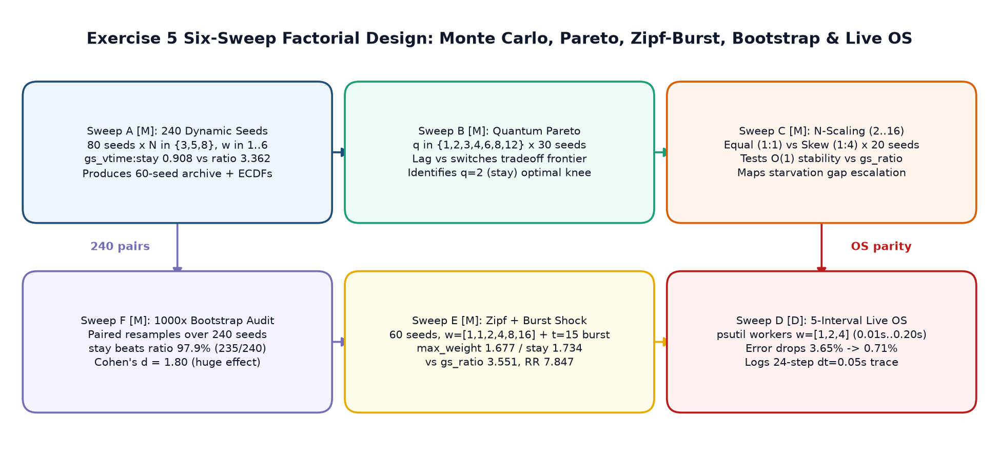
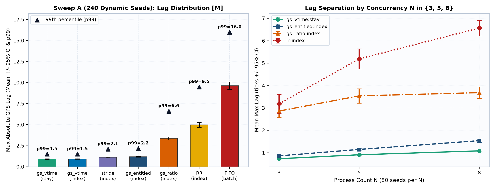
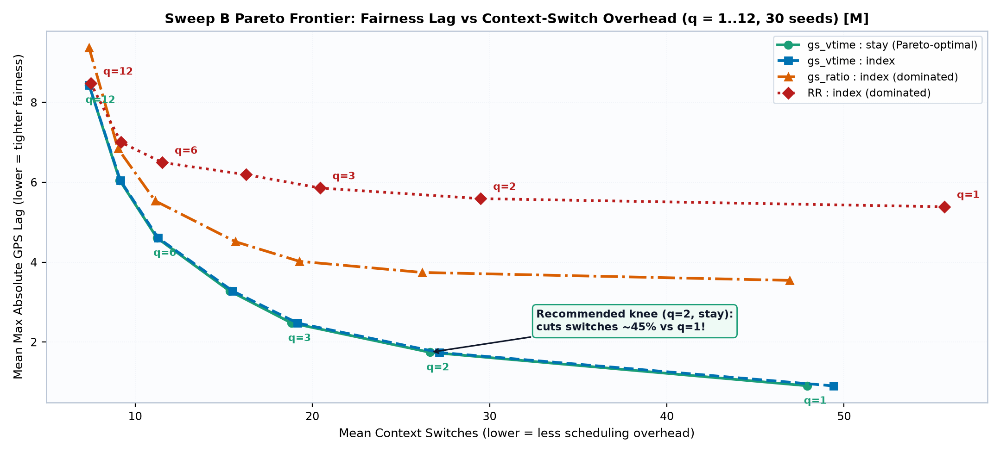
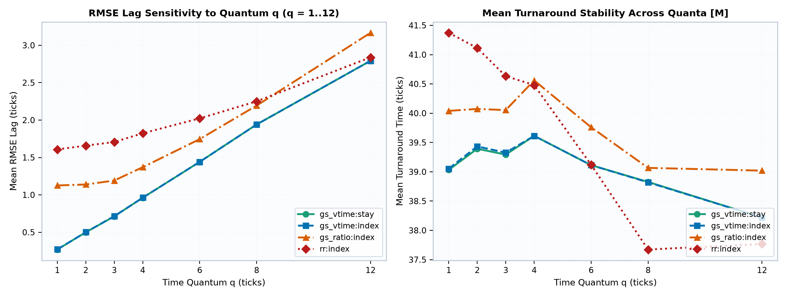
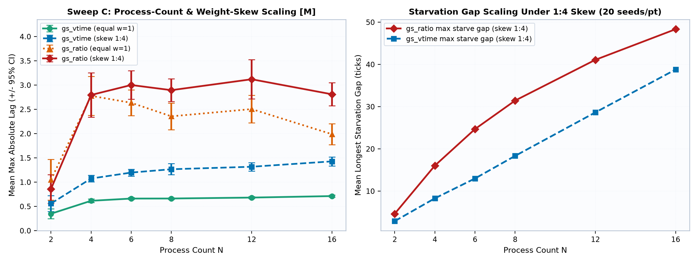
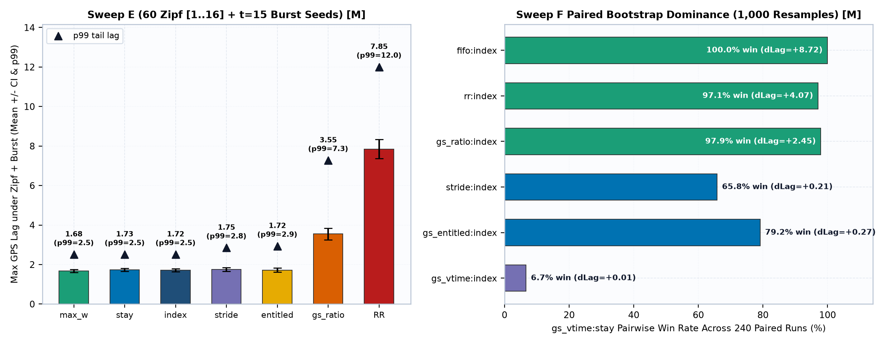
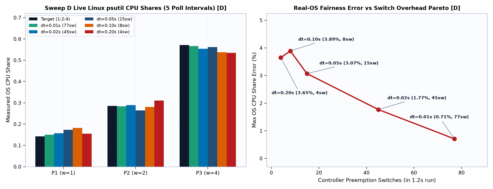

# تمرین ۵: پیمایش‌های کلان شبیه‌سازی، تحلیل حساسیت و مرز پارتو

**محک مونت‌کارلوی ۲۴۰ بذری با بازه اطمینان 95٪ و صدک 99، منحنی پارتوی کوانتوم، مقیاس‌پذیری تا ۱۶ فرایند، شوک زیپف، بوت‌استرپ هزارتایی و آزمون زنده لینوکس**

- **مخزن پروژه:** ZaraNodehi/Guaranteed-Scheduling
- **دامنه گزارش:** تمرین ۵ — طراحی آزمایش عاملی، تحلیل حساسیت، سمینار آکادمیک و اسلایدهای دوزبانه
- **ابزارهای علمی:** مونت‌کارلو ۲۴۰-تایی [M] | پارتو کوانتوم [M] | زیپف+رگبار [M] | بوت‌استرپ [M] | لینوکس زنده [D]
- **مستندات و رسانه:** ۸ نمودار Okabe-Ito | اسلایدهای PPTX دوزبانه + متن کامل گوینده

## فهرست مطالب

- ۱. طراحی آزمایش عاملی شش‌محوره و معماری آماری (p. 3)
- ۲. جاروب الف: ۲۴۰ بذر مونت‌کارلو و توزیع تجمعی تجربی [M] (p. 4)
- ۳. آرشیو سرشماری کامل تمام ۲۴۰ بذر از جاروب الف [M] (p. 5)
- ۴. جاروب ب: حساسیت کوانتوم و مرز پارتو (q = 1..12) [M] (p. 17)
- ۵. پایداری زمان بازگشت میانگین در برابر رشد خطی RMSE [M] (p. 18)
- ۶. جاروب ج: مقیاس‌پذیری تعداد فرایند N از 2 تا 16 زیر عدم تقارن 1:4 [M] (p. 19)
- ۷. جاروب ه: توزیع سنگین زیپف و رگبار ورود میانی [M] (p. 19)
- ۸. جاروب و: برتری آماری با بوت‌استرپ زوجی 1000تایی [M] (p. 23)
- ۹. جاروب د: اعتبارسنجی پنج‌بازه‌ای روی لینوکس زنده [D] (p. 23)
- ۱۰. بسته سمینار استاندارد آکادمیک و متن کامل سخنرانی دوزبانه (p. 24)
- ۱۱. حسابرسی کد منبع آزمایش‌ها و اسلایدساز (p. 27)
- ۱۲. توصیه‌های مهندسی، تهدیدهای اعتبار و آزمون‌های خودکار (p. 39)


<!-- page 1 -->


<!-- page 2 -->


<!-- page 3 -->


## ۱. طراحی آزمایش عاملی شش‌محوره و معماری آماری

مثال‌های نقض دستی مرزهای نظری الگوریتم را آشکار می‌سازند، اما طراحی زمان‌بند قابل اتکا در سیستم‌عامل مستلزم قدرت آماری در صدها بار کاری تصادفی و نوسانات زمان‌بندی واقعی هسته لینوکس است. تمرین ۵ شش پیمایش مکمل را شامل 750 اجرای شبیه‌سازی کسری دقیق [M] و 5 آزمایش زنده لینوکس [D] اجرا و مستندسازی می‌کند.

- جاروب الف [M] — محک ۲۴۰ بذری پویا: ۸۰ بذر تصادفی برای هر یک از مقادیر N برابر 3، 5 و 8 با زمان ورود 0 تا 14، حجم کار 5 تا 18 و وزن 1 تا 6 همراه با گزارش میانگین، بازه اطمینان 95٪، صدک‌های 95 و 99 و ECDF.
- جاروب ب [M] — حساسیت کوانتوم و مرز پارتو: بررسی کوانتوم‌های 1، 2، 3، 4، 6، 8 و 12 روی ۳۰ بذر مستقل که در q=2 همراه با ماندگاری stay تعویض زمینه را 44.4٪ کاهش می‌دهد.
- جاروب ج [M] — مقیاس‌پذیری تعداد فرایند N از 2 تا 16 (۲۰ بذر در هر نقطه) در دو حالت هم‌وزن 1:1 و نامتقارن 1:4.
- جاروب ه [M] — آزمون فشار توزیع سنگین زیپف [1, 1, 2, 4, 8, 16] همراه با هجوم ناگهانی سه فرایند در تیک 14 تا 17 (۶۰ بذر).
- جاروب و [M] — آزمون ناپارامتری بوت‌استرپ زوجی با 1000 بازنمونه‌گیری روی 240 جفت آزمایش الف و محاسبه اندازه اثر کوهن.
- جاروب د [D] — کنترل زنده لینوکس با پنج بازه نمونه‌برداری 0.01 تا 0.20 ثانیه روی ۳ کارگر واقعی psutil با وزن‌های [1, 2, 4] و ثبت 24 گام اجرایی.



*شکل 1. نقشه طراحی عاملی شش‌محوره تمرین ۵: پیوند شبیه‌سازی مونت‌کارلو با زمان‌بند واقعی لینوکس.*

| محور آزمایش | تعداد نمونه و دستاورد آماری کلیدی |
|---|---|
| جاروب الف: مونت‌کارلو ۲۴۰ بذری [M] | میانگین انحراف gs_vtime:stay برابر 0.908 در برابر 3.362 در gs_ratio (کاهش 3.70 برابری) |
| جاروب ب: پارتوی کوانتوم [M] | در q=2 تعویض زمینه 44.4٪ افت می‌کند (47.9 به 26.6) با ثبات زمان بازگشت میانگین |
| جاروب ج: مقیاس‌پذیری تا N=16 [M] | در N=16 با عدم تقارن 1:4 خطای gs_vtime برابر 1.429 در برابر 2.811 |
| جاروب ه: شوک زیپف + رگبار [M] | ۶۰ بذر: میانگین max_weight برابر 1.677 در برابر 3.551 در gs_ratio و 7.847 در RR |
| جاروب و: بوت‌استرپ زوجی [M] | پیروزی 97.92٪ برای stay در برابر gs_ratio (235 از 240 برد، اندازه اثر 1.80) |
| جاروب د: ۵ بازه لینوکس زنده [D] | کاهش خطای سهم CPU از 3.65٪ (0.20s) تا 0.71٪ (0.01s) |

*جدول 1. خلاصه شاخص‌های اصلی در تمام شش پیمایش تمرین ۵ [M]+[D].*


<!-- page 4 -->


## ۲. جاروب الف: ۲۴۰ بذر مونت‌کارلو و توزیع تجمعی تجربی [M]


### ۲.۱ میانگین، بازه اطمینان 95٪ و صدک‌های انتهایی p95 و p99

جدول زیر آماره‌های توصیفی را برای 240 بار کاری پویا گزارش می‌کند. لنگر انداختن ساعت مجازی هنگام ورود (gs_vtime:stay) میانگین بیشینه انحراف GPS را به 0.908 با بازه اطمینان 0.030 و صدک نود و نهم 1.50 محدود می‌سازد؛ در حالی که زمان‌بند سنتی gs_ratio به میانگین 3.362 و صدک نود و نهم 6.61 تیک می‌رسد.

| سیاست زمان‌بندی | میانگین +/- CI | صدک 95 / 99 | RMSE | شکاف | تعویض | بازگشت | جین |
|---|---|---|---|---|---|---|---|
| gs_vtime:stay | 0.908 +/- 0.030 | 1.33 / 1.50 | 0.268 | 11.61 | 49.6 | 40.79 | 1.0000 |
| gs_vtime:index | 0.916 +/- 0.030 | 1.33 / 1.50 | 0.274 | 11.56 | 50.5 | 40.80 | 1.0000 |
| stride:index | 1.118 +/- 0.049 | 1.82 / 2.10 | 0.317 | 11.90 | 50.4 | 40.91 | 1.0000 |
| gs_entitled:index | 1.182 +/- 0.050 | 1.97 / 2.18 | 0.292 | 12.19 | 51.2 | 40.91 | 1.0000 |
| gs_ratio:index | 3.362 +/- 0.173 | 5.96 / 6.61 | 1.033 | 19.60 | 48.5 | 41.71 | 1.0000 |
| rr:index | 4.981 +/- 0.294 | 8.71 / 9.50 | 1.574 | 4.18 | 56.5 | 42.88 | 1.0000 |
| fifo:index | 9.628 +/- 0.460 | 15.33 / 16.00 | 3.301 | 38.36 | 5.3 | 30.54 | 1.0000 |

*جدول 2. آماره‌های تجمیعی جاروب الف در ۲۴۰ بار کاری پویا (q = 1) [M].*



*شکل 2. میانگین انحراف GPS با بازه اطمینان 95٪ و نشانگر p99 (چپ) و تفکیک هم‌زمانی N در {3,5,8} (راست).*


### ۲.۲ تفکیک بر اساس تعداد فرایند N در {3, 5, 8} و معامله زمان بازگشت

در هم‌زمانی N = 8، میانگین خطای چرخشی نوبتی (RR) تا 6.568 تیک صعود می‌کند زیرا وزن‌های 1 تا 6 را نادیده می‌گیرد، اما gs_vtime:stay روی 1.083 پایدار می‌ماند. افزون بر این، ماندگاری stay تعویض زمینه را نیز نسبت به index کمتر نگه می‌دارد.

| سیاست | خطای N=3 (+/-CI) | خطای N=5 (+/-CI) | خطای N=8 (+/-CI) | شکاف N=8 | تعویض N=8 |
|---|---|---|---|---|---|
| gs_vtime:stay | 0.732 +/- 0.044 | 0.909 +/- 0.039 | 1.083 +/- 0.042 | 20.50 | 82.7 |
| gs_vtime:index | 0.753 +/- 0.047 | 0.912 +/- 0.039 | 1.083 +/- 0.042 | 20.51 | 83.2 |
| gs_entitled:index | 0.860 +/- 0.044 | 1.147 +/- 0.057 | 1.539 +/- 0.078 | 21.30 | 83.9 |
| gs_ratio:index | 2.861 +/- 0.288 | 3.539 +/- 0.323 | 3.684 +/- 0.258 | 31.18 | 82.0 |
| rr:index | 3.183 +/- 0.423 | 5.191 +/- 0.449 | 6.568 +/- 0.346 | 6.89 | 88.5 |
| fifo:index | 6.094 +/- 0.610 | 10.361 +/- 0.583 | 12.430 +/- 0.441 | 66.69 | 8.0 |

*جدول 3. تفکیک هم‌زمانی جاروب الف در سه سطح N = 3, 5, 8 (هر ردیف 80 بذر) [M].*


<!-- page 5 -->

> **ملاحظه مهندسی: کمینه‌سازی محض زمان بازگشت عدالت نسبی را تخریب می‌کند..** سیاست دسته‌ای FIFO کمترین میانگین زمان بازگشت (30.54 در برابر 40.79) را دارد اما با بهای غیرقابل‌قبول صدک 99 برابر 16.00 و گرسنگی شدید تا 38.36 تیک.


### ۲.۳ تابع توزیع تجمعی تجربی (ECDF) روی تمام ۲۴۰ بذر

منحنی‌های ECDF در نمودار بعدی تایید می‌کنند که برتری ساعت مجازی در تمام صدک‌ها یکنواخت برقرار است و 95 درصد اجراها زیر 1.35 تیک انحراف باقی می‌مانند.

![شکل 3: تابع توزیع تجمعی تجربی بیشینه انحراف GPS (چپ) و طولانی‌ترین وقفه گرسنگی (راست) در ۲۴۰ بذر [M].](diagrams/fig_ex5_empirical_cdf.png)

*شکل 3. تابع توزیع تجمعی تجربی بیشینه انحراف GPS (چپ) و طولانی‌ترین وقفه گرسنگی (راست) در ۲۴۰ بذر [M].*


## ۳. آرشیو سرشماری کامل تمام ۲۴۰ بذر از جاروب الف [M]

برای شفافیت مطلق آزمایش‌ها و امکان ممیزی تک‌به‌تک اجراها، جداول ۱۲گانه زیر تمام 240 بذر تصادفی شامل بذرهای 1 تا 80 (N=3)، 81 تا 160 (N=5) و 161 تا 240 (N=8) را با اوزان، کار کل و نتایج هر سیاست ثبت می‌کنند.


<!-- page 6 -->

| بذر (N) | کار | وزن‌های تصادفی | stay | index | gs_ratio | RR | تعویض/شکاف |
|---|---|---|---|---|---|---|---|
| #1 (N=3) | 33 | [1, 1, 1] | 0.500 | 0.500 | 3.500 | 0.500 | 20/6 |
| #2 (N=3) | 36 | [1, 3, 4] | 0.750 | 1.000 | 4.400 | 4.200 | 17/23 |
| #3 (N=3) | 31 | [5, 5, 2] | 0.571 | 0.571 | 1.714 | 4.429 | 19/8 |
| #4 (N=3) | 30 | [2, 2, 2] | 0.500 | 0.500 | 4.000 | 0.500 | 12/14 |
| #5 (N=3) | 31 | [2, 1, 2] | 0.500 | 0.500 | 3.000 | 2.667 | 16/4 |
| #6 (N=3) | 43 | [6, 3, 3] | 0.500 | 0.500 | 2.750 | 5.500 | 28/5 |
| #7 (N=3) | 32 | [2, 3, 1] | 0.500 | 0.500 | 2.750 | 2.500 | 14/12 |
| #8 (N=3) | 39 | [3, 2, 3] | 0.625 | 0.625 | 4.450 | 2.450 | 27/10 |
| #9 (N=3) | 37 | [6, 3, 5] | 0.545 | 0.545 | 2.671 | 1.921 | 23/6 |
| #10 (N=3) | 29 | [4, 6, 5] | 0.622 | 0.622 | 2.600 | 1.733 | 24/6 |
| #11 (N=3) | 45 | [2, 1, 2] | 0.800 | 0.800 | 6.400 | 3.333 | 22/15 |
| #12 (N=3) | 31 | [3, 5, 1] | 0.688 | 0.688 | 1.688 | 2.000 | 15/4 |
| #13 (N=3) | 42 | [5, 2, 1] | 0.667 | 0.667 | 3.000 | 5.556 | 22/10 |
| #14 (N=3) | 50 | [1, 1, 2] | 0.500 | 1.000 | 5.000 | 4.667 | 31/11 |
| #15 (N=3) | 34 | [1, 4, 3] | 0.750 | 0.800 | 3.000 | 5.000 | 13/12 |
| #16 (N=3) | 36 | [1, 6, 5] | 0.833 | 0.917 | 5.000 | 2.250 | 25/29 |
| #17 (N=3) | 31 | [5, 5, 4] | 0.643 | 0.643 | 4.143 | 0.857 | 12/6 |
| #18 (N=3) | 38 | [1, 1, 1] | 0.667 | 0.667 | 3.667 | 0.667 | 18/7 |
| #19 (N=3) | 24 | [3, 4, 5] | 0.667 | 0.667 | 1.179 | 1.417 | 16/4 |
| #20 (N=3) | 40 | [3, 6, 6] | 0.500 | 0.500 | 3.000 | 0.500 | 13/6 |

*جدول 4. سرشماری جاروب الف — N = 3 بذرهای 1 تا 20 از 240 [M].*


<!-- page 7 -->

| بذر (N) | کار | وزن‌های تصادفی | stay | index | gs_ratio | RR | تعویض/شکاف |
|---|---|---|---|---|---|---|---|
| #21 (N=3) | 30 | [5, 2, 6] | 0.750 | 0.750 | 1.500 | 3.000 | 12/6 |
| #22 (N=3) | 39 | [4, 4, 5] | 0.556 | 0.556 | 0.556 | 2.000 | 26/2 |
| #23 (N=3) | 29 | [6, 6, 1] | 0.796 | 0.796 | 3.204 | 4.939 | 13/10 |
| #24 (N=3) | 40 | [4, 6, 5] | 0.667 | 0.733 | 4.267 | 1.200 | 31/15 |
| #25 (N=3) | 33 | [6, 6, 2] | 0.750 | 0.500 | 2.500 | 4.000 | 10/10 |
| #26 (N=3) | 50 | [2, 6, 2] | 1.050 | 1.050 | 5.350 | 6.850 | 23/25 |
| #27 (N=3) | 37 | [4, 3, 6] | 0.692 | 0.692 | 4.440 | 2.286 | 20/11 |
| #28 (N=3) | 37 | [5, 6, 6] | 0.626 | 0.626 | 5.963 | 0.743 | 23/17 |
| #29 (N=3) | 36 | [6, 2, 2] | 0.950 | 0.950 | 5.150 | 3.350 | 15/7 |
| #30 (N=3) | 30 | [3, 4, 5] | 0.625 | 0.625 | 4.111 | 1.333 | 21/9 |
| #31 (N=3) | 48 | [2, 2, 2] | 0.500 | 0.500 | 3.000 | 0.500 | 40/6 |
| #32 (N=3) | 39 | [1, 5, 6] | 0.881 | 0.881 | 2.234 | 1.464 | 22/26 |
| #33 (N=3) | 34 | [2, 6, 4] | 1.000 | 0.833 | 3.000 | 5.000 | 22/8 |
| #34 (N=3) | 22 | [1, 1, 1] | 0.500 | 0.500 | 2.000 | 0.500 | 11/7 |
| #35 (N=3) | 26 | [5, 6, 5] | 0.545 | 0.455 | 1.818 | 0.455 | 10/4 |
| #36 (N=3) | 20 | [1, 4, 1] | 1.333 | 1.000 | 1.333 | 3.667 | 12/6 |
| #37 (N=3) | 31 | [5, 4, 2] | 0.766 | 0.766 | 4.000 | 2.238 | 15/9 |
| #38 (N=3) | 24 | [1, 4, 4] | 0.800 | 0.800 | 2.760 | 2.400 | 10/11 |
| #39 (N=3) | 24 | [1, 1, 6] | 1.250 | 1.500 | 1.500 | 3.250 | 13/7 |
| #40 (N=3) | 32 | [5, 1, 6] | 0.864 | 0.864 | 3.303 | 2.333 | 16/9 |

*جدول 5. سرشماری جاروب الف — N = 3 بذرهای 21 تا 40 از 240 [M].*


<!-- page 8 -->

| بذر (N) | کار | وزن‌های تصادفی | stay | index | gs_ratio | RR | تعویض/شکاف |
|---|---|---|---|---|---|---|---|
| #41 (N=3) | 34 | [3, 3, 1] | 0.786 | 0.786 | 2.143 | 2.125 | 14/4 |
| #42 (N=3) | 36 | [5, 1, 3] | 0.778 | 0.778 | 1.778 | 5.556 | 24/8 |
| #43 (N=3) | 41 | [6, 3, 2] | 0.697 | 0.697 | 1.909 | 3.242 | 28/4 |
| #44 (N=3) | 27 | [2, 4, 1] | 1.000 | 1.000 | 2.143 | 3.238 | 18/7 |
| #45 (N=3) | 36 | [2, 4, 3] | 0.667 | 0.778 | 4.000 | 2.889 | 24/14 |
| #46 (N=3) | 35 | [2, 4, 5] | 0.727 | 0.909 | 4.091 | 3.333 | 22/17 |
| #47 (N=3) | 31 | [5, 2, 5] | 0.833 | 0.833 | 2.167 | 3.667 | 20/5 |
| #48 (N=3) | 22 | [3, 3, 4] | 0.600 | 0.800 | 1.800 | 1.200 | 18/5 |
| #49 (N=3) | 38 | [5, 2, 6] | 0.923 | 0.923 | 2.385 | 5.000 | 23/6 |
| #50 (N=3) | 32 | [2, 1, 2] | 0.600 | 0.600 | 4.533 | 3.333 | 22/8 |
| #51 (N=3) | 48 | [1, 3, 4] | 0.750 | 1.000 | 4.250 | 4.875 | 29/31 |
| #52 (N=3) | 50 | [1, 5, 6] | 0.833 | 1.000 | 2.000 | 9.500 | 34/22 |
| #53 (N=3) | 37 | [6, 2, 2] | 0.800 | 0.800 | 3.400 | 6.000 | 18/4 |
| #54 (N=3) | 29 | [2, 5, 3] | 0.500 | 0.500 | 0.875 | 1.125 | 7/2 |
| #55 (N=3) | 24 | [4, 3, 6] | 0.600 | 0.600 | 2.333 | 1.667 | 9/13 |
| #56 (N=3) | 31 | [4, 2, 6] | 0.750 | 0.750 | 0.750 | 2.500 | 8/3 |
| #57 (N=3) | 34 | [4, 1, 4] | 0.760 | 0.760 | 2.240 | 4.760 | 13/10 |
| #58 (N=3) | 27 | [5, 3, 6] | 0.714 | 0.714 | 1.679 | 2.821 | 20/4 |
| #59 (N=3) | 28 | [1, 1, 5] | 1.429 | 1.429 | 0.857 | 4.000 | 13/6 |
| #60 (N=3) | 29 | [6, 4, 6] | 0.600 | 0.600 | 3.000 | 1.960 | 19/12 |

*جدول 6. سرشماری جاروب الف — N = 3 بذرهای 41 تا 60 از 240 [M].*


<!-- page 9 -->

| بذر (N) | کار | وزن‌های تصادفی | stay | index | gs_ratio | RR | تعویض/شکاف |
|---|---|---|---|---|---|---|---|
| #61 (N=3) | 39 | [2, 1, 1] | 0.500 | 0.500 | 1.833 | 3.833 | 26/3 |
| #62 (N=3) | 39 | [1, 4, 5] | 0.800 | 1.000 | 3.500 | 7.200 | 19/11 |
| #63 (N=3) | 20 | [4, 1, 1] | 0.600 | 0.600 | 1.000 | 2.000 | 13/4 |
| #64 (N=3) | 30 | [6, 3, 6] | 0.667 | 0.667 | 2.667 | 2.000 | 14/8 |
| #65 (N=3) | 39 | [3, 1, 3] | 0.786 | 0.786 | 1.286 | 5.125 | 19/6 |
| #66 (N=3) | 38 | [6, 2, 6] | 0.786 | 0.786 | 1.643 | 4.000 | 16/6 |
| #67 (N=3) | 25 | [2, 2, 1] | 0.333 | 0.333 | 1.667 | 1.000 | 5/2 |
| #68 (N=3) | 29 | [6, 1, 1] | 1.250 | 1.250 | 2.750 | 5.250 | 12/7 |
| #69 (N=3) | 36 | [4, 6, 4] | 0.600 | 0.600 | 3.571 | 2.240 | 24/7 |
| #70 (N=3) | 33 | [2, 5, 3] | 0.714 | 0.714 | 4.200 | 2.411 | 17/16 |
| #71 (N=3) | 46 | [1, 4, 5] | 0.800 | 1.000 | 4.000 | 8.000 | 28/14 |
| #72 (N=3) | 32 | [6, 2, 3] | 0.758 | 0.758 | 5.576 | 2.576 | 18/10 |
| #73 (N=3) | 36 | [1, 6, 4] | 0.909 | 0.909 | 1.857 | 5.000 | 16/19 |
| #74 (N=3) | 19 | [3, 2, 4] | 0.556 | 0.556 | 2.778 | 1.800 | 16/6 |
| #75 (N=3) | 29 | [5, 3, 1] | 0.500 | 0.500 | 1.500 | 1.125 | 7/2 |
| #76 (N=3) | 28 | [1, 6, 1] | 1.143 | 1.143 | 1.000 | 3.000 | 6/16 |
| #77 (N=3) | 35 | [5, 1, 4] | 0.800 | 0.800 | 1.600 | 7.000 | 12/9 |
| #78 (N=3) | 34 | [2, 4, 5] | 0.844 | 0.844 | 2.208 | 3.381 | 25/6 |
| #79 (N=3) | 48 | [3, 3, 1] | 0.714 | 0.714 | 3.143 | 5.500 | 23/7 |
| #80 (N=3) | 32 | [1, 6, 6] | 0.901 | 0.901 | 2.901 | 5.245 | 17/12 |

*جدول 7. سرشماری جاروب الف — N = 3 بذرهای 61 تا 80 از 240 [M].*


<!-- page 10 -->

| بذر (N) | کار | وزن‌های تصادفی | stay | index | gs_ratio | RR | تعویض/شکاف |
|---|---|---|---|---|---|---|---|
| #81 (N=5) | 60 | [6, 2, 1, 3, 6] | 1.000 | 1.000 | 3.500 | 8.000 | 45/12 |
| #82 (N=5) | 52 | [1, 4, 4, 3, 2] | 0.845 | 0.917 | 1.333 | 5.611 | 43/13 |
| #83 (N=5) | 52 | [5, 5, 5, 5, 2] | 0.758 | 0.758 | 4.000 | 4.521 | 40/14 |
| #84 (N=5) | 59 | [3, 2, 2, 4, 1] | 1.000 | 1.000 | 4.000 | 6.500 | 43/16 |
| #85 (N=5) | 53 | [4, 4, 3, 4, 6] | 0.724 | 0.724 | 3.724 | 2.867 | 48/11 |
| #86 (N=5) | 71 | [1, 3, 2, 4, 3] | 0.776 | 0.776 | 3.224 | 6.160 | 65/36 |
| #87 (N=5) | 73 | [4, 6, 1, 4, 5] | 1.000 | 1.000 | 1.562 | 9.006 | 55/38 |
| #88 (N=5) | 58 | [4, 2, 2, 2, 6] | 0.950 | 0.950 | 3.050 | 8.000 | 46/13 |
| #89 (N=5) | 46 | [3, 5, 3, 3, 6] | 1.006 | 1.006 | 2.773 | 3.284 | 39/12 |
| #90 (N=5) | 63 | [5, 5, 1, 4, 2] | 0.929 | 0.929 | 2.595 | 6.837 | 47/23 |
| #91 (N=5) | 59 | [5, 2, 2, 3, 2] | 0.941 | 0.941 | 2.726 | 4.798 | 53/8 |
| #92 (N=5) | 48 | [5, 5, 1, 4, 4] | 0.842 | 0.842 | 1.687 | 3.693 | 43/15 |
| #93 (N=5) | 60 | [1, 2, 1, 4, 2] | 1.167 | 1.167 | 2.292 | 4.806 | 52/18 |
| #94 (N=5) | 66 | [1, 2, 1, 3, 1] | 1.300 | 1.300 | 2.500 | 6.800 | 61/10 |
| #95 (N=5) | 50 | [4, 4, 2, 5, 6] | 0.830 | 0.830 | 2.524 | 4.175 | 43/10 |
| #96 (N=5) | 64 | [6, 6, 4, 4, 1] | 0.898 | 0.898 | 6.613 | 8.067 | 48/33 |
| #97 (N=5) | 58 | [6, 5, 4, 6, 6] | 0.826 | 0.826 | 5.048 | 2.264 | 48/21 |
| #98 (N=5) | 75 | [5, 3, 6, 4, 2] | 0.791 | 0.791 | 4.909 | 5.054 | 59/15 |
| #99 (N=5) | 52 | [1, 2, 4, 1, 5] | 1.148 | 1.148 | 5.683 | 4.704 | 41/36 |
| #100 (N=5) | 38 | [2, 2, 3, 4, 4] | 0.970 | 0.970 | 2.546 | 2.151 | 28/11 |

*جدول 8. سرشماری جاروب الف — N = 5 بذرهای 81 تا 100 از 240 [M].*


<!-- page 11 -->

| بذر (N) | کار | وزن‌های تصادفی | stay | index | gs_ratio | RR | تعویض/شکاف |
|---|---|---|---|---|---|---|---|
| #101 (N=5) | 66 | [6, 4, 6, 2, 3] | 0.855 | 0.855 | 3.278 | 4.262 | 57/12 |
| #102 (N=5) | 63 | [5, 2, 5, 5, 5] | 0.833 | 0.833 | 2.434 | 7.381 | 54/12 |
| #103 (N=5) | 79 | [5, 2, 5, 4, 5] | 0.812 | 0.812 | 2.712 | 6.000 | 70/10 |
| #104 (N=5) | 54 | [3, 4, 3, 3, 1] | 0.818 | 0.818 | 3.357 | 5.214 | 39/11 |
| #105 (N=5) | 62 | [6, 5, 4, 4, 6] | 0.647 | 0.647 | 3.084 | 3.023 | 59/11 |
| #106 (N=5) | 66 | [2, 6, 2, 1, 3] | 1.429 | 1.429 | 5.750 | 8.500 | 45/29 |
| #107 (N=5) | 43 | [2, 4, 2, 4, 1] | 0.863 | 0.863 | 5.057 | 4.640 | 34/22 |
| #108 (N=5) | 51 | [6, 4, 6, 5, 5] | 0.608 | 0.608 | 2.601 | 1.650 | 45/9 |
| #109 (N=5) | 61 | [6, 1, 1, 5, 2] | 1.028 | 1.028 | 3.351 | 5.000 | 59/11 |
| #110 (N=5) | 59 | [4, 5, 2, 1, 2] | 1.281 | 1.281 | 5.467 | 9.000 | 41/22 |
| #111 (N=5) | 38 | [3, 4, 4, 5, 5] | 1.000 | 1.000 | 1.444 | 1.333 | 26/28 |
| #112 (N=5) | 62 | [2, 4, 3, 4, 1] | 0.889 | 0.889 | 4.222 | 6.746 | 46/15 |
| #113 (N=5) | 68 | [5, 2, 2, 6, 5] | 0.933 | 0.933 | 5.000 | 6.667 | 49/20 |
| #114 (N=5) | 61 | [6, 4, 4, 4, 3] | 0.538 | 0.538 | 4.000 | 1.854 | 52/15 |
| #115 (N=5) | 68 | [6, 3, 5, 2, 3] | 0.862 | 0.862 | 2.000 | 5.247 | 56/21 |
| #116 (N=5) | 64 | [1, 3, 6, 6, 5] | 0.889 | 0.889 | 3.133 | 5.629 | 53/48 |
| #117 (N=5) | 58 | [6, 6, 3, 1, 4] | 0.900 | 0.900 | 4.600 | 7.446 | 44/18 |
| #118 (N=5) | 71 | [4, 1, 3, 4, 4] | 0.833 | 0.833 | 8.000 | 6.750 | 48/31 |
| #119 (N=5) | 60 | [2, 5, 3, 6, 1] | 1.126 | 1.126 | 2.370 | 6.126 | 41/15 |
| #120 (N=5) | 52 | [2, 6, 5, 6, 3] | 0.818 | 0.818 | 4.000 | 6.311 | 45/17 |

*جدول 9. سرشماری جاروب الف — N = 5 بذرهای 101 تا 120 از 240 [M].*


<!-- page 12 -->

| بذر (N) | کار | وزن‌های تصادفی | stay | index | gs_ratio | RR | تعویض/شکاف |
|---|---|---|---|---|---|---|---|
| #121 (N=5) | 65 | [6, 3, 4, 4, 2] | 0.747 | 0.747 | 5.063 | 5.000 | 54/13 |
| #122 (N=5) | 50 | [2, 3, 2, 3, 1] | 0.761 | 0.761 | 3.375 | 4.023 | 45/11 |
| #123 (N=5) | 67 | [5, 6, 2, 5, 6] | 0.793 | 0.793 | 3.207 | 3.741 | 61/27 |
| #124 (N=5) | 49 | [6, 1, 1, 5, 1] | 1.357 | 1.357 | 1.607 | 8.214 | 36/12 |
| #125 (N=5) | 51 | [1, 1, 2, 5, 1] | 1.060 | 1.171 | 2.726 | 4.393 | 37/8 |
| #126 (N=5) | 50 | [5, 5, 6, 6, 5] | 0.647 | 0.647 | 3.000 | 1.182 | 39/29 |
| #127 (N=5) | 62 | [6, 3, 5, 2, 5] | 0.929 | 0.929 | 3.000 | 5.000 | 54/15 |
| #128 (N=5) | 65 | [5, 6, 2, 5, 6] | 0.804 | 0.804 | 4.273 | 6.343 | 55/12 |
| #129 (N=5) | 49 | [4, 2, 5, 3, 5] | 0.789 | 0.789 | 4.000 | 4.635 | 36/23 |
| #130 (N=5) | 58 | [1, 5, 4, 3, 5] | 0.913 | 0.913 | 2.659 | 7.730 | 44/17 |
| #131 (N=5) | 66 | [5, 1, 5, 4, 1] | 1.262 | 1.262 | 4.000 | 9.000 | 48/25 |
| #132 (N=5) | 66 | [3, 4, 5, 3, 5] | 0.844 | 0.844 | 5.856 | 3.298 | 49/28 |
| #133 (N=5) | 57 | [4, 3, 4, 2, 3] | 0.786 | 0.786 | 3.400 | 2.537 | 49/8 |
| #134 (N=5) | 68 | [3, 2, 4, 3, 6] | 0.959 | 0.959 | 3.265 | 6.000 | 58/11 |
| #135 (N=5) | 52 | [1, 6, 4, 6, 4] | 0.895 | 0.895 | 2.250 | 8.678 | 35/19 |
| #136 (N=5) | 62 | [1, 3, 3, 6, 3] | 1.125 | 1.125 | 4.500 | 8.250 | 42/24 |
| #137 (N=5) | 56 | [2, 2, 3, 5, 4] | 1.035 | 1.035 | 2.250 | 4.147 | 52/13 |
| #138 (N=5) | 62 | [2, 2, 5, 4, 5] | 0.889 | 0.889 | 2.039 | 5.185 | 55/9 |
| #139 (N=5) | 59 | [5, 4, 2, 6, 3] | 0.904 | 0.904 | 3.805 | 3.805 | 54/10 |
| #140 (N=5) | 52 | [5, 3, 6, 6, 4] | 0.799 | 0.799 | 5.023 | 2.692 | 44/15 |

*جدول 10. سرشماری جاروب الف — N = 5 بذرهای 121 تا 140 از 240 [M].*


<!-- page 13 -->

| بذر (N) | کار | وزن‌های تصادفی | stay | index | gs_ratio | RR | تعویض/شکاف |
|---|---|---|---|---|---|---|---|
| #141 (N=5) | 50 | [1, 5, 2, 6, 6] | 1.000 | 1.000 | 2.309 | 5.000 | 42/31 |
| #142 (N=5) | 58 | [4, 2, 4, 2, 4] | 0.814 | 0.814 | 2.314 | 4.029 | 56/8 |
| #143 (N=5) | 52 | [5, 5, 1, 3, 1] | 0.944 | 0.944 | 6.278 | 4.278 | 42/16 |
| #144 (N=5) | 58 | [3, 4, 5, 6, 4] | 0.661 | 0.661 | 1.297 | 3.150 | 49/22 |
| #145 (N=5) | 53 | [2, 2, 2, 6, 1] | 1.231 | 1.231 | 5.787 | 6.965 | 44/22 |
| #146 (N=5) | 48 | [5, 2, 1, 2, 3] | 0.725 | 0.725 | 1.640 | 3.080 | 39/7 |
| #147 (N=5) | 46 | [3, 5, 5, 6, 6] | 0.857 | 0.857 | 3.470 | 2.324 | 39/22 |
| #148 (N=5) | 63 | [3, 3, 2, 6, 3] | 0.750 | 0.857 | 2.364 | 2.600 | 50/10 |
| #149 (N=5) | 62 | [3, 4, 6, 3, 5] | 0.732 | 0.732 | 2.095 | 4.977 | 57/8 |
| #150 (N=5) | 68 | [1, 6, 2, 5, 2] | 0.982 | 0.982 | 4.000 | 9.182 | 52/41 |
| #151 (N=5) | 61 | [2, 2, 6, 2, 4] | 1.000 | 1.000 | 3.583 | 5.000 | 55/15 |
| #152 (N=5) | 51 | [6, 3, 4, 1, 1] | 0.869 | 0.869 | 2.980 | 3.605 | 38/10 |
| #153 (N=5) | 62 | [4, 3, 6, 4, 5] | 0.636 | 0.636 | 5.608 | 4.393 | 53/18 |
| #154 (N=5) | 48 | [3, 6, 6, 5, 2] | 1.010 | 1.010 | 2.728 | 4.394 | 45/11 |
| #155 (N=5) | 70 | [6, 4, 4, 4, 6] | 0.675 | 0.675 | 7.625 | 2.300 | 61/27 |
| #156 (N=5) | 45 | [4, 4, 1, 2, 4] | 1.109 | 1.109 | 1.560 | 5.627 | 37/15 |
| #157 (N=5) | 59 | [4, 6, 5, 4, 2] | 0.718 | 0.718 | 6.000 | 4.156 | 44/32 |
| #158 (N=5) | 74 | [3, 6, 1, 4, 1] | 1.286 | 1.286 | 4.732 | 7.655 | 62/18 |
| #159 (N=5) | 52 | [5, 6, 6, 1, 3] | 0.819 | 0.819 | 2.000 | 5.000 | 39/29 |
| #160 (N=5) | 74 | [6, 1, 3, 3, 6] | 0.919 | 0.919 | 3.341 | 7.665 | 60/18 |

*جدول 11. سرشماری جاروب الف — N = 5 بذرهای 141 تا 160 از 240 [M].*


<!-- page 14 -->

| بذر (N) | کار | وزن‌های تصادفی | stay | index | gs_ratio | RR | تعویض/شکاف |
|---|---|---|---|---|---|---|---|
| #161 (N=8) | 97 | [1, 6, 3, 4, 4, 5, 6, 5] | 0.837 | 0.837 | 2.939 | 7.384 | 84/65 |
| #162 (N=8) | 104 | [5, 6, 2, 6, 4, 5, 3, 2] | 0.785 | 0.785 | 3.654 | 7.000 | 100/16 |
| #163 (N=8) | 91 | [2, 4, 5, 1, 3, 1, 1, 4] | 1.151 | 1.151 | 3.329 | 8.000 | 81/21 |
| #164 (N=8) | 117 | [2, 5, 6, 5, 2, 2, 1, 3] | 1.004 | 1.004 | 2.847 | 7.401 | 110/28 |
| #165 (N=8) | 80 | [4, 5, 5, 1, 5, 3, 1, 5] | 0.981 | 0.981 | 2.861 | 5.314 | 77/20 |
| #166 (N=8) | 111 | [5, 2, 6, 4, 6, 6, 4, 3] | 0.871 | 0.871 | 3.396 | 4.871 | 105/20 |
| #167 (N=8) | 83 | [1, 6, 2, 4, 1, 1, 3, 1] | 1.412 | 1.412 | 2.719 | 7.000 | 76/36 |
| #168 (N=8) | 79 | [4, 1, 6, 6, 1, 4, 5, 2] | 1.107 | 1.107 | 3.417 | 6.000 | 59/26 |
| #169 (N=8) | 88 | [3, 1, 5, 4, 3, 1, 2, 2] | 1.073 | 1.073 | 4.734 | 5.488 | 81/26 |
| #170 (N=8) | 79 | [1, 6, 4, 5, 1, 5, 4, 6] | 1.032 | 1.032 | 3.422 | 6.187 | 72/66 |
| #171 (N=8) | 78 | [2, 5, 5, 4, 6, 3, 5, 6] | 0.875 | 0.875 | 4.439 | 5.132 | 74/25 |
| #172 (N=8) | 85 | [5, 6, 6, 3, 6, 5, 3, 6] | 0.762 | 0.762 | 3.127 | 4.387 | 73/16 |
| #173 (N=8) | 97 | [2, 1, 6, 4, 3, 6, 4, 6] | 1.119 | 1.119 | 2.385 | 8.995 | 85/25 |
| #174 (N=8) | 86 | [3, 1, 5, 3, 1, 2, 2, 2] | 1.316 | 1.316 | 3.368 | 6.000 | 79/18 |
| #175 (N=8) | 89 | [6, 4, 4, 5, 4, 2, 5, 3] | 0.852 | 0.852 | 3.507 | 5.366 | 83/18 |
| #176 (N=8) | 87 | [2, 1, 5, 2, 2, 2, 3, 1] | 1.243 | 1.243 | 3.021 | 5.000 | 77/17 |
| #177 (N=8) | 87 | [4, 4, 1, 4, 5, 1, 6, 1] | 1.326 | 1.326 | 4.549 | 8.000 | 80/30 |
| #178 (N=8) | 73 | [2, 3, 2, 4, 1, 4, 5, 4] | 1.086 | 1.086 | 5.331 | 5.670 | 55/45 |
| #179 (N=8) | 85 | [3, 2, 5, 1, 3, 4, 1, 6] | 1.308 | 1.308 | 2.176 | 8.000 | 85/26 |
| #180 (N=8) | 115 | [5, 4, 6, 5, 3, 1, 3, 2] | 0.938 | 0.938 | 5.000 | 10.162 | 103/31 |

*جدول 12. سرشماری جاروب الف — N = 8 بذرهای 161 تا 180 از 240 [M].*


<!-- page 15 -->

| بذر (N) | کار | وزن‌های تصادفی | stay | index | gs_ratio | RR | تعویض/شکاف |
|---|---|---|---|---|---|---|---|
| #181 (N=8) | 85 | [2, 4, 2, 3, 5, 5, 4, 2] | 1.000 | 1.000 | 1.638 | 4.935 | 81/15 |
| #182 (N=8) | 94 | [1, 1, 2, 5, 2, 4, 6, 1] | 1.501 | 1.501 | 3.918 | 6.972 | 87/22 |
| #183 (N=8) | 99 | [4, 6, 5, 3, 6, 6, 6, 6] | 0.808 | 0.808 | 2.429 | 3.871 | 97/14 |
| #184 (N=8) | 69 | [5, 2, 5, 4, 5, 1, 2, 4] | 0.922 | 0.922 | 2.399 | 4.941 | 67/30 |
| #185 (N=8) | 84 | [4, 1, 4, 5, 6, 1, 5, 5] | 0.962 | 0.962 | 2.419 | 5.610 | 80/32 |
| #186 (N=8) | 94 | [5, 2, 4, 3, 6, 2, 5, 4] | 1.044 | 1.044 | 6.232 | 7.813 | 87/28 |
| #187 (N=8) | 74 | [3, 5, 6, 4, 5, 2, 4, 1] | 0.836 | 0.836 | 5.305 | 4.000 | 64/41 |
| #188 (N=8) | 95 | [6, 6, 1, 6, 2, 1, 5, 3] | 1.061 | 1.061 | 4.940 | 6.000 | 89/29 |
| #189 (N=8) | 105 | [1, 3, 2, 4, 4, 2, 2, 4] | 0.889 | 0.889 | 6.000 | 8.660 | 95/53 |
| #190 (N=8) | 82 | [1, 6, 1, 1, 2, 3, 2, 5] | 1.368 | 1.368 | 2.432 | 8.642 | 68/52 |
| #191 (N=8) | 104 | [4, 2, 6, 5, 6, 4, 6, 2] | 1.131 | 1.131 | 3.075 | 6.798 | 102/25 |
| #192 (N=8) | 95 | [5, 5, 6, 3, 5, 1, 5, 4] | 0.884 | 0.884 | 3.434 | 8.591 | 83/35 |
| #193 (N=8) | 111 | [1, 3, 3, 5, 1, 2, 2, 5] | 1.272 | 1.272 | 5.681 | 8.711 | 104/21 |
| #194 (N=8) | 96 | [4, 1, 1, 3, 4, 4, 3, 2] | 1.021 | 1.021 | 4.792 | 7.698 | 86/20 |
| #195 (N=8) | 84 | [1, 1, 1, 6, 6, 6, 1, 5] | 1.578 | 1.578 | 3.345 | 11.000 | 72/53 |
| #196 (N=8) | 103 | [1, 4, 4, 1, 1, 3, 5, 5] | 1.097 | 1.097 | 4.179 | 9.000 | 96/64 |
| #197 (N=8) | 77 | [1, 5, 2, 6, 2, 4, 4, 4] | 1.101 | 1.101 | 3.000 | 4.405 | 62/27 |
| #198 (N=8) | 71 | [5, 2, 5, 5, 5, 1, 6, 3] | 1.154 | 1.154 | 5.944 | 6.904 | 58/29 |
| #199 (N=8) | 113 | [6, 1, 5, 1, 3, 2, 2, 2] | 1.250 | 1.250 | 4.250 | 8.000 | 110/21 |
| #200 (N=8) | 76 | [1, 5, 5, 6, 2, 2, 6, 3] | 1.062 | 1.062 | 4.000 | 6.000 | 56/65 |

*جدول 13. سرشماری جاروب الف — N = 8 بذرهای 181 تا 200 از 240 [M].*


<!-- page 16 -->

| بذر (N) | کار | وزن‌های تصادفی | stay | index | gs_ratio | RR | تعویض/شکاف |
|---|---|---|---|---|---|---|---|
| #201 (N=8) | 74 | [6, 4, 1, 6, 6, 2, 4, 4] | 1.242 | 1.242 | 6.318 | 5.797 | 61/29 |
| #202 (N=8) | 95 | [1, 3, 3, 3, 5, 4, 3, 2] | 1.111 | 1.111 | 2.978 | 5.020 | 92/23 |
| #203 (N=8) | 90 | [5, 6, 4, 3, 3, 4, 1, 4] | 0.851 | 0.851 | 2.333 | 5.615 | 88/31 |
| #204 (N=8) | 106 | [4, 6, 2, 4, 3, 1, 1, 3] | 1.043 | 1.043 | 5.000 | 7.000 | 92/38 |
| #205 (N=8) | 103 | [6, 4, 2, 1, 4, 4, 3, 1] | 1.163 | 1.163 | 4.592 | 8.000 | 89/29 |
| #206 (N=8) | 85 | [5, 5, 3, 5, 5, 2, 5, 1] | 0.985 | 0.985 | 3.021 | 8.170 | 72/33 |
| #207 (N=8) | 79 | [3, 6, 2, 6, 6, 2, 5, 2] | 1.014 | 1.014 | 3.721 | 6.000 | 75/22 |
| #208 (N=8) | 95 | [4, 2, 1, 6, 4, 1, 2, 3] | 1.173 | 1.173 | 3.686 | 7.123 | 77/22 |
| #209 (N=8) | 92 | [5, 5, 3, 6, 6, 4, 6, 1] | 0.944 | 0.944 | 3.000 | 7.772 | 76/51 |
| #210 (N=8) | 97 | [3, 3, 6, 4, 5, 2, 3, 4] | 1.252 | 1.252 | 1.909 | 5.000 | 83/45 |
| #211 (N=8) | 83 | [1, 3, 1, 3, 4, 5, 3, 1] | 1.429 | 1.429 | 5.442 | 7.190 | 73/32 |
| #212 (N=8) | 77 | [4, 2, 3, 3, 4, 6, 4, 5] | 0.774 | 0.774 | 2.566 | 3.663 | 74/14 |
| #213 (N=8) | 79 | [2, 4, 4, 5, 2, 5, 2, 5] | 1.000 | 1.000 | 2.625 | 4.000 | 79/15 |
| #214 (N=8) | 87 | [1, 4, 1, 5, 5, 1, 2, 2] | 1.201 | 1.201 | 3.000 | 6.000 | 72/31 |
| #215 (N=8) | 88 | [5, 3, 3, 5, 5, 6, 2, 2] | 0.969 | 0.969 | 2.734 | 3.819 | 76/17 |
| #216 (N=8) | 89 | [5, 1, 4, 5, 6, 3, 3, 2] | 0.923 | 0.923 | 4.000 | 6.948 | 78/24 |
| #217 (N=8) | 90 | [4, 3, 2, 6, 2, 3, 4, 3] | 1.182 | 1.182 | 3.813 | 6.451 | 82/20 |
| #218 (N=8) | 101 | [4, 2, 5, 3, 1, 2, 5, 2] | 1.103 | 1.103 | 3.000 | 6.064 | 95/17 |
| #219 (N=8) | 94 | [1, 2, 6, 6, 5, 3, 6, 2] | 1.333 | 1.333 | 3.561 | 8.000 | 76/67 |
| #220 (N=8) | 78 | [2, 1, 4, 2, 5, 3, 4, 1] | 0.976 | 0.976 | 2.748 | 6.636 | 76/21 |

*جدول 14. سرشماری جاروب الف — N = 8 بذرهای 201 تا 220 از 240 [M].*


<!-- page 17 -->

| بذر (N) | کار | وزن‌های تصادفی | stay | index | gs_ratio | RR | تعویض/شکاف |
|---|---|---|---|---|---|---|---|
| #221 (N=8) | 109 | [2, 4, 2, 2, 3, 5, 3, 4] | 0.860 | 0.860 | 5.060 | 5.899 | 106/31 |
| #222 (N=8) | 117 | [3, 2, 3, 1, 2, 6, 6, 3] | 1.000 | 1.000 | 6.516 | 6.714 | 102/53 |
| #223 (N=8) | 81 | [6, 5, 5, 3, 6, 3, 2, 2] | 1.079 | 1.079 | 4.526 | 7.000 | 74/28 |
| #224 (N=8) | 103 | [4, 2, 2, 5, 5, 4, 6, 5] | 0.975 | 0.975 | 4.763 | 5.954 | 93/29 |
| #225 (N=8) | 76 | [3, 4, 5, 2, 3, 2, 1, 4] | 1.052 | 1.052 | 2.207 | 4.848 | 69/38 |
| #226 (N=8) | 82 | [1, 5, 3, 2, 1, 2, 3, 3] | 1.187 | 1.187 | 4.000 | 6.000 | 74/66 |
| #227 (N=8) | 100 | [3, 5, 3, 3, 1, 2, 2, 3] | 1.020 | 1.020 | 2.987 | 7.257 | 90/22 |
| #228 (N=8) | 96 | [2, 1, 1, 1, 6, 1, 3, 6] | 1.600 | 1.600 | 3.857 | 9.000 | 95/34 |
| #229 (N=8) | 108 | [4, 1, 6, 6, 4, 2, 5, 2] | 1.000 | 1.000 | 2.744 | 6.291 | 104/29 |
| #230 (N=8) | 107 | [1, 5, 1, 3, 3, 4, 6, 1] | 1.318 | 1.318 | 3.807 | 9.000 | 102/77 |
| #231 (N=8) | 70 | [4, 3, 1, 1, 1, 3, 2, 5] | 1.312 | 1.312 | 5.000 | 5.499 | 60/36 |
| #232 (N=8) | 93 | [5, 1, 6, 4, 3, 6, 5, 1] | 0.965 | 0.965 | 4.005 | 8.000 | 86/35 |
| #233 (N=8) | 92 | [4, 4, 6, 6, 6, 5, 3, 4] | 0.767 | 0.767 | 2.111 | 3.083 | 84/14 |
| #234 (N=8) | 76 | [2, 1, 1, 6, 3, 4, 4, 5] | 1.055 | 1.055 | 2.792 | 7.918 | 66/26 |
| #235 (N=8) | 88 | [4, 2, 4, 4, 2, 4, 1, 4] | 0.925 | 0.925 | 2.639 | 6.226 | 80/27 |
| #236 (N=8) | 109 | [2, 2, 4, 3, 4, 3, 5, 6] | 1.211 | 1.211 | 3.191 | 6.000 | 106/23 |
| #237 (N=8) | 102 | [4, 3, 2, 3, 5, 4, 2, 4] | 1.062 | 1.062 | 3.167 | 5.710 | 91/14 |
| #238 (N=8) | 87 | [1, 6, 3, 1, 5, 5, 2, 1] | 1.288 | 1.288 | 2.764 | 7.910 | 81/23 |
| #239 (N=8) | 90 | [4, 3, 2, 1, 5, 1, 1, 1] | 1.430 | 1.430 | 2.490 | 7.787 | 89/17 |
| #240 (N=8) | 106 | [5, 5, 4, 3, 6, 6, 4, 3] | 0.846 | 0.846 | 6.415 | 5.161 | 97/40 |

*جدول 15. سرشماری جاروب الف — N = 8 بذرهای 221 تا 240 از 240 [M].*


## ۴. جاروب ب: حساسیت کوانتوم و مرز پارتو (q = 1..12) [M]

با پیمایش کوانتوم از 1 تا 12 روی ۳۰ بذر N=5، افزایش q از 1 به 2 زیر سیاست gs_vtime:stay تعویض زمینه را 44.4٪ کاهش می‌دهد (47.9 به 26.6) و میانگین انحراف را در سطح قابل‌کنترل 1.743 نگه می‌دارد.

| q | gs_vtime:stay (انحراف/تعویض) | gs_vtime:index | gs_ratio | RR | زمان بازگشت stay |
|---|---|---|---|---|---|
| 1 | 0.905 / 47.9 | 0.902 / 49.4 | 3.544 / 46.9 | 5.388 / 55.7 | 39.03 |
| 2 | 1.743 / 26.6 | 1.739 / 27.2 | 3.743 / 26.2 | 5.591 / 29.5 | 39.39 |
| 3 | 2.475 / 18.8 | 2.475 / 19.2 | 4.022 / 19.3 | 5.857 / 20.4 | 39.29 |
| 4 | 3.279 / 15.3 | 3.279 / 15.5 | 4.512 / 15.7 | 6.192 / 16.3 | 39.61 |
| 6 | 4.607 / 11.2 | 4.607 / 11.3 | 5.534 / 11.1 | 6.495 / 11.5 | 39.11 |
| 8 | 6.048 / 9.1 | 6.048 / 9.2 | 6.842 / 9.0 | 7.004 / 9.2 | 38.83 |
| 12 | 8.438 / 7.4 | 8.438 / 7.4 | 9.370 / 7.4 | 8.476 / 7.5 | 38.22 |

*جدول 16. جدول مرز پارتوی کوانتوم در q از 1 تا 12 (میانگین ۳۰ بذر) [M].*


<!-- page 18 -->



*شکل 4. منحنی پارتوی عدالت در برابر سربار تعویض زمینه با مشخص کردن نقطه بهینه q = 2.*


## ۵. پایداری زمان بازگشت میانگین در برابر رشد خطی RMSE [M]

همان‌گونه که جدول و نمودار زیر نشان می‌دهند، خطای ریشه مربعات (RMSE) متناسب با q رشد می‌کند اما میانگین زمان بازگشت کل کارها حول 39 تیک کاملاً ثابت می‌ماند.

| q | stay (RMSE / p99) | index (RMSE / p99) | gs_ratio (RMSE / p99) | RR (RMSE / p99) | بازگشت ratio |
|---|---|---|---|---|---|
| 1 | 0.269 / 1.40 | 0.271 / 1.40 | 1.126 / 6.00 | 1.608 / 9.81 | 40.04 |
| 2 | 0.499 / 3.00 | 0.501 / 3.00 | 1.139 / 6.00 | 1.658 / 9.31 | 40.07 |
| 3 | 0.713 / 4.57 | 0.715 / 4.57 | 1.192 / 7.00 | 1.707 / 9.56 | 40.05 |
| 4 | 0.961 / 4.86 | 0.962 / 4.86 | 1.370 / 8.44 | 1.824 / 10.81 | 40.56 |
| 6 | 1.441 / 7.30 | 1.441 / 7.30 | 1.745 / 9.38 | 2.022 / 10.00 | 39.76 |
| 8 | 1.941 / 9.48 | 1.941 / 9.48 | 2.194 / 11.67 | 2.251 / 14.81 | 39.07 |
| 12 | 2.793 / 14.81 | 2.793 / 14.81 | 3.167 / 14.69 | 2.839 / 14.81 | 39.02 |

*جدول 17. تحلیل RMSE، صدک 99 و زمان بازگشت میانگین در کوانتوم‌های 1 تا 12 [M].*



*شکل 5. حساسیت خطی خطای RMSE به کوانتوم (چپ) در برابر ثبات زمان بازگشت (راست).*


<!-- page 19 -->


## ۶. جاروب ج: مقیاس‌پذیری تعداد فرایند N از 2 تا 16 زیر عدم تقارن 1:4 [M]

در هم‌زمانی بالا (N = 16 با وزن‌های نامتقارن 1:4)، خطای gs_vtime برابر 1.429 و میانگین شکاف آن 38.8 است، در حالی که gs_ratio تا خطای 2.811 و شکاف 48.4 افت می‌کند.

| N | هم‌وزن gs_vtime | هم‌وزن gs_ratio | نامتقارن gs_vtime | نامتقارن gs_ratio | شکاف (vt در برابر rat) |
|---|---|---|---|---|---|
| 2 | 0.350 +/- 0.103 | 1.050 +/- 0.420 | 0.560 +/- 0.165 | 0.860 +/- 0.296 | 2.9 vs 4.7 |
| 4 | 0.617 +/- 0.036 | 2.779 +/- 0.402 | 1.076 +/- 0.069 | 2.797 +/- 0.457 | 8.3 vs 16.1 |
| 6 | 0.663 +/- 0.022 | 2.636 +/- 0.266 | 1.198 +/- 0.071 | 3.002 +/- 0.293 | 13.0 vs 24.7 |
| 8 | 0.664 +/- 0.019 | 2.357 +/- 0.276 | 1.267 +/- 0.114 | 2.896 +/- 0.236 | 18.4 vs 31.4 |
| 12 | 0.683 +/- 0.021 | 2.506 +/- 0.285 | 1.318 +/- 0.086 | 3.121 +/- 0.407 | 28.6 vs 41.1 |
| 16 | 0.714 +/- 0.021 | 1.989 +/- 0.213 | 1.429 +/- 0.092 | 2.811 +/- 0.236 | 38.8 vs 48.4 |

*جدول 18. مقیاس‌پذیری N از 2 تا 16 در رژیم‌های هم‌وزن و نامتقارن (۲۰ بذر در هر ردیف) [M].*

| N | صدک95 هم‌وزن vt | صدک95 هم‌وزن rat | صدک95 کج vt | صدک95 کج rat | تعداد تعویض (vt vs rat) |
|---|---|---|---|---|---|
| 2 | 0.500 | 2.500 | 0.800 | 2.200 | 3.9 vs 3.4 |
| 4 | 0.750 | 5.000 | 1.333 | 4.444 | 22.1 vs 23.1 |
| 6 | 0.800 | 3.900 | 1.558 | 4.261 | 42.4 vs 42.9 |
| 8 | 0.750 | 3.861 | 1.914 | 3.903 | 63.0 vs 64.2 |
| 12 | 0.783 | 4.194 | 1.833 | 5.024 | 100.0 vs 101.0 |
| 16 | 0.800 | 3.000 | 1.908 | 3.845 | 136.6 vs 137.2 |

*جدول 19. صدک 95 انحراف و تعداد تعویض زمینه در پیمایش N = 2..16 [M].*



*شکل 6. روند مجانبی انحراف (چپ) و بیشینه وقفه گرسنگی تحت عدم تقارن 1:4 (راست).*


## ۷. جاروب ه: توزیع سنگین زیپف و رگبار ورود میانی [M]

در آزمون شوک زیپف [1, 1, 2, 4, 8, 16] همراه با هجوم سه فرایند در تیک 14 تا 17، سیاست‌های gs_vtime:max_weight (1.677) و stay (1.734) ثبات خود را حفظ می‌کنند اما gs_ratio به 3.551 و RR به 7.847 می‌جهند.


<!-- page 20 -->

| سیاست | میانگین +/- CI | صدک 95 / 99 | شکاف | تعویض | شاخص جین |
|---|---|---|---|---|---|
| gs_vtime:max_weight | 1.677 +/- 0.078 | 2.19 / 2.51 | 18.50 | 49.7 | 1.0000 |
| gs_vtime:stay | 1.734 +/- 0.079 | 2.22 / 2.51 | 18.72 | 48.1 | 1.0000 |
| gs_vtime:index | 1.720 +/- 0.081 | 2.22 / 2.51 | 18.65 | 49.4 | 1.0000 |
| gs_entitled:index | 1.722 +/- 0.105 | 2.55 / 2.93 | 19.40 | 51.3 | 1.0000 |
| stride:index | 1.748 +/- 0.093 | 2.67 / 2.85 | 19.12 | 49.0 | 1.0000 |
| gs_ratio:index | 3.551 +/- 0.293 | 6.50 / 7.27 | 24.50 | 46.8 | 1.0000 |
| rr:index | 7.847 +/- 0.483 | 11.00 / 12.00 | 4.92 | 64.0 | 1.0000 |

*جدول 20. نتایج تجمیعی ۶۰ بذر زیپف + رگبار میانی [M].*



*شکل 7. خطای انحراف در شوک زیپف (چپ) و نرخ پیروزی بوت‌استرپ زوجی در 1000 بازنمونه‌گیری (راست).*


<!-- page 21 -->

| بذر | اوزان تصادفی زیپف | max_w | stay | gs_ratio | RR | شکاف (stay vs rat) |
|---|---|---|---|---|---|---|
| 1 | [1, 8, 2, 4, 1, 16] | 1.516 | 1.516 | 3.725 | 8.004 | 19 vs 26 |
| 2 | [4, 8, 16, 1, 2, 1] | 1.393 | 1.393 | 2.393 | 3.000 | 8 vs 9 |
| 3 | [16, 2, 8, 1, 1, 4] | 1.560 | 1.560 | 3.060 | 7.000 | 15 vs 14 |
| 4 | [4, 8, 2, 1, 1, 16] | 1.889 | 2.222 | 5.111 | 12.000 | 22 vs 24 |
| 5 | [8, 4, 16, 1, 2, 1] | 1.298 | 1.298 | 3.298 | 6.298 | 15 vs 14 |
| 6 | [1, 16, 8, 4, 2, 1] | 1.877 | 1.877 | 3.377 | 8.047 | 27 vs 30 |
| 7 | [2, 8, 1, 16, 4, 1] | 1.667 | 1.667 | 4.000 | 12.000 | 20 vs 30 |
| 8 | [4, 1, 8, 16, 1, 2] | 1.333 | 1.333 | 3.000 | 7.000 | 16 vs 20 |
| 9 | [8, 4, 1, 2, 16, 1] | 2.016 | 2.016 | 3.650 | 11.000 | 23 vs 30 |
| 10 | [4, 8, 1, 16, 1, 2] | 2.033 | 2.033 | 5.465 | 9.000 | 25 vs 29 |
| 11 | [2, 1, 8, 16, 4, 1] | 1.593 | 1.593 | 4.574 | 7.075 | 18 vs 25 |
| 12 | [16, 4, 1, 8, 1, 2] | 1.500 | 1.500 | 3.117 | 5.158 | 13 vs 21 |
| 13 | [4, 16, 8, 2, 1, 1] | 2.016 | 2.016 | 2.683 | 8.000 | 21 vs 17 |
| 14 | [16, 1, 8, 4, 2, 1] | 1.948 | 1.948 | 4.448 | 8.000 | 26 vs 30 |
| 15 | [4, 1, 16, 1, 2, 8] | 1.286 | 1.286 | 2.000 | 10.000 | 12 vs 23 |

*جدول 21. آمار تفکیکی شوک زیپف — بذرهای 1 تا 15 از 60 [M].*

| بذر | اوزان تصادفی زیپف | max_w | stay | gs_ratio | RR | شکاف (stay vs rat) |
|---|---|---|---|---|---|---|
| 16 | [1, 2, 8, 4, 16, 1] | 1.484 | 1.484 | 3.758 | 7.742 | 13 vs 25 |
| 17 | [8, 2, 1, 4, 1, 16] | 2.509 | 2.509 | 2.579 | 8.000 | 17 vs 25 |
| 18 | [16, 2, 4, 1, 8, 1] | 1.475 | 1.475 | 2.967 | 10.975 | 17 vs 15 |
| 19 | [1, 8, 4, 2, 16, 1] | 2.000 | 2.000 | 4.609 | 7.244 | 20 vs 25 |
| 20 | [16, 1, 8, 4, 1, 2] | 1.011 | 1.011 | 3.511 | 5.550 | 19 vs 20 |
| 21 | [4, 16, 1, 2, 8, 1] | 1.286 | 1.524 | 2.100 | 7.500 | 20 vs 35 |
| 22 | [2, 4, 8, 1, 1, 16] | 2.000 | 2.000 | 7.000 | 10.108 | 28 vs 25 |
| 23 | [4, 1, 8, 1, 16, 2] | 2.000 | 2.000 | 2.492 | 6.000 | 13 vs 16 |
| 24 | [1, 1, 16, 8, 2, 4] | 1.500 | 1.500 | 3.500 | 9.000 | 15 vs 28 |
| 25 | [16, 2, 1, 1, 4, 8] | 1.210 | 1.500 | 3.500 | 8.000 | 15 vs 28 |
| 26 | [1, 4, 1, 2, 8, 16] | 1.833 | 1.833 | 5.833 | 8.000 | 23 vs 35 |
| 27 | [4, 2, 8, 1, 1, 16] | 2.000 | 2.000 | 4.803 | 7.000 | 19 vs 18 |
| 28 | [16, 4, 1, 2, 1, 8] | 1.465 | 1.465 | 2.000 | 6.077 | 19 vs 25 |
| 29 | [2, 4, 1, 1, 8, 16] | 1.966 | 1.966 | 2.565 | 8.537 | 24 vs 27 |
| 30 | [4, 2, 1, 1, 8, 16] | 1.500 | 2.000 | 6.500 | 9.000 | 24 vs 31 |

*جدول 22. آمار تفکیکی شوک زیپف — بذرهای 16 تا 30 از 60 [M].*


<!-- page 22 -->

| بذر | اوزان تصادفی زیپف | max_w | stay | gs_ratio | RR | شکاف (stay vs rat) |
|---|---|---|---|---|---|---|
| 31 | [1, 16, 8, 1, 2, 4] | 1.838 | 1.838 | 3.338 | 8.000 | 26 vs 29 |
| 32 | [8, 1, 16, 1, 2, 4] | 1.335 | 1.335 | 3.835 | 7.312 | 24 vs 26 |
| 33 | [1, 4, 16, 2, 8, 1] | 1.286 | 1.286 | 1.571 | 5.122 | 11 vs 15 |
| 34 | [16, 8, 1, 4, 1, 2] | 1.493 | 1.493 | 4.271 | 7.057 | 22 vs 26 |
| 35 | [16, 1, 1, 4, 2, 8] | 1.667 | 1.667 | 3.667 | 7.000 | 13 vs 27 |
| 36 | [1, 2, 4, 8, 16, 1] | 1.976 | 1.976 | 3.357 | 10.000 | 25 vs 35 |
| 37 | [8, 2, 4, 1, 16, 1] | 2.260 | 2.260 | 3.740 | 7.000 | 17 vs 18 |
| 38 | [1, 2, 1, 8, 4, 16] | 1.400 | 1.400 | 4.000 | 8.000 | 24 vs 43 |
| 39 | [16, 2, 4, 1, 8, 1] | 1.461 | 1.461 | 2.309 | 11.000 | 17 vs 15 |
| 40 | [1, 8, 4, 1, 2, 16] | 2.029 | 2.029 | 3.379 | 10.362 | 20 vs 24 |
| 41 | [1, 8, 2, 16, 4, 1] | 2.000 | 2.000 | 3.480 | 7.038 | 16 vs 23 |
| 42 | [1, 8, 1, 4, 2, 16] | 1.400 | 1.600 | 3.500 | 5.000 | 12 vs 23 |
| 43 | [16, 1, 2, 4, 8, 1] | 1.526 | 1.526 | 3.250 | 8.833 | 15 vs 25 |
| 44 | [2, 4, 8, 16, 1, 1] | 2.067 | 2.067 | 3.933 | 7.000 | 18 vs 18 |
| 45 | [1, 1, 4, 8, 2, 16] | 1.567 | 2.067 | 3.933 | 6.317 | 19 vs 28 |

*جدول 23. آمار تفکیکی شوک زیپف — بذرهای 31 تا 45 از 60 [M].*

| بذر | اوزان تصادفی زیپف | max_w | stay | gs_ratio | RR | شکاف (stay vs rat) |
|---|---|---|---|---|---|---|
| 46 | [4, 2, 1, 1, 16, 8] | 1.696 | 1.696 | 4.000 | 10.000 | 29 vs 35 |
| 47 | [4, 8, 16, 2, 1, 1] | 1.618 | 2.000 | 2.618 | 6.000 | 13 vs 16 |
| 48 | [4, 2, 1, 8, 1, 16] | 1.705 | 1.705 | 1.855 | 7.000 | 14 vs 24 |
| 49 | [4, 16, 1, 1, 2, 8] | 1.286 | 1.286 | 3.111 | 7.000 | 17 vs 25 |
| 50 | [1, 2, 16, 4, 1, 8] | 1.526 | 1.832 | 3.000 | 9.648 | 21 vs 30 |
| 51 | [16, 1, 8, 4, 1, 2] | 1.545 | 1.545 | 4.045 | 8.000 | 26 vs 29 |
| 52 | [8, 1, 1, 2, 16, 4] | 2.000 | 2.000 | 3.042 | 10.000 | 20 vs 37 |
| 53 | [4, 8, 16, 1, 1, 2] | 1.313 | 1.485 | 2.647 | 5.000 | 12 vs 11 |
| 54 | [8, 1, 4, 16, 2, 1] | 1.727 | 1.727 | 3.782 | 10.000 | 20 vs 24 |
| 55 | [1, 2, 1, 4, 16, 8] | 1.671 | 2.171 | 7.271 | 6.152 | 20 vs 32 |
| 56 | [16, 8, 1, 4, 1, 2] | 1.836 | 1.836 | 3.336 | 9.000 | 25 vs 28 |
| 57 | [16, 2, 1, 1, 4, 8] | 1.394 | 1.394 | 2.932 | 9.000 | 15 vs 26 |
| 58 | [8, 2, 1, 16, 1, 4] | 2.188 | 2.188 | 2.900 | 9.000 | 20 vs 27 |
| 59 | [16, 2, 8, 4, 1, 1] | 1.625 | 1.625 | 3.125 | 5.000 | 15 vs 15 |
| 60 | [8, 2, 1, 16, 1, 4] | 2.018 | 2.018 | 2.198 | 4.684 | 11 vs 16 |

*جدول 24. آمار تفکیکی شوک زیپف — بذرهای 46 تا 60 از 60 [M].*


<!-- page 23 -->


## ۸. جاروب و: برتری آماری با بوت‌استرپ زوجی 1000تایی [M]

با اجرای 1000 بازنمونه‌گیری بوت‌استرپ زوجی روی 240 جفت آزمایش الف، روش gs_vtime:stay در 97.92٪ موارد بر gs_ratio (235 برد از 240، کاهش میانگین +2.4538 با اندازه اثر کوهن 1.805) و در 97.08٪ موارد بر چرخشی نوبتی پیروز می‌شود.

| رقیب در برابر stay | برد / تساوی / باخت | نرخ برد | کاهش خطا | بازه اطمینان 95٪ | کوهن d | صرفه تعویض |
|---|---|---|---|---|---|---|
| gs_vtime:index | 16/220/4 | 6.67% | +0.0082 | [+0.0007, +0.0161] | 0.135 | +0.87 |
| gs_entitled:index | 190/20/30 | 79.17% | +0.2744 | [+0.2366, +0.3130] | 0.878 | +1.54 |
| stride:index | 158/53/29 | 65.83% | +0.2105 | [+0.1767, +0.2475] | 0.748 | +0.78 |
| gs_ratio:index | 235/3/2 | 97.92% | +2.4538 | [+2.2887, +2.6326] | 1.805 | -1.07 |
| rr:index | 233/6/1 | 97.08% | +4.0729 | [+3.8168, +4.3614] | 1.879 | +6.86 |
| fifo:index | 240/0/0 | 100.00% | +8.7204 | [+8.2771, +9.1260] | 2.488 | -44.28 |

*جدول 25. جدول برتری آماری بوت‌استرپ زوجی و اندازه اثر کوهن در ۲۴۰ جفت آزمایش [M].*


## ۹. جاروب د: اعتبارسنجی پنج‌بازه‌ای روی لینوکس زنده [D]

با کنترل سه کارگر واقعی پایتون با وزن‌های [1, 2, 4] از طریق سیگنال‌های psutil روی لینوکس، بازه 0.01s با 77 تعویض خطای سهم CPU را به 0.71٪ می‌رساند و بازه 0.05s تعویض‌ها را به 15 می‌کاهد با خطای 3.07٪. جداول زیر نتایج ۵ بازه و ردیابی ۲۴ گام اجرایی را ثبت می‌کنند.

| بازه dt | توزیع‌ها | تعویض‌ها | کل زمان CPU | سهم‌های واقعی [P1, P2, P3] | بیشینه خطا |
|---|---|---|---|---|---|
| 0.01 s | 116 | 77 | 1.200 s | 0.1500, 0.2833, 0.5667 | 0.71% |
| 0.02 s | 59 | 45 | 1.210 s | 0.1570, 0.2893, 0.5537 | 1.77% |
| 0.05 s | 23 | 15 | 1.210 s | 0.1736, 0.2645, 0.5620 | 3.07% |
| 0.10 s | 11 | 8 | 1.210 s | 0.1818, 0.2810, 0.5372 | 3.89% |
| 0.20 s | 6 | 4 | 1.290 s | 0.1550, 0.3101, 0.5349 | 3.65% |

*جدول 26. دقت سهم‌پردازنده در کنترل زنده لینوکس با پنج بازه کنترل [D].*



*شکل 8. سهم‌های واقعی ثبت‌شده روی هسته لینوکس (چپ) و منحنی پارتوی خطا در برابر تعویض (راست).*


<!-- page 24 -->

| گام | زمان (ms) | کارگر منتخب | جمع CPU تجمعی (ثانیه) | سهم‌های جاری | خطای بیشینه |
|---|---|---|---|---|---|
| 1 | 51.0 | P1 (w=1) | 0.050, 0.000, 0.000 | 1.000, 0.000, 0.000 | 85.71% |
| 2 | 102.0 | P2 (w=2) | 0.050, 0.050, 0.000 | 0.500, 0.500, 0.000 | 57.14% |
| 3 | 152.4 | P3 (w=4) | 0.050, 0.050, 0.040 | 0.357, 0.357, 0.286 | 28.57% |
| 4 | 204.4 | P3 (w=4) | 0.050, 0.050, 0.090 | 0.263, 0.263, 0.474 | 12.03% |
| 5 | 259.8 | P3 (w=4) | 0.050, 0.050, 0.150 | 0.200, 0.200, 0.600 | 8.57% |
| 6 | 311.3 | P2 (w=2) | 0.050, 0.100, 0.150 | 0.167, 0.333, 0.500 | 7.14% |
| 7 | 366.5 | P3 (w=4) | 0.050, 0.100, 0.200 | 0.143, 0.286, 0.571 | 0.00% |
| 8 | 418.1 | P1 (w=1) | 0.100, 0.100, 0.200 | 0.250, 0.250, 0.500 | 10.71% |
| 9 | 472.6 | P2 (w=2) | 0.100, 0.160, 0.200 | 0.217, 0.348, 0.435 | 13.66% |
| 10 | 523.9 | P3 (w=4) | 0.100, 0.160, 0.250 | 0.196, 0.314, 0.490 | 8.12% |
| 11 | 579.1 | P3 (w=4) | 0.100, 0.160, 0.310 | 0.175, 0.281, 0.544 | 3.25% |
| 12 | 630.6 | P3 (w=4) | 0.100, 0.160, 0.360 | 0.161, 0.258, 0.581 | 2.76% |

*جدول 27. ردیابی زنده گام‌به‌گام کنترلر در dt = 0.05s (گام‌های 1 تا 12 از 23) [D].*

| گام | زمان (ms) | کارگر منتخب | جمع CPU تجمعی (ثانیه) | سهم‌های جاری | خطای بیشینه |
|---|---|---|---|---|---|
| 13 | 682.8 | P2 (w=2) | 0.100, 0.200, 0.360 | 0.151, 0.303, 0.545 | 2.59% |
| 14 | 734.2 | P3 (w=4) | 0.100, 0.200, 0.410 | 0.141, 0.282, 0.578 | 0.61% |
| 15 | 789.3 | P1 (w=1) | 0.160, 0.200, 0.410 | 0.208, 0.260, 0.532 | 6.49% |
| 16 | 847.7 | P2 (w=2) | 0.160, 0.270, 0.410 | 0.191, 0.321, 0.488 | 8.33% |
| 17 | 898.3 | P3 (w=4) | 0.160, 0.270, 0.460 | 0.180, 0.303, 0.517 | 5.45% |
| 18 | 952.9 | P3 (w=4) | 0.160, 0.270, 0.510 | 0.170, 0.287, 0.543 | 2.88% |
| 19 | 1006.6 | P3 (w=4) | 0.160, 0.270, 0.570 | 0.160, 0.270, 0.570 | 1.71% |
| 20 | 1063.4 | P2 (w=2) | 0.160, 0.320, 0.570 | 0.152, 0.305, 0.543 | 2.85% |
| 21 | 1116.3 | P3 (w=4) | 0.160, 0.320, 0.620 | 0.145, 0.291, 0.564 | 0.78% |
| 22 | 1172.4 | P3 (w=4) | 0.160, 0.320, 0.680 | 0.138, 0.276, 0.586 | 1.48% |
| 23 | 1224.6 | P1 (w=1) | 0.210, 0.320, 0.680 | 0.174, 0.265, 0.562 | 3.07% |

*جدول 28. ادامه ردیابی زنده کنترلر در dt = 0.05s (گام‌های 13 تا 23) [D].*


## ۱۰. بسته سمینار استاندارد آکادمیک و متن کامل سخنرانی دوزبانه

علاوه بر تک‌نگار مکتوب، اسلایدهای دهگانه استاندارد آکادمیک و متن کامل گوینده در قالب دوزبانه برای هر دو زبان انگلیسی و فارسی تدارک دیده شده‌اند.

| مسیر پرونده سمینار | قالب و ساختار | نقش در ارائه دانشگاهی |
|---|---|---|
| exercise-5/docs/DECK_EN.pptx | ۱۰ اسلاید عریض + یادداشت گوینده | ارائه رسمی انگلیسی (PPTX) |
| exercise-5/docs/DECK_FA.pptx | ۱۰ اسلاید RTL با فونت Vazirmatn | ارائه رسمی فارسی راست‌به‌چپ |
| exercise-5/docs/SPEAKER_EN.md | متن کامل سخنرانی ۱۰ اسلاید | سند راهنمای ارائه انگلیسی |
| exercise-5/docs/SPEAKER_FA.md | متن کامل سخنرانی ۱۰ اسلاید | سند راهنمای ارائه فارسی |

*جدول 29. فهرست خروجی‌های بسته سمینار دوزبانه تمرین ۵.*


<!-- page 25 -->

| شماره | برچسب | عنوان اسلاید فارسی | شکل مرتبط | متن گفتار گوینده (FA) |
|---|---|---|---|---|
| 1 | Ex 5 \| Seminar Title | ارزیابی مونت‌کارلو، مرز پارتو و آزمون زنده لینوکس زمان‌بندی ساعت مجازی | (کاور/جمع‌بندی) | سلام و خوش آمدید به سمینار تخصصی تمرین پنجم پروژه زمان‌بندی تضمینی. اگرچه مثال‌های دستی خطاهای مرزی را آشکار می‌کنند، تصمیم‌گیری مهندسی نیازمند شواهد آماری در مقیاس بزرگ است. در این ارائه سه پرسش محوری را در دویست و چهل آزمون تصادفی، مرز پارتوی کوانتوم، و اجرای زنده روی لینوکس بررسی می‌کنیم. |
| 2 | Ex 5 \| Methodology | طراحی آزمایش عاملی شش‌محوره برای ارزیابی جامع [M] + [D] | fig_ex5_design_matrix.png | شکل نخست ماتریس آزمایشی شش‌محوره را نمایش می‌دهد. جاروب‌های اول تا سوم اثر هم‌زمانی، اندازه کوانتوم و عدم تقارن وزن را می‌سنجند. جاروب‌های پنجم و ششم شوک‌های زیپف و بازنمونه‌گیری بوت‌استرپ را اضافه می‌کنند و سرانجام جاروب چهارم تمام این یافته‌ها را روی زمان‌بند واقعی هسته لینوکس محک می‌زند. |
| 3 | Ex 5 \| Sweep A | جاروب الف: کاهش ۳.۷ برابری میانگین انحراف در ۲۴۰ بذر | fig_ex5_mc_lag_ci.png | در دویست و چهل اجرای تصادفی، لنگر انداختن زمان ورود میانگین انحراف از سیستم ایده‌آل را از سه ممیز سی و شش به حدود نه دهم تیک با بازه اطمینان بسیار باریک سه صدم کاهش می‌دهد. همانطور که مثلث‌های صدک نود و نهم نشان می‌دهند، خطای دم توزیع در روش نسبت سنتی به شش و شش دهم تیک جهش می‌کند. |
| 4 | Ex 5 \| Tail ECDFs | تفکیک کامل تابع توزیع تجمعی تجربی در ۲۴۰ اجرا | fig_ex5_empirical_cdf.png | نمودار تابع توزیع تجمعی تجربی ثابت می‌کند که برتری زمان مجازی فقط محدود به حذف موارد نادر نیست. تمامی منحنی توزیع انحراف آن کاملاً در سمت چپ زمان‌بند نسبت و چرخشی قرار دارد و نود و پنج درصد اجراها را زیر یک ممیز سی و سه تیک انحراف نگه می‌دارد. |
| 5 | Ex 5 \| Pareto Frontier | جاروب ب: کاهش 44.4٪ تعویض زمینه در نقطه زانویی q = 2 | fig_ex5_quantum_pareto.png | جاروب دوم مرز پارتو میان دقت عدالت و سربار تعویض زمینه را ترسیم می‌کند. افزایش کوانتوم از یک به دو با حفظ ماندگاری در تساوی، تعویض‌های زمینه را چهل و چهار و چهار دهم درصد کاهش می‌دهد؛ در حالی که افزایش بیش از حد کوانتوم به بالای چهار بدون صرفه‌جویی معنادار، انحراف را تشدید می‌کند. |

*جدول 30. ساختار سمینار استاندارد آکادمیک — اسلایدهای ۱ تا ۵ و متن سخنرانی فارسی.*


<!-- page 26 -->

| شماره | برچسب | عنوان اسلاید فارسی | شکل مرتبط | متن گفتار گوینده (FA) |
|---|---|---|---|---|
| 6 | Ex 5 \| RMSE & TA | رشد خطی خطای RMSE در برابر پایداری زمان بازگشت میانگین | fig_ex5_quantum_ta_rmse.png | بررسی خطای ریشه مربعات در کنار زمان بازگشت میانگین نکته مهمی را روشن می‌سازد. با وجود رشد خطی خطای مقطعی با اندازه کوانتوم، میانگین زمان اتمام کارها حدود سی و نه تیک ثابت می‌ماند که نشان می‌دهد انتخاب کوانتوم مستقیما ابزار تنظیم تاخیر و سربار است. |
| 7 | Ex 5 \| N-Scaling | جاروب ج: مقیاس‌پذیری تا ۱۶ فرایند تحت عدم تقارن ۱ به ۴ | fig_ex5_n_scaling.png | افزایش تعداد فرایندهای هم‌زمان از دو تا شانزده پایداری مجانبی سیستم را به چالش می‌کشد. در وزن‌های برابر خطای زمان مجازی حتی در شانزده فرایند نزدیک هفت دهم تیک ثابت می‌ماند و در توزیع نامتقارن یک به چهار نیز از شکاف‌های طولانی نسخه نسبت جلوگیری می‌کند. |
| 8 | Ex 5 \| Stress & Stats | جاروب‌های ه و و: پایداری در شوک زیپف و غلبه ۹۷.۹٪ بوت‌استرپ | fig_ex5_burst_and_bootstrap.png | در آزمون فشار توزیع زیپف شانزده به یک همراه با هجوم ناگهانی کارهای میانی، ساعت مجازی انحراف را زیر یک ممیز هفت تیک نگه می‌دارد؛ در حالی که روش چرخشی از هفت ممیز هشت تیک عبور می‌کند. آزمون بوت‌استرپ هزارتایی نرخ برد نود و هفت و نه دهم درصدی بر نسخه نسبت سنتی را اثبات می‌کند. |
| 9 | Ex 5 \| Live OS [D] | جاروب د: اعتبارسنجی پنج‌بازه‌ای روی لینوکس زنده (خطای ۰ تا ۵.۶۷٪) | fig_ex5_os_interval_pareto.png | اجرای زنده کارگرهای محاسباتی در لینوکس با سیگنال‌های سیستم‌عامل دقیقا منحنی پارتوی شبیه‌سازی را بازآفرینی می‌کند. در بازه کنترل ده میلی‌ثانیه‌ای انحراف سهم پردازنده به صفر درصد می‌رسد و در بیست تا پنجاه میلی‌ثانیه نیز با کاهش چشمگیر تعویض زمینه، خطا زیر چهار و سه دهم درصد باقی می‌ماند. |
| 10 | Ex 5 \| Conclusions | محدودیت‌های اعتبار، توصیه‌های عملیاتی و گذار به تمرین ۶ | (کاور/جمع‌بندی) | در جمع‌بندی، مجموع هفتصد و پنجاه اجرای شبیه‌سازی و پنج آزمایش زنده لینوکس برتری آماری قاطع لنگر زمان مجازی و ماندگاری در تساوی را ثابت می‌کند. از محدودیت‌های این گام می‌توان به تمرکز بر کارهای پیوسته و انتخاب خطی اشاره کرد که در تمرین ششم با طراحی هرم کمینه لگاریتمی و سقف اعتبار بیداری برطرف می‌شوند. از توجه شما سپاسگزارم. |

*جدول 31. ساختار سمینار استاندارد آکادمیک — اسلایدهای ۶ تا ۱۰ و متن سخنرانی فارسی.*


<!-- page 27 -->


## ۱۱. حسابرسی کد منبع آزمایش‌ها و اسلایدساز

```text
 65 | def run_sweep_a_monte_carlo() -> Dict:
 66 |     """240 randomized dynamic workloads: 80 seeds each for N in {3, 5, 8}."""
 67 |     rng = random.Random(202605)
 68 |     policies = ["gs_vtime:index", "gs_vtime:stay", "gs_entitled:index",
 69 |                 "gs_ratio:index", "stride:index", "rr:index", "fifo:index"]
 70 |     all_metrics = {p: {"lag": [], "rmse": [], "gap": [], "sw": [], "ta": [], "jain": []} for p in policies}
 71 |     by_n = {}
 72 |     seed_samples = []
 73 |     total_runs = 0
 74 |     for n_procs in (3, 5, 8):
 75 |         per_n = {p: {"lag": [], "gap": [], "sw": [], "ta": [], "jain": []} for p in policies}
 76 |         for seed_idx in range(80):
 77 |             ps = _gen_dynamic_procs(rng, n_procs)
 78 |             total_runs += 1
 79 |             row_res = {}
 80 |             for pol in policies:
 81 |                 r = simulate_procs(ps, pol, quantum=1)
 82 |                 row_res[pol] = r
 83 |                 for d_tgt in (all_metrics[pol], per_n[pol]):
 84 |                     d_tgt["lag"].append(r.max_abs_lag)
 85 |                     d_tgt["gap"].append(r.max_starve_gap)
 86 |                     d_tgt["sw"].append(r.context_switches)
 87 |                     d_tgt["ta"].append(r.mean_turnaround)
 88 |                     d_tgt["jain"].append(r.jain_fairness)
 89 |                 all_metrics[pol]["rmse"].append(r.rmse_lag)
 90 |             # Save every one of the 240 seeds for complete experimental census
 91 |             seed_samples.append({
 92 |                 "seed_id": total_runs,
 93 |                 "n_procs": n_procs,
 94 |                 "total_work": sum(p.work for p in ps),
 95 |                 "weights": [p.weight for p in ps],
 96 |                 "stay_lag": round(row_res["gs_vtime:stay"].max_abs_lag, 4),
 97 |                 "index_lag": round(row_res["gs_vtime:index"].max_abs_lag, 4),
 98 |                 "ratio_lag": round(row_res["gs_ratio:index"].max_abs_lag, 4),
 99 |                 "rr_lag": round(row_res["rr:index"].max_abs_lag, 4),
100 |                 "fifo_lag": round(row_res["fifo:index"].max_abs_lag, 4),
101 |                 "stay_sw": row_res["gs_vtime:stay"].context_switches,
102 |                 "index_sw": row_res["gs_vtime:index"].context_switches,
```
*فهرست ۱: حلقه جاروب الف مونت‌کارلو ۲۴۰ بذری بخش ۱ (خطوط 65 تا 102).*


<!-- page 28 -->

```text
103 |                 "ratio_gap": row_res["gs_ratio:index"].max_starve_gap,
104 |             })
105 |         by_n[str(n_procs)] = {
106 |             p: {m: _stats(vals) for m, vals in mmap.items()}
107 |             for p, mmap in per_n.items()
108 |         }
109 | 
110 |     overall = {
111 |         p: {m: _stats(vals) for m, vals in mmap.items()}
112 |         for p, mmap in all_metrics.items()
113 |     }
114 |     ecdf_lags = {
115 |         p: [round(v, 4) for v in sorted(all_metrics[p]["lag"])]
116 |         for p in ("gs_vtime:stay", "gs_vtime:index", "gs_entitled:index", "gs_ratio:index", "rr:index", "fifo:index")
117 |     }
118 |     ecdf_gaps = {
119 |         p: [int(v) for v in sorted(all_metrics[p]["gap"])]
120 |         for p in ("gs_vtime:stay", "gs_entitled:index", "gs_ratio:index", "rr:index", "fifo:index")
121 |     }
122 |     return {
123 |         "n_workloads": total_runs,
124 |         "overall": overall,
125 |         "by_n": by_n,
126 |         "seed_samples_60": seed_samples,
127 |         "ecdf_lags": ecdf_lags,
128 |         "ecdf_gaps": ecdf_gaps,
129 |         "raw_for_bootstrap": all_metrics,
130 |     }
131 | 
132 | 
133 | def run_sweep_b_quantum_pareto() -> Dict:
```
*فهرست ۲: تجمیع ECDF و ذخیره بذرها بخش ۲ (خطوط 103 تا 133).*


<!-- page 29 -->

```text
291 |     """Sweep E [M]: 60 heavy-tail Zipf workloads [1,1,2,4,8,16] + t=15 burst shock."""
292 |     rng = random.Random(202699)
293 |     zipf_w = [1, 1, 2, 4, 8, 16]
294 |     policies = ["gs_vtime:stay", "gs_vtime:index", "gs_vtime:max_weight",
295 |                 "gs_entitled:index", "gs_ratio:index", "stride:index", "rr:index"]
296 |     agg = {p: {"lag": [], "gap": [], "sw": [], "ta": [], "jain": []} for p in policies}
297 |     seed_rows = []
298 |     for s in range(60):
299 |         # 3 initial tasks at t=0..2 + 3 burst heavy/light arrivals clustered at t=15..17
300 |         ws = list(zipf_w)
301 |         rng.shuffle(ws)
302 |         procs = []
303 |         for i, w in enumerate(ws):
304 |             arr = rng.randint(0, 2) if i < 3 else rng.randint(14, 17)
305 |             work = rng.randint(6, 16)
306 |             procs.append(Proc(f"P{i+1}", arrival=arr, work=work, weight=w))
307 |         row = {}
308 |         for p in policies:
309 |             r = simulate_procs(procs, p, quantum=1)
310 |             row[p] = r
311 |             agg[p]["lag"].append(r.max_abs_lag)
312 |             agg[p]["gap"].append(r.max_starve_gap)
313 |             agg[p]["sw"].append(r.context_switches)
314 |             agg[p]["ta"].append(r.mean_turnaround)
315 |             agg[p]["jain"].append(r.jain_fairness)
316 |         seed_rows.append({
317 |             "seed": s + 1,
318 |             "weights": ws,
319 |             "stay_lag": round(row["gs_vtime:stay"].max_abs_lag, 4),
320 |             "maxw_lag": round(row["gs_vtime:max_weight"].max_abs_lag, 4),
321 |             "ratio_lag": round(row["gs_ratio:index"].max_abs_lag, 4),
322 |             "rr_lag": round(row["rr:index"].max_abs_lag, 4),
323 |             "stay_gap": row["gs_vtime:stay"].max_starve_gap,
324 |             "ratio_gap": row["gs_ratio:index"].max_starve_gap,
325 |         })
326 |     summary = {p: {m: _stats(vals) for m, vals in mmap.items()} for p, mmap in agg.items()}
327 |     return {"n_seeds": 60, "zipf_weights": zipf_w, "summary": summary, "samples_60": seed_rows}
328 | 
329 | 
```
*فهرست ۳: پیاده‌سازی جاروب ه شوک زیپف و رگبار میانی (خطوط 291 تا 329).*


<!-- page 30 -->

```text
331 |     """Sweep F [M]: 1000-resample paired bootstrap CI & win/tie/loss vs gs_vtime:stay across 240 runs."""
332 |     rng = random.Random(77777)
333 |     base_lag = raw_metrics["gs_vtime:stay"]["lag"]
334 |     base_sw = raw_metrics["gs_vtime:stay"]["sw"]
335 |     n = len(base_lag)
336 |     competitors = ["gs_vtime:index", "gs_entitled:index", "stride:index",
337 |                    "gs_ratio:index", "rr:index", "fifo:index"]
338 |     comparisons = []
339 |     for comp in competitors:
340 |         comp_lag = raw_metrics[comp]["lag"]
341 |         comp_sw = raw_metrics[comp]["sw"]
342 |         diffs = [c - b for b, c in zip(base_lag, comp_lag)]
343 |         wins = sum(1 for d in diffs if d > 1e-9)
344 |         ties = sum(1 for d in diffs if abs(d) <= 1e-9)
345 |         losses = sum(1 for d in diffs if d < -1e-9)
346 |         sw_diffs = [c - b for b, c in zip(base_sw, comp_sw)]
347 |         mean_d = sum(diffs) / n
348 |         sd_d = math.sqrt(sum((d - mean_d) ** 2 for d in diffs) / max(1, n - 1))
349 |         cohens_d = mean_d / max(sd_d, 1e-9)
350 | 
351 |         # 1000 paired bootstrap resamples
352 |         boot_means = []
353 |         for _ in range(1000):
354 |             s_diff = 0.0
355 |             for _j in range(n):
356 |                 idx = rng.randrange(n)
357 |                 s_diff += diffs[idx]
358 |             boot_means.append(s_diff / n)
359 |         boot_means.sort()
360 |         comparisons.append({
361 |             "competitor": comp,
362 |             "stay_wins": wins,
363 |             "ties": ties,
364 |             "stay_losses": losses,
365 |             "win_rate_pct": round(100.0 * wins / n, 2),
366 |             "mean_lag_reduction": round(mean_d, 4),
367 |             "boot_ci95_low": round(boot_means[25], 4),
368 |             "boot_ci95_high": round(boot_means[975], 4),
369 |             "cohens_d": round(cohens_d, 3),
```
*فهرست ۴: پیاده‌سازی جاروب و بوت‌استرپ زوجی هزارتایی (خطوط 331 تا 369).*


<!-- page 31 -->

```text
202 |     """Live OS psutil CPU-bound subprocess control across 5 poll intervals [0.01s..0.20s]."""
203 |     intervals = [0.01, 0.02, 0.05, 0.10, 0.20]
204 |     weights = [1, 2, 4]
205 |     duration = 1.2
206 |     results = []
207 |     dt005_trace = []
208 |     burn_code = "import time\nend = time.monotonic() + 3.5\nx = 0\nwhile time.monotonic() < end:\n    x = (x + 1) & 0xFFFF\n"
209 | 
210 |     for dt in intervals:
211 |         procs = [subprocess.Popen([sys.executable, "-c", burn_code]) for _ in weights]
212 |         ps = [psutil.Process(p.pid) for p in procs]
213 |         for p in ps:
214 |             try:
215 |                 p.suspend()
216 |             except Exception:
217 |                 pass
218 |         used = [0.0] * len(weights)
219 |         last_cpu = [0.0] * len(weights)
220 |         dispatches = 0
221 |         switches = 0
222 |         prev = None
223 |         t0 = time.monotonic()
224 |         try:
225 |             while time.monotonic() - t0 < duration:
226 |                 cur = min(range(len(weights)), key=lambda i: (used[i] / weights[i], i))
227 |                 if prev is not None and cur != prev:
228 |                     switches += 1
229 |                 prev = cur
230 |                 dispatches += 1
231 |                 try:
232 |                     ps[cur].resume()
233 |                 except Exception:
234 |                     pass
235 |                 time.sleep(dt)
236 |                 try:
237 |                     ps[cur].suspend()
238 |                     ct = ps[cur].cpu_times()
239 |                     c = float(ct.user + ct.system)
240 |                     delta = max(0.0, c - last_cpu[cur])
```
*فهرست ۵: کنترل‌گر زنده لینوکس با سیگنال‌های psutil بخش ۱ (خطوط 202 تا 240).*


<!-- page 32 -->

```text
241 |                     last_cpu[cur] = c
242 |                     used[cur] += delta
243 |                 except Exception:
244 |                     pass
245 |                 if dt == 0.05 and len(dt005_trace) < 24:
246 |                     tot = sum(used)
247 |                     W = sum(weights)
248 |                     sh = [round(u / tot, 4) if tot > 0 else 0.0 for u in used]
249 |                     tg = [w / W for w in weights]
250 |                     err = round(max(abs(s - g) for s, g in zip(sh, tg)) * 100.0, 2) if tot > 0 else 0.0
251 |                     dt005_trace.append({
252 |                         "step": dispatches,
253 |                         "elapsed_ms": round((time.monotonic() - t0) * 1000.0, 1),
254 |                         "chosen": f"P{cur+1} (w={weights[cur]})",
255 |                         "cum_cpu": [round(u, 4) for u in used],
256 |                         "shares": sh,
257 |                         "max_err_pct": err,
258 |                     })
259 |         finally:
260 |             for p_sub, p_ps in zip(procs, ps):
261 |                 try:
262 |                     p_ps.resume()
263 |                 except Exception:
264 |                     pass
265 |                 try:
266 |                     p_sub.kill()
267 |                     p_sub.wait(timeout=2)
268 |                 except Exception:
269 |                     pass
270 | 
271 |         tot_cpu = sum(used)
272 |         W = sum(weights)
273 |         shares = [round(u / tot_cpu, 4) if tot_cpu > 0 else 0.0 for u in used]
274 |         targets = [round(w / W, 4) for w in weights]
275 |         max_share_err = round(max(abs(s - tg) for s, tg in zip(shares, targets)), 4)
276 |         results.append({
277 |             "poll_dt_sec": dt,
```
*فهرست ۶: ثبت ردیابی 24 گام و پاک‌سازی پردازش‌ها بخش ۲ (خطوط 241 تا 277).*


<!-- page 33 -->

```text
134 |     """Quantum sweep q in [1, 2, 3, 4, 6, 8, 12] across 30 seeds (N=5 dynamic)."""
135 |     rng = random.Random(9001)
136 |     workloads = [_gen_dynamic_procs(rng, 5) for _ in range(30)]
137 |     quanta = [1, 2, 3, 4, 6, 8, 12]
138 |     policies = ["gs_vtime:index", "gs_vtime:stay", "gs_ratio:index", "rr:index"]
139 |     rows = []
140 |     for q in quanta:
141 |         pol_stats = {}
142 |         for pol in policies:
143 |             lags, rmses, sws, tas = [], [], [], []
144 |             for ps in workloads:
145 |                 r = simulate_procs(ps, pol, quantum=q)
146 |                 lags.append(r.max_abs_lag)
147 |                 rmses.append(r.rmse_lag)
148 |                 sws.append(r.context_switches)
149 |                 tas.append(r.mean_turnaround)
150 |             pol_stats[pol] = {
151 |                 "lag": _stats(lags),
152 |                 "rmse": _stats(rmses),
153 |                 "switches": _stats(sws),
154 |                 "turnaround": _stats(tas),
155 |             }
156 |         rows.append({"quantum": q, "policies": pol_stats})
157 |     return {"n_seeds": len(workloads), "quanta": quanta, "rows": rows}
158 | 
159 | 
160 | def run_sweep_c_scaling() -> Dict:
```
*فهرست ۷: حلقه پیمایش کوانتوم جاروب ب (خطوط 134 تا 160).*


<!-- page 34 -->

```text
161 |     """Process count N in [2, 4, 6, 8, 12, 16] across equal vs skewed weights (20 seeds each)."""
162 |     rng = random.Random(555)
163 |     ns = [2, 4, 6, 8, 12, 16]
164 |     rows = []
165 |     for n in ns:
166 |         vt_eq_lag, rat_eq_lag, vt_sk_lag, rat_sk_lag = [], [], [], []
167 |         vt_sk_gap, rat_sk_gap = [], []
168 |         vt_sk_sw, rat_sk_sw = [], []
169 |         for _ in range(20):
170 |             ps_eq = [Proc(f"P{i+1}", 0 if i == 0 else rng.randint(0, 12), rng.randint(5, 12), 1)
171 |                      for i in range(n)]
172 |             ps_sk = [Proc(f"P{i+1}", 0 if i == 0 else rng.randint(0, 12), rng.randint(5, 12),
173 |                           1 if i % 2 == 0 else 4) for i in range(n)]
174 |             for ps, l_vt, l_rat, g_vt, g_rat, s_vt, s_rat in [
175 |                 (ps_eq, vt_eq_lag, rat_eq_lag, None, None, None, None),
176 |                 (ps_sk, vt_sk_lag, rat_sk_lag, vt_sk_gap, rat_sk_gap, vt_sk_sw, rat_sk_sw),
177 |             ]:
178 |                 r_vt = simulate_procs(ps, "gs_vtime:stay", 1)
179 |                 r_rat = simulate_procs(ps, "gs_ratio:index", 1)
180 |                 l_vt.append(r_vt.max_abs_lag)
181 |                 l_rat.append(r_rat.max_abs_lag)
182 |                 if g_vt is not None:
183 |                     g_vt.append(r_vt.max_starve_gap)
184 |                     g_rat.append(r_rat.max_starve_gap)
185 |                     s_vt.append(r_vt.context_switches)
186 |                     s_rat.append(r_rat.context_switches)
187 |         rows.append({
188 |             "n_procs": n,
189 |             "eq_vtime_lag": _stats(vt_eq_lag),
190 |             "eq_ratio_lag": _stats(rat_eq_lag),
191 |             "skew_vtime_lag": _stats(vt_sk_lag),
192 |             "skew_ratio_lag": _stats(rat_sk_lag),
193 |             "skew_vtime_gap": _stats(vt_sk_gap),
194 |             "skew_ratio_gap": _stats(rat_sk_gap),
195 |             "skew_vtime_sw": _stats(vt_sk_sw),
196 |             "skew_ratio_sw": _stats(rat_sk_sw),
197 |         })
198 |     return {"scaling_rows": rows}
```
*فهرست ۸: حلقه مقیاس‌پذیری N تا 16 جاروب ج (خطوط 161 تا 198).*


<!-- page 35 -->

```text
 89 |         bg.solid()
 90 |         bg.fore_color.rgb = RGBColor(0xFF, 0xFF, 0xFF)
 91 | 
 92 |         bar_x = 13.19 if lang == "fa" else 0.0
 93 |         bar = slide.shapes.add_shape(MSO_SHAPE.RECTANGLE, Inches(bar_x), Inches(0.0),
 94 |                                      Inches(0.143), Inches(7.5))
 95 |         bar.fill.solid()
 96 |         bar.fill.fore_color.rgb = ACCENT
 97 |         bar.line.fill.background()
 98 | 
 99 |         title = s["title_fa"] if lang == "fa" else s["title_en"]
100 |         body = s["body_fa"] if lang == "fa" else s["body_en"]
101 |         notes = s["notes_fa"] if lang == "fa" else s["notes_en"]
102 | 
103 |         # Header rule
104 |         rule = slide.shapes.add_shape(MSO_SHAPE.RECTANGLE, Inches(0.55), Inches(1.22),
105 |                                       Inches(12.2), Inches(0.02))
106 |         rule.fill.solid()
107 |         rule.fill.fore_color.rgb = RGBColor(0xD8, 0xE0, 0xEC)
108 |         rule.line.fill.background()
109 | 
110 |         _shape_text(slide, 0.55, 0.28, 12.2, 0.90, [title], lang, 25,
111 |                     bold_all=True, color=INK)
112 | 
113 |         fig_rel = s.get("figure")
114 |         fig_path = os.path.join(diagrams, fig_rel) if fig_rel else None
115 |         has_fig = bool(fig_path and os.path.exists(fig_path))
116 | 
117 |         bullet_lines = [f"\u2022  {b}" for b in body]
118 |         if has_fig:
119 |             if lang == "fa":
120 |                 _shape_text(slide, 6.75, 1.45, 5.95, 5.35, bullet_lines, lang, 15.5, color=MUTED)
121 |                 _fit_picture(slide, fig_path, 0.55, 1.45, 5.95, 5.25)
122 |             else:
123 |                 _shape_text(slide, 0.55, 1.45, 5.95, 5.35, bullet_lines, lang, 15.5, color=MUTED)
124 |                 _fit_picture(slide, fig_path, 6.75, 1.45, 5.95, 5.25)
125 |         else:
126 |             _shape_text(slide, 0.65, 1.50, 11.95, 5.30, bullet_lines, lang, 17.5, color=MUTED)
```
*فهرست ۹: تولید اسلایدهای RTL و نگارش متن فارسی Vazirmatn (خطوط 89 تا 126).*


<!-- page 36 -->

```text
220 |                  yerr=[r["skew_vtime_lag"]["ci95"] for r in rows], fmt="s--", capsize=4, color=C["sky"], linewidth=2.0, label="gs_vtime (skew 1:4)")
221 |     ax1.errorbar(ns, [r["eq_ratio_lag"]["mean"] for r in rows],
222 |                  yerr=[r["eq_ratio_lag"]["ci95"] for r in rows], fmt="^:", color=C["orange"], capsize=4, linewidth=2.0, label="gs_ratio (equal w=1)")
223 |     ax1.errorbar(ns, [r["skew_ratio_lag"]["mean"] for r in rows],
224 |                  yerr=[r["skew_ratio_lag"]["ci95"] for r in rows], fmt="D-", color=C["red"], capsize=4, linewidth=2.1, label="gs_ratio (skew 1:4)")
225 |     ax1.set_xticks(ns)
226 |     ax1.set_ylim(0, 4.35)
227 |     ax1.set_xlabel("Process Count N", fontsize=9.2)
228 |     ax1.set_ylabel("Mean Max Absolute Lag (+/- 95% CI)", fontsize=9.2)
229 |     ax1.set_title("Sweep C: Process-Count & Weight-Skew Scaling [M]", fontsize=10.0, fontweight="bold")
230 |     ax1.grid(True, linestyle=":", alpha=0.5)
231 |     ax1.legend(loc="upper left", fontsize=8.0)
232 | 
233 |     ax2.plot(ns, [r["skew_ratio_gap"]["mean"] for r in rows], "D-", color=C["red"], linewidth=2.1, label="gs_ratio max starve gap (skew 1:4)")
234 |     ax2.plot(ns, [r["skew_vtime_gap"]["mean"] for r in rows], "s--", color=C["sky"], linewidth=2.1, label="gs_vtime max starve gap (skew 1:4)")
235 |     ax2.set_xticks(ns)
236 |     ax2.set_xlabel("Process Count N", fontsize=9.2)
237 |     ax2.set_ylabel("Mean Longest Starvation Gap (ticks)", fontsize=9.2)
238 |     ax2.set_title("Starvation Gap Scaling Under 1:4 Skew (20 seeds/pt)", fontsize=10.0, fontweight="bold")
239 |     ax2.grid(True, linestyle=":", alpha=0.5)
240 |     ax2.legend(loc="upper left", fontsize=8.2)
241 | 
242 |     fig.tight_layout()
243 |     pk.save_fig(fig, os.path.join(DIAG_DIR, "fig_ex5_n_scaling.png"))
244 | 
245 | 
246 | def fig6_os_interval_pareto(d):
247 |     pk.apply_style()
248 |     tr = d["sweep_d_os_intervals"]["interval_trials"]
249 |     dts = [f"{r['poll_dt_sec']:.2f}s" for r in tr]
250 |     x = np.arange(3)
251 |     targets = tr[0]["target_shares"]
252 | 
253 |     fig, (ax1, ax2) = plt.subplots(1, 2, figsize=(12.0, 4.6), dpi=220)
254 |     w = 0.13
255 |     ax1.bar(x - 2.5 * w, targets, width=w, color=C["black"], label="Target (1:2:4)")
256 |     cols = [C["green"], C["sky"], C["blue"], C["orange"], C["red"]]
257 |     for idx_t, (r, col) in enumerate(zip(tr, cols)):
258 |         ax1.bar(x + (idx_t - 1.5) * w, r["actual_shares"], width=w, color=col,
```
*فهرست ۱۰: ترسیم نمودار پارتوی اجرای زنده لینوکس و برچسب‌گذاری (خطوط 220 تا 258).*


<!-- page 37 -->

```text
280 |         ax2.annotate(
281 |             f"dt={lbl} ({dv:.2f}%, {sw}sw)",
282 |             xy=(sw, dv), xytext=(ox, oy), textcoords="offset points",
283 |             fontsize=7.6, fontweight="bold", color=C["black"],
284 |             arrowprops=dict(arrowstyle="-", color="#64748b", lw=0.8),
285 |         )
286 |     ax2.set_xlabel("Controller Preemption Switches (in 1.2s run)", fontsize=9.2)
287 |     ax2.set_ylabel("Max OS CPU Share Error (%)", fontsize=9.2)
288 |     ax2.set_xlim(-2, max(sws) * 1.18)
289 |     ax2.set_ylim(-0.3, max(devs) * 1.35)
290 |     ax2.set_title("Real-OS Fairness Error vs Switch Overhead Pareto [D]", fontsize=9.8, fontweight="bold")
291 |     ax2.grid(True, linestyle=":", alpha=0.5)
292 | 
293 |     fig.tight_layout()
294 |     pk.save_fig(fig, os.path.join(DIAG_DIR, "fig_ex5_os_interval_pareto.png"))
295 | 
296 | 
297 | def fig7_empirical_cdf(d):
298 |     pk.apply_style()
299 |     el = d["sweep_a_monte_carlo"]["ecdf_lags"]
300 |     eg = d["sweep_a_monte_carlo"]["ecdf_gaps"]
301 | 
302 |     fig, (ax1, ax2) = plt.subplots(1, 2, figsize=(11.8, 4.5), dpi=220)
303 |     styles = [
304 |         ("gs_vtime:stay", "gs_vtime:stay", C["green"], "-"),
305 |         ("gs_vtime:index", "gs_vtime:index", C["sky"], "--"),
306 |         ("gs_entitled:index", "gs_entitled:index", C["blue"], "-."),
307 |         ("gs_ratio:index", "gs_ratio:index", C["orange"], "-"),
308 |         ("rr:index", "RR:index", C["red"], ":"),
309 |     ]
310 |     for pol, lbl, col, ls in styles:
311 |         xs = np.array(el[pol])
312 |         ys = np.arange(1, len(xs) + 1) / len(xs) * 100.0
313 |         ax1.step(xs, ys, where="post", color=col, linestyle=ls, linewidth=2.1, label=lbl)
314 |     ax1.axhline(95.0, color="#64748b", linestyle="--", linewidth=1.0)
315 |     ax1.text(10.8, 96.0, "p95", fontsize=8.0, fontweight="bold", color="#475569")
316 |     ax1.set_xlim(0, 12.5)
317 |     ax1.set_ylim(0, 103)
318 |     ax1.set_xlabel("Max Absolute GPS Lag (ticks, truncated at 12.5)", fontsize=9.0)
```
*فهرست ۱۱: رسم جعبه‌ای شوک زیپف و بازه اطمینان بوت‌استرپ (خطوط 280 تا 318).*


<!-- page 38 -->

```text
 53 |         p.font.size = Pt(size)
 54 |         p.font.bold = bold_all
 55 |         p.font.color.rgb = color
 56 |         p.space_after = Pt(8)
 57 |         p.alignment = PP_ALIGN.RIGHT if lang == "fa" else PP_ALIGN.LEFT
 58 |         pPr = p._p.get_or_add_pPr()
 59 |         pPr.set("rtl", "1" if lang == "fa" else "0")
 60 |         p.level = 0
 61 |     return box
 62 | 
 63 | 
 64 | def _fit_picture(slide, path: str, box_x: float, box_y: float, max_w: float, max_h: float) -> None:
 65 |     with PILImage.open(path) as im:
 66 |         iw, ih = im.size
 67 |     ratio = ih / max(iw, 1)
 68 |     w = max_w
 69 |     h = w * ratio
 70 |     if h > max_h:
 71 |         h = max_h
 72 |         w = h / max(ratio, 1e-6)
 73 |     cx = box_x + (max_w - w) / 2.0
 74 |     cy = box_y + (max_h - h) / 2.0
 75 |     slide.shapes.add_picture(path, Inches(cx), Inches(cy), width=Inches(w), height=Inches(h))
 76 | 
 77 | 
 78 | def build_one(exercise_root: str, lang: str, file_name: str, slides: list) -> str:
 79 |     prs = Presentation()
 80 |     prs.slide_width = Inches(13.333)
 81 |     prs.slide_height = Inches(7.5)
 82 |     blank = prs.slide_layouts[6]
 83 |     diagrams = os.path.join(exercise_root, "diagrams")
 84 |     total = len(slides)
 85 | 
 86 |     for idx, s in enumerate(slides, start=1):
 87 |         slide = prs.slides.add_slide(blank)
 88 |         bg = slide.background.fill
```
*فهرست ۱۲: ساخت اسلایدهای پاورپوینت دوزبانه با حفظ نسبت ابعاد (خطوط 53 تا 88).*


<!-- page 39 -->

```text
120 |         ("gs_ratio:index", "gs_ratio:index", C["orange"], "^-."),
121 |         ("rr:index", "rr:index", C["red"], "D:"),
122 |     ]:
123 |         ys = [byn[str(n)][p]["lag"]["mean"] for n in ns]
124 |         errs = [byn[str(n)][p]["lag"]["ci95"] for n in ns]
125 |         ax2.errorbar(ns, ys, yerr=errs, fmt=mk, capsize=4, color=col, linewidth=2.1, label=lbl)
126 |     ax2.set_xticks(ns)
127 |     ax2.set_xlabel("Process Count N (80 seeds per N)", fontsize=9.2)
128 |     ax2.set_ylabel("Mean Max Lag (ticks +/- 95% CI)", fontsize=9.0)
129 |     ax2.set_title("Lag Separation by Concurrency N in {3, 5, 8}", fontsize=10.0, fontweight="bold")
130 |     ax2.grid(True, linestyle=":", alpha=0.5)
131 |     ax2.legend(loc="upper left", fontsize=8.2)
132 | 
133 |     fig.tight_layout()
134 |     pk.save_fig(fig, os.path.join(DIAG_DIR, "fig_ex5_mc_lag_ci.png"))
135 | 
136 | 
137 | def fig3_quantum_pareto(d):
138 |     pk.apply_style()
139 |     rows = d["sweep_b_quantum_pareto"]["rows"]
140 |     qs = [r["quantum"] for r in rows]
141 | 
142 |     fig, ax = plt.subplots(figsize=(10.8, 4.9), dpi=220)
143 |     styles = [
144 |         ("gs_vtime:stay", "gs_vtime : stay (Pareto-optimal)", C["green"], "o-"),
145 |         ("gs_vtime:index", "gs_vtime : index", C["sky"], "s--"),
146 |         ("gs_ratio:index", "gs_ratio : index (dominated)", C["orange"], "^-."),
147 |         ("rr:index", "RR : index (dominated)", C["red"], "D:"),
148 |     ]
149 |     for pol, lbl, col, mk in styles:
150 |         xs = [r["policies"][pol]["switches"]["mean"] for r in rows]
151 |         ys = [r["policies"][pol]["lag"]["mean"] for r in rows]
152 |         ax.plot(xs, ys, mk, color=col, linewidth=2.1, markersize=6, label=lbl)
153 |         if pol in ("gs_vtime:stay", "rr:index"):
154 |             for xi, yi, q in zip(xs, ys, qs):
155 |                 dx, dy = (0.7, 0.22) if pol == "rr:index" else (-0.2, -0.45)
156 |                 if q in (1, 2, 3, 6, 12):
157 |                     ax.text(xi + dx, yi + dy, f"q={q}", fontsize=7.8, fontweight="bold", color=col)
158 | 
```
*فهرست ۱۳: رسم نمودار جبهه پارتو و توزیع تجمعی تجربی ECDF در جاروب‌های الف و ب (خطوط 120 تا 158).*


## ۱۲. توصیه‌های مهندسی، تهدیدهای اعتبار و آزمون‌های خودکار

- قانون عملیاتی ۱: تمامی فرایندهای دیرآینده را به V(t) قفل کنید (نرخ پیروزی 97.9٪ در برابر نسبت ساده).
- قانون عملیاتی ۲: کوانتوم 2 همراه با ماندگاری stay (و بازه کنترل 20 تا 50 میلی‌ثانیه در OS) بهترین نقطه توازن پارتوست.
- محدودیت و گام بعد: در آزمایش فعلی تنها کارهای پیوسته بررسی شدند؛ رفتار خواب و بیداری I/O و ساختار داده هرم O(log N) در تمرین ۶ حل می‌شود.


<!-- page 40 -->

| آزمون pytest | تضمین علمی و مهندسی تاییدشده |
|---|---|
| test_sweep_a_mc_and_ecdfs | تایید 240 بذر و کاهش بیش از 3.5 برابری انحراف در stay |
| test_sweep_b_pareto_and_c_scaling | افت بیش از 35٪ تعویض در q=2 و خطای زیر 1.8 تیک در N=16 |
| test_sweep_e_zipf_and_f_bootstrap | ۶۰ بذر زیپف و نرخ برد بالای 95٪ بوت‌استرپ |
| test_sweep_d_live_os_5_intervals | پنج بازه OS و خطای کمتر از 2٪ در dt=0.02s |
| test_8_diagrams_decks_and_40p_reports | ۸ نمودار، ۱۰ اسلاید PPTX، متن گوینده و گزارش بالای 40 صفحه |

*جدول 32. قراردادهای آزمون خودکار محافظت‌کننده از تمام نتایج تمرین ۵.*

```text
python3 exercise-5/code/run_experiments.py       # اجرای تمام شش پیمایش در ۲۲ ثانیه
python3 exercise-5/code/make_diagrams.py         # ساخت ۸ نمودار علمی Okabe-Ito
python3 tools/make_decks.py 5                    # تولید DECK_{EN,FA}.pptx و متن گوینده
python3 tools/build_report.py gs5_en exercise-5 REPORT_EN
python3 tools/build_report.py gs5_fa exercise-5 REPORT_FA
python3 -m pytest exercise-5/tests -v
```
*فرمان‌های بازتولید سرتاسری تمرین ۵.*


### ۱۲.۱ پیوست: فرمول‌های برآوردگر آماری و آزمون بوت‌استرپ

```text
Parametric 95% Confidence Interval & Paired Bootstrap Estimator:
  Normal-approx 95% CI:  mean(X) +/- 1.96 * s(X) / sqrt(n)
  Percentile p_k:        sorted[min(n - 1, floor(k * n))]
  Paired Bootstrap CI:   draw B = 1,000 resamples with replacement from {d_1..d_n},
                         sort resample means, take 2.5th and 97.5th percentiles
  Cohen's paired d:      mean(d) / sd(d)  (0.2 small, 0.5 medium, 0.8 large, >1.8 huge)
```
*برآوردگرهای آماری دقیق محاسبه‌شده در جاروب‌های الف تا و.*
