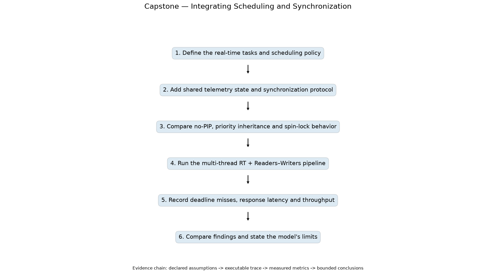

# Exercise 6 — Capstone Integration: Real-Time Scheduling, Synchronization & Readers–Writers

Final Capstone connecting CPU Scheduling (`Guaranteed Scheduling`, `RM`, `EDF`) with Concurrency Control (`Peterson`, `Dekker`, `Semaphore`, `Mesa Monitor`, `3-Policy Readers–Writers`) and full executive presentation artifacts.

## Key Experiments & Results
1. **Mars Pathfinder Priority Inversion vs. PIP vs. Spin-Lock (`horizon = 60` ticks)**:
   - `No-PIP (RM)`: `T_Medium` preempted `T_Low`, blocking `T_High` for `9` ticks (`1` miss, max response `12 > D=8`).
   - `PIP (Priority Inheritance)`: `T_Low` transiently inherits priority `3`, reducing `T_High` block to `2` ticks (`0` misses, max response `5 <= 8`).
   - `Spin-Lock (Preemptive Spin Hazard)`: `T_High` busy-waits across preemptions -> `54` wasted spin ticks and `3` deadline misses.
2. **Live 5-Thread RT Control + Shared RW Telemetry Table (`D = 1.6 ms`)**:
   - `CoarseMutex (serial)` collapsed to **`14.29%`** RT hit rate (`P95 = 2.28 ms`, `2,035 ops/s`).
   - Blocking RW backends (`Monitor Fair`, `Semaphore Fair/Readers/Writers`) hit **`100.00%`** RT deadline compliance (`P95 = 0.99–1.24 ms`, `3,353–3,556 ops/s`).
3. **Exercise 1–3 Bridge (`U = 0.9583`)**:
   - `RM`: `1` miss (`Jain = 0.8883`), `EDF`: `0` misses (`0.8789`), `GS (vtime:stay)`: `0` misses and highest proportional fairness (**`0.9902`**).

## Reproduction
```bash
python3 exercise-6/code/run_experiments.py
python3 exercise-6/code/plot_diagrams.py
python3 tools/make_decks.py 6
python3 tools/build_report.py ex6_en exercise-6 REPORT_EN
python3 tools/build_report.py ex6_fa exercise-6 REPORT_FA
python3 -m pytest exercise-6/tests -v
```

## Capstone integration workflow



The extended monographs include source-audited excerpts from the integrated kernel, experiment driver, figures and tests. The existing bilingual 10-slide presentations and speaker scripts remain part of the deliverables.
