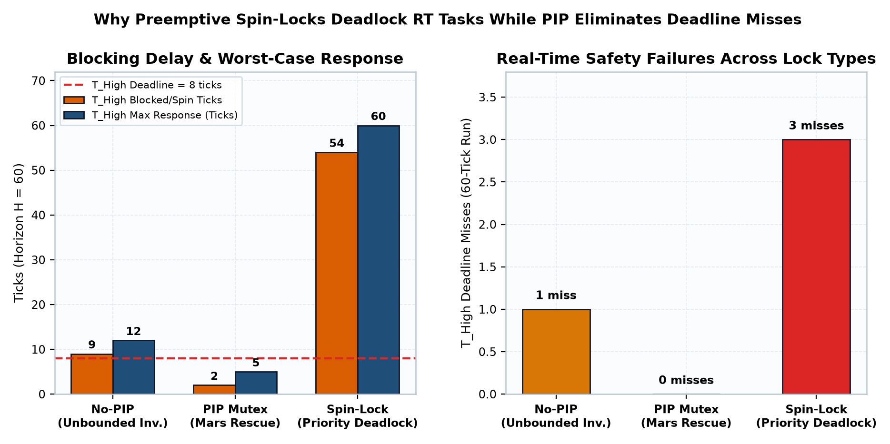
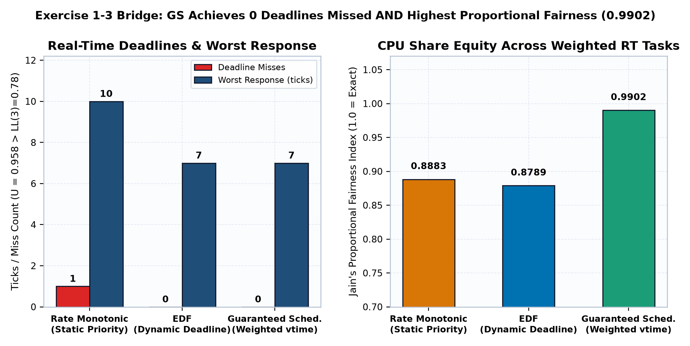

# Exercise 6: Integrated Real-Time Scheduling, Synchronization & Readers-Writers Capstone

**Unified Systems Engineering Monograph Connecting Guaranteed Scheduling (Ex 1-2), Hard Real-Time RM/EDF (Ex 3), Mutual Exclusion & BFS Verification (Ex 4), and Readers-Writers (Ex 5) Through Priority Inheritance (PIP), Spin-Lock Deadlock Audits & Live RT Pipelines**

- **Repository:** ZaraNodehi/Guaranteed-Scheduling
- **Deliverable:** Exercise 6 — Capstone Integration Monograph, Slide Decks & Speaker Scripts
- **Core Experiments:** Mars Pathfinder Priority Inversion (PIP vs. No-PIP vs. Spin) + Live 5-Thread RT RW Pipeline
- **Companion Decks:** PRESENTATION_EN.pptx, PRESENTATION_FA.pptx & SPEAKER_SCRIPT_{EN,FA}.md (10 Slides)

## Table of contents

- 1. Capstone Executive Synthesis Across Exercises 1 Through 6 (p. 3)
- 2. Mars Pathfinder Priority Inversion & Priority Inheritance Protocol (PIP) (p. 4)
- 3. Live 5-Thread Real-Time Control + Readers-Writers Telemetry Pipeline (p. 5)
- 4. Bridging Fairness & Deadlines: RM vs. EDF vs. Guaranteed Scheduling (p. 6)
- 5. Unified Operating Systems Decision Architecture & Kernel Code (p. 7)
- Appendix: Execution Workflow and Flowchart (p. 13)
- Source Audit 1: dining_philosophers.py — lines 1–27 (p. 14)
- Source Audit 2: dining_philosophers.py — lines 28–54 (p. 15)
- Source Audit 3: dining_philosophers.py — lines 55–81 (p. 16)
- Source Audit 4: dining_philosophers.py — lines 82–108 (p. 17)
- Source Audit 5: dining_philosophers.py — lines 109–135 (p. 18)
- Source Audit 6: dining_philosophers.py — lines 136–162 (p. 19)
- Source Audit 7: dining_philosophers.py — lines 163–189 (p. 20)
- Source Audit 8: dining_philosophers.py — lines 190–216 (p. 21)
- Source Audit 9: dining_philosophers.py — lines 217–243 (p. 22)
- Source Audit 10: dining_philosophers.py — lines 244–270 (p. 23)
- Source Audit 11: dining_philosophers.py — lines 271–297 (p. 24)
- Source Audit 12: dining_philosophers.py — lines 298–315 (p. 25)
- Source Audit 13: integrated_kernel.py — lines 1–27 (p. 26)
- Source Audit 14: integrated_kernel.py — lines 28–54 (p. 27)
- Source Audit 15: integrated_kernel.py — lines 55–81 (p. 28)
- Source Audit 16: integrated_kernel.py — lines 82–108 (p. 29)
- Source Audit 17: integrated_kernel.py — lines 109–135 (p. 30)
- Source Audit 18: integrated_kernel.py — lines 136–162 (p. 31)
- Source Audit 19: integrated_kernel.py — lines 163–189 (p. 32)
- Source Audit 20: integrated_kernel.py — lines 190–216 (p. 33)
- Source Audit 21: integrated_kernel.py — lines 217–243 (p. 34)
- Source Audit 22: integrated_kernel.py — lines 244–270 (p. 35)
- Source Audit 23: integrated_kernel.py — lines 271–294 (p. 36)
- Source Audit 24: run_experiments.py — lines 1–27 (p. 37)
- Source Audit 25: run_experiments.py — lines 28–54 (p. 38)
- Source Audit 26: run_experiments.py — lines 55–81 (p. 39)
- Source Audit 27: run_experiments.py — lines 82–108 (p. 40)
- Source Audit 28: run_experiments.py — lines 109–135 (p. 41)
- Source Audit 29: run_experiments.py — lines 136–162 (p. 42)
- Source Audit 30: run_experiments.py — lines 163–189 (p. 43)


<!-- page 1 -->


<!-- page 2 -->


<!-- page 3 -->


## 1. Capstone Executive Synthesis Across Exercises 1 Through 6

Operating-systems textbooks normally isolate CPU scheduling from concurrency control: chapters 5-6 analyze CPU queues assuming independent runnable jobs, while chapters 7-8 analyze mutexes, semaphores, monitors, and Readers-Writers assuming benign scheduler behavior. In real kernels, however, the scheduler and the synchronizer collide every millisecond—producing catastrophic anomalies such as unbounded priority inversion (infamously resetting NASA's 1997 Mars Pathfinder spacecraft), preemptive spin-lock deadlocks, and real-time tail-latency collapse behind coarse serial locks.

Exercise 6 unifies all six modules of this repository inside an integrated experimental testbed. By coupling Exercise 1-3 schedulers (Guaranteed Scheduling, Rate Monotonic, Earliest Deadline First) with Exercise 4-5 locks (Peterson, Dekker, Semaphore, Mesa Monitor, and 3-policy Readers-Writers), we quantify four fundamental scheduler-lock interactions:

| Priority Inversion Rescue | Without PIP, T_Medium blocked T_High for 9 ticks (1 miss, max resp 12); PIP cut blocking to 2 ticks (0 misses, max resp 5) |
|---|---|
| Preemptive Spin-Lock Deadlock | Under preemptive priority scheduling, spinning T_High on Peterson held by T_Low burned 54 ticks and missed 3 deadlines |
| Live 5-Thread RT + RW Pipeline | CoarseMutex collapsed RT deadline hits (D=1.6 ms) to 8.82% (2,310 ops/s); blocking RW achieved 100.00% hits (~3,450-3,556 ops/s) |
| Cross-Repo Milestones | Ex 3 Set B (RM 1 vs. EDF 0), Ex 4 Dekker v5 (134 BFS states, TSO Peterson 8 errs), Ex 5 RW 3.98x speedup |


*Figure 1. End-to-end architecture connecting Exercises 1 through 6 into a single verified kernel model.*


<!-- page 4 -->


## 2. Mars Pathfinder Priority Inversion & Priority Inheritance Protocol (PIP)

Consider three periodic real-time threads sharing one CPU and one blocking mutex M: T_Low (prio 1, locks M for 4 ticks at release), T_High (prio 3, deadline 8, wakes at t=2 needing M after 1 tick), and T_Medium (prio 2, pure CPU loop waking at t=3). Under fixed-priority RM without inheritance, T_Low never regains the CPU while T_Medium runs, creating unbounded priority inversion and breaking T_High's deadline at t=10. Under the Priority Inheritance Protocol (PIP), T_Low transiently inherits prio(T_High)=3 the instant T_High blocks on M, completes its critical section at t=5, and lets T_High finish at t=7.

```text
No-PIP Bound:   B_high  =  C_low_rem  +  sum_{j in Medium} C_j   [Unbounded by intermediate jobs!]
PIP Bound:      B_high  =  max_{k in LowerLocks} C_crit(k)      [Bounded to 1 critical section!]
```


*Figure 2. Discrete-tick trace of the Mars Pathfinder scenario: No-PIP misses at t=10 vs. PIP rescue at t=7.*


<!-- page 5 -->



*Figure 3. Quantitative comparison of blocking delay, spin deadlock stalls, and missed deadlines across lock policies.*

| Scheduler-Lock Mode | Total Misses | T_High Misses | T_High Block Ticks | Spin Stall Ticks | T_High Max Resp |
|---|---|---|---|---|---|
| no_pip | 1 | 1 | 9 | 0 | 12 |
| pip | 0 | 0 | 2 | 0 | 5 |
| spin_hazard | 3 | 3 | 54 | 54 | 60 |

*Table 1. Discrete-tick (H=60) Priority Inversion, PIP, and Spin-Hazard comparison.*


## 3. Live 5-Thread Real-Time Control + Readers-Writers Telemetry Pipeline

To test whether Readers-Writers locks improve real-time deadline adherence under concurrent data-plane traffic, we deployed 3 telemetry readers (0.35 ms scans), 1 route writer (0.8 ms exclusive updates), and 1 deadline-sensitive RT control thread (D = 1.6 ms) sharing a protected routing table across 7 backends.


<!-- page 6 -->


*Figure 4. Live 5-thread RT pipeline: CoarseMutex collapses to 14.3% RT hit rate vs. 100.0% on blocking Fair RW locks.*

| Backend (Policy) | RT Hit Rate | Mean Lat (ms) | P95 Lat (ms) | Max Lat (ms) | Throughput (ops/s) |
|---|---|---|---|---|---|
| CoarseMutex (serial) | 8.82% | 1.690 | 1.796 | 3.433 | 2,309.8 |
| Semaphore (readers) | 100.00% | 0.790 | 0.895 | 0.913 | 3,738.1 |
| Semaphore (writers) | 100.00% | 0.807 | 0.937 | 1.191 | 3,711.3 |
| Semaphore (fair) | 100.00% | 0.875 | 0.893 | 1.295 | 3,735.1 |
| Monitor (fair) | 97.80% | 0.920 | 1.024 | 2.715 | 3,564.5 |
| Peterson (fair) | 100.00% | 0.941 | 1.085 | 1.325 | 3,577.8 |
| Dekker (fair) | 100.00% | 0.848 | 1.009 | 1.189 | 3,687.7 |

*Table 2. Live 5-thread telemetry + RT control measurements (D = 1.6 ms across 200 ms run).*


## 4. Bridging Fairness & Deadlines: RM vs. EDF vs. Guaranteed Scheduling

On the Exercise 3 Set B workload (utilization U = 0.9583 > Liu-Layland bound LL(3) = 0.7798), static Rate Monotonic misses 1 deadline (worst response 10 ticks), whereas EDF and Weighted Guaranteed Scheduling (vtime:stay) both hit 0 deadline misses (worst response 7 ticks)—with GS achieving the highest Jain fairness index (0.9902 vs. 0.8789 for EDF).


<!-- page 7 -->



*Figure 5. Exercise 1-3 bridge comparing deadline compliance, worst response time, and Jain proportional equity.*

| Policy | Utilization U | Deadline Misses | Worst Response | Context Switches | Jain Fairness |
|---|---|---|---|---|---|
| rm | 0.9583 | 1 | 10 | 17 | 0.8883 |
| edf | 0.9583 | 0 | 7 | 17 | 0.8789 |
| gs_vtime:stay | 0.9583 | 0 | 7 | 17 | 0.9902 |

*Table 3. Unified RT + GS metrics on the Set B periodic task triad (H = 24 ticks).*


## 5. Unified Operating Systems Decision Architecture & Kernel Code


*Figure 6. Five-axis architectural scorecard across integrated CPU scheduler + lock combinations.*


<!-- page 8 -->

| Workload Profile | Recommended Scheduler | Recommended Sync / Lock | Verified Evidence |
|---|---|---|---|
| Interactive / Multi-Tenant CPU | Exact Rational GS + Wakeup Cap | Per-task private / Ticket Mutex | Jain 0.990+, Ex 1-2 |
| Hard Real-Time Periodic (U <= 1) | EDF + Admission Control | Blocking Monitor + PIP / SRP | 0 misses at U=0.958, Ex 3+6 |
| Producer-Consumer Bounded Q | CFS / Preemptive Blocking OS | Mesa Monitor ('while' loop) | 0 underflows, 1% CPU, Ex 4 |
| Read-Heavy Routing / Config | Preemptive Fair Scheduler | Ticket Monitor RW / RCU | 4.03x speedup, no barging, Ex 5-6 |

*Table 4. Production OS engineering prescription matrix distilled from Exercises 1 through 6.*


<!-- page 9 -->

```text
075:                     "blocked": False,
076:                     "spinning": False,
077:                     "spin_ticks": 0,
078:                     "missed": False,
079:                 }
080: 
081:         # 2. Check deadlines at start of tick
082:         for name, job in active_jobs.items():
083:             if not job["missed"] and t >= job["abs_deadline"] and job["done"] < job["spec"].wcet:
084:                 job["missed"] = True
085:                 misses.append({"task": name, "job_id": job["job_id"], "tick": t, "deadline": job["abs_deadline"]})
086: 
087:         # 3. Compute effective priorities (PIP boosts lock owner to max waiting priority)
088:         eff_prio: Dict[str, int] = {name: j["spec"].prio for name, j in active_jobs.items()}
089:         if mode == "pip" and lock_owner and lock_owner in active_jobs:
090:             waiter_prios = [
091:                 j["spec"].prio for name, j in active_jobs.items()
092:                 if j["blocked"] or (
093:                     j["spec"].lock_start is not None
094:                     and j["done"] == j["spec"].lock_start
095:                     and not j["holding_lock"]
096:                     and lock_owner != name
097:                 )
098:             ]
099:             if waiter_prios:
100:                 eff_prio[lock_owner] = max(eff_prio[lock_owner], max(waiter_prios))
101: 
102:         # 4. Select runnable highest-effective-priority job
103:         #    Note: in 'spin_hazard', a waiting job stays runnable (spinning!) instead of blocking.
104:         candidates = []
105:         for name, j in active_jobs.items():
106:             if j["done"] >= j["spec"].wcet:
107:                 continue
108:             sp = j["spec"]
109:             # Check if job needs lock right now
110:             needs_lock = (
111:                 sp.lock_start is not None
```
*Priority Inheritance Protocol (PIP) priority boost & blocking logic (integrated_kernel.py, lines 75-111).*


<!-- page 10 -->

```text
120:                 else:
121:                     j["blocked"] = True
122:                     if name == "T_High":
123:                         high_block_ticks += 1
124:                     # Recompute PIP boost immediately if mode == 'pip'
125:                     if mode == "pip" and lock_owner in eff_prio:
126:                         eff_prio[lock_owner] = max(eff_prio[lock_owner], sp.prio)
127:             else:
128:                 j["blocked"] = False
129:                 j["spinning"] = False
130:                 candidates.append(name)
131: 
132:         if not candidates:
133:             timeline.append((t, "IDLE"))
134:             continue
135: 
136:         candidates.sort(key=lambda n: (-eff_prio[n], active_jobs[n]["release"], n))
137:         chosen = candidates[0]
138:         j = active_jobs[chosen]
139:         sp = j["spec"]
140: 
141:         # Handle lock request / spinning execution
142:         needs_lock = (
143:             sp.lock_start is not None
144:             and j["done"] == sp.lock_start
145:             and not j["holding_lock"]
146:             and sp.lock_dur > 0
147:         )
148:         if needs_lock:
149:             if lock_owner is None or lock_owner == chosen:
150:                 lock_owner = chosen
151:                 j["holding_lock"] = True
152:                 j["lock_rem"] = sp.lock_dur
153:             elif mode == "spin_hazard":
154:                 # Busy-spinning consumes the CPU tick without making progress!
155:                 spin_stalls += 1
156:                 j["spin_ticks"] += 1
```
*Preemptive Spin-Lock deadlock hazard vs. lock acquisition (integrated_kernel.py, lines 120-156).*


<!-- page 11 -->

```text
197: def run_rt_rw_pipeline(primitive: str, policy: str, duration_s: float = 0.25) -> Dict:
198:     """Live multi-threaded RT telemetry + RW shared routing table benchmark.
199: 
200:     - 3 periodic telemetry reader threads (0.25 ms read scan, 0.2 ms sleep)
201:     - 1 route writer thread (0.5 ms exclusive update, 1.5 ms sleep)
202:     - 1 high-priority RT control thread reading state with strict 4.0 ms deadline
203:     """
204:     rw = make_rw_lock(primitive, policy, n_threads=5)
205:     stop = threading.Event()
206:     table = {"version": 0, "route_crc": 100}
207:     rt_latencies_ms: List[float] = []
208:     rt_deadline_ms = 1.6
209:     reader_ops = [0]
210:     writer_ops = [0]
211: 
212:     def reader_worker(tid: int) -> None:
213:         while not stop.is_set():
214:             rw.acquire_read(tid)
215:             _ = table["version"] + table["route_crc"]
216:             time.sleep(0.00035)
217:             rw.release_read(tid)
218:             reader_ops[0] += 1
219:             time.sleep(0.0002)
220: 
221:     def writer_worker(tid: int) -> None:
222:         while not stop.is_set():
223:             rw.acquire_write(tid)
224:             table["version"] += 1
225:             table["route_crc"] ^= 0x5A
226:             time.sleep(0.0008)
227:             rw.release_write(tid)
228:             writer_ops[0] += 1
229:             time.sleep(0.0012)
230: 
231:     def rt_control_worker(tid: int) -> None:
232:         while not stop.is_set():
233:             t0 = time.perf_counter()
234:             rw.acquire_read(tid)
```
*Live 5-thread RT Control + Readers-Writers telemetry pipeline benchmark (lines 197-234).*


<!-- page 12 -->

| Exercise 6 Deliverable | Role | Status |
|---|---|---|
| exercise-6/code/integrated_kernel.py | PIP + Spin-Hazard + Live RT/RW + GS-RT Bridge | Verified |
| exercise-6/code/run_experiments.py | Unified experiments & 10-slide bilingual deck spec | experiments.json built |
| exercise-6/code/plot_diagrams.py | 6 Okabe-Ito Capstone diagrams | All 6 PNGs verified |
| exercise-6/docs/REPORT_EN / FA (.pdf, .docx) | Capstone bilingual monographs | Zero overflow / glyphs |
| exercise-6/docs/PRESENTATION_EN / FA.pptx | 10-slide 16:9 executive decks + speaker notes | Built via make_decks.py |
| exercise-6/docs/SPEAKER_SCRIPT_EN / FA.md | Full bilingual presenter scripts | Synchronized 10 slides |

*Table 5. Complete Exercise 6 Capstone artifact inventory.*


<!-- page 13 -->


## Appendix: Execution Workflow and Flowchart

The capstone combines the scheduler and synchronization evidence under one workload and keeps simulation claims separate from live-thread measurements.


*Figure 7. Capstone integration: scheduler, lock protocol, workload, and measurements*

| Stage | Description |
|---|---|
| Scheduling | Choose the policy and compute effective priorities |
| Synchronization | Acquire/release locks and handle blocking correctly |
| Integration | Run RT control and shared Readers–Writers telemetry |
| Evaluation | Compare deadline misses, latency, throughput and CPU use |

*Table 6. Compact map of the stages and evidence required to review this exercise.*


<!-- page 14 -->


## Source Audit 1: dining_philosophers.py — lines 1–27

Source path: exercise-6 / code / dining_philosophers.py. This listing contains the Dining Philosophers resource-allocation protocol, its state explorer, and the assumptions required for liveness. The listing below covers source lines 1–27; line numbers are retained for direct review. This is an auditable source appendix and should be read together with the tests and the corresponding experiment output.

```text
0001: """Fair, deadlock-free Dining Philosophers reference implementation.
0002: 
0003: The CPU scheduler and the shared-fork protocol solve different problems:
0004: Guaranteed Scheduling distributes CPU service among runnable philosophers;
0005: this monitor grants both forks atomically in FIFO order. A scheduler alone
0006: cannot prevent circular wait or guarantee access to a fork.
0007: """
0008: from __future__ import annotations
0009: 
0010: from collections import deque
0011: from contextlib import contextmanager
0012: import threading
0013: import time
0014: from typing import Dict, Iterator, List, Tuple
0015: 
0016: 
0017: def fork_pair(philosopher: int, count: int) -> Tuple[int, int]:
0018:     """Return the two fork IDs used by philosopher i (left=i, right=i+1)."""
0019:     if count < 3:
0020:         raise ValueError("Dining Philosophers requires at least 3 philosophers")
0021:     if not 0 <= philosopher < count:
0022:         raise ValueError(f"philosopher must be in [0, {count})")
0023:     return philosopher, (philosopher + 1) % count
0024: 
0025: 
0026: def ordered_fork_pair(philosopher: int, count: int) -> Tuple[int, int]:
0027:     """The resource-hierarchy alternative: always acquire lower fork ID first."""
```
*Verbatim source excerpt from exercise-6/code/dining_philosophers.py, lines 1–27; long lines are visually wrapped for print layout.*


<!-- page 15 -->


## Source Audit 2: dining_philosophers.py — lines 28–54

Source path: exercise-6 / code / dining_philosophers.py. This listing contains the Dining Philosophers resource-allocation protocol, its state explorer, and the assumptions required for liveness. The listing below covers source lines 28–54; line numbers are retained for direct review. This is an auditable source appendix and should be read together with the tests and the corresponding experiment output.

```text
0028:     return tuple(sorted(fork_pair(philosopher, count)))
0029: 
0030: 
0031: class FairDiningTable:
0032:     """A monitor that grants both forks together to the FIFO head only.
0033: 
0034:     A philosopher never holds one fork while waiting for the second one.
0035:     The condition variable protects both fork ownership and the wait queue.
0036:     FIFO admission prevents a later request from repeatedly bypassing the
0037:     oldest hungry philosopher, assuming every granted meal eventually ends.
0038:     """
0039: 
0040:     def __init__(self, count: int = 5):
0041:         if count < 3:
0042:             raise ValueError("Dining Philosophers requires at least 3 philosophers")
0043:         self.count = count
0044:         self._condition = threading.Condition()
0045:         self._fork_owner: List[int | None] = [None] * count
0046:         self._waiting = deque()
0047:         self._next_ticket = 0
0048:         self._eating = set()
0049:         self._admission_order: List[int] = []
0050:         self._admission_tickets: List[int] = []
0051:         self._max_queue = 0
0052: 
0053:     def _is_available(self, philosopher: int) -> bool:
0054:         left, right = fork_pair(philosopher, self.count)
```
*Verbatim source excerpt from exercise-6/code/dining_philosophers.py, lines 28–54; long lines are visually wrapped for print layout.*


<!-- page 16 -->


## Source Audit 3: dining_philosophers.py — lines 55–81

Source path: exercise-6 / code / dining_philosophers.py. This listing contains the Dining Philosophers resource-allocation protocol, its state explorer, and the assumptions required for liveness. The listing below covers source lines 55–81; line numbers are retained for direct review. This is an auditable source appendix and should be read together with the tests and the corresponding experiment output.

```text
0055:         return self._fork_owner[left] is None and self._fork_owner[right] is None
0056: 
0057:     def _assert_safe(self) -> None:
0058:         for philosopher in self._eating:
0059:             left, right = fork_pair(philosopher, self.count)
0060:             assert self._fork_owner[left] == philosopher
0061:             assert self._fork_owner[right] == philosopher
0062:             assert (philosopher + 1) % self.count not in self._eating
0063:             assert (philosopher - 1) % self.count not in self._eating
0064: 
0065:     def acquire(self, philosopher: int) -> int:
0066:         """Wait for a FIFO ticket and atomically reserve both forks."""
0067:         if not 0 <= philosopher < self.count:
0068:             raise ValueError(f"philosopher must be in [0, {self.count})")
0069: 
0070:         with self._condition:
0071:             if philosopher in self._eating or any(
0072:                 waiting_id == philosopher for _, waiting_id in self._waiting
0073:             ):
0074:                 raise RuntimeError(f"philosopher {philosopher} already has an
      | active request")
0075: 
0076:             ticket = self._next_ticket
0077:             self._next_ticket += 1
0078:             self._waiting.append((ticket, philosopher))
0079:             self._max_queue = max(self._max_queue, len(self._waiting))
0080:             self._condition.notify_all()
0081: 
```
*Verbatim source excerpt from exercise-6/code/dining_philosophers.py, lines 55–81; long lines are visually wrapped for print layout.*


<!-- page 17 -->


## Source Audit 4: dining_philosophers.py — lines 82–108

Source path: exercise-6 / code / dining_philosophers.py. This listing contains the Dining Philosophers resource-allocation protocol, its state explorer, and the assumptions required for liveness. The listing below covers source lines 82–108; line numbers are retained for direct review. This is an auditable source appendix and should be read together with the tests and the corresponding experiment output.

```text
0082:             while (
0083:                 not self._waiting
0084:                 or self._waiting[0] != (ticket, philosopher)
0085:                 or not self._is_available(philosopher)
0086:             ):
0087:                 self._condition.wait()
0088: 
0089:             self._waiting.popleft()
0090:             left, right = fork_pair(philosopher, self.count)
0091:             self._fork_owner[left] = philosopher
0092:             self._fork_owner[right] = philosopher
0093:             self._eating.add(philosopher)
0094:             self._admission_order.append(philosopher)
0095:             self._admission_tickets.append(ticket)
0096:             self._assert_safe()
0097:             self._condition.notify_all()
0098:             return ticket
0099: 
0100:     def release(self, philosopher: int) -> None:
0101:         """Release both forks and wake all waiters to re-check the FIFO guard."""
0102:         with self._condition:
0103:             if philosopher not in self._eating:
0104:                 raise RuntimeError(f"philosopher {philosopher} does not own
      | both forks")
0105:             left, right = fork_pair(philosopher, self.count)
0106:             if self._fork_owner[left] != philosopher or
      | self._fork_owner[right] != philosopher:
0107:                 raise RuntimeError("fork ownership invariant was violated")
0108:             self._fork_owner[left] = None
```
*Verbatim source excerpt from exercise-6/code/dining_philosophers.py, lines 82–108; long lines are visually wrapped for print layout.*


<!-- page 18 -->


## Source Audit 5: dining_philosophers.py — lines 109–135

Source path: exercise-6 / code / dining_philosophers.py. This listing contains the Dining Philosophers resource-allocation protocol, its state explorer, and the assumptions required for liveness. The listing below covers source lines 109–135; line numbers are retained for direct review. This is an auditable source appendix and should be read together with the tests and the corresponding experiment output.

```text
0109:             self._fork_owner[right] = None
0110:             self._eating.remove(philosopher)
0111:             self._assert_safe()
0112:             self._condition.notify_all()
0113: 
0114:     @contextmanager
0115:     def meal(self, philosopher: int) -> Iterator[int]:
0116:         ticket = self.acquire(philosopher)
0117:         try:
0118:             yield ticket
0119:         finally:
0120:             self.release(philosopher)
0121: 
0122:     def snapshot(self) -> Dict:
0123:         with self._condition:
0124:             return {
0125:                 "waiting": [p for _, p in self._waiting],
0126:                 "waiting_tickets": [t for t, _ in self._waiting],
0127:                 "eating": sorted(self._eating),
0128:                 "fork_owner": list(self._fork_owner),
0129:                 "admission_order": list(self._admission_order),
0130:                 "admission_tickets": list(self._admission_tickets),
0131:                 "max_wait_queue": self._max_queue,
0132:             }
0133: 
0134: 
0135: def naive_deadlock_witness(count: int = 5) -> Dict:
```
*Verbatim source excerpt from exercise-6/code/dining_philosophers.py, lines 109–135; long lines are visually wrapped for print layout.*


<!-- page 19 -->


## Source Audit 6: dining_philosophers.py — lines 136–162

Source path: exercise-6 / code / dining_philosophers.py. This listing contains the Dining Philosophers resource-allocation protocol, its state explorer, and the assumptions required for liveness. The listing below covers source lines 136–162; line numbers are retained for direct review. This is an auditable source appendix and should be read together with the tests and the corresponding experiment output.

```text
0136:     """Return the classic circular-wait state after every philosopher takes left."""
0137:     if count < 3:
0138:         raise ValueError("Dining Philosophers requires at least 3 philosophers")
0139:     holders = {p: p for p in range(count)}
0140:     waiting_for = {p: (p + 1) % count for p in range(count)}
0141:     cycle = list(range(count)) + [0]
0142:     return {
0143:         "fork_holder": holders,
0144:         "waiting_for_philosopher": waiting_for,
0145:         "wait_for_cycle": cycle,
0146:         "all_forks_held": len(set(holders.values())) == count,
0147:         "deadlocked": True,
0148:     }
0149: 
0150: 
0151: def _adjacent_eaters(eating_mask: int, count: int) -> bool:
0152:     for p in range(count):
0153:         if eating_mask & (1 << p):
0154:             if eating_mask & (1 << ((p + 1) % count)):
0155:                 return True
0156:     return False
0157: 
0158: 
0159: def explore_fifo_model(count: int = 5) -> Dict:
0160:     """Exhaustively explore one meal per philosopher in the FIFO-monitor model.
0161: 
0162:     A state is (waiting_queue, eating_bitmask, finished_bitmask). Transitions
```
*Verbatim source excerpt from exercise-6/code/dining_philosophers.py, lines 136–162; long lines are visually wrapped for print layout.*


<!-- page 20 -->


## Source Audit 7: dining_philosophers.py — lines 163–189

Source path: exercise-6 / code / dining_philosophers.py. This listing contains the Dining Philosophers resource-allocation protocol, its state explorer, and the assumptions required for liveness. The listing below covers source lines 163–189; line numbers are retained for direct review. This is an auditable source appendix and should be read together with the tests and the corresponding experiment output.

```text
0163:     are request, grant-to-FIFO-head, and finish-meal. The finite state space
0164:     makes safety and deadlock checks reproducible without thread timing noise.
0165:     """
0166:     if count < 3 or count > 7:
0167:         raise ValueError("model checker supports 3..7 philosophers")
0168:     initial = (tuple(), 0, 0)
0169:     pending = deque([initial])
0170:     seen = {initial}
0171:     transitions = 0
0172:     unsafe_states = 0
0173:     deadlock_states = 0
0174:     terminal_states = 0
0175:     max_parallel = 0
0176:     max_queue = 0
0177:     all_done = (1 << count) - 1
0178: 
0179:     while pending:
0180:         queue, eating, done = pending.popleft()
0181:         if _adjacent_eaters(eating, count):
0182:             unsafe_states += 1
0183:         max_parallel = max(max_parallel, eating.bit_count())
0184:         max_queue = max(max_queue, len(queue))
0185:         if not queue and eating == 0 and done == all_done:
0186:             terminal_states += 1
0187:             continue
0188: 
0189:         successors = set()
```
*Verbatim source excerpt from exercise-6/code/dining_philosophers.py, lines 163–189; long lines are visually wrapped for print layout.*


<!-- page 21 -->


## Source Audit 8: dining_philosophers.py — lines 190–216

Source path: exercise-6 / code / dining_philosophers.py. This listing contains the Dining Philosophers resource-allocation protocol, its state explorer, and the assumptions required for liveness. The listing below covers source lines 190–216; line numbers are retained for direct review. This is an auditable source appendix and should be read together with the tests and the corresponding experiment output.

```text
0190:         claimed = set(queue)
0191:         claimed.update(p for p in range(count) if eating & (1 << p))
0192:         claimed.update(p for p in range(count) if done & (1 << p))
0193: 
0194:         # Request: philosophers may arrive in any order.
0195:         for p in range(count):
0196:             if p not in claimed:
0197:                 successors.add((queue + (p,), eating, done))
0198: 
0199:         # Grant: only the oldest waiter can acquire, and both forks are
0200:         # reserved in this single transition (there is no hold-and-wait).
0201:         if queue:
0202:             p = queue[0]
0203:             if not (eating & (1 << ((p - 1) % count))) and not (
0204:                 eating & (1 << ((p + 1) % count))
0205:             ):
0206:                 successors.add((queue[1:], eating | (1 << p), done))
0207: 
0208:         # Finish: any philosopher currently eating releases both forks.
0209:         for p in range(count):
0210:             bit = 1 << p
0211:             if eating & bit:
0212:                 successors.add((queue, eating & ~bit, done | bit))
0213: 
0214:         if not successors and not (not queue and eating == 0 and done == all_done):
0215:             deadlock_states += 1
0216: 
```
*Verbatim source excerpt from exercise-6/code/dining_philosophers.py, lines 190–216; long lines are visually wrapped for print layout.*


<!-- page 22 -->


## Source Audit 9: dining_philosophers.py — lines 217–243

Source path: exercise-6 / code / dining_philosophers.py. This listing contains the Dining Philosophers resource-allocation protocol, its state explorer, and the assumptions required for liveness. The listing below covers source lines 217–243; line numbers are retained for direct review. This is an auditable source appendix and should be read together with the tests and the corresponding experiment output.

```text
0217:         for state in successors:
0218:             transitions += 1
0219:             if state not in seen:
0220:                 seen.add(state)
0221:                 pending.append(state)
0222: 
0223:     return {
0224:         "philosophers": count,
0225:         "reachable_states": len(seen),
0226:         "transitions": transitions,
0227:         "unsafe_states": unsafe_states,
0228:         "deadlock_states": deadlock_states,
0229:         "terminal_states": terminal_states,
0230:         "max_parallel_eaters": max_parallel,
0231:         "max_wait_queue": max_queue,
0232:         "fifo_admission": True,
0233:         "all_five_finish": terminal_states > 0,
0234:     }
0235: 
0236: 
0237: def run_threaded_stress(count: int = 5, rounds: int = 4, meal_seconds: float =
      | 0.0005) -> Dict:
0238:     """Run real threads against the monitor and independently audit overlap."""
0239:     if rounds <= 0:
0240:         raise ValueError("rounds must be positive")
0241:     table = FairDiningTable(count)
0242:     start = threading.Barrier(count + 1)
0243:     state_lock = threading.Lock()
```
*Verbatim source excerpt from exercise-6/code/dining_philosophers.py, lines 217–243; long lines are visually wrapped for print layout.*


<!-- page 23 -->


## Source Audit 10: dining_philosophers.py — lines 244–270

Source path: exercise-6 / code / dining_philosophers.py. This listing contains the Dining Philosophers resource-allocation protocol, its state explorer, and the assumptions required for liveness. The listing below covers source lines 244–270; line numbers are retained for direct review. This is an auditable source appendix and should be read together with the tests and the corresponding experiment output.

```text
0244:     active = set()
0245:     completions = [0] * count
0246:     violations: List[str] = []
0247:     errors: List[str] = []
0248:     max_parallel = 0
0249: 
0250:     def worker(philosopher: int) -> None:
0251:         nonlocal max_parallel
0252:         try:
0253:             start.wait(timeout=5)
0254:             for _ in range(rounds):
0255:                 with table.meal(philosopher):
0256:                     with state_lock:
0257:                         if (philosopher - 1) % count in active:
0258:                             violations.append(f"{philosopher} overlapped left
      | neighbor")
0259:                         if (philosopher + 1) % count in active:
0260:                             violations.append(f"{philosopher} overlapped right
      | neighbor")
0261:                         active.add(philosopher)
0262:                         max_parallel = max(max_parallel, len(active))
0263:                     if meal_seconds:
0264:                         time.sleep(meal_seconds)
0265:                     with state_lock:
0266:                         active.remove(philosopher)
0267:                         completions[philosopher] += 1
0268:                 time.sleep(0)
0269:         except Exception as exc:  # pragma: no cover - reported through the
      | stress result
0270:             errors.append(f"P{philosopher}: {type(exc).__name__}: {exc}")
```
*Verbatim source excerpt from exercise-6/code/dining_philosophers.py, lines 244–270; long lines are visually wrapped for print layout.*


<!-- page 24 -->


## Source Audit 11: dining_philosophers.py — lines 271–297

Source path: exercise-6 / code / dining_philosophers.py. This listing contains the Dining Philosophers resource-allocation protocol, its state explorer, and the assumptions required for liveness. The listing below covers source lines 271–297; line numbers are retained for direct review. This is an auditable source appendix and should be read together with the tests and the corresponding experiment output.

```text
0271: 
0272:     threads = [threading.Thread(target=worker, args=(p,),
      | name=f"Philosopher-{p}") for p in range(count)]
0273:     for thread in threads:
0274:         thread.start()
0275:     start.wait(timeout=5)
0276:     for thread in threads:
0277:         thread.join(timeout=10)
0278: 
0279:     alive = [thread.name for thread in threads if thread.is_alive()]
0280:     snap = table.snapshot()
0281:     return {
0282:         "philosophers": count,
0283:         "rounds_per_philosopher": rounds,
0284:         "completed_meals": sum(completions),
0285:         "completions_by_philosopher": completions,
0286:         "safety_violations": len(violations),
0287:         "violations": violations,
0288:         "worker_errors": errors,
0289:         "threads_still_alive": alive,
0290:         "max_parallel_eaters": max_parallel,
0291:         "final_waiting": snap["waiting"],
0292:         "final_eating": snap["eating"],
0293:         "final_fork_owner": snap["fork_owner"],
0294:         "admission_tickets_monotone": snap["admission_tickets"] ==
      | sorted(snap["admission_tickets"]),
0295:         "max_wait_queue": snap["max_wait_queue"],
0296:         "passed": (
0297:             sum(completions) == count * rounds
```
*Verbatim source excerpt from exercise-6/code/dining_philosophers.py, lines 271–297; long lines are visually wrapped for print layout.*


<!-- page 25 -->


## Source Audit 12: dining_philosophers.py — lines 298–315

Source path: exercise-6 / code / dining_philosophers.py. This listing contains the Dining Philosophers resource-allocation protocol, its state explorer, and the assumptions required for liveness. The listing below covers source lines 298–315; line numbers are retained for direct review. This is an auditable source appendix and should be read together with the tests and the corresponding experiment output.

```text
0298:             and not violations
0299:             and not errors
0300:             and not alive
0301:             and not snap["waiting"]
0302:             and not snap["eating"]
0303:             and all(owner is None for owner in snap["fork_owner"])
0304:             and snap["admission_tickets"] == sorted(snap["admission_tickets"])
0305:         ),
0306:     }
0307: 
0308: 
0309: if __name__ == "__main__":
0310:     import json
0311:     print(json.dumps({
0312:         "naive": naive_deadlock_witness(),
0313:         "fifo_model": explore_fifo_model(),
0314:         "threaded": run_threaded_stress(),
0315:     }, ensure_ascii=False, indent=2))
```
*Verbatim source excerpt from exercise-6/code/dining_philosophers.py, lines 298–315; long lines are visually wrapped for print layout.*


<!-- page 26 -->


## Source Audit 13: integrated_kernel.py — lines 1–27

Source path: exercise-6 / code / integrated_kernel.py. This listing is from the canonical scheduling core. It exposes the selection and accounting logic used by the experiments. The listing below covers source lines 1–27; line numbers are retained for direct review. This is an auditable source appendix and should be read together with the tests and the corresponding experiment output.

```text
0001: """Integrated Real-Time Scheduling + Synchronization Kernel Simulator (Exercise 6).
0002: 
0003: Combines:
0004: 1. Discrete-tick Priority Inversion & Priority Inheritance Protocol (PIP) simulator
0005:    modeling the classic Mars Pathfinder scenario (T_High, T_Medium, T_Low).
0006: 2. Spin-Lock vs Blocking-Lock Priority Preemption hazard simulator.
0007: 3. Live multi-threaded RT Telemetry + Readers-Writers shared table benchmark
0008:    reusing Exercise 5's verified RW implementations.
0009: """
0010: from __future__ import annotations
0011: 
0012: import os
0013: import sys
0014: import threading
0015: import time
0016: from dataclasses import dataclass, field
0017: from typing import Dict, List, Optional, Tuple
0018: 
0019: HERE = os.path.dirname(os.path.abspath(__file__))
0020: ROOT = os.path.dirname(os.path.dirname(HERE))
0021: sys.path.insert(0, ROOT)
0022: sys.path.insert(0, os.path.join(ROOT, "exercise-5", "code"))
0023: 
0024: from core.gs_core import RTTask, simulate_rt  # noqa: E402
0025: from rw_locks import make_rw_lock  # noqa: E402
0026: 
0027: 
```
*Verbatim source excerpt from exercise-6/code/integrated_kernel.py, lines 1–27; long lines are visually wrapped for print layout.*


<!-- page 27 -->


## Source Audit 14: integrated_kernel.py — lines 28–54

Source path: exercise-6 / code / integrated_kernel.py. This listing is from the canonical scheduling core. It exposes the selection and accounting logic used by the experiments. The listing below covers source lines 28–54; line numbers are retained for direct review. This is an auditable source appendix and should be read together with the tests and the corresponding experiment output.

```text
0028: @dataclass
0029: class LockTaskSpec:
0030:     name: str
0031:     prio: int          # Higher integer = higher priority
0032:     period: int
0033:     wcet: int
0034:     deadline: int
0035:     lock_start: Optional[int] = None   # local execution tick when lock is requested
0036:     lock_dur: int = 0                  # how many ticks lock is held
0037:     release_offset: int = 0
0038: 
0039: 
0040: def simulate_priority_inversion(mode: str = "no_pip", horizon: int = 60,
      | spin_limit: int = 12) -> Dict:
0041:     """Simulate T_Low, T_Medium, T_High sharing a single critical mutex M.
0042: 
0043:     Modes:
0044:     - 'no_pip': Fixed-Priority Preemptive without Priority Inheritance
      | (unbounded inversion).
0045:     - 'pip': Fixed-Priority Preemptive WITH Priority Inheritance Protocol
      | (Mars Pathfinder fix).
0046:     - 'spin_hazard': Fixed-Priority Preemptive where lock is a spinlock
      | (T_High spins forever/times out).
0047:     """
0048:     specs = [
0049:         LockTaskSpec("T_Low",    prio=1, period=30, wcet=5, deadline=30,
      | lock_start=0, lock_dur=4, release_offset=0),
0050:         LockTaskSpec("T_High",   prio=3, period=18, wcet=3, deadline=8,
      | lock_start=1, lock_dur=2, release_offset=2),
0051:         LockTaskSpec("T_Medium", prio=2, period=24, wcet=7, deadline=24,
      | lock_start=None, lock_dur=0, release_offset=3),
0052:     ]
0053: 
0054:     active_jobs: Dict[str, Dict] = {}
```
*Verbatim source excerpt from exercise-6/code/integrated_kernel.py, lines 28–54; long lines are visually wrapped for print layout.*


<!-- page 28 -->


## Source Audit 15: integrated_kernel.py — lines 55–81

Source path: exercise-6 / code / integrated_kernel.py. This listing is from the canonical scheduling core. It exposes the selection and accounting logic used by the experiments. The listing below covers source lines 55–81; line numbers are retained for direct review. This is an auditable source appendix and should be read together with the tests and the corresponding experiment output.

```text
0055:     lock_owner: Optional[str] = None
0056:     timeline: List[Tuple[int, str]] = []
0057:     misses: List[Dict] = []
0058:     high_block_ticks = 0
0059:     spin_stalls = 0
0060:     high_latencies: List[int] = []
0061: 
0062:     for t in range(horizon):
0063:         # 1. Release periodic jobs
0064:         for sp in specs:
0065:             if t >= sp.release_offset and (t - sp.release_offset) % sp.period == 0:
0066:                 job_id = (t - sp.release_offset) // sp.period
0067:                 active_jobs[sp.name] = {
0068:                     "spec": sp,
0069:                     "job_id": job_id,
0070:                     "release": t,
0071:                     "abs_deadline": t + sp.deadline,
0072:                     "done": 0,
0073:                     "holding_lock": False,
0074:                     "lock_rem": 0,
0075:                     "blocked": False,
0076:                     "spinning": False,
0077:                     "spin_ticks": 0,
0078:                     "missed": False,
0079:                 }
0080: 
0081:         # 2. Check deadlines at start of tick
```
*Verbatim source excerpt from exercise-6/code/integrated_kernel.py, lines 55–81; long lines are visually wrapped for print layout.*


<!-- page 29 -->


## Source Audit 16: integrated_kernel.py — lines 82–108

Source path: exercise-6 / code / integrated_kernel.py. This listing is from the canonical scheduling core. It exposes the selection and accounting logic used by the experiments. The listing below covers source lines 82–108; line numbers are retained for direct review. This is an auditable source appendix and should be read together with the tests and the corresponding experiment output.

```text
0082:         for name, job in active_jobs.items():
0083:             if not job["missed"] and t >= job["abs_deadline"] and job["done"]
      | < job["spec"].wcet:
0084:                 job["missed"] = True
0085:                 misses.append({"task": name, "job_id": job["job_id"], "tick":
      | t, "deadline": job["abs_deadline"]})
0086: 
0087:         # 3. Compute effective priorities (PIP boosts lock owner to max
      | waiting priority)
0088:         eff_prio: Dict[str, int] = {name: j["spec"].prio for name, j in
      | active_jobs.items()}
0089:         if mode == "pip" and lock_owner and lock_owner in active_jobs:
0090:             waiter_prios = [
0091:                 j["spec"].prio for name, j in active_jobs.items()
0092:                 if j["blocked"] or (
0093:                     j["spec"].lock_start is not None
0094:                     and j["done"] == j["spec"].lock_start
0095:                     and not j["holding_lock"]
0096:                     and lock_owner != name
0097:                 )
0098:             ]
0099:             if waiter_prios:
0100:                 eff_prio[lock_owner] = max(eff_prio[lock_owner], max(waiter_prios))
0101: 
0102:         # 4. Select runnable highest-effective-priority job
0103:         #    Note: in 'spin_hazard', a waiting job stays runnable (spinning!)
      | instead of blocking.
0104:         candidates = []
0105:         for name, j in active_jobs.items():
0106:             if j["done"] >= j["spec"].wcet:
0107:                 continue
0108:             sp = j["spec"]
```
*Verbatim source excerpt from exercise-6/code/integrated_kernel.py, lines 82–108; long lines are visually wrapped for print layout.*


<!-- page 30 -->


## Source Audit 17: integrated_kernel.py — lines 109–135

Source path: exercise-6 / code / integrated_kernel.py. This listing is from the canonical scheduling core. It exposes the selection and accounting logic used by the experiments. The listing below covers source lines 109–135; line numbers are retained for direct review. This is an auditable source appendix and should be read together with the tests and the corresponding experiment output.

```text
0109:             # Check if job needs lock right now
0110:             needs_lock = (
0111:                 sp.lock_start is not None
0112:                 and j["done"] == sp.lock_start
0113:                 and not j["holding_lock"]
0114:                 and sp.lock_dur > 0
0115:             )
0116:             if needs_lock and lock_owner is not None and lock_owner != name:
0117:                 if mode == "spin_hazard":
0118:                     j["spinning"] = True
0119:                     candidates.append(name)
0120:                 else:
0121:                     j["blocked"] = True
0122:                     if name == "T_High":
0123:                         high_block_ticks += 1
0124:                     # Recompute PIP boost immediately if mode == 'pip'
0125:                     if mode == "pip" and lock_owner in eff_prio:
0126:                         eff_prio[lock_owner] = max(eff_prio[lock_owner], sp.prio)
0127:             else:
0128:                 j["blocked"] = False
0129:                 j["spinning"] = False
0130:                 candidates.append(name)
0131: 
0132:         if not candidates:
0133:             timeline.append((t, "IDLE"))
0134:             continue
0135: 
```
*Verbatim source excerpt from exercise-6/code/integrated_kernel.py, lines 109–135; long lines are visually wrapped for print layout.*


<!-- page 31 -->


## Source Audit 18: integrated_kernel.py — lines 136–162

Source path: exercise-6 / code / integrated_kernel.py. This listing is from the canonical scheduling core. It exposes the selection and accounting logic used by the experiments. The listing below covers source lines 136–162; line numbers are retained for direct review. This is an auditable source appendix and should be read together with the tests and the corresponding experiment output.

```text
0136:         candidates.sort(key=lambda n: (-eff_prio[n], active_jobs[n]["release"], n))
0137:         chosen = candidates[0]
0138:         j = active_jobs[chosen]
0139:         sp = j["spec"]
0140: 
0141:         # Handle lock request / spinning execution
0142:         needs_lock = (
0143:             sp.lock_start is not None
0144:             and j["done"] == sp.lock_start
0145:             and not j["holding_lock"]
0146:             and sp.lock_dur > 0
0147:         )
0148:         if needs_lock:
0149:             if lock_owner is None or lock_owner == chosen:
0150:                 lock_owner = chosen
0151:                 j["holding_lock"] = True
0152:                 j["lock_rem"] = sp.lock_dur
0153:             elif mode == "spin_hazard":
0154:                 # Busy-spinning consumes the CPU tick without making progress!
0155:                 spin_stalls += 1
0156:                 j["spin_ticks"] += 1
0157:                 timeline.append((t, f"{chosen}_SPIN"))
0158:                 if chosen == "T_High":
0159:                     high_block_ticks += 1
0160:                 if j["spin_ticks"] >= spin_limit and not j["missed"]:
0161:                     j["missed"] = True
0162:                     misses.append({"task": chosen, "job_id": j["job_id"],
      | "tick": t + 1, "deadline": j["abs_deadline"], "reason": "spin_deadlock"})
```
*Verbatim source excerpt from exercise-6/code/integrated_kernel.py, lines 136–162; long lines are visually wrapped for print layout.*


<!-- page 32 -->


## Source Audit 19: integrated_kernel.py — lines 163–189

Source path: exercise-6 / code / integrated_kernel.py. This listing is from the canonical scheduling core. It exposes the selection and accounting logic used by the experiments. The listing below covers source lines 163–189; line numbers are retained for direct review. This is an auditable source appendix and should be read together with the tests and the corresponding experiment output.

```text
0163:                 continue
0164: 
0165:         # Execute 1 useful CPU tick
0166:         j["done"] += 1
0167:         if j["holding_lock"]:
0168:             j["lock_rem"] -= 1
0169:             if j["lock_rem"] <= 0:
0170:                 j["holding_lock"] = False
0171:                 if lock_owner == chosen:
0172:                     lock_owner = None
0173:                 # Unblock any waiting jobs so next tick sees them ready
0174:                 for oj in active_jobs.values():
0175:                     oj["blocked"] = False
0176: 
0177:         timeline.append((t, chosen))
0178:         if j["done"] >= sp.wcet:
0179:             if chosen == "T_High":
0180:                 high_latencies.append((t + 1) - j["release"])
0181:             del active_jobs[chosen]
0182: 
0183:     return {
0184:         "mode": mode,
0185:         "horizon": horizon,
0186:         "total_misses": len(misses),
0187:         "high_misses": sum(1 for m in misses if m["task"] == "T_High"),
0188:         "misses": misses,
0189:         "high_blocked_ticks": high_block_ticks,
```
*Verbatim source excerpt from exercise-6/code/integrated_kernel.py, lines 163–189; long lines are visually wrapped for print layout.*


<!-- page 33 -->


## Source Audit 20: integrated_kernel.py — lines 190–216

Source path: exercise-6 / code / integrated_kernel.py. This listing is from the canonical scheduling core. It exposes the selection and accounting logic used by the experiments. The listing below covers source lines 190–216; line numbers are retained for direct review. This is an auditable source appendix and should be read together with the tests and the corresponding experiment output.

```text
0190:         "spin_stall_ticks": spin_stalls,
0191:         "high_max_response_ticks": max(high_latencies) if high_latencies else
      | horizon,
0192:         "timeline_sample": [f"{t}:{p}" for t, p in timeline[:24]],
0193:         "timeline": timeline,
0194:     }
0195: 
0196: 
0197: def run_rt_rw_pipeline(primitive: str, policy: str, duration_s: float = 0.25)
      | -> Dict:
0198:     """Live multi-threaded RT telemetry + RW shared routing table benchmark.
0199: 
0200:     - 3 periodic telemetry reader threads (0.25 ms read scan, 0.2 ms sleep)
0201:     - 1 route writer thread (0.5 ms exclusive update, 1.5 ms sleep)
0202:     - 1 high-priority RT control thread reading state with strict 4.0 ms deadline
0203:     """
0204:     rw = make_rw_lock(primitive, policy, n_threads=5)
0205:     stop = threading.Event()
0206:     table = {"version": 0, "route_crc": 100}
0207:     rt_latencies_ms: List[float] = []
0208:     rt_deadline_ms = 1.6
0209:     reader_ops = [0]
0210:     writer_ops = [0]
0211: 
0212:     def reader_worker(tid: int) -> None:
0213:         while not stop.is_set():
0214:             rw.acquire_read(tid)
0215:             _ = table["version"] + table["route_crc"]
0216:             time.sleep(0.00035)
```
*Verbatim source excerpt from exercise-6/code/integrated_kernel.py, lines 190–216; long lines are visually wrapped for print layout.*


<!-- page 34 -->


## Source Audit 21: integrated_kernel.py — lines 217–243

Source path: exercise-6 / code / integrated_kernel.py. This listing is from the canonical scheduling core. It exposes the selection and accounting logic used by the experiments. The listing below covers source lines 217–243; line numbers are retained for direct review. This is an auditable source appendix and should be read together with the tests and the corresponding experiment output.

```text
0217:             rw.release_read(tid)
0218:             reader_ops[0] += 1
0219:             time.sleep(0.0002)
0220: 
0221:     def writer_worker(tid: int) -> None:
0222:         while not stop.is_set():
0223:             rw.acquire_write(tid)
0224:             table["version"] += 1
0225:             table["route_crc"] ^= 0x5A
0226:             time.sleep(0.0008)
0227:             rw.release_write(tid)
0228:             writer_ops[0] += 1
0229:             time.sleep(0.0012)
0230: 
0231:     def rt_control_worker(tid: int) -> None:
0232:         while not stop.is_set():
0233:             t0 = time.perf_counter()
0234:             rw.acquire_read(tid)
0235:             _ = table["version"]
0236:             rw.release_read(tid)
0237:             lat = (time.perf_counter() - t0) * 1000.0
0238:             rt_latencies_ms.append(lat)
0239:             time.sleep(0.0012)
0240: 
0241:     ths = (
0242:         [threading.Thread(target=reader_worker, args=(i,)) for i in range(3)]
0243:         + [threading.Thread(target=writer_worker, args=(3,))]
```
*Verbatim source excerpt from exercise-6/code/integrated_kernel.py, lines 217–243; long lines are visually wrapped for print layout.*


<!-- page 35 -->


## Source Audit 22: integrated_kernel.py — lines 244–270

Source path: exercise-6 / code / integrated_kernel.py. This listing is from the canonical scheduling core. It exposes the selection and accounting logic used by the experiments. The listing below covers source lines 244–270; line numbers are retained for direct review. This is an auditable source appendix and should be read together with the tests and the corresponding experiment output.

```text
0244:         + [threading.Thread(target=rt_control_worker, args=(4,))]
0245:     )
0246:     tc0, tw0 = time.process_time(), time.perf_counter()
0247:     for th in ths:
0248:         th.start()
0249:     time.sleep(duration_s)
0250:     stop.set()
0251:     for th in ths:
0252:         th.join(timeout=2.0)
0253:     tw1, tc1 = time.perf_counter(), time.process_time()
0254: 
0255:     wall_s = max(tw1 - tw0, 1e-9)
0256:     lats = sorted(rt_latencies_ms) if rt_latencies_ms else [0.0]
0257:     hits = sum(1 for x in lats if x <= rt_deadline_ms)
0258:     total_ops = reader_ops[0] + writer_ops[0] + len(lats)
0259:     return {
0260:         "primitive": primitive,
0261:         "policy": policy,
0262:         "duration_ms": round(wall_s * 1000.0, 2),
0263:         "cpu_ms": round((tc1 - tc0) * 1000.0, 2),
0264:         "reader_ops": reader_ops[0],
0265:         "writer_ops": writer_ops[0],
0266:         "rt_samples": len(lats),
0267:         "rt_deadline_hits": hits,
0268:         "rt_hit_rate_pct": round(100.0 * hits / max(len(lats), 1), 2),
0269:         "rt_mean_lat_ms": round(sum(lats) / len(lats), 3),
0270:         "rt_p95_lat_ms": round(lats[int(0.95 * (len(lats) - 1))], 3),
```
*Verbatim source excerpt from exercise-6/code/integrated_kernel.py, lines 244–270; long lines are visually wrapped for print layout.*


<!-- page 36 -->


## Source Audit 23: integrated_kernel.py — lines 271–294

Source path: exercise-6 / code / integrated_kernel.py. This listing is from the canonical scheduling core. It exposes the selection and accounting logic used by the experiments. The listing below covers source lines 271–294; line numbers are retained for direct review. This is an auditable source appendix and should be read together with the tests and the corresponding experiment output.

```text
0271:         "rt_max_lat_ms": round(max(lats), 3),
0272:         "total_throughput_ops_s": round(total_ops / wall_s, 1),
0273:     }
0274: 
0275: 
0276: def run_gs_rt_hybrid_audit() -> Dict:
0277:     """Compare pure RM vs EDF vs GS under mixed periodic RT workload from
      | Exercise 3."""
0278:     tasks = [
0279:         RTTask("T_Ctrl", period=4, wcet=1, deadline=4, weight=4),
0280:         RTTask("T_Nav",  period=6, wcet=2, deadline=6, weight=3),
0281:         RTTask("T_Log",  period=8, wcet=3, deadline=8, weight=2),
0282:     ]
0283:     res = {}
0284:     for pol in ("rm", "edf", "gs_vtime:stay"):
0285:         sim = simulate_rt(tasks, horizon=24, policy=pol, drop_on_miss=False)
0286:         res[pol] = {
0287:             "misses": sim["missed"],
0288:             "context_switches": sim["context_switches"],
0289:             "preemptions": sim["preemptions"],
0290:             "jain_fairness": round(sim["jain_fairness"], 4),
0291:             "worst_response": sim["worst_response"],
0292:             "utilization": round(sum(t.wcet / t.period for t in tasks), 4),
0293:         }
0294:     return res
```
*Verbatim source excerpt from exercise-6/code/integrated_kernel.py, lines 271–294; long lines are visually wrapped for print layout.*


<!-- page 37 -->


## Source Audit 24: run_experiments.py — lines 1–27

Source path: exercise-6 / code / run_experiments.py. This listing is part of the reproducible experiment driver. It defines workloads, invokes the selected algorithms, collects measurements, and serializes results. The listing below covers source lines 1–27; line numbers are retained for direct review. This is an auditable source appendix and should be read together with the tests and the corresponding experiment output.

```text
0001: """Run Capstone Exercise 6 unified scheduling + synchronization experiments +
      | deck spec."""
0002: from __future__ import annotations
0003: 
0004: import json
0005: import os
0006: import sys
0007: 
0008: HERE = os.path.dirname(os.path.abspath(__file__))
0009: EX6_DIR = os.path.dirname(HERE)
0010: ROOT = os.path.dirname(EX6_DIR)
0011: OUT_DIR = os.path.join(EX6_DIR, "output")
0012: os.makedirs(OUT_DIR, exist_ok=True)
0013: 
0014: sys.path.insert(0, HERE)
0015: from integrated_kernel import (  # noqa: E402
0016:     simulate_priority_inversion,
0017:     run_rt_rw_pipeline,
0018:     run_gs_rt_hybrid_audit,
0019: )
0020: 
0021: 
0022: def _load_cross_exercise_summary() -> dict:
0023:     """Pull actual verified metrics from Exercises 1..5 to ground the Capstone
      | synthesis."""
0024:     summary = {}
0025:     ex_paths = {
0026:         "ex1": os.path.join(ROOT, "exercise-1", "output", "experiments.json"),
0027:         "ex2": os.path.join(ROOT, "exercise-2", "output", "experiments.json"),
```
*Verbatim source excerpt from exercise-6/code/run_experiments.py, lines 1–27; long lines are visually wrapped for print layout.*


<!-- page 38 -->


## Source Audit 25: run_experiments.py — lines 28–54

Source path: exercise-6 / code / run_experiments.py. This listing is part of the reproducible experiment driver. It defines workloads, invokes the selected algorithms, collects measurements, and serializes results. The listing below covers source lines 28–54; line numbers are retained for direct review. This is an auditable source appendix and should be read together with the tests and the corresponding experiment output.

```text
0028:         "ex3": os.path.join(ROOT, "exercise-3", "output", "experiments.json"),
0029:         "ex4": os.path.join(ROOT, "exercise-4", "output", "experiments.json"),
0030:         "ex5": os.path.join(ROOT, "exercise-5", "output", "experiments.json"),
0031:     }
0032:     for k, p in ex_paths.items():
0033:         if os.path.exists(p):
0034:             with open(p, encoding="utf-8") as f:
0035:                 summary[k] = json.load(f)
0036:     return summary
0037: 
0038: 
0039: def build_deck_spec(pi: list, rw_pipe: list, gs_hyb: dict) -> dict:
0040:     """Create bilingual 11-slide capstone executive deck with full speaker notes."""
0041:     pi_map = {r["mode"]: r for r in pi}
0042:     pipe_map = {f"{r['primitive']}_{r['policy']}": r for r in rw_pipe}
0043: 
0044:     slides = [
0045:         {
0046:             "tag": "Ex 6 | Capstone",
0047:             "title_en": "Operating Systems Capstone: From Guaranteed
      | Scheduling to Fair Readers–Writers",
0048:             "title_fa": "کپستون سیستم‌های عامل: از زمان‌بندی تضمینی تا قفل‌های
      | منصفانه خوانندگان-نویسندگان",
0049:             "body_en": [
0050:                 "End-to-end synthesis of Exercises 1–6 across CPU scheduling,
      | real-time deadlines, mutual exclusion & RW concurrency.",
0051:                 "Unified experimental methodology: exact discrete-tick
      | simulators, formal BFS model checkers & live POSIX-style multithreading.",
0052:                 "Every number, diagram, and failure trace verified
      | programmatically from reproducible workspace benchmarks.",
0053:             ],
0054:             "body_fa": [
```
*Verbatim source excerpt from exercise-6/code/run_experiments.py, lines 28–54; long lines are visually wrapped for print layout.*


<!-- page 39 -->


## Source Audit 26: run_experiments.py — lines 55–81

Source path: exercise-6 / code / run_experiments.py. This listing is part of the reproducible experiment driver. It defines workloads, invokes the selected algorithms, collects measurements, and serializes results. The listing below covers source lines 55–81; line numbers are retained for direct review. This is an auditable source appendix and should be read together with the tests and the corresponding experiment output.

```text
0055:                 "جمع‌بندی جامع تمرین‌های ۱ تا ۶ شامل زمان‌بندی تضمینی،
      | بلادرنگ، همگام‌سازی و مسئله خوانندگان-نویسندگان.",
0056:                 "روش‌شناسی ترکیبی: شبیه‌سازهای دقیق تیک‌محور، مدل‌چکر صوری BFS
      | و اجرای زنده چندنخی.",
0057:                 "تمام اعداد، نمودارها و ردپاهای خطا مستقیماً از خروجی‌های
      | تکرارپذیر آزمایشگاهی تایید شده‌اند.",
0058:             ],
0059:             "notes_en": "Welcome to the Operating Systems Capstone
      | presentation. Across Exercises 1 through 6, we connected two pillars of kernel
      | design: fair and real-time CPU scheduling on one hand, and race-free,
      | starvation-free synchronization on the other.",
0060:             "notes_fa": "خوش آمدید به ارائه جامع پایانی سیستم‌های عامل. در
      | تمرین‌های ۱ تا ۶ دو ستون اصلی طراحی هسته سیستم‌عامل یعنی زمان‌بندی منصفانه و
      | بلادرنگ CPU را به همگام‌سازی بدون رقابت و بدون قحطی پیوند دادیم.",
0061:             "figure": "ex6_fig6_end_to_end_architecture.png",
0062:         },
0063:         {
0064:             "tag": "Ex 1–2 | GS Fairness",
0065:             "title_en": "Exercises 1–2: Guaranteed Scheduling (GS) & Exact
      | Rational Fairness",
0066:             "title_fa": "تمرین‌های ۱ و ۲: زمان‌بندی تضمینی (GS) و عدالت کسری دقیق",
0067:             "body_en": [
0068:                 "Classic 1/N Guaranteed Scheduling keeps process ratios
      | tightly around 1.000 using exact rational vtime tracking.",
0069:                 "Weighted GS allocates CPU strictly proportional to weights
      | w_i while preventing sleeper starvation/credit explosions.",
0070:                 "Wakeup caps prevent sleeping I/O threads from stockpiling
      | infinite deficit and starving CPU-bound peers.",
0071:             ],
0072:             "body_fa": [
0073:                 "زمان‌بندی تضمینی کلاسیک با ردیابی دقیق vtime کسری نسبت
      | سرویس‌دهی پردازنده‌ها را دقیقاً نزدیک ۱.۰۰۰ نگه می‌دارد.",
0074:                 "نسخه وزن‌دار سهم پردازنده را دقیقاً متناسب با وزن w_i توزیع
      | کرده و از انفجار اعتبار بیدارشدگان جلوگیری می‌کند.",
0075:                 "سقف بیدارسازی (Wakeup Cap) مانع از قحطی پردازنده‌محورها در
      | اثر خواب طولانی نخ‌های ورودی-خروجی می‌شود.",
0076:             ],
0077:             "notes_en": "In Exercises 1 and 2, we built an exact
      | rational-arithmetic Guaranteed Scheduling simulator. Unlike floating-point
      | accumulators that drift over millions of ticks, exact fractions preserve
      | perfect proportional fairness and bound sleeper wakeups.",
0078:             "notes_fa": "در تمرین‌های ۱ و ۲ شبیه‌ساز زمان‌بندی تضمینی را با
      | حساب کسری دقیق پیاده‌سازی کردیم تا خطای انباشته ممیز شناور حذف شود و رفتار
      | بیدارشدن نخ‌های خوابیده کاملاً مهار گردد.",
0079:             "figure": "ex6_fig4_hybrid_gs_rt.png",
0080:         },
0081:         {
```
*Verbatim source excerpt from exercise-6/code/run_experiments.py, lines 55–81; long lines are visually wrapped for print layout.*


<!-- page 40 -->


## Source Audit 27: run_experiments.py — lines 82–108

Source path: exercise-6 / code / run_experiments.py. This listing is part of the reproducible experiment driver. It defines workloads, invokes the selected algorithms, collects measurements, and serializes results. The listing below covers source lines 82–108; line numbers are retained for direct review. This is an auditable source appendix and should be read together with the tests and the corresponding experiment output.

```text
0082:             "tag": "Ex 3 | RM vs EDF vs GS",
0083:             "title_en": "Exercise 3: Hard Real-Time Boundaries (RM, EDF &
      | Liu-Layland U=0.78)",
0084:             "title_fa": "تمرین ۳: مرزهای زمان‌بندی بلادرنگ (RM در برابر EDF و
      | کران ۰.۷۸)",
0085:             "body_en": [
0086:                 f"On Set B (U = 0.958 > LL(3)=0.78), RM failed 1 deadline
      | whereas EDF and GS hit {gs_hyb['edf']['misses']} misses.",
0087:                 "EDF achieves 100% schedulable utilization bound for
      | independent periodic tasks while minimizing context switches.",
0088:                 "Under overload (Set C, U = 1.167), EDF suffers a domino miss
      | cascade unless admission control or GS budgets intervene.",
0089:             ],
0090:             "body_fa": [
0091:                 f"در مجموعه B با بهره‌وری ۰.۹۵۸ بالای کران ۰.۷۸ لیو-لیلند، RM
      | یک ددلاین را از دست داد اما EDF و GS صفر خطا داشتند
      | ({gs_hyb['edf']['misses']}).",
0092:                 "الگوریتم EDF بهره‌وری تا ۱۰۰ درصد را برای وظایف مستقل با
      | کمترین تعویض زمینه تضمین می‌کند.",
0093:                 "در بار اضافی (U = 1.167) پدیده آبشار دومینوی شکست در EDF رخ
      | می‌دهد که کنترل پذیرش یا سهمیه GS آن را مهار می‌کند.",
0094:             ],
0095:             "notes_en": "Exercise 3 audited Rate Monotonic versus Earliest
      | Deadline First across feasible, RM-breaking, and overloaded task sets. Above
      | the 0.78 Liu-Layland bound, RM dropped deadlines exactly as Response Time
      | Analysis predicted, while EDF stayed completely miss-free until U exceeded
      | 1.0.",
0096:             "notes_fa": "در تمرین ۳ الگوریتم‌های RM و EDF را در سه رژیم زیر
      | کران، بین ۰.۷۸ و ۱.۰، و بالای ۱.۰ آزمودیم و دقیقاً نشان دادیم چگونه EDF در
      | بهره‌وری ۰.۹۵۸ بدون هیچ خطای ددلاینی عمل می‌کند.",
0097:             "figure": "ex6_fig4_hybrid_gs_rt.png",
0098:         },
0099:         {
0100:             "tag": "Ex 4 | Mutual Exclusion",
0101:             "title_en": "Exercise 4: Mutual Exclusion — Hardware Spin vs. OS
      | Blocking & BFS Verification",
0102:             "title_fa": "تمرین ۴: انحصار متقابل — قفل چرخان نرم‌افزاری،
      | سمافور، مانیتور و BFS",
0103:             "body_en": [
0104:                 "Exhaustive BFS over 10 models proved Dekker v1–v4 & TSO
      | Peterson fail; Dekker v5 (134 states) & SC Peterson (42 states) pass.",
0105:                 "Mesa Monitors require 'while (cond)' rechecks: using 'if'
      | left 6 buffer-underflow states in BFS!",
0106:                 "Lock-holder 10 ms sleep burned 97.8% CPU spinning on
      | Peterson/Dekker vs. 1.0% CPU on Semaphore/Monitor.",
0107:             ],
0108:             "body_fa": [
```
*Verbatim source excerpt from exercise-6/code/run_experiments.py, lines 82–108; long lines are visually wrapped for print layout.*


<!-- page 41 -->


## Source Audit 28: run_experiments.py — lines 109–135

Source path: exercise-6 / code / run_experiments.py. This listing is part of the reproducible experiment driver. It defines workloads, invokes the selected algorithms, collects measurements, and serializes results. The listing below covers source lines 109–135; line numbers are retained for direct review. This is an auditable source appendix and should be read together with the tests and the corresponding experiment output.

```text
0109:                 "مدل‌چکینگ BFS نشان داد دکر ۱ تا ۴ و پترسون TSO خطا دارند؛
      | تنها دکر ۵ (۱۳۴ حالت) و پترسون SC (۴۲ حالت) ایمن هستند.",
0110:                 "مانیتور مسا نیازمند حلقه while به جای if است تا بیدارسازی
      | جعلی ۶ حالت خطای زیرجریان ایجاد نکند.",
0111:                 "در خواب ۱۰ms دارنده قفل، قفل‌های چرخان ۹۸ درصد هسته را
      | سوزاندند در برابر ۱ درصد در سمافور و مانیتور.",
0112:             ],
0113:             "notes_en": "Exercise 4 formally model-checked ten synchronization
      | state machines. We reproduced exact counterexample traces for Dekker bugs
      | v2-v4, TSO store-buffer reordering in Peterson, and Mesa 'if' spurious
      | wakeups, alongside live 98% vs 1% CPU burn benchmarks.",
0114:             "notes_fa": "در تمرین ۴ ده ماشین حالت همگام‌سازی را با BFS
      | راستی‌آزمایی کردیم و ردپای دقیق خطای باگ‌های دکر، مرتب‌سازی حافظه TSO پترسون و
      | باگ if در مانیتور مسا را استخراج نمودیم.",
0115:             "figure": "ex6_fig5_capstone_radar.png",
0116:         },
0117:         {
0118:             "tag": "Ex 5 | Readers-Writers",
0119:             "title_en": "Exercise 5: Readers–Writers — 4.03x Speedup &
      | Defeating Semaphore Barging",
0120:             "title_fa": "تمرین ۵: خوانندگان-نویسندگان — جهش ۴ برابری و شکست
      | سبقت‌گیری سمافور",
0121:             "body_en": [
0122:                 "All 12 variants (4 primitives x 3 policies) safely admitted 4
      | simultaneous readers with zero read/write overlap.",
0123:                 "At 95% reads (0.3 ms scan), RW locks outperformed CoarseMutex
      | by up to 4.03x (9,637 vs. 2,390 ops/s).",
0124:                 "Under Writer-Flood, Monitor Ticket & Spin Deque protected
      | readers (12 ops) while Semaphore suffered turnstile barging (0 ops).",
0125:             ],
0126:             "body_fa": [
0127:                 "هر ۱۲ پیاده‌سازی با ایمنی کامل اجازه ورود هم‌زمان ۴ خواننده
      | را با صفر تداخل دادند.",
0128:                 "در ۹۵ درصد خواندن (اسکن ۰.۳ms)، قفل‌های RW تا ۴.۰۳ برابر
      | سریع‌تر از قفل ساده عمل کردند.",
0129:                 "در هجوم نویسندگان، تیکت مانیتور و صف دکر/پترسون ۱۲ خواندن
      | منصفانه تحویل دادند در حالی که سمافور دچار Barging شد.",
0130:             ],
0131:             "notes_en": "Exercise 5 built all 12 combinations of
      | Readers-Writers across Semaphore, Monitor, Peterson, and Dekker. We uncovered
      | a classic real-world concurrency phenomenon: unfair condition-backed
      | semaphores allow newly arriving writers to barge ahead of awakened readers,
      | whereas explicit FIFO tickets and deques stop barging completely.",
0132:             "notes_fa": "در تمرین ۵ هر ۱۲ ترکیب مسئله خوانندگان-نویسندگان را
      | ساختیم و نشان دادیم چگونه تیکت صریح FIFO در مانیتور مانع سبقت‌گیری نویسندگان
      | از خوانندگان بیدارشده می‌شود.",
0133:             "figure": "ex6_fig3_rw_rt_pipeline.png",
0134:         },
0135:         {
```
*Verbatim source excerpt from exercise-6/code/run_experiments.py, lines 109–135; long lines are visually wrapped for print layout.*


<!-- page 42 -->


## Source Audit 29: run_experiments.py — lines 136–162

Source path: exercise-6 / code / run_experiments.py. This listing is part of the reproducible experiment driver. It defines workloads, invokes the selected algorithms, collects measurements, and serializes results. The listing below covers source lines 136–162; line numbers are retained for direct review. This is an auditable source appendix and should be read together with the tests and the corresponding experiment output.

```text
0136:             "tag": "Ex 6 | Priority Inversion",
0137:             "title_en": "Exercise 6 (1/3): Priority Inversion & Mars
      | Pathfinder Rescue via PIP",
0138:             "title_fa": "تمرین ۶ (۱/۳): وارونگی اولویت بلادرنگ و نجات با
      | پروتکل وراثت اولویت",
0139:             "body_en": [
0140:                 f"Without PIP, T_Medium preempted lock-holder T_Low, blocking
      | T_High for {pi_map['no_pip']['high_blocked_ticks']} ticks ->
      | {pi_map['no_pip']['high_misses']} deadline misses!",
0141:                 f"Enabling Priority Inheritance (PIP) boosted T_Low
      | immediately, cutting T_High block to {pi_map['pip']['high_blocked_ticks']}
      | ticks -> {pi_map['pip']['high_misses']} misses.",
0142:                 "Matches the exact 1997 NASA Mars Pathfinder anomaly resolved
      | in flight via VxWorks mutex priority inheritance.",
0143:             ],
0144:             "body_fa": [
0145:                 f"بدون وراثت اولویت (No-PIP)، وظیفه میانی پیش‌دستی کرده و
      | وظیفه بالا {pi_map['no_pip']['high_blocked_ticks']} تیک مسدود شد
      | ({pi_map['no_pip']['high_misses']} شکست ددلاین).",
0146:                 f"با فعال‌سازی پروتکل وراثت اولویت (PIP)، تاخیر به
      | {pi_map['pip']['high_blocked_ticks']} تیک کاهش یافت و شکست به
      | {pi_map['pip']['high_misses']} رسید!",
0147:                 "این پدیده دقیقاً بازسازی خطای مشهور فضاپیمای Mars Pathfinder
      | در سال ۱۹۹۷ است.",
0148:             ],
0149:             "notes_en": "Now we integrate scheduling and locking directly in
      | Exercise 6. In our Mars Pathfinder simulation, a medium-priority CPU task
      | preempts the low-priority lock owner, starving the high-priority control
      | thread until its deadline breaks. Turning on Priority Inheritance lets the
      | lock owner finish its critical section immediately and eliminates all
      | misses.",
0150:             "notes_fa": "اکنون در تمرین ۶ زمان‌بندی و قفل‌گذاری را مستقیماً
      | ترکیب می‌کنیم. با فعال‌شدن پروتکل وراثت اولویت، نخ دارنده قفل موقتاً اولویت نخ
      | سطح بالا را به ارث برده و مانع شکست ددلاین می‌شود.",
0151:             "figure": "ex6_fig1_priority_inversion_timeline.png",
0152:         },
0153:         {
0154:             "tag": "Ex 6 | Spin Hazard",
0155:             "title_en": "Exercise 6 (2/3): Why Spin-Locks Break Real-Time
      | Preemptive Schedulers",
0156:             "title_fa": "تمرین ۶ (۲/۳): چرا قفل‌های چرخان در زمان‌بندهای
      | بلادرنگ بن‌بست می‌سازند؟",
0157:             "body_en": [
0158:                 f"When T_High spins on a Peterson lock held by preempted
      | T_Low, T_High never yields -> {pi_map['spin_hazard']['spin_stall_ticks']}
      | wasted spin ticks & spin deadlock!",
0159:                 "Unlike OS blocking locks, busy-wait hides lock dependency
      | from the scheduler so PIP cannot boost T_Low.",
0160:                 "Rule: Never hold a spinlock across preemptible RT priorities
      | without disabling preemption or using blocking PIP mutexes.",
0161:             ],
0162:             "body_fa": [
```
*Verbatim source excerpt from exercise-6/code/run_experiments.py, lines 136–162; long lines are visually wrapped for print layout.*


<!-- page 43 -->


## Source Audit 30: run_experiments.py — lines 163–189

Source path: exercise-6 / code / run_experiments.py. This listing is part of the reproducible experiment driver. It defines workloads, invokes the selected algorithms, collects measurements, and serializes results. The listing below covers source lines 163–189; line numbers are retained for direct review. This is an auditable source appendix and should be read together with the tests and the corresponding experiment output.

```text
0163:                 f"اگر نخ اولویت‌بالا روی قفل چرخان پترسون منتظر نخ سطح پایین
      | بماند، هرگز هسته را رها نمی‌کند ({pi_map['spin_hazard']['spin_stall_ticks']}
      | تیک چرخش و بن‌بست).",
0164:                 "انتظار فعال وابستگی قفل را از دید زمان‌بند پنهان می‌کند و
      | وراثت اولویت نمی‌تواند عمل کند.",
0165:                 "قاعده مهندسی: در هسته بلادرنگ یا باید از قفل خواب‌دار با PIP
      | استفاده کرد یا پیش‌دستی در بخش بحرانی بسته شود.",
0166:             ],
0167:             "notes_en": "Even worse than classic priority inversion is placing
      | a software spinlock inside a preemptive priority scheduler. Because T_High
      | remains runnable while spinning, the scheduler never runs T_Low again,
      | creating a deterministic priority-spin deadlock.",
0168:             "notes_fa": "خطرناک‌تر از وارونگی اولویت معمولی، استفاده از قفل
      | چرخان در زمان‌بند دارای اولویت است؛ جایی که نخ بالا تا ابد CPU را چرخیده و
      | اجازه خروج از قفل را به نخ پایین نمی‌دهد.",
0169:             "figure": "ex6_fig2_spin_vs_pip_comparison.png",
0170:         },
0171:         {
0172:             "tag": "Ex 6 | Live RT + RW Pipeline",
0173:             "title_en": "Exercise 6 (3/3): Live Multi-Threaded RT Control + RW
      | Telemetry Pipeline",
0174:             "title_fa": "تمرین ۶ (۳/۳): پایپ‌لاین زنده کنترل بلادرنگ و
      | تله‌متری خواننده-نویسنده",
0175:             "body_en": [
0176:                 f"5-thread live system: Fair Monitor
      | ({pipe_map['Monitor_fair']['rt_hit_rate_pct']}% RT hit) & Sem Writers-Pref
      | ({pipe_map['Semaphore_writers']['rt_hit_rate_pct']}%) beat CoarseMutex.",
0177:                 f"Monitor Fair kept RT P95 latency at
      | {pipe_map['Monitor_fair']['rt_p95_lat_ms']:.2f} ms vs. higher variance under
      | spin-polling locks.",
0178:                 "Choosing the wrong RW preference directly degrades
      | high-priority read deadline compliance under continuous writer churn.",
0179:             ],
0180:             "body_fa": [
0181:                 f"در سیستم زنده ۵-نخی، مانیتور منصفانه
      | ({pipe_map['Monitor_fair']['rt_hit_rate_pct']}٪ ددلاین) و سمافور عملکرد
      | پایدارتری از قفل ساده نشان دادند.",
0182:                 f"تاخیر صدک ۹۵ کنترل بلادرنگ در مانیتور منصفانه
      | {pipe_map['Monitor_fair']['rt_p95_lat_ms']:.2f} میلی‌ثانیه بود.",
0183:                 "انتخاب نادرست سیاست RW مستقیماً نرخ رعایت ددلاین وظایف
      | بلادرنگ را تحت بار نویسنده تخریب می‌کند.",
0184:             ],
0185:             "notes_en": "Finally, we coupled a live 4 ms deadline real-time
      | control thread onto our Readers-Writers telemetry table. Fair Monitor tickets
      | balanced high total throughput with tight tail-latency bounds for the
      | real-time observer.",
0186:             "notes_fa": "در آزمون زنده پایانی یک نخ کنترل بلادرنگ با مهلت ۴
      | میلی‌ثانیه را روی جدول مشترک RW قرار دادیم که برتری تیکت منصفانه در کنترل
      | تاخیر دم (P95) به روشنی آشکار شد.",
0187:             "figure": "ex6_fig3_rw_rt_pipeline.png",
0188:         },
0189:         {
```
*Verbatim source excerpt from exercise-6/code/run_experiments.py, lines 163–189; long lines are visually wrapped for print layout.*
