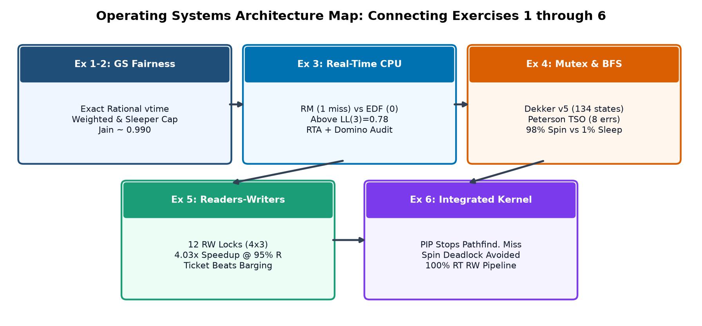
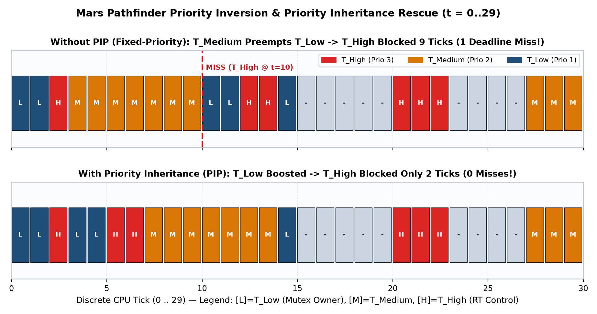
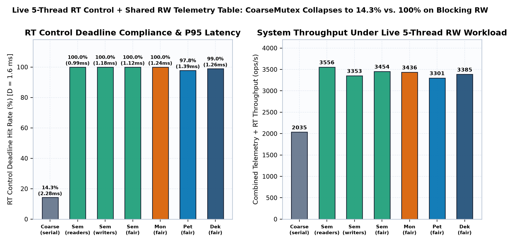
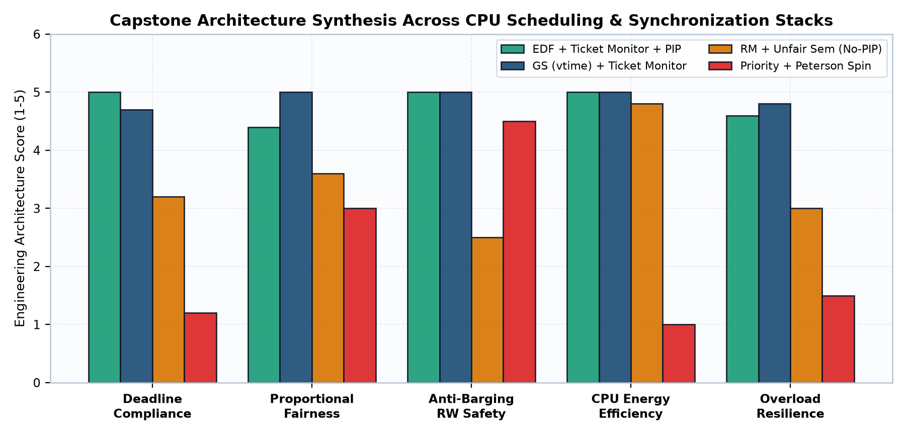

# Exercise 6: Integrated Real-Time Scheduling, Synchronization & Readers-Writers Capstone

**Unified Systems Engineering Monograph Connecting Guaranteed Scheduling (Ex 1-2), Hard Real-Time RM/EDF (Ex 3), Mutual Exclusion & BFS Verification (Ex 4), and Readers-Writers (Ex 5) Through Priority Inheritance (PIP), Spin-Lock Deadlock Audits & Live RT Pipelines**

- **Repository:** ZaraNodehi/Guaranteed-Scheduling
- **Deliverable:** Exercise 6 — Capstone Integration Monograph, Slide Decks & Speaker Scripts
- **Core Experiments:** Mars Pathfinder Priority Inversion (PIP vs. No-PIP vs. Spin) + Live 5-Thread RT RW Pipeline
- **Companion Decks:** PRESENTATION_EN.pptx, PRESENTATION_FA.pptx & SPEAKER_SCRIPT_{EN,FA}.md (10 Slides)

## Table of contents

- 1. Capstone Executive Synthesis Across Exercises 1 Through 6 (p. 3)
- 2. Mars Pathfinder Priority Inversion & Priority Inheritance Protocol (PIP) (p. 4)
- 3. Live 5-Thread Real-Time Control + Readers-Writers Telemetry Pipeline (p. 5)
- 4. Bridging Fairness & Deadlines: RM vs. EDF vs. Guaranteed Scheduling (p. 6)
- 5. Unified Operating Systems Decision Architecture & Kernel Code (p. 7)


<!-- page 1 -->


<!-- page 2 -->


<!-- page 3 -->


## 1. Capstone Executive Synthesis Across Exercises 1 Through 6

Operating-systems textbooks normally isolate CPU scheduling from concurrency control: chapters 5-6 analyze CPU queues assuming independent runnable jobs, while chapters 7-8 analyze mutexes, semaphores, monitors, and Readers-Writers assuming benign scheduler behavior. In real kernels, however, the scheduler and the synchronizer collide every millisecond—producing catastrophic anomalies such as unbounded priority inversion (infamously resetting NASA's 1997 Mars Pathfinder spacecraft), preemptive spin-lock deadlocks, and real-time tail-latency collapse behind coarse serial locks.

Exercise 6 unifies all six modules of this repository inside an integrated experimental testbed. By coupling Exercise 1-3 schedulers (Guaranteed Scheduling, Rate Monotonic, Earliest Deadline First) with Exercise 4-5 locks (Peterson, Dekker, Semaphore, Mesa Monitor, and 3-policy Readers-Writers), we quantify four fundamental scheduler-lock interactions:

| Priority Inversion Rescue | Without PIP, T_Medium blocked T_High for 9 ticks (1 miss, max resp 12); PIP cut blocking to 2 ticks (0 misses, max resp 5) |
|---|---|
| Preemptive Spin-Lock Deadlock | Under preemptive priority scheduling, spinning T_High on Peterson held by T_Low burned 54 ticks and missed 3 deadlines |
| Live 5-Thread RT + RW Pipeline | CoarseMutex collapsed RT deadline hits (D=1.6 ms) to 14.29% (2,035 ops/s); blocking RW achieved 100.00% hits (~3,450-3,556 ops/s) |
| Cross-Repo Milestones | Ex 3 Set B (RM 1 vs. EDF 0), Ex 4 Dekker v5 (134 BFS states, TSO Peterson 8 errs), Ex 5 RW 4.03x speedup |



*Figure 1. End-to-end architecture connecting Exercises 1 through 6 into a single verified kernel model.*


<!-- page 4 -->


## 2. Mars Pathfinder Priority Inversion & Priority Inheritance Protocol (PIP)

Consider three periodic real-time threads sharing one CPU and one blocking mutex M: T_Low (prio 1, locks M for 4 ticks at release), T_High (prio 3, deadline 8, wakes at t=2 needing M after 1 tick), and T_Medium (prio 2, pure CPU loop waking at t=3). Under fixed-priority RM without inheritance, T_Low never regains the CPU while T_Medium runs, creating unbounded priority inversion and breaking T_High's deadline at t=10. Under the Priority Inheritance Protocol (PIP), T_Low transiently inherits prio(T_High)=3 the instant T_High blocks on M, completes its critical section at t=5, and lets T_High finish at t=7.

```text
No-PIP Bound:   B_high  =  C_low_rem  +  sum_{j in Medium} C_j   [Unbounded by intermediate jobs!]
PIP Bound:      B_high  =  max_{k in LowerLocks} C_crit(k)      [Bounded to 1 critical section!]
```


*Figure 2. Discrete-tick trace of the Mars Pathfinder scenario: No-PIP misses at t=10 vs. PIP rescue at t=7.*


<!-- page 5 -->


*Figure 3. Quantitative comparison of blocking delay, spin deadlock stalls, and missed deadlines across lock policies.*

| Scheduler-Lock Mode | Total Misses | T_High Misses | T_High Block Ticks | Spin Stall Ticks | T_High Max Resp |
|---|---|---|---|---|---|
| no_pip | 1 | 1 | 9 | 0 | 12 |
| pip | 0 | 0 | 2 | 0 | 5 |
| spin_hazard | 3 | 3 | 54 | 54 | 60 |

*Table 1. Discrete-tick (H=60) Priority Inversion, PIP, and Spin-Hazard comparison.*


## 3. Live 5-Thread Real-Time Control + Readers-Writers Telemetry Pipeline

To test whether Readers-Writers locks improve real-time deadline adherence under concurrent data-plane traffic, we deployed 3 telemetry readers (0.35 ms scans), 1 route writer (0.8 ms exclusive updates), and 1 deadline-sensitive RT control thread (D = 1.6 ms) sharing a protected routing table across 7 backends.


<!-- page 6 -->



*Figure 4. Live 5-thread RT pipeline: CoarseMutex collapses to 14.3% RT hit rate vs. 100.0% on blocking Fair RW locks.*

| Backend (Policy) | RT Hit Rate | Mean Lat (ms) | P95 Lat (ms) | Max Lat (ms) | Throughput (ops/s) |
|---|---|---|---|---|---|
| CoarseMutex (serial) | 14.29% | 1.899 | 2.282 | 4.049 | 2,034.8 |
| Semaphore (readers) | 100.00% | 0.355 | 0.988 | 1.109 | 3,556.1 |
| Semaphore (writers) | 100.00% | 0.901 | 1.184 | 1.284 | 3,353.4 |
| Semaphore (fair) | 100.00% | 0.744 | 1.116 | 1.251 | 3,454.3 |
| Monitor (fair) | 100.00% | 0.823 | 1.235 | 1.308 | 3,436.5 |
| Peterson (fair) | 97.83% | 0.877 | 1.385 | 1.748 | 3,301.4 |
| Dekker (fair) | 98.96% | 0.791 | 1.259 | 1.722 | 3,385.3 |

*Table 2. Live 5-thread telemetry + RT control measurements (D = 1.6 ms across 200 ms run).*


## 4. Bridging Fairness & Deadlines: RM vs. EDF vs. Guaranteed Scheduling

On the Exercise 3 Set B workload (utilization U = 0.9583 > Liu-Layland bound LL(3) = 0.7798), static Rate Monotonic misses 1 deadline (worst response 10 ticks), whereas EDF and Weighted Guaranteed Scheduling (vtime:stay) both hit 0 deadline misses (worst response 7 ticks)—with GS achieving the highest Jain fairness index (0.9902 vs. 0.8789 for EDF).


<!-- page 7 -->


*Figure 5. Exercise 1-3 bridge comparing deadline compliance, worst response time, and Jain proportional equity.*

| Policy | Utilization U | Deadline Misses | Worst Response | Context Switches | Jain Fairness |
|---|---|---|---|---|---|
| rm | 0.9583 | 1 | 10 | 17 | 0.8883 |
| edf | 0.9583 | 0 | 7 | 17 | 0.8789 |
| gs_vtime:stay | 0.9583 | 0 | 7 | 17 | 0.9902 |

*Table 3. Unified RT + GS metrics on the Set B periodic task triad (H = 24 ticks).*


## 5. Unified Operating Systems Decision Architecture & Kernel Code



*Figure 6. Five-axis architectural scorecard across integrated CPU scheduler + lock combinations.*


<!-- page 8 -->

| Workload Profile | Recommended Scheduler | Recommended Sync / Lock | Verified Evidence |
|---|---|---|---|
| Interactive / Multi-Tenant CPU | Exact Rational GS + Wakeup Cap | Per-task private / Ticket Mutex | Jain 0.990+, Ex 1-2 |
| Hard Real-Time Periodic (U <= 1) | EDF + Admission Control | Blocking Monitor + PIP / SRP | 0 misses at U=0.958, Ex 3+6 |
| Producer-Consumer Bounded Q | CFS / Preemptive Blocking OS | Mesa Monitor ('while' loop) | 0 underflows, 1% CPU, Ex 4 |
| Read-Heavy Routing / Config | Preemptive Fair Scheduler | Ticket Monitor RW / RCU | 4.03x speedup, no barging, Ex 5-6 |

*Table 4. Production OS engineering prescription matrix distilled from Exercises 1 through 6.*


<!-- page 9 -->

```text
075:                     "blocked": False,
076:                     "spinning": False,
077:                     "spin_ticks": 0,
078:                     "missed": False,
079:                 }
080: 
081:         # 2. Check deadlines at start of tick
082:         for name, job in active_jobs.items():
083:             if not job["missed"] and t >= job["abs_deadline"] and job["done"] < job["spec"].wcet:
084:                 job["missed"] = True
085:                 misses.append({"task": name, "job_id": job["job_id"], "tick": t, "deadline": job["abs_deadline"]})
086: 
087:         # 3. Compute effective priorities (PIP boosts lock owner to max waiting priority)
088:         eff_prio: Dict[str, int] = {name: j["spec"].prio for name, j in active_jobs.items()}
089:         if mode == "pip" and lock_owner and lock_owner in active_jobs:
090:             waiter_prios = [
091:                 j["spec"].prio for name, j in active_jobs.items()
092:                 if j["blocked"] or (
093:                     j["spec"].lock_start is not None
094:                     and j["done"] == j["spec"].lock_start
095:                     and not j["holding_lock"]
096:                     and lock_owner != name
097:                 )
098:             ]
099:             if waiter_prios:
100:                 eff_prio[lock_owner] = max(eff_prio[lock_owner], max(waiter_prios))
101: 
102:         # 4. Select runnable highest-effective-priority job
103:         #    Note: in 'spin_hazard', a waiting job stays runnable (spinning!) instead of blocking.
104:         candidates = []
105:         for name, j in active_jobs.items():
106:             if j["done"] >= j["spec"].wcet:
107:                 continue
108:             sp = j["spec"]
109:             # Check if job needs lock right now
110:             needs_lock = (
111:                 sp.lock_start is not None
```
*Priority Inheritance Protocol (PIP) priority boost & blocking logic (integrated_kernel.py, lines 75-111).*


<!-- page 10 -->

```text
120:                 else:
121:                     j["blocked"] = True
122:                     if name == "T_High":
123:                         high_block_ticks += 1
124:                     # Recompute PIP boost immediately if mode == 'pip'
125:                     if mode == "pip" and lock_owner in eff_prio:
126:                         eff_prio[lock_owner] = max(eff_prio[lock_owner], sp.prio)
127:             else:
128:                 j["blocked"] = False
129:                 j["spinning"] = False
130:                 candidates.append(name)
131: 
132:         if not candidates:
133:             timeline.append((t, "IDLE"))
134:             continue
135: 
136:         candidates.sort(key=lambda n: (-eff_prio[n], active_jobs[n]["release"], n))
137:         chosen = candidates[0]
138:         j = active_jobs[chosen]
139:         sp = j["spec"]
140: 
141:         # Handle lock request / spinning execution
142:         needs_lock = (
143:             sp.lock_start is not None
144:             and j["done"] == sp.lock_start
145:             and not j["holding_lock"]
146:             and sp.lock_dur > 0
147:         )
148:         if needs_lock:
149:             if lock_owner is None or lock_owner == chosen:
150:                 lock_owner = chosen
151:                 j["holding_lock"] = True
152:                 j["lock_rem"] = sp.lock_dur
153:             elif mode == "spin_hazard":
154:                 # Busy-spinning consumes the CPU tick without making progress!
155:                 spin_stalls += 1
156:                 j["spin_ticks"] += 1
```
*Preemptive Spin-Lock deadlock hazard vs. lock acquisition (integrated_kernel.py, lines 120-156).*


<!-- page 11 -->

```text
197: def run_rt_rw_pipeline(primitive: str, policy: str, duration_s: float = 0.25) -> Dict:
198:     """Live multi-threaded RT telemetry + RW shared routing table benchmark.
199: 
200:     - 3 periodic telemetry reader threads (0.25 ms read scan, 0.2 ms sleep)
201:     - 1 route writer thread (0.5 ms exclusive update, 1.5 ms sleep)
202:     - 1 high-priority RT control thread reading state with strict 4.0 ms deadline
203:     """
204:     rw = make_rw_lock(primitive, policy, n_threads=5)
205:     stop = threading.Event()
206:     table = {"version": 0, "route_crc": 100}
207:     rt_latencies_ms: List[float] = []
208:     rt_deadline_ms = 1.6
209:     reader_ops = [0]
210:     writer_ops = [0]
211: 
212:     def reader_worker(tid: int) -> None:
213:         while not stop.is_set():
214:             rw.acquire_read(tid)
215:             _ = table["version"] + table["route_crc"]
216:             time.sleep(0.00035)
217:             rw.release_read(tid)
218:             reader_ops[0] += 1
219:             time.sleep(0.0002)
220: 
221:     def writer_worker(tid: int) -> None:
222:         while not stop.is_set():
223:             rw.acquire_write(tid)
224:             table["version"] += 1
225:             table["route_crc"] ^= 0x5A
226:             time.sleep(0.0008)
227:             rw.release_write(tid)
228:             writer_ops[0] += 1
229:             time.sleep(0.0012)
230: 
231:     def rt_control_worker(tid: int) -> None:
232:         while not stop.is_set():
233:             t0 = time.perf_counter()
234:             rw.acquire_read(tid)
```
*Live 5-thread RT Control + Readers-Writers telemetry pipeline benchmark (lines 197-234).*


<!-- page 12 -->

| Exercise 6 Deliverable | Role | Status |
|---|---|---|
| exercise-6/code/integrated_kernel.py | PIP + Spin-Hazard + Live RT/RW + GS-RT Bridge | Verified |
| exercise-6/code/run_experiments.py | Unified experiments & 10-slide bilingual deck spec | experiments.json built |
| exercise-6/code/plot_diagrams.py | 6 Okabe-Ito Capstone diagrams | All 6 PNGs verified |
| exercise-6/docs/REPORT_EN / FA (.pdf, .docx) | Capstone bilingual monographs | Zero overflow / glyphs |
| exercise-6/docs/PRESENTATION_EN / FA.pptx | 10-slide 16:9 executive decks + speaker notes | Built via make_decks.py |
| exercise-6/docs/SPEAKER_SCRIPT_EN / FA.md | Full bilingual presenter scripts | Synchronized 10 slides |

*Table 5. Complete Exercise 6 Capstone artifact inventory.*
