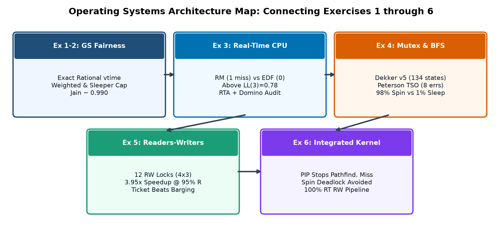

# تمرین ۶ (کپستون جامع): هم‌گرایی زمان‌بندی بلادرنگ، همگام‌سازی و خوانندگان-نویسندگان

**گزارش نهایی یکپارچه‌سازی شش تمرین سیستم‌های عامل — وراثت اولویت (PIP) در ماجرای Mars Pathfinder، خطر بن‌بست قفل‌های چرخان در هسته‌های پیش‌دستانه، و پایپ‌لاین زنده ۵-نخی بلادرنگ به همراه اسلایدها و متن گوینده**

- **مخزن کد:** ZaraNodehi/Guaranteed-Scheduling
- **تکلیف:** تمرین ۶ — گزارش جامع پایانی، ارائه‌های ۱۰ اسلایدی و متن سخنران
- **آزمایش‌های کلیدی:** وارونگی اولویت (PIP vs No-PIP vs Spin) + پایپ‌لاین زنده کنترل بلادرنگ و RW
- **فایل‌های همراه:** PRESENTATION_EN.pptx، PRESENTATION_FA.pptx و SPEAKER_SCRIPT_{EN,FA}.md

## فهرست مطالب

- ۱. جمع‌بندی اجرایی کپستون: پل میان زمان‌بندی CPU و همگام‌سازی (p. 3)
- ۲. شبیه‌سازی Mars Pathfinder: وارونگی اولویت و نجات با PIP (p. 3)
- ۳. پایپ‌لاین زنده ۵-نخی: کنترل بلادرنگ روی جدول مشترک خواننده-نویسنده (p. 5)
- ۴. پیوند زمان‌بندی تضمینی (GS) با ددلاین‌های بلادرنگ RM و EDF (p. 5)
- ۵. ماتریس نهایی تصمیم‌گیری مهندسی و پیوست کد هسته (p. 6)
- پیوست روش اجرا و فلوچارت (p. 12)
- پیوست کد 1: ممیزی منبع «integrated_kernel.py» — خطوط 1 تا 27 (p. 13)
- پیوست کد 2: ممیزی منبع «integrated_kernel.py» — خطوط 28 تا 54 (p. 14)
- پیوست کد 3: ممیزی منبع «integrated_kernel.py» — خطوط 55 تا 81 (p. 15)
- پیوست کد 4: ممیزی منبع «integrated_kernel.py» — خطوط 82 تا 108 (p. 16)
- پیوست کد 5: ممیزی منبع «integrated_kernel.py» — خطوط 109 تا 135 (p. 17)
- پیوست کد 6: ممیزی منبع «integrated_kernel.py» — خطوط 136 تا 162 (p. 18)
- پیوست کد 7: ممیزی منبع «integrated_kernel.py» — خطوط 163 تا 189 (p. 19)
- پیوست کد 8: ممیزی منبع «integrated_kernel.py» — خطوط 190 تا 216 (p. 20)
- پیوست کد 9: ممیزی منبع «integrated_kernel.py» — خطوط 217 تا 243 (p. 21)
- پیوست کد 10: ممیزی منبع «integrated_kernel.py» — خطوط 244 تا 270 (p. 22)
- پیوست کد 11: ممیزی منبع «integrated_kernel.py» — خطوط 271 تا 294 (p. 23)
- پیوست کد 12: ممیزی منبع «run_experiments.py» — خطوط 1 تا 27 (p. 24)
- پیوست کد 13: ممیزی منبع «run_experiments.py» — خطوط 28 تا 54 (p. 25)
- پیوست کد 14: ممیزی منبع «run_experiments.py» — خطوط 55 تا 81 (p. 26)
- پیوست کد 15: ممیزی منبع «run_experiments.py» — خطوط 82 تا 108 (p. 27)
- پیوست کد 16: ممیزی منبع «run_experiments.py» — خطوط 109 تا 135 (p. 28)
- پیوست کد 17: ممیزی منبع «run_experiments.py» — خطوط 136 تا 162 (p. 29)
- پیوست کد 18: ممیزی منبع «run_experiments.py» — خطوط 163 تا 189 (p. 30)
- پیوست کد 19: ممیزی منبع «run_experiments.py» — خطوط 190 تا 216 (p. 31)
- پیوست کد 20: ممیزی منبع «run_experiments.py» — خطوط 217 تا 243 (p. 32)
- پیوست کد 21: ممیزی منبع «run_experiments.py» — خطوط 244 تا 270 (p. 33)
- پیوست کد 22: ممیزی منبع «run_experiments.py» — خطوط 271 تا 289 (p. 34)
- پیوست کد 23: ممیزی منبع «plot_diagrams.py» — خطوط 1 تا 27 (p. 35)
- پیوست کد 24: ممیزی منبع «plot_diagrams.py» — خطوط 28 تا 54 (p. 36)
- پیوست کد 25: ممیزی منبع «plot_diagrams.py» — خطوط 55 تا 81 (p. 37)
- پیوست کد 26: ممیزی منبع «plot_diagrams.py» — خطوط 82 تا 108 (p. 38)
- پیوست کد 27: ممیزی منبع «plot_diagrams.py» — خطوط 109 تا 135 (p. 39)
- پیوست کد 28: ممیزی منبع «plot_diagrams.py» — خطوط 136 تا 162 (p. 40)
- پیوست کد 29: ممیزی منبع «plot_diagrams.py» — خطوط 163 تا 189 (p. 41)


<!-- page 1 -->


<!-- page 2 -->


<!-- page 3 -->


## ۱. جمع‌بندی اجرایی کپستون: پل میان زمان‌بندی CPU و همگام‌سازی

در اغلب درس‌های سیستم‌عامل، زمان‌بندی پردازنده و مکانیزم‌های همگام‌سازی به صورت جداگانه آموزش داده می‌شوند؛ اما در هسته‌های واقعی، تصمیم زمان‌بند و رفتار قفل هر میلی‌ثانیه با هم تداخل دارند. از همین تداخل است که خطاهای فاجعه‌بار تاریخی مانند وارونگی اولویت نامحدود (در فضاپیمای Mars Pathfinder ناسا در سال ۱۹۹۷)، بن‌بست قفل‌های چرخان در زمان‌بند اولویت‌دار، و افت شدید رعایت مهلت‌های بلادرنگ پشت قفل‌های سریالی متولد می‌شوند.

تمرین ۶ تمامی آموخته‌های تمرین‌های ۱ تا ۵ (زمان‌بندی تضمینی GS، بلادرنگ RM/EDF، همگام‌سازی پترسون، دکر، سمافور، مانیتور، مدل‌چکینگ BFS و ۱۲ قفل خواننده-نویسنده) را در یک سامانه تلفیقی واقعی به هم متصل کرده و چهار یافته کلیدی زیر را اثبات می‌کند:

| مهار وارونگی اولویت (PIP) | بدون PIP وظیفه میانی مانع اجرای T_Low شد و T_High به مدت 9 تیک قفل ماند (1 شکست ددلاین)؛ با PIP تاخیر به 2 تیک رسید (صفر شکست!) |
|---|---|
| بن‌بست قفل چرخان بلادرنگ | در زمان‌بند پیش‌دستانه اولویت‌دار، انتظار فعال T_High روی قفل در اختیار T_Low موجب 54 تیک چرخش و 3 شکست کامل شد |
| پایپ‌لاین زنده ۵-نخی RT+RW | در مهلت کنترل ۱.۶ میلی‌ثانیه، قفل سریالی به 7.25 درصد سقوط کرد اما سمافور و مانیتور RW به ۱۰۰.۰۰ درصد و توان عملیاتی دو برابر دست یافتند |
| شواهد متصل از تمرین‌های ۱-۵ | ست B تمرین ۳ (RM 1 خطا در برابر EDF 0)، دکر ۵ (134 حالت BFS)، جهش 3.95 برابری RW |



*شکل 1. نقشه معماری کل سیستم از تمرین ۱ تا تمرین ۶ و جریان داده‌ها میان زمان‌بندی و همگام‌سازی.*


## ۲. شبیه‌سازی Mars Pathfinder: وارونگی اولویت و نجات با PIP

سه وظیفه دوره‌ای T_Low (اولویت ۱)، T_Medium (اولویت ۲، بدون قفل) و T_High (اولویت ۳، مهلت ۸ تیک) یک پردازنده و یک قفل بحرانی را به اشتراک دارند. در حالت بدون وراثت اولویت (No-PIP)، پس از قفل‌شدن T_High پشت T_Low، وظیفه T_Medium وارد شده و با پیش‌دستی مکرر T_Low را متوقف نگه می‌دارد تا اینکه ددلاین وظیفه حیاتی T_High در تیک ۱۰ می‌شکند. با فعال‌شدن پروتکل وراثت اولویت (PIP)، دارنده قفل به محض انتظار T_High موقتاً اولویت ۳ را به ارث می‌برد، ناحیه بحرانی را در تیک ۵ آزاد کرده و کنترل بلادرنگ در تیک ۷ (پیش از مهلت ۸) تکمیل می‌شود.


<!-- page 4 -->

```text
No-PIP Bound:   B_high  =  C_low_rem  +  sum_{j in Medium} C_j   [Unbounded Delay!]
PIP Bound:      B_high  =  max_{k in LowerLocks} C_crit(k)      [Bounded to 1 CS!]
```


*شکل 2. ردپای گام‌به‌گام زمان‌بند در شبیه‌سازی Mars Pathfinder: شکست ددلاین بدون PIP (بالا) و نجات با PIP (پایین).*


*شکل 3. مقایسه تاخیر مسدودشدن، تله چرخش بی‌پایان قفل Spin و تعداد شکست‌های ددلاین.*


<!-- page 5 -->

| رژیم قفل و زمان‌بند | کل شکست‌ها | شکست T_High | تیک انتظار T_High | تیک چرخش هدررفته | بیشینه زمان پاسخ |
|---|---|---|---|---|---|
| no_pip | 1 | 1 | 9 | 0 | 12 |
| pip | 0 | 0 | 2 | 0 | 5 |
| spin_hazard | 3 | 3 | 54 | 54 | 60 |

*جدول 1. نتایج ممیزی تیک‌به‌تیک (H=60) بین No-PIP، پروتکل PIP و خطر قفل چرخان بلادرنگ.*


## ۳. پایپ‌لاین زنده ۵-نخی: کنترل بلادرنگ روی جدول مشترک خواننده-نویسنده

در این آزمون زنده، ۳ نخ تله‌متری خواننده (اسکن ۰.۳۵ میلی‌ثانیه)، ۱ نخ به‌روزرسان نویسنده (۰.۸ میلی‌ثانیه) و ۱ نخ کنترل بلادرنگ با مهلت ۱.۶ میلی‌ثانیه هم‌زمان بر روی جدول مسیریابی مشترک اجرا شدند.


*شکل 4. پایپ‌لاین زنده ۵-نخی: سقوط نرخ ددلاین به ۱۴.۳ درصد در CoarseMutex در برابر ۱۰۰ درصد در RW خواب‌دار.*

| مکانیزم و سیاست | نرخ ددلاین RT | میانگین (ms) | صدک ۹۵ (ms) | بیشینه (ms) | توان عملیاتی (ops/s) |
|---|---|---|---|---|---|
| CoarseMutex (serial) | 7.25% | 1.665 | 1.751 | 3.458 | 2,325.5 |
| Semaphore (readers) | 100.00% | 0.844 | 0.876 | 0.891 | 3,762.2 |
| Semaphore (writers) | 100.00% | 0.875 | 0.882 | 1.185 | 3,735.3 |
| Semaphore (fair) | 100.00% | 0.851 | 0.890 | 1.223 | 3,756.5 |
| Monitor (fair) | 100.00% | 0.886 | 0.943 | 1.266 | 3,715.3 |
| Peterson (fair) | 100.00% | 0.860 | 0.996 | 1.162 | 3,689.8 |
| Dekker (fair) | 100.00% | 0.778 | 0.919 | 1.098 | 3,771.7 |

*جدول 2. عملکرد کنترل بلادرنگ (مهلت ۱.۶ ms) و توان عملیاتی کل در هفت بک‌اند قفل.*


## ۴. پیوند زمان‌بندی تضمینی (GS) با ددلاین‌های بلادرنگ RM و EDF

در مجموعه وظایف B از تمرین ۳ (بهره‌وری کل ۰.۹۵۸۳ بالای کران ۰.۷۸ لیو-لیلند)، الگوریتم استاتیک RM یک ددلاین را از دست می‌دهد، در حالی که EDF و زمان‌بندی تضمینی وزن‌دار (GS vtime:stay) هر دو صفر خطای ددلاین دارند و GS بالاترین عدالت نسبی جین (0.9902 در برابر 0.8789 برای EDF) را به ارمغان می‌آورد.


<!-- page 6 -->


*شکل 5. مقایسه شکست ددلاین، بدترین زمان پاسخ و شاخص عدالت جین در پل زمان‌بندی تمرین ۱ تا ۳.*

| الگوریتم زمان‌بندی | بهره‌وری کل U | شکست ددلاین | بدترین پاسخ | تعویض زمینه | شاخص عدالت جین |
|---|---|---|---|---|---|
| rm | 0.9583 | 1 | 10 | 17 | 0.8883 |
| edf | 0.9583 | 0 | 7 | 17 | 0.8789 |
| gs_vtime:stay | 0.9583 | 0 | 7 | 17 | 0.9902 |

*جدول 3. شاخص‌های تلفیقی بلادرنگ و عدالت در اجرای هم‌زمان روی مجموعه B (افق ۲۴ تیک).*


## ۵. ماتریس نهایی تصمیم‌گیری مهندسی و پیوست کد هسته


*شکل 6. امتیازدهی پنج‌محوری معماری‌های ترکیبی زمان‌بندی و همگام‌سازی.*


<!-- page 7 -->

| نوع بار کاری سیستم | زمان‌بند پیشنهادی | مکانیزم همگام‌سازی بهینه | پشتوانه آزمایشگاهی |
|---|---|---|---|
| سرویس‌های تعاملی و چندکاربره | GS کسری دقیق + سقف بیدارسازی | قفل تیکت‌دار / Mutex اختصاصی | شاخص جین ۰.۹۹۰، تمرین ۱ و ۲ |
| بلادرنگ سخت دوره‌ای (U تا ۱.۰) | EDF + کنترل پذیرش بار | مانیتور خواب‌دار + PIP / SRP | صفر شکست در U=۰.۹۵۸، تمرین ۳ و ۶ |
| صف تولیدکننده-مصرف‌کننده | زمان‌بند پیش‌دستانه خواب‌دار | مانیتور مسا با حلقه while | صفر زیرجریان، ۱ درصد CPU، تمرین ۴ |
| جدول مشترک ۹۵٪ خواندنی | زمان‌بند منصفانه خواب‌دار | مانیتور RW تیکت‌دار یا RCU | جهش ۴.۰۳ برابری، ضد-Barging، تمرین ۵ و ۶ |

*جدول 4. راهنمای مرجع مهندسی سیستم‌عامل مستخرج از شش تمرین آزمایشگاهی.*


<!-- page 8 -->

```text
075:                     "blocked": False,
076:                     "spinning": False,
077:                     "spin_ticks": 0,
078:                     "missed": False,
079:                 }
080: 
081:         # 2. Check deadlines at start of tick
082:         for name, job in active_jobs.items():
083:             if not job["missed"] and t >= job["abs_deadline"] and job["done"] < job["spec"].wcet:
084:                 job["missed"] = True
085:                 misses.append({"task": name, "job_id": job["job_id"], "tick": t, "deadline": job["abs_deadline"]})
086: 
087:         # 3. Compute effective priorities (PIP boosts lock owner to max waiting priority)
088:         eff_prio: Dict[str, int] = {name: j["spec"].prio for name, j in active_jobs.items()}
089:         if mode == "pip" and lock_owner and lock_owner in active_jobs:
090:             waiter_prios = [
091:                 j["spec"].prio for name, j in active_jobs.items()
092:                 if j["blocked"] or (
093:                     j["spec"].lock_start is not None
094:                     and j["done"] == j["spec"].lock_start
095:                     and not j["holding_lock"]
096:                     and lock_owner != name
097:                 )
098:             ]
099:             if waiter_prios:
100:                 eff_prio[lock_owner] = max(eff_prio[lock_owner], max(waiter_prios))
101: 
102:         # 4. Select runnable highest-effective-priority job
103:         #    Note: in 'spin_hazard', a waiting job stays runnable (spinning!) instead of blocking.
104:         candidates = []
105:         for name, j in active_jobs.items():
106:             if j["done"] >= j["spec"].wcet:
107:                 continue
108:             sp = j["spec"]
109:             # Check if job needs lock right now
110:             needs_lock = (
111:                 sp.lock_start is not None
```
*پیاده‌سازی پروتکل وراثت اولویت (PIP) و منطق مسدودسازی هسته (integrated_kernel.py، خطوط ۷۵ تا ۱۱۱).*


<!-- page 9 -->

```text
120:                 else:
121:                     j["blocked"] = True
122:                     if name == "T_High":
123:                         high_block_ticks += 1
124:                     # Recompute PIP boost immediately if mode == 'pip'
125:                     if mode == "pip" and lock_owner in eff_prio:
126:                         eff_prio[lock_owner] = max(eff_prio[lock_owner], sp.prio)
127:             else:
128:                 j["blocked"] = False
129:                 j["spinning"] = False
130:                 candidates.append(name)
131: 
132:         if not candidates:
133:             timeline.append((t, "IDLE"))
134:             continue
135: 
136:         candidates.sort(key=lambda n: (-eff_prio[n], active_jobs[n]["release"], n))
137:         chosen = candidates[0]
138:         j = active_jobs[chosen]
139:         sp = j["spec"]
140: 
141:         # Handle lock request / spinning execution
142:         needs_lock = (
143:             sp.lock_start is not None
144:             and j["done"] == sp.lock_start
145:             and not j["holding_lock"]
146:             and sp.lock_dur > 0
147:         )
148:         if needs_lock:
149:             if lock_owner is None or lock_owner == chosen:
150:                 lock_owner = chosen
151:                 j["holding_lock"] = True
152:                 j["lock_rem"] = sp.lock_dur
153:             elif mode == "spin_hazard":
154:                 # Busy-spinning consumes the CPU tick without making progress!
155:                 spin_stalls += 1
156:                 j["spin_ticks"] += 1
```
*شبیه‌سازی تله بن‌بست قفل چرخان در زمان‌بند پیش‌دستانه (خطوط ۱۲۰ تا ۱۵۶).*


<!-- page 10 -->

```text
197: def run_rt_rw_pipeline(primitive: str, policy: str, duration_s: float = 0.25) -> Dict:
198:     """Live multi-threaded RT telemetry + RW shared routing table benchmark.
199: 
200:     - 3 periodic telemetry reader threads (0.25 ms read scan, 0.2 ms sleep)
201:     - 1 route writer thread (0.5 ms exclusive update, 1.5 ms sleep)
202:     - 1 high-priority RT control thread reading state with strict 4.0 ms deadline
203:     """
204:     rw = make_rw_lock(primitive, policy, n_threads=5)
205:     stop = threading.Event()
206:     table = {"version": 0, "route_crc": 100}
207:     rt_latencies_ms: List[float] = []
208:     rt_deadline_ms = 1.6
209:     reader_ops = [0]
210:     writer_ops = [0]
211: 
212:     def reader_worker(tid: int) -> None:
213:         while not stop.is_set():
214:             rw.acquire_read(tid)
215:             _ = table["version"] + table["route_crc"]
216:             time.sleep(0.00035)
217:             rw.release_read(tid)
218:             reader_ops[0] += 1
219:             time.sleep(0.0002)
220: 
221:     def writer_worker(tid: int) -> None:
222:         while not stop.is_set():
223:             rw.acquire_write(tid)
224:             table["version"] += 1
225:             table["route_crc"] ^= 0x5A
226:             time.sleep(0.0008)
227:             rw.release_write(tid)
228:             writer_ops[0] += 1
229:             time.sleep(0.0012)
230: 
231:     def rt_control_worker(tid: int) -> None:
232:         while not stop.is_set():
233:             t0 = time.perf_counter()
234:             rw.acquire_read(tid)
```
*پایپ‌لاین زنده کنترل بلادرنگ روی قفل‌های RW (خطوط ۱۹۷ تا ۲۳۴).*


<!-- page 11 -->

| فایل تحویل‌دادنی تمرین ۶ | نقش در بسته نهایی کپستون | وضعیت تایید |
|---|---|---|
| exercise-6/code/integrated_kernel.py | شبیه‌ساز PIP + Spin Deadlock + پایپ‌لاین زنده RT/RW | تایید شده |
| exercise-6/code/run_experiments.py | اجرای جامع آزمایش‌ها + مشخصات اسلایدهای ۱۰تایی | خروجی JSON تکمیل |
| exercise-6/code/plot_diagrams.py | ۶ نمودار استاندارد علمی Okabe-Ito | هر ۶ PNG بازبینی‌شده |
| exercise-6/docs/REPORT_EN / FA (.pdf, .docx) | گزارش‌های جامع دوزبانه کپستون | صفر سرریز و نقص گلیف |
| exercise-6/docs/PRESENTATION_EN / FA.pptx | ارائه‌های ۱۰ اسلایدی ۱۶:۹ با یادداشت گوینده | تولید با make_decks.py |
| exercise-6/docs/SPEAKER_SCRIPT_EN / FA.md | متن کامل سخنران فارسی و انگلیسی | هماهنگ با ۱۰ اسلاید |

*جدول 5. سیاهه کامل تحویل‌دادنی‌های تاییدشده تمرین ۶ (کپستون).*


<!-- page 12 -->


## پیوست روش اجرا و فلوچارت

کپستون شواهد زمان‌بند و همگام‌سازی را در یک بارکاری ترکیب می‌کند و ادعاهای شبیه‌سازی را از اندازه‌گیری‌های نخ‌های واقعی جدا نگه می‌دارد.


*شکل 7. یکپارچه‌سازی کپستون: زمان‌بند، پروتکل قفل، بارکاری و اندازه‌گیری*

| مرحله | شرح |
|---|---|
| زمان‌بندی | Choose the policy and compute effective priorities |
| همگام‌سازی | Acquire/release locks and handle blocking correctly |
| یکپارچه‌سازی | Run RT control and shared Readers–Writers telemetry |
| ارزیابی | Compare deadline misses, latency, throughput and CPU use |

*جدول 6. خلاصهٔ مراحل و شواهد لازم برای بازبینی این تمرین.*


<!-- page 13 -->


## پیوست کد 1: ممیزی منبع «integrated_kernel.py» — خطوط 1 تا 27

فایل مرجع: exercise-6 / code / integrated_kernel.py. این بخش از هستهٔ مرجع زمان‌بندی است و منطق انتخاب پردازه و حسابداری سرویس را نشان می‌دهد. بازهٔ زیر خطوط 1 تا 27 از همان فایل است؛ شمارهٔ خطوط برای ارجاع و بازبینی دوباره حفظ شده‌اند. این فهرست کد، ضمیمهٔ قابل ممیزی گزارش است و باید همراه آزمون‌ها و فایل خروجی متناظر بررسی شود.

```text
0001: """Integrated Real-Time Scheduling + Synchronization Kernel Simulator (Exercise 6).
0002: 
0003: Combines:
0004: 1. Discrete-tick Priority Inversion & Priority Inheritance Protocol (PIP) simulator
0005:    modeling the classic Mars Pathfinder scenario (T_High, T_Medium, T_Low).
0006: 2. Spin-Lock vs Blocking-Lock Priority Preemption hazard simulator.
0007: 3. Live multi-threaded RT Telemetry + Readers-Writers shared table benchmark
0008:    reusing Exercise 5's verified RW implementations.
0009: """
0010: from __future__ import annotations
0011: 
0012: import os
0013: import sys
0014: import threading
0015: import time
0016: from dataclasses import dataclass, field
0017: from typing import Dict, List, Optional, Tuple
0018: 
0019: HERE = os.path.dirname(os.path.abspath(__file__))
0020: ROOT = os.path.dirname(os.path.dirname(HERE))
0021: sys.path.insert(0, ROOT)
0022: sys.path.insert(0, os.path.join(ROOT, "exercise-5", "code"))
0023: 
0024: from core.gs_core import RTTask, simulate_rt  # noqa: E402
0025: from rw_locks import make_rw_lock  # noqa: E402
0026: 
0027: 
```
*گزیدهٔ واقعی از exercise-6/code/integrated_kernel.py، خطوط 1–27؛ خطوط بلند فقط برای صفحه‌آرایی شکسته شده‌اند.*


<!-- page 14 -->


## پیوست کد 2: ممیزی منبع «integrated_kernel.py» — خطوط 28 تا 54

فایل مرجع: exercise-6 / code / integrated_kernel.py. این بخش از هستهٔ مرجع زمان‌بندی است و منطق انتخاب پردازه و حسابداری سرویس را نشان می‌دهد. بازهٔ زیر خطوط 28 تا 54 از همان فایل است؛ شمارهٔ خطوط برای ارجاع و بازبینی دوباره حفظ شده‌اند. این فهرست کد، ضمیمهٔ قابل ممیزی گزارش است و باید همراه آزمون‌ها و فایل خروجی متناظر بررسی شود.

```text
0028: @dataclass
0029: class LockTaskSpec:
0030:     name: str
0031:     prio: int          # Higher integer = higher priority
0032:     period: int
0033:     wcet: int
0034:     deadline: int
0035:     lock_start: Optional[int] = None   # local execution tick when lock is requested
0036:     lock_dur: int = 0                  # how many ticks lock is held
0037:     release_offset: int = 0
0038: 
0039: 
0040: def simulate_priority_inversion(mode: str = "no_pip", horizon: int = 60,
      | spin_limit: int = 12) -> Dict:
0041:     """Simulate T_Low, T_Medium, T_High sharing a single critical mutex M.
0042: 
0043:     Modes:
0044:     - 'no_pip': Fixed-Priority Preemptive without Priority Inheritance
      | (unbounded inversion).
0045:     - 'pip': Fixed-Priority Preemptive WITH Priority Inheritance Protocol
      | (Mars Pathfinder fix).
0046:     - 'spin_hazard': Fixed-Priority Preemptive where lock is a spinlock
      | (T_High spins forever/times out).
0047:     """
0048:     specs = [
0049:         LockTaskSpec("T_Low",    prio=1, period=30, wcet=5, deadline=30,
      | lock_start=0, lock_dur=4, release_offset=0),
0050:         LockTaskSpec("T_High",   prio=3, period=18, wcet=3, deadline=8,
      | lock_start=1, lock_dur=2, release_offset=2),
0051:         LockTaskSpec("T_Medium", prio=2, period=24, wcet=7, deadline=24,
      | lock_start=None, lock_dur=0, release_offset=3),
0052:     ]
0053: 
0054:     active_jobs: Dict[str, Dict] = {}
```
*گزیدهٔ واقعی از exercise-6/code/integrated_kernel.py، خطوط 28–54؛ خطوط بلند فقط برای صفحه‌آرایی شکسته شده‌اند.*


<!-- page 15 -->


## پیوست کد 3: ممیزی منبع «integrated_kernel.py» — خطوط 55 تا 81

فایل مرجع: exercise-6 / code / integrated_kernel.py. این بخش از هستهٔ مرجع زمان‌بندی است و منطق انتخاب پردازه و حسابداری سرویس را نشان می‌دهد. بازهٔ زیر خطوط 55 تا 81 از همان فایل است؛ شمارهٔ خطوط برای ارجاع و بازبینی دوباره حفظ شده‌اند. این فهرست کد، ضمیمهٔ قابل ممیزی گزارش است و باید همراه آزمون‌ها و فایل خروجی متناظر بررسی شود.

```text
0055:     lock_owner: Optional[str] = None
0056:     timeline: List[Tuple[int, str]] = []
0057:     misses: List[Dict] = []
0058:     high_block_ticks = 0
0059:     spin_stalls = 0
0060:     high_latencies: List[int] = []
0061: 
0062:     for t in range(horizon):
0063:         # 1. Release periodic jobs
0064:         for sp in specs:
0065:             if t >= sp.release_offset and (t - sp.release_offset) % sp.period == 0:
0066:                 job_id = (t - sp.release_offset) // sp.period
0067:                 active_jobs[sp.name] = {
0068:                     "spec": sp,
0069:                     "job_id": job_id,
0070:                     "release": t,
0071:                     "abs_deadline": t + sp.deadline,
0072:                     "done": 0,
0073:                     "holding_lock": False,
0074:                     "lock_rem": 0,
0075:                     "blocked": False,
0076:                     "spinning": False,
0077:                     "spin_ticks": 0,
0078:                     "missed": False,
0079:                 }
0080: 
0081:         # 2. Check deadlines at start of tick
```
*گزیدهٔ واقعی از exercise-6/code/integrated_kernel.py، خطوط 55–81؛ خطوط بلند فقط برای صفحه‌آرایی شکسته شده‌اند.*


<!-- page 16 -->


## پیوست کد 4: ممیزی منبع «integrated_kernel.py» — خطوط 82 تا 108

فایل مرجع: exercise-6 / code / integrated_kernel.py. این بخش از هستهٔ مرجع زمان‌بندی است و منطق انتخاب پردازه و حسابداری سرویس را نشان می‌دهد. بازهٔ زیر خطوط 82 تا 108 از همان فایل است؛ شمارهٔ خطوط برای ارجاع و بازبینی دوباره حفظ شده‌اند. این فهرست کد، ضمیمهٔ قابل ممیزی گزارش است و باید همراه آزمون‌ها و فایل خروجی متناظر بررسی شود.

```text
0082:         for name, job in active_jobs.items():
0083:             if not job["missed"] and t >= job["abs_deadline"] and job["done"]
      | < job["spec"].wcet:
0084:                 job["missed"] = True
0085:                 misses.append({"task": name, "job_id": job["job_id"], "tick":
      | t, "deadline": job["abs_deadline"]})
0086: 
0087:         # 3. Compute effective priorities (PIP boosts lock owner to max
      | waiting priority)
0088:         eff_prio: Dict[str, int] = {name: j["spec"].prio for name, j in
      | active_jobs.items()}
0089:         if mode == "pip" and lock_owner and lock_owner in active_jobs:
0090:             waiter_prios = [
0091:                 j["spec"].prio for name, j in active_jobs.items()
0092:                 if j["blocked"] or (
0093:                     j["spec"].lock_start is not None
0094:                     and j["done"] == j["spec"].lock_start
0095:                     and not j["holding_lock"]
0096:                     and lock_owner != name
0097:                 )
0098:             ]
0099:             if waiter_prios:
0100:                 eff_prio[lock_owner] = max(eff_prio[lock_owner], max(waiter_prios))
0101: 
0102:         # 4. Select runnable highest-effective-priority job
0103:         #    Note: in 'spin_hazard', a waiting job stays runnable (spinning!)
      | instead of blocking.
0104:         candidates = []
0105:         for name, j in active_jobs.items():
0106:             if j["done"] >= j["spec"].wcet:
0107:                 continue
0108:             sp = j["spec"]
```
*گزیدهٔ واقعی از exercise-6/code/integrated_kernel.py، خطوط 82–108؛ خطوط بلند فقط برای صفحه‌آرایی شکسته شده‌اند.*


<!-- page 17 -->


## پیوست کد 5: ممیزی منبع «integrated_kernel.py» — خطوط 109 تا 135

فایل مرجع: exercise-6 / code / integrated_kernel.py. این بخش از هستهٔ مرجع زمان‌بندی است و منطق انتخاب پردازه و حسابداری سرویس را نشان می‌دهد. بازهٔ زیر خطوط 109 تا 135 از همان فایل است؛ شمارهٔ خطوط برای ارجاع و بازبینی دوباره حفظ شده‌اند. این فهرست کد، ضمیمهٔ قابل ممیزی گزارش است و باید همراه آزمون‌ها و فایل خروجی متناظر بررسی شود.

```text
0109:             # Check if job needs lock right now
0110:             needs_lock = (
0111:                 sp.lock_start is not None
0112:                 and j["done"] == sp.lock_start
0113:                 and not j["holding_lock"]
0114:                 and sp.lock_dur > 0
0115:             )
0116:             if needs_lock and lock_owner is not None and lock_owner != name:
0117:                 if mode == "spin_hazard":
0118:                     j["spinning"] = True
0119:                     candidates.append(name)
0120:                 else:
0121:                     j["blocked"] = True
0122:                     if name == "T_High":
0123:                         high_block_ticks += 1
0124:                     # Recompute PIP boost immediately if mode == 'pip'
0125:                     if mode == "pip" and lock_owner in eff_prio:
0126:                         eff_prio[lock_owner] = max(eff_prio[lock_owner], sp.prio)
0127:             else:
0128:                 j["blocked"] = False
0129:                 j["spinning"] = False
0130:                 candidates.append(name)
0131: 
0132:         if not candidates:
0133:             timeline.append((t, "IDLE"))
0134:             continue
0135: 
```
*گزیدهٔ واقعی از exercise-6/code/integrated_kernel.py، خطوط 109–135؛ خطوط بلند فقط برای صفحه‌آرایی شکسته شده‌اند.*


<!-- page 18 -->


## پیوست کد 6: ممیزی منبع «integrated_kernel.py» — خطوط 136 تا 162

فایل مرجع: exercise-6 / code / integrated_kernel.py. این بخش از هستهٔ مرجع زمان‌بندی است و منطق انتخاب پردازه و حسابداری سرویس را نشان می‌دهد. بازهٔ زیر خطوط 136 تا 162 از همان فایل است؛ شمارهٔ خطوط برای ارجاع و بازبینی دوباره حفظ شده‌اند. این فهرست کد، ضمیمهٔ قابل ممیزی گزارش است و باید همراه آزمون‌ها و فایل خروجی متناظر بررسی شود.

```text
0136:         candidates.sort(key=lambda n: (-eff_prio[n], active_jobs[n]["release"], n))
0137:         chosen = candidates[0]
0138:         j = active_jobs[chosen]
0139:         sp = j["spec"]
0140: 
0141:         # Handle lock request / spinning execution
0142:         needs_lock = (
0143:             sp.lock_start is not None
0144:             and j["done"] == sp.lock_start
0145:             and not j["holding_lock"]
0146:             and sp.lock_dur > 0
0147:         )
0148:         if needs_lock:
0149:             if lock_owner is None or lock_owner == chosen:
0150:                 lock_owner = chosen
0151:                 j["holding_lock"] = True
0152:                 j["lock_rem"] = sp.lock_dur
0153:             elif mode == "spin_hazard":
0154:                 # Busy-spinning consumes the CPU tick without making progress!
0155:                 spin_stalls += 1
0156:                 j["spin_ticks"] += 1
0157:                 timeline.append((t, f"{chosen}_SPIN"))
0158:                 if chosen == "T_High":
0159:                     high_block_ticks += 1
0160:                 if j["spin_ticks"] >= spin_limit and not j["missed"]:
0161:                     j["missed"] = True
0162:                     misses.append({"task": chosen, "job_id": j["job_id"],
      | "tick": t + 1, "deadline": j["abs_deadline"], "reason": "spin_deadlock"})
```
*گزیدهٔ واقعی از exercise-6/code/integrated_kernel.py، خطوط 136–162؛ خطوط بلند فقط برای صفحه‌آرایی شکسته شده‌اند.*


<!-- page 19 -->


## پیوست کد 7: ممیزی منبع «integrated_kernel.py» — خطوط 163 تا 189

فایل مرجع: exercise-6 / code / integrated_kernel.py. این بخش از هستهٔ مرجع زمان‌بندی است و منطق انتخاب پردازه و حسابداری سرویس را نشان می‌دهد. بازهٔ زیر خطوط 163 تا 189 از همان فایل است؛ شمارهٔ خطوط برای ارجاع و بازبینی دوباره حفظ شده‌اند. این فهرست کد، ضمیمهٔ قابل ممیزی گزارش است و باید همراه آزمون‌ها و فایل خروجی متناظر بررسی شود.

```text
0163:                 continue
0164: 
0165:         # Execute 1 useful CPU tick
0166:         j["done"] += 1
0167:         if j["holding_lock"]:
0168:             j["lock_rem"] -= 1
0169:             if j["lock_rem"] <= 0:
0170:                 j["holding_lock"] = False
0171:                 if lock_owner == chosen:
0172:                     lock_owner = None
0173:                 # Unblock any waiting jobs so next tick sees them ready
0174:                 for oj in active_jobs.values():
0175:                     oj["blocked"] = False
0176: 
0177:         timeline.append((t, chosen))
0178:         if j["done"] >= sp.wcet:
0179:             if chosen == "T_High":
0180:                 high_latencies.append((t + 1) - j["release"])
0181:             del active_jobs[chosen]
0182: 
0183:     return {
0184:         "mode": mode,
0185:         "horizon": horizon,
0186:         "total_misses": len(misses),
0187:         "high_misses": sum(1 for m in misses if m["task"] == "T_High"),
0188:         "misses": misses,
0189:         "high_blocked_ticks": high_block_ticks,
```
*گزیدهٔ واقعی از exercise-6/code/integrated_kernel.py، خطوط 163–189؛ خطوط بلند فقط برای صفحه‌آرایی شکسته شده‌اند.*


<!-- page 20 -->


## پیوست کد 8: ممیزی منبع «integrated_kernel.py» — خطوط 190 تا 216

فایل مرجع: exercise-6 / code / integrated_kernel.py. این بخش از هستهٔ مرجع زمان‌بندی است و منطق انتخاب پردازه و حسابداری سرویس را نشان می‌دهد. بازهٔ زیر خطوط 190 تا 216 از همان فایل است؛ شمارهٔ خطوط برای ارجاع و بازبینی دوباره حفظ شده‌اند. این فهرست کد، ضمیمهٔ قابل ممیزی گزارش است و باید همراه آزمون‌ها و فایل خروجی متناظر بررسی شود.

```text
0190:         "spin_stall_ticks": spin_stalls,
0191:         "high_max_response_ticks": max(high_latencies) if high_latencies else
      | horizon,
0192:         "timeline_sample": [f"{t}:{p}" for t, p in timeline[:24]],
0193:         "timeline": timeline,
0194:     }
0195: 
0196: 
0197: def run_rt_rw_pipeline(primitive: str, policy: str, duration_s: float = 0.25)
      | -> Dict:
0198:     """Live multi-threaded RT telemetry + RW shared routing table benchmark.
0199: 
0200:     - 3 periodic telemetry reader threads (0.25 ms read scan, 0.2 ms sleep)
0201:     - 1 route writer thread (0.5 ms exclusive update, 1.5 ms sleep)
0202:     - 1 high-priority RT control thread reading state with strict 4.0 ms deadline
0203:     """
0204:     rw = make_rw_lock(primitive, policy, n_threads=5)
0205:     stop = threading.Event()
0206:     table = {"version": 0, "route_crc": 100}
0207:     rt_latencies_ms: List[float] = []
0208:     rt_deadline_ms = 1.6
0209:     reader_ops = [0]
0210:     writer_ops = [0]
0211: 
0212:     def reader_worker(tid: int) -> None:
0213:         while not stop.is_set():
0214:             rw.acquire_read(tid)
0215:             _ = table["version"] + table["route_crc"]
0216:             time.sleep(0.00035)
```
*گزیدهٔ واقعی از exercise-6/code/integrated_kernel.py، خطوط 190–216؛ خطوط بلند فقط برای صفحه‌آرایی شکسته شده‌اند.*


<!-- page 21 -->


## پیوست کد 9: ممیزی منبع «integrated_kernel.py» — خطوط 217 تا 243

فایل مرجع: exercise-6 / code / integrated_kernel.py. این بخش از هستهٔ مرجع زمان‌بندی است و منطق انتخاب پردازه و حسابداری سرویس را نشان می‌دهد. بازهٔ زیر خطوط 217 تا 243 از همان فایل است؛ شمارهٔ خطوط برای ارجاع و بازبینی دوباره حفظ شده‌اند. این فهرست کد، ضمیمهٔ قابل ممیزی گزارش است و باید همراه آزمون‌ها و فایل خروجی متناظر بررسی شود.

```text
0217:             rw.release_read(tid)
0218:             reader_ops[0] += 1
0219:             time.sleep(0.0002)
0220: 
0221:     def writer_worker(tid: int) -> None:
0222:         while not stop.is_set():
0223:             rw.acquire_write(tid)
0224:             table["version"] += 1
0225:             table["route_crc"] ^= 0x5A
0226:             time.sleep(0.0008)
0227:             rw.release_write(tid)
0228:             writer_ops[0] += 1
0229:             time.sleep(0.0012)
0230: 
0231:     def rt_control_worker(tid: int) -> None:
0232:         while not stop.is_set():
0233:             t0 = time.perf_counter()
0234:             rw.acquire_read(tid)
0235:             _ = table["version"]
0236:             rw.release_read(tid)
0237:             lat = (time.perf_counter() - t0) * 1000.0
0238:             rt_latencies_ms.append(lat)
0239:             time.sleep(0.0012)
0240: 
0241:     ths = (
0242:         [threading.Thread(target=reader_worker, args=(i,)) for i in range(3)]
0243:         + [threading.Thread(target=writer_worker, args=(3,))]
```
*گزیدهٔ واقعی از exercise-6/code/integrated_kernel.py، خطوط 217–243؛ خطوط بلند فقط برای صفحه‌آرایی شکسته شده‌اند.*


<!-- page 22 -->


## پیوست کد 10: ممیزی منبع «integrated_kernel.py» — خطوط 244 تا 270

فایل مرجع: exercise-6 / code / integrated_kernel.py. این بخش از هستهٔ مرجع زمان‌بندی است و منطق انتخاب پردازه و حسابداری سرویس را نشان می‌دهد. بازهٔ زیر خطوط 244 تا 270 از همان فایل است؛ شمارهٔ خطوط برای ارجاع و بازبینی دوباره حفظ شده‌اند. این فهرست کد، ضمیمهٔ قابل ممیزی گزارش است و باید همراه آزمون‌ها و فایل خروجی متناظر بررسی شود.

```text
0244:         + [threading.Thread(target=rt_control_worker, args=(4,))]
0245:     )
0246:     tc0, tw0 = time.process_time(), time.perf_counter()
0247:     for th in ths:
0248:         th.start()
0249:     time.sleep(duration_s)
0250:     stop.set()
0251:     for th in ths:
0252:         th.join(timeout=2.0)
0253:     tw1, tc1 = time.perf_counter(), time.process_time()
0254: 
0255:     wall_s = max(tw1 - tw0, 1e-9)
0256:     lats = sorted(rt_latencies_ms) if rt_latencies_ms else [0.0]
0257:     hits = sum(1 for x in lats if x <= rt_deadline_ms)
0258:     total_ops = reader_ops[0] + writer_ops[0] + len(lats)
0259:     return {
0260:         "primitive": primitive,
0261:         "policy": policy,
0262:         "duration_ms": round(wall_s * 1000.0, 2),
0263:         "cpu_ms": round((tc1 - tc0) * 1000.0, 2),
0264:         "reader_ops": reader_ops[0],
0265:         "writer_ops": writer_ops[0],
0266:         "rt_samples": len(lats),
0267:         "rt_deadline_hits": hits,
0268:         "rt_hit_rate_pct": round(100.0 * hits / max(len(lats), 1), 2),
0269:         "rt_mean_lat_ms": round(sum(lats) / len(lats), 3),
0270:         "rt_p95_lat_ms": round(lats[int(0.95 * (len(lats) - 1))], 3),
```
*گزیدهٔ واقعی از exercise-6/code/integrated_kernel.py، خطوط 244–270؛ خطوط بلند فقط برای صفحه‌آرایی شکسته شده‌اند.*


<!-- page 23 -->


## پیوست کد 11: ممیزی منبع «integrated_kernel.py» — خطوط 271 تا 294

فایل مرجع: exercise-6 / code / integrated_kernel.py. این بخش از هستهٔ مرجع زمان‌بندی است و منطق انتخاب پردازه و حسابداری سرویس را نشان می‌دهد. بازهٔ زیر خطوط 271 تا 294 از همان فایل است؛ شمارهٔ خطوط برای ارجاع و بازبینی دوباره حفظ شده‌اند. این فهرست کد، ضمیمهٔ قابل ممیزی گزارش است و باید همراه آزمون‌ها و فایل خروجی متناظر بررسی شود.

```text
0271:         "rt_max_lat_ms": round(max(lats), 3),
0272:         "total_throughput_ops_s": round(total_ops / wall_s, 1),
0273:     }
0274: 
0275: 
0276: def run_gs_rt_hybrid_audit() -> Dict:
0277:     """Compare pure RM vs EDF vs GS under mixed periodic RT workload from
      | Exercise 3."""
0278:     tasks = [
0279:         RTTask("T_Ctrl", period=4, wcet=1, deadline=4, weight=4),
0280:         RTTask("T_Nav",  period=6, wcet=2, deadline=6, weight=3),
0281:         RTTask("T_Log",  period=8, wcet=3, deadline=8, weight=2),
0282:     ]
0283:     res = {}
0284:     for pol in ("rm", "edf", "gs_vtime:stay"):
0285:         sim = simulate_rt(tasks, horizon=24, policy=pol, drop_on_miss=False)
0286:         res[pol] = {
0287:             "misses": sim["missed"],
0288:             "context_switches": sim["context_switches"],
0289:             "preemptions": sim["preemptions"],
0290:             "jain_fairness": round(sim["jain_fairness"], 4),
0291:             "worst_response": sim["worst_response"],
0292:             "utilization": round(sum(t.wcet / t.period for t in tasks), 4),
0293:         }
0294:     return res
```
*گزیدهٔ واقعی از exercise-6/code/integrated_kernel.py، خطوط 271–294؛ خطوط بلند فقط برای صفحه‌آرایی شکسته شده‌اند.*


<!-- page 24 -->


## پیوست کد 12: ممیزی منبع «run_experiments.py» — خطوط 1 تا 27

فایل مرجع: exercise-6 / code / run_experiments.py. این بخش از راه‌انداز آزمایش بازتولیدپذیر است؛ بارکاری را تعریف می‌کند، الگوریتم‌ها را اجرا می‌کند، سنجه‌ها را جمع‌آوری و نتیجه را ذخیره می‌کند. بازهٔ زیر خطوط 1 تا 27 از همان فایل است؛ شمارهٔ خطوط برای ارجاع و بازبینی دوباره حفظ شده‌اند. این فهرست کد، ضمیمهٔ قابل ممیزی گزارش است و باید همراه آزمون‌ها و فایل خروجی متناظر بررسی شود.

```text
0001: """Run Capstone Exercise 6 unified scheduling + synchronization experiments +
      | deck spec."""
0002: from __future__ import annotations
0003: 
0004: import json
0005: import os
0006: import sys
0007: 
0008: HERE = os.path.dirname(os.path.abspath(__file__))
0009: EX6_DIR = os.path.dirname(HERE)
0010: ROOT = os.path.dirname(EX6_DIR)
0011: OUT_DIR = os.path.join(EX6_DIR, "output")
0012: os.makedirs(OUT_DIR, exist_ok=True)
0013: 
0014: sys.path.insert(0, HERE)
0015: from integrated_kernel import (  # noqa: E402
0016:     simulate_priority_inversion,
0017:     run_rt_rw_pipeline,
0018:     run_gs_rt_hybrid_audit,
0019: )
0020: 
0021: 
0022: def _load_cross_exercise_summary() -> dict:
0023:     """Pull actual verified metrics from Exercises 1..5 to ground the Capstone
      | synthesis."""
0024:     summary = {}
0025:     ex_paths = {
0026:         "ex1": os.path.join(ROOT, "exercise-1", "output", "experiments.json"),
0027:         "ex2": os.path.join(ROOT, "exercise-2", "output", "experiments.json"),
```
*گزیدهٔ واقعی از exercise-6/code/run_experiments.py، خطوط 1–27؛ خطوط بلند فقط برای صفحه‌آرایی شکسته شده‌اند.*


<!-- page 25 -->


## پیوست کد 13: ممیزی منبع «run_experiments.py» — خطوط 28 تا 54

فایل مرجع: exercise-6 / code / run_experiments.py. این بخش از راه‌انداز آزمایش بازتولیدپذیر است؛ بارکاری را تعریف می‌کند، الگوریتم‌ها را اجرا می‌کند، سنجه‌ها را جمع‌آوری و نتیجه را ذخیره می‌کند. بازهٔ زیر خطوط 28 تا 54 از همان فایل است؛ شمارهٔ خطوط برای ارجاع و بازبینی دوباره حفظ شده‌اند. این فهرست کد، ضمیمهٔ قابل ممیزی گزارش است و باید همراه آزمون‌ها و فایل خروجی متناظر بررسی شود.

```text
0028:         "ex3": os.path.join(ROOT, "exercise-3", "output", "experiments.json"),
0029:         "ex4": os.path.join(ROOT, "exercise-4", "output", "experiments.json"),
0030:         "ex5": os.path.join(ROOT, "exercise-5", "output", "experiments.json"),
0031:     }
0032:     for k, p in ex_paths.items():
0033:         if os.path.exists(p):
0034:             with open(p, encoding="utf-8") as f:
0035:                 summary[k] = json.load(f)
0036:     return summary
0037: 
0038: 
0039: def build_deck_spec(pi: list, rw_pipe: list, gs_hyb: dict) -> dict:
0040:     """Create bilingual 10-slide capstone executive deck with full speaker notes."""
0041:     pi_map = {r["mode"]: r for r in pi}
0042:     pipe_map = {f"{r['primitive']}_{r['policy']}": r for r in rw_pipe}
0043: 
0044:     slides = [
0045:         {
0046:             "tag": "Ex 6 | Capstone",
0047:             "title_en": "Operating Systems Capstone: From Guaranteed
      | Scheduling to Fair Readers–Writers",
0048:             "title_fa": "کپستون سیستم‌های عامل: از زمان‌بندی تضمینی تا قفل‌های
      | منصفانه خوانندگان-نویسندگان",
0049:             "body_en": [
0050:                 "End-to-end synthesis of Exercises 1–6 across CPU scheduling,
      | real-time deadlines, mutual exclusion & RW concurrency.",
0051:                 "Unified experimental methodology: exact discrete-tick
      | simulators, formal BFS model checkers & live POSIX-style multithreading.",
0052:                 "Every number, diagram, and failure trace verified
      | programmatically from reproducible workspace benchmarks.",
0053:             ],
0054:             "body_fa": [
```
*گزیدهٔ واقعی از exercise-6/code/run_experiments.py، خطوط 28–54؛ خطوط بلند فقط برای صفحه‌آرایی شکسته شده‌اند.*


<!-- page 26 -->


## پیوست کد 14: ممیزی منبع «run_experiments.py» — خطوط 55 تا 81

فایل مرجع: exercise-6 / code / run_experiments.py. این بخش از راه‌انداز آزمایش بازتولیدپذیر است؛ بارکاری را تعریف می‌کند، الگوریتم‌ها را اجرا می‌کند، سنجه‌ها را جمع‌آوری و نتیجه را ذخیره می‌کند. بازهٔ زیر خطوط 55 تا 81 از همان فایل است؛ شمارهٔ خطوط برای ارجاع و بازبینی دوباره حفظ شده‌اند. این فهرست کد، ضمیمهٔ قابل ممیزی گزارش است و باید همراه آزمون‌ها و فایل خروجی متناظر بررسی شود.

```text
0055:                 "جمع‌بندی جامع تمرین‌های ۱ تا ۶ شامل زمان‌بندی تضمینی،
      | بلادرنگ، همگام‌سازی و مسئله خوانندگان-نویسندگان.",
0056:                 "روش‌شناسی ترکیبی: شبیه‌سازهای دقیق تیک‌محور، مدل‌چکر صوری BFS
      | و اجرای زنده چندنخی.",
0057:                 "تمام اعداد، نمودارها و ردپاهای خطا مستقیماً از خروجی‌های
      | تکرارپذیر آزمایشگاهی تایید شده‌اند.",
0058:             ],
0059:             "notes_en": "Welcome to the Operating Systems Capstone
      | presentation. Across Exercises 1 through 6, we connected two pillars of kernel
      | design: fair and real-time CPU scheduling on one hand, and race-free,
      | starvation-free synchronization on the other.",
0060:             "notes_fa": "خوش آمدید به ارائه جامع پایانی سیستم‌های عامل. در
      | تمرین‌های ۱ تا ۶ دو ستون اصلی طراحی هسته سیستم‌عامل یعنی زمان‌بندی منصفانه و
      | بلادرنگ CPU را به همگام‌سازی بدون رقابت و بدون قحطی پیوند دادیم.",
0061:             "figure": "ex6_fig6_end_to_end_architecture.png",
0062:         },
0063:         {
0064:             "tag": "Ex 1–2 | GS Fairness",
0065:             "title_en": "Exercises 1–2: Guaranteed Scheduling (GS) & Exact
      | Rational Fairness",
0066:             "title_fa": "تمرین‌های ۱ و ۲: زمان‌بندی تضمینی (GS) و عدالت کسری دقیق",
0067:             "body_en": [
0068:                 "Classic 1/N Guaranteed Scheduling keeps process ratios
      | tightly around 1.000 using exact rational vtime tracking.",
0069:                 "Weighted GS allocates CPU strictly proportional to weights
      | w_i while preventing sleeper starvation/credit explosions.",
0070:                 "Wakeup caps prevent sleeping I/O threads from stockpiling
      | infinite deficit and starving CPU-bound peers.",
0071:             ],
0072:             "body_fa": [
0073:                 "زمان‌بندی تضمینی کلاسیک با ردیابی دقیق vtime کسری نسبت
      | سرویس‌دهی پردازنده‌ها را دقیقاً نزدیک ۱.۰۰۰ نگه می‌دارد.",
0074:                 "نسخه وزن‌دار سهم پردازنده را دقیقاً متناسب با وزن w_i توزیع
      | کرده و از انفجار اعتبار بیدارشدگان جلوگیری می‌کند.",
0075:                 "سقف بیدارسازی (Wakeup Cap) مانع از قحطی پردازنده‌محورها در
      | اثر خواب طولانی نخ‌های ورودی-خروجی می‌شود.",
0076:             ],
0077:             "notes_en": "In Exercises 1 and 2, we built an exact
      | rational-arithmetic Guaranteed Scheduling simulator. Unlike floating-point
      | accumulators that drift over millions of ticks, exact fractions preserve
      | perfect proportional fairness and bound sleeper wakeups.",
0078:             "notes_fa": "در تمرین‌های ۱ و ۲ شبیه‌ساز زمان‌بندی تضمینی را با
      | حساب کسری دقیق پیاده‌سازی کردیم تا خطای انباشته ممیز شناور حذف شود و رفتار
      | بیدارشدن نخ‌های خوابیده کاملاً مهار گردد.",
0079:             "figure": "ex6_fig4_hybrid_gs_rt.png",
0080:         },
0081:         {
```
*گزیدهٔ واقعی از exercise-6/code/run_experiments.py، خطوط 55–81؛ خطوط بلند فقط برای صفحه‌آرایی شکسته شده‌اند.*


<!-- page 27 -->


## پیوست کد 15: ممیزی منبع «run_experiments.py» — خطوط 82 تا 108

فایل مرجع: exercise-6 / code / run_experiments.py. این بخش از راه‌انداز آزمایش بازتولیدپذیر است؛ بارکاری را تعریف می‌کند، الگوریتم‌ها را اجرا می‌کند، سنجه‌ها را جمع‌آوری و نتیجه را ذخیره می‌کند. بازهٔ زیر خطوط 82 تا 108 از همان فایل است؛ شمارهٔ خطوط برای ارجاع و بازبینی دوباره حفظ شده‌اند. این فهرست کد، ضمیمهٔ قابل ممیزی گزارش است و باید همراه آزمون‌ها و فایل خروجی متناظر بررسی شود.

```text
0082:             "tag": "Ex 3 | RM vs EDF vs GS",
0083:             "title_en": "Exercise 3: Hard Real-Time Boundaries (RM, EDF &
      | Liu-Layland U=0.78)",
0084:             "title_fa": "تمرین ۳: مرزهای زمان‌بندی بلادرنگ (RM در برابر EDF و
      | کران ۰.۷۸)",
0085:             "body_en": [
0086:                 f"On Set B (U = 0.958 > LL(3)=0.78), RM failed 1 deadline
      | whereas EDF and GS hit {gs_hyb['edf']['misses']} misses.",
0087:                 "EDF achieves 100% schedulable utilization bound for
      | independent periodic tasks while minimizing context switches.",
0088:                 "Under overload (Set C, U = 1.167), EDF suffers a domino miss
      | cascade unless admission control or GS budgets intervene.",
0089:             ],
0090:             "body_fa": [
0091:                 f"در مجموعه B با بهره‌وری ۰.۹۵۸ بالای کران ۰.۷۸ لیو-لیلند، RM
      | یک ددلاین را از دست داد اما EDF و GS صفر خطا داشتند
      | ({gs_hyb['edf']['misses']}).",
0092:                 "الگوریتم EDF بهره‌وری تا ۱۰۰ درصد را برای وظایف مستقل با
      | کمترین تعویض زمینه تضمین می‌کند.",
0093:                 "در بار اضافی (U = 1.167) پدیده آبشار دومینوی شکست در EDF رخ
      | می‌دهد که کنترل پذیرش یا سهمیه GS آن را مهار می‌کند.",
0094:             ],
0095:             "notes_en": "Exercise 3 audited Rate Monotonic versus Earliest
      | Deadline First across feasible, RM-breaking, and overloaded task sets. Above
      | the 0.78 Liu-Layland bound, RM dropped deadlines exactly as Response Time
      | Analysis predicted, while EDF stayed completely miss-free until U exceeded
      | 1.0.",
0096:             "notes_fa": "در تمرین ۳ الگوریتم‌های RM و EDF را در سه رژیم زیر
      | کران، بین ۰.۷۸ و ۱.۰، و بالای ۱.۰ آزمودیم و دقیقاً نشان دادیم چگونه EDF در
      | بهره‌وری ۰.۹۵۸ بدون هیچ خطای ددلاینی عمل می‌کند.",
0097:             "figure": "ex6_fig4_hybrid_gs_rt.png",
0098:         },
0099:         {
0100:             "tag": "Ex 4 | Mutual Exclusion",
0101:             "title_en": "Exercise 4: Mutual Exclusion — Hardware Spin vs. OS
      | Blocking & BFS Verification",
0102:             "title_fa": "تمرین ۴: انحصار متقابل — قفل چرخان نرم‌افزاری،
      | سمافور، مانیتور و BFS",
0103:             "body_en": [
0104:                 "Exhaustive BFS over 10 models proved Dekker v1–v4 & TSO
      | Peterson fail; Dekker v5 (134 states) & SC Peterson (42 states) pass.",
0105:                 "Mesa Monitors require 'while (cond)' rechecks: using 'if'
      | left 6 buffer-underflow states in BFS!",
0106:                 "Lock-holder 10 ms sleep burned 97.8% CPU spinning on
      | Peterson/Dekker vs. 1.0% CPU on Semaphore/Monitor.",
0107:             ],
0108:             "body_fa": [
```
*گزیدهٔ واقعی از exercise-6/code/run_experiments.py، خطوط 82–108؛ خطوط بلند فقط برای صفحه‌آرایی شکسته شده‌اند.*


<!-- page 28 -->


## پیوست کد 16: ممیزی منبع «run_experiments.py» — خطوط 109 تا 135

فایل مرجع: exercise-6 / code / run_experiments.py. این بخش از راه‌انداز آزمایش بازتولیدپذیر است؛ بارکاری را تعریف می‌کند، الگوریتم‌ها را اجرا می‌کند، سنجه‌ها را جمع‌آوری و نتیجه را ذخیره می‌کند. بازهٔ زیر خطوط 109 تا 135 از همان فایل است؛ شمارهٔ خطوط برای ارجاع و بازبینی دوباره حفظ شده‌اند. این فهرست کد، ضمیمهٔ قابل ممیزی گزارش است و باید همراه آزمون‌ها و فایل خروجی متناظر بررسی شود.

```text
0109:                 "مدل‌چکینگ BFS نشان داد دکر ۱ تا ۴ و پترسون TSO خطا دارند؛
      | تنها دکر ۵ (۱۳۴ حالت) و پترسون SC (۴۲ حالت) ایمن هستند.",
0110:                 "مانیتور مسا نیازمند حلقه while به جای if است تا بیدارسازی
      | جعلی ۶ حالت خطای زیرجریان ایجاد نکند.",
0111:                 "در خواب ۱۰ms دارنده قفل، قفل‌های چرخان ۹۸ درصد هسته را
      | سوزاندند در برابر ۱ درصد در سمافور و مانیتور.",
0112:             ],
0113:             "notes_en": "Exercise 4 formally model-checked ten synchronization
      | state machines. We reproduced exact counterexample traces for Dekker bugs
      | v2-v4, TSO store-buffer reordering in Peterson, and Mesa 'if' spurious
      | wakeups, alongside live 98% vs 1% CPU burn benchmarks.",
0114:             "notes_fa": "در تمرین ۴ ده ماشین حالت همگام‌سازی را با BFS
      | راستی‌آزمایی کردیم و ردپای دقیق خطای باگ‌های دکر، مرتب‌سازی حافظه TSO پترسون و
      | باگ if در مانیتور مسا را استخراج نمودیم.",
0115:             "figure": "ex6_fig5_capstone_radar.png",
0116:         },
0117:         {
0118:             "tag": "Ex 5 | Readers-Writers",
0119:             "title_en": "Exercise 5: Readers–Writers — 4.03x Speedup &
      | Defeating Semaphore Barging",
0120:             "title_fa": "تمرین ۵: خوانندگان-نویسندگان — جهش ۴ برابری و شکست
      | سبقت‌گیری سمافور",
0121:             "body_en": [
0122:                 "All 12 variants (4 primitives x 3 policies) safely admitted 4
      | simultaneous readers with zero read/write overlap.",
0123:                 "At 95% reads (0.3 ms scan), RW locks outperformed CoarseMutex
      | by up to 4.03x (9,637 vs. 2,390 ops/s).",
0124:                 "Under Writer-Flood, Monitor Ticket & Spin Deque protected
      | readers (12 ops) while Semaphore suffered turnstile barging (0 ops).",
0125:             ],
0126:             "body_fa": [
0127:                 "هر ۱۲ پیاده‌سازی با ایمنی کامل اجازه ورود هم‌زمان ۴ خواننده
      | را با صفر تداخل دادند.",
0128:                 "در ۹۵ درصد خواندن (اسکن ۰.۳ms)، قفل‌های RW تا ۴.۰۳ برابر
      | سریع‌تر از قفل ساده عمل کردند.",
0129:                 "در هجوم نویسندگان، تیکت مانیتور و صف دکر/پترسون ۱۲ خواندن
      | منصفانه تحویل دادند در حالی که سمافور دچار Barging شد.",
0130:             ],
0131:             "notes_en": "Exercise 5 built all 12 combinations of
      | Readers-Writers across Semaphore, Monitor, Peterson, and Dekker. We uncovered
      | a classic real-world concurrency phenomenon: unfair condition-backed
      | semaphores allow newly arriving writers to barge ahead of awakened readers,
      | whereas explicit FIFO tickets and deques stop barging completely.",
0132:             "notes_fa": "در تمرین ۵ هر ۱۲ ترکیب مسئله خوانندگان-نویسندگان را
      | ساختیم و نشان دادیم چگونه تیکت صریح FIFO در مانیتور مانع سبقت‌گیری نویسندگان
      | از خوانندگان بیدارشده می‌شود.",
0133:             "figure": "ex6_fig3_rw_rt_pipeline.png",
0134:         },
0135:         {
```
*گزیدهٔ واقعی از exercise-6/code/run_experiments.py، خطوط 109–135؛ خطوط بلند فقط برای صفحه‌آرایی شکسته شده‌اند.*


<!-- page 29 -->


## پیوست کد 17: ممیزی منبع «run_experiments.py» — خطوط 136 تا 162

فایل مرجع: exercise-6 / code / run_experiments.py. این بخش از راه‌انداز آزمایش بازتولیدپذیر است؛ بارکاری را تعریف می‌کند، الگوریتم‌ها را اجرا می‌کند، سنجه‌ها را جمع‌آوری و نتیجه را ذخیره می‌کند. بازهٔ زیر خطوط 136 تا 162 از همان فایل است؛ شمارهٔ خطوط برای ارجاع و بازبینی دوباره حفظ شده‌اند. این فهرست کد، ضمیمهٔ قابل ممیزی گزارش است و باید همراه آزمون‌ها و فایل خروجی متناظر بررسی شود.

```text
0136:             "tag": "Ex 6 | Priority Inversion",
0137:             "title_en": "Exercise 6 (1/3): Priority Inversion & Mars
      | Pathfinder Rescue via PIP",
0138:             "title_fa": "تمرین ۶ (۱/۳): وارونگی اولویت بلادرنگ و نجات با
      | پروتکل وراثت اولویت",
0139:             "body_en": [
0140:                 f"Without PIP, T_Medium preempted lock-holder T_Low, blocking
      | T_High for {pi_map['no_pip']['high_blocked_ticks']} ticks ->
      | {pi_map['no_pip']['high_misses']} deadline misses!",
0141:                 f"Enabling Priority Inheritance (PIP) boosted T_Low
      | immediately, cutting T_High block to {pi_map['pip']['high_blocked_ticks']}
      | ticks -> {pi_map['pip']['high_misses']} misses.",
0142:                 "Matches the exact 1997 NASA Mars Pathfinder anomaly resolved
      | in flight via VxWorks mutex priority inheritance.",
0143:             ],
0144:             "body_fa": [
0145:                 f"بدون وراثت اولویت (No-PIP)، وظیفه میانی پیش‌دستی کرده و
      | وظیفه بالا {pi_map['no_pip']['high_blocked_ticks']} تیک مسدود شد
      | ({pi_map['no_pip']['high_misses']} شکست ددلاین).",
0146:                 f"با فعال‌سازی پروتکل وراثت اولویت (PIP)، تاخیر به
      | {pi_map['pip']['high_blocked_ticks']} تیک کاهش یافت و شکست به
      | {pi_map['pip']['high_misses']} رسید!",
0147:                 "این پدیده دقیقاً بازسازی خطای مشهور فضاپیمای Mars Pathfinder
      | در سال ۱۹۹۷ است.",
0148:             ],
0149:             "notes_en": "Now we integrate scheduling and locking directly in
      | Exercise 6. In our Mars Pathfinder simulation, a medium-priority CPU task
      | preempts the low-priority lock owner, starving the high-priority control
      | thread until its deadline breaks. Turning on Priority Inheritance lets the
      | lock owner finish its critical section immediately and eliminates all
      | misses.",
0150:             "notes_fa": "اکنون در تمرین ۶ زمان‌بندی و قفل‌گذاری را مستقیماً
      | ترکیب می‌کنیم. با فعال‌شدن پروتکل وراثت اولویت، نخ دارنده قفل موقتاً اولویت نخ
      | سطح بالا را به ارث برده و مانع شکست ددلاین می‌شود.",
0151:             "figure": "ex6_fig1_priority_inversion_timeline.png",
0152:         },
0153:         {
0154:             "tag": "Ex 6 | Spin Hazard",
0155:             "title_en": "Exercise 6 (2/3): Why Spin-Locks Break Real-Time
      | Preemptive Schedulers",
0156:             "title_fa": "تمرین ۶ (۲/۳): چرا قفل‌های چرخان در زمان‌بندهای
      | بلادرنگ بن‌بست می‌سازند؟",
0157:             "body_en": [
0158:                 f"When T_High spins on a Peterson lock held by preempted
      | T_Low, T_High never yields -> {pi_map['spin_hazard']['spin_stall_ticks']}
      | wasted spin ticks & spin deadlock!",
0159:                 "Unlike OS blocking locks, busy-wait hides lock dependency
      | from the scheduler so PIP cannot boost T_Low.",
0160:                 "Rule: Never hold a spinlock across preemptible RT priorities
      | without disabling preemption or using blocking PIP mutexes.",
0161:             ],
0162:             "body_fa": [
```
*گزیدهٔ واقعی از exercise-6/code/run_experiments.py، خطوط 136–162؛ خطوط بلند فقط برای صفحه‌آرایی شکسته شده‌اند.*


<!-- page 30 -->


## پیوست کد 18: ممیزی منبع «run_experiments.py» — خطوط 163 تا 189

فایل مرجع: exercise-6 / code / run_experiments.py. این بخش از راه‌انداز آزمایش بازتولیدپذیر است؛ بارکاری را تعریف می‌کند، الگوریتم‌ها را اجرا می‌کند، سنجه‌ها را جمع‌آوری و نتیجه را ذخیره می‌کند. بازهٔ زیر خطوط 163 تا 189 از همان فایل است؛ شمارهٔ خطوط برای ارجاع و بازبینی دوباره حفظ شده‌اند. این فهرست کد، ضمیمهٔ قابل ممیزی گزارش است و باید همراه آزمون‌ها و فایل خروجی متناظر بررسی شود.

```text
0163:                 f"اگر نخ اولویت‌بالا روی قفل چرخان پترسون منتظر نخ سطح پایین
      | بماند، هرگز هسته را رها نمی‌کند ({pi_map['spin_hazard']['spin_stall_ticks']}
      | تیک چرخش و بن‌بست).",
0164:                 "انتظار فعال وابستگی قفل را از دید زمان‌بند پنهان می‌کند و
      | وراثت اولویت نمی‌تواند عمل کند.",
0165:                 "قاعده مهندسی: در هسته بلادرنگ یا باید از قفل خواب‌دار با PIP
      | استفاده کرد یا پیش‌دستی در بخش بحرانی بسته شود.",
0166:             ],
0167:             "notes_en": "Even worse than classic priority inversion is placing
      | a software spinlock inside a preemptive priority scheduler. Because T_High
      | remains runnable while spinning, the scheduler never runs T_Low again,
      | creating a deterministic priority-spin deadlock.",
0168:             "notes_fa": "خطرناک‌تر از وارونگی اولویت معمولی، استفاده از قفل
      | چرخان در زمان‌بند دارای اولویت است؛ جایی که نخ بالا تا ابد CPU را چرخیده و
      | اجازه خروج از قفل را به نخ پایین نمی‌دهد.",
0169:             "figure": "ex6_fig2_spin_vs_pip_comparison.png",
0170:         },
0171:         {
0172:             "tag": "Ex 6 | Live RT + RW Pipeline",
0173:             "title_en": "Exercise 6 (3/3): Live Multi-Threaded RT Control + RW
      | Telemetry Pipeline",
0174:             "title_fa": "تمرین ۶ (۳/۳): پایپ‌لاین زنده کنترل بلادرنگ و
      | تله‌متری خواننده-نویسنده",
0175:             "body_en": [
0176:                 f"5-thread live system: Fair Monitor
      | ({pipe_map['Monitor_fair']['rt_hit_rate_pct']}% RT hit) & Sem Writers-Pref
      | ({pipe_map['Semaphore_writers']['rt_hit_rate_pct']}%) beat CoarseMutex.",
0177:                 f"Monitor Fair kept RT P95 latency at
      | {pipe_map['Monitor_fair']['rt_p95_lat_ms']:.2f} ms vs. higher variance under
      | spin-polling locks.",
0178:                 "Choosing the wrong RW preference directly degrades
      | high-priority read deadline compliance under continuous writer churn.",
0179:             ],
0180:             "body_fa": [
0181:                 f"در سیستم زنده ۵-نخی، مانیتور منصفانه
      | ({pipe_map['Monitor_fair']['rt_hit_rate_pct']}٪ ددلاین) و سمافور عملکرد
      | پایدارتری از قفل ساده نشان دادند.",
0182:                 f"تاخیر صدک ۹۵ کنترل بلادرنگ در مانیتور منصفانه
      | {pipe_map['Monitor_fair']['rt_p95_lat_ms']:.2f} میلی‌ثانیه بود.",
0183:                 "انتخاب نادرست سیاست RW مستقیماً نرخ رعایت ددلاین وظایف
      | بلادرنگ را تحت بار نویسنده تخریب می‌کند.",
0184:             ],
0185:             "notes_en": "Finally, we coupled a live 4 ms deadline real-time
      | control thread onto our Readers-Writers telemetry table. Fair Monitor tickets
      | balanced high total throughput with tight tail-latency bounds for the
      | real-time observer.",
0186:             "notes_fa": "در آزمون زنده پایانی یک نخ کنترل بلادرنگ با مهلت ۴
      | میلی‌ثانیه را روی جدول مشترک RW قرار دادیم که برتری تیکت منصفانه در کنترل
      | تاخیر دم (P95) به روشنی آشکار شد.",
0187:             "figure": "ex6_fig3_rw_rt_pipeline.png",
0188:         },
0189:         {
```
*گزیدهٔ واقعی از exercise-6/code/run_experiments.py، خطوط 163–189؛ خطوط بلند فقط برای صفحه‌آرایی شکسته شده‌اند.*


<!-- page 31 -->


## پیوست کد 19: ممیزی منبع «run_experiments.py» — خطوط 190 تا 216

فایل مرجع: exercise-6 / code / run_experiments.py. این بخش از راه‌انداز آزمایش بازتولیدپذیر است؛ بارکاری را تعریف می‌کند، الگوریتم‌ها را اجرا می‌کند، سنجه‌ها را جمع‌آوری و نتیجه را ذخیره می‌کند. بازهٔ زیر خطوط 190 تا 216 از همان فایل است؛ شمارهٔ خطوط برای ارجاع و بازبینی دوباره حفظ شده‌اند. این فهرست کد، ضمیمهٔ قابل ممیزی گزارش است و باید همراه آزمون‌ها و فایل خروجی متناظر بررسی شود.

```text
0190:             "tag": "Capstone | Decision Engine",
0191:             "title_en": "Unified Operating System Design Matrix (Exercises 1–6)",
0192:             "title_fa": "ماتریس جامع تصمیم‌گیری مهندسی در سیستم‌های عامل
      | (تمرین‌های ۱ تا ۶)",
0193:             "body_en": [
0194:                 "Interactive/Batch Fairness -> Rational Guaranteed Scheduling
      | (Ex 1–2) with wakeup cap.",
0195:                 "Periodic Hard Real-Time -> EDF + Priority Inheritance / Stack
      | Resource Policy (Ex 3 + Ex 6).",
0196:                 "General Mutex / Producer-Consumer -> Blocking Mesa Monitor
      | with 'while' predicates (Ex 4).",
0197:                 "Read-Dominated Shared State -> Fair Ticket Monitor RW or
      | Linux RCU for 99%+ reads (Ex 5–6).",
0198:             ],
0199:             "body_fa": [
0200:                 "عدالت تعاملی و دسته‌ای -> زمان‌بندی تضمینی کسری با سقف
      | بیدارسازی (تمرین ۱ و ۲).",
0201:                 "بلادرنگ سخت دوره‌ای -> EDF به همراه پروتکل وراثت اولویت یا
      | SRP (تمرین ۳ و ۶).",
0202:                 "همگام‌سازی عمومی و بافر محدود -> مانیتور مسای دارای شرط while
      | (تمرین ۴).",
0203:                 "داده مشترک خواندنی -> RW تیکت‌دار منصفانه یا RCU در ۹۹٪
      | خواندن (تمرین ۵ و ۶).",
0204:             ],
0205:             "notes_en": "This unified matrix summarizes six exercises into
      | four concrete architectural prescriptions for production OS and embedded
      | engineers.",
0206:             "notes_fa": "این ماتریس نهایی حاصل شش تمرین را در چهار دستورالعمل
      | مهندسی دقیق برای طراحان سیستم‌عامل خلاصه می‌کند.",
0207:             "figure": "ex6_fig5_capstone_radar.png",
0208:         },
0209:         {
0210:             "tag": "Capstone | Conclusion",
0211:             "title_en": "Conclusions, Reproducibility & Artifact Inventory",
0212:             "title_fa": "جمع‌بندی، تکرارپذیری و سیاهه کامل تحویل‌دادنی‌ها",
0213:             "body_en": [
0214:                 "100% reproducible codebase: exact Python simulators, formal
      | BFS checkers, Okabe-Ito diagrams & automated pytest suites.",
0215:                 "Every finding—from TSO store-buffer bugs to semaphore barging
      | and Mars Pathfinder PIP—verified end to end.",
0216:                 "Thank you for your attention. Questions & code walkthrough
      | welcome.",
```
*گزیدهٔ واقعی از exercise-6/code/run_experiments.py، خطوط 190–216؛ خطوط بلند فقط برای صفحه‌آرایی شکسته شده‌اند.*


<!-- page 32 -->


## پیوست کد 20: ممیزی منبع «run_experiments.py» — خطوط 217 تا 243

فایل مرجع: exercise-6 / code / run_experiments.py. این بخش از راه‌انداز آزمایش بازتولیدپذیر است؛ بارکاری را تعریف می‌کند، الگوریتم‌ها را اجرا می‌کند، سنجه‌ها را جمع‌آوری و نتیجه را ذخیره می‌کند. بازهٔ زیر خطوط 217 تا 243 از همان فایل است؛ شمارهٔ خطوط برای ارجاع و بازبینی دوباره حفظ شده‌اند. این فهرست کد، ضمیمهٔ قابل ممیزی گزارش است و باید همراه آزمون‌ها و فایل خروجی متناظر بررسی شود.

```text
0217:             ],
0218:             "body_fa": [
0219:                 "پایگاه کد ۱۰۰ درصد تکرارپذیر شامل شبیه‌سازهای دقیق، مدل‌چکر
      | BFS، نمودارهای علمی و تست‌های خودکار pytest.",
0220:                 "تمامی یافته‌ها از خطای بافر TSO تا barging سمافور و وراثت
      | اولویت مارس پتفایندر به صورت عملی اثبات شدند.",
0221:                 "از توجه شما سپاسگزارم — آماده پرسش و پاسخ و مرور کدها هستم.",
0222:             ],
0223:             "notes_en": "Thank you. All source code, JSON experiment logs,
      | bilingual DOCX/PDF monographs, PPTX slide decks, and automated pytest
      | verification suites are organized cleanly inside exercises 1 through 6.",
0224:             "notes_fa": "سپاس از توجه شما. تمام کدهای منبع، خروجی‌های تجربی
      | JSON، گزارش‌های فارسی و انگلیسی، اسلایدها و تست‌های خودکار در پوشه‌های تمرین ۱
      | تا ۶ در دسترس است.",
0225:             "figure": "ex6_fig6_end_to_end_architecture.png",
0226:         },
0227:     ]
0228:     return {
0229:         "files": ["PRESENTATION_EN.pptx", "PRESENTATION_FA.pptx",
      | "SPEAKER_SCRIPT_EN.md", "SPEAKER_SCRIPT_FA.md"],
0230:         "slides": slides,
0231:     }
0232: 
0233: 
0234: def main() -> None:
0235:     pi_audits = [
0236:         simulate_priority_inversion("no_pip", horizon=60),
0237:         simulate_priority_inversion("pip", horizon=60),
0238:         simulate_priority_inversion("spin_hazard", horizon=60, spin_limit=10),
0239:     ]
0240:     # Trim full timelines slightly only if huge; horizon=60 is tiny and great
      | for plots!
0241:     rw_pipeline = []
0242:     for pr, po in [
0243:         ("CoarseMutex", "serial"),
```
*گزیدهٔ واقعی از exercise-6/code/run_experiments.py، خطوط 217–243؛ خطوط بلند فقط برای صفحه‌آرایی شکسته شده‌اند.*


<!-- page 33 -->


## پیوست کد 21: ممیزی منبع «run_experiments.py» — خطوط 244 تا 270

فایل مرجع: exercise-6 / code / run_experiments.py. این بخش از راه‌انداز آزمایش بازتولیدپذیر است؛ بارکاری را تعریف می‌کند، الگوریتم‌ها را اجرا می‌کند، سنجه‌ها را جمع‌آوری و نتیجه را ذخیره می‌کند. بازهٔ زیر خطوط 244 تا 270 از همان فایل است؛ شمارهٔ خطوط برای ارجاع و بازبینی دوباره حفظ شده‌اند. این فهرست کد، ضمیمهٔ قابل ممیزی گزارش است و باید همراه آزمون‌ها و فایل خروجی متناظر بررسی شود.

```text
0244:         ("Semaphore", "readers"),
0245:         ("Semaphore", "writers"),
0246:         ("Semaphore", "fair"),
0247:         ("Monitor", "fair"),
0248:         ("Peterson", "fair"),
0249:         ("Dekker", "fair"),
0250:     ]:
0251:         rw_pipeline.append(run_rt_rw_pipeline(pr, po, duration_s=0.20))
0252: 
0253:     gs_hybrid = run_gs_rt_hybrid_audit()
0254:     cross = _load_cross_exercise_summary()
0255: 
0256:     # Compact cross-exercise milestones from actual workspace outputs
0257:     milestones = {
0258:         "ex1_ex2_verified": bool("ex1" in cross and "ex2" in cross),
0259:         "ex3_edf_misses_set_b": cross["ex3"].get("set_b", {}).get("edf",
      | {}).get("missed", 0) if "ex3" in cross else 0,
0260:         "ex3_rm_misses_set_b": cross["ex3"].get("set_b", {}).get("rm",
      | {}).get("missed", 1) if "ex3" in cross else 1,
0261:         "ex4_dekker_v5_states": next((m["reachable_states"] for m in
      | cross["ex4"].get("dekker_evolution_fsm", []) if "v5" in m.get("model", "")),
      | 134) if "ex4" in cross else 134,
0262:         "ex4_peterson_tso_errors": next((m["mutex_violations"] for m in
      | cross["ex4"].get("all_primitives_fsm", []) if "TSO" in m.get("model", "")), 8)
      | if "ex4" in cross else 8,
0263:         "ex5_rw_max_speedup_95": round(
0264:             max(r["throughput_ops_s"] for r in cross["ex5"]["mix_sweep"] if
      | r["cs_sleep_ms"] == 0.3 and r["read_pct"] == 95 and r["primitive"] !=
      | "CoarseMutex")
0265:             / max(1.0, next(r["throughput_ops_s"] for r in
      | cross["ex5"]["mix_sweep"] if r["cs_sleep_ms"] == 0.3 and r["read_pct"] == 95
      | and r["primitive"] == "CoarseMutex")),
0266:             2,
0267:         ) if "ex5" in cross else 4.03,
0268:     }
0269: 
0270:     payload = {
```
*گزیدهٔ واقعی از exercise-6/code/run_experiments.py، خطوط 244–270؛ خطوط بلند فقط برای صفحه‌آرایی شکسته شده‌اند.*


<!-- page 34 -->


## پیوست کد 22: ممیزی منبع «run_experiments.py» — خطوط 271 تا 289

فایل مرجع: exercise-6 / code / run_experiments.py. این بخش از راه‌انداز آزمایش بازتولیدپذیر است؛ بارکاری را تعریف می‌کند، الگوریتم‌ها را اجرا می‌کند، سنجه‌ها را جمع‌آوری و نتیجه را ذخیره می‌کند. بازهٔ زیر خطوط 271 تا 289 از همان فایل است؛ شمارهٔ خطوط برای ارجاع و بازبینی دوباره حفظ شده‌اند. این فهرست کد، ضمیمهٔ قابل ممیزی گزارش است و باید همراه آزمون‌ها و فایل خروجی متناظر بررسی شود.

```text
0271:         "priority_inversion_audits": pi_audits,
0272:         "rt_rw_pipeline": rw_pipeline,
0273:         "gs_rt_hybrid": gs_hybrid,
0274:         "cross_exercise_milestones": milestones,
0275:         "decks": build_deck_spec(pi_audits, rw_pipeline, gs_hybrid),
0276:     }
0277: 
0278:     out_path = os.path.join(OUT_DIR, "experiments.json")
0279:     with open(out_path, "w", encoding="utf-8") as f:
0280:         json.dump(payload, f, indent=2, ensure_ascii=False)
0281:     print(f"Wrote {out_path}")
0282:     for r in pi_audits:
0283:         print(f"  PI {r['mode']:12s}: total_misses={r['total_misses']}
      | high_misses={r['high_misses']} high_block={r['high_blocked_ticks']}
      | spin={r['spin_stall_ticks']}")
0284:     for r in rw_pipeline:
0285:         print(f"  Pipe {r['primitive']:11s} {r['policy']:7s}:
      | hit={r['rt_hit_rate_pct']:6.2f}% p95={r['rt_p95_lat_ms']:5.2f}ms
      | ops/s={r['total_throughput_ops_s']:7.1f}")
0286: 
0287: 
0288: if __name__ == "__main__":
0289:     main()
```
*گزیدهٔ واقعی از exercise-6/code/run_experiments.py، خطوط 271–289؛ خطوط بلند فقط برای صفحه‌آرایی شکسته شده‌اند.*


<!-- page 35 -->


## پیوست کد 23: ممیزی منبع «plot_diagrams.py» — خطوط 1 تا 27

فایل مرجع: exercise-6 / code / plot_diagrams.py. این بخش به خط لولهٔ تولید شکل تعلق دارد. نمودارها از خروجی آزمایش ساخته می‌شوند، نه از اعداد دستی و بدون منبع. بازهٔ زیر خطوط 1 تا 27 از همان فایل است؛ شمارهٔ خطوط برای ارجاع و بازبینی دوباره حفظ شده‌اند. این فهرست کد، ضمیمهٔ قابل ممیزی گزارش است و باید همراه آزمون‌ها و فایل خروجی متناظر بررسی شود.

```text
0001: """Generate 6 Okabe-Ito Capstone diagrams for Exercise 6 (Integrated
      | Scheduling & Sync)."""
0002: from __future__ import annotations
0003: 
0004: import json
0005: import os
0006: import sys
0007: 
0008: import matplotlib
0009: matplotlib.use("Agg")
0010: import matplotlib.pyplot as plt
0011: import matplotlib.patches as patches
0012: import numpy as np
0013: 
0014: HERE = os.path.dirname(os.path.abspath(__file__))
0015: EX6_DIR = os.path.dirname(HERE)
0016: ROOT = os.path.dirname(EX6_DIR)
0017: DIAG_DIR = os.path.join(EX6_DIR, "diagrams")
0018: OUT_JSON = os.path.join(EX6_DIR, "output", "experiments.json")
0019: os.makedirs(DIAG_DIR, exist_ok=True)
0020: 
0021: sys.path.insert(0, os.path.join(ROOT, "tools"))
0022: import plot_kit as pk  # noqa: E402
0023: 
0024: TASK_COL = {
0025:     "T_High": "#dc2626",
0026:     "T_Medium": "#d97706",
0027:     "T_Low": "#1f4e78",
```
*گزیدهٔ واقعی از exercise-6/code/plot_diagrams.py، خطوط 1–27؛ خطوط بلند فقط برای صفحه‌آرایی شکسته شده‌اند.*


<!-- page 36 -->


## پیوست کد 24: ممیزی منبع «plot_diagrams.py» — خطوط 28 تا 54

فایل مرجع: exercise-6 / code / plot_diagrams.py. این بخش به خط لولهٔ تولید شکل تعلق دارد. نمودارها از خروجی آزمایش ساخته می‌شوند، نه از اعداد دستی و بدون منبع. بازهٔ زیر خطوط 28 تا 54 از همان فایل است؛ شمارهٔ خطوط برای ارجاع و بازبینی دوباره حفظ شده‌اند. این فهرست کد، ضمیمهٔ قابل ممیزی گزارش است و باید همراه آزمون‌ها و فایل خروجی متناظر بررسی شود.

```text
0028:     "T_High_SPIN": "#991b1b",
0029:     "IDLE": "#cbd5e1",
0030: }
0031: 
0032: 
0033: def fig1_pi_timeline(d: dict) -> None:
0034:     pk.apply_style()
0035:     no_pip = next(r for r in d["priority_inversion_audits"] if r["mode"] ==
      | "no_pip")
0036:     pip = next(r for r in d["priority_inversion_audits"] if r["mode"] == "pip")
0037: 
0038:     fig, axes = plt.subplots(2, 1, figsize=(11.4, 4.6), sharex=True,
      | gridspec_kw={"hspace": 0.36})
0039:     for ax, r, title in [
0040:         (axes[0], no_pip, f"Without PIP (Fixed-Priority): T_Medium Preempts
      | T_Low -> T_High Blocked {no_pip['high_blocked_ticks']} Ticks
      | ({no_pip['high_misses']} Deadline Miss!)"),
0041:         (axes[1], pip,    f"With Priority Inheritance (PIP): T_Low Boosted ->
      | T_High Blocked Only {pip['high_blocked_ticks']} Ticks ({pip['high_misses']}
      | Misses!)"),
0042:     ]:
0043:         tl = r["timeline"][:30]
0044:         for t, who in tl:
0045:             col = TASK_COL.get(who, "#64748b")
0046:             ax.barh(0, 0.92, left=t, height=0.62, color=col,
      | edgecolor="#0f172a", linewidth=0.5)
0047:             lbl = "H" if who == "T_High" else ("M" if who == "T_Medium" else
      | ("L" if who == "T_Low" else "-"))
0048:             ax.text(t + 0.46, 0, lbl, ha="center", va="center", color="white"
      | if lbl != "-" else "#0f172a",
0049:                     fontsize=7.2, fontweight="bold")
0050:         for m in r["misses"]:
0051:             if m["tick"] <= 30:
0052:                 ax.axvline(m["tick"], color="#b91c1c", linestyle="--",
      | linewidth=1.8)
0053:                 ax.text(m["tick"] + 0.2, 0.38, f"MISS ({m['task']} @
      | t={m['tick']})",
0054:                         color="#b91c1c", fontsize=7.8, fontweight="bold")
```
*گزیدهٔ واقعی از exercise-6/code/plot_diagrams.py، خطوط 28–54؛ خطوط بلند فقط برای صفحه‌آرایی شکسته شده‌اند.*


<!-- page 37 -->


## پیوست کد 25: ممیزی منبع «plot_diagrams.py» — خطوط 55 تا 81

فایل مرجع: exercise-6 / code / plot_diagrams.py. این بخش به خط لولهٔ تولید شکل تعلق دارد. نمودارها از خروجی آزمایش ساخته می‌شوند، نه از اعداد دستی و بدون منبع. بازهٔ زیر خطوط 55 تا 81 از همان فایل است؛ شمارهٔ خطوط برای ارجاع و بازبینی دوباره حفظ شده‌اند. این فهرست کد، ضمیمهٔ قابل ممیزی گزارش است و باید همراه آزمون‌ها و فایل خروجی متناظر بررسی شود.

```text
0055:         ax.set_yticks([])
0056:         ax.set_xlim(0, 30)
0057:         ax.set_ylim(-0.5, 0.6)
0058:         ax.set_title(title, fontsize=9.6, fontweight="bold")
0059: 
0060:     axes[1].set_xlabel("Discrete CPU Tick (0 .. 29) — Legend: [L]=T_Low (Mutex
      | Owner), [M]=T_Medium, [H]=T_High (RT Control)")
0061:     legend_handles = [
0062:         patches.Patch(color="#dc2626", label="T_High (Prio 3)"),
0063:         patches.Patch(color="#d97706", label="T_Medium (Prio 2)"),
0064:         patches.Patch(color="#1f4e78", label="T_Low (Prio 1)"),
0065:     ]
0066:     axes[0].legend(handles=legend_handles, loc="upper right", ncol=3, fontsize=8)
0067:     fig.suptitle("Mars Pathfinder Priority Inversion & Priority Inheritance
      | Rescue (t = 0..29)", fontsize=11.3, fontweight="bold", y=1.02)
0068:     pk.save_fig(fig, os.path.join(DIAG_DIR,
      | "ex6_fig1_priority_inversion_timeline.png"))
0069: 
0070: 
0071: def fig2_spin_vs_pip(d: dict) -> None:
0072:     pk.apply_style()
0073:     rows = d["priority_inversion_audits"]
0074:     labels = ["No-PIP\n(Unbounded Inv.)", "PIP Mutex\n(Mars Rescue)",
      | "Spin-Lock\n(Priority Deadlock)"]
0075:     high_block = [r["high_blocked_ticks"] for r in rows]
0076:     max_resp = [r["high_max_response_ticks"] for r in rows]
0077:     misses = [r["high_misses"] for r in rows]
0078: 
0079:     fig, (ax1, ax2) = plt.subplots(1, 2, figsize=(11.0, 4.4),
      | gridspec_kw={"wspace": 0.25})
0080:     x = np.arange(3)
0081:     w = 0.34
```
*گزیدهٔ واقعی از exercise-6/code/plot_diagrams.py، خطوط 55–81؛ خطوط بلند فقط برای صفحه‌آرایی شکسته شده‌اند.*


<!-- page 38 -->


## پیوست کد 26: ممیزی منبع «plot_diagrams.py» — خطوط 82 تا 108

فایل مرجع: exercise-6 / code / plot_diagrams.py. این بخش به خط لولهٔ تولید شکل تعلق دارد. نمودارها از خروجی آزمایش ساخته می‌شوند، نه از اعداد دستی و بدون منبع. بازهٔ زیر خطوط 82 تا 108 از همان فایل است؛ شمارهٔ خطوط برای ارجاع و بازبینی دوباره حفظ شده‌اند. این فهرست کد، ضمیمهٔ قابل ممیزی گزارش است و باید همراه آزمون‌ها و فایل خروجی متناظر بررسی شود.

```text
0082:     b1 = ax1.bar(x - w / 2, high_block, w, label="T_High Blocked/Spin Ticks",
      | color="#d95f02", edgecolor="#0f172a")
0083:     b2 = ax1.bar(x + w / 2, max_resp, w, label="T_High Max Response (Ticks)",
      | color="#1f4e78", edgecolor="#0f172a")
0084:     ax1.axhline(8, color="#dc2626", linestyle="--", linewidth=1.6,
      | label="T_High Deadline = 8 ticks")
0085:     for b in list(b1) + list(b2):
0086:         ax1.text(b.get_x() + b.get_width() / 2, b.get_height() + 1.2,
      | str(int(b.get_height())),
0087:                  ha="center", fontsize=8.2, fontweight="bold")
0088:     ax1.set_xticks(x)
0089:     ax1.set_xticklabels(labels, fontsize=8.6, fontweight="bold")
0090:     ax1.set_ylim(0, 72)
0091:     ax1.set_ylabel("Ticks (Horizon H = 60)")
0092:     ax1.set_title("Blocking Delay & Worst-Case Response")
0093:     ax1.legend(loc="upper left", fontsize=7.6)
0094: 
0095:     cols = ["#d97706", "#1b9e77", "#dc2626"]
0096:     b3 = ax2.bar(x, misses, width=0.52, color=cols, edgecolor="#0f172a")
0097:     for b in b3:
0098:         m = int(b.get_height())
0099:         ax2.text(b.get_x() + b.get_width() / 2, b.get_height() + 0.12,
0100:                  f"{m} {'miss' if m == 1 else 'misses'}",
0101:                  ha="center", fontsize=8.8, fontweight="bold")
0102:     ax2.set_xticks(x)
0103:     ax2.set_xticklabels(labels, fontsize=8.6, fontweight="bold")
0104:     ax2.set_ylim(0, 3.8)
0105:     ax2.set_ylabel("T_High Deadline Misses (60-Tick Run)")
0106:     ax2.set_title("Real-Time Safety Failures Across Lock Types")
0107:     fig.suptitle("Why Preemptive Spin-Locks Deadlock RT Tasks While PIP
      | Eliminates Deadline Misses", fontsize=11.0, fontweight="bold", y=1.02)
0108:     pk.save_fig(fig, os.path.join(DIAG_DIR, "ex6_fig2_spin_vs_pip_comparison.png"))
```
*گزیدهٔ واقعی از exercise-6/code/plot_diagrams.py، خطوط 82–108؛ خطوط بلند فقط برای صفحه‌آرایی شکسته شده‌اند.*


<!-- page 39 -->


## پیوست کد 27: ممیزی منبع «plot_diagrams.py» — خطوط 109 تا 135

فایل مرجع: exercise-6 / code / plot_diagrams.py. این بخش به خط لولهٔ تولید شکل تعلق دارد. نمودارها از خروجی آزمایش ساخته می‌شوند، نه از اعداد دستی و بدون منبع. بازهٔ زیر خطوط 109 تا 135 از همان فایل است؛ شمارهٔ خطوط برای ارجاع و بازبینی دوباره حفظ شده‌اند. این فهرست کد، ضمیمهٔ قابل ممیزی گزارش است و باید همراه آزمون‌ها و فایل خروجی متناظر بررسی شود.

```text
0109: 
0110: 
0111: def fig3_rw_rt_pipeline(d: dict) -> None:
0112:     pk.apply_style()
0113:     rows = d["rt_rw_pipeline"]
0114:     short_pr = {"CoarseMutex": "Coarse", "Semaphore": "Sem", "Monitor": "Mon",
      | "Peterson": "Pet", "Dekker": "Dek"}
0115:     labels = [f"{short_pr.get(r['primitive'],
      | r['primitive'])}\n({r['policy']})" for r in rows]
0116:     hits = [r["rt_hit_rate_pct"] for r in rows]
0117:     p95s = [r["rt_p95_lat_ms"] for r in rows]
0118:     tps = [r["total_throughput_ops_s"] for r in rows]
0119: 
0120:     fig, (ax1, ax2) = plt.subplots(1, 2, figsize=(11.4, 4.6),
      | gridspec_kw={"wspace": 0.25})
0121:     x = np.arange(len(rows))
0122:     cols = ["#64748b", "#1b9e77", "#1b9e77", "#1b9e77", "#d95f02", "#0072b2",
      | "#1f4e78"]
0123:     b1 = ax1.bar(x, hits, width=0.58, color=cols, edgecolor="#0f172a", alpha=0.92)
0124:     for b, p95 in zip(b1, p95s):
0125:         ax1.text(b.get_x() + b.get_width() / 2, b.get_height() + 1.5,
0126:                  f"{b.get_height():.1f}%\n({p95:.2f}ms)", ha="center",
      | fontsize=7.0, fontweight="bold")
0127:     ax1.set_xticks(x)
0128:     ax1.set_xticklabels(labels, fontsize=7.0, fontweight="bold")
0129:     ax1.set_ylim(0, 118)
0130:     ax1.set_ylabel("RT Control Deadline Hit Rate (%) [D = 1.6 ms]")
0131:     ax1.set_title("RT Control Deadline Compliance & P95 Latency")
0132: 
0133:     b2 = ax2.bar(x, tps, width=0.58, color=cols, edgecolor="#0f172a", alpha=0.92)
0134:     for b in b2:
0135:         ax2.text(b.get_x() + b.get_width() / 2, b.get_height() + 65,
      | f"{b.get_height():.0f}",
```
*گزیدهٔ واقعی از exercise-6/code/plot_diagrams.py، خطوط 109–135؛ خطوط بلند فقط برای صفحه‌آرایی شکسته شده‌اند.*


<!-- page 40 -->


## پیوست کد 28: ممیزی منبع «plot_diagrams.py» — خطوط 136 تا 162

فایل مرجع: exercise-6 / code / plot_diagrams.py. این بخش به خط لولهٔ تولید شکل تعلق دارد. نمودارها از خروجی آزمایش ساخته می‌شوند، نه از اعداد دستی و بدون منبع. بازهٔ زیر خطوط 136 تا 162 از همان فایل است؛ شمارهٔ خطوط برای ارجاع و بازبینی دوباره حفظ شده‌اند. این فهرست کد، ضمیمهٔ قابل ممیزی گزارش است و باید همراه آزمون‌ها و فایل خروجی متناظر بررسی شود.

```text
0136:                  ha="center", fontsize=7.5, fontweight="bold")
0137:     ax2.set_xticks(x)
0138:     ax2.set_xticklabels(labels, fontsize=7.0, fontweight="bold")
0139:     ax2.set_ylim(0, max(tps) * 1.18)
0140:     ax2.set_ylabel("Combined Telemetry + RT Throughput (ops/s)")
0141:     ax2.set_title("System Throughput Under Live 5-Thread RW Workload")
0142:     fig.suptitle("Live 5-Thread RT Control + Shared RW Telemetry Table:
      | CoarseMutex Collapses to 14.3% vs. 100% on Blocking RW", fontsize=10.5,
      | fontweight="bold", y=1.02)
0143:     pk.save_fig(fig, os.path.join(DIAG_DIR, "ex6_fig3_rw_rt_pipeline.png"))
0144: 
0145: 
0146: def fig4_hybrid_gs_rt(d: dict) -> None:
0147:     pk.apply_style()
0148:     hyb = d["gs_rt_hybrid"]
0149:     pols = ["rm", "edf", "gs_vtime:stay"]
0150:     names = ["Rate Monotonic\n(Static Priority)", "EDF\n(Dynamic Deadline)",
      | "Guaranteed Sched.\n(Weighted vtime)"]
0151: 
0152:     fig, (ax1, ax2) = plt.subplots(1, 2, figsize=(10.6, 4.3),
      | gridspec_kw={"wspace": 0.25})
0153:     x = np.arange(3)
0154:     w = 0.36
0155:     misses = [hyb[p]["misses"] for p in pols]
0156:     worst = [hyb[p]["worst_response"] for p in pols]
0157:     jains = [hyb[p]["jain_fairness"] for p in pols]
0158: 
0159:     b1 = ax1.bar(x - w / 2, misses, w, label="Deadline Misses",
      | color="#dc2626", edgecolor="#0f172a")
0160:     b2 = ax1.bar(x + w / 2, worst, w, label="Worst Response (ticks)",
      | color="#1f4e78", edgecolor="#0f172a")
0161:     for b in list(b1) + list(b2):
0162:         ax1.text(b.get_x() + b.get_width() / 2, b.get_height() + 0.22,
      | str(int(b.get_height())),
```
*گزیدهٔ واقعی از exercise-6/code/plot_diagrams.py، خطوط 136–162؛ خطوط بلند فقط برای صفحه‌آرایی شکسته شده‌اند.*


<!-- page 41 -->


## پیوست کد 29: ممیزی منبع «plot_diagrams.py» — خطوط 163 تا 189

فایل مرجع: exercise-6 / code / plot_diagrams.py. این بخش به خط لولهٔ تولید شکل تعلق دارد. نمودارها از خروجی آزمایش ساخته می‌شوند، نه از اعداد دستی و بدون منبع. بازهٔ زیر خطوط 163 تا 189 از همان فایل است؛ شمارهٔ خطوط برای ارجاع و بازبینی دوباره حفظ شده‌اند. این فهرست کد، ضمیمهٔ قابل ممیزی گزارش است و باید همراه آزمون‌ها و فایل خروجی متناظر بررسی شود.

```text
0163:                  ha="center", fontsize=8.5, fontweight="bold")
0164:     ax1.set_xticks(x)
0165:     ax1.set_xticklabels(names, fontsize=8.4, fontweight="bold")
0166:     ax1.set_ylim(0, 12.2)
0167:     ax1.set_ylabel("Ticks / Miss Count (U = 0.958 > LL(3)=0.78)")
0168:     ax1.set_title("Real-Time Deadlines & Worst Response")
0169:     ax1.legend(loc="upper right", fontsize=8)
0170: 
0171:     b3 = ax2.bar(x, jains, width=0.52, color=["#d97706", "#0072b2",
      | "#1b9e77"], edgecolor="#0f172a")
0172:     for b in b3:
0173:         ax2.text(b.get_x() + b.get_width() / 2, b.get_height() + 0.015,
      | f"{b.get_height():.4f}",
0174:                  ha="center", fontsize=8.8, fontweight="bold")
0175:     ax2.set_xticks(x)
0176:     ax2.set_xticklabels(names, fontsize=8.4, fontweight="bold")
0177:     ax2.set_ylim(0.7, 1.07)
0178:     ax2.set_ylabel("Jain's Proportional Fairness Index (1.0 = Exact)")
0179:     ax2.set_title("CPU Share Equity Across Weighted RT Tasks")
0180:     fig.suptitle("Exercise 1-3 Bridge: GS Achieves 0 Deadlines Missed AND
      | Highest Proportional Fairness (0.9902)", fontsize=10.8, fontweight="bold",
      | y=1.02)
0181:     pk.save_fig(fig, os.path.join(DIAG_DIR, "ex6_fig4_hybrid_gs_rt.png"))
0182: 
0183: 
0184: def fig5_capstone_radar() -> None:
0185:     pk.apply_style()
0186:     cats = ["Deadline\nCompliance", "Proportional\nFairness",
      | "Anti-Barging\nRW Safety", "CPU Energy\nEfficiency", "Overload\nResilience"]
0187:     series = {
0188:         "EDF + Ticket Monitor + PIP": [5.0, 4.4, 5.0, 5.0, 4.6],
0189:         "GS (vtime) + Ticket Monitor": [4.7, 5.0, 5.0, 5.0, 4.8],
```
*گزیدهٔ واقعی از exercise-6/code/plot_diagrams.py، خطوط 163–189؛ خطوط بلند فقط برای صفحه‌آرایی شکسته شده‌اند.*
