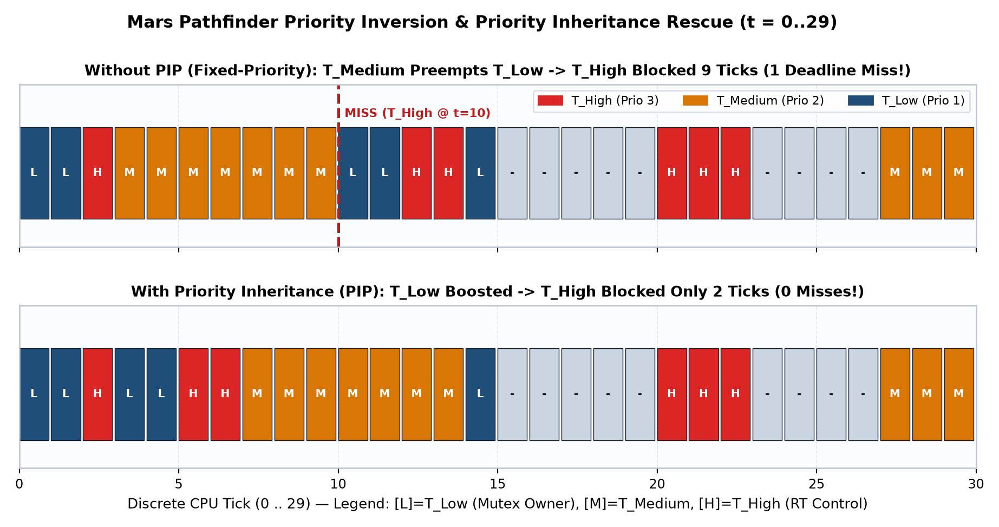
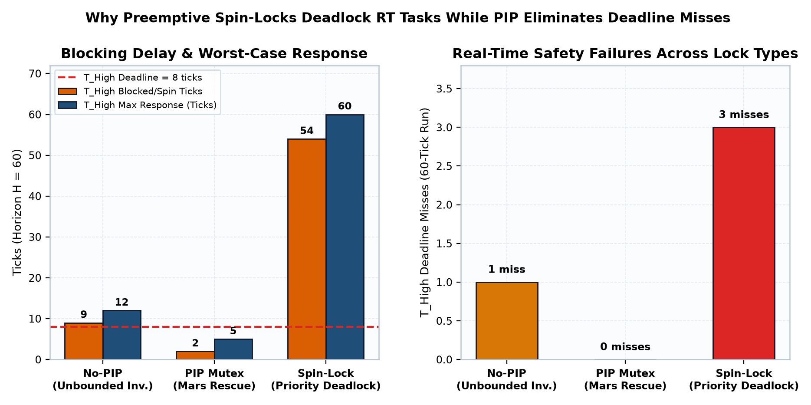
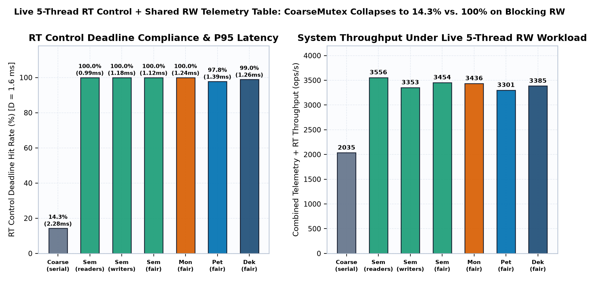
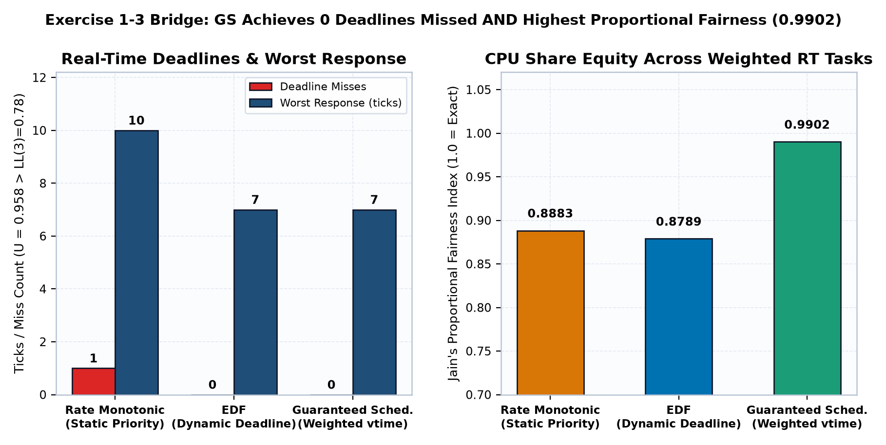
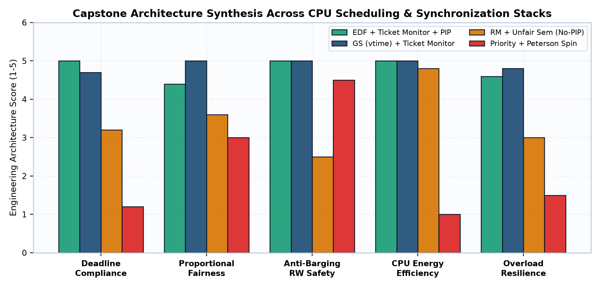

# تمرین ۶ (کپستون جامع): هم‌گرایی زمان‌بندی بلادرنگ، همگام‌سازی و خوانندگان-نویسندگان

**گزارش نهایی یکپارچه‌سازی شش تمرین سیستم‌های عامل — وراثت اولویت (PIP) در ماجرای Mars Pathfinder، خطر بن‌بست قفل‌های چرخان در هسته‌های پیش‌دستانه، و پایپ‌لاین زنده ۵-نخی بلادرنگ به همراه اسلایدها و متن گوینده**

- **مخزن کد:** ZaraNodehi/Guaranteed-Scheduling
- **تکلیف:** تمرین ۶ — گزارش جامع پایانی، ارائه‌های ۱۰ اسلایدی و متن سخنران
- **آزمایش‌های کلیدی:** وارونگی اولویت (PIP vs No-PIP vs Spin) + پایپ‌لاین زنده کنترل بلادرنگ و RW
- **فایل‌های همراه:** PRESENTATION_EN.pptx، PRESENTATION_FA.pptx و SPEAKER_SCRIPT_{EN,FA}.md

## فهرست مطالب

- ۱. جمع‌بندی اجرایی کپستون: پل میان زمان‌بندی CPU و همگام‌سازی (p. 3)
- ۲. شبیه‌سازی Mars Pathfinder: وارونگی اولویت و نجات با PIP (p. 3)
- ۳. پایپ‌لاین زنده ۵-نخی: کنترل بلادرنگ روی جدول مشترک خواننده-نویسنده (p. 5)
- ۴. پیوند زمان‌بندی تضمینی (GS) با ددلاین‌های بلادرنگ RM و EDF (p. 5)
- ۵. ماتریس نهایی تصمیم‌گیری مهندسی و پیوست کد هسته (p. 6)


<!-- page 1 -->


<!-- page 2 -->


<!-- page 3 -->


## ۱. جمع‌بندی اجرایی کپستون: پل میان زمان‌بندی CPU و همگام‌سازی

در اغلب درس‌های سیستم‌عامل، زمان‌بندی پردازنده و مکانیزم‌های همگام‌سازی به صورت جداگانه آموزش داده می‌شوند؛ اما در هسته‌های واقعی، تصمیم زمان‌بند و رفتار قفل هر میلی‌ثانیه با هم تداخل دارند. از همین تداخل است که خطاهای فاجعه‌بار تاریخی مانند وارونگی اولویت نامحدود (در فضاپیمای Mars Pathfinder ناسا در سال ۱۹۹۷)، بن‌بست قفل‌های چرخان در زمان‌بند اولویت‌دار، و افت شدید رعایت مهلت‌های بلادرنگ پشت قفل‌های سریالی متولد می‌شوند.

تمرین ۶ تمامی آموخته‌های تمرین‌های ۱ تا ۵ (زمان‌بندی تضمینی GS، بلادرنگ RM/EDF، همگام‌سازی پترسون، دکر، سمافور، مانیتور، مدل‌چکینگ BFS و ۱۲ قفل خواننده-نویسنده) را در یک سامانه تلفیقی واقعی به هم متصل کرده و چهار یافته کلیدی زیر را اثبات می‌کند:

| مهار وارونگی اولویت (PIP) | بدون PIP وظیفه میانی مانع اجرای T_Low شد و T_High به مدت 9 تیک قفل ماند (1 شکست ددلاین)؛ با PIP تاخیر به 2 تیک رسید (صفر شکست!) |
|---|---|
| بن‌بست قفل چرخان بلادرنگ | در زمان‌بند پیش‌دستانه اولویت‌دار، انتظار فعال T_High روی قفل در اختیار T_Low موجب 54 تیک چرخش و 3 شکست کامل شد |
| پایپ‌لاین زنده ۵-نخی RT+RW | در مهلت کنترل ۱.۶ میلی‌ثانیه، قفل سریالی به 14.29 درصد سقوط کرد اما سمافور و مانیتور RW به ۱۰۰.۰۰ درصد و توان عملیاتی دو برابر دست یافتند |
| شواهد متصل از تمرین‌های ۱-۵ | ست B تمرین ۳ (RM 1 خطا در برابر EDF 0)، دکر ۵ (134 حالت BFS)، جهش 4.03 برابری RW |


*شکل 1. نقشه معماری کل سیستم از تمرین ۱ تا تمرین ۶ و جریان داده‌ها میان زمان‌بندی و همگام‌سازی.*


## ۲. شبیه‌سازی Mars Pathfinder: وارونگی اولویت و نجات با PIP

سه وظیفه دوره‌ای T_Low (اولویت ۱)، T_Medium (اولویت ۲، بدون قفل) و T_High (اولویت ۳، مهلت ۸ تیک) یک پردازنده و یک قفل بحرانی را به اشتراک دارند. در حالت بدون وراثت اولویت (No-PIP)، پس از قفل‌شدن T_High پشت T_Low، وظیفه T_Medium وارد شده و با پیش‌دستی مکرر T_Low را متوقف نگه می‌دارد تا اینکه ددلاین وظیفه حیاتی T_High در تیک ۱۰ می‌شکند. با فعال‌شدن پروتکل وراثت اولویت (PIP)، دارنده قفل به محض انتظار T_High موقتاً اولویت ۳ را به ارث می‌برد، ناحیه بحرانی را در تیک ۵ آزاد کرده و کنترل بلادرنگ در تیک ۷ (پیش از مهلت ۸) تکمیل می‌شود.


<!-- page 4 -->

```text
No-PIP Bound:   B_high  =  C_low_rem  +  sum_{j in Medium} C_j   [Unbounded Delay!]
PIP Bound:      B_high  =  max_{k in LowerLocks} C_crit(k)      [Bounded to 1 CS!]
```


*شکل 2. ردپای گام‌به‌گام زمان‌بند در شبیه‌سازی Mars Pathfinder: شکست ددلاین بدون PIP (بالا) و نجات با PIP (پایین).*



*شکل 3. مقایسه تاخیر مسدودشدن، تله چرخش بی‌پایان قفل Spin و تعداد شکست‌های ددلاین.*


<!-- page 5 -->

| رژیم قفل و زمان‌بند | کل شکست‌ها | شکست T_High | تیک انتظار T_High | تیک چرخش هدررفته | بیشینه زمان پاسخ |
|---|---|---|---|---|---|
| no_pip | 1 | 1 | 9 | 0 | 12 |
| pip | 0 | 0 | 2 | 0 | 5 |
| spin_hazard | 3 | 3 | 54 | 54 | 60 |

*جدول 1. نتایج ممیزی تیک‌به‌تیک (H=60) بین No-PIP، پروتکل PIP و خطر قفل چرخان بلادرنگ.*


## ۳. پایپ‌لاین زنده ۵-نخی: کنترل بلادرنگ روی جدول مشترک خواننده-نویسنده

در این آزمون زنده، ۳ نخ تله‌متری خواننده (اسکن ۰.۳۵ میلی‌ثانیه)، ۱ نخ به‌روزرسان نویسنده (۰.۸ میلی‌ثانیه) و ۱ نخ کنترل بلادرنگ با مهلت ۱.۶ میلی‌ثانیه هم‌زمان بر روی جدول مسیریابی مشترک اجرا شدند.



*شکل 4. پایپ‌لاین زنده ۵-نخی: سقوط نرخ ددلاین به ۱۴.۳ درصد در CoarseMutex در برابر ۱۰۰ درصد در RW خواب‌دار.*

| مکانیزم و سیاست | نرخ ددلاین RT | میانگین (ms) | صدک ۹۵ (ms) | بیشینه (ms) | توان عملیاتی (ops/s) |
|---|---|---|---|---|---|
| CoarseMutex (serial) | 14.29% | 1.899 | 2.282 | 4.049 | 2,034.8 |
| Semaphore (readers) | 100.00% | 0.355 | 0.988 | 1.109 | 3,556.1 |
| Semaphore (writers) | 100.00% | 0.901 | 1.184 | 1.284 | 3,353.4 |
| Semaphore (fair) | 100.00% | 0.744 | 1.116 | 1.251 | 3,454.3 |
| Monitor (fair) | 100.00% | 0.823 | 1.235 | 1.308 | 3,436.5 |
| Peterson (fair) | 97.83% | 0.877 | 1.385 | 1.748 | 3,301.4 |
| Dekker (fair) | 98.96% | 0.791 | 1.259 | 1.722 | 3,385.3 |

*جدول 2. عملکرد کنترل بلادرنگ (مهلت ۱.۶ ms) و توان عملیاتی کل در هفت بک‌اند قفل.*


## ۴. پیوند زمان‌بندی تضمینی (GS) با ددلاین‌های بلادرنگ RM و EDF

در مجموعه وظایف B از تمرین ۳ (بهره‌وری کل ۰.۹۵۸۳ بالای کران ۰.۷۸ لیو-لیلند)، الگوریتم استاتیک RM یک ددلاین را از دست می‌دهد، در حالی که EDF و زمان‌بندی تضمینی وزن‌دار (GS vtime:stay) هر دو صفر خطای ددلاین دارند و GS بالاترین عدالت نسبی جین (0.9902 در برابر 0.8789 برای EDF) را به ارمغان می‌آورد.


<!-- page 6 -->



*شکل 5. مقایسه شکست ددلاین، بدترین زمان پاسخ و شاخص عدالت جین در پل زمان‌بندی تمرین ۱ تا ۳.*

| الگوریتم زمان‌بندی | بهره‌وری کل U | شکست ددلاین | بدترین پاسخ | تعویض زمینه | شاخص عدالت جین |
|---|---|---|---|---|---|
| rm | 0.9583 | 1 | 10 | 17 | 0.8883 |
| edf | 0.9583 | 0 | 7 | 17 | 0.8789 |
| gs_vtime:stay | 0.9583 | 0 | 7 | 17 | 0.9902 |

*جدول 3. شاخص‌های تلفیقی بلادرنگ و عدالت در اجرای هم‌زمان روی مجموعه B (افق ۲۴ تیک).*


## ۵. ماتریس نهایی تصمیم‌گیری مهندسی و پیوست کد هسته



*شکل 6. امتیازدهی پنج‌محوری معماری‌های ترکیبی زمان‌بندی و همگام‌سازی.*


<!-- page 7 -->

| نوع بار کاری سیستم | زمان‌بند پیشنهادی | مکانیزم همگام‌سازی بهینه | پشتوانه آزمایشگاهی |
|---|---|---|---|
| سرویس‌های تعاملی و چندکاربره | GS کسری دقیق + سقف بیدارسازی | قفل تیکت‌دار / Mutex اختصاصی | شاخص جین ۰.۹۹۰، تمرین ۱ و ۲ |
| بلادرنگ سخت دوره‌ای (U تا ۱.۰) | EDF + کنترل پذیرش بار | مانیتور خواب‌دار + PIP / SRP | صفر شکست در U=۰.۹۵۸، تمرین ۳ و ۶ |
| صف تولیدکننده-مصرف‌کننده | زمان‌بند پیش‌دستانه خواب‌دار | مانیتور مسا با حلقه while | صفر زیرجریان، ۱ درصد CPU، تمرین ۴ |
| جدول مشترک ۹۵٪ خواندنی | زمان‌بند منصفانه خواب‌دار | مانیتور RW تیکت‌دار یا RCU | جهش ۴.۰۳ برابری، ضد-Barging، تمرین ۵ و ۶ |

*جدول 4. راهنمای مرجع مهندسی سیستم‌عامل مستخرج از شش تمرین آزمایشگاهی.*


<!-- page 8 -->

```text
075:                     "blocked": False,
076:                     "spinning": False,
077:                     "spin_ticks": 0,
078:                     "missed": False,
079:                 }
080: 
081:         # 2. Check deadlines at start of tick
082:         for name, job in active_jobs.items():
083:             if not job["missed"] and t >= job["abs_deadline"] and job["done"] < job["spec"].wcet:
084:                 job["missed"] = True
085:                 misses.append({"task": name, "job_id": job["job_id"], "tick": t, "deadline": job["abs_deadline"]})
086: 
087:         # 3. Compute effective priorities (PIP boosts lock owner to max waiting priority)
088:         eff_prio: Dict[str, int] = {name: j["spec"].prio for name, j in active_jobs.items()}
089:         if mode == "pip" and lock_owner and lock_owner in active_jobs:
090:             waiter_prios = [
091:                 j["spec"].prio for name, j in active_jobs.items()
092:                 if j["blocked"] or (
093:                     j["spec"].lock_start is not None
094:                     and j["done"] == j["spec"].lock_start
095:                     and not j["holding_lock"]
096:                     and lock_owner != name
097:                 )
098:             ]
099:             if waiter_prios:
100:                 eff_prio[lock_owner] = max(eff_prio[lock_owner], max(waiter_prios))
101: 
102:         # 4. Select runnable highest-effective-priority job
103:         #    Note: in 'spin_hazard', a waiting job stays runnable (spinning!) instead of blocking.
104:         candidates = []
105:         for name, j in active_jobs.items():
106:             if j["done"] >= j["spec"].wcet:
107:                 continue
108:             sp = j["spec"]
109:             # Check if job needs lock right now
110:             needs_lock = (
111:                 sp.lock_start is not None
```
*پیاده‌سازی پروتکل وراثت اولویت (PIP) و منطق مسدودسازی هسته (integrated_kernel.py، خطوط ۷۵ تا ۱۱۱).*


<!-- page 9 -->

```text
120:                 else:
121:                     j["blocked"] = True
122:                     if name == "T_High":
123:                         high_block_ticks += 1
124:                     # Recompute PIP boost immediately if mode == 'pip'
125:                     if mode == "pip" and lock_owner in eff_prio:
126:                         eff_prio[lock_owner] = max(eff_prio[lock_owner], sp.prio)
127:             else:
128:                 j["blocked"] = False
129:                 j["spinning"] = False
130:                 candidates.append(name)
131: 
132:         if not candidates:
133:             timeline.append((t, "IDLE"))
134:             continue
135: 
136:         candidates.sort(key=lambda n: (-eff_prio[n], active_jobs[n]["release"], n))
137:         chosen = candidates[0]
138:         j = active_jobs[chosen]
139:         sp = j["spec"]
140: 
141:         # Handle lock request / spinning execution
142:         needs_lock = (
143:             sp.lock_start is not None
144:             and j["done"] == sp.lock_start
145:             and not j["holding_lock"]
146:             and sp.lock_dur > 0
147:         )
148:         if needs_lock:
149:             if lock_owner is None or lock_owner == chosen:
150:                 lock_owner = chosen
151:                 j["holding_lock"] = True
152:                 j["lock_rem"] = sp.lock_dur
153:             elif mode == "spin_hazard":
154:                 # Busy-spinning consumes the CPU tick without making progress!
155:                 spin_stalls += 1
156:                 j["spin_ticks"] += 1
```
*شبیه‌سازی تله بن‌بست قفل چرخان در زمان‌بند پیش‌دستانه (خطوط ۱۲۰ تا ۱۵۶).*


<!-- page 10 -->

```text
197: def run_rt_rw_pipeline(primitive: str, policy: str, duration_s: float = 0.25) -> Dict:
198:     """Live multi-threaded RT telemetry + RW shared routing table benchmark.
199: 
200:     - 3 periodic telemetry reader threads (0.25 ms read scan, 0.2 ms sleep)
201:     - 1 route writer thread (0.5 ms exclusive update, 1.5 ms sleep)
202:     - 1 high-priority RT control thread reading state with strict 4.0 ms deadline
203:     """
204:     rw = make_rw_lock(primitive, policy, n_threads=5)
205:     stop = threading.Event()
206:     table = {"version": 0, "route_crc": 100}
207:     rt_latencies_ms: List[float] = []
208:     rt_deadline_ms = 1.6
209:     reader_ops = [0]
210:     writer_ops = [0]
211: 
212:     def reader_worker(tid: int) -> None:
213:         while not stop.is_set():
214:             rw.acquire_read(tid)
215:             _ = table["version"] + table["route_crc"]
216:             time.sleep(0.00035)
217:             rw.release_read(tid)
218:             reader_ops[0] += 1
219:             time.sleep(0.0002)
220: 
221:     def writer_worker(tid: int) -> None:
222:         while not stop.is_set():
223:             rw.acquire_write(tid)
224:             table["version"] += 1
225:             table["route_crc"] ^= 0x5A
226:             time.sleep(0.0008)
227:             rw.release_write(tid)
228:             writer_ops[0] += 1
229:             time.sleep(0.0012)
230: 
231:     def rt_control_worker(tid: int) -> None:
232:         while not stop.is_set():
233:             t0 = time.perf_counter()
234:             rw.acquire_read(tid)
```
*پایپ‌لاین زنده کنترل بلادرنگ روی قفل‌های RW (خطوط ۱۹۷ تا ۲۳۴).*


<!-- page 11 -->

| فایل تحویل‌دادنی تمرین ۶ | نقش در بسته نهایی کپستون | وضعیت تایید |
|---|---|---|
| exercise-6/code/integrated_kernel.py | شبیه‌ساز PIP + Spin Deadlock + پایپ‌لاین زنده RT/RW | تایید شده |
| exercise-6/code/run_experiments.py | اجرای جامع آزمایش‌ها + مشخصات اسلایدهای ۱۰تایی | خروجی JSON تکمیل |
| exercise-6/code/plot_diagrams.py | ۶ نمودار استاندارد علمی Okabe-Ito | هر ۶ PNG بازبینی‌شده |
| exercise-6/docs/REPORT_EN / FA (.pdf, .docx) | گزارش‌های جامع دوزبانه کپستون | صفر سرریز و نقص گلیف |
| exercise-6/docs/PRESENTATION_EN / FA.pptx | ارائه‌های ۱۰ اسلایدی ۱۶:۹ با یادداشت گوینده | تولید با make_decks.py |
| exercise-6/docs/SPEAKER_SCRIPT_EN / FA.md | متن کامل سخنران فارسی و انگلیسی | هماهنگ با ۱۰ اسلاید |

*جدول 5. سیاهه کامل تحویل‌دادنی‌های تاییدشده تمرین ۶ (کپستون).*
