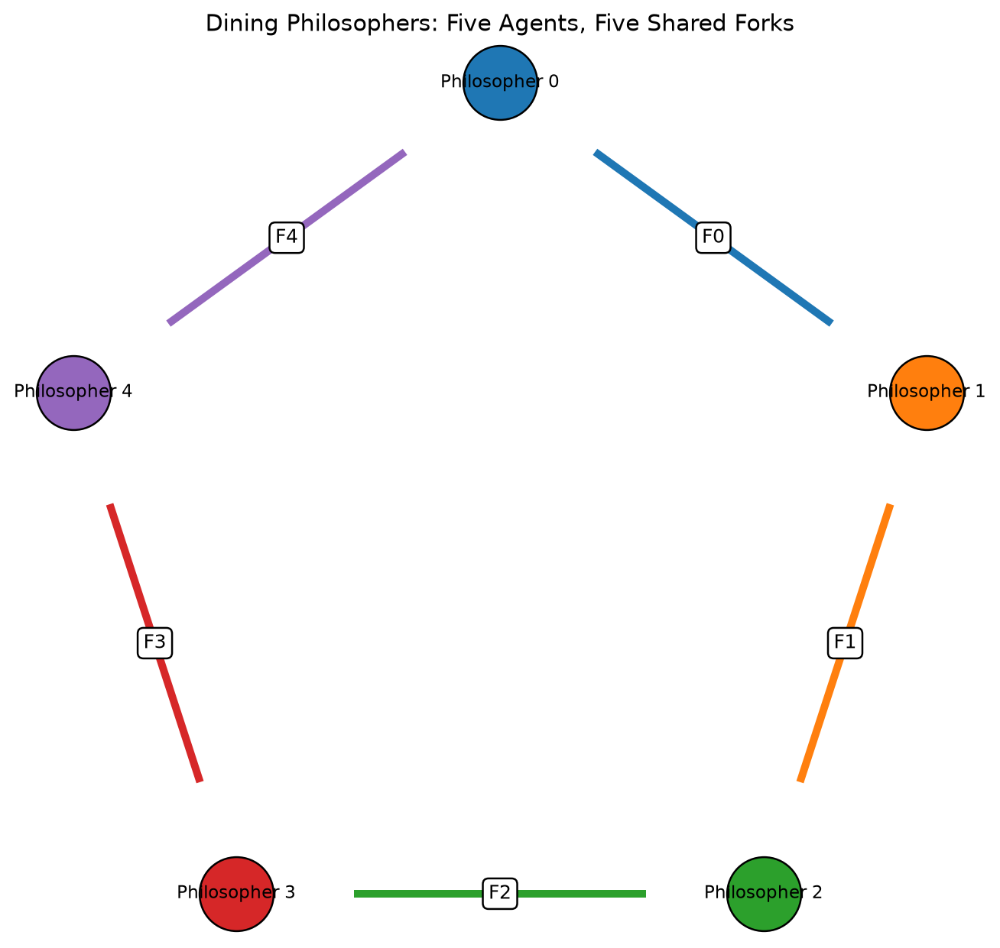
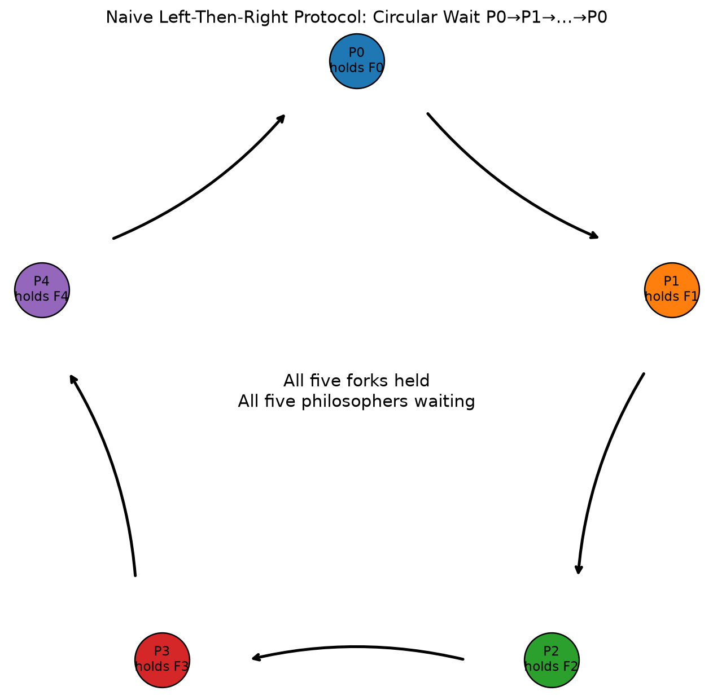
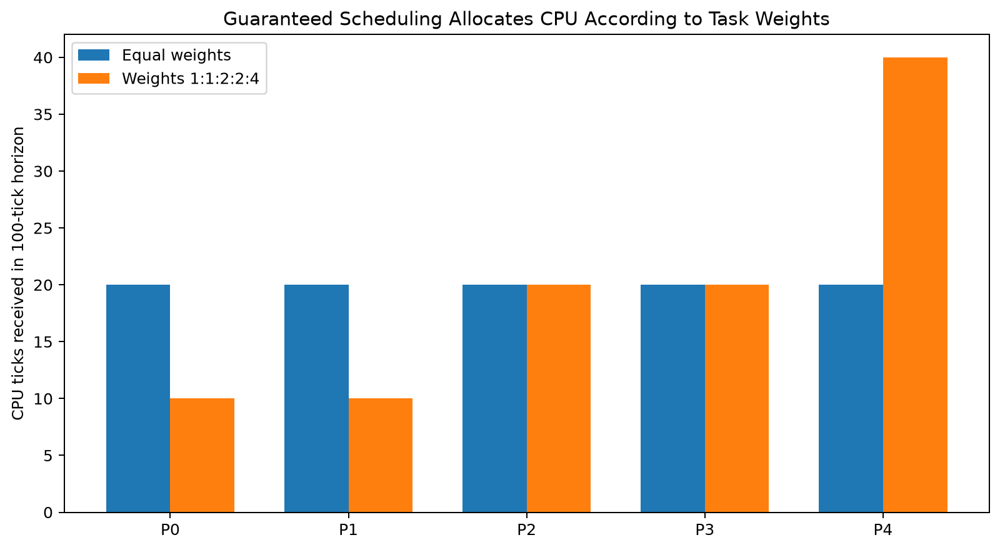
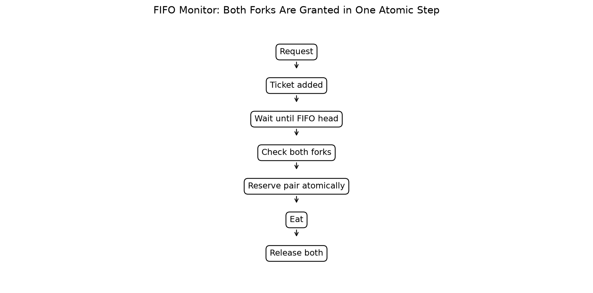
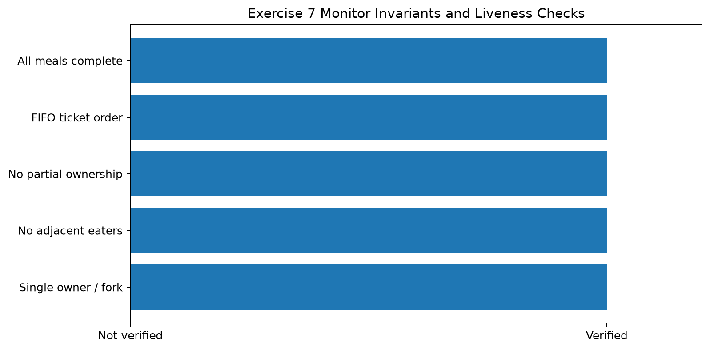
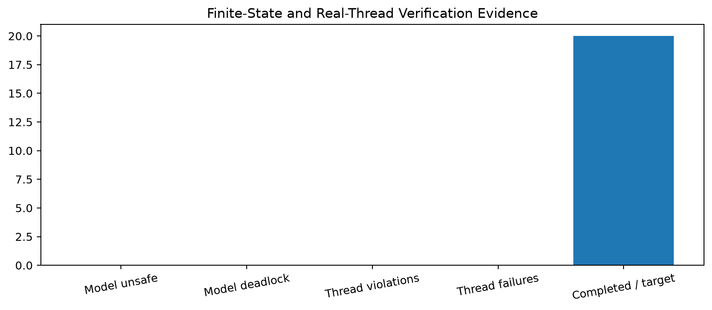
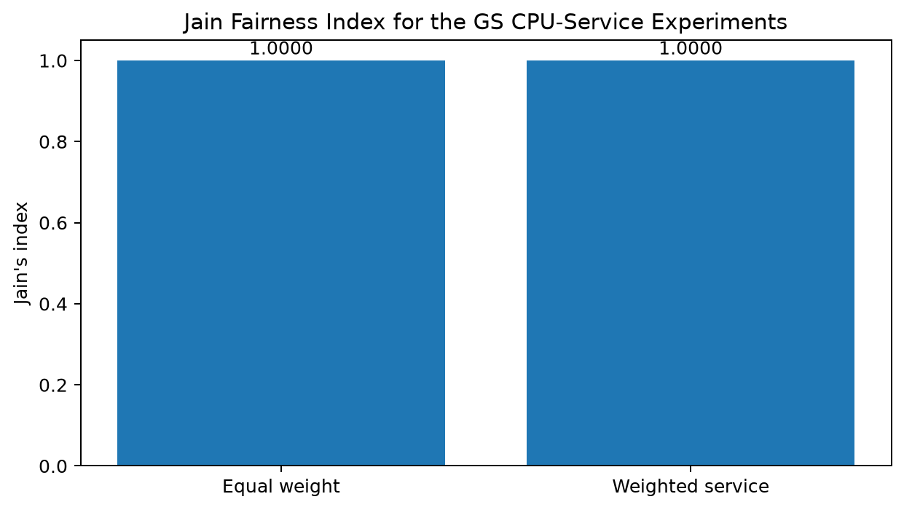
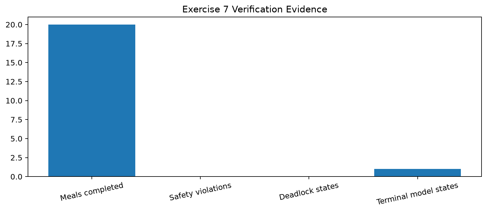
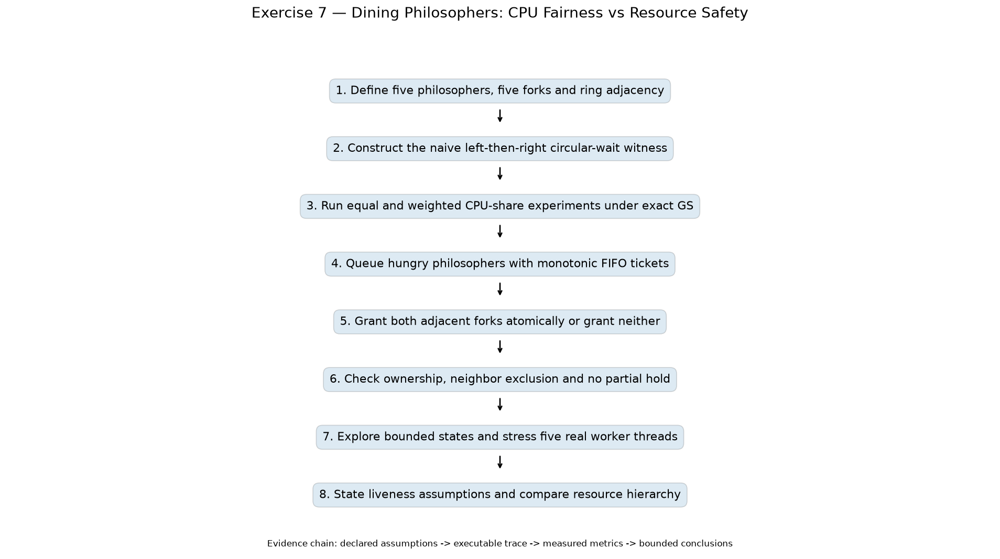

# Exercise 7: Dining Philosophers — Guaranteed Scheduling and Deadlock-Free Resource Allocation

**An independent systems-engineering study of CPU fairness, circular wait, FIFO monitors, atomic fork-pair reservation, bounded state exploration and real-thread verification**

- **Repository:** ZaraNodehi/Guaranteed-Scheduling
- **Exercise:** Exercise 7 — Dining Philosophers
- **Core question:** Can Guaranteed Scheduling solve Dining Philosophers? How should CPU fairness be combined with resource synchronization?
- **Implementation:** FIFO monitor with atomic reservation of both adjacent forks
- **Verification:** Finite-state explorer + five real worker threads + exact-rational GS CPU-share experiment

## Table of contents

- 1. Executive Summary and Direct Answer to the Instructor (p. 3)
- 2. Problem Definition, State and Formal Safety Properties (p. 4)
- 3. Why Processor Fairness Does Not Solve a Resource Deadlock (p. 6)
- 4. Naive Protocol and Circular-Wait Proof (p. 6)
- 5. Proposed Solution: FIFO Monitor with Atomic Pair Reservation (p. 7)
- 6. Invariants, Deadlock Freedom and Conditional Liveness (p. 8)
- 7. Alternative: Global Resource Hierarchy (p. 9)
- 8. Experimental Method and Independent Verification (p. 10)
- 9. Guaranteed Scheduling CPU-Share Experiment (p. 10)
- 10. Result Interpretation, Limitations and Final Answer (p. 11)
- References and Further Reading (p. 12)
- Appendix: Execution Workflow and Flowchart (p. 13)
- Source Audit 1: dining_philosophers.py — lines 1–15 (p. 14)
- Source Audit 2: dining_philosophers.py — lines 16–30 (p. 15)
- Source Audit 3: dining_philosophers.py — lines 31–45 (p. 16)
- Source Audit 4: dining_philosophers.py — lines 46–60 (p. 17)
- Source Audit 5: dining_philosophers.py — lines 61–75 (p. 18)
- Source Audit 6: dining_philosophers.py — lines 76–90 (p. 19)
- Source Audit 7: dining_philosophers.py — lines 91–105 (p. 20)
- Source Audit 8: dining_philosophers.py — lines 106–120 (p. 21)
- Source Audit 9: dining_philosophers.py — lines 121–135 (p. 22)
- Source Audit 10: dining_philosophers.py — lines 136–150 (p. 23)
- Source Audit 11: dining_philosophers.py — lines 151–165 (p. 24)
- Source Audit 12: dining_philosophers.py — lines 166–180 (p. 25)
- Source Audit 13: dining_philosophers.py — lines 181–195 (p. 26)
- Source Audit 14: dining_philosophers.py — lines 196–210 (p. 27)
- Source Audit 15: dining_philosophers.py — lines 211–225 (p. 28)
- Source Audit 16: dining_philosophers.py — lines 226–240 (p. 29)
- Source Audit 17: dining_philosophers.py — lines 241–255 (p. 30)
- Source Audit 18: dining_philosophers.py — lines 256–270 (p. 31)
- Source Audit 19: dining_philosophers.py — lines 271–285 (p. 32)
- Source Audit 20: dining_philosophers.py — lines 286–300 (p. 33)
- Source Audit 21: dining_philosophers.py — lines 301–315 (p. 34)
- Source Audit 22: dining_philosophers.py — lines 316–317 (p. 35)
- Source Audit 23: run_experiments.py — lines 1–15 (p. 36)
- Source Audit 24: run_experiments.py — lines 16–30 (p. 37)
- Source Audit 25: run_experiments.py — lines 31–45 (p. 38)
- Source Audit 26: run_experiments.py — lines 46–60 (p. 39)
- Source Audit 27: run_experiments.py — lines 61–75 (p. 40)
- Source Audit 28: run_experiments.py — lines 76–90 (p. 41)
- Source Audit 29: run_experiments.py — lines 91–105 (p. 42)
- Source Audit 30: run_experiments.py — lines 106–120 (p. 43)
- Source Audit 31: run_experiments.py — lines 121–135 (p. 44)
- Source Audit 32: run_experiments.py — lines 136–142 (p. 45)
- Source Audit 33: plot_diagrams.py — lines 1–15 (p. 46)
- Source Audit 34: plot_diagrams.py — lines 16–30 (p. 47)


<!-- page 1 -->


<!-- page 2 -->


<!-- page 3 -->


## 1. Executive Summary and Direct Answer to the Instructor

The Dining Philosophers problem is a concurrency-control problem in which five philosophers share five forks arranged in a ring. Each philosopher needs both adjacent forks to eat. A naive protocol can deadlock when every philosopher holds one fork and waits for the next. The final instructor question asks whether the logic of Guaranteed Scheduling can be applied to this problem, and how. The answer requires distinguishing two independent layers: CPU scheduling and resource allocation.

Guaranteed Scheduling (GS) can distribute processor service fairly among philosophers that are runnable. It cannot create an available fork, revoke a fork owner safely, or remove a circular wait. Therefore GS alone is not a deadlock solution. This exercise composes the exact-rational GS scheduler with a separate FIFO monitor that grants both adjacent forks atomically.

| Naive protocol | Five-node circular wait witness: P0 → P1 → P2 → P3 → P4 → P0 |
|---|---|
| FIFO finite-state model | 1902 reachable states; 0 unsafe states; 0 nonterminal deadlock states; 1 terminal completions |
| Real-thread stress | 20 of 20 meals completed; 0 adjacent-eating violations |
| CPU share experiment | Equal-weight GS Jain index 1.0000; weighted GS Jain index 1.0000 |


<!-- page 4 -->



*Figure 1. Five philosophers and five shared forks in the ring topology.*


## 2. Problem Definition, State and Formal Safety Properties

Let N=5. Philosopher P_i is adjacent to forks F_i and F_(i+1 mod N). A philosopher alternates between thinking, hungry/waiting and eating. The resource state contains the owner of every fork, the set of eating philosophers and a queue of hungry philosophers. A correct protocol must prevent a fork from having two owners and must prevent adjacent philosophers from eating simultaneously.


<!-- page 5 -->

| Symbol | Meaning | Exercise 7 value |
|---|---|---|
| N | Number of philosophers and forks | 5 |
| F_i | Fork between P_i and P_(i-1 mod N) | IDs 0..4 |
| Need(P_i) | Two forks needed for meal | {F_i,F_(i+1 mod N)} |
| State | Owners, wait queue, eating set | Protected by one monitor condition |
| Admission | Order in which hungry philosophers request forks | Monotonic FIFO ticket |

*Table 1. Formal vocabulary and state variables used in the model.*



*Figure 2. Naive left-then-right allocation can form a five-node wait-for cycle.*


<!-- page 6 -->


## 3. Why Processor Fairness Does Not Solve a Resource Deadlock

Assume every philosopher has equal CPU weight and GS rotates the processor fairly. If each philosopher has acquired its left fork and blocks waiting for the right fork, every thread is waiting on a resource. The scheduler may be perfectly fair among runnable work, yet the resource state remains unchanged. CPU entitlement does not imply resource ownership, and a wait-for cycle is not broken by dispatching the blocked participants again.

This separation is central to the proof. CPU fairness is a property of the scheduler's service trace. Mutual exclusion and deadlock freedom are properties of the resource-allocation protocol. A correct system needs both; neither property implies the other.

| Layer | Question | Mechanism | What it cannot guarantee alone |
|---|---|---|---|
| CPU scheduling | Who receives the next CPU tick? | GS virtual-time / weighted scheduling | Fork availability or deadlock freedom |
| Resource allocation | Who owns the two forks? | FIFO monitor / atomic pair grant | CPU entitlement among runnable threads |
| Composition | Can work progress end to end? | GS + monitor + finite critical sections | Liveness if a meal or thread never finishes |

*Table 2. Separation of responsibilities across scheduling and synchronization.*



*Figure 3. Exact-rational GS experiment: CPU service follows equal and weighted philosopher entitlements.*


## 4. Naive Protocol and Circular-Wait Proof

The naive algorithm is: each philosopher picks up the left fork, then waits for the right fork. A reachable state exists in which P_i owns F_i for every i. Since P_i's right fork F_(i+1) is owned by P_(i+1), all five philosophers wait. The wait-for graph has edges P_i → P_(i+1) and therefore contains the cycle P0→P1→P2→P3→P4→P0.


<!-- page 7 -->

- Mutual exclusion: each individual fork has at most one owner.
- Hold-and-wait: each philosopher holds one fork while waiting for another.
- No preemption: forks are not forcibly taken from an eating philosopher.
- Circular wait: the five ownership dependencies form a cycle.

The four Coffman conditions explain why the naive design can deadlock. The key correction in this exercise is not to adjust CPU weights; it is to remove partial ownership and circular acquisition.


## 5. Proposed Solution: FIFO Monitor with Atomic Pair Reservation

The FairDiningTable monitor protects fork ownership, a FIFO queue of (ticket, philosopher), and the set of eating philosophers with one condition lock. A hungry philosopher obtains a monotonically increasing ticket. It waits until its request is the queue head and both adjacent forks are free. At that point the monitor removes the request from the queue and changes both fork-owner fields inside one critical section. It never grants only one fork.

- Request: add (ticket, philosopher) to the tail of the FIFO queue.
- Wait: use a condition loop that checks queue-head identity and availability of both forks.
- Grant: reserve both adjacent forks atomically, mark the philosopher as eating, and record the ticket.
- Release: clear both owners together, remove the philosopher from the eating set and notify waiters.



*Figure 4. The monitor grants a pair of forks atomically to the FIFO head.*


<!-- page 8 -->

```text
035:     The condition variable protects both fork ownership and the wait queue.
036:     FIFO admission prevents a later request from repeatedly bypassing the
037:     oldest hungry philosopher, assuming every granted meal eventually ends.
038:     """
039: 
040:     def __init__(self, count: int = 5):
041:         if count < 3:
042:             raise ValueError("Dining Philosophers requires at least 3 philosophers")
043:         self.count = count
044:         self._condition = threading.Condition()
045:         self._fork_owner: List[int | None] = [None] * count
046:         self._waiting = deque()
047:         self._next_ticket = 0
048:         self._eating = set()
049:         self._admission_order: List[int] = []
050:         self._admission_tickets: List[int] = []
051:         self._max_queue = 0
052: 
053:     def _is_available(self, philosopher: int) -> bool:
054:         left, right = fork_pair(philosopher, self.count)
055:         return self._fork_owner[left] is None and self._fork_owner[right] is None
056: 
057:     def _assert_safe(self) -> None:
058:         for philosopher in self._eating:
059:             left, right = fork_pair(philosopher, self.count)
060:             assert self._fork_owner[left] == philosopher
061:             assert self._fork_owner[right] == philosopher
062:             assert (philosopher + 1) % self.count not in self._eating
063:             assert (philosopher - 1) % self.count not in self._eating
064: 
065:     def acquire(self, philosopher: int) -> int:
066:         """Wait for a FIFO ticket and atomically reserve both forks."""
067:         if not 0 <= philosopher < self.count:
068:             raise ValueError(f"philosopher must be in [0, {self.count})")
069: 
070:         with self._condition:
```
*Source excerpt: condition-protected FIFO monitor and atomic fork-pair reservation.*


## 6. Invariants, Deadlock Freedom and Conditional Liveness

| Invariant | Statement | Enforcement / evidence |
|---|---|---|
| I1 — ownership | Each fork has at most one owner. | Single monitor lock guards owner fields. |
| I2 — pair ownership | An eating philosopher owns both adjacent forks. | Atomic pair assignment and runtime assertion. |
| I3 — neighbor safety | No adjacent philosophers eat simultaneously. | Forks are shared only by adjacent pairs. |
| I4 — no partial hold | A waiting philosopher owns no fork. | Wait occurs before either owner field is set. |
| I5 — FIFO order | Grant tickets are increasing. | Only the queue head may acquire. |

*Table 3. Safety invariants and their implementation-level checks.*


<!-- page 9 -->



*Figure 5. Checklist of the resource-safety and FIFO invariants.*

Deadlock freedom follows from eliminating hold-and-wait: a philosopher either owns both forks or owns none. Since the monitor serializes both assignments, no cycle can be formed from partial fork ownership. FIFO reduces starvation by preventing later requests from bypassing an older request repeatedly. Liveness is conditional: every granted meal must eventually finish, threads must eventually receive CPU service, and waiters must eventually be notified. FIFO can also cause head-of-line waiting, sacrificing some parallelism for a simpler fairness argument.


## 7. Alternative: Global Resource Hierarchy

An alternative deadlock-prevention method is to number forks globally and require every philosopher to acquire the lower-numbered fork before the higher-numbered fork. Strictly increasing resource order prevents a circular acquisition chain. It removes circular wait without a global admission queue. However, resource ordering alone does not promise FIFO access or bounded waiting; fairness must be analyzed separately. Exercise 7 implements the ordering helper and documents the distinction.

| Approach | Deadlock prevention | Fairness property | Trade-off |
|---|---|---|---|
| Left then right | No | None guaranteed | Circular wait is reachable. |
| Global fork order | Yes, by acyclic order | Not necessarily FIFO | Simple proof; waiting order can vary. |
| FIFO atomic monitor | Yes, no partial hold | FIFO request order | Possible head-of-line blocking. |

*Table 4. Three resource-acquisition policies and their guarantees.*


<!-- page 10 -->


## 8. Experimental Method and Independent Verification

The experiment uses two independent forms of evidence. The finite-state explorer enumerates request, grant-to-FIFO-head and finish-meal transitions for a fixed five-philosopher model. It audits every reached state for adjacent eaters, nonterminal states with no enabled transition and terminal completion. A separate stress test launches five actual Python worker threads; each performs four meals and the test records completed meals, neighbor overlap, worker exceptions, thread liveness, final owners and FIFO ticket order.



*Figure 6. Finite-state and real-thread verification evidence.*

| Metric | Observed value | Interpretation |
|---|---|---|
| Reachable model states | 1902 | Distinct bounded states visited. |
| Model transitions | 4190 | Request, grant and finish edges explored. |
| Unsafe states | 0 | Must be zero. |
| Nonterminal deadlock states | 0 | Must be zero. |
| Terminal completed states | 1 | At least one full completion state exists. |
| Real meals completed | 20 | Target 20. |
| Real safety violations | 0 | Must be zero. |

*Table 5. Actual metrics loaded from the current experiment output.*


## 9. Guaranteed Scheduling CPU-Share Experiment

The scheduler experiment is intentionally separate from the fork experiment. Five CPU-bound philosopher tasks are simulated for a 100-tick horizon under exact-rational gs_vtime. With equal weights the service counts are equal; with weights 1:1:2:2:4 the CPU service follows those weights. Jain's index is computed on service-to-entitlement ratios; it does not measure fork fairness, meal completion or deadlock freedom.


<!-- page 11 -->

| Philosopher | Equal weight | Equal CPU ticks | Weighted share weight | Weighted CPU ticks |
|---|---|---|---|---|
| P0 | 1 | 20 | 1 | 10 |
| P1 | 1 | 20 | 1 | 10 |
| P2 | 1 | 20 | 2 | 20 |
| P3 | 1 | 20 | 2 | 20 |
| P4 | 1 | 20 | 4 | 40 |

*Table 6. Exact-rational GS CPU allocation; all philosophers remain CPU-runnable in this separate experiment.*



*Figure 7. Jain proportional-fairness index for equal and weighted CPU entitlement.*


## 10. Result Interpretation, Limitations and Final Answer

The results support a layered conclusion. GS fairly allocates CPU service to runnable philosophers. The FIFO monitor provides fork ownership, exclusion and a deadlock-free acquisition structure in the bounded model. The threaded test checks the implementation under actual concurrency. The model is a fixed ring and the stress test is finite; neither proves liveness under a scheduler that never runs waiters or a philosopher that never releases its forks.


<!-- page 12 -->



*Figure 8. Exercise 7 verification summary.*

Direct answer to the instructor: the algorithm's fairness logic can be applied to the CPU scheduling of philosopher threads, but the Dining Philosophers problem cannot be solved by CPU scheduling alone. It must be combined with an explicit deadlock-free synchronization protocol. In this submission that protocol is a FIFO monitor granting both forks atomically; a global resource hierarchy is an alternative.


## References and Further Reading

- E. W. Dijkstra, Hierarchical Ordering of Sequential Processes, Acta Informatica, 1971.
- C. A. R. Hoare, Monitors: An Operating System Structuring Concept, Communications of the ACM, 1974.
- C. L. Liu and J. W. Layland, Scheduling Algorithms for Multiprogramming in a Hard-Real-Time Environment, Journal of the ACM, 1973.
- A. Silberschatz, P. B. Galvin and G. Gagne, Operating System Concepts, synchronization and deadlock chapters.


<!-- page 13 -->


## Appendix: Execution Workflow and Flowchart

The exercise separates exact-rational CPU-share scheduling from resource ownership. It proves the naive circular wait, grants both forks atomically through a FIFO monitor, and validates bounded states and live threads.



*Figure 9. Dining Philosophers: GS CPU fairness, FIFO fork monitor and verification workflow*

| Stage | Description |
|---|---|
| Input | Five philosophers, five forks, ring topology and fairness assumptions |
| Witness | Construct the naive left-then-right circular wait |
| Scheduling | Measure equal and weighted CPU service using exact-rational GS |
| Synchronization | FIFO admission and atomic reservation of both forks |
| Verification | Explore bounded states and run five real worker threads |
| Conclusion | Separate CPU fairness, resource safety and conditional liveness |

*Table 7. Compact map of the stages and evidence required to review this exercise.*


<!-- page 14 -->


## Source Audit 1: dining_philosophers.py — lines 1–15

Source path: exercise-7 / code / dining_philosophers.py. This listing contains the Dining Philosophers resource-allocation protocol, its state explorer, and the assumptions required for liveness. The listing below covers source lines 1–15; line numbers are retained for direct review. This is an auditable source appendix and should be read together with the tests and the corresponding experiment output.

```text
0001: """Exercise 7: FIFO monitor solution for the Dining Philosophers problem.
0002: 
0003: The CPU scheduler and the shared-fork protocol solve different problems:
0004: Guaranteed Scheduling distributes CPU service among runnable philosophers;
0005: this monitor grants both forks atomically in FIFO order. A scheduler alone
0006: cannot prevent circular wait or guarantee access to a fork.
0007: """
0008: from __future__ import annotations
0009: 
0010: from collections import deque
0011: from contextlib import contextmanager
0012: import threading
0013: import time
0014: from typing import Dict, Iterator, List, Tuple
0015: 
```
*Verbatim source excerpt from exercise-7/code/dining_philosophers.py, lines 1–15; long lines are visually wrapped for print layout.*


<!-- page 15 -->


## Source Audit 2: dining_philosophers.py — lines 16–30

Source path: exercise-7 / code / dining_philosophers.py. This listing contains the Dining Philosophers resource-allocation protocol, its state explorer, and the assumptions required for liveness. The listing below covers source lines 16–30; line numbers are retained for direct review. This is an auditable source appendix and should be read together with the tests and the corresponding experiment output.

```text
0016: 
0017: def fork_pair(philosopher: int, count: int) -> Tuple[int, int]:
0018:     """Return the two fork IDs used by philosopher i (left=i, right=i+1)."""
0019:     if count < 3:
0020:         raise ValueError("Dining Philosophers requires at least 3 philosophers")
0021:     if not 0 <= philosopher < count:
0022:         raise ValueError(f"philosopher must be in [0, {count})")
0023:     return philosopher, (philosopher + 1) % count
0024: 
0025: 
0026: def ordered_fork_pair(philosopher: int, count: int) -> Tuple[int, int]:
0027:     """The resource-hierarchy alternative: always acquire lower fork ID first."""
0028:     return tuple(sorted(fork_pair(philosopher, count)))
0029: 
0030: 
```
*Verbatim source excerpt from exercise-7/code/dining_philosophers.py, lines 16–30; long lines are visually wrapped for print layout.*


<!-- page 16 -->


## Source Audit 3: dining_philosophers.py — lines 31–45

Source path: exercise-7 / code / dining_philosophers.py. This listing contains the Dining Philosophers resource-allocation protocol, its state explorer, and the assumptions required for liveness. The listing below covers source lines 31–45; line numbers are retained for direct review. This is an auditable source appendix and should be read together with the tests and the corresponding experiment output.

```text
0031: class FairDiningTable:
0032:     """A monitor that grants both forks together to the FIFO head only.
0033: 
0034:     A philosopher never holds one fork while waiting for the second one.
0035:     The condition variable protects both fork ownership and the wait queue.
0036:     FIFO admission prevents a later request from repeatedly bypassing the
0037:     oldest hungry philosopher, assuming every granted meal eventually ends.
0038:     """
0039: 
0040:     def __init__(self, count: int = 5):
0041:         if count < 3:
0042:             raise ValueError("Dining Philosophers requires at least 3 philosophers")
0043:         self.count = count
0044:         self._condition = threading.Condition()
0045:         self._fork_owner: List[int | None] = [None] * count
```
*Verbatim source excerpt from exercise-7/code/dining_philosophers.py, lines 31–45; long lines are visually wrapped for print layout.*


<!-- page 17 -->


## Source Audit 4: dining_philosophers.py — lines 46–60

Source path: exercise-7 / code / dining_philosophers.py. This listing contains the Dining Philosophers resource-allocation protocol, its state explorer, and the assumptions required for liveness. The listing below covers source lines 46–60; line numbers are retained for direct review. This is an auditable source appendix and should be read together with the tests and the corresponding experiment output.

```text
0046:         self._waiting = deque()
0047:         self._next_ticket = 0
0048:         self._eating = set()
0049:         self._admission_order: List[int] = []
0050:         self._admission_tickets: List[int] = []
0051:         self._max_queue = 0
0052: 
0053:     def _is_available(self, philosopher: int) -> bool:
0054:         left, right = fork_pair(philosopher, self.count)
0055:         return self._fork_owner[left] is None and self._fork_owner[right] is None
0056: 
0057:     def _assert_safe(self) -> None:
0058:         for philosopher in self._eating:
0059:             left, right = fork_pair(philosopher, self.count)
0060:             assert self._fork_owner[left] == philosopher
```
*Verbatim source excerpt from exercise-7/code/dining_philosophers.py, lines 46–60; long lines are visually wrapped for print layout.*


<!-- page 18 -->


## Source Audit 5: dining_philosophers.py — lines 61–75

Source path: exercise-7 / code / dining_philosophers.py. This listing contains the Dining Philosophers resource-allocation protocol, its state explorer, and the assumptions required for liveness. The listing below covers source lines 61–75; line numbers are retained for direct review. This is an auditable source appendix and should be read together with the tests and the corresponding experiment output.

```text
0061:             assert self._fork_owner[right] == philosopher
0062:             assert (philosopher + 1) % self.count not in self._eating
0063:             assert (philosopher - 1) % self.count not in self._eating
0064: 
0065:     def acquire(self, philosopher: int) -> int:
0066:         """Wait for a FIFO ticket and atomically reserve both forks."""
0067:         if not 0 <= philosopher < self.count:
0068:             raise ValueError(f"philosopher must be in [0, {self.count})")
0069: 
0070:         with self._condition:
0071:             if philosopher in self._eating or any(
0072:                 waiting_id == philosopher for _, waiting_id in self._waiting
0073:             ):
0074:                 raise RuntimeError(f"philosopher {philosopher} already has an
      | active request")
0075: 
```
*Verbatim source excerpt from exercise-7/code/dining_philosophers.py, lines 61–75; long lines are visually wrapped for print layout.*


<!-- page 19 -->


## Source Audit 6: dining_philosophers.py — lines 76–90

Source path: exercise-7 / code / dining_philosophers.py. This listing contains the Dining Philosophers resource-allocation protocol, its state explorer, and the assumptions required for liveness. The listing below covers source lines 76–90; line numbers are retained for direct review. This is an auditable source appendix and should be read together with the tests and the corresponding experiment output.

```text
0076:             ticket = self._next_ticket
0077:             self._next_ticket += 1
0078:             self._waiting.append((ticket, philosopher))
0079:             self._max_queue = max(self._max_queue, len(self._waiting))
0080:             self._condition.notify_all()
0081: 
0082:             while (
0083:                 not self._waiting
0084:                 or self._waiting[0] != (ticket, philosopher)
0085:                 or not self._is_available(philosopher)
0086:             ):
0087:                 self._condition.wait()
0088: 
0089:             self._waiting.popleft()
0090:             left, right = fork_pair(philosopher, self.count)
```
*Verbatim source excerpt from exercise-7/code/dining_philosophers.py, lines 76–90; long lines are visually wrapped for print layout.*


<!-- page 20 -->


## Source Audit 7: dining_philosophers.py — lines 91–105

Source path: exercise-7 / code / dining_philosophers.py. This listing contains the Dining Philosophers resource-allocation protocol, its state explorer, and the assumptions required for liveness. The listing below covers source lines 91–105; line numbers are retained for direct review. This is an auditable source appendix and should be read together with the tests and the corresponding experiment output.

```text
0091:             self._fork_owner[left] = philosopher
0092:             self._fork_owner[right] = philosopher
0093:             self._eating.add(philosopher)
0094:             self._admission_order.append(philosopher)
0095:             self._admission_tickets.append(ticket)
0096:             self._assert_safe()
0097:             self._condition.notify_all()
0098:             return ticket
0099: 
0100:     def release(self, philosopher: int) -> None:
0101:         """Release both forks and wake all waiters to re-check the FIFO guard."""
0102:         with self._condition:
0103:             if philosopher not in self._eating:
0104:                 raise RuntimeError(f"philosopher {philosopher} does not own
      | both forks")
0105:             left, right = fork_pair(philosopher, self.count)
```
*Verbatim source excerpt from exercise-7/code/dining_philosophers.py, lines 91–105; long lines are visually wrapped for print layout.*


<!-- page 21 -->


## Source Audit 8: dining_philosophers.py — lines 106–120

Source path: exercise-7 / code / dining_philosophers.py. This listing contains the Dining Philosophers resource-allocation protocol, its state explorer, and the assumptions required for liveness. The listing below covers source lines 106–120; line numbers are retained for direct review. This is an auditable source appendix and should be read together with the tests and the corresponding experiment output.

```text
0106:             if self._fork_owner[left] != philosopher or
      | self._fork_owner[right] != philosopher:
0107:                 raise RuntimeError("fork ownership invariant was violated")
0108:             self._fork_owner[left] = None
0109:             self._fork_owner[right] = None
0110:             self._eating.remove(philosopher)
0111:             self._assert_safe()
0112:             self._condition.notify_all()
0113: 
0114:     @contextmanager
0115:     def meal(self, philosopher: int) -> Iterator[int]:
0116:         ticket = self.acquire(philosopher)
0117:         try:
0118:             yield ticket
0119:         finally:
0120:             self.release(philosopher)
```
*Verbatim source excerpt from exercise-7/code/dining_philosophers.py, lines 106–120; long lines are visually wrapped for print layout.*


<!-- page 22 -->


## Source Audit 9: dining_philosophers.py — lines 121–135

Source path: exercise-7 / code / dining_philosophers.py. This listing contains the Dining Philosophers resource-allocation protocol, its state explorer, and the assumptions required for liveness. The listing below covers source lines 121–135; line numbers are retained for direct review. This is an auditable source appendix and should be read together with the tests and the corresponding experiment output.

```text
0121: 
0122:     def snapshot(self) -> Dict:
0123:         with self._condition:
0124:             return {
0125:                 "waiting": [p for _, p in self._waiting],
0126:                 "waiting_tickets": [t for t, _ in self._waiting],
0127:                 "eating": sorted(self._eating),
0128:                 "fork_owner": list(self._fork_owner),
0129:                 "admission_order": list(self._admission_order),
0130:                 "admission_tickets": list(self._admission_tickets),
0131:                 "max_wait_queue": self._max_queue,
0132:             }
0133: 
0134: 
0135: def naive_deadlock_witness(count: int = 5) -> Dict:
```
*Verbatim source excerpt from exercise-7/code/dining_philosophers.py, lines 121–135; long lines are visually wrapped for print layout.*


<!-- page 23 -->


## Source Audit 10: dining_philosophers.py — lines 136–150

Source path: exercise-7 / code / dining_philosophers.py. This listing contains the Dining Philosophers resource-allocation protocol, its state explorer, and the assumptions required for liveness. The listing below covers source lines 136–150; line numbers are retained for direct review. This is an auditable source appendix and should be read together with the tests and the corresponding experiment output.

```text
0136:     """Return the classic circular-wait state after every philosopher takes left."""
0137:     if count < 3:
0138:         raise ValueError("Dining Philosophers requires at least 3 philosophers")
0139:     holders = {p: p for p in range(count)}
0140:     waiting_for = {p: (p + 1) % count for p in range(count)}
0141:     cycle = list(range(count)) + [0]
0142:     return {
0143:         "fork_holder": holders,
0144:         "waiting_for_philosopher": waiting_for,
0145:         "wait_for_cycle": cycle,
0146:         "all_forks_held": len(set(holders.values())) == count,
0147:         "deadlocked": True,
0148:     }
0149: 
0150: 
```
*Verbatim source excerpt from exercise-7/code/dining_philosophers.py, lines 136–150; long lines are visually wrapped for print layout.*


<!-- page 24 -->


## Source Audit 11: dining_philosophers.py — lines 151–165

Source path: exercise-7 / code / dining_philosophers.py. This listing contains the Dining Philosophers resource-allocation protocol, its state explorer, and the assumptions required for liveness. The listing below covers source lines 151–165; line numbers are retained for direct review. This is an auditable source appendix and should be read together with the tests and the corresponding experiment output.

```text
0151: def _adjacent_eaters(eating_mask: int, count: int) -> bool:
0152:     for p in range(count):
0153:         if eating_mask & (1 << p):
0154:             if eating_mask & (1 << ((p + 1) % count)):
0155:                 return True
0156:     return False
0157: 
0158: 
0159: def explore_fifo_model(count: int = 5) -> Dict:
0160:     """Exhaustively explore one meal per philosopher in the FIFO-monitor model.
0161: 
0162:     A state is (waiting_queue, eating_bitmask, finished_bitmask). Transitions
0163:     are request, grant-to-FIFO-head, and finish-meal. The finite state space
0164:     makes safety and deadlock checks reproducible without thread timing noise.
0165:     """
```
*Verbatim source excerpt from exercise-7/code/dining_philosophers.py, lines 151–165; long lines are visually wrapped for print layout.*


<!-- page 25 -->


## Source Audit 12: dining_philosophers.py — lines 166–180

Source path: exercise-7 / code / dining_philosophers.py. This listing contains the Dining Philosophers resource-allocation protocol, its state explorer, and the assumptions required for liveness. The listing below covers source lines 166–180; line numbers are retained for direct review. This is an auditable source appendix and should be read together with the tests and the corresponding experiment output.

```text
0166:     if count < 3 or count > 7:
0167:         raise ValueError("model checker supports 3..7 philosophers")
0168:     initial = (tuple(), 0, 0)
0169:     pending = deque([initial])
0170:     seen = {initial}
0171:     transitions = 0
0172:     unsafe_states = 0
0173:     deadlock_states = 0
0174:     terminal_states = 0
0175:     max_parallel = 0
0176:     max_queue = 0
0177:     all_done = (1 << count) - 1
0178: 
0179:     while pending:
0180:         queue, eating, done = pending.popleft()
```
*Verbatim source excerpt from exercise-7/code/dining_philosophers.py, lines 166–180; long lines are visually wrapped for print layout.*


<!-- page 26 -->


## Source Audit 13: dining_philosophers.py — lines 181–195

Source path: exercise-7 / code / dining_philosophers.py. This listing contains the Dining Philosophers resource-allocation protocol, its state explorer, and the assumptions required for liveness. The listing below covers source lines 181–195; line numbers are retained for direct review. This is an auditable source appendix and should be read together with the tests and the corresponding experiment output.

```text
0181:         if _adjacent_eaters(eating, count):
0182:             unsafe_states += 1
0183:         max_parallel = max(max_parallel, eating.bit_count())
0184:         max_queue = max(max_queue, len(queue))
0185:         if not queue and eating == 0 and done == all_done:
0186:             terminal_states += 1
0187:             continue
0188: 
0189:         successors = set()
0190:         claimed = set(queue)
0191:         claimed.update(p for p in range(count) if eating & (1 << p))
0192:         claimed.update(p for p in range(count) if done & (1 << p))
0193: 
0194:         # Request: philosophers may arrive in any order.
0195:         for p in range(count):
```
*Verbatim source excerpt from exercise-7/code/dining_philosophers.py, lines 181–195; long lines are visually wrapped for print layout.*


<!-- page 27 -->


## Source Audit 14: dining_philosophers.py — lines 196–210

Source path: exercise-7 / code / dining_philosophers.py. This listing contains the Dining Philosophers resource-allocation protocol, its state explorer, and the assumptions required for liveness. The listing below covers source lines 196–210; line numbers are retained for direct review. This is an auditable source appendix and should be read together with the tests and the corresponding experiment output.

```text
0196:             if p not in claimed:
0197:                 successors.add((queue + (p,), eating, done))
0198: 
0199:         # Grant: only the oldest waiter can acquire, and both forks are
0200:         # reserved in this single transition (there is no hold-and-wait).
0201:         if queue:
0202:             p = queue[0]
0203:             if not (eating & (1 << ((p - 1) % count))) and not (
0204:                 eating & (1 << ((p + 1) % count))
0205:             ):
0206:                 successors.add((queue[1:], eating | (1 << p), done))
0207: 
0208:         # Finish: any philosopher currently eating releases both forks.
0209:         for p in range(count):
0210:             bit = 1 << p
```
*Verbatim source excerpt from exercise-7/code/dining_philosophers.py, lines 196–210; long lines are visually wrapped for print layout.*


<!-- page 28 -->


## Source Audit 15: dining_philosophers.py — lines 211–225

Source path: exercise-7 / code / dining_philosophers.py. This listing contains the Dining Philosophers resource-allocation protocol, its state explorer, and the assumptions required for liveness. The listing below covers source lines 211–225; line numbers are retained for direct review. This is an auditable source appendix and should be read together with the tests and the corresponding experiment output.

```text
0211:             if eating & bit:
0212:                 successors.add((queue, eating & ~bit, done | bit))
0213: 
0214:         if not successors and not (not queue and eating == 0 and done == all_done):
0215:             deadlock_states += 1
0216: 
0217:         for state in successors:
0218:             transitions += 1
0219:             if state not in seen:
0220:                 seen.add(state)
0221:                 pending.append(state)
0222: 
0223:     return {
0224:         "philosophers": count,
0225:         "reachable_states": len(seen),
```
*Verbatim source excerpt from exercise-7/code/dining_philosophers.py, lines 211–225; long lines are visually wrapped for print layout.*


<!-- page 29 -->


## Source Audit 16: dining_philosophers.py — lines 226–240

Source path: exercise-7 / code / dining_philosophers.py. This listing contains the Dining Philosophers resource-allocation protocol, its state explorer, and the assumptions required for liveness. The listing below covers source lines 226–240; line numbers are retained for direct review. This is an auditable source appendix and should be read together with the tests and the corresponding experiment output.

```text
0226:         "transitions": transitions,
0227:         "unsafe_states": unsafe_states,
0228:         "deadlock_states": deadlock_states,
0229:         "terminal_states": terminal_states,
0230:         "max_parallel_eaters": max_parallel,
0231:         "max_wait_queue": max_queue,
0232:         "fifo_admission": True,
0233:         "all_five_finish": terminal_states > 0,
0234:     }
0235: 
0236: 
0237: def run_threaded_stress(count: int = 5, rounds: int = 4, meal_seconds: float =
      | 0.0005) -> Dict:
0238:     """Run real threads against the monitor and independently audit overlap."""
0239:     if rounds <= 0:
0240:         raise ValueError("rounds must be positive")
```
*Verbatim source excerpt from exercise-7/code/dining_philosophers.py, lines 226–240; long lines are visually wrapped for print layout.*


<!-- page 30 -->


## Source Audit 17: dining_philosophers.py — lines 241–255

Source path: exercise-7 / code / dining_philosophers.py. This listing contains the Dining Philosophers resource-allocation protocol, its state explorer, and the assumptions required for liveness. The listing below covers source lines 241–255; line numbers are retained for direct review. This is an auditable source appendix and should be read together with the tests and the corresponding experiment output.

```text
0241:     table = FairDiningTable(count)
0242:     start = threading.Barrier(count + 1)
0243:     state_lock = threading.Lock()
0244:     active = set()
0245:     completions = [0] * count
0246:     violations: List[str] = []
0247:     errors: List[str] = []
0248:     max_parallel = 0
0249: 
0250:     def worker(philosopher: int) -> None:
0251:         nonlocal max_parallel
0252:         try:
0253:             start.wait(timeout=5)
0254:             for _ in range(rounds):
0255:                 with table.meal(philosopher):
```
*Verbatim source excerpt from exercise-7/code/dining_philosophers.py, lines 241–255; long lines are visually wrapped for print layout.*


<!-- page 31 -->


## Source Audit 18: dining_philosophers.py — lines 256–270

Source path: exercise-7 / code / dining_philosophers.py. This listing contains the Dining Philosophers resource-allocation protocol, its state explorer, and the assumptions required for liveness. The listing below covers source lines 256–270; line numbers are retained for direct review. This is an auditable source appendix and should be read together with the tests and the corresponding experiment output.

```text
0256:                     with state_lock:
0257:                         if (philosopher - 1) % count in active:
0258:                             violations.append(f"{philosopher} overlapped left
      | neighbor")
0259:                         if (philosopher + 1) % count in active:
0260:                             violations.append(f"{philosopher} overlapped right
      | neighbor")
0261:                         active.add(philosopher)
0262:                         max_parallel = max(max_parallel, len(active))
0263:                     if meal_seconds:
0264:                         time.sleep(meal_seconds)
0265:                     with state_lock:
0266:                         active.remove(philosopher)
0267:                         completions[philosopher] += 1
0268:                 time.sleep(0)
0269:         except Exception as exc:  # pragma: no cover - reported through the
      | stress result
0270:             errors.append(f"P{philosopher}: {type(exc).__name__}: {exc}")
```
*Verbatim source excerpt from exercise-7/code/dining_philosophers.py, lines 256–270; long lines are visually wrapped for print layout.*


<!-- page 32 -->


## Source Audit 19: dining_philosophers.py — lines 271–285

Source path: exercise-7 / code / dining_philosophers.py. This listing contains the Dining Philosophers resource-allocation protocol, its state explorer, and the assumptions required for liveness. The listing below covers source lines 271–285; line numbers are retained for direct review. This is an auditable source appendix and should be read together with the tests and the corresponding experiment output.

```text
0271: 
0272:     threads = [threading.Thread(target=worker, args=(p,),
      | name=f"Philosopher-{p}") for p in range(count)]
0273:     for thread in threads:
0274:         thread.start()
0275:     start.wait(timeout=5)
0276:     for thread in threads:
0277:         thread.join(timeout=10)
0278: 
0279:     alive = [thread.name for thread in threads if thread.is_alive()]
0280:     snap = table.snapshot()
0281:     return {
0282:         "philosophers": count,
0283:         "rounds_per_philosopher": rounds,
0284:         "completed_meals": sum(completions),
0285:         "completions_by_philosopher": completions,
```
*Verbatim source excerpt from exercise-7/code/dining_philosophers.py, lines 271–285; long lines are visually wrapped for print layout.*


<!-- page 33 -->


## Source Audit 20: dining_philosophers.py — lines 286–300

Source path: exercise-7 / code / dining_philosophers.py. This listing contains the Dining Philosophers resource-allocation protocol, its state explorer, and the assumptions required for liveness. The listing below covers source lines 286–300; line numbers are retained for direct review. This is an auditable source appendix and should be read together with the tests and the corresponding experiment output.

```text
0286:         "safety_violations": len(violations),
0287:         "violations": violations,
0288:         "worker_errors": errors,
0289:         "threads_still_alive": alive,
0290:         "max_parallel_eaters": max_parallel,
0291:         "admission_order": snap["admission_order"],
0292:         "admission_tickets": snap["admission_tickets"],
0293:         "final_waiting": snap["waiting"],
0294:         "final_eating": snap["eating"],
0295:         "final_fork_owner": snap["fork_owner"],
0296:         "admission_tickets_monotone": snap["admission_tickets"] ==
      | sorted(snap["admission_tickets"]),
0297:         "max_wait_queue": snap["max_wait_queue"],
0298:         "passed": (
0299:             sum(completions) == count * rounds
0300:             and not violations
```
*Verbatim source excerpt from exercise-7/code/dining_philosophers.py, lines 286–300; long lines are visually wrapped for print layout.*


<!-- page 34 -->


## Source Audit 21: dining_philosophers.py — lines 301–315

Source path: exercise-7 / code / dining_philosophers.py. This listing contains the Dining Philosophers resource-allocation protocol, its state explorer, and the assumptions required for liveness. The listing below covers source lines 301–315; line numbers are retained for direct review. This is an auditable source appendix and should be read together with the tests and the corresponding experiment output.

```text
0301:             and not errors
0302:             and not alive
0303:             and not snap["waiting"]
0304:             and not snap["eating"]
0305:             and all(owner is None for owner in snap["fork_owner"])
0306:             and snap["admission_tickets"] == sorted(snap["admission_tickets"])
0307:         ),
0308:     }
0309: 
0310: 
0311: if __name__ == "__main__":
0312:     import json
0313:     print(json.dumps({
0314:         "naive": naive_deadlock_witness(),
0315:         "fifo_model": explore_fifo_model(),
```
*Verbatim source excerpt from exercise-7/code/dining_philosophers.py, lines 301–315; long lines are visually wrapped for print layout.*


<!-- page 35 -->


## Source Audit 22: dining_philosophers.py — lines 316–317

Source path: exercise-7 / code / dining_philosophers.py. This listing contains the Dining Philosophers resource-allocation protocol, its state explorer, and the assumptions required for liveness. The listing below covers source lines 316–317; line numbers are retained for direct review. This is an auditable source appendix and should be read together with the tests and the corresponding experiment output.

```text
0316:         "threaded": run_threaded_stress(),
0317:     }, ensure_ascii=False, indent=2))
```
*Verbatim source excerpt from exercise-7/code/dining_philosophers.py, lines 316–317; long lines are visually wrapped for print layout.*


<!-- page 36 -->


## Source Audit 23: run_experiments.py — lines 1–15

Source path: exercise-7 / code / run_experiments.py. This listing is part of the reproducible experiment driver. It defines workloads, invokes the selected algorithms, collects measurements, and serializes results. The listing below covers source lines 1–15; line numbers are retained for direct review. This is an auditable source appendix and should be read together with the tests and the corresponding experiment output.

```text
0001: """Reproducible Exercise 7 experiments: CPU fairness and dining-resource safety."""
0002: from __future__ import annotations
0003: import json
0004: import os
0005: import sys
0006: from pathlib import Path
0007: 
0008: HERE=Path(__file__).resolve().parent
0009: EX7=HERE.parent
0010: ROOT=EX7.parent
0011: OUT=EX7/"output"
0012: OUT.mkdir(parents=True,exist_ok=True)
0013: sys.path.insert(0,str(ROOT/"core"))
0014: sys.path.insert(0,str(HERE))
0015: from gs_core import Proc, simulate_procs  # noqa: E402
```
*Verbatim source excerpt from exercise-7/code/run_experiments.py, lines 1–15; long lines are visually wrapped for print layout.*


<!-- page 37 -->


## Source Audit 24: run_experiments.py — lines 16–30

Source path: exercise-7 / code / run_experiments.py. This listing is part of the reproducible experiment driver. It defines workloads, invokes the selected algorithms, collects measurements, and serializes results. The listing below covers source lines 16–30; line numbers are retained for direct review. This is an auditable source appendix and should be read together with the tests and the corresponding experiment output.

```text
0016: from dining_philosophers import explore_fifo_model, naive_deadlock_witness,
      | run_threaded_stress  # noqa: E402
0017: 
0018: 
0019: def gs_cpu_study():
0020:     equal=[Proc(f"P{i}",0,100,weight=1) for i in range(5)]
0021:     weighted=[Proc(f"P{i}",0,100,weight=w) for i,w in enumerate((1,1,2,2,4))]
0022:     eq=simulate_procs(equal,policy="gs_vtime",quantum=1,horizon=100).as_dict(k
      | eep_timeline=False)
0023:     wt=simulate_procs(weighted,policy="gs_vtime",quantum=1,horizon=100).as_dic
      | t(keep_timeline=False)
0024:     return {
0025:         "equal_weight":eq,
0026:         "weighted":wt,
0027:         "interpretation":"GS distributes CPU among runnable philosophers; it
      | does not allocate forks or remove a circular wait."
0028:     }
0029: 
0030: 
```
*Verbatim source excerpt from exercise-7/code/run_experiments.py, lines 16–30; long lines are visually wrapped for print layout.*


<!-- page 38 -->


## Source Audit 25: run_experiments.py — lines 31–45

Source path: exercise-7 / code / run_experiments.py. This listing is part of the reproducible experiment driver. It defines workloads, invokes the selected algorithms, collects measurements, and serializes results. The listing below covers source lines 31–45; line numbers are retained for direct review. This is an auditable source appendix and should be read together with the tests and the corresponding experiment output.

```text
0031: def build_deck_spec(model, stress, cpu):
0032:     slides=[
0033:       {
0034:        "tag":"Ex 7 | Problem",
0035:        "title_en":"Exercise 7: Dining Philosophers and Guaranteed Scheduling",
0036:        "title_fa":"تمرین ۷: مسئله فیلسوفان غذاخور و زمان‌بندی تضمینی",
0037:        "body_en":["Five concurrent philosophers share five forks in a
      | ring.","Each philosopher needs two adjacent forks to eat.","The study
      | separates CPU fairness from resource-allocation correctness."],
0038:        "body_fa":["پنج فیلسوف هم‌زمان پنج چنگال حلقه‌ای را به اشتراک
      | می‌گذارند.","هر فیلسوف برای غذاخوردن به دو چنگال مجاور نیاز دارد.","این مطالعه
      | عدالت پردازنده را از درستی تخصیص منابع جدا می‌کند."],
0039:        "notes_en":"Introduce the classic Dining Philosophers problem. Explain
      | that CPU scheduling decides which runnable thread executes, while
      | synchronization decides whether the two required forks can be acquired
      | safely.",
0040:        "notes_fa":"مسئله کلاسیک فیلسوفان غذاخور را معرفی کنید. زمان‌بندی CPU
      | نخ آماده را برای اجرا انتخاب می‌کند، اما همگام‌سازی تعیین می‌کند که دو چنگال
      | لازم چگونه و با چه ایمنی در اختیار آن قرار گیرند.",
0041:        "figure":"fig_ex7_table_topology.png"
0042:       },
0043:       {
0044:        "tag":"Deadlock | Circular wait",
0045:        "title_en":"The Naive Protocol: A Circular Wait",
```
*Verbatim source excerpt from exercise-7/code/run_experiments.py, lines 31–45; long lines are visually wrapped for print layout.*


<!-- page 39 -->


## Source Audit 26: run_experiments.py — lines 46–60

Source path: exercise-7 / code / run_experiments.py. This listing is part of the reproducible experiment driver. It defines workloads, invokes the selected algorithms, collects measurements, and serializes results. The listing below covers source lines 46–60; line numbers are retained for direct review. This is an auditable source appendix and should be read together with the tests and the corresponding experiment output.

```text
0046:        "title_fa":"روش ساده: تشکیل چرخه انتظار",
0047:        "body_en":["Each philosopher takes the left fork first.","All five
      | forks can become owned simultaneously.","Every philosopher then waits for the
      | right fork: no transition can release the cycle."],
0048:        "body_fa":["هر فیلسوف ابتدا چنگال سمت چپ را می‌گیرد.","ممکن است هر پنج
      | چنگال هم‌زمان مالک داشته باشند.","همه منتظر چنگال راست می‌مانند و چرخه انتظار
      | شکل می‌گیرد."],
0049:        "notes_en":"Walk through the wait-for cycle P0→P1→P2→P3→P4→P0. This is
      | a resource deadlock. Giving the philosophers more CPU time does not free a
      | fork.",
0050:        "notes_fa":"چرخه انتظار P0 به P1، سپس P2، P3، P4 و بازگشت به P0 را
      | توضیح دهید. این یک بن‌بست منابع است؛ افزایش سهم CPU هیچ چنگالی را آزاد
      | نمی‌کند.",
0051:        "figure":"fig_ex7_wait_for_cycle.png"
0052:       },
0053:       {
0054:        "tag":"GS | CPU fairness",
0055:        "title_en":"What Guaranteed Scheduling Can and Cannot Do",
0056:        "title_fa":"توانایی و محدودیت زمان‌بندی تضمینی",
0057:        "body_en":["Exact virtual-time GS can distribute CPU fairly among
      | runnable philosophers.","A philosopher blocked on a fork is not made runnable
      | by a larger CPU share.","The scheduler cannot replace a resource protocol."],
0058:        "body_fa":["GS با زمان مجازی دقیق می‌تواند CPU را میان فیلسوفان آماده
      | منصفانه تقسیم کند.","فیلسوفی که پشت چنگال مسدود شده با سهم CPU بیشتر آماده
      | اجرا نمی‌شود.","زمان‌بند جایگزین پروتکل تخصیص منابع نیست."],
0059:        "notes_en":"Use the equal and weighted GS experiments. The scheduler is
      | responsible for processor entitlement; the monitor is responsible for fork
      | ownership, deadlock avoidance and admission fairness.",
0060:        "notes_fa":"آزمایش‌های GS با وزن برابر و وزن‌دار را شرح دهید. زمان‌بند
      | مسئول استحقاق CPU است؛ مانیتور مسئول مالکیت چنگال، جلوگیری از بن‌بست و عدالت
      | پذیرش درخواست است.",
```
*Verbatim source excerpt from exercise-7/code/run_experiments.py, lines 46–60; long lines are visually wrapped for print layout.*


<!-- page 40 -->


## Source Audit 27: run_experiments.py — lines 61–75

Source path: exercise-7 / code / run_experiments.py. This listing is part of the reproducible experiment driver. It defines workloads, invokes the selected algorithms, collects measurements, and serializes results. The listing below covers source lines 61–75; line numbers are retained for direct review. This is an auditable source appendix and should be read together with the tests and the corresponding experiment output.

```text
0061:        "figure":"fig_ex7_gs_service_shares.png"
0062:       },
0063:       {
0064:        "tag":"Solution | FIFO monitor",
0065:        "title_en":"Solution: Atomic Pair Reservation with a FIFO Monitor",
0066:        "title_fa":"راه‌حل: رزرو اتمی دو چنگال با مانیتور FIFO",
0067:        "body_en":["Every hungry philosopher receives a monotonic
      | ticket.","Only the FIFO head may proceed, and only when both forks are
      | free.","Both forks are reserved in one critical section; no partial ownership
      | is exposed."],
0068:        "body_fa":["هر فیلسوف گرسنه یک بلیت افزایشی دریافت می‌کند.","فقط سر صف
      | FIFO و در صورت آزاد بودن هر دو چنگال اجازه عبور دارد.","هر دو چنگال در یک بخش
      | بحرانی رزرو می‌شوند و مالکیت ناقص شکل نمی‌گیرد."],
0069:        "notes_en":"Describe the monitor condition loop. The guard checks
      | queue-head identity and availability of both forks under one condition lock;
      | then both owner fields change atomically.",
0070:        "notes_fa":"حلقه انتظار مانیتور را توضیح دهید. شرط، هویت سر صف و آزاد
      | بودن هر دو چنگال را زیر یک قفل شرطی بررسی می‌کند؛ سپس مالکیت هر دو چنگال
      | به‌صورت اتمی تغییر می‌کند.",
0071:        "figure":"fig_ex7_fifo_monitor.png"
0072:       },
0073:       {
0074:        "tag":"Proof | Invariants",
0075:        "title_en":"Safety, Deadlock Freedom and Conditional Liveness",
```
*Verbatim source excerpt from exercise-7/code/run_experiments.py, lines 61–75; long lines are visually wrapped for print layout.*


<!-- page 41 -->


## Source Audit 28: run_experiments.py — lines 76–90

Source path: exercise-7 / code / run_experiments.py. This listing is part of the reproducible experiment driver. It defines workloads, invokes the selected algorithms, collects measurements, and serializes results. The listing below covers source lines 76–90; line numbers are retained for direct review. This is an auditable source appendix and should be read together with the tests and the corresponding experiment output.

```text
0076:        "title_fa":"ایمنی، نبود بن‌بست و پیشرفت مشروط",
0077:        "body_en":["One owner per fork; no neighboring philosophers eat
      | concurrently.","No philosopher holds one fork while waiting for a second
      | fork.","FIFO prevents repeated bypass; progress assumes meals finish and
      | waiters are scheduled."],
0078:        "body_fa":["هر چنگال یک مالک دارد و دو همسایه هم‌زمان غذا
      | نمی‌خورند.","هیچ فیلسوفی یک چنگال را هنگام انتظار برای چنگال دوم نگه
      | نمی‌دارد.","FIFO مانع سبقت مکرر است؛ پیشرفت مشروط به پایان غذا و زمان‌بندی
      | منتظران است."],
0079:        "notes_en":"Be precise: safety is enforced by atomic ownership,
      | deadlock is prevented by removing hold-and-wait, and starvation resistance
      | follows FIFO under scheduler and finite-meal assumptions.",
0080:        "notes_fa":"دقیق باشید: ایمنی با مالکیت اتمی برقرار می‌شود، بن‌بست با
      | حذف نگه‌داشتن و انتظار رفع می‌شود و مقاومت در برابر گرسنگی با فرض زمان‌بندی
      | منصفانه و پایان محدود وعده‌ها از FIFO حاصل می‌شود.",
0081:        "figure":"fig_ex7_invariants.png"
0082:       },
0083:       {
0084:        "tag":"Verification | Model and threads",
0085:        "title_en":"Independent Verification: State Exploration and Real Threads",
0086:        "title_fa":"راستی‌آزمایی مستقل: فضای حالت و نخ‌های واقعی",
0087:        "body_en":["Naive witness exposes the five-node circular wait.","A
      | finite-state explorer checks reachable states and terminal completion.","Five
      | OS threads execute four meals each; the test audits 20 completions and zero
      | adjacent overlap."],
0088:        "body_fa":["شاهد روش ساده چرخه انتظار پنج‌گرهی را نشان
      | می‌دهد.","مدل‌چکر حالت‌های قابل‌دسترسی و تکمیل نهایی را بررسی می‌کند.","پنج نخ
      | واقعی هرکدام چهار وعده اجرا می‌کنند؛ ۲۰ تکمیل و صفر هم‌پوشانی همسایه ممیزی
      | می‌شود."],
0089:        "notes_en":"Distinguish exhaustive exploration of a bounded abstraction
      | from empirical stress testing of the Python monitor. Neither result should be
      | overstated as a proof about every OS scheduler.",
0090:        "notes_fa":"جست‌وجوی کامل یک مدل محدود را از آزمون تنش تجربی مانیتور
      | پایتون جدا کنید. هیچ‌یک را نباید اثبات رفتار تمام زمان‌بندهای سیستم‌عامل
      | دانست.",
```
*Verbatim source excerpt from exercise-7/code/run_experiments.py, lines 76–90; long lines are visually wrapped for print layout.*


<!-- page 42 -->


## Source Audit 29: run_experiments.py — lines 91–105

Source path: exercise-7 / code / run_experiments.py. This listing is part of the reproducible experiment driver. It defines workloads, invokes the selected algorithms, collects measurements, and serializes results. The listing below covers source lines 91–105; line numbers are retained for direct review. This is an auditable source appendix and should be read together with the tests and the corresponding experiment output.

```text
0091:        "figure":"fig_ex7_verification.png"
0092:       },
0093:       {
0094:        "tag":"Conclusion",
0095:        "title_en":"The Correct Answer: Compose Scheduling with Synchronization",
0096:        "title_fa":"نتیجه: ترکیب زمان‌بندی و همگام‌سازی",
0097:        "body_en":["GS provides fair CPU service to runnable philosophers.","A
      | FIFO monitor or resource hierarchy provides safe fork acquisition.","The
      | correct design composes and verifies both layers independently."],
0098:        "body_fa":["GS خدمت CPU منصفانه را به فیلسوفان آماده می‌دهد.","مانیتور
      | FIFO یا سلسله‌مراتب منابع، تصاحب ایمن چنگال را فراهم می‌کند.","طراحی صحیح هر
      | دو لایه را ترکیب و مستقل راستی‌آزمایی می‌کند."],
0099:        "notes_en":"Answer the instructor's question directly: the logic of a
      | fair scheduler applies to CPU allocation, but not as a standalone deadlock
      | solution. Dining Philosophers requires a separate synchronization policy.",
0100:        "notes_fa":"مستقیماً به سؤال استاد پاسخ دهید: منطق زمان‌بند منصفانه
      | برای تخصیص CPU کاربرد دارد، اما به‌تنهایی راه‌حل بن‌بست نیست. مسئله فیلسوفان
      | غذاخور به سیاست همگام‌سازی مستقل نیاز دارد.",
0101:        "figure":"fig_ex7_summary.png"
0102:       }
0103:     ]
0104:     return {
0105:       "files":["PRESENTATION_EN.pptx","PRESENTATION_FA.pptx","SPEAKER_SCRIPT_E
      | N.md","SPEAKER_SCRIPT_FA.md"],
```
*Verbatim source excerpt from exercise-7/code/run_experiments.py, lines 91–105; long lines are visually wrapped for print layout.*


<!-- page 43 -->


## Source Audit 30: run_experiments.py — lines 106–120

Source path: exercise-7 / code / run_experiments.py. This listing is part of the reproducible experiment driver. It defines workloads, invokes the selected algorithms, collects measurements, and serializes results. The listing below covers source lines 106–120; line numbers are retained for direct review. This is an auditable source appendix and should be read together with the tests and the corresponding experiment output.

```text
0106:       "slides":slides
0107:     }
0108: 
0109: 
0110: def main():
0111:     naive=naive_deadlock_witness(5)
0112:     model=explore_fifo_model(5)
0113:     stress=run_threaded_stress(5,4,0.0002)
0114:     cpu=gs_cpu_study()
0115:     payload={
0116:       "exercise":"Exercise 7",
0117:       "topic":"Dining Philosophers: CPU fairness versus resource safety",
0118:       "naive_deadlock_witness":naive,
0119:       "fifo_model":model,
0120:       "thread_stress":stress,
```
*Verbatim source excerpt from exercise-7/code/run_experiments.py, lines 106–120; long lines are visually wrapped for print layout.*


<!-- page 44 -->


## Source Audit 31: run_experiments.py — lines 121–135

Source path: exercise-7 / code / run_experiments.py. This listing is part of the reproducible experiment driver. It defines workloads, invokes the selected algorithms, collects measurements, and serializes results. The listing below covers source lines 121–135; line numbers are retained for direct review. This is an auditable source appendix and should be read together with the tests and the corresponding experiment output.

```text
0121:       "gs_cpu_study":cpu,
0122:       "comparison":{
0123:         "GS_only":"CPU fairness among runnable threads; cannot break fork
      | circular wait.",
0124:         "FIFO_monitor":"Atomic fork-pair reservation with FIFO admission.",
0125:         "assumptions":["Every granted meal eventually ends.","Waiting threads
      | are eventually scheduled and notified.","The model is a fixed ring with two
      | forks per philosopher."]
0126:       }
0127:     }
0128:     payload["decks"]=build_deck_spec(model,stress,cpu)
0129:     out=OUT/"experiments.json"
0130:     out.write_text(json.dumps(payload,ensure_ascii=False,indent=2),encoding="utf-8")
0131:     print(json.dumps({
0132:       "naive_cycle":naive["wait_for_cycle"],
0133:       "model":{k:model[k] for k in ("reachable_states","transitions","unsafe_s
      | tates","deadlock_states","terminal_states","max_parallel_eaters")},
0134:       "thread_stress":{k:stress[k] for k in ("completed_meals","completions_by
      | _philosopher","safety_violations","passed","max_parallel_eaters")},
0135:       "gs_equal_jain":cpu["equal_weight"]["jain_fairness"],
```
*Verbatim source excerpt from exercise-7/code/run_experiments.py, lines 121–135; long lines are visually wrapped for print layout.*


<!-- page 45 -->


## Source Audit 32: run_experiments.py — lines 136–142

Source path: exercise-7 / code / run_experiments.py. This listing is part of the reproducible experiment driver. It defines workloads, invokes the selected algorithms, collects measurements, and serializes results. The listing below covers source lines 136–142; line numbers are retained for direct review. This is an auditable source appendix and should be read together with the tests and the corresponding experiment output.

```text
0136:       "gs_weighted_jain":cpu["weighted"]["jain_fairness"],
0137:       "output":str(out)
0138:     },indent=2))
0139: 
0140: 
0141: if __name__=="__main__":
0142:     main()
```
*Verbatim source excerpt from exercise-7/code/run_experiments.py, lines 136–142; long lines are visually wrapped for print layout.*


<!-- page 46 -->


## Source Audit 33: plot_diagrams.py — lines 1–15

Source path: exercise-7 / code / plot_diagrams.py. This listing belongs to the figure-generation pipeline. The charts are derived from the experiment output rather than manually typed measurements. The listing below covers source lines 1–15; line numbers are retained for direct review. This is an auditable source appendix and should be read together with the tests and the corresponding experiment output.

```text
0001: """Generate the Exercise 7 figures from reproducible experiment output."""
0002: from __future__ import annotations
0003: import json
0004: from pathlib import Path
0005: import matplotlib
0006: matplotlib.use("Agg")
0007: import matplotlib.pyplot as plt
0008: import numpy as np
0009: 
0010: HERE=Path(__file__).resolve().parent
0011: EX7=HERE.parent
0012: ROOT=EX7.parent
0013: DATA=json.loads((EX7/"output"/"experiments.json").read_text(encoding="utf-8"))
0014: OUT=EX7/"diagrams"
0015: OUT.mkdir(parents=True,exist_ok=True)
```
*Verbatim source excerpt from exercise-7/code/plot_diagrams.py, lines 1–15; long lines are visually wrapped for print layout.*


<!-- page 47 -->


## Source Audit 34: plot_diagrams.py — lines 16–30

Source path: exercise-7 / code / plot_diagrams.py. This listing belongs to the figure-generation pipeline. The charts are derived from the experiment output rather than manually typed measurements. The listing below covers source lines 16–30; line numbers are retained for direct review. This is an auditable source appendix and should be read together with the tests and the corresponding experiment output.

```text
0016: 
0017: def save(fig,name):
0018:     fig.tight_layout()
0019:     path=OUT/name
0020:     fig.savefig(path,dpi=180,bbox_inches="tight")
0021:     plt.close(fig)
0022:     print(path.relative_to(ROOT))
0023: 
0024: def topology():
0025:     fig,ax=plt.subplots(figsize=(8,7))
0026:     n=5
0027:     ang=np.linspace(np.pi/2,np.pi/2-2*np.pi,n,endpoint=False)
0028:     xy=[(2*np.cos(a),2*np.sin(a)) for a in ang]
0029:     for i,(x,y) in enumerate(xy):
0030:         ax.scatter(x,y,s=1500,edgecolors="black",zorder=3)
```
*Verbatim source excerpt from exercise-7/code/plot_diagrams.py, lines 16–30; long lines are visually wrapped for print layout.*
