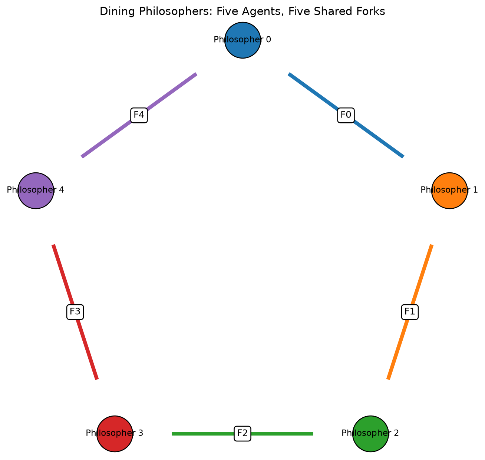
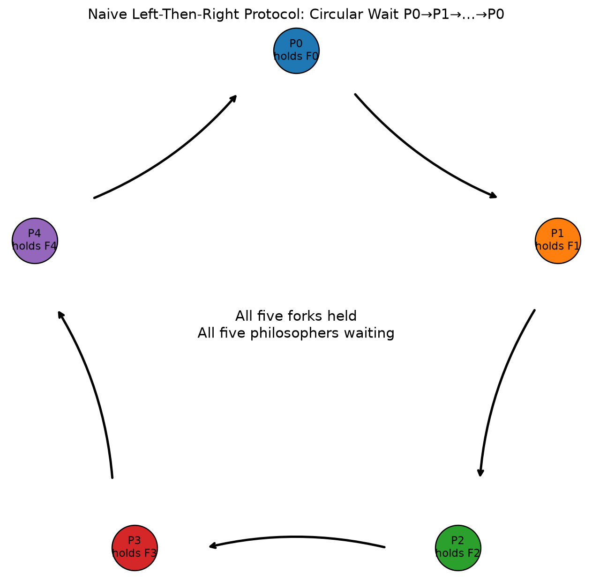
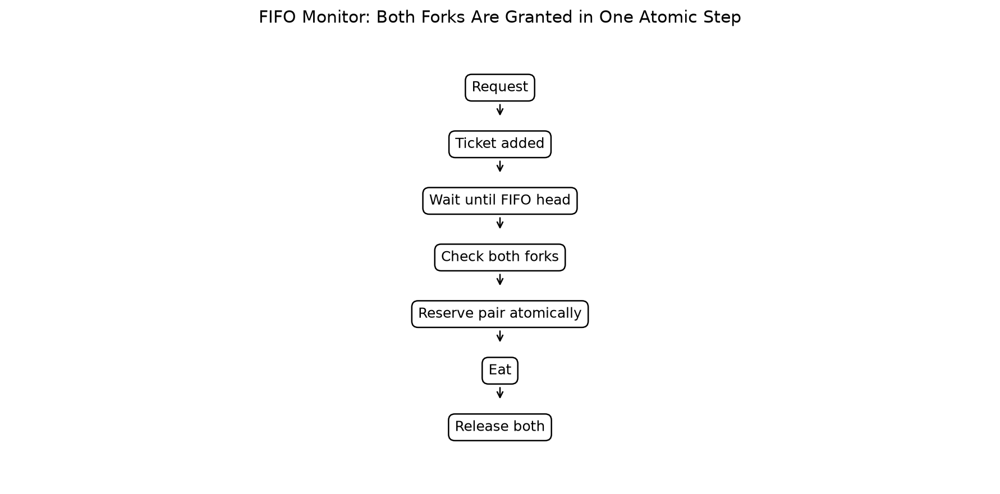
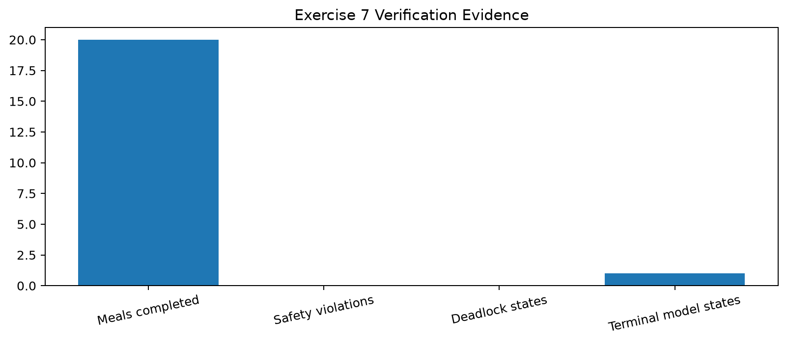
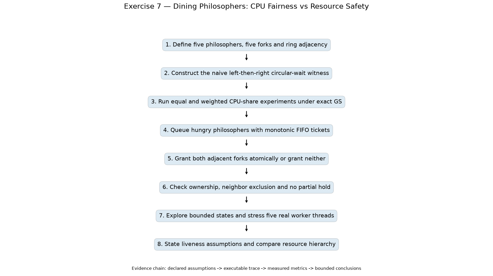

# تمرین ۷: مسئله فیلسوفان غذاخور — زمان‌بندی تضمینی و تخصیص منابع بدون بن‌بست

**مطالعه مستقل مهندسی سیستم‌عامل درباره عدالت CPU، انتظار حلقوی، مانیتور FIFO، رزرو اتمی دو چنگال، جست‌وجوی فضای حالت و آزمون نخ‌های واقعی**

- **مخزن:** ZaraNodehi/Guaranteed-Scheduling
- **تمرین:** تمرین ۷ — فیلسوفان غذاخور
- **پرسش اصلی:** آیا منطق زمان‌بندی تضمینی مسئله فیلسوفان غذاخور را حل می‌کند و چگونه باید به کار گرفته شود؟
- **راهکار:** مانیتور FIFO با رزرو اتمی دو چنگال مجاور
- **راستی‌آزمایی:** مدل‌چکر فضای حالت + پنج نخ واقعی + آزمایش سهم CPU با GS کسری دقیق

## فهرست مطالب

- ۱. خلاصه اجرایی و پاسخ مستقیم به سؤال استاد (p. 3)
- ۲. تعریف مسئله، وضعیت و ویژگی‌های صوری ایمنی (p. 4)
- ۳. چرا عدالت پردازنده بن‌بست منابع را حل نمی‌کند (p. 5)
- ۴. روش ساده و اثبات انتظار حلقوی (p. 6)
- ۵. راهکار پیشنهادی: مانیتور FIFO با رزرو اتمی جفت چنگال (p. 6)
- ۶. ناورداها، نبود بن‌بست و پیشرفت مشروط (p. 8)
- ۷. راهکار جایگزین: سلسله‌مراتب سراسری منابع (p. 9)
- ۸. روش آزمایش و راستی‌آزمایی مستقل (p. 9)
- ۹. آزمایش سهم CPU با زمان‌بندی تضمینی (p. 10)
- ۱۰. تفسیر نتایج، محدودیت‌ها و پاسخ نهایی (p. 11)
- منابع و مطالعه بیشتر (p. 12)
- پیوست روش اجرا و فلوچارت (p. 13)
- پیوست کد 1: ممیزی منبع «dining_philosophers.py» — خطوط 1 تا 15 (p. 14)
- پیوست کد 2: ممیزی منبع «dining_philosophers.py» — خطوط 16 تا 30 (p. 15)
- پیوست کد 3: ممیزی منبع «dining_philosophers.py» — خطوط 31 تا 45 (p. 16)
- پیوست کد 4: ممیزی منبع «dining_philosophers.py» — خطوط 46 تا 60 (p. 17)
- پیوست کد 5: ممیزی منبع «dining_philosophers.py» — خطوط 61 تا 75 (p. 18)
- پیوست کد 6: ممیزی منبع «dining_philosophers.py» — خطوط 76 تا 90 (p. 19)
- پیوست کد 7: ممیزی منبع «dining_philosophers.py» — خطوط 91 تا 105 (p. 20)
- پیوست کد 8: ممیزی منبع «dining_philosophers.py» — خطوط 106 تا 120 (p. 21)
- پیوست کد 9: ممیزی منبع «dining_philosophers.py» — خطوط 121 تا 135 (p. 22)
- پیوست کد 10: ممیزی منبع «dining_philosophers.py» — خطوط 136 تا 150 (p. 23)
- پیوست کد 11: ممیزی منبع «dining_philosophers.py» — خطوط 151 تا 165 (p. 24)
- پیوست کد 12: ممیزی منبع «dining_philosophers.py» — خطوط 166 تا 180 (p. 25)
- پیوست کد 13: ممیزی منبع «dining_philosophers.py» — خطوط 181 تا 195 (p. 26)
- پیوست کد 14: ممیزی منبع «dining_philosophers.py» — خطوط 196 تا 210 (p. 27)
- پیوست کد 15: ممیزی منبع «dining_philosophers.py» — خطوط 211 تا 225 (p. 28)
- پیوست کد 16: ممیزی منبع «dining_philosophers.py» — خطوط 226 تا 240 (p. 29)
- پیوست کد 17: ممیزی منبع «dining_philosophers.py» — خطوط 241 تا 255 (p. 30)
- پیوست کد 18: ممیزی منبع «dining_philosophers.py» — خطوط 256 تا 270 (p. 31)
- پیوست کد 19: ممیزی منبع «dining_philosophers.py» — خطوط 271 تا 285 (p. 32)
- پیوست کد 20: ممیزی منبع «dining_philosophers.py» — خطوط 286 تا 300 (p. 33)
- پیوست کد 21: ممیزی منبع «dining_philosophers.py» — خطوط 301 تا 315 (p. 34)
- پیوست کد 22: ممیزی منبع «dining_philosophers.py» — خطوط 316 تا 317 (p. 35)
- پیوست کد 23: ممیزی منبع «run_experiments.py» — خطوط 1 تا 15 (p. 36)
- پیوست کد 24: ممیزی منبع «run_experiments.py» — خطوط 16 تا 30 (p. 37)
- پیوست کد 25: ممیزی منبع «run_experiments.py» — خطوط 31 تا 45 (p. 38)
- پیوست کد 26: ممیزی منبع «run_experiments.py» — خطوط 46 تا 60 (p. 39)
- پیوست کد 27: ممیزی منبع «run_experiments.py» — خطوط 61 تا 75 (p. 40)
- پیوست کد 28: ممیزی منبع «run_experiments.py» — خطوط 76 تا 90 (p. 41)
- پیوست کد 29: ممیزی منبع «run_experiments.py» — خطوط 91 تا 105 (p. 42)
- پیوست کد 30: ممیزی منبع «run_experiments.py» — خطوط 106 تا 120 (p. 43)
- پیوست کد 31: ممیزی منبع «run_experiments.py» — خطوط 121 تا 135 (p. 44)
- پیوست کد 32: ممیزی منبع «run_experiments.py» — خطوط 136 تا 142 (p. 45)
- پیوست کد 33: ممیزی منبع «plot_diagrams.py» — خطوط 1 تا 15 (p. 46)
- پیوست کد 34: ممیزی منبع «plot_diagrams.py» — خطوط 16 تا 30 (p. 47)


<!-- page 1 -->


<!-- page 2 -->


<!-- page 3 -->


## ۱. خلاصه اجرایی و پاسخ مستقیم به سؤال استاد

مسئله فیلسوفان غذاخور یک مسئله کنترل هم‌زمانی است که در آن پنج فیلسوف پنج چنگال را در قالب یک حلقه به اشتراک می‌گذارند. هر فیلسوف برای غذاخوردن به دو چنگال مجاور نیاز دارد. روش ساده ممکن است زمانی به بن‌بست برسد که هر فیلسوف یک چنگال را نگه دارد و منتظر چنگال بعدی بماند. سؤال پایانی استاد این است که آیا منطق الگوریتم زمان‌بندی تضمینی می‌تواند برای این مسئله به کار رود و چگونه. پاسخ نیازمند تفکیک دو لایه مستقل است: زمان‌بندی CPU و تخصیص منابع.

زمان‌بندی تضمینی (GS) می‌تواند خدمت پردازنده را میان فیلسوفانی که آماده اجرا هستند منصفانه تقسیم کند؛ اما نمی‌تواند چنگال آزاد ایجاد کند، مالکیت چنگال را به‌صورت ایمن لغو کند یا انتظار حلقوی را از بین ببرد. بنابراین GS به‌تنهایی راه‌حل بن‌بست نیست. این تمرین، زمان‌بند کسری دقیق GS را با یک مانیتور FIFO مستقل ترکیب می‌کند که هر دو چنگال مجاور را به‌صورت اتمی واگذار می‌کند.

| روش ساده | شاهد چرخه انتظار پنج‌گرهی: P0 ← P1 ← P2 ← P3 ← P4 ← P0 |
|---|---|
| مدل محدود FIFO | 1902 حالت قابل‌دسترسی؛ 0 حالت ناایمن؛ 0 بن‌بست غیرنهایی؛ 1 حالت تکمیل |
| آزمون نخ‌های واقعی | 20 وعده از 20 وعده؛ 0 نقض هم‌زمانی همسایه‌ها |
| آزمایش سهم CPU | شاخص جین GS با وزن برابر 1.0000؛ GS وزن‌دار 1.0000 |


<!-- page 4 -->



*شکل 1. چیدمان حلقه‌ای پنج فیلسوف و پنج چنگال مشترک.*


## ۲. تعریف مسئله، وضعیت و ویژگی‌های صوری ایمنی

تعداد فیلسوفان N=5 است. فیلسوف P_i برای غذاخوردن به چنگال‌های F_i و F_(i+1 mod N) نیاز دارد. هر فیلسوف بین سه وضعیت فکرکردن، گرسنه/منتظر و غذاخوردن جابه‌جا می‌شود. وضعیت منابع شامل مالک هر چنگال، مجموعه فیلسوفان غذاخور و صف فیلسوفان گرسنه است. پروتکل صحیح باید مانع مالکیت هم‌زمان یک چنگال توسط دو نفر شود و اجازه ندهد دو فیلسوف مجاور هم‌زمان غذا بخورند.

| نماد | معنا | مقدار در تمرین ۷ |
|---|---|---|
| N | تعداد فیلسوف و چنگال | ۵ |
| F_i | چنگال میان P_i و P_(i-1 mod N) | شناسه‌های ۰ تا ۴ |
| Need(P_i) | دو چنگال لازم برای غذا | {F_i,F_(i+1 mod N)} |
| State | مالک‌ها، صف انتظار و مجموعه غذاخورها | محافظت‌شده با یک قفل شرطی مانیتور |
| Admission | ترتیب درخواست چنگال توسط فیلسوف گرسنه | بلیت افزایشی FIFO |

*جدول 1. واژگان صوری و متغیرهای وضعیت در مدل.*


<!-- page 5 -->



*شکل 2. در روش ساده چپ‌سپس‌راست، چرخه انتظار پنج‌گرهی قابل دستیابی است.*


## ۳. چرا عدالت پردازنده بن‌بست منابع را حل نمی‌کند

فرض کنیم وزن CPU همه فیلسوفان برابر باشد و GS پردازنده را کاملاً منصفانه بین آن‌ها بچرخاند. اگر هر فیلسوف چنگال سمت چپ را گرفته و پشت چنگال سمت راست مسدود شده باشد، هر پنج نخ منتظر منبع هستند. زمان‌بند حتی اگر در میان کارهای آماده کاملاً منصفانه باشد، وضعیت منابع را تغییر نمی‌دهد. استحقاق CPU معادل مالکیت منبع نیست و با اجرای دوباره نخ‌های مسدودشده، چرخه انتظار شکسته نمی‌شود.

این تفکیک برای اثبات مهم است: عدالت CPU ویژگی ردپای خدمت زمان‌بند است؛ انحصار متقابل و نبود بن‌بست ویژگی پروتکل تخصیص منابع است. سامانه صحیح به هر دو نیاز دارد و هیچ‌یک به‌تنهایی دیگری را نتیجه نمی‌دهد.


<!-- page 6 -->

| لایه | پرسش | سازوکار | محدودیت در حالت مستقل |
|---|---|---|---|
| زمان‌بندی CPU | کدام نخ تیک بعدی را می‌گیرد؟ | GS با زمان مجازی و وزن | آزادبودن چنگال یا نبود بن‌بست |
| تخصیص منبع | مالک دو چنگال چه کسی است؟ | مانیتور FIFO و واگذاری اتمی | استحقاق CPU میان نخ‌های آماده |
| ترکیب | آیا کار از ابتدا تا انتها پیش می‌رود؟ | GS + مانیتور + بخش بحرانی محدود | پیشرفت در صورت پایان‌نیافتن وعده تضمین نمی‌شود |

*جدول 2. تفکیک مسئولیت زمان‌بندی و همگام‌سازی.*


*شکل 3. آزمایش GS کسری دقیق: خدمت CPU مطابق وزن برابر و وزن‌دار توزیع می‌شود.*


## ۴. روش ساده و اثبات انتظار حلقوی

الگوریتم ساده چنین است: هر فیلسوف ابتدا چنگال سمت چپ و سپس چنگال سمت راست را می‌گیرد. حالتی قابل دستیابی است که هر P_i مالک F_i باشد. از آنجا که چنگال سمت راست P_i یعنی F_(i+1) در اختیار P_(i+1) است، هر پنج فیلسوف منتظر می‌مانند. گراف انتظار یال‌های P_i به P_(i+1) دارد و چرخه P0→P1→P2→P3→P4→P0 شکل می‌گیرد.

- انحصار متقابل: هر چنگال حداکثر یک مالک دارد.
- نگه‌داشتن و انتظار: هر فیلسوف یک چنگال را نگه می‌دارد و منتظر منبع دیگر است.
- نبود پیش‌دستی: چنگال از فیلسوف غذاخور به‌اجبار گرفته نمی‌شود.
- انتظار حلقوی: وابستگی مالکیت منابع یک چرخه می‌سازد.

چهار شرط کافمن توضیح می‌دهند که چرا روش ساده ممکن است بن‌بست ایجاد کند. اصلاح اصلی، تغییر وزن CPU نیست؛ بلکه حذف مالکیت جزئی و ترتیب تصاحب چرخه‌ای منابع است.


## ۵. راهکار پیشنهادی: مانیتور FIFO با رزرو اتمی جفت چنگال

مانیتور FairDiningTable مالکیت چنگال‌ها، صف FIFO شامل (بلیت، فیلسوف) و مجموعه فیلسوفان غذاخور را با یک قفل شرطی محافظت می‌کند. فیلسوف گرسنه یک بلیت افزایشی می‌گیرد. تا وقتی درخواست او سر صف نباشد یا هر دو چنگال مجاور آزاد نشده باشند، منتظر می‌ماند. در آن لحظه مانیتور درخواست را از صف خارج کرده و مالکیت هر دو چنگال را در یک بخش بحرانی تغییر می‌دهد؛ هیچ‌گاه فقط یک چنگال واگذار نمی‌شود.


<!-- page 7 -->

- درخواست: افزودن (بلیت، فیلسوف) به انتهای صف FIFO.
- انتظار: حلقه شرطی، سرصف بودن و آزادبودن هر دو چنگال را بررسی می‌کند.
- واگذاری: رزرو هم‌زمان دو چنگال، ثبت وضعیت غذاخوردن و ثبت بلیت.
- آزادسازی: هر دو مالکیت پاک می‌شوند و منتظران برای بررسی مجدد بیدار می‌شوند.



*شکل 4. مانیتور جفت چنگال را به‌صورت اتمی به سر صف FIFO می‌دهد.*


<!-- page 8 -->

```text
035:     The condition variable protects both fork ownership and the wait queue.
036:     FIFO admission prevents a later request from repeatedly bypassing the
037:     oldest hungry philosopher, assuming every granted meal eventually ends.
038:     """
039: 
040:     def __init__(self, count: int = 5):
041:         if count < 3:
042:             raise ValueError("Dining Philosophers requires at least 3 philosophers")
043:         self.count = count
044:         self._condition = threading.Condition()
045:         self._fork_owner: List[int | None] = [None] * count
046:         self._waiting = deque()
047:         self._next_ticket = 0
048:         self._eating = set()
049:         self._admission_order: List[int] = []
050:         self._admission_tickets: List[int] = []
051:         self._max_queue = 0
052: 
053:     def _is_available(self, philosopher: int) -> bool:
054:         left, right = fork_pair(philosopher, self.count)
055:         return self._fork_owner[left] is None and self._fork_owner[right] is None
056: 
057:     def _assert_safe(self) -> None:
058:         for philosopher in self._eating:
059:             left, right = fork_pair(philosopher, self.count)
060:             assert self._fork_owner[left] == philosopher
061:             assert self._fork_owner[right] == philosopher
062:             assert (philosopher + 1) % self.count not in self._eating
063:             assert (philosopher - 1) % self.count not in self._eating
064: 
065:     def acquire(self, philosopher: int) -> int:
066:         """Wait for a FIFO ticket and atomically reserve both forks."""
067:         if not 0 <= philosopher < self.count:
068:             raise ValueError(f"philosopher must be in [0, {self.count})")
069: 
070:         with self._condition:
```
*گزیده کد: مانیتور محافظت‌شده با شرط و رزرو اتمی دو چنگال.*


## ۶. ناورداها، نبود بن‌بست و پیشرفت مشروط

| ناوردا | گزاره | کنترل اجرایی |
|---|---|---|
| I1 — مالکیت | هر چنگال حداکثر یک مالک دارد. | قفل مانیتور، فیلدهای مالک را محافظت می‌کند. |
| I2 — مالکیت جفت | فیلسوف غذاخور مالک هر دو چنگال مجاور است. | تخصیص اتمی و assert زمان اجرا. |
| I3 — ایمنی همسایه | دو فیلسوف مجاور هم‌زمان غذا نمی‌خورند. | جفت‌های منابع مشترک‌اند و مالک یکتا دارند. |
| I4 — نبود مالکیت جزئی | فیلسوف منتظر مالک هیچ چنگالی نیست. | انتظار پیش از ثبت مالکیت انجام می‌شود. |
| I5 — ترتیب FIFO | بلیت واگذاری افزایشی است. | فقط سر صف اجازه تصاحب دارد. |

*جدول 3. ناورداهای ایمنی و کنترل‌های پیاده‌سازی.*


<!-- page 9 -->


*شکل 5. چک‌لیست ناورداهای ایمنی منابع و ترتیب FIFO.*

نبود بن‌بست از حذف شرط نگه‌داشتن و انتظار نتیجه می‌شود: فیلسوف یا هر دو چنگال را دارد یا هیچ‌کدام را. چون مانیتور هر دو مالکیت را سریالی و اتمی ثبت می‌کند، چرخه‌ای از مالکیت ناقص ایجاد نمی‌شود. FIFO با جلوگیری از سبقت مکرر درخواست‌های جدید، گرسنگی را کاهش می‌دهد. با این حال پیشرفت مشروط است: هر وعده پذیرفته‌شده باید پایان یابد، نخ‌ها باید سرانجام CPU بگیرند و منتظران باید بیدار شوند. FIFO ممکن است انتظار ابتدای صف ایجاد کند و بخشی از موازی‌سازی را در برابر استدلال ساده‌تر عدالت مبادله کند.


## ۷. راهکار جایگزین: سلسله‌مراتب سراسری منابع

روش جایگزین، شماره‌گذاری سراسری چنگال‌ها و الزام به تصاحب چنگال با شماره کمتر پیش از چنگال با شماره بیشتر است. ترتیب سخت‌گیرانه منابع، زنجیره چرخه‌ای تصاحب را ناممکن می‌کند. این روش بدون صف پذیرش سراسری، انتظار حلقوی را حذف می‌کند؛ اما FIFO بودن یا انتظار کراندار را تضمین نمی‌کند و عدالت باید جداگانه بررسی شود.

| روش | پیشگیری از بن‌بست | ویژگی عدالت | مبادله |
|---|---|---|---|
| چپ سپس راست | خیر | هیچ تضمینی ندارد | چرخه انتظار قابل دستیابی است. |
| ترتیب سراسری چنگال | بله، با ترتیب بدون چرخه | لزومی به FIFO ندارد | اثبات ساده؛ ترتیب انتظار متغیر. |
| مانیتور اتمی FIFO | بله، بدون مالکیت جزئی | ترتیب درخواست FIFO | احتمال انتظار ابتدای صف. |

*جدول 4. سه سیاست تصاحب منبع و تضمین‌های آن‌ها.*


## ۸. روش آزمایش و راستی‌آزمایی مستقل

آزمایش دو نوع شاهد مستقل دارد. نخست، مدل‌چکر محدود، انتقال‌های درخواست، واگذاری به سر صف و پایان غذا را برای مدل پنج‌فیلسوفی پیمایش می‌کند. همه حالت‌ها از نظر غذاخوردن همسایه‌ها، حالت غیرنهایی بدون انتقال و امکان تکمیل نهایی بررسی می‌شوند. دوم، پنج نخ واقعی پایتون اجرا می‌شوند و هرکدام چهار وعده انجام می‌دهند؛ تعداد وعده‌های تکمیل‌شده، هم‌پوشانی همسایه‌ها، خطاهای نخ، زنده‌ماندن رشته‌ها، مالکیت نهایی و ترتیب بلیت FIFO ثبت می‌شود.


<!-- page 10 -->


*شکل 6. شواهد مدل‌چکر محدود و آزمون نخ‌های واقعی.*

| سنجه | مقدار مشاهده‌شده | تفسیر |
|---|---|---|
| حالت‌های قابل‌دسترسی | 1902 | حالت‌های متمایز پیمایش‌شده. |
| انتقال‌های مدل | 4190 | یال‌های درخواست، واگذاری و پایان غذا. |
| حالت‌های ناایمن | 0 | باید صفر باشد. |
| بن‌بست غیرنهایی | 0 | باید صفر باشد. |
| حالت‌های تکمیل نهایی | 1 | حداقل یک حالت تکمیل کامل وجود دارد. |
| وعده‌های واقعی تکمیل‌شده | 20 | هدف 20. |
| نقض ایمنی در نخ واقعی | 0 | باید صفر باشد. |

*جدول 5. سنجه‌های واقعی خوانده‌شده از خروجی آزمایش.*


## ۹. آزمایش سهم CPU با زمان‌بندی تضمینی

آزمایش زمان‌بند عمداً از آزمایش چنگال جدا نگه داشته شده است. پنج وظیفه CPUمحور با زمان مجازی کسری دقیق gs_vtime در افق ۱۰۰ تیک اجرا می‌شوند. در حالت وزن برابر، خدمت پردازنده برابر است؛ در حالت وزن‌های ۱:۱:۲:۲:۴، سهم CPU متناسب با همین وزن‌ها توزیع می‌شود. شاخص جین بر مبنای نسبت خدمت به استحقاق محاسبه شده و معیار عدالت چنگال، تکمیل غذا یا نبود بن‌بست نیست.

| فیلسوف | وزن برابر | تیک CPU برابر | وزن در حالت وزن‌دار | تیک CPU وزن‌دار |
|---|---|---|---|---|
| P0 | ۱ | 20 | 1 | 10 |
| P1 | ۱ | 20 | 1 | 10 |
| P2 | ۱ | 20 | 2 | 20 |
| P3 | ۱ | 20 | 2 | 20 |
| P4 | ۱ | 20 | 4 | 40 |

*جدول 6. تخصیص CPU با GS کسری دقیق؛ در این آزمایش همه فیلسوفان همیشه آماده اجرا هستند.*


<!-- page 11 -->


*شکل 7. شاخص عدالت نسبی جین برای استحقاق برابر و وزن‌دار CPU.*


## ۱۰. تفسیر نتایج، محدودیت‌ها و پاسخ نهایی

نتایج از یک نتیجه‌گیری لایه‌ای پشتیبانی می‌کنند. GS خدمت CPU را میان فیلسوفان آماده منصفانه توزیع می‌کند. مانیتور FIFO مالکیت چنگال، انحصار و ساختار تصاحب بدون بن‌بست را در مدل محدود فراهم می‌کند. آزمون نخ واقعی پیاده‌سازی را زیر هم‌زمانی عملی بررسی می‌کند. مدل یک حلقه ثابت است و آزمون تنش نیز محدود است؛ هیچ‌یک پیشرفت را در حالتی که زمان‌بند هرگز نخ منتظر را اجرا نکند یا فیلسوف چنگال را آزاد نکند اثبات نمی‌کند.



*شکل 8. خلاصه شواهد راستی‌آزمایی تمرین ۷.*

پاسخ مستقیم به استاد: منطق عدالت الگوریتم می‌تواند برای زمان‌بندی CPU نخ‌های فیلسوف به کار رود، اما خود زمان‌بندی مسئله فیلسوفان غذاخور را حل نمی‌کند. باید با پروتکل همگام‌سازی صریح و بدون بن‌بست ترکیب شود. در این تحویل، پروتکل اصلی مانیتور FIFO با واگذاری اتمی هر دو چنگال است؛ سلسله‌مراتب سراسری منابع نیز راهکار جایگزین محسوب می‌شود.


<!-- page 12 -->


## منابع و مطالعه بیشتر

- E. W. Dijkstra, Hierarchical Ordering of Sequential Processes, Acta Informatica, 1971.
- C. A. R. Hoare, Monitors: An Operating System Structuring Concept, Communications of the ACM, 1974.
- C. L. Liu and J. W. Layland, Scheduling Algorithms for Multiprogramming in a Hard-Real-Time Environment, Journal of the ACM, 1973.
- A. Silberschatz, P. B. Galvin and G. Gagne, Operating System Concepts، فصل‌های همگام‌سازی و بن‌بست.


<!-- page 13 -->


## پیوست روش اجرا و فلوچارت

این تمرین زمان‌بندی سهم CPU با GS کسری دقیق را از مالکیت منابع جدا می‌کند؛ چرخه انتظار روش ساده را نشان می‌دهد، دو چنگال را با مانیتور FIFO اتمی واگذار می‌کند و مدل محدود و نخ‌های واقعی را می‌آزماید.



*شکل 9. فیلسوفان غذاخور: عدالت CPU در GS، مانیتور چنگال FIFO و روند راستی‌آزمایی*

| مرحله | شرح |
|---|---|
| ورودی | Five philosophers, five forks, ring topology and fairness assumptions |
| Witness | Construct the naive left-then-right circular wait |
| زمان‌بندی | Measure equal and weighted CPU service using exact-rational GS |
| همگام‌سازی | FIFO admission and atomic reservation of both forks |
| Verification | Explore bounded states and run five real worker threads |
| Conclusion | Separate CPU fairness, resource safety and conditional liveness |

*جدول 7. خلاصهٔ مراحل و شواهد لازم برای بازبینی این تمرین.*


<!-- page 14 -->


## پیوست کد 1: ممیزی منبع «dining_philosophers.py» — خطوط 1 تا 15

فایل مرجع: exercise-7 / code / dining_philosophers.py. این بخش پیاده‌سازی تخصیص منابع فیلسوفان غذاخور، مدل‌چکر فضای حالت و فرض‌های لازم برای پیشرفت را نشان می‌دهد. بازهٔ زیر خطوط 1 تا 15 از همان فایل است؛ شمارهٔ خطوط برای ارجاع و بازبینی دوباره حفظ شده‌اند. این فهرست کد، ضمیمهٔ قابل ممیزی گزارش است و باید همراه آزمون‌ها و فایل خروجی متناظر بررسی شود.

```text
0001: """Exercise 7: FIFO monitor solution for the Dining Philosophers problem.
0002: 
0003: The CPU scheduler and the shared-fork protocol solve different problems:
0004: Guaranteed Scheduling distributes CPU service among runnable philosophers;
0005: this monitor grants both forks atomically in FIFO order. A scheduler alone
0006: cannot prevent circular wait or guarantee access to a fork.
0007: """
0008: from __future__ import annotations
0009: 
0010: from collections import deque
0011: from contextlib import contextmanager
0012: import threading
0013: import time
0014: from typing import Dict, Iterator, List, Tuple
0015: 
```
*گزیدهٔ واقعی از exercise-7/code/dining_philosophers.py، خطوط 1–15؛ خطوط بلند فقط برای صفحه‌آرایی شکسته شده‌اند.*


<!-- page 15 -->


## پیوست کد 2: ممیزی منبع «dining_philosophers.py» — خطوط 16 تا 30

فایل مرجع: exercise-7 / code / dining_philosophers.py. این بخش پیاده‌سازی تخصیص منابع فیلسوفان غذاخور، مدل‌چکر فضای حالت و فرض‌های لازم برای پیشرفت را نشان می‌دهد. بازهٔ زیر خطوط 16 تا 30 از همان فایل است؛ شمارهٔ خطوط برای ارجاع و بازبینی دوباره حفظ شده‌اند. این فهرست کد، ضمیمهٔ قابل ممیزی گزارش است و باید همراه آزمون‌ها و فایل خروجی متناظر بررسی شود.

```text
0016: 
0017: def fork_pair(philosopher: int, count: int) -> Tuple[int, int]:
0018:     """Return the two fork IDs used by philosopher i (left=i, right=i+1)."""
0019:     if count < 3:
0020:         raise ValueError("Dining Philosophers requires at least 3 philosophers")
0021:     if not 0 <= philosopher < count:
0022:         raise ValueError(f"philosopher must be in [0, {count})")
0023:     return philosopher, (philosopher + 1) % count
0024: 
0025: 
0026: def ordered_fork_pair(philosopher: int, count: int) -> Tuple[int, int]:
0027:     """The resource-hierarchy alternative: always acquire lower fork ID first."""
0028:     return tuple(sorted(fork_pair(philosopher, count)))
0029: 
0030: 
```
*گزیدهٔ واقعی از exercise-7/code/dining_philosophers.py، خطوط 16–30؛ خطوط بلند فقط برای صفحه‌آرایی شکسته شده‌اند.*


<!-- page 16 -->


## پیوست کد 3: ممیزی منبع «dining_philosophers.py» — خطوط 31 تا 45

فایل مرجع: exercise-7 / code / dining_philosophers.py. این بخش پیاده‌سازی تخصیص منابع فیلسوفان غذاخور، مدل‌چکر فضای حالت و فرض‌های لازم برای پیشرفت را نشان می‌دهد. بازهٔ زیر خطوط 31 تا 45 از همان فایل است؛ شمارهٔ خطوط برای ارجاع و بازبینی دوباره حفظ شده‌اند. این فهرست کد، ضمیمهٔ قابل ممیزی گزارش است و باید همراه آزمون‌ها و فایل خروجی متناظر بررسی شود.

```text
0031: class FairDiningTable:
0032:     """A monitor that grants both forks together to the FIFO head only.
0033: 
0034:     A philosopher never holds one fork while waiting for the second one.
0035:     The condition variable protects both fork ownership and the wait queue.
0036:     FIFO admission prevents a later request from repeatedly bypassing the
0037:     oldest hungry philosopher, assuming every granted meal eventually ends.
0038:     """
0039: 
0040:     def __init__(self, count: int = 5):
0041:         if count < 3:
0042:             raise ValueError("Dining Philosophers requires at least 3 philosophers")
0043:         self.count = count
0044:         self._condition = threading.Condition()
0045:         self._fork_owner: List[int | None] = [None] * count
```
*گزیدهٔ واقعی از exercise-7/code/dining_philosophers.py، خطوط 31–45؛ خطوط بلند فقط برای صفحه‌آرایی شکسته شده‌اند.*


<!-- page 17 -->


## پیوست کد 4: ممیزی منبع «dining_philosophers.py» — خطوط 46 تا 60

فایل مرجع: exercise-7 / code / dining_philosophers.py. این بخش پیاده‌سازی تخصیص منابع فیلسوفان غذاخور، مدل‌چکر فضای حالت و فرض‌های لازم برای پیشرفت را نشان می‌دهد. بازهٔ زیر خطوط 46 تا 60 از همان فایل است؛ شمارهٔ خطوط برای ارجاع و بازبینی دوباره حفظ شده‌اند. این فهرست کد، ضمیمهٔ قابل ممیزی گزارش است و باید همراه آزمون‌ها و فایل خروجی متناظر بررسی شود.

```text
0046:         self._waiting = deque()
0047:         self._next_ticket = 0
0048:         self._eating = set()
0049:         self._admission_order: List[int] = []
0050:         self._admission_tickets: List[int] = []
0051:         self._max_queue = 0
0052: 
0053:     def _is_available(self, philosopher: int) -> bool:
0054:         left, right = fork_pair(philosopher, self.count)
0055:         return self._fork_owner[left] is None and self._fork_owner[right] is None
0056: 
0057:     def _assert_safe(self) -> None:
0058:         for philosopher in self._eating:
0059:             left, right = fork_pair(philosopher, self.count)
0060:             assert self._fork_owner[left] == philosopher
```
*گزیدهٔ واقعی از exercise-7/code/dining_philosophers.py، خطوط 46–60؛ خطوط بلند فقط برای صفحه‌آرایی شکسته شده‌اند.*


<!-- page 18 -->


## پیوست کد 5: ممیزی منبع «dining_philosophers.py» — خطوط 61 تا 75

فایل مرجع: exercise-7 / code / dining_philosophers.py. این بخش پیاده‌سازی تخصیص منابع فیلسوفان غذاخور، مدل‌چکر فضای حالت و فرض‌های لازم برای پیشرفت را نشان می‌دهد. بازهٔ زیر خطوط 61 تا 75 از همان فایل است؛ شمارهٔ خطوط برای ارجاع و بازبینی دوباره حفظ شده‌اند. این فهرست کد، ضمیمهٔ قابل ممیزی گزارش است و باید همراه آزمون‌ها و فایل خروجی متناظر بررسی شود.

```text
0061:             assert self._fork_owner[right] == philosopher
0062:             assert (philosopher + 1) % self.count not in self._eating
0063:             assert (philosopher - 1) % self.count not in self._eating
0064: 
0065:     def acquire(self, philosopher: int) -> int:
0066:         """Wait for a FIFO ticket and atomically reserve both forks."""
0067:         if not 0 <= philosopher < self.count:
0068:             raise ValueError(f"philosopher must be in [0, {self.count})")
0069: 
0070:         with self._condition:
0071:             if philosopher in self._eating or any(
0072:                 waiting_id == philosopher for _, waiting_id in self._waiting
0073:             ):
0074:                 raise RuntimeError(f"philosopher {philosopher} already has an
      | active request")
0075: 
```
*گزیدهٔ واقعی از exercise-7/code/dining_philosophers.py، خطوط 61–75؛ خطوط بلند فقط برای صفحه‌آرایی شکسته شده‌اند.*


<!-- page 19 -->


## پیوست کد 6: ممیزی منبع «dining_philosophers.py» — خطوط 76 تا 90

فایل مرجع: exercise-7 / code / dining_philosophers.py. این بخش پیاده‌سازی تخصیص منابع فیلسوفان غذاخور، مدل‌چکر فضای حالت و فرض‌های لازم برای پیشرفت را نشان می‌دهد. بازهٔ زیر خطوط 76 تا 90 از همان فایل است؛ شمارهٔ خطوط برای ارجاع و بازبینی دوباره حفظ شده‌اند. این فهرست کد، ضمیمهٔ قابل ممیزی گزارش است و باید همراه آزمون‌ها و فایل خروجی متناظر بررسی شود.

```text
0076:             ticket = self._next_ticket
0077:             self._next_ticket += 1
0078:             self._waiting.append((ticket, philosopher))
0079:             self._max_queue = max(self._max_queue, len(self._waiting))
0080:             self._condition.notify_all()
0081: 
0082:             while (
0083:                 not self._waiting
0084:                 or self._waiting[0] != (ticket, philosopher)
0085:                 or not self._is_available(philosopher)
0086:             ):
0087:                 self._condition.wait()
0088: 
0089:             self._waiting.popleft()
0090:             left, right = fork_pair(philosopher, self.count)
```
*گزیدهٔ واقعی از exercise-7/code/dining_philosophers.py، خطوط 76–90؛ خطوط بلند فقط برای صفحه‌آرایی شکسته شده‌اند.*


<!-- page 20 -->


## پیوست کد 7: ممیزی منبع «dining_philosophers.py» — خطوط 91 تا 105

فایل مرجع: exercise-7 / code / dining_philosophers.py. این بخش پیاده‌سازی تخصیص منابع فیلسوفان غذاخور، مدل‌چکر فضای حالت و فرض‌های لازم برای پیشرفت را نشان می‌دهد. بازهٔ زیر خطوط 91 تا 105 از همان فایل است؛ شمارهٔ خطوط برای ارجاع و بازبینی دوباره حفظ شده‌اند. این فهرست کد، ضمیمهٔ قابل ممیزی گزارش است و باید همراه آزمون‌ها و فایل خروجی متناظر بررسی شود.

```text
0091:             self._fork_owner[left] = philosopher
0092:             self._fork_owner[right] = philosopher
0093:             self._eating.add(philosopher)
0094:             self._admission_order.append(philosopher)
0095:             self._admission_tickets.append(ticket)
0096:             self._assert_safe()
0097:             self._condition.notify_all()
0098:             return ticket
0099: 
0100:     def release(self, philosopher: int) -> None:
0101:         """Release both forks and wake all waiters to re-check the FIFO guard."""
0102:         with self._condition:
0103:             if philosopher not in self._eating:
0104:                 raise RuntimeError(f"philosopher {philosopher} does not own
      | both forks")
0105:             left, right = fork_pair(philosopher, self.count)
```
*گزیدهٔ واقعی از exercise-7/code/dining_philosophers.py، خطوط 91–105؛ خطوط بلند فقط برای صفحه‌آرایی شکسته شده‌اند.*


<!-- page 21 -->


## پیوست کد 8: ممیزی منبع «dining_philosophers.py» — خطوط 106 تا 120

فایل مرجع: exercise-7 / code / dining_philosophers.py. این بخش پیاده‌سازی تخصیص منابع فیلسوفان غذاخور، مدل‌چکر فضای حالت و فرض‌های لازم برای پیشرفت را نشان می‌دهد. بازهٔ زیر خطوط 106 تا 120 از همان فایل است؛ شمارهٔ خطوط برای ارجاع و بازبینی دوباره حفظ شده‌اند. این فهرست کد، ضمیمهٔ قابل ممیزی گزارش است و باید همراه آزمون‌ها و فایل خروجی متناظر بررسی شود.

```text
0106:             if self._fork_owner[left] != philosopher or
      | self._fork_owner[right] != philosopher:
0107:                 raise RuntimeError("fork ownership invariant was violated")
0108:             self._fork_owner[left] = None
0109:             self._fork_owner[right] = None
0110:             self._eating.remove(philosopher)
0111:             self._assert_safe()
0112:             self._condition.notify_all()
0113: 
0114:     @contextmanager
0115:     def meal(self, philosopher: int) -> Iterator[int]:
0116:         ticket = self.acquire(philosopher)
0117:         try:
0118:             yield ticket
0119:         finally:
0120:             self.release(philosopher)
```
*گزیدهٔ واقعی از exercise-7/code/dining_philosophers.py، خطوط 106–120؛ خطوط بلند فقط برای صفحه‌آرایی شکسته شده‌اند.*


<!-- page 22 -->


## پیوست کد 9: ممیزی منبع «dining_philosophers.py» — خطوط 121 تا 135

فایل مرجع: exercise-7 / code / dining_philosophers.py. این بخش پیاده‌سازی تخصیص منابع فیلسوفان غذاخور، مدل‌چکر فضای حالت و فرض‌های لازم برای پیشرفت را نشان می‌دهد. بازهٔ زیر خطوط 121 تا 135 از همان فایل است؛ شمارهٔ خطوط برای ارجاع و بازبینی دوباره حفظ شده‌اند. این فهرست کد، ضمیمهٔ قابل ممیزی گزارش است و باید همراه آزمون‌ها و فایل خروجی متناظر بررسی شود.

```text
0121: 
0122:     def snapshot(self) -> Dict:
0123:         with self._condition:
0124:             return {
0125:                 "waiting": [p for _, p in self._waiting],
0126:                 "waiting_tickets": [t for t, _ in self._waiting],
0127:                 "eating": sorted(self._eating),
0128:                 "fork_owner": list(self._fork_owner),
0129:                 "admission_order": list(self._admission_order),
0130:                 "admission_tickets": list(self._admission_tickets),
0131:                 "max_wait_queue": self._max_queue,
0132:             }
0133: 
0134: 
0135: def naive_deadlock_witness(count: int = 5) -> Dict:
```
*گزیدهٔ واقعی از exercise-7/code/dining_philosophers.py، خطوط 121–135؛ خطوط بلند فقط برای صفحه‌آرایی شکسته شده‌اند.*


<!-- page 23 -->


## پیوست کد 10: ممیزی منبع «dining_philosophers.py» — خطوط 136 تا 150

فایل مرجع: exercise-7 / code / dining_philosophers.py. این بخش پیاده‌سازی تخصیص منابع فیلسوفان غذاخور، مدل‌چکر فضای حالت و فرض‌های لازم برای پیشرفت را نشان می‌دهد. بازهٔ زیر خطوط 136 تا 150 از همان فایل است؛ شمارهٔ خطوط برای ارجاع و بازبینی دوباره حفظ شده‌اند. این فهرست کد، ضمیمهٔ قابل ممیزی گزارش است و باید همراه آزمون‌ها و فایل خروجی متناظر بررسی شود.

```text
0136:     """Return the classic circular-wait state after every philosopher takes left."""
0137:     if count < 3:
0138:         raise ValueError("Dining Philosophers requires at least 3 philosophers")
0139:     holders = {p: p for p in range(count)}
0140:     waiting_for = {p: (p + 1) % count for p in range(count)}
0141:     cycle = list(range(count)) + [0]
0142:     return {
0143:         "fork_holder": holders,
0144:         "waiting_for_philosopher": waiting_for,
0145:         "wait_for_cycle": cycle,
0146:         "all_forks_held": len(set(holders.values())) == count,
0147:         "deadlocked": True,
0148:     }
0149: 
0150: 
```
*گزیدهٔ واقعی از exercise-7/code/dining_philosophers.py، خطوط 136–150؛ خطوط بلند فقط برای صفحه‌آرایی شکسته شده‌اند.*


<!-- page 24 -->


## پیوست کد 11: ممیزی منبع «dining_philosophers.py» — خطوط 151 تا 165

فایل مرجع: exercise-7 / code / dining_philosophers.py. این بخش پیاده‌سازی تخصیص منابع فیلسوفان غذاخور، مدل‌چکر فضای حالت و فرض‌های لازم برای پیشرفت را نشان می‌دهد. بازهٔ زیر خطوط 151 تا 165 از همان فایل است؛ شمارهٔ خطوط برای ارجاع و بازبینی دوباره حفظ شده‌اند. این فهرست کد، ضمیمهٔ قابل ممیزی گزارش است و باید همراه آزمون‌ها و فایل خروجی متناظر بررسی شود.

```text
0151: def _adjacent_eaters(eating_mask: int, count: int) -> bool:
0152:     for p in range(count):
0153:         if eating_mask & (1 << p):
0154:             if eating_mask & (1 << ((p + 1) % count)):
0155:                 return True
0156:     return False
0157: 
0158: 
0159: def explore_fifo_model(count: int = 5) -> Dict:
0160:     """Exhaustively explore one meal per philosopher in the FIFO-monitor model.
0161: 
0162:     A state is (waiting_queue, eating_bitmask, finished_bitmask). Transitions
0163:     are request, grant-to-FIFO-head, and finish-meal. The finite state space
0164:     makes safety and deadlock checks reproducible without thread timing noise.
0165:     """
```
*گزیدهٔ واقعی از exercise-7/code/dining_philosophers.py، خطوط 151–165؛ خطوط بلند فقط برای صفحه‌آرایی شکسته شده‌اند.*


<!-- page 25 -->


## پیوست کد 12: ممیزی منبع «dining_philosophers.py» — خطوط 166 تا 180

فایل مرجع: exercise-7 / code / dining_philosophers.py. این بخش پیاده‌سازی تخصیص منابع فیلسوفان غذاخور، مدل‌چکر فضای حالت و فرض‌های لازم برای پیشرفت را نشان می‌دهد. بازهٔ زیر خطوط 166 تا 180 از همان فایل است؛ شمارهٔ خطوط برای ارجاع و بازبینی دوباره حفظ شده‌اند. این فهرست کد، ضمیمهٔ قابل ممیزی گزارش است و باید همراه آزمون‌ها و فایل خروجی متناظر بررسی شود.

```text
0166:     if count < 3 or count > 7:
0167:         raise ValueError("model checker supports 3..7 philosophers")
0168:     initial = (tuple(), 0, 0)
0169:     pending = deque([initial])
0170:     seen = {initial}
0171:     transitions = 0
0172:     unsafe_states = 0
0173:     deadlock_states = 0
0174:     terminal_states = 0
0175:     max_parallel = 0
0176:     max_queue = 0
0177:     all_done = (1 << count) - 1
0178: 
0179:     while pending:
0180:         queue, eating, done = pending.popleft()
```
*گزیدهٔ واقعی از exercise-7/code/dining_philosophers.py، خطوط 166–180؛ خطوط بلند فقط برای صفحه‌آرایی شکسته شده‌اند.*


<!-- page 26 -->


## پیوست کد 13: ممیزی منبع «dining_philosophers.py» — خطوط 181 تا 195

فایل مرجع: exercise-7 / code / dining_philosophers.py. این بخش پیاده‌سازی تخصیص منابع فیلسوفان غذاخور، مدل‌چکر فضای حالت و فرض‌های لازم برای پیشرفت را نشان می‌دهد. بازهٔ زیر خطوط 181 تا 195 از همان فایل است؛ شمارهٔ خطوط برای ارجاع و بازبینی دوباره حفظ شده‌اند. این فهرست کد، ضمیمهٔ قابل ممیزی گزارش است و باید همراه آزمون‌ها و فایل خروجی متناظر بررسی شود.

```text
0181:         if _adjacent_eaters(eating, count):
0182:             unsafe_states += 1
0183:         max_parallel = max(max_parallel, eating.bit_count())
0184:         max_queue = max(max_queue, len(queue))
0185:         if not queue and eating == 0 and done == all_done:
0186:             terminal_states += 1
0187:             continue
0188: 
0189:         successors = set()
0190:         claimed = set(queue)
0191:         claimed.update(p for p in range(count) if eating & (1 << p))
0192:         claimed.update(p for p in range(count) if done & (1 << p))
0193: 
0194:         # Request: philosophers may arrive in any order.
0195:         for p in range(count):
```
*گزیدهٔ واقعی از exercise-7/code/dining_philosophers.py، خطوط 181–195؛ خطوط بلند فقط برای صفحه‌آرایی شکسته شده‌اند.*


<!-- page 27 -->


## پیوست کد 14: ممیزی منبع «dining_philosophers.py» — خطوط 196 تا 210

فایل مرجع: exercise-7 / code / dining_philosophers.py. این بخش پیاده‌سازی تخصیص منابع فیلسوفان غذاخور، مدل‌چکر فضای حالت و فرض‌های لازم برای پیشرفت را نشان می‌دهد. بازهٔ زیر خطوط 196 تا 210 از همان فایل است؛ شمارهٔ خطوط برای ارجاع و بازبینی دوباره حفظ شده‌اند. این فهرست کد، ضمیمهٔ قابل ممیزی گزارش است و باید همراه آزمون‌ها و فایل خروجی متناظر بررسی شود.

```text
0196:             if p not in claimed:
0197:                 successors.add((queue + (p,), eating, done))
0198: 
0199:         # Grant: only the oldest waiter can acquire, and both forks are
0200:         # reserved in this single transition (there is no hold-and-wait).
0201:         if queue:
0202:             p = queue[0]
0203:             if not (eating & (1 << ((p - 1) % count))) and not (
0204:                 eating & (1 << ((p + 1) % count))
0205:             ):
0206:                 successors.add((queue[1:], eating | (1 << p), done))
0207: 
0208:         # Finish: any philosopher currently eating releases both forks.
0209:         for p in range(count):
0210:             bit = 1 << p
```
*گزیدهٔ واقعی از exercise-7/code/dining_philosophers.py، خطوط 196–210؛ خطوط بلند فقط برای صفحه‌آرایی شکسته شده‌اند.*


<!-- page 28 -->


## پیوست کد 15: ممیزی منبع «dining_philosophers.py» — خطوط 211 تا 225

فایل مرجع: exercise-7 / code / dining_philosophers.py. این بخش پیاده‌سازی تخصیص منابع فیلسوفان غذاخور، مدل‌چکر فضای حالت و فرض‌های لازم برای پیشرفت را نشان می‌دهد. بازهٔ زیر خطوط 211 تا 225 از همان فایل است؛ شمارهٔ خطوط برای ارجاع و بازبینی دوباره حفظ شده‌اند. این فهرست کد، ضمیمهٔ قابل ممیزی گزارش است و باید همراه آزمون‌ها و فایل خروجی متناظر بررسی شود.

```text
0211:             if eating & bit:
0212:                 successors.add((queue, eating & ~bit, done | bit))
0213: 
0214:         if not successors and not (not queue and eating == 0 and done == all_done):
0215:             deadlock_states += 1
0216: 
0217:         for state in successors:
0218:             transitions += 1
0219:             if state not in seen:
0220:                 seen.add(state)
0221:                 pending.append(state)
0222: 
0223:     return {
0224:         "philosophers": count,
0225:         "reachable_states": len(seen),
```
*گزیدهٔ واقعی از exercise-7/code/dining_philosophers.py، خطوط 211–225؛ خطوط بلند فقط برای صفحه‌آرایی شکسته شده‌اند.*


<!-- page 29 -->


## پیوست کد 16: ممیزی منبع «dining_philosophers.py» — خطوط 226 تا 240

فایل مرجع: exercise-7 / code / dining_philosophers.py. این بخش پیاده‌سازی تخصیص منابع فیلسوفان غذاخور، مدل‌چکر فضای حالت و فرض‌های لازم برای پیشرفت را نشان می‌دهد. بازهٔ زیر خطوط 226 تا 240 از همان فایل است؛ شمارهٔ خطوط برای ارجاع و بازبینی دوباره حفظ شده‌اند. این فهرست کد، ضمیمهٔ قابل ممیزی گزارش است و باید همراه آزمون‌ها و فایل خروجی متناظر بررسی شود.

```text
0226:         "transitions": transitions,
0227:         "unsafe_states": unsafe_states,
0228:         "deadlock_states": deadlock_states,
0229:         "terminal_states": terminal_states,
0230:         "max_parallel_eaters": max_parallel,
0231:         "max_wait_queue": max_queue,
0232:         "fifo_admission": True,
0233:         "all_five_finish": terminal_states > 0,
0234:     }
0235: 
0236: 
0237: def run_threaded_stress(count: int = 5, rounds: int = 4, meal_seconds: float =
      | 0.0005) -> Dict:
0238:     """Run real threads against the monitor and independently audit overlap."""
0239:     if rounds <= 0:
0240:         raise ValueError("rounds must be positive")
```
*گزیدهٔ واقعی از exercise-7/code/dining_philosophers.py، خطوط 226–240؛ خطوط بلند فقط برای صفحه‌آرایی شکسته شده‌اند.*


<!-- page 30 -->


## پیوست کد 17: ممیزی منبع «dining_philosophers.py» — خطوط 241 تا 255

فایل مرجع: exercise-7 / code / dining_philosophers.py. این بخش پیاده‌سازی تخصیص منابع فیلسوفان غذاخور، مدل‌چکر فضای حالت و فرض‌های لازم برای پیشرفت را نشان می‌دهد. بازهٔ زیر خطوط 241 تا 255 از همان فایل است؛ شمارهٔ خطوط برای ارجاع و بازبینی دوباره حفظ شده‌اند. این فهرست کد، ضمیمهٔ قابل ممیزی گزارش است و باید همراه آزمون‌ها و فایل خروجی متناظر بررسی شود.

```text
0241:     table = FairDiningTable(count)
0242:     start = threading.Barrier(count + 1)
0243:     state_lock = threading.Lock()
0244:     active = set()
0245:     completions = [0] * count
0246:     violations: List[str] = []
0247:     errors: List[str] = []
0248:     max_parallel = 0
0249: 
0250:     def worker(philosopher: int) -> None:
0251:         nonlocal max_parallel
0252:         try:
0253:             start.wait(timeout=5)
0254:             for _ in range(rounds):
0255:                 with table.meal(philosopher):
```
*گزیدهٔ واقعی از exercise-7/code/dining_philosophers.py، خطوط 241–255؛ خطوط بلند فقط برای صفحه‌آرایی شکسته شده‌اند.*


<!-- page 31 -->


## پیوست کد 18: ممیزی منبع «dining_philosophers.py» — خطوط 256 تا 270

فایل مرجع: exercise-7 / code / dining_philosophers.py. این بخش پیاده‌سازی تخصیص منابع فیلسوفان غذاخور، مدل‌چکر فضای حالت و فرض‌های لازم برای پیشرفت را نشان می‌دهد. بازهٔ زیر خطوط 256 تا 270 از همان فایل است؛ شمارهٔ خطوط برای ارجاع و بازبینی دوباره حفظ شده‌اند. این فهرست کد، ضمیمهٔ قابل ممیزی گزارش است و باید همراه آزمون‌ها و فایل خروجی متناظر بررسی شود.

```text
0256:                     with state_lock:
0257:                         if (philosopher - 1) % count in active:
0258:                             violations.append(f"{philosopher} overlapped left
      | neighbor")
0259:                         if (philosopher + 1) % count in active:
0260:                             violations.append(f"{philosopher} overlapped right
      | neighbor")
0261:                         active.add(philosopher)
0262:                         max_parallel = max(max_parallel, len(active))
0263:                     if meal_seconds:
0264:                         time.sleep(meal_seconds)
0265:                     with state_lock:
0266:                         active.remove(philosopher)
0267:                         completions[philosopher] += 1
0268:                 time.sleep(0)
0269:         except Exception as exc:  # pragma: no cover - reported through the
      | stress result
0270:             errors.append(f"P{philosopher}: {type(exc).__name__}: {exc}")
```
*گزیدهٔ واقعی از exercise-7/code/dining_philosophers.py، خطوط 256–270؛ خطوط بلند فقط برای صفحه‌آرایی شکسته شده‌اند.*


<!-- page 32 -->


## پیوست کد 19: ممیزی منبع «dining_philosophers.py» — خطوط 271 تا 285

فایل مرجع: exercise-7 / code / dining_philosophers.py. این بخش پیاده‌سازی تخصیص منابع فیلسوفان غذاخور، مدل‌چکر فضای حالت و فرض‌های لازم برای پیشرفت را نشان می‌دهد. بازهٔ زیر خطوط 271 تا 285 از همان فایل است؛ شمارهٔ خطوط برای ارجاع و بازبینی دوباره حفظ شده‌اند. این فهرست کد، ضمیمهٔ قابل ممیزی گزارش است و باید همراه آزمون‌ها و فایل خروجی متناظر بررسی شود.

```text
0271: 
0272:     threads = [threading.Thread(target=worker, args=(p,),
      | name=f"Philosopher-{p}") for p in range(count)]
0273:     for thread in threads:
0274:         thread.start()
0275:     start.wait(timeout=5)
0276:     for thread in threads:
0277:         thread.join(timeout=10)
0278: 
0279:     alive = [thread.name for thread in threads if thread.is_alive()]
0280:     snap = table.snapshot()
0281:     return {
0282:         "philosophers": count,
0283:         "rounds_per_philosopher": rounds,
0284:         "completed_meals": sum(completions),
0285:         "completions_by_philosopher": completions,
```
*گزیدهٔ واقعی از exercise-7/code/dining_philosophers.py، خطوط 271–285؛ خطوط بلند فقط برای صفحه‌آرایی شکسته شده‌اند.*


<!-- page 33 -->


## پیوست کد 20: ممیزی منبع «dining_philosophers.py» — خطوط 286 تا 300

فایل مرجع: exercise-7 / code / dining_philosophers.py. این بخش پیاده‌سازی تخصیص منابع فیلسوفان غذاخور، مدل‌چکر فضای حالت و فرض‌های لازم برای پیشرفت را نشان می‌دهد. بازهٔ زیر خطوط 286 تا 300 از همان فایل است؛ شمارهٔ خطوط برای ارجاع و بازبینی دوباره حفظ شده‌اند. این فهرست کد، ضمیمهٔ قابل ممیزی گزارش است و باید همراه آزمون‌ها و فایل خروجی متناظر بررسی شود.

```text
0286:         "safety_violations": len(violations),
0287:         "violations": violations,
0288:         "worker_errors": errors,
0289:         "threads_still_alive": alive,
0290:         "max_parallel_eaters": max_parallel,
0291:         "admission_order": snap["admission_order"],
0292:         "admission_tickets": snap["admission_tickets"],
0293:         "final_waiting": snap["waiting"],
0294:         "final_eating": snap["eating"],
0295:         "final_fork_owner": snap["fork_owner"],
0296:         "admission_tickets_monotone": snap["admission_tickets"] ==
      | sorted(snap["admission_tickets"]),
0297:         "max_wait_queue": snap["max_wait_queue"],
0298:         "passed": (
0299:             sum(completions) == count * rounds
0300:             and not violations
```
*گزیدهٔ واقعی از exercise-7/code/dining_philosophers.py، خطوط 286–300؛ خطوط بلند فقط برای صفحه‌آرایی شکسته شده‌اند.*


<!-- page 34 -->


## پیوست کد 21: ممیزی منبع «dining_philosophers.py» — خطوط 301 تا 315

فایل مرجع: exercise-7 / code / dining_philosophers.py. این بخش پیاده‌سازی تخصیص منابع فیلسوفان غذاخور، مدل‌چکر فضای حالت و فرض‌های لازم برای پیشرفت را نشان می‌دهد. بازهٔ زیر خطوط 301 تا 315 از همان فایل است؛ شمارهٔ خطوط برای ارجاع و بازبینی دوباره حفظ شده‌اند. این فهرست کد، ضمیمهٔ قابل ممیزی گزارش است و باید همراه آزمون‌ها و فایل خروجی متناظر بررسی شود.

```text
0301:             and not errors
0302:             and not alive
0303:             and not snap["waiting"]
0304:             and not snap["eating"]
0305:             and all(owner is None for owner in snap["fork_owner"])
0306:             and snap["admission_tickets"] == sorted(snap["admission_tickets"])
0307:         ),
0308:     }
0309: 
0310: 
0311: if __name__ == "__main__":
0312:     import json
0313:     print(json.dumps({
0314:         "naive": naive_deadlock_witness(),
0315:         "fifo_model": explore_fifo_model(),
```
*گزیدهٔ واقعی از exercise-7/code/dining_philosophers.py، خطوط 301–315؛ خطوط بلند فقط برای صفحه‌آرایی شکسته شده‌اند.*


<!-- page 35 -->


## پیوست کد 22: ممیزی منبع «dining_philosophers.py» — خطوط 316 تا 317

فایل مرجع: exercise-7 / code / dining_philosophers.py. این بخش پیاده‌سازی تخصیص منابع فیلسوفان غذاخور، مدل‌چکر فضای حالت و فرض‌های لازم برای پیشرفت را نشان می‌دهد. بازهٔ زیر خطوط 316 تا 317 از همان فایل است؛ شمارهٔ خطوط برای ارجاع و بازبینی دوباره حفظ شده‌اند. این فهرست کد، ضمیمهٔ قابل ممیزی گزارش است و باید همراه آزمون‌ها و فایل خروجی متناظر بررسی شود.

```text
0316:         "threaded": run_threaded_stress(),
0317:     }, ensure_ascii=False, indent=2))
```
*گزیدهٔ واقعی از exercise-7/code/dining_philosophers.py، خطوط 316–317؛ خطوط بلند فقط برای صفحه‌آرایی شکسته شده‌اند.*


<!-- page 36 -->


## پیوست کد 23: ممیزی منبع «run_experiments.py» — خطوط 1 تا 15

فایل مرجع: exercise-7 / code / run_experiments.py. این بخش از راه‌انداز آزمایش بازتولیدپذیر است؛ بارکاری را تعریف می‌کند، الگوریتم‌ها را اجرا می‌کند، سنجه‌ها را جمع‌آوری و نتیجه را ذخیره می‌کند. بازهٔ زیر خطوط 1 تا 15 از همان فایل است؛ شمارهٔ خطوط برای ارجاع و بازبینی دوباره حفظ شده‌اند. این فهرست کد، ضمیمهٔ قابل ممیزی گزارش است و باید همراه آزمون‌ها و فایل خروجی متناظر بررسی شود.

```text
0001: """Reproducible Exercise 7 experiments: CPU fairness and dining-resource safety."""
0002: from __future__ import annotations
0003: import json
0004: import os
0005: import sys
0006: from pathlib import Path
0007: 
0008: HERE=Path(__file__).resolve().parent
0009: EX7=HERE.parent
0010: ROOT=EX7.parent
0011: OUT=EX7/"output"
0012: OUT.mkdir(parents=True,exist_ok=True)
0013: sys.path.insert(0,str(ROOT/"core"))
0014: sys.path.insert(0,str(HERE))
0015: from gs_core import Proc, simulate_procs  # noqa: E402
```
*گزیدهٔ واقعی از exercise-7/code/run_experiments.py، خطوط 1–15؛ خطوط بلند فقط برای صفحه‌آرایی شکسته شده‌اند.*


<!-- page 37 -->


## پیوست کد 24: ممیزی منبع «run_experiments.py» — خطوط 16 تا 30

فایل مرجع: exercise-7 / code / run_experiments.py. این بخش از راه‌انداز آزمایش بازتولیدپذیر است؛ بارکاری را تعریف می‌کند، الگوریتم‌ها را اجرا می‌کند، سنجه‌ها را جمع‌آوری و نتیجه را ذخیره می‌کند. بازهٔ زیر خطوط 16 تا 30 از همان فایل است؛ شمارهٔ خطوط برای ارجاع و بازبینی دوباره حفظ شده‌اند. این فهرست کد، ضمیمهٔ قابل ممیزی گزارش است و باید همراه آزمون‌ها و فایل خروجی متناظر بررسی شود.

```text
0016: from dining_philosophers import explore_fifo_model, naive_deadlock_witness,
      | run_threaded_stress  # noqa: E402
0017: 
0018: 
0019: def gs_cpu_study():
0020:     equal=[Proc(f"P{i}",0,100,weight=1) for i in range(5)]
0021:     weighted=[Proc(f"P{i}",0,100,weight=w) for i,w in enumerate((1,1,2,2,4))]
0022:     eq=simulate_procs(equal,policy="gs_vtime",quantum=1,horizon=100).as_dict(k
      | eep_timeline=False)
0023:     wt=simulate_procs(weighted,policy="gs_vtime",quantum=1,horizon=100).as_dic
      | t(keep_timeline=False)
0024:     return {
0025:         "equal_weight":eq,
0026:         "weighted":wt,
0027:         "interpretation":"GS distributes CPU among runnable philosophers; it
      | does not allocate forks or remove a circular wait."
0028:     }
0029: 
0030: 
```
*گزیدهٔ واقعی از exercise-7/code/run_experiments.py، خطوط 16–30؛ خطوط بلند فقط برای صفحه‌آرایی شکسته شده‌اند.*


<!-- page 38 -->


## پیوست کد 25: ممیزی منبع «run_experiments.py» — خطوط 31 تا 45

فایل مرجع: exercise-7 / code / run_experiments.py. این بخش از راه‌انداز آزمایش بازتولیدپذیر است؛ بارکاری را تعریف می‌کند، الگوریتم‌ها را اجرا می‌کند، سنجه‌ها را جمع‌آوری و نتیجه را ذخیره می‌کند. بازهٔ زیر خطوط 31 تا 45 از همان فایل است؛ شمارهٔ خطوط برای ارجاع و بازبینی دوباره حفظ شده‌اند. این فهرست کد، ضمیمهٔ قابل ممیزی گزارش است و باید همراه آزمون‌ها و فایل خروجی متناظر بررسی شود.

```text
0031: def build_deck_spec(model, stress, cpu):
0032:     slides=[
0033:       {
0034:        "tag":"Ex 7 | Problem",
0035:        "title_en":"Exercise 7: Dining Philosophers and Guaranteed Scheduling",
0036:        "title_fa":"تمرین ۷: مسئله فیلسوفان غذاخور و زمان‌بندی تضمینی",
0037:        "body_en":["Five concurrent philosophers share five forks in a
      | ring.","Each philosopher needs two adjacent forks to eat.","The study
      | separates CPU fairness from resource-allocation correctness."],
0038:        "body_fa":["پنج فیلسوف هم‌زمان پنج چنگال حلقه‌ای را به اشتراک
      | می‌گذارند.","هر فیلسوف برای غذاخوردن به دو چنگال مجاور نیاز دارد.","این مطالعه
      | عدالت پردازنده را از درستی تخصیص منابع جدا می‌کند."],
0039:        "notes_en":"Introduce the classic Dining Philosophers problem. Explain
      | that CPU scheduling decides which runnable thread executes, while
      | synchronization decides whether the two required forks can be acquired
      | safely.",
0040:        "notes_fa":"مسئله کلاسیک فیلسوفان غذاخور را معرفی کنید. زمان‌بندی CPU
      | نخ آماده را برای اجرا انتخاب می‌کند، اما همگام‌سازی تعیین می‌کند که دو چنگال
      | لازم چگونه و با چه ایمنی در اختیار آن قرار گیرند.",
0041:        "figure":"fig_ex7_table_topology.png"
0042:       },
0043:       {
0044:        "tag":"Deadlock | Circular wait",
0045:        "title_en":"The Naive Protocol: A Circular Wait",
```
*گزیدهٔ واقعی از exercise-7/code/run_experiments.py، خطوط 31–45؛ خطوط بلند فقط برای صفحه‌آرایی شکسته شده‌اند.*


<!-- page 39 -->


## پیوست کد 26: ممیزی منبع «run_experiments.py» — خطوط 46 تا 60

فایل مرجع: exercise-7 / code / run_experiments.py. این بخش از راه‌انداز آزمایش بازتولیدپذیر است؛ بارکاری را تعریف می‌کند، الگوریتم‌ها را اجرا می‌کند، سنجه‌ها را جمع‌آوری و نتیجه را ذخیره می‌کند. بازهٔ زیر خطوط 46 تا 60 از همان فایل است؛ شمارهٔ خطوط برای ارجاع و بازبینی دوباره حفظ شده‌اند. این فهرست کد، ضمیمهٔ قابل ممیزی گزارش است و باید همراه آزمون‌ها و فایل خروجی متناظر بررسی شود.

```text
0046:        "title_fa":"روش ساده: تشکیل چرخه انتظار",
0047:        "body_en":["Each philosopher takes the left fork first.","All five
      | forks can become owned simultaneously.","Every philosopher then waits for the
      | right fork: no transition can release the cycle."],
0048:        "body_fa":["هر فیلسوف ابتدا چنگال سمت چپ را می‌گیرد.","ممکن است هر پنج
      | چنگال هم‌زمان مالک داشته باشند.","همه منتظر چنگال راست می‌مانند و چرخه انتظار
      | شکل می‌گیرد."],
0049:        "notes_en":"Walk through the wait-for cycle P0→P1→P2→P3→P4→P0. This is
      | a resource deadlock. Giving the philosophers more CPU time does not free a
      | fork.",
0050:        "notes_fa":"چرخه انتظار P0 به P1، سپس P2، P3، P4 و بازگشت به P0 را
      | توضیح دهید. این یک بن‌بست منابع است؛ افزایش سهم CPU هیچ چنگالی را آزاد
      | نمی‌کند.",
0051:        "figure":"fig_ex7_wait_for_cycle.png"
0052:       },
0053:       {
0054:        "tag":"GS | CPU fairness",
0055:        "title_en":"What Guaranteed Scheduling Can and Cannot Do",
0056:        "title_fa":"توانایی و محدودیت زمان‌بندی تضمینی",
0057:        "body_en":["Exact virtual-time GS can distribute CPU fairly among
      | runnable philosophers.","A philosopher blocked on a fork is not made runnable
      | by a larger CPU share.","The scheduler cannot replace a resource protocol."],
0058:        "body_fa":["GS با زمان مجازی دقیق می‌تواند CPU را میان فیلسوفان آماده
      | منصفانه تقسیم کند.","فیلسوفی که پشت چنگال مسدود شده با سهم CPU بیشتر آماده
      | اجرا نمی‌شود.","زمان‌بند جایگزین پروتکل تخصیص منابع نیست."],
0059:        "notes_en":"Use the equal and weighted GS experiments. The scheduler is
      | responsible for processor entitlement; the monitor is responsible for fork
      | ownership, deadlock avoidance and admission fairness.",
0060:        "notes_fa":"آزمایش‌های GS با وزن برابر و وزن‌دار را شرح دهید. زمان‌بند
      | مسئول استحقاق CPU است؛ مانیتور مسئول مالکیت چنگال، جلوگیری از بن‌بست و عدالت
      | پذیرش درخواست است.",
```
*گزیدهٔ واقعی از exercise-7/code/run_experiments.py، خطوط 46–60؛ خطوط بلند فقط برای صفحه‌آرایی شکسته شده‌اند.*


<!-- page 40 -->


## پیوست کد 27: ممیزی منبع «run_experiments.py» — خطوط 61 تا 75

فایل مرجع: exercise-7 / code / run_experiments.py. این بخش از راه‌انداز آزمایش بازتولیدپذیر است؛ بارکاری را تعریف می‌کند، الگوریتم‌ها را اجرا می‌کند، سنجه‌ها را جمع‌آوری و نتیجه را ذخیره می‌کند. بازهٔ زیر خطوط 61 تا 75 از همان فایل است؛ شمارهٔ خطوط برای ارجاع و بازبینی دوباره حفظ شده‌اند. این فهرست کد، ضمیمهٔ قابل ممیزی گزارش است و باید همراه آزمون‌ها و فایل خروجی متناظر بررسی شود.

```text
0061:        "figure":"fig_ex7_gs_service_shares.png"
0062:       },
0063:       {
0064:        "tag":"Solution | FIFO monitor",
0065:        "title_en":"Solution: Atomic Pair Reservation with a FIFO Monitor",
0066:        "title_fa":"راه‌حل: رزرو اتمی دو چنگال با مانیتور FIFO",
0067:        "body_en":["Every hungry philosopher receives a monotonic
      | ticket.","Only the FIFO head may proceed, and only when both forks are
      | free.","Both forks are reserved in one critical section; no partial ownership
      | is exposed."],
0068:        "body_fa":["هر فیلسوف گرسنه یک بلیت افزایشی دریافت می‌کند.","فقط سر صف
      | FIFO و در صورت آزاد بودن هر دو چنگال اجازه عبور دارد.","هر دو چنگال در یک بخش
      | بحرانی رزرو می‌شوند و مالکیت ناقص شکل نمی‌گیرد."],
0069:        "notes_en":"Describe the monitor condition loop. The guard checks
      | queue-head identity and availability of both forks under one condition lock;
      | then both owner fields change atomically.",
0070:        "notes_fa":"حلقه انتظار مانیتور را توضیح دهید. شرط، هویت سر صف و آزاد
      | بودن هر دو چنگال را زیر یک قفل شرطی بررسی می‌کند؛ سپس مالکیت هر دو چنگال
      | به‌صورت اتمی تغییر می‌کند.",
0071:        "figure":"fig_ex7_fifo_monitor.png"
0072:       },
0073:       {
0074:        "tag":"Proof | Invariants",
0075:        "title_en":"Safety, Deadlock Freedom and Conditional Liveness",
```
*گزیدهٔ واقعی از exercise-7/code/run_experiments.py، خطوط 61–75؛ خطوط بلند فقط برای صفحه‌آرایی شکسته شده‌اند.*


<!-- page 41 -->


## پیوست کد 28: ممیزی منبع «run_experiments.py» — خطوط 76 تا 90

فایل مرجع: exercise-7 / code / run_experiments.py. این بخش از راه‌انداز آزمایش بازتولیدپذیر است؛ بارکاری را تعریف می‌کند، الگوریتم‌ها را اجرا می‌کند، سنجه‌ها را جمع‌آوری و نتیجه را ذخیره می‌کند. بازهٔ زیر خطوط 76 تا 90 از همان فایل است؛ شمارهٔ خطوط برای ارجاع و بازبینی دوباره حفظ شده‌اند. این فهرست کد، ضمیمهٔ قابل ممیزی گزارش است و باید همراه آزمون‌ها و فایل خروجی متناظر بررسی شود.

```text
0076:        "title_fa":"ایمنی، نبود بن‌بست و پیشرفت مشروط",
0077:        "body_en":["One owner per fork; no neighboring philosophers eat
      | concurrently.","No philosopher holds one fork while waiting for a second
      | fork.","FIFO prevents repeated bypass; progress assumes meals finish and
      | waiters are scheduled."],
0078:        "body_fa":["هر چنگال یک مالک دارد و دو همسایه هم‌زمان غذا
      | نمی‌خورند.","هیچ فیلسوفی یک چنگال را هنگام انتظار برای چنگال دوم نگه
      | نمی‌دارد.","FIFO مانع سبقت مکرر است؛ پیشرفت مشروط به پایان غذا و زمان‌بندی
      | منتظران است."],
0079:        "notes_en":"Be precise: safety is enforced by atomic ownership,
      | deadlock is prevented by removing hold-and-wait, and starvation resistance
      | follows FIFO under scheduler and finite-meal assumptions.",
0080:        "notes_fa":"دقیق باشید: ایمنی با مالکیت اتمی برقرار می‌شود، بن‌بست با
      | حذف نگه‌داشتن و انتظار رفع می‌شود و مقاومت در برابر گرسنگی با فرض زمان‌بندی
      | منصفانه و پایان محدود وعده‌ها از FIFO حاصل می‌شود.",
0081:        "figure":"fig_ex7_invariants.png"
0082:       },
0083:       {
0084:        "tag":"Verification | Model and threads",
0085:        "title_en":"Independent Verification: State Exploration and Real Threads",
0086:        "title_fa":"راستی‌آزمایی مستقل: فضای حالت و نخ‌های واقعی",
0087:        "body_en":["Naive witness exposes the five-node circular wait.","A
      | finite-state explorer checks reachable states and terminal completion.","Five
      | OS threads execute four meals each; the test audits 20 completions and zero
      | adjacent overlap."],
0088:        "body_fa":["شاهد روش ساده چرخه انتظار پنج‌گرهی را نشان
      | می‌دهد.","مدل‌چکر حالت‌های قابل‌دسترسی و تکمیل نهایی را بررسی می‌کند.","پنج نخ
      | واقعی هرکدام چهار وعده اجرا می‌کنند؛ ۲۰ تکمیل و صفر هم‌پوشانی همسایه ممیزی
      | می‌شود."],
0089:        "notes_en":"Distinguish exhaustive exploration of a bounded abstraction
      | from empirical stress testing of the Python monitor. Neither result should be
      | overstated as a proof about every OS scheduler.",
0090:        "notes_fa":"جست‌وجوی کامل یک مدل محدود را از آزمون تنش تجربی مانیتور
      | پایتون جدا کنید. هیچ‌یک را نباید اثبات رفتار تمام زمان‌بندهای سیستم‌عامل
      | دانست.",
```
*گزیدهٔ واقعی از exercise-7/code/run_experiments.py، خطوط 76–90؛ خطوط بلند فقط برای صفحه‌آرایی شکسته شده‌اند.*


<!-- page 42 -->


## پیوست کد 29: ممیزی منبع «run_experiments.py» — خطوط 91 تا 105

فایل مرجع: exercise-7 / code / run_experiments.py. این بخش از راه‌انداز آزمایش بازتولیدپذیر است؛ بارکاری را تعریف می‌کند، الگوریتم‌ها را اجرا می‌کند، سنجه‌ها را جمع‌آوری و نتیجه را ذخیره می‌کند. بازهٔ زیر خطوط 91 تا 105 از همان فایل است؛ شمارهٔ خطوط برای ارجاع و بازبینی دوباره حفظ شده‌اند. این فهرست کد، ضمیمهٔ قابل ممیزی گزارش است و باید همراه آزمون‌ها و فایل خروجی متناظر بررسی شود.

```text
0091:        "figure":"fig_ex7_verification.png"
0092:       },
0093:       {
0094:        "tag":"Conclusion",
0095:        "title_en":"The Correct Answer: Compose Scheduling with Synchronization",
0096:        "title_fa":"نتیجه: ترکیب زمان‌بندی و همگام‌سازی",
0097:        "body_en":["GS provides fair CPU service to runnable philosophers.","A
      | FIFO monitor or resource hierarchy provides safe fork acquisition.","The
      | correct design composes and verifies both layers independently."],
0098:        "body_fa":["GS خدمت CPU منصفانه را به فیلسوفان آماده می‌دهد.","مانیتور
      | FIFO یا سلسله‌مراتب منابع، تصاحب ایمن چنگال را فراهم می‌کند.","طراحی صحیح هر
      | دو لایه را ترکیب و مستقل راستی‌آزمایی می‌کند."],
0099:        "notes_en":"Answer the instructor's question directly: the logic of a
      | fair scheduler applies to CPU allocation, but not as a standalone deadlock
      | solution. Dining Philosophers requires a separate synchronization policy.",
0100:        "notes_fa":"مستقیماً به سؤال استاد پاسخ دهید: منطق زمان‌بند منصفانه
      | برای تخصیص CPU کاربرد دارد، اما به‌تنهایی راه‌حل بن‌بست نیست. مسئله فیلسوفان
      | غذاخور به سیاست همگام‌سازی مستقل نیاز دارد.",
0101:        "figure":"fig_ex7_summary.png"
0102:       }
0103:     ]
0104:     return {
0105:       "files":["PRESENTATION_EN.pptx","PRESENTATION_FA.pptx","SPEAKER_SCRIPT_E
      | N.md","SPEAKER_SCRIPT_FA.md"],
```
*گزیدهٔ واقعی از exercise-7/code/run_experiments.py، خطوط 91–105؛ خطوط بلند فقط برای صفحه‌آرایی شکسته شده‌اند.*


<!-- page 43 -->


## پیوست کد 30: ممیزی منبع «run_experiments.py» — خطوط 106 تا 120

فایل مرجع: exercise-7 / code / run_experiments.py. این بخش از راه‌انداز آزمایش بازتولیدپذیر است؛ بارکاری را تعریف می‌کند، الگوریتم‌ها را اجرا می‌کند، سنجه‌ها را جمع‌آوری و نتیجه را ذخیره می‌کند. بازهٔ زیر خطوط 106 تا 120 از همان فایل است؛ شمارهٔ خطوط برای ارجاع و بازبینی دوباره حفظ شده‌اند. این فهرست کد، ضمیمهٔ قابل ممیزی گزارش است و باید همراه آزمون‌ها و فایل خروجی متناظر بررسی شود.

```text
0106:       "slides":slides
0107:     }
0108: 
0109: 
0110: def main():
0111:     naive=naive_deadlock_witness(5)
0112:     model=explore_fifo_model(5)
0113:     stress=run_threaded_stress(5,4,0.0002)
0114:     cpu=gs_cpu_study()
0115:     payload={
0116:       "exercise":"Exercise 7",
0117:       "topic":"Dining Philosophers: CPU fairness versus resource safety",
0118:       "naive_deadlock_witness":naive,
0119:       "fifo_model":model,
0120:       "thread_stress":stress,
```
*گزیدهٔ واقعی از exercise-7/code/run_experiments.py، خطوط 106–120؛ خطوط بلند فقط برای صفحه‌آرایی شکسته شده‌اند.*


<!-- page 44 -->


## پیوست کد 31: ممیزی منبع «run_experiments.py» — خطوط 121 تا 135

فایل مرجع: exercise-7 / code / run_experiments.py. این بخش از راه‌انداز آزمایش بازتولیدپذیر است؛ بارکاری را تعریف می‌کند، الگوریتم‌ها را اجرا می‌کند، سنجه‌ها را جمع‌آوری و نتیجه را ذخیره می‌کند. بازهٔ زیر خطوط 121 تا 135 از همان فایل است؛ شمارهٔ خطوط برای ارجاع و بازبینی دوباره حفظ شده‌اند. این فهرست کد، ضمیمهٔ قابل ممیزی گزارش است و باید همراه آزمون‌ها و فایل خروجی متناظر بررسی شود.

```text
0121:       "gs_cpu_study":cpu,
0122:       "comparison":{
0123:         "GS_only":"CPU fairness among runnable threads; cannot break fork
      | circular wait.",
0124:         "FIFO_monitor":"Atomic fork-pair reservation with FIFO admission.",
0125:         "assumptions":["Every granted meal eventually ends.","Waiting threads
      | are eventually scheduled and notified.","The model is a fixed ring with two
      | forks per philosopher."]
0126:       }
0127:     }
0128:     payload["decks"]=build_deck_spec(model,stress,cpu)
0129:     out=OUT/"experiments.json"
0130:     out.write_text(json.dumps(payload,ensure_ascii=False,indent=2),encoding="utf-8")
0131:     print(json.dumps({
0132:       "naive_cycle":naive["wait_for_cycle"],
0133:       "model":{k:model[k] for k in ("reachable_states","transitions","unsafe_s
      | tates","deadlock_states","terminal_states","max_parallel_eaters")},
0134:       "thread_stress":{k:stress[k] for k in ("completed_meals","completions_by
      | _philosopher","safety_violations","passed","max_parallel_eaters")},
0135:       "gs_equal_jain":cpu["equal_weight"]["jain_fairness"],
```
*گزیدهٔ واقعی از exercise-7/code/run_experiments.py، خطوط 121–135؛ خطوط بلند فقط برای صفحه‌آرایی شکسته شده‌اند.*


<!-- page 45 -->


## پیوست کد 32: ممیزی منبع «run_experiments.py» — خطوط 136 تا 142

فایل مرجع: exercise-7 / code / run_experiments.py. این بخش از راه‌انداز آزمایش بازتولیدپذیر است؛ بارکاری را تعریف می‌کند، الگوریتم‌ها را اجرا می‌کند، سنجه‌ها را جمع‌آوری و نتیجه را ذخیره می‌کند. بازهٔ زیر خطوط 136 تا 142 از همان فایل است؛ شمارهٔ خطوط برای ارجاع و بازبینی دوباره حفظ شده‌اند. این فهرست کد، ضمیمهٔ قابل ممیزی گزارش است و باید همراه آزمون‌ها و فایل خروجی متناظر بررسی شود.

```text
0136:       "gs_weighted_jain":cpu["weighted"]["jain_fairness"],
0137:       "output":str(out)
0138:     },indent=2))
0139: 
0140: 
0141: if __name__=="__main__":
0142:     main()
```
*گزیدهٔ واقعی از exercise-7/code/run_experiments.py، خطوط 136–142؛ خطوط بلند فقط برای صفحه‌آرایی شکسته شده‌اند.*


<!-- page 46 -->


## پیوست کد 33: ممیزی منبع «plot_diagrams.py» — خطوط 1 تا 15

فایل مرجع: exercise-7 / code / plot_diagrams.py. این بخش به خط لولهٔ تولید شکل تعلق دارد. نمودارها از خروجی آزمایش ساخته می‌شوند، نه از اعداد دستی و بدون منبع. بازهٔ زیر خطوط 1 تا 15 از همان فایل است؛ شمارهٔ خطوط برای ارجاع و بازبینی دوباره حفظ شده‌اند. این فهرست کد، ضمیمهٔ قابل ممیزی گزارش است و باید همراه آزمون‌ها و فایل خروجی متناظر بررسی شود.

```text
0001: """Generate the Exercise 7 figures from reproducible experiment output."""
0002: from __future__ import annotations
0003: import json
0004: from pathlib import Path
0005: import matplotlib
0006: matplotlib.use("Agg")
0007: import matplotlib.pyplot as plt
0008: import numpy as np
0009: 
0010: HERE=Path(__file__).resolve().parent
0011: EX7=HERE.parent
0012: ROOT=EX7.parent
0013: DATA=json.loads((EX7/"output"/"experiments.json").read_text(encoding="utf-8"))
0014: OUT=EX7/"diagrams"
0015: OUT.mkdir(parents=True,exist_ok=True)
```
*گزیدهٔ واقعی از exercise-7/code/plot_diagrams.py، خطوط 1–15؛ خطوط بلند فقط برای صفحه‌آرایی شکسته شده‌اند.*


<!-- page 47 -->


## پیوست کد 34: ممیزی منبع «plot_diagrams.py» — خطوط 16 تا 30

فایل مرجع: exercise-7 / code / plot_diagrams.py. این بخش به خط لولهٔ تولید شکل تعلق دارد. نمودارها از خروجی آزمایش ساخته می‌شوند، نه از اعداد دستی و بدون منبع. بازهٔ زیر خطوط 16 تا 30 از همان فایل است؛ شمارهٔ خطوط برای ارجاع و بازبینی دوباره حفظ شده‌اند. این فهرست کد، ضمیمهٔ قابل ممیزی گزارش است و باید همراه آزمون‌ها و فایل خروجی متناظر بررسی شود.

```text
0016: 
0017: def save(fig,name):
0018:     fig.tight_layout()
0019:     path=OUT/name
0020:     fig.savefig(path,dpi=180,bbox_inches="tight")
0021:     plt.close(fig)
0022:     print(path.relative_to(ROOT))
0023: 
0024: def topology():
0025:     fig,ax=plt.subplots(figsize=(8,7))
0026:     n=5
0027:     ang=np.linspace(np.pi/2,np.pi/2-2*np.pi,n,endpoint=False)
0028:     xy=[(2*np.cos(a),2*np.sin(a)) for a in ang]
0029:     for i,(x,y) in enumerate(xy):
0030:         ax.scatter(x,y,s=1500,edgecolors="black",zorder=3)
```
*گزیدهٔ واقعی از exercise-7/code/plot_diagrams.py، خطوط 16–30؛ خطوط بلند فقط برای صفحه‌آرایی شکسته شده‌اند.*
