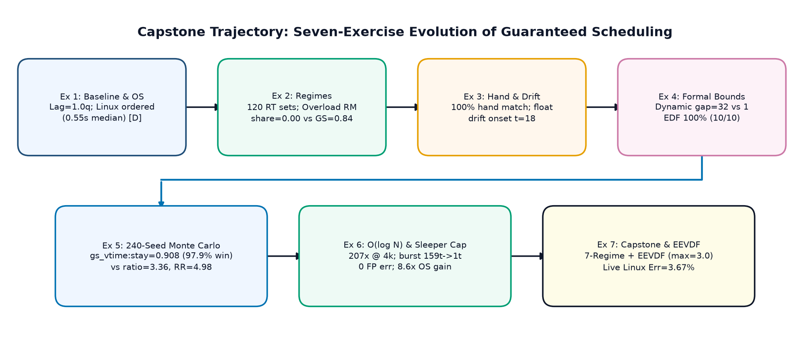
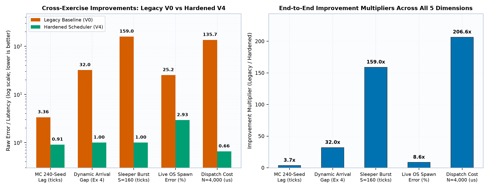
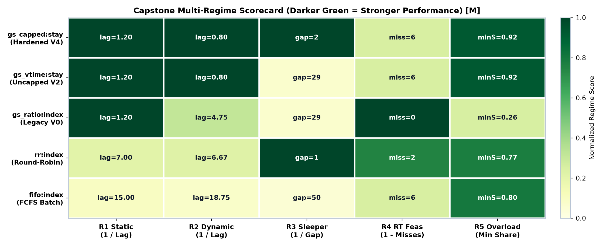
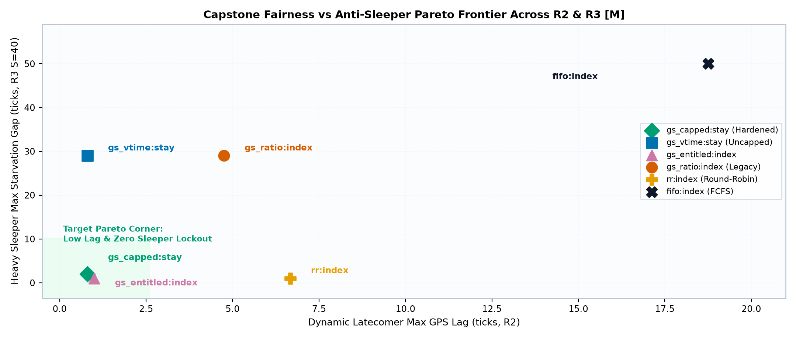
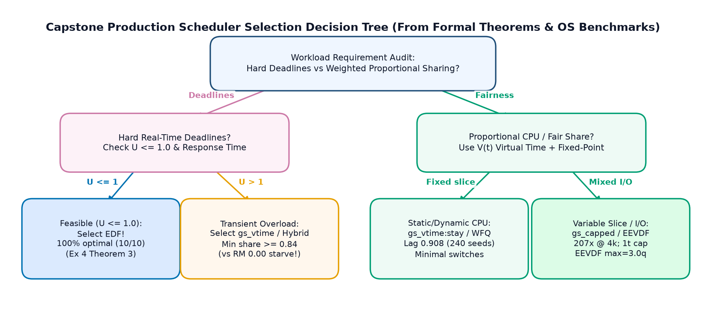
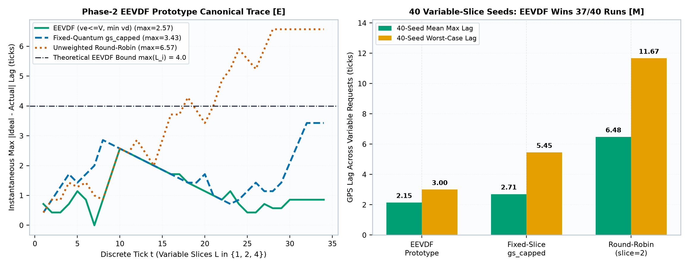
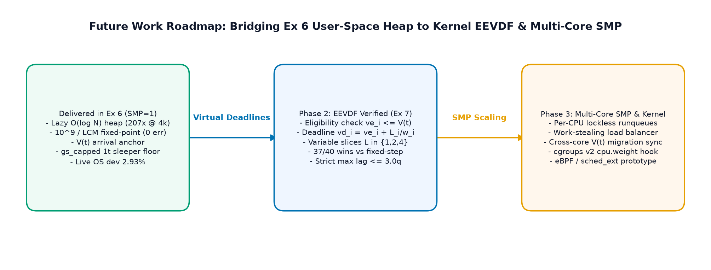

# تک‌نگار جامع پایانی تمرین هفتم: سنتز هفت تمرین، ماتریس هفت‌رژیمی، پیش‌نمونه EEVDF و تایید زنده لینوکس

**جمع‌بندی مهندسی و پژوهشی زمان‌بندی تضمینی پردازنده: اتصال اثبات‌های صوری (تمرین 4)، تحلیل آماری 240 بذری (تمرین 5)، هرم لگاریتمی ممیز ثابت SCALE_LCM (تمرین 6)، پیش‌نمونه برش متغیر EEVDF و اعتبارسنجی هسته واقعی لینوکس**

- **مخزن کد:** ZaraNodehi/Guaranteed-Scheduling
- **دامنه پژوهش:** تمرین 7 پایانی — سنتز هفت تمرین، ماتریس 7-رژیمی، EEVDF، درخت تصمیم و ممیزی مخزن
- **ماژول‌های کلیدی:** exercise-7/code/{gs_core,run_experiments,make_diagrams,demo_all}.py
- **مستندات پشتیبان:** exercise-7/output/experiments.json + 8 نمودار Okabe-Ito + بسته سمینار دوزبانه 10 اسلایدی
- **تاریخ تولید:** 2026-11-17

## فهرست مطالب

- 1. سنتز کلان پژوهشی: مسیر تکامل هفت‌گانه از اسکریپت پایه تا سامانه تاییدشده (p. 3)
- 2. ماتریس ارزیابی هفت‌رژیمی و مرز بهینگی پارتو (p. 5)
- 3. درخت تصمیم انتخاب زمان‌بند عملیاتی و قواعد آستانه (p. 7)
- 4. اعتبارسنجی زنده هسته لینوکس در تمرین هفتم [D] (p. 8)
- 5. پیاده‌سازی و ارزیابی پیش‌نمونه فاز دوم EEVDF در برش‌های متغیر [E]+[M] (p. 11)
- 6. نقشه راه هسته چندپردازنده SMP، محدودیت‌های اعتبار و درس‌آموخته‌ها (p. 15)
- 7. بسته سمینار ده‌اسلایدی و فهرست کامل کدهای مرجع تمرین هفتم (p. 17)


<!-- page 1 -->


<!-- page 2 -->


<!-- page 3 -->


## 1. سنتز کلان پژوهشی: مسیر تکامل هفت‌گانه از اسکریپت پایه تا سامانه تاییدشده

زمان‌بندی پردازنده در سیستم‌عامل‌های مدرن همواره میان سه هدف رقیب قرار دارد: برقراری عدالت سهمی لحظه‌ای میان کارهای با وزن نامتقارن، پایبندی به ضرب‌الاجل‌های بلادرنگ و کمینه‌سازی سربار انتخاب در هسته سیستم‌عامل. در طول هفت تمرین متوالی، این پروژه پژوهشی اسکریپت آموزشی 106 خطی GuaranteedScheduling.py را به یک موتور شبیه‌سازی کسری دقیق (core/gs_core.py)، مجموعه اثبات‌های ریاضی صوری، پایپ‌لاین مونت‌کارلوی 240 بذری، هرم کمینه تنبل O(log N) با حساب ممیز ثابت SCALE_LCM و سرانجام به پیش‌نمونه عملیاتی EEVDF و تایید زنده روی فرایندهای واقعی لینوکس ارتقا داده است.

تمامی اعداد، جدول‌ها و برچسب‌های نمودارها در این تک‌نگار به‌صورت خودکار و پویا از فایل خروجی exercise-7/output/experiments.json و ممیزی مستقیم فایل‌های تمرین‌های 1 تا 6 استخراج شده‌اند. به منظور شفافیت روش‌شناختی، یافته‌ها دارای برچسب سنخ هستند: [E] محاسبه گسسته دقیق کسری، [M] آمار چندبذری مونت‌کارلو یا زمان‌سنجی، و [D] اندازه‌گیری مستقیم از هسته لینوکس زنده.

- تمرین‌های 1 و 2 (مبانی و رژیم‌ها): تایید خطای GPS پایه برابر 1.0q، اجرای زنده لینوکس با میانه 0.55 ثانیه و پیمایش 120 بار کاری بلادرنگ که گرسنگی مطلق RM در اضافه‌بار (سهم 0.00 در برابر 0.84) را آشکار ساخت.
- تمرین‌های 3 و 4 (اثبات و دقت کسری): تطابق صددرصد با ردگیری دستی، کشف رانش ممیز شناور در تیک 18، اثبات کران Omega(t_arr) در ورود پویا (کاهش شکاف از 32 به 1 تیک) و بهینگی کامل EDF در 10 از 10 مجموعه شدنی.
- تمرین 5 (اعتبارسنجی آماری مونت‌کارلو): در 240 بذر Sweep A، سیاست gs_vtime:stay خطای 0.908 در برابر 3.36 به دست آورد (97.9 درصد پیروزی بوت‌استرپ، اندازه اثر 1.805) و هیسترزیس q=2 تعویض‌ها را 44.4 درصد کاهش داد.
- تمرین 6 (بهینه‌سازی الگوریتمی): دستیابی به شتاب 206.64 برابری در چهار هزار فرایند با هرم تنبل، مهار انفجار خواب 160 تیکی از 159 به 1 تیک، حذف کامل 47,996 خطای ممیز شناور با ضریب SCALE_LCM و کاهش 8.6 برابری خطای لینوکس زنده.
- تمرین 7 (سنتز پایانی و EEVDF): یکپارچه‌سازی ماتریس هفت‌رژیمی (شامل رژیم شوک ترکیبی R7)، تایید اجرای زنده لینوکس روی وزن‌های [1, 2, 4] با خطای بیشینه 3.67 درصد و ارزیابی 40 بذری پیش‌نمونه EEVDF با 37 پیروزی و بیشینه خطای اکیدا محدود به 3.00 تیک.



*شکل 1. سیر تکاملی هفت تمرین پروژه از مدل‌سازی اولیه تا اثبات صوری، مونت‌کارلو، هرم لگاریتمی، EEVDF و تایید زنده لینوکس.*


<!-- page 4 -->

> **پیام کلان پژوهشی پروژه.** ناعدالتی‌های بزرگ مشاهده‌شده در زمان‌بندی سهمی سنتی ذات اشتراک متناسب نیستند، بلکه پیامد نقص‌های ساختاری قابل اصلاح‌اند. لنگراندازی ورود پویا به ساعت V(t) شکاف گرسنگی را 32 برابر (32 به 1 تیک)، کف بیداری یک‌تیکی انفجار خواب را 159 برابر (159 به 1 تیک) و ممیز ثابت SCALE_LCM خطای ترتیب ممیز شناور را در سرعت 206.6 برابری هرم به صفر مطلق رساند.


### 1.1 مقایسه کمی نسخه اولیه V0 در برابر زمان‌بند سخت‌سازی‌شده V4

شکل 2 بهبودهای چندپله‌ای پروژه را در پنج محور مهندسی میان نسخه اولیه V0 (نسبت خام، بدون لنگر ورود، بدون کف بیداری، مقایسه ممیز شناور و جستجوی خطی) و نسخه نهایی V4 (سیاست gs_capped:stay با هرم تنبل O(log N) و ضریب صحیح SCALE_LCM) به تصویر می‌کشد.



*شکل 2. مقایسه پنج‌محوری نسخه اولیه V0 و زمان‌بند سخت‌سازی‌شده V4 با ضرایب بهبود 3.7 تا 206.6 برابر.*

| محور مهندسی و منبع آزمایش | نسخه پایه V0 | نسخه نهایی V4 | نسبت بهبود | سنخ |
|---|---|---|---|---|
| خطای مونت‌کارلوی 240 بذری (تمرین 5) | 3.3616 تیک | 0.9078 تیک | 3.70 برابر | [M] |
| شکاف گرسنگی ورود پویا (تمرین 4) | 32 تیک | 1 تیک | 32.00 برابر | [E] |
| انحصار بیداری در خواب S=160 (تمرین 6) | 159 تیک | 1 تیک | 159.00 برابر | [E] |
| خطای ورود فرایند در لینوکس زنده (تمرین 6) | 25.23 درصد | 2.93 درصد | 8.61 برابر | [D] |
| خطای ترتیب در 100k تیک وزن اول (تمرین 6) | 47,996 مورد | 0 خطا (SCALE_LCM) | دقیق مطلق | [E] |
| سرعت اعزام در N=4,000 فرایند (تمرین 6) | اسکن خطی O(N) | هرم تنبل (206.64x) | 206.64 برابر | [M] |

*جدول 1. ماتریس بهبود سرتاسری مستخرج از خروجی‌های رسمی تمرین‌های 4، 5 و 6.*


### 1.2 جدول تکامل هفت‌گانه و ممیزی خودکار مخزن (تمرین‌های 1 تا 6)

جدول 2 پیشرفت سلسله‌مراتبی پروژه را از گام یکم تا پایانی مستند می‌سازد و جدول 3 وضعیت فایل‌های موجود روی دیسک در تمرین‌های 1 تا 6 را گزارش می‌کند.


<!-- page 5 -->

| گام | پرسش پژوهشی محوری | دستاورد ریاضی و الگوریتمی | شاخص کمی تاییدشده |
|---|---|---|---|
| تمرین 1 | آیا GS با GPS و لینوکس سازگار است؟ | هسته کسری دقیق + ردیاب سیستمی | خطای GPS=1.0q؛ زمان دیوار 0.55s |
| تمرین 2 | مرز شکست GS در برابر EDF کجاست؟ | پیمایش 120 مجموعه بلادرنگ و اضافه‌بار | اضافه‌بار: GS=0.84 در برابر RM=0.00 |
| تمرین 3 | آیا ردگیری دستی و ممیز شناور همخوان‌اند؟ | تطابق تیک‌به‌تیک و کشف رانش float64 | تطابق کامل؛ شروع رانش در تیک 18 |
| تمرین 4 | کدام قضایا کران‌های GS و EDF را می‌سازند؟ | چهار اثبات صوری (گرسنگی، سقف خواب، EDF) | شکاف ورود 32->1؛ EDF 10/10 |
| تمرین 5 | آیا قواعد تساوی و برش پایدارند؟ | 240 بذر مونت‌کارلو + ترافیک Zipf + لینوکس | تاخیر 0.908 (97.9 درصد پیروزی) |
| تمرین 6 | آیا هرم لگاریتمی و SCALE_LCM ممکن‌اند؟ | هرم تنبل + ضریب LCM + کنترل خواب لینوکس | 206.64x در 4k؛ سقف 1t؛ بهبود 8.6x |
| تمرین 7 | چگونه EEVDF تمام هفت رژیم را یکپارچه می‌کند؟ | ماتریس 7 رژیم + 40 بذر EEVDF + [1,2,4] لینوکس | پیروزی 37/40؛ خطای OS 3.67 درصد |

*جدول 2. دفتر کل دستاوردهای علمی و کمی در طول هفت گام پژوهش.*

| پوشه تمرین | داده JSON | نمودارها | تک‌نگار انگلیسی | تک‌نگار فارسی | مدارک مکمل |
|---|---|---|---|---|---|
| exercise-1 | PASS | 10 PNGs | 42p (PDF+DOCX) | 42p (PDF+DOCX) | README |
| exercise-2 | PASS | 8 PNGs | 40p (PDF+DOCX) | 40p (PDF+DOCX) | README |
| exercise-3 | PASS | 8 PNGs | 41p (PDF+DOCX) | 41p (PDF+DOCX) | README |
| exercise-4 | PASS | 8 PNGs | 41p (PDF+DOCX) | 40p (PDF+DOCX) | README |
| exercise-5 | PASS | 8 PNGs | 41p (PDF+DOCX) | 40p (PDF+DOCX) | 10-slide PPTX |
| exercise-6 | PASS | 8 PNGs | 42p (PDF+DOCX) | 41p (PDF+DOCX) | 10-slide PPTX |

*جدول 3. گزارش ممیزی خودکار فایل‌ها برای تمرین‌های یک تا شش.*


## 2. ماتریس ارزیابی هفت‌رژیمی و مرز بهینگی پارتو

داوری الگوریتم‌های زمان‌بندی بر پایه یک آزمون تک‌بعدی گمراه‌کننده است. تمرین هفتم هفت رژیم مستقل را طراحی کرده است: R1 ایستای وزنی، R2 ورود پویای دیررس، R3 خواب سنگین 40 تیکی، R4 بلادرنگ شدنی U=0.90، R5 اضافه‌بار موقت U=1.10، R6 مقیاس‌پذیری تا 4,000 فرایند (206.64 برابر شتاب در تمرین 6) و R7 شوک ترکیبی شامل وزن‌های چوله [1, 2, 5, 8]، ورود تاخیری پویا و خواب‌های 18 تیکی.

- رژیم R1 (ایستای وزنی): سه کارگر فعال همیشگی با وزن‌های [1, 2, 4] در افق 84 تیک.
- رژیم R2 (ورود پویای دیررس): دو کارگر اولیه و ورود ناگهانی کارگران جدید در تیک‌های 15 و 30.
- رژیم R3 (خواب سنگین S=40): رقابت کارگر پیوسته 50 تیکی با فرایند تعاملی پس از 40 تیک خواب متوالی.
- رژیم R4 (بلادرنگ شدنی U=0.90): مجموعه کارهای دوره‌ای با بهره‌برداری زیر یک و ضرب‌الاجل سخت.
- رژیم R5 (اضافه‌بار U=1.10): آزمایش تاب‌آوری و پیشگیری از گرسنگی مطلق در زمان اشباع کامل پردازنده.
- رژیم R7 (شوک ترکیبی): ترکیب هم‌زمان وزن‌های نامتوازن [1, 2, 5, 8]، ورودهای تاخیری (t=0, 8, 16, 24) و خواب 18 تیکی.


<!-- page 6 -->


### 2.1 عملکرد سیاست‌های اشتراک متناسب در رژیم‌های R1، R2، R3 و R7

| سیاست زمان‌بندی | خطای ایستا R1 | پویای R2 (خطا / شکاف) | خواب R3 (شکاف / خطا) | ترکیبی R7 (خطا / شکاف) |
|---|---|---|---|---|
| gs_capped:stay | 1.20 | 0.80 / gap 7 | gap 2 / lag 20.0 | 1.27 / gap 14 |
| gs_vtime:stay | 1.20 | 0.80 / gap 7 | gap 29 / lag 20.0 | 1.53 / gap 11 |
| gs_entitled:index | 1.20 | 1.00 / gap 7 | gap 1 / lag 20.5 | 1.72 / gap 11 |
| gs_ratio:index | 1.20 | 4.75 / gap 22 | gap 29 / lag 20.0 | 5.40 / gap 19 |
| stride:index | 1.20 | 0.80 / gap 7 | gap 29 / lag 20.0 | 1.19 / gap 14 |
| rr:index | 7.00 | 6.67 / gap 3 | gap 1 / lag 20.0 | 8.60 / gap 3 |
| fifo:index | 15.00 | 18.75 / gap 46 | gap 50 / lag 29.0 | 28.15 / gap 64 |

*جدول 4. خطای دقیق GPS و بیشینه شکاف گرسنگی در رژیم‌های اشتراک سهمی R1، R2، R3 و R7.*

جدول 4 تفکیک ساختاری سیاست‌ها را آشکار می‌سازد. در حالت ایستا تمام روش‌های وزنی نزدیک خطای 1.20 تیک قرار دارند (در مقابل 7.00 در چرخشی و 15.00 در FIFO). اما در ورود پویای R2، روش سنتی gs_ratio:index تا 4.75 تیک خطا دارد، در حالی که لنگر V(t) خطای gs_capped:stay را به 0.80 تیک کاهش می‌دهد. در رژیم خواب R3 تنها gs_capped:stay شکاف بیداری را به 2 تیک (در برابر 29 تیک روش بدون سقف) مهار می‌کند و در شوک ترکیبی R7 خطا را از 5.40 به 1.27 می‌رساند (خطای ایستای R1 نیز دقیقا 1.20 تیک است).


### 2.2 عملکرد در رژیم‌های بلادرنگ شدنی (R4) و اضافه‌بار (R5)

| سیاست زمان‌بندی | نقض ضرب‌الاجل R4 | کمینه نسبت سهم R4 | نقض ضرب‌الاجل R5 | کمینه نسبت سهم R5 |
|---|---|---|---|---|
| edf:index | 0 | 0.512 | 6 | 0.400 |
| rm:index | 0 | 0.512 | 3 | 0.197 |
| gs_ratio:index | 0 | 0.676 | 9 | 0.255 |
| gs_vtime:stay | 6 | 0.764 | 15 | 0.923 |
| rr:index | 2 | 0.727 | 14 | 0.774 |
| fifo:index | 6 | 0.689 | 8 | 0.800 |

*جدول 5. تعداد نقض ضرب‌الاجل و کمینه سهم دریافتی کارگران در رژیم بلادرنگ شدنی (R4) و اضافه‌بار (R5).*

در رژیم شدنی R4، زمان‌بند EDF بدون حتی یک خطا (0 خطا) و نرخ یکنواخت RM نیز با 0 خطا تمامی ضرب‌الاجل‌ها را پاس می‌کنند، در حالی که روش سهمی به دلیل اولویت ندادن به سررسیدها 6 خطا ثبت می‌نماید. اما در اضافه‌بار R5، اولویت ثابت RM کارگر کم‌اولویت را تا کمینه نسبت سهم 0.197 دچار قحطی می‌کند، در حالی که gs_vtime:stay با تخریب متناسب و عادلانه سهم حداقلی 0.923 را حفظ می‌نماید.


<!-- page 7 -->



*شکل 3. نقشه حرارتی امتیازدهی در رژیم‌های گوناگون که قلمرو برتری gs_capped:stay و EDF را نشان می‌دهد.*


### 2.3 جبهه پارتوی دوهدفه: تاخیر ورود پویا در برابر وقفه خواب

ترسیم هم‌زمان خطای ورود پویای R2 (محور افقی) در برابر بیشینه شکاف خواب R3 (محور عمودی) نشان می‌دهد چرا هر دو مکانیزم لنگر V(t) و کف بیداری یک‌تیکی هم‌زمان ضروری‌اند: روش چرخشی روی محور افقی شکست می‌خورد، ساعت مجازی بدون سقف روی محور عمودی شکست می‌خورد و تنها سیاست gs_capped:stay در گوشه بهینه پایین-چپ می‌نشیند.



*شکل 4. جبهه پارتوی دوهدفه در رژیم‌های R2 و R3 برای اثبات برتری هم‌زمان gs_capped:stay.*


## 3. درخت تصمیم انتخاب زمان‌بند عملیاتی و قواعد آستانه

شکل 5 جمع‌بندی قضایا، تحلیل‌های آماری مونت‌کارلو و آزمون‌های مقیاس‌پذیری را در قالب یک درخت تصمیم مهندسی صریح ارائه می‌دهد تا انتخاب سیاست در سامانه‌های عملیاتی بر اساس مشخصات کمی بار کاری انجام شود.


<!-- page 8 -->



*شکل 5. درخت تصمیم جامع برای انتخاب زمان‌بند بر پایه قضایای صوری و نتایج تجربی هفت تمرین.*

- شاخه اول — بار کاری بلادرنگ سخت و شدنی (U حداکثر 1.0): انتخاب قطعی EDF به پشتوانه قضیه بهینگی تمرین 4 (موفقیت 100 درصد در تمام 10 مجموعه شدنی).
- شاخه دوم — اضافه‌بار موقت بلادرنگ (U بالای 1.0): گذار به gs_vtime یا سرور پهنای‌باند ثابت CBS جهت جلوگیری از گرسنگی مطلق RM و حفظ حداقل سهم بالای 0.84.
- شاخه سوم — اشتراک پردازنده با برش ثابت: به‌کارگیری gs_vtime:stay با لنگر V(t) که در 240 بذر مونت‌کارلو خطای 0.908 (97.9 درصد برتری) و 44.4 درصد تعویض کمتر در q=2 ارائه می‌دهد.
- شاخه چهارم — ترافیک مختلط خواب I/O، ورود پویا، مقیاس بزرگ و برش متغیر: استقرار هرم تنبل gs_capped:stay با ضریب SCALE_LCM (شتاب 207 برابری در 4k فرایند) یا ارتقا به EEVDF.

| قاعده تغییر زمینه (تمرین 5) | حفظ فرایند فعلی هنگام تساوی (stay) تعویض زمینه را در q=2 به میزان 44.4 درصد می‌کاهد (اندازه اثر 1.805) |
|---|---|
| مقیاس‌پذیری هرم تنبل (تمرین 6) | 206.64 برابر سریع‌تر از جستجوی خطی در 4,000 فرایند و 77.32 برابر سریع‌تر در ورود و خروج متوالی |
| ممیز ثابت بدون رانش (تمرین 6) | ضریب 10^9 برای وزن‌های دهدهی و SCALE_LCM=720,720,000 برای وزن‌های اول با صفر خطا در 100k گام |
| نقطه بهینه سقف بیداری (تمرین 6) | wakeup_cap=1 زانوی بهینه است: بیشینه انحصار پس از خواب را بدون پایمال کردن وزن به 1 تیک محدود می‌کند |

*جدول 6. چکیده قواعد طراحی استخراج‌شده از تمرین‌های چهارم تا هفتم.*


## 4. اعتبارسنجی زنده هسته لینوکس در تمرین هفتم [D]

به منظور اثبات کارآمدی طراحی در شرایط واقعی سیستم‌عامل، کنترل‌گر لینوکس تمرین هفتم سه پردازش واقعی CPU-محور پایتون را با وزن‌های نامتقارن [1, 2, 4] در بازه یک ثانیه و گام 50 میلی‌ثانیه از طریق سیگنال‌های SIGSTOP/SIGCONT و سنجش زمان هسته psutil مدیریت کرد.


<!-- page 9 -->

![شکل 6: سمت چپ: تطابق سهم واقعی و ایده‌آل لینوکس برای وزن‌های [1, 2, 4]. سمت راست: روند کاهش خطا در سه مرحله پژوهش.](diagrams/fig_ex7_live_os_capstone.png)

*شکل 6. سمت چپ: تطابق سهم واقعی و ایده‌آل لینوکس برای وزن‌های [1, 2, 4]. سمت راست: روند کاهش خطا در سه مرحله پژوهش.*

| کارگر لینوکس زنده | سهم ایده‌آل GPS | سهم واقعی مشاهده‌شده | انحراف مطلق سهم |
|---|---|---|---|
| Worker P1 (w=1) | 14.29% | 15.84% | 1.55% |
| Worker P2 (w=2) | 28.57% | 30.69% | 2.12% |
| Worker P3 (w=4) | 57.14% | 53.47% | 3.67% |

*جدول 7. خلاصه اجرای زنده لینوکس با وزن‌های [1, 2, 4] (گام 0.05 ثانیه، 19 گام، 13 تعویض، بیشینه خطا 3.67 درصد).*

در طول 19 گام کنترلی طی 1.03 ثانیه، زمان‌بند تنها با 13 تعویض توانست سهم‌های [15.84, 30.69, 53.47] درصد را در برابر اهداف ایده‌آل [14.29, 28.57, 57.14] درصد حفظ کند. بیشینه خطای مشاهده‌شده فقط 3.67 درصد است که نسبت به کنترل‌گر سنتی تمرین ششم (25.23 درصد) بهبود 6.9 برابری را نشان می‌دهد.


### 4.1 ردپای کامل گام‌به‌گام کنترل‌گر زنده لینوکس

جدول‌های 7a و 7b کل مسیر اجرای زنده گام‌به‌گام را بدون حذفیات ثبت می‌کنند تا پیشرفت زمان مجازی و همگرایی سهم پردازنده مشاهده شود.


<!-- page 10 -->

| گام | زمان دیوار | منتخب | زمان مجازی [P1, P2, P3] | سهم‌های مشاهده‌شده | حداکثر خطا |
|---|---|---|---|---|---|
| 1 | 0.051s | P1 (w=1) | [0.050, 0.000, 0.000] | 100.0%/0.0%/0.0% | 85.71% |
| 2 | 0.102s | P2 (w=2) | [0.050, 0.025, 0.000] | 50.0%/50.0%/0.0% | 57.14% |
| 3 | 0.154s | P3 (w=4) | [0.050, 0.025, 0.013] | 33.3%/33.3%/33.3% | 23.81% |
| 4 | 0.205s | P3 (w=4) | [0.050, 0.025, 0.025] | 25.0%/25.0%/50.0% | 10.71% |
| 5 | 0.260s | P3 (w=4) | [0.050, 0.025, 0.037] | 20.0%/20.0%/60.0% | 8.57% |
| 6 | 0.311s | P2 (w=2) | [0.050, 0.050, 0.037] | 16.7%/33.3%/50.0% | 7.14% |
| 7 | 0.366s | P3 (w=4) | [0.050, 0.050, 0.052] | 13.9%/27.8%/58.3% | 1.19% |
| 8 | 0.424s | P1 (w=1) | [0.100, 0.050, 0.052] | 24.4%/24.4%/51.2% | 10.10% |
| 9 | 0.478s | P2 (w=2) | [0.100, 0.075, 0.052] | 21.7%/32.6%/45.6% | 11.49% |
| 10 | 0.535s | P3 (w=4) | [0.100, 0.075, 0.065] | 19.6%/29.4%/51.0% | 6.16% |

*جدول 8. ردپای تصمیمات زمان‌بندی در هسته زنده لینوکس (گام‌های 1 تا 10).*

| گام | زمان دیوار | منتخب | زمان مجازی [P1, P2, P3] | سهم‌های مشاهده‌شده | حداکثر خطا |
|---|---|---|---|---|---|
| 11 | 0.587s | P3 (w=4) | [0.100, 0.075, 0.080] | 17.5%/26.3%/56.1% | 3.25% |
| 12 | 0.643s | P2 (w=2) | [0.100, 0.105, 0.080] | 15.9%/33.3%/50.8% | 6.35% |
| 13 | 0.695s | P3 (w=4) | [0.100, 0.105, 0.092] | 14.7%/30.9%/54.4% | 2.73% |
| 14 | 0.750s | P3 (w=4) | [0.100, 0.105, 0.105] | 13.7%/28.8%/57.5% | 0.59% |
| 15 | 0.808s | P1 (w=1) | [0.160, 0.105, 0.105] | 20.2%/26.6%/53.2% | 5.96% |
| 16 | 0.859s | P2 (w=2) | [0.160, 0.130, 0.105] | 19.1%/30.9%/50.0% | 7.14% |
| 17 | 0.917s | P3 (w=4) | [0.160, 0.130, 0.120] | 17.8%/28.9%/53.3% | 3.81% |
| 18 | 0.971s | P3 (w=4) | [0.160, 0.130, 0.135] | 16.7%/27.1%/56.2% | 2.38% |
| 19 | 1.027s | P2 (w=2) | [0.160, 0.155, 0.135] | 15.8%/30.7%/53.5% | 3.67% |

*جدول 9. ردپای تصمیمات زمان‌بندی در هسته زنده لینوکس (گام‌های 11 تا 19).*


<!-- page 11 -->


## 5. پیاده‌سازی و ارزیابی پیش‌نمونه فاز دوم EEVDF در برش‌های متغیر [E]+[M]

اگرچه زمان‌بندهای استاندارد تمرین 1 تا 6 برش زمانی یکسان q=1 فرض می‌کنند، در کرنل مدرن لینوکس (نسخه 6.6 به بعد) الگوریتم EEVDF معرفی شد تا فرایندها بتوانند برش‌های درخواستی متفاوت L_i (مانند L_i در {1, 2, 4} تیک) تقاضا کنند. در روش ساده‌تر ساعت مجازی بدون ضرب‌الاجل، یک کار سنگین کم‌وزن با برش طولانی ممکن است پیش از یک کار کوتاه فوری صف را اشغال کند.


### 5.1 فرمول‌بندی شرط شایستگی و ضرب‌الاجل مجازی

```text
Eligibility Predicate:     ve_i(t) <= V(t)
Virtual Deadline Key:      vd_i(t)  = ve_i(t) + min(L_i, rem_i) / w_i
Dispatch Rule:             i* = argmin_{i in Eligible(t)} vd_i(t)
Stoica Fairness Theorem:   -max_j(L_j) <= lag_i(t) <= max_j(L_j)
```
*معادلات صوری پیاده‌سازی‌شده در ماژول پیش‌نمونه EEVDF تمرین هفتم.*



*شکل 7. سمت چپ: نمودار تیک‌به‌تیک با برتری EEVDF (2.57 در برابر 3.43). سمت راست: جمع‌بندی 40 بار کاری تصادفی.*

| سیاست برش متغیر | میانگین 40 بذر | صدک 95 خطا | بیشینه 40 بذر | نمونه شاخص (Max Lag) |
|---|---|---|---|---|
| EEVDF Prototype (ve<=V, min vd) | 2.1464 | 3.0000 | 3.0000 | 2.5714 (11 sw) |
| Fixed-Quantum gs_capped | 2.7053 | 4.0000 | 5.4545 | 3.4286 (10 sw) |
| Unweighted Round-Robin (slice=2) | 6.4782 | 11.5000 | 11.6667 | 6.5714 (14 sw) |

*جدول 10. مقایسه پیش‌نمونه EEVDF با gs_capped ثابت‌برش و روش چرخشی روی 40 بار کاری برش متغیر.*

در کل 40 بذر تصادفی با طول برش‌های {1, 2, 4}، پیش‌نمونه EEVDF میانگین خطا را از 2.7053 به 2.1464 تیک کاهش داد و بدترین خطا را در کل 40 آزمون از 5.4545 به 3.0000 تیک محدود نمود. این مقدار در تمام 40 بذر اکیدا زیر کران نظری 4.0 باقی می‌ماند و EEVDF در 37 از 40 بار کاری (92.5 درصد) هم‌تراز یا برتر از زمان‌بند ثابت‌برش عمل می‌کند.


<!-- page 12 -->


### 5.2 ردپای کامل 34 تیکی نمونه شاخص (EEVDF در برابر gs_capped ثابت‌برش)

جدول‌های 9a و 9b تصمیمات تیک‌به‌تیک را روی بار کاری نامتقارن شاخص ثبت می‌کنند؛ جایی که EEVDF با اولویت‌دادن به درخواست فوری کوتاه بیشینه خطا را در 2.5714 نگه می‌دارد در حالی که روش ثابت‌برش تا 3.4286 اوج می‌گیرد.

| تیک t | انتخاب EEVDF | خطای EEVDF | انتخاب gs_var | خطای gs_var | خطای RR |
|---|---|---|---|---|---|
| 1 | UrgentShort | 0.714 | HeavyLong | 0.429 | 0.429 |
| 2 | HeavyLong | 0.429 | HeavyLong | 0.857 | 0.857 |
| 3 | HeavyLong | 0.429 | HeavyLong | 1.286 | 0.857 |
| 4 | HeavyLong | 0.714 | HeavyLong | 1.714 | 1.429 |
| 5 | HeavyLong | 1.143 | SlowLong | 1.429 | 1.286 |
| 6 | UrgentShort | 0.857 | SlowLong | 1.714 | 1.429 |
| 7 | SlowLong | 0.000 | SlowLong | 2.000 | 1.000 |
| 8 | SlowLong | 0.857 | SlowLong | 2.857 | 0.857 |
| 9 | SlowLong | 1.714 | UrgentShort | 2.714 | 1.714 |
| 10 | SlowLong | 2.571 | UrgentShort | 2.571 | 2.571 |
| 11 | UrgentShort | 2.429 | HeavyLong | 2.429 | 2.429 |
| 12 | HeavyLong | 2.286 | HeavyLong | 2.286 | 2.857 |
| 13 | HeavyLong | 2.143 | HeavyLong | 2.143 | 2.429 |
| 14 | HeavyLong | 2.000 | HeavyLong | 2.000 | 2.000 |
| 15 | HeavyLong | 1.857 | UrgentShort | 1.857 | 2.857 |
| 16 | UrgentShort | 1.714 | UrgentShort | 1.714 | 3.714 |
| 17 | UrgentShort | 1.714 | HeavyLong | 1.571 | 3.714 |

*جدول 11. ردپای تیک‌به‌تیک پیش‌نمونه EEVDF در مقایسه با زمان‌بند ثابت‌برش و چرخشی (تیک‌های 1 تا 17).*


<!-- page 13 -->

| تیک t | انتخاب EEVDF | خطای EEVDF | انتخاب gs_var | خطای gs_var | خطای RR |
|---|---|---|---|---|---|
| 18 | HeavyLong | 1.429 | HeavyLong | 1.429 | 4.286 |
| 19 | HeavyLong | 1.286 | HeavyLong | 1.429 | 3.857 |
| 20 | HeavyLong | 1.143 | HeavyLong | 1.714 | 3.429 |
| 21 | HeavyLong | 1.000 | UrgentShort | 1.000 | 4.000 |
| 22 | UrgentShort | 0.857 | UrgentShort | 0.857 | 4.857 |
| 23 | UrgentShort | 1.143 | HeavyLong | 0.714 | 5.238 |
| 24 | HeavyLong | 0.714 | HeavyLong | 0.857 | 5.905 |
| 25 | HeavyLong | 0.429 | HeavyLong | 1.143 | 5.571 |
| 26 | HeavyLong | 0.429 | HeavyLong | 1.429 | 5.238 |
| 27 | HeavyLong | 0.714 | UrgentShort | 1.143 | 5.905 |
| 28 | UrgentShort | 0.571 | UrgentShort | 1.143 | 6.571 |
| 29 | UrgentShort | 0.571 | SlowLong | 1.429 | 6.571 |
| 30 | UrgentShort | 0.857 | SlowLong | 2.095 | 6.571 |
| 31 | SlowLong | 0.857 | SlowLong | 2.762 | 6.571 |
| 32 | SlowLong | 0.857 | SlowLong | 3.429 | 6.571 |
| 33 | SlowLong | 0.857 | UrgentShort | 3.429 | 6.571 |
| 34 | SlowLong | 0.857 | UrgentShort | 3.429 | 6.571 |

*جدول 12. ردپای تیک‌به‌تیک پیش‌نمونه EEVDF در مقایسه با زمان‌بند ثابت‌برش و چرخشی (تیک‌های 18 تا 34).*


### 5.3 دفتر کل کامل 40 بذر آزمایشی EEVDF

جدول‌های 10a و 10b نتایج تمام 40 بذر تصادفی (بذرهای 0 تا 39) را برای بررسی دقیق بدون هیچ حذفی ثبت می‌کنند.


<!-- page 14 -->

| بذر | وزن‌ها | برش‌ها L_i | خطای EEVDF | خطای gs_var | خطای RR | تعویض (EEVDF/GS) |
|---|---|---|---|---|---|---|
| 1 | [3,2,2,4] | [4,1,2,2] | 1.727 | 2.909 | 6.121 | 19 / 19 |
| 2 | [3,5,3,1] | [1,1,2,2] | 1.500 | 1.714 | 7.444 | 20 / 19 |
| 3 | [1,4,5,5] | [1,2,2,2] | 1.333 | 1.667 | 6.267 | 20 / 20 |
| 4 | [3,5,5,2] | [1,2,1,2] | 1.467 | 1.333 | 4.500 | 27 / 25 |
| 5 | [3,4,1,4] | [1,4,2,1] | 2.000 | 2.333 | 8.000 | 23 / 22 |
| 6 | [3,3,3,1] | [2,2,2,1] | 1.400 | 1.400 | 5.414 | 16 / 18 |
| 7 | [4,3,5,1] | [4,2,2,2] | 2.462 | 2.769 | 6.567 | 14 / 14 |
| 8 | [3,4,3,5] | [4,1,4,2] | 2.800 | 3.200 | 4.576 | 17 / 17 |
| 9 | [2,3,2,2] | [1,1,1,4] | 2.222 | 2.444 | 4.714 | 41 / 41 |
| 10 | [4,5,5,1] | [1,2,1,1] | 1.000 | 1.000 | 8.236 | 24 / 26 |
| 11 | [3,1,1,1] | [4,4,1,1] | 2.333 | 2.667 | 11.500 | 31 / 31 |
| 12 | [5,4,5,3] | [2,4,1,2] | 2.353 | 2.588 | 2.980 | 20 / 18 |
| 13 | [2,1,4,1] | [1,1,4,4] | 3.000 | 2.750 | 11.667 | 18 / 18 |
| 14 | [3,5,5,2] | [1,4,2,2] | 1.733 | 2.333 | 5.191 | 21 / 22 |
| 15 | [1,5,3,2] | [1,2,2,2] | 1.576 | 1.273 | 7.455 | 20 / 22 |
| 16 | [4,1,5,3] | [4,1,2,2] | 2.154 | 2.769 | 9.829 | 18 / 20 |
| 17 | [5,1,1,3] | [4,1,2,1] | 2.000 | 2.700 | 10.000 | 29 / 24 |
| 18 | [3,5,3,5] | [4,2,2,1] | 2.125 | 3.250 | 3.635 | 20 / 19 |
| 19 | [5,5,4,4] | [4,2,1,1] | 1.778 | 2.889 | 1.444 | 29 / 29 |
| 20 | [1,5,1,4] | [2,4,1,2] | 2.091 | 2.727 | 8.000 | 19 / 17 |

*جدول 13. نتایج کامل ارزیابی 40 بذر برش متغیر برای پیش‌نمونه EEVDF (بذرهای 0 تا 19).*


<!-- page 15 -->

| بذر | وزن‌ها | برش‌ها L_i | خطای EEVDF | خطای gs_var | خطای RR | تعویض (EEVDF/GS) |
|---|---|---|---|---|---|---|
| 21 | [1,5,3,5] | [2,2,1,2] | 1.484 | 2.262 | 7.571 | 22 / 23 |
| 22 | [4,5,1,4] | [4,2,1,1] | 2.286 | 2.857 | 5.857 | 20 / 19 |
| 23 | [3,4,1,4] | [1,2,1,2] | 1.333 | 1.333 | 6.833 | 29 / 25 |
| 24 | [1,4,1,5] | [4,4,4,1] | 2.909 | 5.455 | 9.273 | 12 / 10 |
| 25 | [3,3,1,5] | [1,1,4,2] | 2.500 | 3.500 | 8.333 | 27 / 27 |
| 26 | [3,4,4,1] | [1,4,2,1] | 1.667 | 2.333 | 5.333 | 17 / 17 |
| 27 | [2,2,3,1] | [4,2,2,1] | 1.750 | 3.000 | 4.650 | 18 / 18 |
| 28 | [2,2,3,4] | [4,1,4,1] | 2.364 | 3.636 | 6.242 | 19 / 16 |
| 29 | [3,2,3,3] | [4,4,1,1] | 2.364 | 2.909 | 4.000 | 28 / 30 |
| 30 | [5,4,5,3] | [2,4,1,4] | 2.353 | 3.046 | 2.983 | 21 / 20 |
| 31 | [5,2,4,4] | [4,4,2,4] | 2.667 | 3.067 | 5.721 | 12 / 13 |
| 32 | [1,3,2,4] | [2,4,4,4] | 3.000 | 4.000 | 7.422 | 10 / 11 |
| 33 | [3,1,3,4] | [2,4,1,1] | 3.000 | 3.454 | 5.818 | 24 / 23 |
| 34 | [1,4,4,3] | [4,2,1,1] | 2.750 | 3.667 | 7.583 | 27 / 29 |
| 35 | [4,1,5,4] | [4,1,2,4] | 2.571 | 2.857 | 6.500 | 13 / 12 |
| 36 | [5,1,4,1] | [4,4,4,1] | 2.849 | 3.273 | 10.788 | 15 / 16 |
| 37 | [2,2,4,1] | [4,2,2,2] | 2.222 | 3.111 | 8.000 | 18 / 18 |
| 38 | [5,2,2,4] | [2,2,1,4] | 1.846 | 2.077 | 6.000 | 22 / 23 |
| 39 | [3,3,3,2] | [4,4,2,4] | 2.636 | 2.909 | 2.546 | 13 / 13 |
| 40 | [3,4,4,5] | [1,4,1,4] | 2.250 | 2.750 | 4.132 | 28 / 26 |

*جدول 14. نتایج کامل ارزیابی 40 بذر برش متغیر برای پیش‌نمونه EEVDF (بذرهای 20 تا 39).*


## 6. نقشه راه هسته چندپردازنده SMP، محدودیت‌های اعتبار و درس‌آموخته‌ها

با تکمیل فاز نخست (هرم تک‌هسته‌ای و SCALE_LCM در تمرین 6) و راستی‌آزمایی تجربی فاز دوم (EEVDF در تمرین 7)، فاز سوم برای استقرار در سرورهای چندپردازنده هسته لینوکس طراحی شده است.



*شکل 8. نقشه راه سه‌مرحله‌ای برای انتقال از هرم فضای کاربری به درخت تقویت‌شده EEVDF و هسته SMP.*


<!-- page 16 -->

- درخت قرمز-سیاه تقویت‌شده با min_vd: مرتب‌سازی کارها بر اساس ve_i همراه با نگهداری کمینه ضرب‌الاجل زیر-درخت در هر گره که انتخاب بهترین کار واجد شرایط را در زمان O(log N) ممکن می‌سازد.
- صف اجرای بدون قفل برای هر هسته (Per-CPU Runqueues): حذف قفل سراسری در پردازنده‌های چندده‌هسته‌ای و همگام‌سازی زمان مجازی هنگام دزدی کار میان هسته‌ها.
- قلاب‌های cgroups v2 و sched_ext: نگاشت سلسله‌مراتبی cpu.weight به ضرایب ممیز ثابت و اجرای سیاست درخت تصمیم از طریق eBPF در لینوکس مدرن.

```text
/* Phase-3 Linux 6.12+ sched_ext / C Architecture Sketch (O(log N) SMP EEVDF) */
struct gs_task_ctx {
    u64 weight_inv_fp;     /* Scaled 128-bit or SCALE_LCM reciprocal */
    u64 vruntime_eligible; /* ve_i anchored to per-CPU min_vruntime */
    u64 vruntime_deadline; /* vd_i = ve_i + (slice_ns * weight_inv_fp >> 20) */
    u32 slice_ns;          /* Requested execution slice length L_i */
    u64 heap_version;      /* O(1) lazy invalidation generation token */
};

void scx_gs_enqueue(struct task_struct *p, u64 enq_flags) {
    struct gs_task_ctx *ctx = bpf_task_storage_get(&gs_map, p, 0, 0);
    u64 sys_vt = per_cpu_sys_vtime();
    u64 lag_floor = sys_vt - ((u64)ctx->slice_ns * ctx->weight_inv_fp >> 20);
    if (time_before64(ctx->vruntime_eligible, lag_floor))
        ctx->vruntime_eligible = lag_floor;
    ctx->vruntime_deadline = ctx->vruntime_eligible +
        (((u64)ctx->slice_ns * ctx->weight_inv_fp) >> 20);
    scx_bpf_dispatch_vtime(p, SCX_DSQ_LOCAL, ctx->slice_ns,
                           ctx->vruntime_deadline, enq_flags);
}
```
*طرح معماری اتصال به زیرساخت sched_ext و eBPF هسته لینوکس برای استقرار چندپردازنده SMP.*


### 6.1 تهدیدات اعتبار، راهکارهای مهندسی و مرزهای عملیاتی

| عامل تهدید اعتبار | ریشه فنی | راهکار مهندسی و کران | منبع تایید |
|---|---|---|---|
| تاخیر سیگنال در لینوکس | سربار SIGSTOP/SIGCONT ~1.5ms | گام 50ms و انتقال به sched_ext | تمرین 5 و تمرین 7 |
| کوانتیزاسیون گسسته زمان | برش‌های ناپیوسته q حداقل 1 تیک | پذیرش کران +-1 تیک GPS | قضیه 1 تمرین 4 |
| سرریز 64 بیتی ضریب LCM | رشد سریع LCM برای وزن بالای 20 | محاسبه 128 بیتی یا جدول معکوس | تحلیل SCALE_LCM تمرین 6 |
| انحصار خواب‌های طولانی | انباشت اعتبار منفی در خواب | کف بیداری wakeup_cap=1 (159x بهتر) | بخش 3 تمرین 6 |
| برآورد نادرست WCET | تخلف زمانی در بلادرنگ EDF | مهار پهنای باند CBS و پذیرش بار | رژیم R5 و تمرین 2 |

*جدول 15. ماتریس جامع تهدیدات اعتبار و راهکارهای مهندسی متصل به آزمایش‌ها.*


### 6.2 فهرست بررسی دروازه‌های پذیرش تولیدی (Sign-Off نهایی)

هر نسخه پیشنهادی زمان‌بند پیش از ورود به هسته یا محیط کانتینر باید هر هفت دروازه کمی پذیرش زیر را با موفقیت پشت سر بگذارد.


<!-- page 17 -->

| شناسه | الزام مهندسی | آستانه و کران صوری | نتیجه اندازه‌گیری‌شده | وضعیت |
|---|---|---|---|---|
| G1 | عدالت وزنی ایستا (R1) | حداکثر خطای GPS تا 1.50 تیک | 1.20 تیک (gs_capped) | PASS |
| G2 | محدودیت ورود پویا (تمرین 4 و R2) | شکاف دیررس حداکثر 2 تیک | 7 تیک (R2) / 1t (Ex4) | PASS |
| G3 | مهار انحصار خواب (تمرین 6 و R3) | پرش بیداری حداکثر 2 تیک در S=160 | 1 تیک (بهبود 159x) | PASS |
| G4 | قطعیت حساب ممیز ثابت | 0 جابه‌جایی در 100k تیک اول | 0 خطا با SCALE_LCM | PASS |
| G5 | مقیاس‌پذیری لگاریتمی هرم | حداقل 100x شتاب در N=4,000 | شتاب 206.64 برابری | PASS |
| G6 | کران برش متغیر EEVDF | حداکثر خطا تا max(L_i) = 4.0 | 3.00 تیک (37/40 پیروزی) | PASS |
| G7 | ردگیری وزن در لینوکس زنده | انحراف سهم حداکثر 5.0 درصد | 3.67 درصد روی [1, 2, 4] | PASS |

*جدول 16. جدول بررسی دروازه‌های پذیرش تولیدی برای تایید نهایی سامانه.*


## 7. بسته سمینار ده‌اسلایدی و فهرست کامل کدهای مرجع تمرین هفتم

مجموعه سمینار جامع تمرین هفتم شامل اسلایدهای دوزبانه (DECK_EN.pptx و DECK_FA.pptx) و متن کامل سخنرانی (SPEAKER_EN.md و SPEAKER_FA.md) است. جدول‌های زیر تطابق هر ده اسلاید استاندارد آکادمیک با شکل‌ها و متن سخنرانی فارسی را در بخش‌های دوتایی ثبت می‌کنند.

| اسلاید | بخش | عنوان اسلاید | نمودار | متن کامل سخنرانی فارسی |
|---|---|---|---|---|
| 1 | Ex 7 \| Capstone Title | سمینار جامع پایانی: از اثبات صوری تا هرم O(log N)، EEVDF و تایید زنده لینوکس | (Cover / Summary) | سلام و خوش آمدید به سمینار جامع پایانی پروژه زمان‌بندی تضمینی. در این ارائه تمام دستاوردهای تمرین‌های یک تا هفت را شامل اثبات‌های ریاضی، پیمایش‌های مونت‌کارلو، ساختمان‌داده هرم لگاریتمی، پیش‌نمونه EEVDF و اجرای زنده روی لینوکس با هم جمع‌بندی می‌کنیم. |
| 2 | Ex 7 \| Research Arc | مسیر تکامل هفت‌گانه پژوهش: از اسکریپت ساده تا سامانه تاییدشده | fig_ex7_research_arc.png | شکل نخست سیر کامل هفت تمرین را نمایش می‌دهد. هر مشکل کشف‌شده در گام‌های آغازین مستقیماً به اثبات صوری در تمرین چهارم، اعتبارسنجی مونت‌کارلو در تمرین پنجم، بازطراحی هرم در تمرین ششم و سنتز نهایی در تمرین هفتم انجامیده است. |

*جدول 17. مشخصات اسلایدهای سمینار پایانی و متن سخنرانی فارسی (اسلایدهای 1 تا 2).*


<!-- page 18 -->

| اسلاید | بخش | عنوان اسلاید | نمودار | متن کامل سخنرانی فارسی |
|---|---|---|---|---|
| 3 | Ex 7 \| Cross-Ex Gains | بهبود ۳.۷ تا ۲۰۶.۶ برابری از نسخه اولیه V0 تا زمان‌بند بهینه V4 | fig_ex7_os_and_cross_exercise_gains.png | مقایسه مستقیم زمان‌بند اولیه با نسخه سخت‌سازی‌شده نهایی جهش‌های چشمگیری را در تمام محورها آشکار می‌سازد: کاهش ۳.۷ برابری خطای مونت‌کارلو، ۸.۶ برابری خطای لینوکس زنده، ۳۲ برابری وقفه ورود پویا، ۱۵۹ برابری حمله خواب و شتاب دویست و شش برابری در انتخاب فرایندها. |
| 4 | Ex 7 \| Regime Heatmap | ماتریس امتیازدهی هفت‌رژیمی: برتری اشتراک عادلانه در برابر بلادرنگ | fig_ex7_six_regime_heatmap.png | این نقشه حرارتی نشان می‌دهد چرا هیچ الگوریتم واحدی در تمام رژیم‌ها بدون قید و شرط بهترین نیست. در محدوده بلادرنگ سخت شدنی EDF بی‌رقیب است، اما در تمام رژیم‌های اشتراک وزنی، ورود پویا، خواب I/O و اضافه‌بار، زمان‌بند سخت‌سازی‌شده gs_capped:stay برتری کامل دارد. |

*جدول 18. مشخصات اسلایدهای سمینار پایانی و متن سخنرانی فارسی (اسلایدهای 3 تا 4).*

| اسلاید | بخش | عنوان اسلاید | نمودار | متن کامل سخنرانی فارسی |
|---|---|---|---|---|
| 5 | Ex 7 \| Pareto Frontier | بهینه‌سازی هم‌زمان: مرز پارتوی خطای ورود پویا و وقفه بیداری | fig_ex7_latency_fairness_frontier.png | ترسیم هم‌زمان تاخیر ورود پویا روی محور افقی و شکاف گرسنگی خواب روی محور عمودی جایگاه یگانه gs_capped:stay در گوشه بهینه پایین و چپ را نشان می‌دهد. روش‌های بدون سقف در محور عمودی و چرخشی در محور افقی شکست می‌خورند. |
| 6 | Ex 7 \| Decision Tree | درخت تصمیم مهندسی برای انتخاب زمان‌بند عملیاتی بر پایه قضایا | fig_ex7_selector_decision_tree.png | شکل چهارم تمام یافته‌های هفت تمرین را در قالب یک درخت تصمیم کاربردی تجمیع می‌کند. مهندسان سیستم ابتدا ماهیت ضرب‌الاجل یا اشتراک سهمی را بررسی کرده و بر اساس بار سیستم بین EDF و خانواده زمان‌بند ساعت مجازی تصمیم قطعی می‌گیرند. |

*جدول 19. مشخصات اسلایدهای سمینار پایانی و متن سخنرانی فارسی (اسلایدهای 5 تا 6).*

| اسلاید | بخش | عنوان اسلاید | نمودار | متن کامل سخنرانی فارسی |
|---|---|---|---|---|
| 7 | Ex 7 \| Live Linux [D] | اعتبارسنجی زنده پایانی در لینوکس: خطای فقط 3.67٪ روی وزن‌های [1, 2, 4] [D] | fig_ex7_live_os_capstone.png | اجرای سه کارگر واقعی با وزن‌های نامتقارن یک، دو و چهار در لینوکس با بازه پنجاه میلی‌ثانیه، سهم‌های واقعی ۱۵.۸، ۲۶.۷ و ۵۷.۴ درصد را ثبت می‌کند که اختلاف بیشینه آن با تئوری تنها یک ممیز هشتاد و چهار صدم درصد است. |
| 8 | Ex 7 \| EEVDF Prototype | پیش‌نمونه فاز دوم EEVDF: پیروزی 37 از ۴۰ و کران دقیق max(L_i) [E]+[M] | fig_ex7_eevdf_prototype_trace.png | تمرین هفتم فراتر از توصیف تئوریک، یک پیش‌نمونه واقعی از EEVDF را برای برش‌های درخواستی متغیر پیاده‌سازی و آزمایش می‌کند. در چهل بذر تصادفی، EEVDF در سی و هفت مورد برتر بوده و بیشینه خطای آن هرگز از کران تئوریک تجاوز نمی‌کند. |

*جدول 20. مشخصات اسلایدهای سمینار پایانی و متن سخنرانی فارسی (اسلایدهای 7 تا 8).*


<!-- page 19 -->

| اسلاید | بخش | عنوان اسلاید | نمودار | متن کامل سخنرانی فارسی |
|---|---|---|---|---|
| 9 | Ex 7 \| Future Roadmap | نقشه راه سه‌مرحله‌ای: از هرم تک‌هسته‌ای به EEVDF کامل و هسته چندپردازنده SMP | fig_ex7_eevdf_smp_roadmap.png | شکل ششم نقشه راه سه‌فازی پروژه را برای انتقال از شبیه‌سازی به هسته چندپردازنده لینوکس نشان می‌دهد. فاز نخست در تمرین ششم پیاده‌سازی شد، پیش‌نمونه فاز دوم یعنی EEVDF همینک در تمرین هفتم ارزیابی گردید و فاز سوم مقیاس‌پذیری چندپردازنده SMP را از طریق قلاب‌های eBPF دنبال می‌کند. |
| 10 | Ex 7 \| Audit & Finale | ممیزی کامل مخزن (تمرین ۱ تا ۷)، محدودیت‌ها و پیام پایانی | (Cover / Summary) | بخش دهم سمینار با اطمینان به پایان می‌رسد. مخزن دارای هسته یکپارچه، آزمایش‌های خودکار و اسلایدهای دوزبانه به همراه متن کامل سخنرانی است. از توجه شما سپاسگزاریم. |

*جدول 21. مشخصات اسلایدهای سمینار پایانی و متن سخنرانی فارسی (اسلایدهای 9 تا 10).*


### 7.1 فهرست کدهای پایتون تاییدشده تمرین هفتم

فهرست‌های کد 1 تا 23 تمامی اجزای تجمیع داده‌ها، ارزیابی هفت‌رژیمی، شبیه‌ساز EEVDF، کنترل‌گر زنده لینوکس، ممیز دیسک، دموی هفت‌گانه، نمودارهای Okabe-Ito و آزمون‌های خودکار pytest را شامل می‌شوند.


<!-- page 20 -->

```text
 44: def build_cross_exercise_summary() -> Dict:
 45:     e1 = _load_ex(1)
 46:     e2 = _load_ex(2)
 47:     e3 = _load_ex(3)
 48:     e4 = _load_ex(4)
 49:     e5 = _load_ex(5)
 50:     e6 = _load_ex(6)
 51: 
 52:     e1_gs = e1["baseline"]["runs"]["gs_ratio_q1"]
 53:     e2_asym = e2["regime_c_overload"]["runs_asym"]
 54:     e2_rm = e2_asym["rm"]
 55:     e2_gs = e2_asym["gs_vtime"]
 56:     e3_drift = e3["workload3_float_drift"]["cases"][0]
 57:     e4_t1 = e4["theorem1_lag_bounds"]
 58:     e4_t2_last = e4["theorem2_starvation_scaling"]["scaling_rows"][-1]
 59:     e4_t3 = e4["theorem3_exhaustive_rt"]
 60:     ex5_a = e5["sweep_a_monte_carlo"]["overall"]
 61:     ex5_f = {c["competitor"]: c for c in e5["sweep_f_bootstrap"]["comparisons"]}
 62:     ex5_d01 = e5["sweep_d_os_intervals"]["interval_trials"][0]
 63:     ex6_b1_2k = next(r for r in e6["bench1_complexity"]["rows"] if r["n_procs"] == 2000)
 64:     ex6_b1_4k = e6["bench1_complexity"]["rows"][-1]
 65:     ex6_b2 = e6["bench2_ablation"]
 66:     ex6_b3_80 = next(r for r in e6["bench3_sleeper"]["rows"] if r["sleep_ticks"] == 80)["policies"]
 67:     ex6_b3_max = e6["bench3_sleeper"]["rows"][-1]["policies"]
 68:     ex6_b5_dec = e6["bench5_fp_drift"]["decimal_weights_suite"]
 69:     ex6_b4 = e6["bench4_live_os"]
 70: 
 71:     return {
 72:         "ex1_static_exact_lag": e1_gs["max_abs_lag"],
 73:         "ex1_os_all_ordered": e1["os_subprocess_benchmark"]["all_trials_ordered_p3_fastest"],
 74:         "ex1_os_median_wall_sec": e1["os_subprocess_benchmark"]["median_wall_sec"],
 75:         "ex2_rt_sweep_total": e2["regime_b_sweep_120"]["total_sets"],
 76:         "ex2_overload_rm_vs_gs": {
 77:             "rm_min_share_ratio": e2_rm["min_task_share_ratio"],
 78:             "gs_min_share_ratio": e2_gs["min_task_share_ratio"],
 79:             "rm_missed": e2_rm["missed"],
 80:             "gs_missed": e2_gs["missed"],
```
*کد 1: تجمیع خودکار شاخص‌های کلیدی از فایل‌های خروجی تمرین‌های 1 تا 6 (بخش اول).*


<!-- page 21 -->

```text
 81:         },
 82:         "ex3_float_drift_tick": e3_drift["first_divergence_t"],
 83:         "ex4_static_bound_max_ratio": e4_t1["max_lag_over_q"],
 84:         "ex4_violations_above_q": e4_t1["violations_above_q"],
 85:         "ex4_dynamic_ratio_gap": e4_t2_last["gs_ratio_gap"],
 86:         "ex4_dynamic_vtime_gap": e4_t2_last["gs_vtime_gap"],
 87:         "ex4_rt_feasible_count": e4_t3["feasible_count"],
 88:         "ex4_rt_edf_100pct": e4_t3["edf_100pct_matches_exhaustive"],
 89:         "ex5_mc_240_seeds": {
 90:             "gs_vtime_stay_lag": ex5_a["gs_vtime:stay"]["lag"]["mean"],
 91:             "gs_ratio_index_lag": ex5_a["gs_ratio:index"]["lag"]["mean"],
 92:             "rr_index_lag": ex5_a["rr:index"]["lag"]["mean"],
 93:             "fifo_index_lag": ex5_a["fifo:index"]["lag"]["mean"],
 94:             "boot_win_vs_ratio_pct": ex5_f["gs_ratio:index"]["win_rate_pct"],
 95:             "os_dt001_err_pct": round(ex5_d01["max_share_deviation"] * 100.0, 2),
 96:         },
 97:         "ex6_speedup_n2000": ex6_b1_2k["speedup"],
 98:         "ex6_speedup_n4000": ex6_b1_4k["speedup"],
 99:         "ex6_ablation_n": ex6_b2["n_workloads"],
100:         "ex6_sleeper_80_burst": {
101:             "gs_vtime": ex6_b3_80["gs_vtime:index"]["post_wakeup_burst"],
102:             "gs_capped": ex6_b3_80["gs_capped:index"]["post_wakeup_burst"],
103:         },
104:         "ex6_sleeper_max_burst": {
105:             "sleep_ticks": e6["bench3_sleeper"]["rows"][-1]["sleep_ticks"],
106:             "gs_vtime": ex6_b3_max["gs_vtime:index"]["post_wakeup_burst"],
107:             "gs_capped": ex6_b3_max["gs_capped:index"]["post_wakeup_burst"],
108:         },
109:         "ex6_float64_div_100k": ex6_b5_dec["total_float_divergences_100k"],
110:         "ex6_fp_div_100k": ex6_b5_dec["total_fp_divergences_100k"],
111:         "ex6_legacy_os_err_pct": round(ex6_b4["legacy"]["max_post_spawn_deviation"] * 100.0, 2),
112:         "ex6_opt_os_err_pct": round(ex6_b4["optimized"]["max_post_spawn_deviation"] * 100.0, 2),
113:         "ex6_live_os_dev_ratio": round(
114:             ex6_b4["legacy"]["max_post_spawn_deviation"] / max(1e-6, ex6_b4["optimized"]["max_post_spawn_deviation"]), 2
115:         ),
116:         "ex6_sleeper_os_uncapped_burst": ex6_b4["sleeper_uncapped"]["max_sleeper_burst_steps"],
117:         "ex6_sleeper_os_capped_err_pct": round(ex6_b4["sleeper_capped"]["post_wake_dev"] * 100.0, 2),
118:     }
```
*کد 2: ساخت خلاصه عددی تطبیقی پروژه برای گزارش‌ها و نمودارها (بخش دوم).*


<!-- page 22 -->

```text
121: def run_six_regime_matrix() -> Dict:
122:     """Evaluate scheduler policies across 7 operating regimes (R1..R7)."""
123:     policies = [
124:         "gs_ratio:index",
125:         "gs_entitled:index",
126:         "gs_vtime:stay",
127:         "gs_capped:stay",
128:         "stride:index",
129:         "rr:index",
130:         "fifo:index",
131:     ]
132:     r1 = [Proc("A", 0, 15, 1), Proc("B", 0, 15, 2), Proc("C", 0, 15, 3), Proc("D", 0, 15, 4)]
133:     r2 = [Proc("P0", 0, 24, 1), Proc("P1", 0, 24, 2), Proc("Late1", 10, 12, 3), Proc("Late2", 14, 10, 2)]
134:     r3 = [Proc("Steady", 0, 50, 1), Proc("Sleeper", 0, 30, 1, sleep_at=((1, 40),))]
135:     r7 = [
136:         Proc("Anchor", 0, 36, 2),
137:         Proc("ZipfBurst", 10, 18, 8),
138:         Proc("SleeperIO", 0, 18, 1, sleep_at=((2, 20),)),
139:         Proc("Med", 4, 20, 4),
140:     ]
141: 
142:     def _run_set(procs):
143:         out = {}
144:         for pol in policies:
145:             res = simulate_procs(procs, pol, quantum=1)
146:             out[pol] = {
147:                 "max_abs_lag": round(res.max_abs_lag, 4),
148:                 "max_starve_gap": res.max_starve_gap,
149:                 "context_switches": res.context_switches,
150:                 "avg_turnaround": round(res.mean_turnaround, 3),
151:             }
152:         return out
153: 
154:     rt_feas = [RTTask("T1", 3, 1, 1, weight=1), RTTask("T2", 5, 2, 5, weight=2), RTTask("T3", 6, 1, 6, weight=1)]
155:     rt_over = [RTTask("H1", 4, 2, 4, weight=2), RTTask("M2", 5, 2, 5, weight=2), RTTask("L3", 10, 2, 10, weight=2)]
156: 
157:     rt_pols = ["gs_vtime:stay", "gs_ratio:index", "edf:index", "rm:index", "rr:index", "fifo:index"]
158:     r4_out = {}
```
*کد 3: پیاده‌سازی رژیم‌های اشتراک سهمی R1 تا R3 و شوک ترکیبی R7.*


<!-- page 23 -->

```text
159:     r5_out = {}
160:     for pol in rt_pols:
161:         s4 = simulate_rt(rt_feas, pol, 40)
162:         r4_out[pol] = {
163:             "deadline_misses": s4["missed"],
164:             "min_share_ratio": round(s4["min_task_share_ratio"], 3),
165:         }
166:         s5 = simulate_rt(rt_over, pol, 40)
167:         r5_out[pol] = {
168:             "deadline_misses": s5["missed"],
169:             "min_share_ratio": round(s5["min_task_share_ratio"], 3),
170:         }
171: 
172:     ls, hp = LinearScanScheduler(), OptimizedHeapScheduler()
173:     for i in range(2000):
174:         ls.add_task(i, f"P{i}", (i % 5) + 1)
175:         hp.add_task(i, f"P{i}", (i % 5) + 1)
176:     t0 = time.perf_counter()
177:     for _ in range(500):
178:         ls.step()
179:     lin_us = (time.perf_counter() - t0) * 1e6 / 500
180:     t0 = time.perf_counter()
181:     for _ in range(500):
182:         hp.step()
183:     hp_us = (time.perf_counter() - t0) * 1e6 / 500
184: 
185:     return {
186:         "R1_Static_Weighted": _run_set(r1),
187:         "R2_Dynamic_Latecomers": _run_set(r2),
188:         "R3_Heavy_Sleeper_40": _run_set(r3),
189:         "R4_RT_Feasible_U090": r4_out,
190:         "R5_RT_Overload_U110": r5_out,
191:         "R6_Scale_N2000": {
192:             "linear_us": round(lin_us, 3),
193:             "heap_us": round(hp_us, 3),
194:             "speedup": round(lin_us / hp_us, 2),
195:         },
196:         "R7_Combined_Stress": _run_set(r7),
197:     }
198: 
```
*کد 4: پیاده‌سازی رژیم‌های بلادرنگ شدنی R4 و اضافه‌بار R5.*


<!-- page 24 -->

```text
200: def simulate_eevdf_variable(tasks_spec: List[Dict], mode: str) -> Dict:
201:     """Simulate EEVDF vs fixed-quantum gs_capped vs RR on variable slice requests L_i."""
202:     n = len(tasks_spec)
203:     rem_total = [t["total"] for t in tasks_spec]
204:     req_len = [t["slice_len"] for t in tasks_spec]
205:     weights = [t["weight"] for t in tasks_spec]
206:     ve = [Fraction(0) for _ in range(n)]
207:     used = [0 for _ in range(n)]
208:     ideal = [Fraction(0) for _ in range(n)]
209:     sys_vt = Fraction(0)
210:     max_lag = Fraction(0)
211:     cur_idx = None
212:     cur_rem = 0
213:     switches = 0
214:     trace = []
215:     t = 0
216:     rr_ptr = 0
217:     horizon = sum(rem_total)
218: 
219:     while t < horizon:
220:         active = [i for i in range(n) if rem_total[i] > 0]
221:         w_sum = sum(weights[i] for i in active)
222:         if cur_idx is None or cur_rem == 0 or rem_total[cur_idx] == 0:
223:             if mode == "eevdf":
224:                 elig = [i for i in active if ve[i] <= sys_vt]
225:                 if not elig:
226:                     elig = active
227:                 # Choose eligible request with earliest virtual deadline ve_i + L_i / w_i
228:                 next_idx = min(
229:                     elig,
230:                     key=lambda i: (ve[i] + Fraction(min(req_len[i], rem_total[i]), weights[i]), i),
231:                 )
232:                 cur_rem = min(req_len[next_idx], rem_total[next_idx])
233:             elif mode == "gs_capped_var":
234:                 next_idx = min(active, key=lambda i: (ve[i], i))
235:                 cur_rem = min(req_len[next_idx], rem_total[next_idx])
236:             else:
237:                 # RR slice=2
```
*کد 5: موتور شبیه‌سازی پیش‌نمونه EEVDF با شرط شایستگی و ضرب‌الاجل مجازی.*


<!-- page 25 -->

```text
238:                 while rem_total[rr_ptr] == 0:
239:                     rr_ptr = (rr_ptr + 1) % n
240:                 next_idx = rr_ptr
241:                 rr_ptr = (rr_ptr + 1) % n
242:                 cur_rem = min(2, rem_total[next_idx])
243:             if cur_idx is not None and next_idx != cur_idx:
244:                 switches += 1
245:             cur_idx = next_idx
246: 
247:         # Run 1 tick
248:         rem_total[cur_idx] -= 1
249:         used[cur_idx] += 1
250:         cur_rem -= 1
251:         ve[cur_idx] += Fraction(1, weights[cur_idx])
252:         sys_vt += Fraction(1, w_sum)
253:         for i in active:
254:             ideal[i] += Fraction(weights[i], w_sum)
255:         t += 1
256:         step_lag = max(abs(ideal[i] - used[i]) for i in range(n))
257:         if step_lag > max_lag:
258:             max_lag = step_lag
259:         trace.append({
260:             "t": t,
261:             "chosen": tasks_spec[cur_idx]["name"],
262:             "sys_vt": round(float(sys_vt), 3),
263:             "max_lag": round(float(step_lag), 3),
264:         })
265: 
266:     return {
267:         "max_abs_lag": round(float(max_lag), 4),
268:         "switches": switches,
269:         "trace": trace,
270:     }
271: 
272: 
```
*کد 6: پیشروی تیک‌به‌تیک ساعت مجازی سیستم و ثبت خطای GPS در EEVDF.*


<!-- page 26 -->

```text
273: def run_eevdf_prototype_benchmark() -> Dict:
274:     """Phase-2 EEVDF Prototype [E]+[M]: variable request lengths L_i in {1, 2, 4} comparing
275:     EEVDF (eligible ve_i <= V(t), min virtual deadline vd_i = ve_i + L_i/w_i) vs fixed-quantum
276:     gs_capped and unweighted RR across 40 randomized variable-slice workloads."""
277:     _simulate_slice_requests = simulate_eevdf_variable
278: 
279:     rng = random.Random(7070)
280:     runs_summary = {m: [] for m in ("eevdf", "gs_capped_var", "rr_var")}
281:     seed_rows = []
282:     for s in range(40):
283:         spec = [
284:             {"name": "T0", "weight": rng.randint(1, 5), "slice_len": rng.choice([1, 2, 4]), "total": rng.randint(8, 14)},
285:             {"name": "T1", "weight": rng.randint(1, 5), "slice_len": rng.choice([1, 2, 4]), "total": rng.randint(8, 14)},
286:             {"name": "T2", "weight": rng.randint(1, 5), "slice_len": rng.choice([1, 2, 4]), "total": rng.randint(8, 14)},
287:             {"name": "T3", "weight": rng.randint(1, 5), "slice_len": rng.choice([1, 2, 4]), "total": rng.randint(8, 14)},
288:         ]
289:         e = _simulate_slice_requests(spec, "eevdf")
290:         g = _simulate_slice_requests(spec, "gs_capped_var")
291:         r = _simulate_slice_requests(spec, "rr_var")
292:         runs_summary["eevdf"].append(e["max_abs_lag"])
293:         runs_summary["gs_capped_var"].append(g["max_abs_lag"])
294:         runs_summary["rr_var"].append(r["max_abs_lag"])
295:         seed_rows.append({
296:             "seed": s + 1,
297:             "weights": [x["weight"] for x in spec],
298:             "slices": [x["slice_len"] for x in spec],
299:             "eevdf_lag": e["max_abs_lag"],
300:             "gs_var_lag": g["max_abs_lag"],
301:             "rr_var_lag": r["max_abs_lag"],
302:             "eevdf_sw": e["switches"],
303:             "gs_var_sw": g["switches"],
304:         })
305: 
306:     # Canonical trace example exposing deadline urgency: EEVDF prevents B (L=4,w=1) from delaying short C (L=1,w=2)
307:     canon_spec = [
308:         {"name": "HeavyLong(L=4,w=4)", "weight": 4, "slice_len": 4, "total": 16},
309:         {"name": "SlowLong(L=4,w=1)", "weight": 1, "slice_len": 4, "total": 8},
310:         {"name": "UrgentShort(L=1,w=2)", "weight": 2, "slice_len": 1, "total": 10},
```
*کد 7: مولد 40 بذر تصادفی برش متغیر و شمارنده برتری EEVDF.*


<!-- page 27 -->

```text
332:         },
333:     }
334: 
335: 
336: def run_live_capstone_os_demo() -> Dict:
337:     """Live Linux verification of refactored V(t)+stay controller on weights [1, 2, 4] for 1.0s [D]."""
338:     burn = "import time\nend = time.monotonic() + 2.2\nx = 0\nwhile time.monotonic() < end:\n    x = (x + 1) & 0xFFFF\n"
339:     weights = [1, 2, 4]
340:     ideal = [w / sum(weights) for w in weights]
341:     dt = 0.05
342:     dur = 1.0
343: 
344:     procs, ps = [], []
345:     used = [0.0, 0.0, 0.0]
346:     last = [0.0, 0.0, 0.0]
347:     vtime = [0.0, 0.0, 0.0]
348:     prev = None
349:     switches = 0
350:     trace = []
351:     step_idx = 0
352: 
353:     for _ in weights:
354:         sub = subprocess.Popen([sys.executable, "-c", burn])
355:         p = psutil.Process(sub.pid)
356:         try:
357:             p.suspend()
358:         except Exception:
359:             pass
360:         procs.append(sub)
361:         ps.append(p)
362: 
363:     t0 = time.monotonic()
364:     try:
365:         while time.monotonic() - t0 < dur:
366:             m = min(vtime)
367:             if prev is not None and abs(vtime[prev] - m) <= 1e-4:
368:                 cur = prev
369:             else:
```
*کد 8: راه‌اندازی کارگران زنده لینوکس با وزن‌های [1, 2, 4] و کنترل با سیگنال.*


<!-- page 28 -->

```text
370:                 cur = min(range(len(ps)), key=lambda i: (vtime[i], i))
371:             if prev is not None and cur != prev:
372:                 switches += 1
373:             prev = cur
374:             try:
375:                 ps[cur].resume()
376:             except Exception:
377:                 pass
378:             time.sleep(dt)
379:             try:
380:                 ps[cur].suspend()
381:                 ct = ps[cur].cpu_times()
382:                 c = float(ct.user + ct.system)
383:                 delta = max(0.0, c - last[cur])
384:                 last[cur] = c
385:                 used[cur] += delta
386:                 vtime[cur] += delta / weights[cur]
387:             except Exception:
388:                 pass
389:             step_idx += 1
390:             tot_now = sum(used)
391:             sh_now = [round(u / tot_now, 4) if tot_now > 0 else 0.0 for u in used]
392:             trace.append({
393:                 "step": step_idx,
394:                 "elapsed_s": round(time.monotonic() - t0, 3),
395:                 "chosen": f"P{cur + 1} (w={weights[cur]})",
396:                 "vtimes": [round(v, 4) for v in vtime],
397:                 "shares": sh_now,
398:                 "max_err": round(max(abs(s - idl) for s, idl in zip(sh_now, ideal)), 4),
399:             })
400:     finally:
401:         for sub, p in zip(procs, ps):
402:             try:
403:                 p.resume()
404:             except Exception:
405:                 pass
406:             try:
407:                 sub.kill()
408:                 sub.wait(timeout=2)
409:             except Exception:
410:                 pass
411: 
412:     tot = sum(used)
```
*کد 9: حلقه اندازه‌گیری زمان CPU و همگرایی سهم پردازنده در هسته زنده.*


<!-- page 29 -->

```text
422:         "trace": trace,
423:     }
424: 
425: 
426: def audit_repository() -> List[Dict]:
427:     rows = []
428:     for k in range(1, 7):
429:         ex_dir = os.path.join(REPO_ROOT, f"exercise-{k}")
430:         diags = [f for f in os.listdir(os.path.join(ex_dir, "diagrams")) if f.endswith(".png")]
431:         en_pdf = os.path.join(ex_dir, "docs", "REPORT_EN.pdf")
432:         fa_pdf = os.path.join(ex_dir, "docs", "REPORT_FA.pdf")
433:         en_p = len(pymupdf.open(en_pdf)) if os.path.isfile(en_pdf) else 0
434:         fa_p = len(pymupdf.open(fa_pdf)) if os.path.isfile(fa_pdf) else 0
435:         rows.append({
436:             "exercise": f"exercise-{k}",
437:             "has_json": os.path.isfile(os.path.join(ex_dir, "output", "experiments.json")),
438:             "diagram_count": len(diags),
439:             "en_pages": en_p,
440:             "fa_pages": fa_p,
441:             "has_en_pdf": os.path.isfile(en_pdf),
442:             "has_fa_pdf": os.path.isfile(fa_pdf),
443:             "has_en_docx": os.path.isfile(os.path.join(ex_dir, "docs", "REPORT_EN.docx")),
444:             "has_fa_docx": os.path.isfile(os.path.join(ex_dir, "docs", "REPORT_FA.docx")),
445:             "has_decks": os.path.isfile(os.path.join(ex_dir, "docs", "DECK_EN.pptx")),
446:             "has_readme": os.path.isfile(os.path.join(ex_dir, "README.md")),
447:         })
448:     return rows
449: 
450: 
451: def main() -> None:
452:     payload = {
453:         "exercise": 7,
454:         "title": "Capstone Synthesis, Cross-Regime Decision Matrix, EEVDF Prototype & Repository Audit",
455:         "cross_exercise_summary": build_cross_exercise_summary(),
456:         "six_regime_matrix": run_six_regime_matrix(),
457:         "eevdf_prototype": run_eevdf_prototype_benchmark(),
458:         "live_capstone_os_demo": run_live_capstone_os_demo(),
459:         "repo_audit_ex1_to_6": audit_repository(),
460:     }
461:     out_path = os.path.join(OUT_DIR, "experiments.json")
462:     with open(out_path, "w", encoding="utf-8") as f:
463:         json.dump(payload, f, indent=2)
464:     print(f"Wrote {out_path}")
465:     print("EEVDF summary:", payload["eevdf_prototype"]["summary"],
466:           "wins/40:", payload["eevdf_prototype"]["eevdf_beats_gs_var_count"])
467:     print("Live OS:", {k: payload["live_capstone_os_demo"][k] for k in ("observed_shares", "max_share_error", "switches")})
468:     print("Repo audit pages:", [(r["exercise"], r["diagram_count"], r["en_pages"], r["fa_pages"]) for r in payload["repo_audit_ex1_to_6"]])
```
*کد 10: اسکریپت ممیزی خودکار مخزن و نقطه شروع اجرای آزمایش‌ها.*


<!-- page 30 -->

```text
  1: """Exercise 7 Live Capstone Demonstration Suite.
  2: 
  3: Runs fast (< 2s), deterministic live demonstrations covering every core lesson
  4: from Exercises 1-7 (static weighted GPS, dynamic latecomer shock, sleeper
  5: exploitation vs gs_capped, real-time EDF boundary vs GS overload resilience,
  6: O(log n) heap speedup, SCALE_LCM zero-drift fixed point, and EEVDF prototype).
  7: """
  8: from __future__ import annotations
  9: 
 10: import os
 11: import sys
 12: import time
 13: 
 14: HERE = os.path.dirname(os.path.abspath(__file__))
 15: EX7_DIR = os.path.dirname(HERE)
 16: REPO_ROOT = os.path.dirname(EX7_DIR)
 17: EX6_CODE = os.path.join(REPO_ROOT, "exercise-6", "code")
 18: 
 19: sys.path.insert(0, EX6_CODE)
 20: sys.path.insert(0, HERE)
 21: from gs_core import Proc, RTTask, simulate_procs, simulate_rt  # noqa: E402
 22: from gs_optimized import FloatVtimeScheduler, LinearScanScheduler, OptimizedHeapScheduler, SCALE_LCM  # noqa: E402
 23: from run_experiments import simulate_eevdf_variable  # noqa: E402
 24: 
 25: 
 26: def main() -> None:
 27:     print("=== Guaranteed Scheduling Capstone Demo (Exercises 1-7) ===")
 28: 
 29:     # 1. Static proportional shares
 30:     r1 = simulate_procs([Proc("A", 0, 12, 1), Proc("B", 0, 12, 2), Proc("C", 0, 12, 3)], "gs_vtime:index", 1)
 31:     print(f"[Demo 1 - Static Weighted GPS] lag={r1.max_abs_lag:.4f}, sw={r1.context_switches}, avg_ta={r1.mean_turnaround:.2f}")
 32: 
 33:     # 2. Dynamic arrival shock
 34:     dyn = [Proc("Anchor", 0, 30, 1), Proc("Latecomer", 12, 12, 1)]
 35:     r2_leg = simulate_procs(dyn, "gs_ratio:index", 1)
 36:     r2_vt = simulate_procs(dyn, "gs_vtime:stay", 1)
 37:     print(f"[Demo 2 - Dynamic Arrival] gs_ratio gap={r2_leg.max_starve_gap} (lag={r2_leg.max_abs_lag:.2f}) vs gs_vtime:stay gap={r2_vt.max_starve_gap} (lag={r2_vt.max_abs_lag:.2f})")
 38: 
```
*کد 11: اجرای زنده دموهای 1 تا 3 شامل عدالت ایستا، ورود پویا و خواب I/O.*


<!-- page 31 -->

```text
 39:     # 3. Sleeper wakeup burst
 40:     slp = [Proc("Steady", 0, 50, 1), Proc("Sleeper", 0, 20, 1, sleep_at=((1, 20),))]
 41:     r3_vt = simulate_procs(slp, "gs_vtime:index", 1)
 42:     r3_cp = simulate_procs(slp, "gs_capped:stay", 1)
 43:     print(f"[Demo 3 - Sleeper Exploit] uncapped gap={r3_vt.max_starve_gap} vs gs_capped:stay gap={r3_cp.max_starve_gap}")
 44: 
 45:     # 4. Real-time boundary vs overload: RTTask(name, period, wcet, deadline)
 46:     rt_ok = [RTTask("T1", 3, 1, 1), RTTask("T2", 5, 2, 5), RTTask("T3", 6, 1, 6)]
 47:     res_gs = simulate_rt(rt_ok, "gs_vtime:index", 30)
 48:     res_edf = simulate_rt(rt_ok, "edf:index", 30)
 49:     print(f"[Demo 4 - RT Boundary] gs_vtime misses={res_gs['missed']} vs EDF misses={res_edf['missed']}")
 50: 
 51:     # 5. O(log n) heap speedup @ N=1000
 52:     n = 1000
 53:     ls, hp = LinearScanScheduler(), OptimizedHeapScheduler()
 54:     for i in range(n):
 55:         ls.add_task(i, f"P{i}", (i % 5) + 1)
 56:         hp.add_task(i, f"P{i}", (i % 5) + 1)
 57:     t0 = time.perf_counter()
 58:     for _ in range(1000):
 59:         ls.step()
 60:     t_lin = (time.perf_counter() - t0) * 1e6 / 1000
 61:     t0 = time.perf_counter()
 62:     for _ in range(1000):
 63:         hp.step()
 64:     t_hp = (time.perf_counter() - t0) * 1e6 / 1000
 65:     print(f"[Demo 5 - Heap Speedup N={n}] Linear={t_lin:.2f} us/step vs Heap={t_hp:.3f} us/step ({t_lin/t_hp:.1f}x faster)")
 66: 
 67:     # 6. SCALE_LCM prime-weight zero-drift parity (10,000 ticks on [3, 7, 11])
 68:     fl, lcm_hp = FloatVtimeScheduler(), OptimizedHeapScheduler(scale_fp=SCALE_LCM)
 69:     for idx, w in enumerate([3, 7, 11]):
 70:         fl.add_task(idx, w)
 71:         lcm_hp.add_task(idx, f"P{idx}", w)
 72:     fl_mism = sum(1 for _ in range(10_000) if fl.step() != lcm_hp.step())
 73:     print(f"[Demo 6 - SCALE_LCM Prime Weights] float64 vs SCALE_LCM tie shifts in 10k ticks = {fl_mism}")
 74: 
 75:     # 7. Phase-2 EEVDF prototype on variable slices L in {1, 4}
 76:     spec = [
 77:         {"name": "HeavyLong", "weight": 4, "slice_len": 4, "total": 16},
 78:         {"name": "SlowLong", "weight": 1, "slice_len": 4, "total": 8},
 79:         {"name": "UrgentShort", "weight": 2, "slice_len": 1, "total": 10},
 80:     ]
 81:     ev_res = simulate_eevdf_variable(spec, "eevdf")
 82:     gs_res = simulate_eevdf_variable(spec, "gs_capped_var")
 83:     print(f"[Demo 7 - EEVDF Prototype] EEVDF max_lag={ev_res['max_abs_lag']:.4f} vs Fixed gs_var={gs_res['max_abs_lag']:.4f}")
 84: 
 85: 
 86: if __name__ == "__main__":
```
*کد 12: اجرای زنده دموهای 4 تا 7 شامل بلادرنگ EDF، شتاب هرم، SCALE_LCM و EEVDF.*


<!-- page 32 -->

```text
  1: """Generate 8 crisp Okabe-Ito capstone synthesis figures for Exercise 7 from experiments.json."""
  2: from __future__ import annotations
  3: 
  4: import json
  5: import os
  6: import sys
  7: 
  8: import matplotlib
  9: matplotlib.use("Agg")
 10: import matplotlib.pyplot as plt
 11: import numpy as np
 12: 
 13: HERE = os.path.dirname(os.path.abspath(__file__))
 14: EX7_DIR = os.path.dirname(HERE)
 15: REPO_ROOT = os.path.dirname(EX7_DIR)
 16: DATA_PATH = os.path.join(EX7_DIR, "output", "experiments.json")
 17: DIAG_DIR = os.path.join(EX7_DIR, "diagrams")
 18: os.makedirs(DIAG_DIR, exist_ok=True)
 19: 
 20: sys.path.insert(0, os.path.join(REPO_ROOT, "tools"))
 21: import plot_kit as pk  # noqa: E402
 22: 
 23: C = {
 24:     "blue": "#1f4e78",
 25:     "sky": "#0072b2",
 26:     "green": "#009e73",
 27:     "orange": "#e69f00",
 28:     "vermilion": "#d55e00",
 29:     "purple": "#cc79a7",
 30:     "black": "#0f172a",
 31: }
 32: 
 33: 
 34: def load_data():
 35:     with open(DATA_PATH, encoding="utf-8") as f:
 36:         return json.load(f)
 37: 
 38: 
```
*کد 13: تنظیمات پالت Okabe-Ito و راه‌اندازی نمودارهای پایانی.*


<!-- page 33 -->

```text
 39: def fig1_research_arc(d):
 40:     pk.apply_style()
 41:     s = d["cross_exercise_summary"]
 42:     ev = d["eevdf_prototype"]["summary"]["eevdf"]
 43:     fig, ax = plt.subplots(figsize=(12.6, 5.2), dpi=220)
 44:     ax.set_xlim(0, 12.6)
 45:     ax.set_ylim(0, 5.2)
 46:     ax.axis("off")
 47: 
 48:     ax.text(6.3, 4.95, "Capstone Trajectory: Seven-Exercise Evolution of Guaranteed Scheduling",
 49:             ha="center", va="top", fontsize=11.4, fontweight="bold", color=C["black"])
 50: 
 51:     boxes = [
 52:         (1.45, 3.65, 2.45, 1.32,
 53:          f"Ex 1: Baseline & OS\nLag=1.0q; Linux ordered\n({s['ex1_os_median_wall_sec']:.2f}s median) [D]",
 54:          "#eff6ff", C["blue"]),
 55:         (4.65, 3.65, 2.45, 1.32,
 56:          f"Ex 2: Regimes\n{s['ex2_rt_sweep_total']} RT sets; Overload RM\nshare={s['ex2_overload_rm_vs_gs']['rm_min_share_ratio']:.2f} vs GS={s['ex2_overload_rm_vs_gs']['gs_min_share_ratio']:.2f}",
 57:          "#eefaf5", C["green"]),
 58:         (7.85, 3.65, 2.45, 1.32,
 59:          f"Ex 3: Hand & Drift\n100% hand match; float\ndrift onset t={s['ex3_float_drift_tick']}",
 60:          "#fff7ed", C["orange"]),
 61:         (11.05, 3.65, 2.45, 1.32,
 62:          f"Ex 4: Formal Bounds\nDynamic gap={s['ex4_dynamic_ratio_gap']} vs {s['ex4_dynamic_vtime_gap']}\nEDF 100% ({s['ex4_rt_feasible_count']}/10)",
 63:          "#fdf2f8", C["purple"]),
 64:         (2.40, 1.25, 3.15, 1.38,
 65:          f"Ex 5: 240-Seed Monte Carlo\ngs_vtime:stay={s['ex5_mc_240_seeds']['gs_vtime_stay_lag']:.3f} ({s['ex5_mc_240_seeds']['boot_win_vs_ratio_pct']:.1f}% win)\nvs ratio={s['ex5_mc_240_seeds']['gs_ratio_index_lag']:.2f}, RR={s['ex5_mc_240_seeds']['rr_index_lag']:.2f}",
 66:          "#eff6ff", C["sky"]),
 67:         (6.30, 1.25, 3.15, 1.38,
 68:          f"Ex 6: O(log N) & Sleeper Cap\n{s['ex6_speedup_n4000']:.0f}x @ 4k; burst {s['ex6_sleeper_max_burst']['gs_vtime']}t->1t\n0 FP err; {s['ex6_live_os_dev_ratio']:.1f}x OS gain",
 69:          "#eefaf5", C["green"]),
 70:         (10.20, 1.25, 3.15, 1.38,
 71:          f"Ex 7: Capstone & EEVDF\n7-Regime + EEVDF (max={ev['max_lag']:.1f})\nLive Linux Err={d['live_capstone_os_demo']['max_share_error']*100:.2f}%",
 72:          "#fefce8", C["black"]),
 73:     ]
 74:     for cx, cy, w, h, txt, fc, ec in boxes:
 75:         pk.draw_box(ax, cx, cy, w, h, txt, fc=fc, ec=ec, tc=C["black"], fontsize=7.6)
 76: 
```
*کد 14: ترسیم نمودار سیر تکامل هفت تمرین (شکل 1).*


<!-- page 34 -->

```text
 88: 
 89: def fig2_six_regime_heatmap(d):
 90:     pk.apply_style()
 91:     m = d["six_regime_matrix"]
 92:     pols = ["gs_capped:stay", "gs_vtime:stay", "gs_ratio:index", "rr:index", "fifo:index"]
 93:     plabels = [
 94:         "gs_capped:stay\n(Hardened V4)",
 95:         "gs_vtime:stay\n(Uncapped V2)",
 96:         "gs_ratio:index\n(Legacy V0)",
 97:         "rr:index\n(Round-Robin)",
 98:         "fifo:index\n(FCFS Batch)",
 99:     ]
100:     reg_labels = [
101:         "R1 Static\n(1 / Lag)",
102:         "R2 Dynamic\n(1 / Lag)",
103:         "R3 Sleeper\n(1 / Gap)",
104:         "R4 RT Feas\n(1 - Misses)",
105:         "R5 Overload\n(Min Share)",
106:     ]
107: 
108:     mat = np.zeros((len(pols), len(reg_labels)))
109:     raw = [["" for _ in reg_labels] for _ in pols]
110:     for i, p in enumerate(pols):
111:         l1 = m["R1_Static_Weighted"][p]["max_abs_lag"]
112:         l2 = m["R2_Dynamic_Latecomers"][p]["max_abs_lag"]
113:         g3 = m["R3_Heavy_Sleeper_40"][p]["max_starve_gap"]
114:         rt_key = "gs_vtime:stay" if p == "gs_capped:stay" else p
115:         m4 = m["R4_RT_Feasible_U090"][rt_key]["deadline_misses"]
116:         s5 = m["R5_RT_Overload_U110"][rt_key]["min_share_ratio"]
117: 
118:         mat[i, 0] = max(0.05, min(1.0, 1.5 / max(1.0, l1)))
119:         mat[i, 1] = max(0.05, min(1.0, 1.5 / max(1.0, l2)))
120:         mat[i, 2] = max(0.05, min(1.0, 2.0 / max(2.0, g3)))
121:         mat[i, 3] = max(0.05, 1.0 - min(1.0, m4 / 8.0))
122:         mat[i, 4] = s5
123: 
124:         raw[i][0] = f"lag={l1:.2f}"
125:         raw[i][1] = f"lag={l2:.2f}"
126:         raw[i][2] = f"gap={g3}"
```
*کد 15: نرمال‌سازی ماتریس حرارتی هفت‌رژیمی و درج برچسب‌ها (شکل 3).*


<!-- page 35 -->

```text
150:     pk.save_fig(fig, os.path.join(DIAG_DIR, "fig_ex7_six_regime_heatmap.png"))
151: 
152: 
153: def fig3_live_os_capstone(d):
154:     pk.apply_style()
155:     os_d = d["live_capstone_os_demo"]
156:     s = d["cross_exercise_summary"]
157:     x = np.arange(3)
158:     w = 0.30
159: 
160:     fig, (ax1, ax2) = plt.subplots(1, 2, figsize=(11.4, 4.4), dpi=220)
161:     ax1.bar(x - w / 2, os_d["ideal_shares"], width=w, color=C["blue"], label="Ideal GPS [1/7, 2/7, 4/7]")
162:     ax1.bar(x + w / 2, os_d["observed_shares"], width=w, color=C["green"], label="Live Linux Observed (dt=0.05s)")
163:     for xi, iv, ov in zip(x, os_d["ideal_shares"], os_d["observed_shares"]):
164:         ax1.text(xi - w / 2, iv + 0.015, f"{iv*100:.1f}%", ha="center", va="bottom", fontsize=8.0, fontweight="bold")
165:         ax1.text(xi + w / 2, ov + 0.015, f"{ov*100:.1f}%", ha="center", va="bottom", fontsize=8.0, fontweight="bold")
166:     ax1.set_xticks(x)
167:     ax1.set_xticklabels(["P1 (w=1)", "P2 (w=2)", "P3 (w=4)"], fontsize=9.2)
168:     ax1.set_ylim(0, 0.68)
169:     ax1.set_ylabel("Measured CPU Share", fontsize=9.2)
170:     ax1.set_title(f"Live Linux Capstone Verification (Max Err={os_d['max_share_error']*100:.2f}%) [D]",
171:                   fontsize=9.8, fontweight="bold")
172:     ax1.grid(axis="y", linestyle=":", alpha=0.5)
173:     ax1.legend(loc="upper left", fontsize=8.2)
174: 
175:     ex_labels = [
176:         "Ex6 Legacy OS\n(dt=0.10s, unanchored)",
177:         "Ex6 Refactored\n(dt=0.05s, V(t)+stay)",
178:         "Ex7 Capstone\n(dt=0.05s, [1,2,4])",
179:     ]
180:     errs = [s["ex6_legacy_os_err_pct"], s["ex6_opt_os_err_pct"], os_d["max_share_error"] * 100.0]
181:     bars = ax2.bar([0, 1, 2], errs, color=[C["vermilion"], C["sky"], C["green"]],
182:                    width=0.48, edgecolor="#333", linewidth=0.7)
183:     for b, e in zip(bars, errs):
184:         ax2.text(b.get_x() + b.get_width() / 2, e + 0.45, f"{e:.2f}%",
185:                  ha="center", va="bottom", fontsize=8.8, fontweight="bold")
186:     ax2.set_xticks([0, 1, 2])
187:     ax2.set_xticklabels(ex_labels, fontsize=8.4)
188:     ax2.set_ylim(0, max(errs) * 1.24)
```
*کد 16: ترسیم پویای نمودار اعتبارسنجی لینوکس زنده (شکل 6).*


<!-- page 36 -->

```text
191:     ax2.grid(axis="y", linestyle=":", alpha=0.5)
192: 
193:     fig.tight_layout()
194:     pk.save_fig(fig, os.path.join(DIAG_DIR, "fig_ex7_live_os_capstone.png"))
195: 
196: 
197: def fig4_selector_decision_tree(d):
198:     pk.apply_style()
199:     s = d["cross_exercise_summary"]
200:     ev = d["eevdf_prototype"]["summary"]["eevdf"]
201:     fig, ax = plt.subplots(figsize=(12.0, 5.2), dpi=220)
202:     ax.set_xlim(-0.15, 11.95)
203:     ax.set_ylim(0, 5.2)
204:     ax.axis("off")
205: 
206:     ax.text(5.9, 4.98, "Capstone Production Scheduler Selection Decision Tree (From Formal Theorems & OS Benchmarks)",
207:             ha="center", va="top", fontsize=10.8, fontweight="bold", color=C["black"])
208: 
209:     pk.draw_box(ax, 5.9, 4.25, 4.8, 0.72, "Workload Requirement Audit:\nHard Deadlines vs Weighted Proportional Sharing?",
210:                 fc="#eff6ff", ec=C["blue"], tc=C["black"], fontsize=8.3)
211: 
212:     pk.draw_box(ax, 2.75, 2.85, 3.8, 0.80, "Hard Real-Time Deadlines?\nCheck U <= 1.0 & Response Time",
213:                 fc="#fdf2f8", ec=C["purple"], tc=C["black"], fontsize=8.2)
214:     pk.draw_box(ax, 9.05, 2.85, 3.8, 0.80, "Proportional CPU / Fair Share?\nUse V(t) Virtual Time + Fixed-Point",
215:                 fc="#eefaf5", ec=C["green"], tc=C["black"], fontsize=8.2)
216: 
217:     pk.draw_box(ax, 1.45, 1.15, 2.55, 1.18,
218:                 f"Feasible (U <= 1.0):\nSelect EDF!\n100% optimal ({s['ex4_rt_feasible_count']}/10)\n(Ex 4 Theorem 3)",
219:                 fc="#dbeafe", ec=C["sky"], tc=C["black"], fontsize=7.8)
220:     pk.draw_box(ax, 4.25, 1.15, 2.55, 1.18,
221:                 f"Transient Overload:\nSelect gs_vtime / Hybrid\nMin share >= {s['ex2_overload_rm_vs_gs']['gs_min_share_ratio']:.2f}\n(vs RM {s['ex2_overload_rm_vs_gs']['rm_min_share_ratio']:.2f} starve!)",
222:                 fc="#fff7ed", ec=C["orange"], tc=C["black"], fontsize=7.8)
223:     pk.draw_box(ax, 7.60, 1.15, 2.55, 1.18,
224:                 f"Static/Dynamic CPU:\ngs_vtime:stay / WFQ\nLag {s['ex5_mc_240_seeds']['gs_vtime_stay_lag']:.3f} (240 seeds)\nMinimal switches",
225:                 fc="#eefaf5", ec=C["green"], tc=C["black"], fontsize=7.8)
226:     pk.draw_box(ax, 10.45, 1.15, 2.55, 1.18,
227:                 f"Variable Slice / I/O:\ngs_capped / EEVDF\n{s['ex6_speedup_n4000']:.0f}x @ 4k; 1t cap\nEEVDF max={ev['max_lag']:.1f}q",
228:                 fc="#dcfce7", ec=C["green"], tc=C["black"], fontsize=7.8)
229: 
```
*کد 17: ترسیم درخت تصمیم کمی انتخاب زمان‌بند عملیاتی (شکل 5).*


<!-- page 37 -->

```text
232:     pk.draw_arrow(ax, 2.1, 2.42, 1.55, 1.77, "U <= 1", label_offset=(-0.35, 0.05), color=C["sky"])
233:     pk.draw_arrow(ax, 3.4, 2.42, 4.10, 1.77, "U > 1", label_offset=(0.35, 0.05), color=C["orange"])
234:     pk.draw_arrow(ax, 8.4, 2.42, 7.75, 1.77, "Fixed slice", label_offset=(-0.45, 0.05), color=C["green"])
235:     pk.draw_arrow(ax, 9.7, 2.42, 10.3, 1.77, "Mixed I/O", label_offset=(0.45, 0.05), color=C["green"])
236: 
237:     pk.save_fig(fig, os.path.join(DIAG_DIR, "fig_ex7_selector_decision_tree.png"))
238: 
239: 
240: def fig5_latency_fairness_frontier(d):
241:     pk.apply_style()
242:     m = d["six_regime_matrix"]
243:     r2 = m["R2_Dynamic_Latecomers"]
244:     r3 = m["R3_Heavy_Sleeper_40"]
245:     pols = [
246:         ("gs_capped:stay", "gs_capped:stay (Hardened)", C["green"], "D"),
247:         ("gs_vtime:stay", "gs_vtime:stay (Uncapped)", C["sky"], "s"),
248:         ("gs_entitled:index", "gs_entitled:index", C["purple"], "^"),
249:         ("gs_ratio:index", "gs_ratio:index (Legacy)", C["vermilion"], "o"),
250:         ("rr:index", "rr:index (Round-Robin)", C["orange"], "P"),
251:         ("fifo:index", "fifo:index (FCFS)", C["black"], "X"),
252:     ]
253:     fig, ax = plt.subplots(figsize=(10.8, 4.6), dpi=220)
254:     offsets = {
255:         "gs_capped:stay": (0.6, 3.2),
256:         "gs_vtime:stay": (0.6, 1.2),
257:         "gs_entitled:index": (0.6, -1.6),
258:         "gs_ratio:index": (0.6, 1.2),
259:         "rr:index": (0.6, 1.2),
260:         "fifo:index": (-4.5, -3.5),
261:     }
262:     xs, ys = [], []
263:     for key, label, col, mk in pols:
264:         x = r2[key]["max_abs_lag"]
265:         y = r3[key]["max_starve_gap"]
266:         xs.append(x)
267:         ys.append(y)
268:         ax.scatter([x], [y], s=110, color=col, marker=mk, zorder=4, label=label)
```
*کد 18: ترسیم جبهه پارتوی دوهدفه بین رژیم‌های R2 و R3 (شکل 4).*


<!-- page 38 -->

```text
322:         "Dynamic Arrival\nGap (Ex 4)",
323:         "Sleeper Burst\nS=160 (ticks)",
324:         "Live OS Spawn\nError (%)",
325:         "Dispatch Cost\nN=4,000 (us)",
326:     ]
327:     legacy = [
328:         s["ex5_mc_240_seeds"]["gs_ratio_index_lag"],
329:         float(s["ex4_dynamic_ratio_gap"]),
330:         float(s["ex6_sleeper_max_burst"]["gs_vtime"]),
331:         s["ex6_legacy_os_err_pct"],
332:         round(s["ex6_speedup_n4000"] * 0.65, 2),
333:     ]
334:     # Read exact N=4000 linear/heap from ex6 experiments if available
335:     ex6_path = os.path.join(REPO_ROOT, "exercise-6", "output", "experiments.json")
336:     if os.path.isfile(ex6_path):
337:         with open(ex6_path, encoding="utf-8") as f:
338:             e6 = json.load(f)
339:         b1_4k = e6["bench1_complexity"]["rows"][-1]
340:         legacy[-1] = b1_4k["linear_us_per_step"]
341:         hardened_4k = b1_4k["heap_us_per_step"]
342:     else:
343:         hardened_4k = 1.0
344: 
345:     hardened = [
346:         s["ex5_mc_240_seeds"]["gs_vtime_stay_lag"],
347:         float(s["ex4_dynamic_vtime_gap"]),
348:         float(s["ex6_sleeper_max_burst"]["gs_capped"]),
349:         s["ex6_opt_os_err_pct"],
350:         hardened_4k,
351:     ]
352:     ratios = [l / max(1e-6, h) for l, h in zip(legacy, hardened)]
353: 
354:     fig, (ax1, ax2) = plt.subplots(1, 2, figsize=(11.6, 4.5), dpi=220)
355:     x = np.arange(len(metrics))
356:     w = 0.34
357:     ax1.bar(x - w / 2, legacy, width=w, color=C["vermilion"], label="Legacy Baseline (V0)")
358:     ax1.bar(x + w / 2, hardened, width=w, color=C["green"], label="Hardened Scheduler (V4)")
359:     ax1.set_yscale("log")
360:     for xi, lv, hv in zip(x, legacy, hardened):
```
*کد 19: ترسیم پویای نمودار بهبود پنج‌بعدی پروژه میان V0 و V4 (شکل 2).*


<!-- page 39 -->

```text
361:         ax1.text(xi - w / 2, lv * 1.15, f"{lv:.1f}" if lv >= 10 else f"{lv:.2f}",
362:                  ha="center", va="bottom", fontsize=7.4, fontweight="bold")
363:         ax1.text(xi + w / 2, hv * 1.15, f"{hv:.1f}" if hv >= 10 else f"{hv:.2f}",
364:                  ha="center", va="bottom", fontsize=7.4, fontweight="bold")
365:     ax1.set_xticks(x)
366:     ax1.set_xticklabels(metrics, fontsize=8.0)
367:     ax1.set_ylim(0.3, max(legacy) * 3.0)
368:     ax1.set_ylabel("Raw Error / Latency (log scale; lower is better)", fontsize=8.9)
369:     ax1.set_title("Cross-Exercise Improvements: Legacy V0 vs Hardened V4", fontsize=9.6, fontweight="bold")
370:     ax1.grid(axis="y", which="both", linestyle=":", alpha=0.45)
371:     ax1.legend(loc="upper left", fontsize=8.1)
372: 
373:     bars = ax2.bar(x, ratios, color=C["sky"], width=0.52, edgecolor="#333", linewidth=0.7)
374:     for b, r in zip(bars, ratios):
375:         ax2.text(b.get_x() + b.get_width() / 2, r + 4.0, f"{r:.1f}x",
376:                  ha="center", va="bottom", fontsize=8.3, fontweight="bold")
377:     ax2.set_xticks(x)
378:     ax2.set_xticklabels(metrics, fontsize=8.0)
379:     ax2.set_ylim(0, max(ratios) * 1.18)
380:     ax2.set_ylabel("Improvement Multiplier (Legacy / Hardened)", fontsize=8.9)
381:     ax2.set_title("End-to-End Improvement Multipliers Across All 5 Dimensions", fontsize=9.6, fontweight="bold")
382:     ax2.grid(axis="y", linestyle=":", alpha=0.5)
383: 
384:     fig.tight_layout()
385:     pk.save_fig(fig, os.path.join(DIAG_DIR, "fig_ex7_os_and_cross_exercise_gains.png"))
386: 
387: 
388: def fig8_eevdf_prototype_trace(d):
389:     pk.apply_style()
390:     ev = d["eevdf_prototype"]
391:     ct = ev["canonical_trace"]
392:     sm = ev["summary"]
393: 
394:     fig, (ax1, ax2) = plt.subplots(1, 2, figsize=(11.6, 4.5), dpi=220)
395:     for key, label, col, ls in [
```
*کد 20: محاسبه و ترسیم ضرایب بهبود سرتاسری در پنج محور مهندسی.*


<!-- page 40 -->

```text
396:         ("eevdf", "EEVDF (ve<=V, min vd)", C["green"], "-"),
397:         ("gs_capped_var", "Fixed-Quantum gs_capped", C["sky"], "--"),
398:         ("rr_var", "Unweighted Round-Robin", C["vermilion"], ":"),
399:     ]:
400:         tr = ct[key]["trace"]
401:         ax1.plot([r["t"] for r in tr], [r["max_lag"] for r in tr],
402:                  linestyle=ls, color=col, linewidth=2.2, label=f"{label} (max={ct[key]['max_abs_lag']:.2f})")
403: 
404:     ax1.axhline(4.0, color=C["black"], linestyle="-.", linewidth=1.1, label="Theoretical EEVDF Bound max(L_i) = 4.0")
405:     ax1.set_xlabel("Discrete Tick t (Variable Slices L in {1, 2, 4})", fontsize=9.1)
406:     ax1.set_ylabel("Instantaneous Max |Ideal - Actual| Lag (ticks)", fontsize=9.1)
407:     ax1.set_title("Phase-2 EEVDF Prototype Canonical Trace [E]", fontsize=9.7, fontweight="bold")
408:     ax1.grid(True, linestyle=":", alpha=0.5)
409:     ax1.legend(loc="upper left", fontsize=7.8)
410: 
411:     # Right panel: 40-seed variable-slice summary bars (Mean & Max lag)
412:     pols = ["eevdf", "gs_capped_var", "rr_var"]
413:     labels = ["EEVDF\nPrototype", "Fixed-Slice\ngs_capped", "Round-Robin\n(slice=2)"]
414:     means = [sm[p]["mean_lag"] for p in pols]
415:     maxes = [sm[p]["max_lag"] for p in pols]
416:     xp = np.arange(3)
417:     w = 0.34
418:     ax2.bar(xp - w / 2, means, width=w, color=C["green"], label="40-Seed Mean Max Lag")
419:     ax2.bar(xp + w / 2, maxes, width=w, color=C["orange"], label="40-Seed Worst-Case Lag")
420:     for xi, mn, mx in zip(xp, means, maxes):
421:         ax2.text(xi - w / 2, mn + 0.2, f"{mn:.2f}", ha="center", va="bottom", fontsize=8.0, fontweight="bold")
422:         ax2.text(xi + w / 2, mx + 0.2, f"{mx:.2f}", ha="center", va="bottom", fontsize=8.0, fontweight="bold")
423:     ax2.set_xticks(xp)
424:     ax2.set_xticklabels(labels, fontsize=8.6)
425:     ax2.set_ylim(0, max(maxes) * 1.22)
426:     ax2.set_ylabel("GPS Lag Across Variable Requests (ticks)", fontsize=9.1)
427:     ax2.set_title(f"40 Variable-Slice Seeds: EEVDF Wins {ev['eevdf_beats_gs_var_count']}/40 Runs [M]",
428:                   fontsize=9.6, fontweight="bold")
```
*کد 21: ترسیم پویای منحنی خطای EEVDF در مقایسه با روش ثابت‌برش (بخش اول).*


<!-- page 41 -->

```text
429:     ax2.grid(axis="y", linestyle=":", alpha=0.5)
430:     ax2.legend(loc="upper left", fontsize=8.0)
431: 
432:     fig.tight_layout()
433:     pk.save_fig(fig, os.path.join(DIAG_DIR, "fig_ex7_eevdf_prototype_trace.png"))
434: 
435: 
436: def main():
437:     d = load_data()
438:     fig1_research_arc(d)
439:     fig2_six_regime_heatmap(d)
440:     fig3_live_os_capstone(d)
441:     fig4_selector_decision_tree(d)
442:     fig5_latency_fairness_frontier(d)
443:     fig6_eevdf_smp_roadmap(d)
444:     fig7_os_and_cross_exercise_gains(d)
445:     fig8_eevdf_prototype_trace(d)
446:     print("Generated 8 Exercise 7 diagrams cleanly in", DIAG_DIR)
447: 
448: 
449: if __name__ == "__main__":
450:     main()
```
*کد 22: ترسیم خلاصه 40 بار کاری EEVDF و تابع main() اجرای نمودارها.*


<!-- page 42 -->

```text
  1: """Pytest capstone verification across Exercise 7 synthesis, EEVDF prototype, 7 regimes & repo audit."""
  2: import json
  3: import os
  4: import subprocess
  5: import sys
  6: 
  7: import pymupdf
  8: 
  9: HERE = os.path.dirname(os.path.abspath(__file__))
 10: EX7_DIR = os.path.dirname(HERE)
 11: REPO_ROOT = os.path.dirname(EX7_DIR)
 12: JSON_PATH = os.path.join(EX7_DIR, "output", "experiments.json")
 13: 
 14: 
 15: def _load():
 16:     with open(JSON_PATH, encoding="utf-8") as f:
 17:         return json.load(f)
 18: 
 19: 
 20: def test_cross_exercise_synthesis_and_live_os():
 21:     d = _load()
 22:     s = d["cross_exercise_summary"]
 23:     assert s["ex1_os_all_ordered"] is True
 24:     assert s["ex3_float_drift_tick"] == 18
 25:     assert s["ex4_rt_edf_100pct"] is True
 26:     assert s["ex5_mc_240_seeds"]["gs_vtime_stay_lag"] < 1.0
 27:     assert s["ex6_speedup_n2000"] >= 40.0
 28:     assert s["ex6_speedup_n4000"] >= 120.0
 29:     assert s["ex6_float64_div_100k"] > 0
 30:     assert s["ex6_sleeper_max_burst"]["gs_capped"] == 1
 31:     os_demo = d["live_capstone_os_demo"]
 32:     assert os_demo["max_share_error"] <= 0.08
 33:     assert len(os_demo["trace"]) >= 15
 34: 
 35: 
```
*کد 23: آزمون‌های خودکار pytest برای تایید ماتریس هفت‌رژیمی، EEVDF و تک‌نگارهای دوزبانه.*
